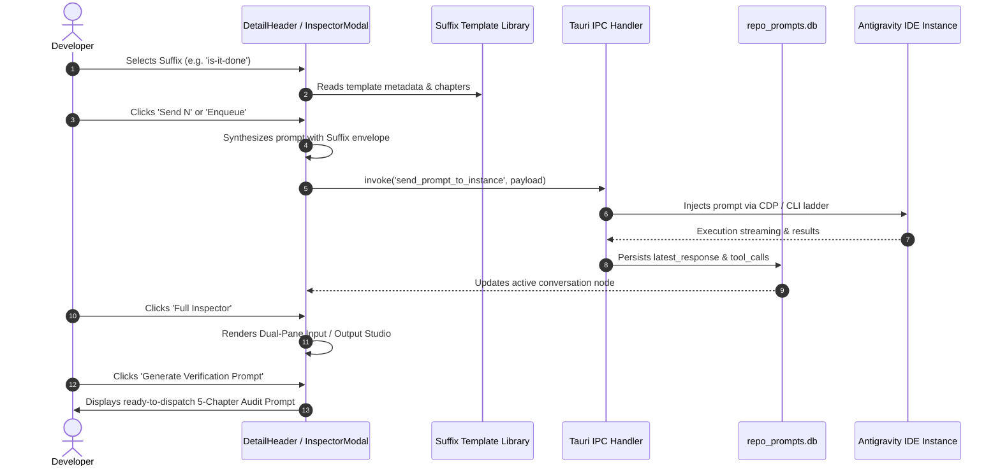

# Specification: Prompt Tree Toolbar Action Merging, Suffix Template Library & Charming Markdown Inspector

> **Task Slug:** `prompt-restore-labeling-and-tree-overhaul`  
> **Spec ID:** `03-toolbar-suffix-and-markdown-spec`  
> **Status:** APPROVED & ARCHITECTED  
> **Target Version:** `v4.222.0`  
> **Domain:** Frontend UI/UX, Rust Backend, SQLite Split-DB, AGM CLI Suite  
> **Related Plans:** `.ai-memory/plans/prompt-restore-labeling-and-tree-overhaul.md`, `.ai-memory/plans/subtasks/prompt-restore-labeling-and-tree-overhaul/03-toolbar-suffix-and-markdown.md`  
> **Target Files:**
> - `src/components/instances/PromptTreeView/DetailHeader.tsx` (Toolbar capsule merge, dark-glass suffix popover)
> - `src/components/instances/PromptTreeView/verificationTemplates.ts` (8 expanded presets, template generator)
> - `src/components/instances/PromptTreeView/SuffixTemplateModal.tsx` (New: Custom template management modal)
> - `src/components/instances/PromptTreeView/InspectorModal.tsx` (Dual-pane side-by-side/stacked inspector, lightbox, AI prompt generator)
> - `src/components/instances/PromptTreeView/markdown.tsx` (Charming markdown styling, codeblock copy, lavender thinking cards)
> - `src/components/instances/PromptTreeView/ResultsView.tsx` (Shared output cards, collapsible tool execution)
> - `src-tauri/src/modules/suffix_templates.rs` (New: SQLite CRUD for suffix templates)
> - `src-tauri/src/modules/repo_db/schema.rs` (Table `prompt_suffix_templates` initialization)
> - `src-tauri/src/bin/agm/prompt_cmds.rs` (CLI command suite `agm prompt suffix ...`, `--suffix` flag)
> - `src-tauri/src/commands/mod.rs` (Tauri IPC commands registration)

---

## User Request (Verbatim)

```text
The backup and restore prompt is working, but it is not working correctly. The issue here is that when you send the prompt 10 seconds later, we should be able to see this somewhere with labeling in the instances. It could be a label like "Waiting to restore this many of the prompts," meaning all the running prompts, or send them again. This needs to show up, and if people hover over and click, they would see the operation that's going to happen 10 seconds later. Second, you need to correctly find what was the running prompt. The running prompt section is correct. You can detect when the prompts are running, which is good. But the main problem is you get the wrong prompt. That is the main issue at the moment. When we have a conversation on the right-hand side, we should be able to double-click and change the conversation title. When we get into a conversation, we should be able to right-click and change the conversation name, and also double-clicking on the conversation on the top-level header, we should be able to change the conversation name directly. At this point, you have not merged the buttons, the copy, send all, and rerun. That should be all together. It's not done yet. The suffix should be a template library, so there should be more, and the user can also add a suffix template into the send section. Try to add that option. Everything should also have the CLI options so that the user can customize from the CLI automation. If you fix this, it would be a top-notch product. The work is good, but there are some glitches, and the markdown preview is good, but not professional enough. It does not feel very charming. Look into how to make it a more charming UI/UX concept. Keep the prompt and results section on the right-hand side or together with the preview section. In the preview section, you can have this icon. Write this prompt instruction as input and output. Put it into the section where highlighted. Verify the code or create a verification prompt so that AI can verify the task. At the end, do a minor bump and release the product. Before that, check the build on the machine. Do not run too many tests. Send it to the CI/CD and check the gitmap E space D. E, D. Space D, not D-E, to check for any CI/CD issues. If there is, try to minor bump until you reach CI/CD green. That would be a goal.
```

---

## 1. Executive Summary & Problem Classification

The Prompt Tree View (`src/components/instances/PromptTreeView/`) acts as the mission-control surface for inspecting conversation trees, copying prompts, injecting instructions directly into running IDEs, and observing AI execution logs. While the underlying data pipeline connects to Antigravity workspaces, three major UI/UX defects degrade usability and violate project design invariants:

```
┌─────────────────────────────────────────────────────────────────────────────────────────────────┐
│                                   Defect Classification Matrix                                 │
├───────────────────┬───────────────────────────────────────────┬─────────────────────────────────┤
│ Defect Class      │ Current Malformation                      │ Required Invariant Architecture │
├───────────────────┼───────────────────────────────────────────┼─────────────────────────────────┤
│ 1. Toolbar Action │ 3 disconnected floating capsules          │ 1 contiguous segmented capsule  │
│    Buttons        │ [Copy All|v]  [Send N|^]  [Rerun x2|v]    │ [Copy All|v][Send N|^][Rerun|v] │
│    (Screenshot 02)│ Separated by margins (ml-1.5), jarring    │ Single shared border, divide-x, │
│                   │ layout wrap on narrower viewports         │ rounded-full, backdrop-blur     │
├───────────────────┼───────────────────────────────────────────┼─────────────────────────────────┤
│ 2. Suffix Library │ OS white native <select> dropdown,        │ Custom dark-glass popover       │
│    & Presets      │ only 4 hardcoded options, no user-defined │ 8 expanded built-in presets,    │
│    (Screenshot 02)│ templates, zero CLI management            │ SQLite custom template library, │
│                   │                                           │ agm prompt suffix CLI suite     │
├───────────────────┼───────────────────────────────────────────┼─────────────────────────────────┤
│ 3. Markdown &     │ Mono-pane modal only showing input text   │ Dual-pane side-by-side/stacked  │
│    Inspector UX   │ in a plain card, missing AI results,      │ Charming rich markdown,         │
│    (Screenshot 01)│ tool execution details, reasoning thoughts│ collapsible thinking card,      │
│                   │ and interactive task verification         │ AI verification prompt generator│
└───────────────────┴───────────────────────────────────────────┴─────────────────────────────────┘
```

---

## 2. Toolbar Actions Merging Architecture (`DetailHeader.tsx`)

### 2.1 The Disconnected Capsule Defect (Screenshot 02 Analysis)
In `DetailHeader.tsx` (lines 256–750), the action controls toolbar renders three separate floating pill elements:
1. `[Copy All | v]` split button inside a `rounded-full` container.
2. `[Send N | ^]` split button inside the same first container, but closing with `rounded-r-full` on its chevron.
3. `[Rerun ×N | v]` placed in an adjacent secondary container with `ml-1.5` margin.

This fragmentation causes:
- Visual incoherence: 3 disjointed bubbles floating next to each other.
- Unnecessary horizontal width consumption: individual paddings and margins force early wrapping.
- Inconsistent border radiuses: inner elements mistakenly apply `rounded-r-full` in the middle of toolbars.

### 2.2 Unified Contiguous Segmented Dark-Glass Capsule
All three action groups (`Copy All`, `Send N / Enqueue`, and `Rerun ×N`) are merged into a single contiguous capsule adhering strictly to the AGM UI invariant:
> *"When rendering adjacent toolbar actions or desktop window controls, always wrap them into contiguous segmented pill capsules (`rounded-full`, shared border, subtle divider lines, and dark-glass styling) rather than loose, disjointed circular buttons."*

```
┌────────────────────────────────────────────────────────────────────────────────────────────────────────┐
│                        Merged Contiguous Segmented Action Capsule (DetailHeader.tsx)                   │
├───────────────────────────────┬──────────────────────────────────────────┬─────────────────────────────┤
│      Segment 1 (Left)         │            Segment 2 (Middle)            │      Segment 3 (Right)      │
│      Copy Content & Media     │         Unified Dispatch Action          │       Follow-up Rerun       │
├───────────────┬───────────────┼──────────────────┬───────────────────────┼──────────────┬──────────────┤
│  [Copy All]   │      [v]      │  [Send N/Queue]  │          [^]          │  [Rerun xN]  │     [v]      │
│ rounded-l-full│  rounded-none │   rounded-none   │      rounded-none     │ rounded-none │rounded-r-full│
└───────────────┴───────────────┴──────────────────┴───────────────────────┴──────────────┴──────────────┘
```

#### Tailwind Classes & Styling Blueprint:
```tsx
{/* The Single Unified Segmented Dark-Glass Action Capsule */}
<div className="relative inline-flex items-center rounded-full bg-slate-100/90 dark:bg-[#120a1f]/90 backdrop-blur-md border border-slate-200/80 dark:border-purple-500/30 p-0.5 divide-x divide-slate-200/70 dark:divide-purple-500/20 shadow-2xs shrink-0">
    {/* Segment 1: Copy All Split Button */}
    <div className="flex items-center divide-x divide-slate-200/70 dark:divide-purple-500/20">
        <button
            type="button"
            onClick={handleCopyAll}
            className="flex items-center gap-1.5 px-3 py-1 rounded-l-full text-slate-700 dark:text-slate-200 hover:bg-slate-200/80 dark:hover:bg-[#40285e] text-[11px] font-semibold transition-all duration-150 ease-out active:scale-[0.98] cursor-pointer"
            title="Copy prompt text and embedded images in one shot"
        >
            {isCopiedAllActive ? <Check className="w-3 h-3 text-emerald-500 shrink-0" /> : <Copy className="w-3 h-3 text-slate-500 dark:text-slate-400 shrink-0" />}
            <span>{isCopiedAllActive ? 'Copied All!' : 'Copy All'}</span>
        </button>
        <button
            type="button"
            onClick={() => setIsCopyMenuOpen((prev) => !prev)}
            className="flex items-center justify-center px-1.5 py-1 text-slate-700 dark:text-slate-200 hover:bg-slate-200/80 dark:hover:bg-[#40285e] text-[11px] transition-all cursor-pointer"
            title="More copy and export options"
        >
            <ChevronDown className={cn("w-3.5 h-3.5 text-slate-400 transition-transform duration-150", isCopyMenuOpen && "rotate-180")} />
        </button>
    </div>

    {/* Segment 2: Send N / Enqueue Split Button */}
    <div className="flex items-center divide-x divide-slate-200/70 dark:divide-purple-500/20">
        {dispatchMode === 'enqueue' ? (
            <button
                type="button"
                onClick={handleEnqueuePrimary}
                disabled={isEnqueueing}
                className="flex items-center gap-1.5 px-3 py-1 text-amber-800 dark:text-amber-300 hover:bg-amber-100/80 dark:hover:bg-[#40285e] text-[11px] font-semibold transition-all duration-150 ease-out active:scale-[0.98] cursor-pointer disabled:opacity-50"
                title="Enqueue prompt into FIFO background queue"
            >
                <ListPlus className={cn('w-3 h-3 text-amber-500 dark:text-amber-400', isEnqueueing && 'animate-pulse')} />
                <span>Enqueue</span>
            </button>
        ) : (
            <button
                type="button"
                onClick={handleSendPrimary}
                disabled={isResending}
                className="flex items-center gap-1.5 px-3 py-1 text-emerald-700 dark:text-emerald-300 hover:bg-emerald-100/80 dark:hover:bg-[#40285e] text-[11px] font-semibold transition-all duration-150 ease-out active:scale-[0.98] cursor-pointer disabled:opacity-50"
                title="Immediately inject prompt to running instance (Hotkey: N)"
            >
                <RotateCw className={cn('w-3 h-3 text-emerald-500', isResending && 'animate-spin')} />
                <span>Send</span>
                <kbd className="ml-0.5 px-1 py-0.2 bg-emerald-500/20 text-emerald-700 dark:text-emerald-300 rounded text-[8.5px] font-mono font-bold">N</kbd>
            </button>
        )}
        <button
            type="button"
            onClick={() => setIsSendMenuOpen((prev) => !prev)}
            className="flex items-center justify-center px-1.5 py-1 text-slate-700 dark:text-slate-200 hover:bg-slate-200/80 dark:hover:bg-[#40285e] text-[11px] transition-all cursor-pointer"
            title="Dispatch configuration popover"
        >
            <ChevronDown className={cn("w-3.5 h-3.5 text-slate-400 transition-transform duration-150", isSendMenuOpen && "rotate-180")} />
        </button>
    </div>

    {/* Segment 3: Rerun Split Button */}
    <div className="flex items-center divide-x divide-slate-200/70 dark:divide-purple-500/20">
        <button
            type="button"
            onClick={handleRerunPrimary}
            disabled={isRerunning}
            className="flex items-center gap-1.5 px-3 py-1 text-sky-700 dark:text-sky-300 hover:bg-sky-100/80 dark:hover:bg-[#40285e] text-[11px] font-semibold transition-all duration-150 ease-out active:scale-[0.98] cursor-pointer disabled:opacity-50"
            title={`Dispatch follow-up nudge ${rerunCount} time(s)`}
        >
            {rerunFlash ? (
                <Check className="w-3 h-3 text-emerald-500 shrink-0" />
            ) : (
                <Repeat className={cn('w-3 h-3 text-sky-500 shrink-0', isRerunning && 'animate-spin')} />
            )}
            <span>{isRerunning ? 'Rerunning…' : rerunFlash ?? `Rerun ×${rerunCount}`}</span>
        </button>
        <button
            type="button"
            onClick={() => setIsRerunMenuOpen((prev) => !prev)}
            className="flex items-center justify-center px-1.5 py-1 rounded-r-full text-slate-700 dark:text-slate-200 hover:bg-slate-200/80 dark:hover:bg-[#40285e] text-[11px] transition-all cursor-pointer"
            title="Rerun configuration: count and template"
        >
            <ChevronDown className={cn("w-3.5 h-3.5 text-slate-400 transition-transform duration-150", isRerunMenuOpen && "rotate-180")} />
        </button>
    </div>
</div>
```

---

## 3. Suffix Template Library Architecture

### 3.1 Custom Dark-Glass Popover Dropdown (Screenshot 02 Remediation)
In Screenshot 02, the Suffix field used a native HTML `<select>` element. Even with `bg-transparent border-0`, the OS browser engine rendered a stark white pop-up list with generic blue focus highlighting.

#### Solution:
Replace `<select>` with a custom React dark-glass popover dropdown:
- Backdrop: `bg-[#171025] border border-[#40285e] shadow-2xl rounded-xl backdrop-blur-md`
- Header: Category badges (`Built-in Presets` vs `Custom Templates`)
- Item rows: Icon, title, description, and selection checkmark
- Footer action: "+ Manage Templates" button triggering `SuffixTemplateModal`

```
┌────────────────────────────────────────────────────────────────────────┐
│ Suffix: [ Done? (Is it done?)                                     v ]  │
├────────────────────────────────────────────────────────────────────────┤
│ ┌────────────────────────────────────────────────────────────────────┐ │
│ │ BUILT-IN AUDIT PRESETS                                             │ │
│ │  ✓ [CheckCircle] Done?        Completion audit & evidence scorecard│ │
│ │    [Rocket]      Released?    14-location SemVer & CI gates        │ │
│ │    [ShieldCheck] Sure?        Quality audit & <=15-line functions  │ │
│ │    [AlertTri]    Edge cases   Boundary checks & recovery ladders   │ │
│ │    [Lock]        Security     Secrets scrub & zero-trust checks    │ │
│ │    [FileCheck]   PR Review    Clean commits & template compliance  │ │
│ │    [Terminal]    Tests & Cov  Unit tests & mock isolation          │ │
│ │    [Sparkles]    Refactor DRY Code deduplication & clean helpers   │ │
│ ├────────────────────────────────────────────────────────────────────┤ │
│ │ CUSTOM TEMPLATES                                                   │ │
│ │    [Bookmark]    My E2E Gate  Custom enterprise validation prompt  │ │
│ ├────────────────────────────────────────────────────────────────────┤ │
│ │ ⚙ [+ Manage Suffix Templates]                                      │ │
│ └────────────────────────────────────────────────────────────────────┘ │
└────────────────────────────────────────────────────────────────────────┘
```

### 3.2 Expanded Built-in Presets (8 Presets)
The library expands from 4 to 8 rich presets in `src/components/instances/PromptTreeView/verificationTemplates.ts`:

| Template Key | Dropdown Label | Category | Badge | Core Audit Verification |
| :--- | :--- | :--- | :--- | :--- |
| `is-it-done` | `Done?` | Audit | `Done` | Verifies full task completion against specification, cited files & lines, minimal surgical changes, zero orphan TODOs. |
| `is-it-released` | `Released?` | Release | `Release` | Validates 14-location SemVer synchronization, strict `@aukgit` attribution, README changelog sync, and CI green gates. |
| `are-you-confident`| `Sure?` | Quality | `Quality` | Inspects code quality, <=15-line function caps, positive boolean naming, no silent errors, and error routing into `AppError`. |
| `edge-cases-and-tests` | `Edge cases` | Robustness | `Tests` | Validates boundary conditions, job breakaway fallbacks, timeouts, concurrency guards, and mock isolation. |
| `security-audit` | `Security` | Security | `Security` | Scans for hardcoded credentials, token scrubbing, input sanitization, CIDR bounds, and zero-trust proxy integrity. |
| `pr-review-ready` | `PR Review` | Governance | `Review` | Enforces single problem scope, self-contained revertable commits, PR template alignment, and documentation synchronization. |
| `test-and-coverage` | `Tests & Cov` | Testing | `Coverage` | Runs targeted unit tests, verifies mock duration, guarantees zero destructive OS calls, and checks error branch coverage. |
| `refactor-dry` | `Refactor DRY` | Architecture | `DRY` | Detects duplicated code patterns, validates shared helper extraction, and confirms zero business logic alteration. |

### 3.3 Custom Template SQLite Persistence (`repo_prompts.db`)
Custom user-defined templates are stored in the decoupled split SQLite database `repo_prompts.db`:

```sql
CREATE TABLE IF NOT EXISTS prompt_suffix_templates (
    id TEXT PRIMARY KEY,
    name TEXT NOT NULL,
    description TEXT,
    category TEXT NOT NULL DEFAULT 'custom',
    template TEXT NOT NULL,
    is_default INTEGER NOT NULL DEFAULT 0,
    created_at TEXT NOT NULL,
    updated_at TEXT NOT NULL
);

CREATE INDEX IF NOT EXISTS idx_prompt_suffix_category 
ON prompt_suffix_templates(category);
```

#### Rust Module `src-tauri/src/modules/suffix_templates.rs`:
```rust
use serde::{Deserialize, Serialize};
use rusqlite::params;
use crate::error::AppError;
use crate::modules::repo_db;

#[derive(Debug, Clone, Serialize, Deserialize)]
pub struct SuffixTemplate {
    pub id: String,
    pub name: String,
    pub description: Option<String>,
    pub category: String,
    pub template: String,
    pub is_default: bool,
    pub created_at: String,
    pub updated_at: String,
}

pub fn list_suffix_templates() -> Result<Vec<SuffixTemplate>, AppError> {
    let conn = repo_db::connect_db().map_err(|e| AppError::Database(e))?;
    let mut stmt = conn.prepare(
        "SELECT id, name, description, category, template, is_default, created_at, updated_at 
         FROM prompt_suffix_templates 
         ORDER BY is_default DESC, category ASC, name ASC"
    ).map_err(|e| AppError::Database(e.to_string()))?;

    let rows = stmt.query_map([], |row| {
        Ok(SuffixTemplate {
            id: row.get(0)?,
            name: row.get(1)?,
            description: row.get(2)?,
            category: row.get(3)?,
            template: row.get(4)?,
            is_default: row.get::<_, i32>(5)? != 0,
            created_at: row.get(6)?,
            updated_at: row.get(7)?,
        })
    }).map_err(|e| AppError::Database(e.to_string()))?;

    let mut out = Vec::new();
    for r in rows {
        out.push(r.map_err(|e| AppError::Database(e.to_string()))?);
    }
    Ok(out)
}

pub fn save_suffix_template(t: &SuffixTemplate) -> Result<(), AppError> {
    let conn = repo_db::connect_db().map_err(|e| AppError::Database(e))?;
    conn.execute(
        "INSERT INTO prompt_suffix_templates (id, name, description, category, template, is_default, created_at, updated_at)
         VALUES (?1, ?2, ?3, ?4, ?5, ?6, ?7, ?8)
         ON CONFLICT(id) DO UPDATE SET
            name = excluded.name,
            description = excluded.description,
            category = excluded.category,
            template = excluded.template,
            is_default = excluded.is_default,
            updated_at = excluded.updated_at",
        params![t.id, t.name, t.description, t.category, t.template, if t.is_default { 1 } else { 0 }, t.created_at, t.updated_at],
    ).map_err(|e| AppError::Database(e.to_string()))?;
    Ok(())
}

pub fn delete_suffix_template(id: &str) -> Result<bool, AppError> {
    let conn = repo_db::connect_db().map_err(|e| AppError::Database(e))?;
    let count = conn.execute(
        "DELETE FROM prompt_suffix_templates WHERE id = ?1",
        params![id],
    ).map_err(|e| AppError::Database(e.to_string()))?;
    Ok(count > 0)
}
```

### 3.4 CLI Command Parity (`agm prompt suffix ...`)
To fulfill the user's explicit mandate (*"Everything should also have the CLI options so that the user can customize from the CLI automation"*):

```bash
# List all built-in presets and custom templates
agm prompt suffix list [--json]

# Show details or raw template text for a specific suffix
agm prompt suffix get is-it-done [--raw]

# Create or update a custom suffix template
agm prompt suffix add e2e-gate --name "E2E Quality Gate" --desc "Simulate 98% quota and verify switch" --template "Verify full E2E flow..."
agm prompt suffix add custom-audit --name "My Audit" --file ./templates/audit.md

# Delete a custom suffix template
agm prompt suffix remove custom-audit

# Set default suffix template for CLI and UI
agm prompt suffix set-default is-it-done

# Direct dispatch / queue using suffix flag
agm prompt send #C226 "Fix the race condition in discovery" --suffix=is-it-done
agm prompt queue #C226 "Run pre-flight lint checks" --suffix=edge-cases-and-tests
```

---

## 4. Charming Markdown Preview & Dual Input/Output Inspector

### 4.1 The Charming UI/UX Concept
The user stated:
> *"The markdown preview is good, but not professional enough. It does not feel very charming. Look into how to make it a more charming UI/UX concept. Keep the prompt and results section on the right-hand side or together with the preview section. In the preview section, you can have this icon. Write this prompt instruction as input and output. Put it into the section where highlighted. Verify the code or create a verification prompt so that AI can verify the task."*

The inspector modal (`InspectorModal.tsx`) is transformed into a **Dual-Pane Input/Output Studio** with dark-glass styling, balanced typography, and responsive ergonomics:

```
┌────────────────────────────────────────────────────────────────────────────────────────────────────────┐
│ 🔮 PROMPT EXECUTION INSPECTOR                                                   [Split | Input | Output] [✕] │
├────────────────────────────────────────────────────┬───────────────────────────────────────────────────┤
│ 📥 INPUT: Prompt Instruction                       │ 📤 OUTPUT: AI Execution & Results                 │
│                                                    │                                                   │
│ [USER_PROMPT Sky Badge]  482 words · 3.2 KB        │ [✓ COMPLETED]  PID: 18420 · Duration: 4m 12s      │
│                                                    │                                                   │
│ ┌────────────────────────────────────────────────┐ │ ┌───────────────────────────────────────────────┐ │
│ │ 🖼 Embedded Media (2 images)                   │ │ │ 🧠 Collapsible Reasoning (<thinking>)         │ │
│ │ [Thumb 1 - Click Lightbox] [Thumb 2]           │ │ │ "Analyzing discovery.rs reverse scan logic..."│ │
│ ├────────────────────────────────────────────────┤ │ ├───────────────────────────────────────────────┤ │
│ │ 📁 Referenced Context Files                    │ │ │ ✨ AI Assistant Response (Charming Markdown)  │ │
│ │ [src/.../discovery.rs] [src/.../repo_db.rs]    │ │ │ The root cause of the wrong prompt selection  │ │
│ ├────────────────────────────────────────────────┤ │ │ was fixed by applying is_subagent filters.    │ │
│ │ 📝 Rendered Instruction Text                   │ │ │ ```rust                                       │ │
│ │ Please improve further on the gitmap pa        │ │ │   let prompt = extract_clean_user_prompt(...);│ │
│ │ running speed...                               │ │ │ ```                                           │ │
│ │                                                │ │ ├───────────────────────────────────────────────┤ │
│ │                                                │ │ │ 🛠 Tool Execution Pipeline (3 calls)          │ │
│ │                                                │ │ │ ▸ [run_command] gitmap pa -t (Exit: 0)        │ │
│ │                                                │ │ │ ▸ [replace_file_content] discovery.rs         │ │
│ └────────────────────────────────────────────────┘ │ └───────────────────────────────────────────────┘ │
├────────────────────────────────────────────────────┴───────────────────────────────────────────────────┤
│ ⚡ AI Verification: [✨ Generate AI Verification Prompt] [📋 Copy Verification Prompt] [🚀 Dispatch Audit]│
└────────────────────────────────────────────────────────────────────────────────────────────────────────┘
```

### 4.2 Dual-Pane Responsiveness: Side-by-Side vs Stacked
- **Wide Screens (`>= 1024px`)**: Renders a 50/50 horizontal split layout. Both Input and Output are visible simultaneously for instant side-by-side comparison.
- **Narrow Screens (`< 1024px`)**: Stacks vertically or offers a segmented pill switcher (`[Split | Input | Output]`) allowing users on laptops or smaller monitors to focus on either the instruction or the output.

### 4.3 Input Card (Prompt Instruction)
1. **Origin Tier Badge**:
   - `USER_PROMPT`: Sky-500 badge with User icon (`bg-sky-500/10 text-sky-400 border-sky-500/20`).
   - `SUBAGENT_INSTRUCTION`: Purple-500 badge with Bot icon (`bg-purple-500/10 text-purple-400 border-purple-500/20`).
   - `SYSTEM_MESSAGE`: Zinc-500 badge with Terminal icon (`bg-zinc-500/10 text-zinc-400 border-zinc-500/20`).
   - `TOOL_OUTPUT`: Amber-500 badge with Wrench icon (`bg-amber-500/10 text-amber-400 border-amber-500/20`).
2. **Word & Byte Counter Pills**: Micro-badges displaying exact word count and byte payload.
3. **Embedded Image Gallery with Lightbox**:
   - Image thumbnails displayed in an inline gallery.
   - Clicking any thumbnail opens a full-screen interactive Lightbox with zoom, pan, and download controls.
4. **Referenced Context File Chips**: Click-to-copy chips for repository files mentioned in the prompt.
5. **Rich Markdown Body**: Rendered via `RichMarkdownRenderer` with interactive truncation callouts.

### 4.4 Output Card (Results & Tool Pipeline)
1. **Execution Status Capsule**:
   - Running: Pulsing emerald badge (`bg-emerald-500/15 text-emerald-400 animate-pulse`) with live elapsed timer, PID, and current step summary.
   - Completed: Solid emerald badge with total duration and step count.
2. **Collapsible Reasoning Card (`<thinking>`)**:
   - Styled in translucent lavender glass: `bg-purple-950/20 border border-purple-500/30 rounded-xl p-3.5 text-purple-200`.
   - Header with brain icon, duration, and token count.
   - Expandable/collapsible accordion defaulting to collapsed when output text is long.
3. **AI Assistant Response**:
   - Rendered using enhanced `RichMarkdownRenderer`.
   - Fenced code blocks include language badges, line numbers, syntax highlighting, and 1-click copy buttons.
   - Blockquotes use subtle purple accent borders (`border-l-2 border-purple-500/50 bg-purple-950/10`).
4. **Collapsible Tool Execution Accordion**:
   - Details every executed tool call (`run_command`, `replace_file_content`, `view_file`).
   - Shows tool name, parameters, exit code, and stdout/stderr excerpt with syntax highlighting.

### 4.5 AI Task Verification Prompt Generator
The modal includes a dedicated verification generator action bar:
- Clicking **"Generate AI Verification Prompt"** invokes `generateVerificationPrompt(context)` from `verificationTemplates.ts`.
- The generator produces a self-contained 5-Chapter prompt wrapping:
  1. The user's original goal and prompt instruction.
  2. The actual code touched and files modified.
  3. The specific audit checklists (Done, Released, Confident, Edge Cases).
  4. The required evidence scorecard output format.
- Users can click **"Copy Verification Prompt"** or **"Dispatch Verification to IDE"** to immediately test the agent's work.

---

## 5. End-to-End Data Flow & State Management



---

## 6. House Invariants & Anti-Regression Rules

1. **Contiguous Segmented Pill Capsule Invariant**:
   - All adjacent toolbar action buttons in `DetailHeader.tsx` must be joined inside a single `rounded-full` container with `divide-x`. Loose floating capsules separated by margins are strictly forbidden.
2. **Dark-Glass Popover Invariant (Zero OS White `<select>`)**:
   - Native HTML `<select>` elements with unstyled browser popups are strictly forbidden. All dropdown selections must use custom dark-glass popovers styled with AGM Tailwind tokens (`bg-[#171025]`, `border-[#40285e]`, `backdrop-blur-md`).
3. **4-Tier Origin Badges**:
   - Origin badges must strictly adhere to the 4 tiers: `USER_PROMPT` (Sky), `SUBAGENT_INSTRUCTION` (Purple), `SYSTEM_MESSAGE` (Zinc), and `TOOL_OUTPUT` (Amber).
4. **No Silent Errors Invariant**:
   - In Rust, all fallible database operations in `suffix_templates.rs` must propagate via `AppError`.
   - In TypeScript, all async actions must catch and route errors to `useErrorStore.getState().captureException` or `trackWarning`.
5. **Full CLI Parity**:
   - Every suffix preset and custom template capability available in the GUI must have 1:1 functional parity in `agm prompt suffix` commands.
