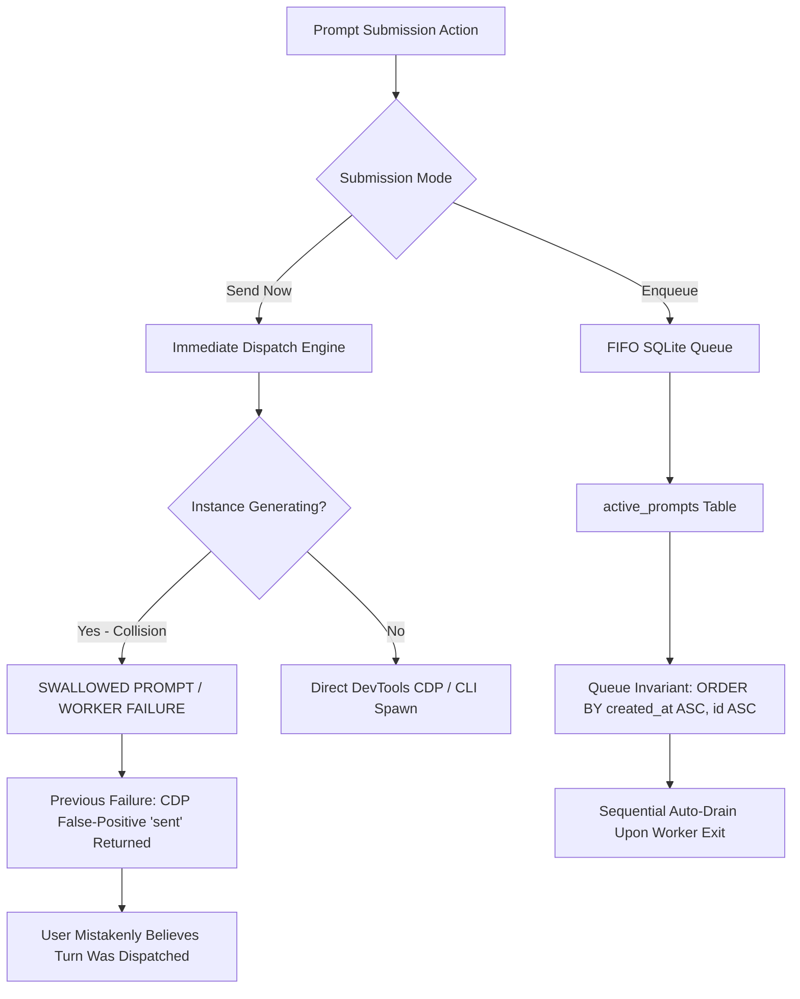

# Architecture Specification: Prompt Sending ("Send Now") vs. FIFO Queue ("Enqueue") Engine

**Version:** 1.0.0  
**Updated:** 2026-10-21  
**AI Confidence:** Verified  
**Ambiguity:** None  
**Author:** @aukgit  
**Target:** `02-spec/21-app/prompt-sending-and-enqueue-testing/01-send-vs-enqueue-spec.md`  
**Scope:** Prompt Tree Dispatch, CDP Loopback Injection, FIFO Queue Scheduling, Multimodal Image Markdown Normalization, and Split-DB Persistence  

---

## Keywords

`prompt-dispatch` · `send-now-bypass` · `fifo-queue` · `active-prompts` · `cdp-injection` · `generating-guard` · `multimodal-images` · `repo-prompts-db`

---

## Scoring

| Criterion | Status |
|-----------|--------|
| Target Relative Git Path Adherence | ✅ |
| AI Confidence Assigned | ✅ |
| Ambiguity Cleared | ✅ |
| Keywords Present | ✅ |
| Strict FIFO Invariant Documented (`ORDER BY created_at ASC, id ASC`) | ✅ |
| No Silent Errors Invariant Enforced | ✅ |
| Exact Verification Commands Provided | ✅ |

---

## Purpose

This specification establishes the authoritative architecture, state models, protocol contracts, and execution invariants governing prompt submission in Antigravity-Manager (AGM). It formalizes the technical divergence between **Immediate Send Bypass ("Send Now")** and **FIFO Scheduled Queue ("Enqueue")**, rectifies concurrency collisions during active IDE generation states, prevents Chrome DevTools Protocol (CDP) false-positive transmissions, guarantees strict First-In-First-Out (FIFO) queue ordering across SQLite databases, and standardizes space-safe multimodal image Markdown encapsulation (`<path>`) and persistence.

---

## 1. Executive Summary & Problem Classification

### 1.1 Executive Summary

In Antigravity-Manager, users manage and orchestrate isolated Antigravity IDE instances across multi-workspace repositories. Within the Prompt Tree and Conversation views, operators interact with two primary prompt submission actions:
1. **Send Now**: Direct, immediate prompt injection into an active or newly focused IDE workspace session.
2. **Enqueue**: Asynchronous registration into an execution backlog, designed to defer execution until the target instance and workspace complete active agent turns.

### 1.2 Problem Classification

Prior to this specification, production telemetry and issue reports identified four systemic failure tiers that degraded prompt delivery reliability:



#### Tier 1: Concurrency Collision in Immediate Send
The Antigravity IDE extension operates on a strictly serialized turn model: an agent session executes exactly one active prompt turn at a time. When an operator triggers "Send Now" while the agent is actively streaming tokens, executing subagent tools, or writing files:
- **CLI Worker Collisions**: Spawning an `agy` CLI worker (`spawn_or_replace_prompt_via_agy`) while another worker is active either forces an uncoordinated process termination of in-flight work or rejects execution with an exit code conflict.
- **CDP Input Swallowing**: Sending keyboard text into the Monaco/Lexical composer while the agent response is streaming results in dropped keystrokes, corrupted cursor offsets, or dropped input.

#### Tier 2: CDP False-Positive 'sent' Reports
In the legacy DevTools loopback bridge (`src-tauri/src/modules/instance/cdp_onboarding.rs`), the script searched for a Send button (`button[aria-label="Send message"]`). During active agent generation, the IDE replaces the Send button with a **Stop Generating** button (`button[aria-label="Stop generating"]`).
- When the Send button was absent or disabled, the legacy script blindly fell back to dispatching a synthetic `Enter` `KeyboardEvent` to `document.activeElement`.
- The IDE actively ignores `Enter` events in the composer while a generation stream is running.
- Nevertheless, the JavaScript snippet returned `"sent"`, causing AGM to log success, clear the UI draft, and report `Prompt dispatched to IDE & copied to clipboard!`, even though the prompt was entirely ignored and never executed.

#### Tier 3: Multimodal Media Dropping & Markdown Whitespace Corruption
When users attach image captures or screenshots to prompts:
- **Space Corruption**: Paths containing spaces (e.g., `screenshots/Run 01/error state.png` or repository relative paths with spaces) violate standard CommonMark URL parsing if enclosed as ``. Parsers terminate the URL at the first whitespace character, corrupting image delivery to the upstream LLM.
- **Turn Isolation**: Media attachments were stored exclusively on individual `AgmPromptTurnNode` entries, leaving the parent `AgmConversationNode` unaware of attached media. Re-sending or enqueuing from the conversation level resulted in empty `media_paths` and lost multimodal context.

#### Tier 4: Queue Invariant Inversion & Starvation
Database queries inspecting queued items occasionally utilized unstable sorts (`ORDER BY updated_at DESC` or unordered sets). This inverted LIFO anomaly resulted in older queued prompts being permanently starved by recently enqueued items.

---

## 2. Immediate Send Bypass Specification ("Send Now")

### 2.1 Direct Session Injection Pipeline

When the operator triggers "Send Now", AGM executes an immediate bypass flow designed to deliver the prompt with zero queue delay, provided the target instance is healthy and idle.

```mermaid
sequenceDiagram
    autonumber
    participant UI as PromptTreeView (React)
    participant IPC as Tauri Command (send_prompt_now)
    participant AGY as agy.rs Engine
    participant CDP as CDP WebSocket (cdp_onboarding.rs)
    participant IDE as Antigravity IDE (Monaco/Lexical)

    UI->>IPC: send_prompt_now(inst, repo, text, conv_id, media_paths)
    IPC->>AGY: send_prompt_now_for_instance(...)
    AGY->>AGY: Resolve canonical instance ID & ensure running
    AGY->>CDP: submit_prompt_via_cdp_for_instance(...)
    CDP->>IDE: Inspect DOM for Generating State
    alt Agent is Actively Generating
        IDE-->>CDP: button[aria-label="Stop generating"] present
        CDP-->>AGY: Return 'editor_busy_generating' (ABORT)
        AGY-->>IPC: Err("Instance is actively generating; use Enqueue or wait")
        IPC-->>UI: Capture warning & display guidance modal
    else Agent is Idle & Message Input Ready
        CDP->>IDE: Input.insertText + click Send Button
        IDE-->>CDP: DOM Confirmation (Input Cleared / Agent Started)
        CDP-->>AGY: Return 'sent' (SUCCESS)
        AGY-->>IPC: Ok(ActivePrompt { status: "running" })
        IPC-->>UI: Success notification & tree refresh
    end
```

### 2.2 Guarding Against CDP False-Positives in Generating State

To guarantee zero false positives, `submit_prompt_on_ws` in `src-tauri/src/modules/instance/cdp_onboarding.rs` must execute a two-phase check before inserting text or triggering execution events.

#### Phase 1: Pre-Submission Generating Guard
The script queries the DOM for active generation markers. If any marker evaluates to true, injection must immediately terminate:

```javascript
// Pre-submission Generating Guard
const isGenerating = (() => {
    // 1. Explicit Stop buttons indicating active generation
    const stopSelectors = [
        'button[aria-label="Stop generating"]',
        'button[aria-label="Stop"]',
        'button[title*="Stop"]',
        '.codicon-stop-circle',
        'div[data-status="generating"]',
        'div[aria-busy="true"]'
    ];
    for (const sel of stopSelectors) {
        const el = document.querySelector(sel);
        if (el && el.offsetParent !== null) return true;
    }

    // 2. Disabled Send button with non-empty input indicating locked composer
    const sendBtn = document.querySelector('button[aria-label="Send message"], button[aria-label="Send Prompt"]');
    if (sendBtn && sendBtn.disabled) {
        return true;
    }

    return false;
})();

if (isGenerating) {
    return 'editor_busy_generating';
}
```

#### Phase 2: Elimination of Blind Synthetic Enter Fallback
Synthetic `Enter` key event dispatching is strictly forbidden unless all of the following conditions are simultaneously met:
1. `isGenerating === false`.
2. The active element matches an input editor selector (`[contenteditable="true"]`, `textarea.monaco-mouse-cursor-text`).
3. Post-dispatch DOM evaluation verifies that either:
   - The input element's text content is cleared, OR
   - A generation stop button appears within 300ms.
4. If DOM state does not mutate, return `'not_ready'` rather than `'sent'`.

### 2.3 Upstream Fallback Ladder

If direct CDP injection returns `'editor_busy_generating'` or fails:
1. **Never Silently Discard**: The backend must never log a fake success.
2. **Actionable Error Surface**: The Tauri IPC command returns an explicit error string detailing the blockage.
3. **Clipboard Safeguard**: Concurrently prime the OS clipboard with dual-MIME rich HTML and plain text so the operator can manually inspect or paste the prompt if desired.

---

## 3. FIFO Enqueue Specification ("Enqueue")

### 3.1 Database Invariants & Schema Architecture

When an operator triggers "Enqueue", the prompt is not injected into the active UI composer. Instead, it is persisted directly into the Split-DB SQLite storage (`repo_prompts.db`).

#### Data Structure: `active_prompts` Table
```sql
CREATE TABLE IF NOT EXISTS active_prompts (
    id TEXT PRIMARY KEY,
    project_id TEXT NOT NULL,
    instance_id TEXT NOT NULL,
    repo_path TEXT NOT NULL,
    prompt_content TEXT NOT NULL,
    model TEXT,
    session_id TEXT,
    status TEXT NOT NULL,          -- 'queued' | 'running' | 'completed' | 'failed'
    created_at INTEGER NOT NULL,    -- Unix epoch in seconds
    updated_at INTEGER NOT NULL,    -- Unix epoch in seconds
    image_payload TEXT             -- Semicolon-delimited paths or JSON array
);

CREATE INDEX IF NOT EXISTS idx_active_prompts_fifo 
ON active_prompts (instance_id, repo_path, status, created_at, id);
```

#### Invariant: Strict FIFO Ordering
Every query that discovers, drains, or restores queued prompts across `active_prompts`, `prompt_backups`, and `repo_prompts.db` **MUST** execute with:

```sql
ORDER BY created_at ASC, id ASC
```

> [!CAUTION]
> Inverted ordering (`ORDER BY updated_at DESC`, `ORDER BY created_at DESC`) or queries lacking secondary sort keys (`id ASC`) are strictly forbidden. Unstable sorts cause concurrent prompts with identical timestamps to resolve indeterminately.

### 3.2 Workspace Snapshot Persistence

Simultaneously with database insertion, AGM persists task resumption files into the workspace root (`repo_path`):
- Repository-scoped snapshot: `<repo_path>/.antigravity_resume_task.json`
- Instance-scoped snapshot: `<repo_path>/.antigravity_resume_task.<instance_id>.json`

```json
{
  "id": "queued-9f8a3c1e",
  "project_id": "Antigravity-Manager",
  "instance_id": "inst-8159",
  "repo_path": "02-spec/21-app",
  "prompt_content": "Execute test suite...",
  "status": "queued",
  "auto_boot": false,
  "created_at": 1774149100,
  "updated_at": 1774149100,
  "image_payload": [
    "02-spec/fixtures/media/sample_diagram.png"
  ]
}
```

### 3.3 Scheduler Queue Execution & Auto-Drain Criteria

Queued prompts transition to `"running"` only when the execution slot for `(instance_id, repo_path)` becomes available.

#### Drain Trigger Events
1. **Worker Exit**: The active child `agy` process completes, and the process monitor detects worker termination.
2. **Transcript Settlement**: Transcript polling detects that `transcript_full.jsonl` has reached an end step (`DONE` or `ERROR`) and has experienced zero file modifications for a minimum 3,000ms settling buffer.
3. **Manual Queue Trigger**: An operator clicks "Run Next Queued" or invokes `agm prompts run-next` via CLI.

#### Atomic Drain Logic (`drain_next_queued_prompt_for_workspace`)
```rust
// Atomic Fetch and Lock of Next FIFO Item
let mut stmt = conn.prepare(
    "SELECT id, project_id, instance_id, repo_path, prompt_content, model, session_id, status, created_at, updated_at, image_payload
     FROM active_prompts
     WHERE instance_id = ?1 AND repo_path = ?2 AND status = 'queued'
     ORDER BY created_at ASC, id ASC
     LIMIT 1",
)?;
```

If an item is found:
1. Transition status: `UPDATE active_prompts SET status = 'running', updated_at = ?1 WHERE id = ?2`.
2. Spawn execution: Invoke `spawn_or_replace_prompt_via_agy(&prompt, false)`.
3. Invalidate caches: Trigger `invalidate_prompt_tree_cache(Some(instance_id))`.

---

## 4. Attached Image & Multimodal Preservation Specification

### 4.1 Multi-Tier Media Aggregation (`usePromptTreePromptActions.ts`)

In `src/components/instances/PromptTreeView/usePromptTreePromptActions.ts`, media assets must be aggregated defensively from three distinct hierarchy tiers before dispatch or queueing:
1. **Active Selected Turn**: `selectedTurn?.media_paths` and `selectedTurn?.media_thumbnails`.
2. **Conversation Node**: `selectedConversation?.media_paths` and `selectedConversation?.media_thumbnails`.
3. **Turn History Scan**: Iterating through `conv?.prompts || []` to extract historical `media_paths` and `media_thumbnails`.

```typescript
// Unified Multimodal Aggregation Logic
const aggregatedMedia: string[] = [
    ...(selectedTurn?.media_paths || []),
    ...(selectedTurn?.media_thumbnails || []),
    ...(selectedConversation?.media_paths || []),
    ...(selectedConversation?.media_thumbnails || []),
    ...(conv?.media_paths || []),
    ...(conv?.media_thumbnails || []),
    ...(conv?.prompts?.flatMap(p => [...(p.media_paths || []), ...(p.media_thumbnails || [])]) || []),
].filter((p, idx, arr): p is string => Boolean(p && typeof p === 'string' && arr.indexOf(p) === idx));
```

### 4.2 Whitespace-Safe Image Markdown Formatting (`<path>`)

When synthesizing markdown blocks for missing images, paths containing spaces, parentheses, or non-ASCII characters break standard CommonMark destination parsing unless enclosed in angle brackets `<...>`:

```typescript
// Space-Protected Markdown Link Synthesis
const imagesBlock = '\n\n' + missingMedia
    .map((filePath, idx) => ``)
    .join('\n\n');

// Insertion Preservation
if (promptContent.includes('</USER_REQUEST>')) {
    promptContent = promptContent.replace('</USER_REQUEST>', imagesBlock + '\n</USER_REQUEST>');
} else {
    promptContent += imagesBlock;
}
```

### 4.3 Tauri IPC Command Expansion

Both `send_prompt_now` and `enqueue_prompt` in `src-tauri/src/commands/instance.rs` must explicitly accept `media_paths: Option<Vec<String>>`:

```rust
#[tauri::command]
pub async fn send_prompt_now(
    instance_id: String,
    repo_path: String,
    prompt_content: String,
    conversation_id: Option<String>,
    media_paths: Option<Vec<String>>,
) -> Result<crate::modules::repo_db::ActivePrompt, String>;

#[tauri::command]
pub async fn enqueue_prompt(
    instance_id: String,
    repo_path: String,
    prompt_content: String,
    conversation_id: Option<String>,
    project_id: Option<String>,
    media_paths: Option<Vec<String>>,
) -> Result<crate::modules::repo_db::ActivePrompt, String>;
```

#### Backend Image Payload Population (`agy.rs`)
In `send_prompt_now_for_instance` and `enqueue_prompt_for_instance`:
1. Check explicit `media_paths` passed from IPC.
2. If absent, fall back to regex extraction via `extract_image_payload_or_path(prompt_content)`.
3. Semicolon-join unique paths and store in `ActivePrompt.image_payload`.
4. Populate `image_payload` inside `.antigravity_resume_task.json`.

### 4.4 Data Model & Tree Node Parity

#### Rust Model Expansion (`src-tauri/src/modules/repo_db/models.rs`)
`AgmConversationNode` must maintain field parity with `AgmPromptTurnNode`:

```rust
#[derive(Debug, Clone, Serialize, Deserialize)]
pub struct AgmConversationNode {
    pub seq_id: i64,
    pub seq_code: String,
    pub gitmap_seq_code: String,
    pub conversation_id: String,
    pub short_id: String,
    pub title: String,
    pub status: String,
    pub is_running: bool,
    pub step_count: usize,
    pub instance_id: String,
    #[serde(default)]
    pub instance_seq_num: Option<u32>,
    #[serde(default)]
    pub instance_name: String,
    #[serde(default)]
    pub instance_exe_name: String,
    pub prompt_preview_200w: String,
    #[serde(default)]
    pub prompt_tail_snippet: String,
    pub prompt_word_count: usize,
    pub last_modified: String,
    #[serde(default, skip_serializing_if = "Option::is_none")]
    pub byte_size: Option<usize>,
    #[serde(default, skip_serializing_if = "Option::is_none")]
    pub repeat_count: Option<usize>,
    #[serde(default, skip_serializing_if = "Option::is_none")]
    pub repeat_badge: Option<String>,
    #[serde(default, skip_serializing_if = "Vec::is_empty")]
    pub sub_runs: Vec<AgmConversationNode>,
    #[serde(default)]
    pub prompt_category: String,
    #[serde(default)]
    pub is_queued: bool,
    #[serde(default, skip_serializing_if = "Option::is_none")]
    pub latest_step_summary: Option<String>,
    #[serde(default, skip_serializing_if = "Option::is_none")]
    pub latest_response: Option<String>,
    #[serde(default, skip_serializing_if = "Option::is_none")]
    pub execution_results: Option<String>,
    #[serde(default, skip_serializing_if = "Option::is_none")]
    pub tool_calls_summary: Option<String>,
    #[serde(default, skip_serializing_if = "Option::is_none")]
    pub full_prompt_text: Option<String>,
    #[serde(default, skip_serializing_if = "Vec::is_empty")]
    pub prompts: Vec<AgmPromptTurnNode>,
    /// Aggregated multimodal image paths for this entire conversation
    #[serde(default, skip_serializing_if = "Vec::is_empty")]
    pub media_paths: Vec<String>,
    /// Aggregated multimodal thumbnail previews for this entire conversation
    #[serde(default, skip_serializing_if = "Vec::is_empty")]
    pub media_thumbnails: Vec<String>,
}
```

#### Node Population (`src-tauri/src/modules/repo_db/tree_node_conv.rs`)
1. In `build_candidate_conv_nodes`: Collect and deduplicate all `media_paths` across `item.prompts` and assign to `conv_node.media_paths`.
2. In `build_active_prompt_conv_nodes`: Parse `ap.image_payload` (splitting on `;` and stripping token markers) to populate both `conv_node.media_paths` and `ap_turn.media_paths`.

---

## 5. Comparison Matrix: Send Now vs. Enqueue

| Metric / Dimension | Send Now (Immediate Bypass) | Enqueue (FIFO Scheduled Queue) |
|:---|:---|:---|
| **Primary Intent** | Immediate active session prompt execution | Non-intrusive sequential queueing |
| **Execution Timing** | Synchronous dispatch (immediate) | Asynchronous execution upon idle trigger |
| **Target Mechanism** | Direct loopback CDP WebSocket injection | SQLite `active_prompts` insertion |
| **Active Generation Behavior** | Blocked with `'editor_busy_generating'` | Accepted & stored with `status = 'queued'` |
| **Concurrency Impact** | Replaces/collides if instance is busy | Zero collision; strictly serialized |
| **FIFO Order Guarantee** | N/A (Bypasses queue) | Strictly guaranteed: `ORDER BY created_at ASC, id ASC` |
| **Task Resume Snapshot** | Written with `"status": "dispatched"` | Written with `"status": "queued", "auto_boot": false` |
| **Clipboard Synchronization** | Concurrently copied to OS clipboard | Concurrently copied to OS clipboard |
| **Multimodal Handling** | Space-safe `<path>` markdown + payload | Space-safe `<path>` markdown + payload |

---

## 6. Verification Commands & Success Criteria

### 6.1 Pre-Flight Quality Gates

All modifications implementing this specification must pass the standard local pre-flight checks before tagging or pull request submission:

```bash
# 1. Rust Formatting Verification
cd src-tauri && cargo fmt -- --check

# 2. Rust Clippy Gate (Comprehensive compilation & linter check)
cd src-tauri && cargo clippy --all-targets --all-features

# 3. Targeted Unit Tests for Repo DB & Prompt Queue
cd src-tauri && cargo test --lib modules::repo_db -- --nocapture

# 4. Frontend Compilation Gate
npm run build
```

### 6.2 Targeted Integration Test Scenarios

```bash
# Verify FIFO ordering invariant in prompt queue
cd src-tauri && cargo test --lib modules::repo_db::agy::tests::test_drain_fifo_order

# Verify whitespace angle bracket enclosure in prompt markdown
cd src-tauri && cargo test --lib modules::repo_db::agy::tests::test_media_paths_markdown_enclosure
```

### 6.3 Success Criteria

1. **Zero Silent Errors**: Every fallible database access, WebSocket frame transmission, and file system write routes through `AppError` or logs via `crate::error::record_ignored` with an explicit `// Justification:` comment.
2. **False-Positive Elimination**: When the target IDE is streaming an agent response, `send_prompt_now` must return an error and never report a synthetic `'sent'` success.
3. **Queue Invariant Adherence**: Sequential calls to `enqueue_prompt` must always drain in the exact chronological order of their creation (`ORDER BY created_at ASC, id ASC`).
4. **Multimodal Whitespace Safety**: File paths containing spaces (e.g. `path/to/my screenshot.png`) are enclosed in `<...>` syntax and render without markdown parser corruption.
5. **Data Model Parity**: Both `AgmConversationNode` and `AgmPromptTurnNode` accurately expose `media_paths` and `media_thumbnails` to frontend consumers.
