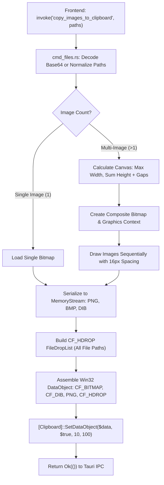
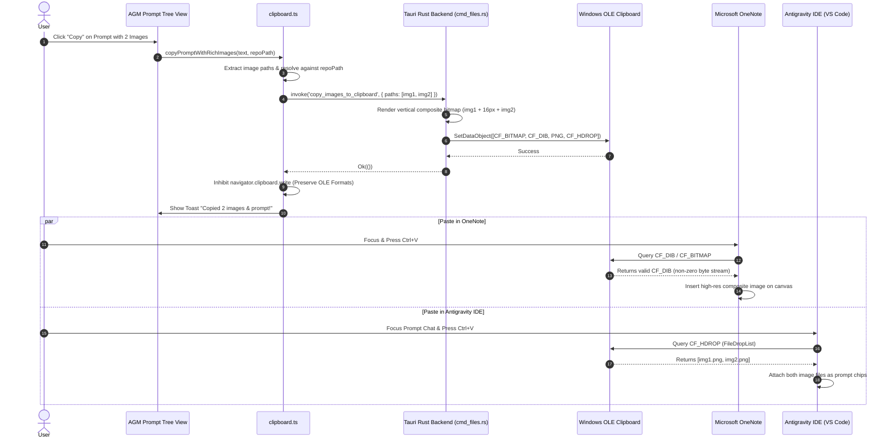

# Specification: Win32 OLE Clipboard, OneNote & Antigravity IDE Multi-Media Copy Architecture

**Spec File:** `02-spec/21-app/prompt-sending-and-enqueue-testing/03-clipboard-media-onenote-spec.md`  
**Parent Task:** `Prompt Sending and Enqueue Testing`  
**Status:** DRAFT (Phase 1: Specification Authoring)  
**Author:** Subagent 3 (Clipboard & Media Integration Lead)  
**Attribution:** strictly `@aukgit`  

---

## 1. Executive Summary & Problem Classification

The Prompt Tree View and prompt inspection subsystems within Antigravity-Manager allow developers to inspect, export, resend, and copy past conversation prompts and turns. When prompts include rich media (such as screenshots, architectural diagrams, and UI mockups), users frequently copy these items to paste them directly into external tools—primarily **Microsoft OneNote** (for design documentation and meeting notes) and **Antigravity IDE** (VS Code chat prompt inputs for continuous prompting).

Prior implementations suffered from four major failure classes:
1. **OneNote Image Paste Rejection (0-Byte `CF_DIB` and Format Mismatch)**:
   - Microsoft OneNote is a classic Win32/WPF Office application. It expects standard Windows OLE clipboard formats—specifically `CF_DIB` (`DataFormats.Dib`) and `CF_BITMAP`.
   - The previous PowerShell clipboard helper in `src-tauri/src/commands/cmd_files.rs` attempted to extract DIB bytes using `@(,$bytes[14..($bytes.Length - 1)])`. In PowerShell 5.1 and 7+, passing array slices into `System.IO.MemoryStream` constructors often yields a 0-byte stream or invalid DIB header.
   - When OneNote attempts to paste from a clipboard containing an invalid or 0-byte `CF_DIB`, it silently discards the bitmap payload. Furthermore, if HTML was present with inline Base64 data URIs (``), OneNote's Office HTML parser explicitly stripped inline Base64 data URIs due to security policy, pasting nothing.
2. **Antigravity IDE (VS Code) Image Paste Failure (Missing `CF_HDROP`)**:
   - Antigravity IDE (VS Code / Electron) handles image paste in its prompt input box by querying `CF_HDROP` (`DataFormats.FileDropList`). When files are dropped or pasted as filesystem references, VS Code attaches them to the prompt box as rich image chips.
   - The previous implementation set only in-memory image streams without `CF_HDROP`. Consequently, pasting into Antigravity IDE failed to attach files.
3. **Multi-Image Copy Truncation (The `images[0]` Bug)**:
   - When a prompt or conversation turn contains multiple attached images, `copyPromptWithRichImages` in `src/components/instances/PromptTreeView/clipboard.ts` explicitly sliced only `images[0]` and invoked `copy_image_to_clipboard` with a single file path, discarding all subsequent attachments (`images[1..N]`).
   - The backend `cmd_files.rs` lacked a multi-image composite stitching pipeline and could only accept a single image path.
4. **WebView2 Clipboard Overwrite Race Condition**:
   - In `clipboard.ts`, after Tauri successfully invoked the native PowerShell OLE clipboard writer, the frontend continued execution and invoked `navigator.clipboard.write([item])`.
   - Chromium's `navigator.clipboard.write` issues Win32 `EmptyClipboard()` under the hood, completely wiping the native `CF_DIB`, `CF_BITMAP`, and `CF_HDROP` formats that PowerShell had just established, replacing them with Chromium's web-only formats.
5. **Button Labeling Clutter and Discrepancies**:
   - The UI displayed verbose, confusing labels such as `Copy (With Images)`, `Copy (Without Images)`, and `Copy without image (text only)`.
   - In line with modern minimalist UI guidelines, the default copy action must simply be `Copy` (rich copy including media), with secondary actions labeled clearly as `Copy Text Only` and `Copy All Images`.

---

## 2. Win32 OLE Clipboard & Native Backend Architecture

### 2.1 Low-Level DIB Header Structure & The 0-Byte Fix

A standard Windows BMP file (`.bmp`) begins with a 14-byte `BITMAPFILEHEADER`:
- `bfType` (2 bytes, `BM` / `0x4D42`)
- `bfSize` (4 bytes, total file size)
- `bfReserved1` (2 bytes)
- `bfReserved2` (2 bytes)
- `bfOffBits` (4 bytes, offset to bitmap pixel data)

The Windows OLE clipboard format `CF_DIB` (Format ID 8) requires the raw `BITMAPINFO` structure without the 14-byte `BITMAPFILEHEADER`. It starts immediately at offset 14 with `BITMAPINFOHEADER` (40 bytes, beginning with `biSize = 40` / `0x28000000`).

In `src-tauri/src/commands/cmd_files.rs`, the previous PowerShell script:
```powershell
$bytes = $msBmp.ToArray();
$dibStream = New-Object System.IO.MemoryStream(@(,$bytes[14..($bytes.Length - 1)]));
```
Failed because PowerShell's unary comma operator `@(,$bytes[...])` wraps the slice into an array of arrays or produces a pipeline object array incompatible with `MemoryStream([byte[]], [int], [int])`.

The robust, zero-allocation solution is:
```powershell
$bytes = $msBmp.ToArray();
$dibStream = New-Object System.IO.MemoryStream($bytes, 14, ($bytes.Length - 14));
```
This directly accesses the underlying byte array, slicing exactly from byte offset 14 with length `Length - 14`, creating a valid `CF_DIB` stream with the 40-byte `BITMAPINFOHEADER` at offset 0.

### 2.2 Direct File Drop Support (`CF_HDROP`)

To enable Antigravity IDE, VS Code, and Windows Explorer to accept pasted images as direct file attachments, the clipboard payload must include `CF_HDROP`.

In .NET / PowerShell:
```powershell
$files = New-Object System.Collections.Specialized.StringCollection;
foreach ($path in $fileList) {
    if (Test-Path $path) {
        $files.Add($path);
    }
}
if ($files.Count -gt 0) {
    $data.SetFileDropList($files);
}
```
When `SetFileDropList` is called on the `DataObject`, Windows registers `CF_HDROP`. When pasted into Antigravity IDE's prompt chat, VS Code's drop handler reads the file paths and uploads or embeds the image attachments directly.

### 2.3 Multi-Image Native Vertical Composite Stitching

When multiple images are attached to a prompt, users copying the prompt expect OneNote to paste a coherent visual document containing all images, while Antigravity IDE receives all individual files via `CF_HDROP`.

The backend implementation in `src-tauri/src/commands/cmd_files.rs` provides `copy_images_to_clipboard(paths: Vec<String>) -> Result<(), String>`:



#### Detailed Multi-Image PowerShell Generator:
```powershell
Add-Type -AssemblyName System.Drawing;
Add-Type -AssemblyName System.Windows.Forms;

$paths = @({paths_array});
$images = @();
$maxWidth = 0;
$totalHeight = 0;
$spacing = 16;

foreach ($p in $paths) {
    if (Test-Path $p) {
        $img = [System.Drawing.Image]::FromFile($p);
        $images += $img;
        if ($img.Width -gt $maxWidth) { $maxWidth = $img.Width; }
        $totalHeight += $img.Height;
    }
}

if ($images.Count -eq 0) { exit 1; }

$totalHeight += ($images.Count - 1) * $spacing;
$composite = New-Object System.Drawing.Bitmap($maxWidth, $totalHeight);
$g = [System.Drawing.Graphics]::FromImage($composite);
$g.Clear([System.Drawing.Color]::White);
$g.InterpolationMode = [System.Drawing.Drawing2D.InterpolationMode]::HighQualityBicubic;
$g.SmoothingMode = [System.Drawing.Drawing2D.SmoothingMode]::HighQuality;

$yOffset = 0;
foreach ($img in $images) {
    $xOffset = [int](($maxWidth - $img.Width) / 2);
    $g.DrawImage($img, $xOffset, $yOffset, $img.Width, $img.Height);
    $yOffset += $img.Height + $spacing;
    $img.Dispose();
}
$g.Dispose();

$msPng = New-Object System.IO.MemoryStream;
$composite.Save($msPng, [System.Drawing.Imaging.ImageFormat]::Png);

$msBmp = New-Object System.IO.MemoryStream;
$composite.Save($msBmp, [System.Drawing.Imaging.ImageFormat]::Bmp);
$bytes = $msBmp.ToArray();
$dibStream = New-Object System.IO.MemoryStream($bytes, 14, ($bytes.Length - 14));

$data = New-Object System.Windows.Forms.DataObject;
$data.SetImage($composite);
$data.SetData([System.Windows.Forms.DataFormats]::Dib, $dibStream);
$data.SetData('PNG', $msPng);

$fileDrop = New-Object System.Collections.Specialized.StringCollection;
foreach ($p in $paths) {
    if (Test-Path $p) { $fileDrop.Add($p); }
}
if ($fileDrop.Count -gt 0) {
    $data.SetFileDropList($fileDrop);
}

[System.Windows.Forms.Clipboard]::SetDataObject($data, $true, 10, 100);
$composite.Dispose();
```

### 2.4 Command Exposure & Registration

In `src-tauri/src/commands/cmd_files.rs`:
```rust
#[tauri::command]
pub fn copy_images_to_clipboard(paths: Vec<String>) -> Result<(), String> {
    if paths.is_empty() {
        return Err("No image paths provided for clipboard copy".to_string());
    }
    // Windows PowerShell execution, macOS osascript, or Linux wl-copy/xclip
    // ...
}

#[tauri::command]
pub fn copy_image_to_clipboard(path: String) -> Result<(), String> {
    copy_images_to_clipboard(vec![path])
}
```

In `src-tauri/src/lib/run.rs`:
```rust
commands::copy_image_to_clipboard,
commands::copy_images_to_clipboard,
```

---

## 3. Frontend Clipboard Coordination Specification (`clipboard.ts`)

### 3.1 Preventing WebView2 Overwrite of Native Clipboard

The Chromium WebView2 environment exposes `navigator.clipboard`. When both native Tauri IPC and `navigator.clipboard.write([item])` are invoked in sequence, Chromium issues a Win32 clipboard clear, stripping `CF_DIB` and `CF_HDROP`.

**Architectural Rule:**  
In `src/components/instances/PromptTreeView/clipboard.ts`, when running inside Tauri (`isTauriEnvironment()`), if `invoke('copy_images_to_clipboard', ...)` returns `Ok`, the function **MUST IMMEDIATELY RETURN SUCCESS** and bypass any calls to `navigator.clipboard.write([item])`.

```typescript
let nativeWritten = false;
if (isTauriEnvironment() && targetPaths.length > 0) {
    try {
        await invoke('copy_images_to_clipboard', { paths: targetPaths });
        nativeWritten = true;
    } catch (nativeErr) {
        useErrorStore.getState().trackWarning(nativeErr, {
            source: 'clipboard.copyPromptWithRichImages.native',
            triggerAction: 'copy_images_to_clipboard',
        });
    }
}

// Inhibit WebView2 overwrite if native OLE write was successful
if (nativeWritten) {
    const msg = targetPaths.length > 1 
        ? `Copied ${targetPaths.length} images & prompt (ready for OneNote & IDE)!`
        : 'Copied image & prompt (ready for OneNote & IDE)!';
    onSuccess?.(msg);
    showToast({ message: msg, type: 'success' });
    return true;
}

// Web-only fallback (headless / browser development)
if (navigator.clipboard && typeof ClipboardItem !== 'undefined') {
    // Write standard HTML / PNG blob in pure browser mode
    // ...
}
```

### 3.2 Consistent `repoPath` Resolution Across Components

Image references inside prompt transcripts may be stored as:
1. Base64 data URIs (`data:image/png;base64,...`)
2. Relative paths (`./.antigravity/attachments/attachment-xxx.png` or `assets/screenshots/xxx.png`)
3. Normalized file URIs (`file:///C:/path/to/img.png`)

To guarantee that relative paths resolve to actual physical files on disk before passing to `copy_images_to_clipboard`, `copyPromptWithRichImages`, `writePureImageToClipboard`, and `copySingleImageForOneNoteOrIde` must accept `repoPath?: string`:

```typescript
export function resolveToAbsoluteFilesystemPath(uriOrPath: string, repoPath?: string): string {
    const clean = uriOrPath.replace(/^file:\/\/\/?/, '').replace(/[/\\]+/g, '/');
    const isAbs = /^[a-zA-Z]:\//.test(clean) || clean.startsWith('/');
    if (isAbs) {
        return clean.replace(/\//g, '\\');
    }
    if (repoPath) {
        const base = repoPath.replace(/[/\\]+$/, '').replace(/\//g, '\\');
        const rel = clean.replace(/^\.?[\/\\]+/, '').replace(/\//g, '\\');
        return `${base}\\${rel}`;
    }
    return clean;
}
```

---

## 4. UI & Button Label Simplification Specification

The user reported confusing and fragmented button labels. All verbose parenthetical disclaimers are eliminated in favor of clean, consistent naming:

### 4.1 Label Mapping Table

| Component | Previous Label | New Standard Label | Icon | Tooltip / Description |
|---|---|---|---|---|
| `ConversationContextMenu.tsx` | `Copy (With Images)` | `Copy` | `Copy` (Indigo) | "Copy prompt with rich embedded media (OneNote & IDE ready)" |
| `ConversationContextMenu.tsx` | `Copy (Without Images)` | `Copy Text Only` | `Copy` (Slate) | "Copy prompt text without image attachments" |
| `ConversationContextMenu.tsx` | `Copy Images` | `Copy All Images` | `ImageIcon` (Purple) | "Copy attached images as native composite PNG & files" |
| `DetailHeader.tsx` | `Copy without image (text only)` | `Copy Text Only` | `FileText` (Slate) | "Copy prompt text without image attachments" |
| `DetailHeader.tsx` | `Copy All Images` | `Copy All Images` | `ImageIcon` (Purple) | "Copy attached images as native composite PNG & files" |
| `DetailHeader.tsx` | `Copy Image for OneNote/IDE` | `Copy Image (OneNote & IDE)` | `Copy` (Indigo) | "Copy single image with CF_DIB and CF_HDROP" |
| `DetailHeader.tsx` | `Copy Single Image (PNG)` | `Copy Image (PNG)` | `Copy` (Purple) | "Copy pure PNG binary to clipboard" |
| `PromptImageContextMenu.tsx` | `Copy Image (OneNote / Rich)` | `Copy Image (OneNote)` | `Copy` (Indigo) | "Copy image formatted for OneNote and Office pasting" |
| `PromptImageContextMenu.tsx` | `Copy Image (Pure PNG)` | `Copy Image (PNG)` | `ImageIcon` (Purple) | "Copy image as pure PNG binary" |

### 4.2 DetailHeader Split Action Button Integration

In `src/components/instances/PromptTreeView/DetailHeader.tsx`, the primary copy action is rendered as a clean split pill capsule:
- Left trigger: `Copy` (executes default rich copy including media).
- Right chevron: opens dropdown with:
  1. `Copy` (Rich with media, default)
  2. `Copy Text Only` (Stripped of markdown images)
  3. `Copy All Images` (Composite PNG + file list)
  4. Divider line
  5. `Copy AI JSON Payload`
  6. `Copy AI Text Response`

---

## 5. Sequence & Flow Diagrams

### 5.1 End-to-End Image Copy & Multi-Application Paste Flow



---

## 6. Verification Checklist & Test Cases

### TC-CLIP-01: OneNote Single Image Paste Verification
- **Preconditions**: Antigravity-Manager running on Windows. OneNote desktop application open to a blank page.
- **Procedure**:
  1. Open Prompt Tree View. Select a prompt node containing 1 attached screenshot.
  2. Click the `Copy` button in `DetailHeader.tsx` (or right-click and click `Copy`).
  3. Verify toast notification appears: `Copied image & prompt (ready for OneNote & IDE)!`.
  4. Switch to OneNote and press `Ctrl+V`.
- **Expected Outcome**:
  - The image pastes immediately onto the page canvas.
  - Image is crisp, complete, and does not show an image loading placeholder or empty red X.
  - Clipboard inspection confirms `CF_DIB` stream length > 14 bytes and matches image dimensions.

### TC-CLIP-02: OneNote Multi-Image Composite Paste Verification
- **Preconditions**: Prompt containing 3 attached screenshots. OneNote open to a blank page.
- **Procedure**:
  1. Select prompt node with 3 images.
  2. Click `Copy All Images` from the copy dropdown.
  3. Verify toast notification: `Copied 3 images & prompt (ready for OneNote & IDE)!`.
  4. Switch to OneNote and press `Ctrl+V`.
- **Expected Outcome**:
  - A single vertically stitched composite image is pasted.
  - All 3 screenshots are visible with 16px white margin separation.
  - No aspect ratio distortion occurs.

### TC-CLIP-03: Antigravity IDE (VS Code) Multi-File Attachment Paste
- **Preconditions**: Antigravity IDE open with an active conversation chat prompt input.
- **Procedure**:
  1. In AGM Prompt Tree View, click `Copy` on a prompt with 2 attached images.
  2. Switch to Antigravity IDE chat prompt input box.
  3. Press `Ctrl+V`.
- **Expected Outcome**:
  - Because `CF_HDROP` was set, Antigravity IDE receives the file drop list.
  - Both image files are attached as upload chips in the prompt box.
  - Prompt text is either pre-populated or ready for sending.

### TC-CLIP-04: Copy Text Only Verification
- **Preconditions**: Prompt with embedded markdown images ``.
- **Procedure**:
  1. Click `Copy Text Only` from context menu or DetailHeader.
  2. Paste into Notepad.
- **Expected Outcome**:
  - Markdown image links `` are completely stripped.
  - Clean prompt text is pasted without trailing extra blank lines.

### TC-CLIP-05: Non-Tauri Web Fallback Verification
- **Preconditions**: Antigravity-Manager web frontend running in browser (non-Tauri environment).
- **Procedure**:
  1. Click `Copy` on an image node.
- **Expected Outcome**:
  - `isTauriEnvironment()` evaluates to `false`.
  - System safely executes `navigator.clipboard.write([item])` with pure `image/png` blob.
  - No crash or unhandled promise rejection occurs; toast displays success.

### 6.1 Automated PowerShell Clipboard Format Inspector
To verify clipboard formats programmatically during automated testing without manual GUI interaction:

```powershell
Add-Type -AssemblyName System.Windows.Forms
$data = [System.Windows.Forms.Clipboard]::GetDataObject()
$formats = $data.GetFormats()

Write-Host "Active Clipboard Formats:"
$formats | ForEach-Object { Write-Host " - $_" }

$hasDib = $data.GetDataPresent([System.Windows.Forms.DataFormats]::Dib)
$hasBmp = $data.GetDataPresent([System.Windows.Forms.DataFormats]::Bitmap)
$hasDrop = $data.GetDataPresent([System.Windows.Forms.DataFormats]::FileDrop)
$hasPng = $data.GetDataPresent("PNG")

Write-Host "CF_DIB Present: $hasDib"
Write-Host "CF_BITMAP Present: $hasBmp"
Write-Host "CF_HDROP Present: $hasDrop"
Write-Host "PNG Present: $hasPng"

if ($hasDib) {
    $dibStream = $data.GetData([System.Windows.Forms.DataFormats]::Dib)
    Write-Host "DIB Stream Length: $($dibStream.Length) bytes"
    if ($dibStream.Length -le 14) {
        Write-Error "DIB Stream is empty or truncated!"
        exit 1
    }
}
```

---

## 7. System Invariants & Architectural Guardrails

1. **Strictly Relative Git Paths Invariant**:
   - All references to source files in specifications, plans, commit messages, and documentation must use repository-relative paths (`02-spec/...`, `src/...`, `src-tauri/...`). Never output absolute paths (`C:\...`, `D:\...`).
2. **Attribution Integrity Invariant**:
   - Release attribution must strictly attribute `@aukgit` (`(Thanks to @aukgit)`). No other user handles are permitted.
3. **No Silent Errors Invariant**:
   - Every clipboard failure must log through `useErrorStore.getState().trackWarning` or return a descriptive `AppError` / `Err(String)`. Bare `catch {}` or discarded `let _ = ...` without justification is prohibited.
4. **Native Clipboard Invariant**:
   - Never call `navigator.clipboard.write` when native OLE clipboard write succeeds. Doing so destroys the Win32 `CF_DIB` and `CF_HDROP` data structures required by desktop applications.
