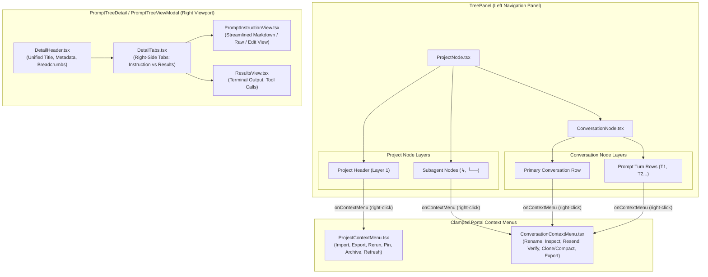

# Architecture Specification: Prompt Tree Right-Click Context Menus, Right-Side Tabs, Header Whitespace Optimization, and Copy Consolidation

> **Spec ID:** `02-spec/21-app/prompt-tree-context-menu-and-telegram-fixes/01-architecture-spec.md`  
> **Status:** APPROVED & READY FOR IMPLEMENTATION  
> **Author:** Spec Author 01 (Frontend Architecture)  
> **Scope:** Prompt Tree Right-Click Context Menus (`ProjectNode.tsx`, `ConversationNode.tsx`, `ProjectContextMenu.tsx`, `ConversationContextMenu.tsx`), Right-Side Tab Placement & 40-50px Header Whitespace Optimization (`DetailHeader.tsx`, `DetailTabs.tsx`, `PromptTreeViewModal.tsx`), Top Toolbar `[ Copy All | v ]` Consolidation & Footer Button Elimination (`PromptInstructionView.tsx`)  
> **Related Subtask:** [01-frontend-tree-and-layout.md](../../../.ai-memory/plans/subtasks/prompt-tree-context-menu-and-telegram-fixes/01-frontend-tree-and-layout.md)  
> **Coding Guidelines:** [coding-guidelines.md](../../../coding-guidelines.md) | [AGENTS.md](../../../AGENTS.md)

---

## 1. Executive Summary

The Antigravity Manager (`AGM`) **Prompt Tree View** (`src/components/instances/PromptTreeView/`) provides the mission-critical visual orchestration interface for workspace instances, project repositories, conversation threads, AI subagent tasks, and individual prompt execution turns.

Despite recent iterative visual improvements, extensive user workflow audits have identified three primary ergonomic bottlenecks in the prompt tree view:
1. **Missing Context Menu Accessibility on Project Headers, Subagents, and Prompt Turns:**
   - Right-clicking project headers in [ProjectNode.tsx](../../../src/components/instances/PromptTreeView/ProjectNode.tsx) currently yields default browser context menus rather than project-scoped operations (Import scoped to project, Export to JSON/SQLite/YAML, and Bulk Rerun of queued/all project prompts).
   - Indented AI subagents in [ProjectNode.tsx](../../../src/components/instances/PromptTreeView/ProjectNode.tsx) and prompt execution turns in [ConversationNode.tsx](../../../src/components/instances/PromptTreeView/ConversationNode.tsx) lack right-click context menus and prominent selection indicators, making granular prompt inspection, turn re-injection, and clipboard export difficult.
2. **Excessive Vertical Whitespace & Disconnected Tab Layout:**
   - The primary navigation tabs ("Prompt Instruction" vs "AI Results & Outputs") in [DetailTabs.tsx](../../../src/components/instances/PromptTreeView/DetailTabs.tsx) occupy an entire standalone horizontal bar positioned beneath [DetailHeader.tsx](../../../src/components/instances/PromptTreeView/DetailHeader.tsx).
   - This stacked layout creates three consecutive horizontal division lines and consumes **40–50px of redundant vertical space**, pushing prompt contents down and constraining the visible markdown preview and terminal result views on standard 1080p displays.
3. **Redundant Copy Buttons in Content Views:**
   - [PromptInstructionView.tsx](../../../src/components/instances/PromptTreeView/PromptInstructionView.tsx) currently renders redundant footer copy buttons (`Copy All (Content + Images)` and `Copy Full Prompt`) at the base of both Preview and Raw text viewports.
   - These duplicate the top toolbar's `[ Copy All | v ]` segmented capsule and violate the single source of truth design principle for toolbar actions.

This specification details the frontend architecture, component interfaces, state synchronization flows, and coordinate clamping algorithms required to resolve all three issues while strictly upholding the **AGENTS.md segmented pill capsule design standards** and **No Silent Errors** house rules.

---

## 2. Component Hierarchy & Layout Transformation

### 2.1 Before vs After Layout Topology

```
BEFORE: Fragmented Stack (40-50px Wasted Vertical Space)
┌────────────────────────────────────────────────────────────────────────────────────────┐
│ DetailHeader Row 1: [#C001 USER_PROMPT] [RUNNING PID:1234 00:45] [Conversation Title]   │
├────────────────────────────────────────────────────────────────────────────────────────┤
│ DetailHeader Row 2: [ Copy All | v ] [ Send N | v ] [ Rerun x5 | v ]                    │
├────────────────────────────────────────────────────────────────────────────────────────┤
│ DetailTabs Row 3:   [Prompt Instruction | AI Results & Outputs]   120 words · 1.4 KB   │
├────────────────────────────────────────────────────────────────────────────────────────┤
│ PromptInstructionView (Markdown Container)                                             │
│                                                                                        │
│ Footer Bar:         120 words    [Show All]  [Copy All (Images)]  [Copy Full Prompt]   │ <── Redundant
└────────────────────────────────────────────────────────────────────────────────────────┘

AFTER: Unified Compact Header & Right-Side Tabs (Zero Wasted Space)
┌────────────────────────────────────────────────────────────────────────────────────────┐
│ Row 1: Identity & Metadata                                                             │
│ [#C001 USER_PROMPT] [RUNNING 00:45] [Conversation Title ✏️] [Breadcrumb Context]        │
├────────────────────────────────────────────────────────────────────────────────────────┤
│ Row 2: Consolidated Action Toolbar with Right-Side Navigation Tabs                     │
│ [Left: 120 words · 1.4 KB]              [Tabs: Prompt Instruction | AI Results]        │
│                                         [Actions: [ Copy All | v ] [ Send N | v ] ...] │
├────────────────────────────────────────────────────────────────────────────────────────┤
│ PromptInstructionView (Maximized Viewport, Zero Redundant Footer Buttons)              │
│                                                                                        │
│ Footer Bar:         120 words    [Show All / Show Less]                                │
└────────────────────────────────────────────────────────────────────────────────────────┘
```

### 2.2 System Architecture Diagram



---

## 3. Subsystem 1: Prompt Tree Right-Click Custom Menu Engine

### 3.1 Project Header Right-Click Menu (`ProjectNode.tsx` & `ProjectContextMenu.tsx`)

Currently, [ProjectNode.tsx](../../../src/components/instances/PromptTreeView/ProjectNode.tsx) only binds `onClick` for expand/collapse and project selection. Right-clicking the project header row triggers the default browser menu, giving users no access to project-level operations.

#### Functional Requirements
1. **Event Capture & State:**
   - In `ProjectNode.tsx`, bind `onContextMenu` on the Layer 1 Project Row (`div.group`).
   - Prevent default browser menu (`e.preventDefault()`) and stop propagation (`e.stopPropagation()`).
   - Store coordinates `{ x: e.clientX, y: e.clientY }` in local state `projectContextMenuPos`.
2. **Context Menu Actions:**
   - Extend [ProjectContextMenu.tsx](../../../src/components/instances/PromptTreeView/ProjectContextMenu.tsx) to provide:
     * **Import Prompts into Project:** Emits `onImport(project)` to open the `PromptTreeImportModal` pre-scoped to `project.repo_path` or `project.project_id`.
     * **Export Project (JSON / SQLite / YAML):** Reuses existing `exportProjectAsJson`, `exportProjectAsSqlite`, `exportProjectAsYaml` utilities.
     * **Rerun Project Prompts:** Submenu or direct action to bulk-rerun:
       - Rerun Queued Prompts in Project
       - Rerun All Prompts in Project
     * **Pin / Unpin Project:** Toggles project pin state via `onTogglePin(project.project_id)`.
     * **Archive / Unarchive Project:** Toggles project archive state via `onToggleArchive(project.project_id)`.
     * **Refresh Project:** Triggers project directory re-scan via `onRefresh(project.project_id)`.

#### Clamped Coordinate Portal Standard
Context menus must render via React `createPortal(..., document.body)` with boundary clamping to prevent menus from being rendered off-screen:

```typescript
// Clamped coordinate calculation
const MENU_WIDTH = 240;
const MENU_HEIGHT = 340;
const left = Math.max(8, Math.min(x, window.innerWidth - MENU_WIDTH));
const top = Math.max(8, Math.min(y, window.innerHeight - MENU_HEIGHT));
```

### 3.2 Subagent Tasks Context Menu & Selection (`ProjectNode.tsx`)

In [ProjectNode.tsx](../../../src/components/instances/PromptTreeView/ProjectNode.tsx) (lines 112–170), AI subagent tasks are rendered under parent conversations with tree branch connectors (`↳` and `└──`). Currently, these rows only have `onClick` and `onDoubleClick`.

#### Requirements
1. **Right-Click Context Menu:**
   - Add `onContextMenu` handler to each subagent task row.
   - Subagent tasks are represented as `AgmConversationNode` objects (`subNode.primaryNode`).
   - Mount [ConversationContextMenu.tsx](../../../src/components/instances/PromptTreeView/ConversationContextMenu.tsx) positioned at `(e.clientX, e.clientY)` with the subagent conversation node.
2. **Selectability & High-Contrast Visual Focus:**
   - Add `tabIndex={0}` and keyboard navigation (`Enter` / `Space` to select, `F2` to trigger rename).
   - Ensure the selected subagent row displays active high-contrast styling:
     * Dark theme: `bg-purple-600 text-white font-medium shadow-2xs`
     * Light theme: `bg-purple-100 text-purple-900 border border-purple-300 font-medium`
     * Outline: `focus-visible:ring-1 focus-visible:ring-purple-400`

### 3.3 Prompt Execution Turns Context Menu & Selection (`ConversationNode.tsx`)

In [ConversationNode.tsx](../../../src/components/instances/PromptTreeView/ConversationNode.tsx) (lines 241–324), multi-turn prompts render as indented turn items (`T1`, `T2`, etc.).

#### Requirements
1. **Right-Click Context Menu for Turns:**
   - Add `onContextMenu` handler to each turn item container (`div.group/turn`).
   - Right-clicking a turn opens `ConversationContextMenu.tsx` with properties constructed specifically for that turn:
     ```typescript
     const turnConv: AgmConversationNode = {
         ...conv,
         prompt_preview_200w: turn.preview_200w || turn.prompt_text.slice(0, 200),
         full_prompt_text: turn.prompt_text,
         latest_step_summary: `Turn ${turn.turn_number} · ${turn.status}`,
         is_running: turn.is_running,
         is_queued: turn.is_queued,
         status: turn.status,
     };
     ```
   - Enables users to directly Resend Turn, Enqueue Turn, Copy Turn Prompt, or Inspect Turn.
2. **Turn Selectability & Visual Active State:**
   - Add selection awareness to turns. When a turn is selected, apply distinct highlight styling (`bg-slate-200 dark:bg-purple-950/80 text-purple-300 border border-purple-500/40`).
   - Add `tabIndex={0}` and keyboard trigger support.

---

## 4. Subsystem 2: Right-Side Tab Placement & Vertical Space Optimization

### 4.1 Root Cause of 40–50px Whitespace Bloat

Detailed analysis of [DetailHeader.tsx](../../../src/components/instances/PromptTreeView/DetailHeader.tsx), [DetailTabs.tsx](../../../src/components/instances/PromptTreeView/DetailTabs.tsx), and [PromptTreeViewModal.tsx](../../../src/components/instances/PromptTreeView/PromptTreeViewModal.tsx) reveals the source of the vertical gap:

1. `DetailHeader` root has `space-y-2 pb-2.5 border-b mb-2` (adds ~18px margin and padding).
2. `DetailTabs` root has `pb-1 border-b mb-2` (adds ~14px margin, padding, and an extra border line).
3. `DetailTabs` wraps primary navigation tabs (`Prompt Instruction` / `AI Results & Outputs`) into an isolated left-aligned capsule, while placing word count / view mode controls on the right.
4. `PromptInstructionView` container adds `space-y-3 pt-2` (adds another ~16px).
5. In aggregate, **48px of vertical screen real estate** is consumed purely by stacked borders, padding, and separate row wrappers before any prompt text appears.

### 4.2 Optimized Header Architecture

To recover this space, we collapse the layout from three vertical bands into two streamlined rows:

```
Row 1: Identity & Metadata (32px height)
┌────────────────────────────────────────────────────────────────────────────────────────┐
│ [C001 USER_PROMPT] [RUNNING 00:45] [Conversation Title ✏️] [Instance #1 · agy (Default)] │
└────────────────────────────────────────────────────────────────────────────────────────┘

Row 2: Action & Navigation Toolbar (34px height)
┌────────────────────────────────────────────────────────────────────────────────────────┐
│ Left: Metrics & View Mode          │ Right: Primary Tabs & Action Capsules             │
│ 120 words · 1.4 KB [Preview|Raw|Edit]│ [Prompt Instruction | AI Results] [Copy All|v]...│
└────────────────────────────────────────────────────────────────────────────────────────┘
```

#### Detailed Integration Strategy
1. **Move Primary Tabs to Toolbar Right:**
   - The primary navigation capsule (`[Prompt Instruction | AI Results & Outputs]`) moves from the left side of `DetailTabs` into the right side of the action toolbar.
   - It is mounted alongside the unified action controls (`[ Copy All | v ]`, `[ Send N | v ]`, `[ Rerun xN | v ]`).
2. **Segmented Dark-Glass Styling Standard:**
   - Both the navigation tabs capsule and the action controls capsules use identical styling:
     ```tsx
     className="inline-flex items-center rounded-full bg-slate-100/90 dark:bg-[#120a1f]/90 backdrop-blur-md border border-slate-200/80 dark:border-purple-500/30 p-0.5 divide-x divide-slate-200/70 dark:divide-purple-500/20 shadow-2xs shrink-0"
     ```
   - Navigation buttons maintain smooth pill active transitions (`bg-blue-600 text-white shadow-2xs`).
3. **Elimination of Intermediate Divider Line:**
   - Remove the intermediate `border-b border-slate-200/60 dark:border-[#40285e]/60` between `DetailHeader` and `DetailTabs`.
   - Single unified border line at the base of Row 2 clearly separates the toolbar from the content area.

---

## 5. Subsystem 3: Top Toolbar Copy All Consolidation & Footer Button Elimination

### 5.1 Top Toolbar `[ Copy All | v ]` Split Capsule

The top toolbar split button in [DetailHeader.tsx](../../../src/components/instances/PromptTreeView/DetailHeader.tsx) is the canonical source for all clipboard and export actions.

#### Split Button Structure:
1. **Primary Button `[ Copy All ]`:**
   - One-shot copy of complete prompt text with rich embedded image assets (calls `handleCopyAllWithRichImages` or `handleCopyWithImagesRich`).
   - Displays temporary green `Copied All!` checkmark state for 2000ms.
2. **Dropdown Chevron `[ v ]`:**
   - Expands a 320px dark-glass dropdown menu (`isCopyMenuOpen`) providing comprehensive clipboard variations:
     * **Copy Clean Text:** Strips all markdown image tags `` via `stripImagesFromPrompt`, copies pure textual instructions.
     * **Copy with Images (Rich HTML):** Copies multimodal HTML markup with base64/remote image representations.
     * **Copy Full Prompt:** Copies raw unmodified prompt text to clipboard.
     * **Copy AI Results as JSON:** Copies `execution_results` and `latest_response` as structured JSON.
     * **Copy Prompt & AI as Text / Markdown:** Monospace export format.
     * **Save Images to Disk:** Invokes client asset download helper to persist embedded screenshots.
     * **Export Section:** Quick export to `.md` or `.json`.

### 5.2 Elimination of Redundant Footer Copy Buttons

In [PromptInstructionView.tsx](../../../src/components/instances/PromptTreeView/PromptInstructionView.tsx):
- **Preview Mode (lines 106–154):**
  * REMOVE: `<button ...>Copy All (Content + Images)</button>` (`data-ui-name="prompt-bottom-copy-all-btn"`)
  * REMOVE: `<button ...>Copy Full Prompt</button>` (`data-ui-name="prompt-copy-full-text-btn"`)
  * RETAIN: Word and byte count statistics (`120 words · 1.4 KB`)
  * RETAIN: `[Show All / Show Less]` expand/collapse toggle
- **Raw Mode (lines 174–220):**
  * REMOVE: `<button ...>Copy All (Content + Images)</button>` (`data-ui-name="prompt-raw-bottom-copy-all-btn"`)
  * REMOVE: `<button ...>Copy Raw</button>` (`data-ui-name="prompt-raw-copy-btn"`)
- **Benefits:**
  * Eliminates clutter from the bottom of the prompt reading pane.
  * Directs all user interaction to the top toolbar where hotkeys, counts, and dispatch controls live.
  * Ensures uniform behavior whether viewing short 1-line prompts or 50,000-word specs.

---

## 6. Architectural Invariants & House Rules

### Invariant 1: Portal & Coordinate Clamping
Every floating context menu (`ProjectContextMenu`, `ConversationContextMenu`) must be rendered using React `createPortal(..., document.body)`. Coordinates must be clamped against `window.innerWidth` and `window.innerHeight` with a minimum margin of 8px. Menus must dismiss on `Escape`, click outside (`mousedown`), and scroll (`scroll` capture).

### Invariant 2: Origin Tier Classification & Visual Hierarchy
When subagents or turns are rendered or selected, origin tiers must strictly respect the 4-tier taxonomy defined in `AGENTS.md`:
- `USER_PROMPT`: Sky badge (`text-sky-500`, `User` icon)
- `SUBAGENT_INSTRUCTION`: Purple badge (`text-purple-500`, `Bot` icon, branch glyphs `↳`, `└──`)
- `SYSTEM_MESSAGE`: Zinc badge (`text-zinc-500`, `Terminal` icon)
- `TOOL_OUTPUT`: Amber badge (`text-amber-500`, `Wrench` icon)

### Invariant 3: Segmented Pill Capsule Design Standard
Adjacent action buttons and navigation tabs must always be grouped into contiguous segmented capsules (`rounded-full`, shared border, subtle divider lines, dark-glass styling) rather than loose, disjointed buttons. Any inline dropdown `<select>` must use transparent borderless styling (`bg-transparent border-0 focus:ring-0 focus:outline-none`).

### Invariant 4: No Silent Errors
Any failure in context menu dispatches (rename, export, rerun, copy) must be reported via `useErrorStore.getState().captureException(error, context)` or `reportPromptActionError(err, source)`. Swallowing errors with empty `catch {}` or `.catch(() => {})` is strictly forbidden.

### Invariant 5: First-In-First-Out (FIFO) Dispatch Ordering
All prompt rerun and restore queries must strictly enforce FIFO ordering (`ORDER BY created_at ASC, id ASC`). Reversing to LIFO (`ORDER BY updated_at DESC`) is strictly forbidden.

---

## 7. Type Definitions & Interface Specifications

### 7.1 Extended `ProjectContextMenuProps`

```typescript
export interface ProjectContextMenuProps {
    x: number;
    y: number;
    projectId: string;
    projectName: string;
    repoPath: string;
    isPinned: boolean;
    isArchived: boolean;
    onClose: () => void;
    onRefresh: () => void;
    onTogglePin: () => void;
    onToggleArchive: () => void;
    onOpenImport: () => void;
    onRerunQueued: () => void;
    onRerunAll: () => void;
    onExportJson: () => void;
    onExportSqlite: () => void;
    onExportYaml: () => void;
}
```

### 7.2 Updated `DetailHeaderProps` & `DetailTabsProps` Alignment

```typescript
export interface DetailToolbarProps {
    // Navigation Tab state
    previewTab: 'instruction' | 'results';
    setPreviewTab: (v: 'instruction' | 'results') => void;

    // View Mode state (Preview / Raw / Edit)
    viewMode: ViewMode;
    setViewMode: (v: ViewMode) => void;

    // Word & Byte statistics
    activeWordCount: number;
    activeByteCount: number;
    formatByteSize: (bytes: number) => string;

    // Selected conversation context
    selectedConversation: AgmConversationNode;

    // Toolbar action dispatches
    onCopyAllWithRichImages?: () => void;
    onCopyCleanText?: () => void;
    onResend: () => void;
    onEnqueue: () => void;
    onOpenInspector: (conv: AgmConversationNode) => void;
}
```

---

## 8. Implementation & Verification Plan

| Phase | Milestone | Primary Target Files | Success Criteria |
| :--- | :--- | :--- | :--- |
| **Phase 1** | Project Header Context Menu | `ProjectNode.tsx`, `ProjectContextMenu.tsx` | Right-click on project row opens menu with Import, Export, Rerun, Pin, Archive. |
| **Phase 2** | Subagents & Turns Context Menus | `ProjectNode.tsx`, `ConversationNode.tsx`, `ConversationContextMenu.tsx` | Right-clicking subagent or prompt turn opens clamped context menu; keyboard navigation works. |
| **Phase 3** | Right-Side Tabs & Whitespace Elimination | `DetailHeader.tsx`, `DetailTabs.tsx`, `PromptTreeViewModal.tsx` | Navigation tabs relocated to right of toolbar; 40-50px vertical gap eliminated. |
| **Phase 4** | Copy All Consolidation & Footer Cleanup | `DetailHeader.tsx`, `PromptInstructionView.tsx` | Top toolbar dropdown provides all copy variations; redundant footer buttons removed. |
| **Phase 5** | Pre-Flight Checks & Quality Gate | Entire PromptTreeView component tree | `cargo clippy`, `cargo fmt`, `npm run build` pass cleanly with zero lint warnings. |

---

## 9. References & Related Documents

- Subtask Plan: [01-frontend-tree-and-layout.md](../../../.ai-memory/plans/subtasks/prompt-tree-context-menu-and-telegram-fixes/01-frontend-tree-and-layout.md)
- Project Guidelines: [AGENTS.md](../../../AGENTS.md)
- Coding Guidelines: [coding-guidelines.md](../../../coding-guidelines.md)
- Origin Tier Specification: [tierClassification.ts](../../../src/components/instances/PromptTreeView/tierClassification.ts)
- Prompt Actions Hook: [usePromptTreePromptActions.ts](../../../src/components/instances/PromptTreeView/usePromptTreePromptActions.ts)
