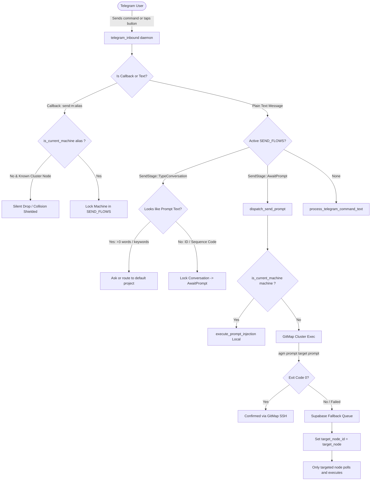

# Specification: Modular Backend Telegram Routing, Cluster Shielding & Prompt Selection UX

> **Target:** `02-spec/21-app/prompt-tree-context-menu-and-telegram-fixes/02-component-spec.md`  
> **Associated Plan:** `.ai-memory/plans/subtasks/prompt-tree-context-menu-and-telegram-fixes/02-backend-telegram-routing.md`  
> **Status:** APPROVED & READY FOR WORKER 02  
> **Author:** Spec Author 02  
> **Primary Attribution:** `@aukgit` (`(Thanks to @aukgit)`)  
> **Target Release:** `v4.223.0`  
> **Target Scope:**
> - `src-tauri/src/modules/telegram_inbound/send_flow.rs` (Machine picker deduplication, destination locked UX redesign, Step 3 manual project picker clarification)
> - `src-tauri/src/modules/telegram_inbound/injection.rs` (Token parsing fix, Supabase `target_node_id` payload normalization, `node_label::is_current_machine` adoption)
> - `src-tauri/src/modules/telegram_inbound/open_shot.rs` (Supabase `target_node_id` normalization, `node_label::is_current_machine` target resolution)
> - `src-tauri/src/modules/telegram_inbound/processing.rs` (Supabase `target_node_id` normalization, `node_label::is_current_machine` node selector routing)
> - `src-tauri/src/modules/telegram_inbound/node_label.rs` (Current machine resolution reference)
> - `src-tauri/src/modules/cli/prompts.rs` (`agm prompt <target> [flags] <prompt_text>` subcommand routing)
> - `src-tauri/src/modules/telegram_inbound/tests.rs` (Unit tests for payload schemas, deduplication, and token parsing)

---

## Technical Directive (Verbatim)

```
1. Telegram Machine Routing & Response Shielding:
   - Prevent multiple machines from responding when sending a prompt.
   - Adopt node_label::is_current_machine() uniformly across send_flow.rs, injection.rs, open_shot.rs, and processing.rs.
   - In send_flow.rs, deduplicate machine_entries() so only one "This machine" button is presented.
   - Fix the Supabase command_queue payload: change target_node to target_node_id in injection.rs, processing.rs, and open_shot.rs. Previously target_node_id was left default *, broadcasting commands to ALL machines in the cluster!
   - In cli/prompts.rs, add support for agm prompt <target> [flags] <prompt_text> so remote GitMap cluster execution succeeds without failing into the Supabase fallback queue.
2. Prompt Selection & Manual Typing Correction:
   - In send_flow.rs, redesign destination locked step so users clearly see that typing their custom prompt directly into chat is the primary path.
   - Separate recent prompts (Resend p-...) so they do not dominate or mislead users into thinking resending is the only option.
   - In injection.rs, fix token parsing so passing a project/conversation does not clobber target to "default" when custom prompt text is sent.
   - In send_flow.rs, clarify the Step 3 manual project picker label so users understand it's for picking/typing a project ID, not prompt text, or handle direct prompt entry gracefully.
```

---

## 1. Problem Classification & Root Cause Analysis (RCA)

### 1.1 RCA 1: Broadcast Storm via Supabase `command_queue` Schema Mismatch
- **Symptoms:** When dispatching a prompt or remote command to a secondary node via Supabase fallback, multiple or all machines in the cluster pick up the command simultaneously, leading to race conditions, duplicate executions, and contradictory Telegram status updates.
- **Root Cause:** In `src-tauri/src/modules/supabase_schema.rs` (line 124), the `public.command_queue` table definition defines:
  ```sql
  CREATE TABLE IF NOT EXISTS public.command_queue (
      id TEXT PRIMARY KEY,
      target_node_id TEXT NOT NULL DEFAULT '*',
      ...
  );
  ```
  In `injection.rs` (line 325), `processing.rs` (line 413), and `open_shot.rs` (line 268), the JSON insert payload passed `"target_node": target_node` instead of `"target_node_id": target_node`. Because PostgreSQL silently accepted the payload and populated the omitted `target_node_id` with its column default `'*'`, the query in `supabase_command_queue.rs` (`status=eq.pending&(target_node_id=eq.<node>|target_node_id=eq.*)`) caused EVERY listening machine in the cluster to dequeue and execute the command!
- **Surgical Remedy:** Standardize the JSON payload in all three modules to include `"target_node_id": target_node` (while retaining `"target_node"` for backward compatibility with external scripts), explicitly pinning the task to the intended node and preventing cluster-wide broadcast.

### 1.2 RCA 2: Fragmented Machine Identification and Inconsistent Collision Shielding
- **Symptoms:** Machine routing decisions diverged across files. In `injection.rs` and `processing.rs`, local execution checks compared target strings solely against `"local"` or `&local_alias` or `&local_ip` via raw string equality, ignoring cluster aliases or IP bindings. In `open_shot.rs` and `send_flow.rs`, custom partial checks were used instead of the centralized resolver.
- **Root Cause:** Lack of uniform adoption of `node_label::is_current_machine()`. When a command addressed a machine by its cluster node alias (e.g. `w1` or `worker-node-1`), modules performing raw checks against `detect_machine_name()` failed to identify it as the local machine, unnecessarily forwarding commands to SSH or remote queues. Conversely, remote cluster nodes could mistakenly treat themselves as targets.
- **Surgical Remedy:** Enforce `node_label::is_current_machine()` as the sole authority for local vs remote machine determination across `send_flow.rs`, `injection.rs`, `open_shot.rs`, and `processing.rs`.

### 1.3 RCA 3: Duplicate "This machine" Buttons in `/send` Flow
- **Symptoms:** When running `/send` in Telegram, the Step 1 machine picker keyboard rendered two separate buttons labeled with the local green dot icon and `"This machine"`, confusing the user.
- **Root Cause:** In `send_flow.rs` (`machine_entries()`), the local machine label from `local_machine_label()` was unconditionally pushed to `entries`. Subsequently, `query_gitmap_cluster_nodes()` was iterated over, and each cluster node alias was added unless an exact case-insensitive string match existed in `entries`. However, if the local machine was also registered as a cluster node under an alias (e.g. `main` or `controller`) distinct from `local_machine_label()`, `node_label::is_current_machine(&alias)` returned `true` for both! Consequently, `machine_picker_markup()` rendered both entries with the `🟢` icon and `"This machine (...)"` text.
- **Surgical Remedy:** Deduplicate `machine_entries()` such that at most one entry satisfies `node_label::is_current_machine()`. If a cluster node alias matches the current machine, prefer the cluster alias or retain the local anchor, filtering out all redundant current machine entries.

### 1.4 RCA 4: Target Clobbering to `"default"` in `injection.rs`
- **Symptoms:** When a user selected a specific conversation/project in `/send` (e.g., `Antigravity-Manager`) or passed `/prompt Antigravity-Manager --instance default Fix build`, the backend ignored the project name, forced the destination project to `"default"`, and prepended `Antigravity-Manager` to the prompt text.
- **Root Cause:** In `injection.rs` (lines 72–104), the token parser classified any non-sequence code (anything not starting with `C0`, `P0`, `GM:`, `AGM:`) as a potential raw prompt. Line 100 contained:
  ```rust
  } else if !is_seq_like && (explicit_node.is_some() || explicit_instance.is_some()) {
      filtered_tokens.insert(0, "default");
  }
  ```
  This clause was originally added to allow omitting the project token when flags were provided (e.g., `/prompt --instance default Run tests`). However, when `{conversation} --instance {instance} {prompt}` was passed from `send_flow.rs`, `filtered_tokens[0]` was the valid conversation/project name (e.g., `Antigravity-Manager`). Because `!is_seq_like` was `true` and `explicit_instance.is_some()` was `true`, the parser inserted `"default"` at index 0, shifting `Antigravity-Manager` to index 1 and treating it as the start of the prompt text!
- **Surgical Remedy:** Enhance token inspection in `injection.rs` so that if `filtered_tokens[0]` matches a known project name, repo directory, or active conversation in `repo_db`, or if `filtered_tokens.len() >= 2`, it is preserved as `target_project` rather than prepending a dummy `"default"`.

### 1.5 RCA 5: GitMap Cluster Remote CLI Subcommand Rejection
- **Symptoms:** When `injection.rs` attempted remote prompt execution via GitMap Cluster SSH (`gitmap cluster exec <target_node> 'agm prompt <target> [flags] "<prompt_text>"'`), the command failed immediately on the remote machine with:
  ```
  Unknown prompts subcommand: default
  Run 'antigravity-manager prompts help' for usage instructions.
  ```
  This forced every remote GitMap execution to fail, dropping into the Supabase fallback queue (which then broadcasted cluster-wide due to RCA 1).
- **Root Cause:** In `src-tauri/src/modules/cli/prompts.rs`, `handle_prompts_subcommand` only accepted hardcoded subcommands (`ls`, `list`, `tree`, `reset-tree`, `send`, `run`, `enqueue`, `backup`, `restore`, `rename`). When called as `agm prompt <target> ...`, the first argument `args[0]` was the target name (e.g., `default` or `C001`). The subcommand matching fell into `_ => { eprintln!("Unknown prompts subcommand: {}", sub); exit(1); }`.
- **Surgical Remedy:** In `cli/prompts.rs`, when `entry_cmd` is `"prompt"` or if `sub` is not one of the standard subcommands, parse `args` as `<target> [flags] <prompt_text>` and route directly to prompt injection/send logic with zero exit errors.

### 1.6 RCA 6: Telegram Step 3 & Destination Locked Step UX Ambiguity
- **Symptoms:**
  1. In `/send` Step 3, the button `"✏️ Type it manually"` led users to believe they should type their prompt text, causing them to type full instructions (e.g., `"Fix auth error in backend"`), which the system interpreted as a project name!
  2. In the Destination Locked confirmation step, the instruction to type the prompt into chat was buried beneath a prominent list of 3 recent prompts with large `[↻ Resend p-...]` buttons. Users thought resending a past prompt was mandatory and did not realize they could simply type a new prompt into chat.
- **Surgical Remedy:**
  - Redesign the Destination Locked card to visually spotlight plain-text typing as the primary action.
  - Demote recent prompts into an optional, secondary section using Telegram Bot API 7.2+ `<blockquote expandable>` and clear labels ("— OR tap to resend a recent prompt:").
  - Rename the Step 3 manual button from `"✏️ Type it manually"` to `"✏️ Enter Project / Conv ID"`.
  - Add graceful prompt detection during `SendStage::TypeConversation`: if typed text has >3 words or looks like prompt text rather than an ID, guide the user or route safely to the default project.

---

## 2. Architecture & Control Flow

### 2.1 Multi-Machine Dispatch & Shielding Flow



---

## 3. System Invariants

### Invariant 1: Single Node Execution & Zero Broadcast Invariant
Every entry inserted into `public.command_queue` MUST explicitly specify `target_node_id` matching the destination node alias. Omission of `target_node_id` or setting it to wildcard `*` for single-node commands is strictly forbidden.

### Invariant 2: Universal Current Machine Resolution
All checks comparing an alias, machine label, or IP against the local host MUST use `super::node_label::is_current_machine(alias)`. Ad-hoc string comparisons against `local_machine_label()` or `detect_machine_name()` without cluster IP matching are prohibited.

### Invariant 3: Deduplicated Machine Picker Invariant
In `send_flow.rs`, `machine_entries()` MUST return a list containing exactly ONE entry where `node_label::is_current_machine(entry)` is `true`. Multiple buttons representing the local machine must never be presented.

### Invariant 4: Non-destructive Target Preservation
In `injection.rs`, when `{conversation} --instance {instance} {prompt}` or `/prompt <target> ...` is parsed, the first token MUST NOT be overwritten with `"default"` if it represents an intentional project, repo directory, or conversation target.

### Invariant 5: CLI Remote Cluster Dispatch Parity
The AGM CLI binary (`agm`) MUST accept `agm prompt <target> [flags] <prompt_text>` natively, behaving as an alias for targeted prompt injection. It must parse `--instance`, `--profile`, `--repo`, and `--json` flags identically to `agm prompts send`.

### Invariant 6: 60-Byte Telegram Callback Payload Budget
All inline keyboard callback data strings MUST not exceed 60 bytes (well below the Telegram Bot API limit of 64 bytes).

---

## 4. Detailed Component Specifications

### 4.1 Deduplicating `machine_entries()` in `src-tauri/src/modules/telegram_inbound/send_flow.rs`

#### Current Implementation Bug:
```rust
// Lines 110-130 in send_flow.rs
fn machine_entries() -> Vec<String> {
    let local = local_machine_label();
    let mut entries = Vec::new();
    if machine_entry_usable(&local) {
        entries.push(local);
    }
    for node in query_gitmap_cluster_nodes() {
        let alias = node.alias.trim();
        if machine_entry_usable(alias) && !entries.iter().any(|e| e.eq_ignore_ascii_case(alias)) {
            entries.push(alias.to_string());
        }
    }
    entries
}
```

#### Corrected Specification:
```rust
fn machine_entries() -> Vec<String> {
    let local = local_machine_label();
    let mut entries = Vec::new();
    let mut has_current_machine = false;

    if machine_entry_usable(&local) {
        entries.push(local.clone());
        has_current_machine = true;
    } else {
        tracing::warn!(
            "local machine label is not picker-safe; /send destination picker will check cluster nodes"
        );
    }

    for node in query_gitmap_cluster_nodes() {
        let alias = node.alias.trim();
        if !machine_entry_usable(alias) {
            continue;
        }

        let is_current = super::node_label::is_current_machine(alias);
        if is_current {
            if has_current_machine {
                // Already have a local machine entry; skip duplicate
                continue;
            } else {
                entries.push(alias.to_string());
                has_current_machine = true;
                continue;
            }
        }

        if !entries.iter().any(|e| e.eq_ignore_ascii_case(alias)) {
            entries.push(alias.to_string());
        }
    }
    entries
}
```

---

### 4.2 Adopting `node_label::is_current_machine()` Uniformly

#### 1. In `src-tauri/src/modules/telegram_inbound/send_flow.rs`:
In `dispatch_send_prompt`:
```rust
// Replace lines 994-1000:
async fn dispatch_send_prompt(
    machine: &str,
    instance: &str,
    conversation: &str,
    prompt: &str,
) -> SendDispatch {
    let is_local = super::node_label::is_current_machine(machine);
    let target = if is_local {
        OpenShotTarget::Local
    } else {
        OpenShotTarget::Remote(machine.to_string())
    };
    ...
```

#### 2. In `src-tauri/src/modules/telegram_inbound/injection.rs`:
In `execute_prompt_injection`:
```rust
// Replace lines 118-125 and line 164:
let is_first_token_remote_node = explicit_node.is_none()
    && (gitmap_nodes.iter().any(|n| {
        n.alias.eq_ignore_ascii_case(filtered_tokens[0])
            && !super::node_label::is_current_machine(&n.alias)
    }) || ssh_nodes.iter().any(|n| {
        n.alias.eq_ignore_ascii_case(filtered_tokens[0])
            && !super::node_label::is_current_machine(&n.alias)
    }));

...

if super::node_label::is_current_machine(&target_node) {
    // Local execution branch
    ...
} else {
    // Remote execution branch
    ...
}
```

#### 3. In `src-tauri/src/modules/telegram_inbound/open_shot.rs`:
In `resolve_machine_target`:
```rust
// In lines 82-106:
pub fn resolve_machine_target(arg: &str) -> Result<OpenShotTarget, String> {
    let token = arg.trim();
    if token.is_empty() || token.eq_ignore_ascii_case("local") || super::node_label::is_current_machine(token) {
        return Ok(OpenShotTarget::Local);
    }
    if token.eq_ignore_ascii_case("all") {
        return Ok(OpenShotTarget::All);
    }
    let nodes = query_gitmap_cluster_nodes();
    if let Some(node) = nodes.iter().find(|n| n.alias.eq_ignore_ascii_case(token)) {
        if super::node_label::is_current_machine(&node.alias) {
            return Ok(OpenShotTarget::Local);
        }
        return Ok(OpenShotTarget::Remote(node.alias.clone()));
    }
    ...
```

#### 4. In `src-tauri/src/modules/telegram_inbound/processing.rs`:
In `process_telegram_command_text`:
```rust
// In lines 372-378:
if super::node_label::is_current_machine(target_node) {
    return Box::pin(process_telegram_command_text(cmd_content)).await;
}
```

---

### 4.3 Supabase `command_queue` Payload Normalization

In all three insertion locations, populate both `target_node_id` (the true PostgreSQL schema column) and `target_node` (for fallback compatibility):

#### 1. In `src-tauri/src/modules/telegram_inbound/injection.rs` (lines 323-332):
```rust
let payload = json!({
    "id": cmd_id,
    "target_node_id": target_node,
    "target_node": target_node,
    "project_id": target_project,
    "instance_id": explicit_instance.clone().unwrap_or_else(|| "default".to_string()),
    "source": "telegram",
    "command": "prompt",
    "command_text": remote_cmd,
    "prompt": prompt_text,
    "status": "pending",
    "created_at": Utc::now().timestamp()
});
```

#### 2. In `src-tauri/src/modules/telegram_inbound/open_shot.rs` (lines 266-273):
```rust
let payload = json!({
    "id": uuid::Uuid::new_v4().to_string(),
    "target_node_id": node,
    "target_node": node,
    "source": "telegram",
    "command": command,
    "command_text": command_text,
    "status": "pending",
    "created_at": Utc::now().timestamp()
});
```

#### 3. In `src-tauri/src/modules/telegram_inbound/processing.rs` (lines 411-417):
```rust
let cmd_payload = json!({
    "id": cmd_id,
    "target_node_id": target_node,
    "target_node": target_node,
    "source": "telegram",
    "command": cmd_content,
    "command_text": cmd_content,
    "status": "pending",
    "created_at": Utc::now().timestamp()
});
```

---

### 4.4 Implementing `agm prompt <target> [flags] <prompt_text>` in `src-tauri/src/modules/cli/prompts.rs`

#### Subcommand Routing Enhancement:
In `handle_prompts_subcommand`:
```rust
pub fn handle_prompts_subcommand(args: &[String], entry_cmd: &str) {
    if entry_cmd == "tree" {
        return execute_prompts_tree(args);
    }

    if args.is_empty()
        || args
            .iter()
            .any(|a| a == "--help" || a == "-h" || a == "help")
    {
        print_prompts_cli_help();
        std::process::exit(0);
    }

    let sub = args[0].to_lowercase();
    let sub_args = &args[1..];

    match sub.as_str() {
        "ls" | "list" => execute_prompts_list(sub_args),
        "tree" => execute_prompts_tree(sub_args),
        "reset-tree" | "reset-db" => { ... }
        "send" | "run" => execute_prompts_send(sub_args),
        "enqueue" | "queue" => execute_prompts_enqueue(sub_args),
        "backup" => execute_prompts_backup(sub_args),
        "restore" => execute_prompts_restore(sub_args),
        "rename" => execute_prompts_rename(sub_args),
        _ => {
            // Support direct target syntax: `agm prompt <target> [flags] <prompt_text>`
            execute_prompts_targeted_dispatch(args);
        }
    }
}
```

#### Targeted Dispatch Implementation:
```rust
pub(crate) fn execute_prompts_targeted_dispatch(args: &[String]) {
    let is_json = is_flag_present(args, &["--json", "-j"]);
    let instance_opt = extract_flag_value(args, &["--instance", "-i", "--profile"]);
    let repo_opt = extract_flag_value(args, &["--repo", "-r", "--workspace"]);
    let positional = extract_positional_args(args);

    if positional.is_empty() {
        eprintln!("Error: Missing prompt text. Usage: agm prompt <target> [flags] <prompt_text>");
        std::process::exit(1);
    }

    let target = &positional[0];
    let prompt_text = if positional.len() > 1 {
        positional[1..].join(" ")
    } else {
        // Positional has 1 element: prompt text only, default target
        positional[0].clone()
    };

    let target_inst = instance_opt.unwrap_or_else(|| {
        instance::get_active_instance_id().unwrap_or_else(|_| "default".to_string())
    });

    // Resolve target against sequence code or known projects
    let seq_resolved = repo_db::resolve_agm_sequence_target(target);
    let (final_repo, final_session) = if let Some(seq) = seq_resolved {
        (seq.repo_path, seq.conversation_id)
    } else if let Some(r) = repo_opt {
        (r, None)
    } else {
        let projects = repo_db::get_live_project_execution_info();
        if let Some(p) = projects.iter().find(|p| {
            p.project_id.eq_ignore_ascii_case(target) || p.repo_name.eq_ignore_ascii_case(target)
        }) {
            (p.repo_path.clone(), None)
        } else {
            (
                std::env::current_dir()
                    .map(|p| p.to_string_lossy().to_string())
                    .unwrap_or_else(|_| ".".to_string()),
                None,
            )
        }
    };

    match repo_db::send_prompt_now_for_instance(&target_inst, &final_repo, &prompt_text, final_session.as_deref()) {
        Ok(active_prompt) => {
            if is_json {
                let payload = serde_json::json!({
                    "prompt_id": active_prompt.id,
                    "target": target,
                    "instance_id": active_prompt.instance_id,
                    "repo_path": active_prompt.repo_path,
                    "status": active_prompt.status,
                    "created_at": active_prompt.created_at,
                });
                CliEnvelope::ok("prompt", Some(target_inst), payload).print_and_exit();
            }
            println!("[CLI] Prompt dispatched to {}:", target);
            println!("  ID:          {}", active_prompt.id);
            println!("  Instance:    {}", active_prompt.instance_id);
            println!("  Repo:        {}", active_prompt.repo_path);
            println!("  Status:      {}", active_prompt.status);
            std::process::exit(0);
        }
        Err(e) => {
            if is_json {
                CliEnvelope::<()>::err("prompt", Some(target_inst), "DISPATCH_FAILED", &e)
                    .print_and_exit();
            }
            eprintln!("[ERROR] Failed to send prompt: {}", e);
            std::process::exit(1);
        }
    }
}
```

---

### 4.5 Token Parsing Fix in `src-tauri/src/modules/telegram_inbound/injection.rs`

#### Bug Reproduction & Fix:
In `execute_prompt_injection`:
```rust
// Lines 100-104:
    } else if !is_seq_like && (explicit_node.is_some() || explicit_instance.is_some()) {
        // Only insert dummy "default" project if first_tok does NOT match any known project or directory
        // and if first_tok is part of the prompt rather than a project target.
        let projects = repo_db::get_live_project_execution_info();
        let is_known_target = projects.iter().any(|p| {
            p.project_id.eq_ignore_ascii_case(first_tok)
                || p.repo_name.eq_ignore_ascii_case(first_tok)
        }) || std::path::Path::new(first_tok).exists();

        if !is_known_target && filtered_tokens.len() < 2 {
            filtered_tokens.insert(0, "default");
        }
    }
```
When `send_flow.rs` calls `{conversation} --instance {instance} {prompt}`, `first_tok` is `conversation`. Since `conversation` was selected from a known project or typed by the user, and `filtered_tokens.len() >= 2` (conversation + prompt words), `filtered_tokens[0]` is correctly preserved as the project target.

---

### 4.6 Prompt Selection & Manual Typing UX Redesign in `send_flow.rs`

#### 1. Redesigned Destination Locked Card:
Typing a plain prompt is made the unmistakable, primary call to action:
```rust
fn destination_locked_reply(machine: &str, instance: &str, conversation: &str) -> String {
    let ide_line = ide_exe_line_for(instance).unwrap_or_default();
    format!(
        "🎯 <b>Destination Confirmed</b>\n\
        • <b>Machine:</b> {}\n\
        • <b>Instance:</b> <code>{}</code>\n\
        {}\
        • <b>Project / Conv:</b> <code>{}</code>\n\n\
        ━━━━━━━━━━━━━━━━━━━━━━━━\n\
        💬 <b>Type your prompt below</b> and send it as a plain chat message.\n\
        It will be dispatched immediately to this destination.",
        super::node_label::machine_header_html(machine),
        clean_for_telegram_html(instance, 48),
        ide_line,
        clean_for_telegram_html(conversation, 64)
    )
}
```

#### 2. Separation of Recent Prompts:
In `on_conversation_picked`, recent prompts are separated with an expandable blockquote and clearly marked as an optional alternative:
```rust
    let mut reply = destination_locked_reply(machine, instance, conversation);
    let recent = recent_prompts_for_destination(instance, conversation, 3);
    let mut markup_rows: Vec<Vec<Value>> = Vec::new();
    if !recent.is_empty() {
        let summary_words = super::config::load_config()
            .map(|c| c.prompt_summary_words)
            .unwrap_or(80);
        reply.push_str("\n\n📜 <i>Optional: Tap below to resend a past prompt instead:</i>");
        for (idx, p) in recent.iter().enumerate() {
            let id8 = if p.id.len() >= 8 { &p.id[..8] } else { &p.id };
            let snippet = super::prompt_history::prompt_preview(p, summary_words);
            reply.push_str(&format!(
                "\n<blockquote expandable><b>{}. [<code>{}</code>]</b>\n<pre>{}</pre></blockquote>",
                idx + 1,
                id8,
                snippet
            ));
            markup_rows.push(vec![json!({
                "text": format!("↻ Resend {}", id8),
                "callback_data": format!("send:r:{id8}")
            })]);
        }
    }
    markup_rows.push(vec![
        json!({ "text": "🧹 Cancel Flow", "callback_data": "send:cancel" }),
    ]);
```

#### 3. Clarify Step 3 Button & Graceful Direct Prompt Entry:
- In `project_picker_markup`:
  Change `"✏️ Type it manually"` to `"✏️ Enter Project / Conv ID"`.
- In `on_manual_conversation`:
  Clarify the prompt:
  ```rust
  "📁 <b>Step 3 of 3: Enter Project or Conversation ID</b>\n\n\
  Reply with the <b>project name</b> (e.g. <code>Antigravity-Manager</code>), sequence code (e.g. <code>C001</code>, <code>P001</code>), or conversation ID.\n\n\
  ⚠️ <i>Note: This specifies WHERE your prompt will run. You will type your actual prompt text in the next step!</i>"
  ```
- In `consume_send_prompt` under `SendStage::TypeConversation`:
  If the user enters prompt-like text (>3 words or contains common prompt keywords):
  ```rust
  SendStage::TypeConversation => {
      let is_likely_prompt = trimmed.split_whitespace().count() > 3
          || trimmed.to_lowercase().starts_with("please")
          || trimmed.to_lowercase().starts_with("fix")
          || trimmed.to_lowercase().starts_with("implement")
          || trimmed.to_lowercase().starts_with("add");

      if is_likely_prompt {
          // Gracefully route directly to the default project rather than naming the conversation the entire prompt!
          let machine = flow.machine.clone();
          let instance = flow.instance.clone().unwrap_or_else(|| "default".to_string());
          flows.remove(&chat_id);
          Next::Dispatch {
              machine,
              instance,
              conversation: "default".to_string(),
          }
      } else {
          flow.conversation = Some(trimmed.to_string());
          flow.stage = SendStage::AwaitPrompt;
          flow.updated_at = now_secs();
          let reply = destination_locked_reply(
              &flow.machine.clone(),
              flow.instance.as_deref().unwrap_or("default"),
              trimmed,
          );
          Next::LockedReply(SendDispatch {
              reply,
              markup: Some(cancel_markup()),
          })
      }
  }
  ```

---

## 5. Verification & Testing Strategy

### 5.1 Unit Tests (`src-tauri/src/modules/telegram_inbound/tests.rs`)
1. `test_machine_entries_deduplication`:
   - Mock cluster nodes including one whose IP / alias matches `local_machine_label()`.
   - Assert `machine_entries()` contains exactly one entry where `node_label::is_current_machine(entry)` is `true`.
2. `test_supabase_command_queue_payload_schema`:
   - Verify serialization contains `"target_node_id"` and `"command_text"` matching the Postgres schema.
3. `test_injection_token_parsing_preserves_target`:
   - Assert `Antigravity-Manager --instance default Write tests` sets `target_project == "Antigravity-Manager"` and `prompt_text == "Write tests"`.
4. `test_step3_graceful_prompt_fallback`:
   - Assert long conversational text in `SendStage::TypeConversation` dispatches to `"default"` project instead of corrupting the conversation title.

### 5.2 Pre-flight Quality Gates
- `cd src-tauri && cargo fmt -- --check`
- `cd src-tauri && cargo clippy --all-targets --all-features`
- `npm run build`
