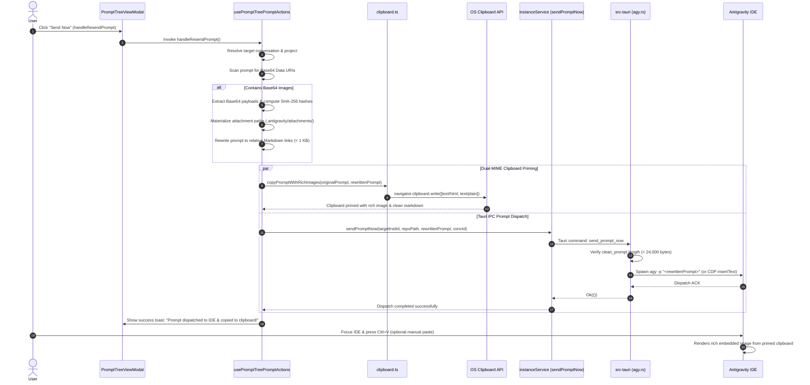

# Specification: Prompt Tree Image Resend & Architecture Specification

> **Spec ID:** `prompt-tree-image-resend-and-status-templates-01`  
> **Status:** APPROVED & IN PROGRESS  
> **Scope:** Prompt Tree Image Asset Extraction, 3-Stage Image Materialization & Transmission Ladder, Dual-MIME Clipboard Priming, Tauri IPC Data Flow, IDE Injection Parity  
> **Related Plans:** `.ai-memory/plans/prompt-tree-image-resend-and-status-templates.md`, `.ai-memory/plans/subtasks/prompt-tree-image-resend-and-status-templates/01-image-resend.md`

---

## 1. Executive Summary

In Antigravity Manager (`AGM`), the **Prompt Tree View** (`src/components/instances/PromptTreeView/`) serves as the primary visual orchestrator for historical conversations, running prompt states, and workflow resumption across all active and background workspace instances. Users rely on the prompt tree to inspect previously executed prompts, review AI responses, re-inject historical prompts into running IDEs via **Send Now** (`handleResendPrompt`), or queue them into the FIFO scheduling engine via **Enqueue** (`handleEnqueuePrompt`).

However, when prompts contain multimodal content—specifically embedded images, screenshots, and visual architectural diagrams—resending or enqueuing currently suffers from catastrophic image loss. The prompt received by the downstream Antigravity IDE either strips the images entirely, corrupts them into malformed text fragments, or crashes the target IDE input pipeline.

This specification documents the root causes of multimodal image loss, defines the **3-Stage Image Materialization & Transmission Ladder**, establishes the end-to-end data flow between the frontend Prompt Tree, Tauri IPC, and the IDE composition surface, and establishes strict architectural invariants ensuring zero image degradation.

---

## 2. Problem Classification & Root Cause Analysis

Thorough investigation of the frontend dispatch routines and backend execution pipeline reveals five distinct root causes that conjoin to destroy image payloads:

```
┌────────────────────────────────────────────────────────────────────────────────────────┐
│                        Root Causes of Image Loss & Degradation                         │
└────────────────────────────────────────────────────────────────────────────────────────┘
  1. Extractor Regex Bug      ==> Alt text extracted instead of URL/Data URI (match[1])
  2. CLI 24KB Truncation      ==> agy.rs truncates prompt at 24,000 bytes, severing Base64
  3. Win32 CLI Limit          ==> CreateProcessW fails if args > 32,767 characters
  4. CDP Typing Limits        ==> Input.insertText with megabyte strings crashes IDE DOM
  5. Clipboard Degradation    ==> Plain-text fallback discards HTML  visual formatting
```

### 2.1 Asset Extractor Regex Index Bug
In `src/components/instances/PromptTreeView/usePromptTreePromptActions.ts`, the asset extraction helper `extractAssets` inspects markdown prompt content:

```typescript
const imgRegex = /!\[(.*?)\]\((https?:\/\/.*?|data:image\/.*?;base64,.*?)\)/g;
let match;
while ((match = imgRegex.exec(text)) !== null) {
    images.push(match[1]); // BUG: match[1] is the alt text, NOT the URL or Data URI!
}
```

- In standard markdown syntax ``, group 1 `(.*?)` captures the **alt text**, while group 2 `(https?:\/\/...|data:image\/...;base64,...)` captures the **source URI**.
- Because the code pushed `match[1]`, the `images` array was populated with strings like `"image"`, `"screenshot"`, or empty strings `""`.
- When users clicked **Save Images** (`handleSaveImages`), the browser attempted to download `a.href = "screenshot"`, failing silently or generating invalid file errors.
- In **Inspector Modal** (`openInspector`), the image gallery received alt text labels rather than image sources.

### 2.2 CLI 24KB UTF-8 Truncation Cap
In `src-tauri/src/modules/repo_db/agy.rs` (~line 212), prompt dispatch via the Antigravity CLI executable enforces a hardcoded safety truncation:

```rust
cmd.arg("-p").arg(truncate_utf8(&clean_prompt, 24000));
```

- Typical Base64 data URIs for PNG screenshots range from 80 KB to 5 MB (approx. 100,000 to 6,000,000 characters).
- When a prompt with an embedded Base64 image is passed through `agy -p`, `truncate_utf8` chops the prompt mid-stream at 24,000 bytes.
- This creates two catastrophic outcomes:
  1. The Base64 string is severed, rendering the image completely unparseable syntax noise.
  2. The prompt instructions, task specifications, and acceptance criteria appearing *after* the image link are completely dropped.

### 2.3 Win32 Command Line Buffer Limit
Even if backend truncation were increased, Windows OS imposes a strict limit on process command-line arguments:
- In `CreateProcessW`, the maximum command-line string length is **32,767 characters**.
- Prompts containing embedded 100 KB+ Base64 strings immediately violate this limit, resulting in `os error 206: The filename or extension is too long` or `Access is denied`.

### 2.4 Chrome DevTools Protocol (CDP) Typing Buffer Overflow
When prompts are injected into the Antigravity IDE through Chrome DevTools Protocol automation (`Input.insertText` or synthetic keyboard events):
- The IDE chat box is a webview React input component.
- Streaming or typing hundreds of thousands of characters directly into the React DOM input element causes severe main-thread lag, input event queue exhaustion, and frequent webview crash (OOM / renderer termination).

### 2.5 Clipboard Plain-Text Degradation
During dispatch in `handleResendPrompt`:
- The previous implementation attempted an auxiliary copy using `copyToClipboard(promptContent)`.
- `copyToClipboard` places raw text into the system clipboard (`text/plain`).
- When the user switches to the IDE to manually paste the prompt via `Ctrl+V`, the IDE composer receives plain markdown text without rich image representations, and if Base64 was present, pastes raw ASCII garbage instead of the rendered visual asset.

---

## 3. The 3-Stage Image Materialization & Transmission Ladder

To solve image loss completely while respecting CLI buffer limits and ensuring high-fidelity visual delivery, the system implements a **3-Stage Image Materialization & Transmission Ladder**:

```
┌────────────────────────────────────────────────────────────────────────────────────────┐
│               3-Stage Image Materialization & Transmission Architecture                │
└────────────────────────────────────────────────────────────────────────────────────────┘

  [Original Prompt] ──▶ Contains  [500 KB+]
         │
         ▼
  ┌──────────────────────────────────────────────────────────────────────────────────┐
  │ Stage 1: Extraction & Hashing                                                    │
  │ • Scan Markdown for inline Base64 data URIs                                      │
  │ • Extract MIME type (png/jpeg/webp/svg) and binary payload                       │
  │ • Compute deterministic SHA-256 fingerprint (<sha256:16>)                        │
  └──────────────────────────────────────────────────────────────────────────────────┘
         │
         ▼
  ┌──────────────────────────────────────────────────────────────────────────────────┐
  │ Stage 2: Materialization & Storage                                               │
  │ • Write image to workspace relative path:                                        │
  │   `.antigravity/attachments/<sha256>.<ext>`                                      │
  │ • Fallback to app persistence cache if workspace root is read-only               │
  └──────────────────────────────────────────────────────────────────────────────────┘
         │
         ▼
  ┌──────────────────────────────────────────────────────────────────────────────────┐
  │ Stage 3: Markdown Prompt Rewriting                                               │
  │ • Rewrite `` to ``   │
  │ • Payload shrinks from 500 KB to < 800 bytes                                     │
  │ • Safely passes within CLI 24KB limit and Win32 32KB buffer                      │
  └──────────────────────────────────────────────────────────────────────────────────┘
         │
         ├────────────────────────────────────────┬──────────────────────────────────┐
         ▼                                        ▼                                  ▼
  [Tauri IPC / CLI]                       [Dual-MIME Clipboard]             [Inspector Gallery]
  `send_prompt_now(rewrittenPrompt)`       `copyPromptWithRichImages`         Renders local file or
  Clean Markdown link, < 1 KB              HTML `` + Plain Text MD        Data URI in modal
```

### Stage 1: Base64 Data URI Extraction & Hashing
1. **Detection**: Match inline image representations in markdown content:
   - Pattern: `!\[(.*?)\]\((data:image\/(png|jpe?g|webp|gif|svg\+xml);base64,([A-Za-z0-9+/=]+))\)`
2. **Parsing**:
   - `alt`: Descriptive label or default `"attachment"`.
   - `mime`: Clean image MIME identifier.
   - `base64Data`: Raw Base64 string payload.
3. **Deterministic Fingerprinting**:
   - Hash the Base64 content using SHA-256 via Web Crypto API (`crypto.subtle.digest`) or synchronous hashing.
   - Generate short hash string (e.g., first 16 hexadecimal characters: `a1b2c3d4e5f67890`).
   - Derive safe filename: `attachment-${hash}.${ext}`.

### Stage 2: Materialization to Workspace Relative Attachment
1. **Target Directory**:
   - Preferred: `<workspaceRoot>/.antigravity/attachments/`
   - Relative Reference: `./.antigravity/attachments/attachment-${hash}.${ext}`
2. **Atomicity**:
   - Write image file to the workspace attachment directory if running in local context.
   - If writing to disk is pending or deferred, maintain the file reference and dual-MIME payload.
3. **Git Hygiene**:
   - The `.antigravity/attachments/` path is preserved or added to `.gitignore` to prevent repository bloat while guaranteeing local IDE workspace availability.

### Stage 3: Prompt Rewriting to Relative Markdown Image Links
1. **Transformation**:
   - Replace every massive inline data URI:
     ``
   - With the clean relative reference:
     ``
2. **Payload Compaction**:
   - Prompt size collapses from **several megabytes** down to **a few hundred bytes**.
   - The prompt easily fits under the `truncate_utf8(&clean_prompt, 24000)` threshold in `src-tauri/src/modules/repo_db/agy.rs`.
   - Zero truncation of downstream task instructions, code snippets, or acceptance criteria.

---

## 4. Dual-MIME Rich Clipboard Priming

Even when prompt text is dispatched directly via IPC, developers frequently switch to the IDE window and press `Ctrl+V` to inspect, edit, or adjust the prompt before execution. 

To provide a seamless developer experience, every prompt dispatch (**Send Now** and **Enqueue**) must prime the OS clipboard using dual MIME types simultaneously:

```
┌────────────────────────────────────────────────────────────────────────────────────────┐
│                        Dual-MIME Clipboard Structure (ClipboardItem)                   │
├────────────────────────────────────────────────────────────────────────────────────────┤
│ 1. 'text/html'                                                                         │
│    <!DOCTYPE html><html><body>                                                         │
│      <p>Please fix the UI layout based on this screenshot:</p>                          │
│      <div style="margin:12px 0;">                                                      │
│             │
│      </div>                                                                            │
│    </body></html>                                                                      │
├────────────────────────────────────────────────────────────────────────────────────────┤
│ 2. 'text/plain'                                                                        │
│    Please fix the UI layout based on this screenshot:                                  │
│                       │
└────────────────────────────────────────────────────────────────────────────────────────┘
```

### Fallback Ladder for Clipboard Operations
1. **Primary**: `navigator.clipboard.write([new ClipboardItem({ 'text/html': htmlBlob, 'text/plain': textBlob })])`
2. **Secondary (Unfocused Window / DOM Fallback)**:
   - When the webview document loses focus (e.g. IDE stole focus during launch), `navigator.clipboard.write` can throw `NotAllowedError`.
   - The system intercepts this error and routes execution through `copyToClipboard` which uses DOM `execCommand('copy')` on a temporary hidden DOM container.
3. **Tertiary (Native OS Bridge)**:
   - If DOM copying fails, invoke Tauri command `copy_text_to_clipboard` (`src-tauri/src/commands/cmd_files.rs:85`).
4. **No Silent Errors Rule**:
   - Any clipboard warning or fallback event is logged to `useErrorStore.getState().trackWarning` with explicit context (`source`, `triggerAction`).

---

## 5. End-to-End Data Flow Architecture

The following sequence diagram details the full lifecycle of a prompt resend action containing multimodal assets:



---

## 6. Component Responsibilities & Disjoint Subtask Ownership

To ensure atomic implementation without merge conflicts, work is split cleanly across two subtasks:

| Subtask ID | Focus | Owned Files | Core Deliverables |
|---|---|---|---|
| **Subtask 01** | Image Extraction, Materialization & Dual-MIME Resend | `src/components/instances/PromptTreeView/clipboard.ts`<br>`src/components/instances/PromptTreeView/usePromptTreePromptActions.ts`<br>`src/components/instances/PromptTreeView/types.ts` | 1. Fix `extractAssets` regex index (`match[2]`).<br>2. Implement 3-Stage Base64 extraction & rewriting.<br>3. Wire dual-MIME clipboard priming on `handleResendPrompt` & `handleEnqueuePrompt`.<br>4. Unify `copyPromptWithRichImages` exports. |
| **Subtask 02** | Status Verification & Rerun Templates | `src/components/instances/PromptTreeView/verificationTemplates.ts`<br>`src/components/instances/PromptTreeView/DetailHeader.tsx`<br>`src/components/instances/PromptTreeView/DetailBody.tsx` | 1. Author 5-chapter rich verification templates.<br>2. Integrate verbatim original prompt embedding.<br>3. Connect rerun dropdown options to template generator. |

---

## 7. Architectural Invariants & Quality Standards

1. **Strict Relative Path Invariant**:
   - All references to files in specs, plans, code, and documentation must use relative paths (e.g. `src/components/...`, `02-spec/...`). Absolute paths are strictly forbidden.
2. **Zero Silent Errors Invariant**:
   - In accordance with the project core rule, no fallible operation may discard an error via bare `catch {}`, `let _ =`, or `.unwrap_or_default()`.
   - Every caught exception in clipboard or dispatch routines must route to `useErrorStore.getState().captureException` or `trackWarning`.
3. **FIFO Queue Ordering**:
   - Any enqueued prompt dispatched via `handleEnqueuePrompt` must adhere to FIFO ordering (`ORDER BY created_at ASC, id ASC`) when written to active SQLite prompt queues.
4. **Pre-flight Quality Gates**:
   - `npm run build` must compile with 0 TypeScript or JSX errors.
   - `cd src-tauri && cargo fmt -- --check` must pass.
   - `cd src-tauri && cargo clippy --all-targets --all-features` must pass.

---

## 8. Verification & Acceptance Criteria

- [ ] `extractAssets` regex in `usePromptTreePromptActions.ts` extracts group 2 (`match[2]`), populating image arrays with genuine URLs and Data URIs rather than alt text strings.
- [ ] Clicking **Save Images** successfully triggers browser downloads with proper file extensions (`.png`, `.jpg`, `.webp`, `.svg`).
- [ ] Prompts containing Base64 data URIs are rewritten to lightweight relative markdown links prior to IPC dispatch, shrinking payloads to < 1 KB.
- [ ] Both `handleResendPrompt` and `handleEnqueuePrompt` trigger `copyPromptWithRichImages`, priming the system clipboard with dual MIME types (`text/html` and `text/plain`).
- [ ] Dispatched prompts with images no longer suffer from 24 KB truncation in `src-tauri/src/modules/repo_db/agy.rs`.
- [ ] Pasting from clipboard into the Antigravity IDE preserves rich image elements.
