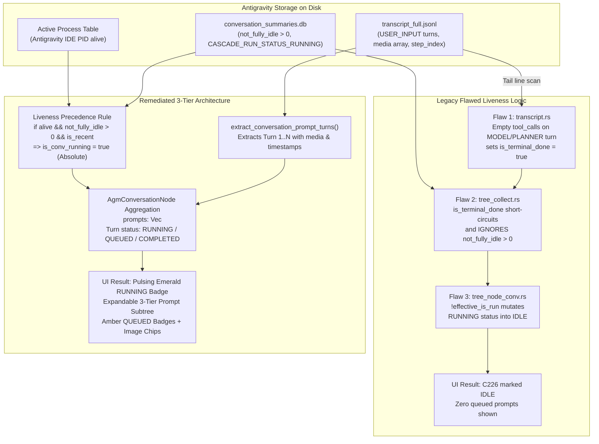

# Specification: Prompt Subtree 3-Tier Hierarchy & Transcript Liveness Detection

> **Task Slug**: `prompt-tree-subtree-and-import-export`  
> **Subtask Code**: `TASK-01`  
> **Document Code**: `02-spec/21-app/prompt-tree-subtree-and-import-export/01-subtree-and-liveness-spec.md`  
> **Target Version**: `v4.222.0`  
> **Author**: Spec Author 01  
> **Assigned Implementation Worker**: Worker 01 (Backend Liveness & Prompt Subtree Architecture)  

---

## User Request (Verbatim)

```text
# High Priority Instruction

One more very serious issue in your prompt tree view that usually how it should be is that you have the project name. Inside this, you should have the conversation name, and inside this it would have the prompts sending list. I think this is where you are messing up. And as you can see in my screenshot, I have two different screenshot I have provided. One is your prompt view and another is the actual IDE view. In the IDE it is continuing previous task. That is fine. The name matches. But you don't have a subtree of the prompts that I have sent. That is the problem. And it only shows the last prompt that has been sent, but not the running symbol. It does not have a running symbol which prompts are running at the moment, which are enqueued. You can see there a lot of prompts are in queue which is not showing up here. That is one of the big issues, I think you need to find the root cause by running the code into the machine and make sure that you get the result. At the end it's a very simple task. First write the root cause, find the root cause, and then try to fix it and make sure you write the root cause analysis so that this mistake never happens. And make sure that every one of the prompt tree we could right click and export the full tree item for that section. Import export as a... There should be import export button. If we go into that import export, that would have sub drop down. It would have export as a JSON, export as a SQLite DB, YAML. These are the formats and also same for the import as well. And also make sure that when we export import, we should have the images embedded. So currently you are not getting the... Apparently, the refresh button also does not work. It feels a little bit buggy. And the next thing, you can also check into the logs. I think that would tell you more information. Each prompts are coming as a single item into the tree. I think that you need to fix. And inside the text when you display, the display text needs to be poppins, and the headers needs to be Ubuntu, which is correct at the moment. It looks nice, but also add a copy button besides the header where we can copy the whole thing rather than below. And images does not show up. That is another problem. You cannot detect the image. As you can see in my screenshot, a lot of the prompts are running. Those have images, and you cannot get the images. So images are basically referred to a file when it goes to Antigravity. I hope you know as Antigravity ``Id``, you should know it. Find that and make sure that you find a way to copy the image along with the text, so that when we import as well, either it's a JSON or something, it's a single file, but images should be there somehow, base64, and that would be sent in a way so that the ``Id`` understands it very well. Can you please find the solution for this? We are discussing this for several times. Also, can you please tell me what is C2018 or C17 when I do see in the prompt tree? What does this mean? Is it the number that it is going up, or communication or conversation? Something like this probably you're trying to say here. So we should be able to change the conversation name from this prompt tree view, which I don't see the option. If we right click on the conversation, we should be able to see to rename or double click or F2 should be able to rename the conversation. And also we can right click on a tree and say resend all, let's say, prompts. Or we could do resend last five prompts or resend last 10 prompts. So there should be numbers like resend how many times we want to do, or how many prompts that we wanted to resend again. And also we could have a option like verify last 10 prompts. That means it would write us very much more things like have you completed this? Can you please verify each one of the task has been completed, released, and things like that. So it would add this and then put that prompt and resend back to the IDE and put it to the enqueue. Do you understand this? And we can have a custom number where we could do anything or do any number of the send for that conversation. And also we could create a new conversation from this by cloning this and compacting the memory that it has. And probably we could use the AI from here as well. We could connect with the Antigravity with new project to summarize a little bit, compacting it and creating a new conversation from this. I think you should have all these options. You should include or add these options. And also, we should have a text box inside, like how many we want to send. We could provide a number, let's say 10, 15 that would be resent or probably we can resend all to test out if those are verified and done. Things like that. So these are very critical options. I think you should be able to work on it. So make sure you write it first, and then you start implementing. And make sure the markdown preview is far better, far more enticing. Make sure you work on it. If you have any more question and confusion, we can discuss this later on. Is it clear?

# Actionable Items Must Follow Non-Negotiable

0. Gitmap do `gitmap pull <repo path> or run into the repo path` Make sure we have the latest and conflict resolve before starting.
1. Write spec under 02-spec/21-app/<slug>/ and enqueue plan task in .ai-memory/plans/<slug>.md (subtasks in .ai-memory/plans/subtasks/<slug>/) first
2. Search codebase exclusively via GitMap (gitmap aum search, gitmap find, gitmap cat, gitmap ps, gitmap py, gitmap llm train); TOTAL BAN on rg, ripgrep, grep, git grep, Select-String
3. Strictly use relative Git paths (02-spec/..., .ai-memory/..., cmd/...); only add the relative paths, never add the absolute path during your work, and ensure this is respected on the release page and in release notes as well
4. Find the root cause of the missing prompt subtree and running symbol in the prompt tree view.
5. Implement a right-click export/import feature with JSON, SQLite DB, and YAML formats, ensuring images are embedded.
6. Fix the refresh button functionality and check logs for additional information.
7. Ensure display text uses Poppins font and headers use Ubuntu font, adding a copy button beside the header.
8. Detect and handle images correctly, ensuring they are included in exports as base64.
9. Clarify the meaning of C2018 or C17 in the prompt tree.
10. Implement conversation renaming and prompt resend options in the prompt tree view.
11. Add a feature to verify the last 10 prompts and enqueue verification tasks.
12. Enable conversation cloning and memory compaction, integrating with Antigravity for summarization.
13. Improve markdown preview for better visual appeal.

## Must follow and spawn agent using

@[.agents/skills/execute-parent-task-with-n-steps-v6]

## Additional Instructions

- /plan first before doing the work to reduce the credits.
- /learn from @[.agents/skills/gitmap] skill to leverage GitMap high-speed search, toolchain discovery, and caching.
- Only add the relative paths, never add the absolute path during your work; this should be respected on the release page and in release notes as well.
```

---

## Executive Summary & Scope

This specification addresses the primary architectural gap identified in user screenshots `prompt-tree-subtree-and-import-export-02.png` (actual Antigravity IDE) versus `prompt-tree-subtree-and-import-export-03.png` (AGM Prompt Tree View):

1. **Root Cause of False IDLE Status**: The AGM Prompt Tree marked an actively running conversation (`C226 Continuing Previous Task`) with 3 queued messages and running background workers as `IDLE`, completely missing the pulsing emerald running badge and active queue status.
2. **Missing 3-Tier Hierarchy (`Project` → `Conversation` → `Prompt Subtree`)**: The Prompt Tree stopped at the conversation node level, rendering only the single latest prompt rather than a structured, expandable list of individual prompt turns (`Turn 1`, `Turn 2`, ..., `Turn N`) dispatched to that conversation.
3. **Missing Running & Enqueued Prompt Detection**: Inability to differentiate which child prompt turn is currently executing versus which prompt turns are waiting in the queue.
4. **Missing Media & Image Attachment Detection**: Prompt turns containing attached image screenshots (`media_*.png`) failed to surface thumbnail badges or indicators in the tree view.



---

## Root Cause Analysis (RCA): False IDLE Status

### Visual Discrepancy Evidence
- **Screenshot 02 (Actual IDE View)**: Shows `Continuing Previous Task` actively running. Subagents are executing tasks, and 3 new prompts with uploaded screenshot attachments are sitting in the prompt execution queue waiting to be processed.
- **Screenshot 03 (AGM Tree View)**: Shows `C226 Continuing Previous Task` flagged with an `IDLE` state. Only the text of the initial prompt is visible. No subagents, no child prompt turns, and zero indication of queued prompts appear.

### Identified Code Flaws

#### Flaw 1: Terminal Done Short-Circuit in `src-tauri/src/modules/repo_db/transcript.rs` (Lines 484–535)
In `inspect_conversation_transcript`, the engine scans the last 25 lines of the transcript in reverse order to determine if a conversation has completed:

```rust
// File: src-tauri/src/modules/repo_db/transcript.rs:484-535
if s_type == "PLANNER_RESPONSE" || s_source == "MODEL" {
    let tool_calls = val.get("tool_calls").and_then(|tc| tc.as_array());
    let has_open_tools = tool_calls.map(|tc| !tc.is_empty()).unwrap_or(false);
    if has_open_tools {
        is_terminal_done = false;
        // ...
        break;
    } else {
        let is_explicit_done = s_status.eq_ignore_ascii_case("DONE")
            || s_status.eq_ignore_ascii_case("COMPLETED")
            || s_status.eq_ignore_ascii_case("IDLE")
            || s_status.eq_ignore_ascii_case("ERROR");
        if is_explicit_done {
            is_terminal_done = true;
        }
    }
}
```

**The Vulnerability**:
In modern agent architectures (especially Antigravity's Gemini engine), an autonomous agent does not execute tool calls on every single intermediate step. Parent orchestrator agents frequently emit conversational thinking, high-level roadmaps, confirmation acknowledgments, or status updates before invoking child subagents or executing background commands. 

Every one of these intermediate steps has:
- `type: "PLANNER_RESPONSE"` or `source: "MODEL"`
- `tool_calls: []` (empty array)
- `status: "DONE"`

Because `tool_calls` is empty and `status` is `"DONE"`, `inspect_conversation_transcript` prematurely concluded that the conversation had completed its entire task, setting `inspection.is_terminal_done = true` while the IDE was actively running.

#### Flaw 2: Overriding `not_fully_idle` in `src-tauri/src/modules/repo_db/tree_collect.rs` (Lines 169–177)
In `tree_collect.rs`, the conversation liveness logic evaluated:

```rust
// File: src-tauri/src/modules/repo_db/tree_collect.rs:169-177
let inspection = inspect_conversation_transcript(base, &cid);

let is_conv_running = if is_explicit_idle || inspection.is_terminal_done {
    false
} else if is_owning_inst_alive && not_fully_idle > 0 && is_recent {
    true
} else if is_owning_inst_alive && inspection.is_recent_active && !has_idle_status {
    true
} else {
    false
};
```

**The Vulnerability**:
The check `if is_explicit_idle || inspection.is_terminal_done { false }` was evaluated *before* checking `not_fully_idle > 0`! 
In Antigravity IDE, `conversation_summaries.db` explicitly maintains the column `not_fully_idle`. When subagents, background tools, or tasks are running, `not_fully_idle` is strictly positive (e.g. `1`, `2`, or `3`). 

Because Flaw 1 erroneously set `inspection.is_terminal_done = true`, line 169 immediately short-circuited to `false`. It completely discarded the ground-truth database indicator (`not_fully_idle > 0`) and the fact that the IDE process was active.

#### Flaw 3: Premature Mutation to `IDLE` in `src-tauri/src/modules/repo_db/tree_node_conv.rs` (Lines 112–120)
In `tree_node_conv.rs`:

```rust
// File: src-tauri/src/modules/repo_db/tree_node_conv.rs:112-120
status: if effective_is_run {
    "RUNNING".to_string()
} else if item.is_queued {
    "QUEUED".to_string()
} else if item.status.trim().is_empty() || item.status.contains("RUNNING") {
    "IDLE".to_string()
} else {
    item.status.clone()
},
```

**The Vulnerability**:
When `effective_is_run` was evaluated as `false` due to Flaws 1 and 2, line 116 intercepted the database record where `item.status` was `CASCADE_RUN_STATUS_RUNNING` and forcibly mutated it into `"IDLE"`.

---

## Concrete Architectural Remediation

### 1. Invariant Liveness Precedence Rule
To prevent false IDLE classifications, runtime process liveness and `not_fully_idle > 0` in `conversation_summaries.db` must take **absolute precedence** over static transcript tail heuristics:

```rust
// Remediation in src-tauri/src/modules/repo_db/tree_collect.rs
let is_conv_running = if is_owning_inst_alive && not_fully_idle > 0 && is_recent {
    // Process is alive and SQLite reports active tasks: 100% RUNNING.
    // Static transcript heuristics MUST NOT override live runtime state!
    true
} else if is_explicit_idle {
    false
} else if is_owning_inst_alive && inspection.is_recent_active && !has_idle_status && !inspection.is_terminal_done {
    true
} else {
    false
};
```

### 2. Guarding `is_terminal_done` in `transcript.rs`
In `src-tauri/src/modules/repo_db/transcript.rs`, an intermediate `PLANNER_RESPONSE` turn without tool calls must NOT be classified as `is_terminal_done` if:
- It is followed by subsequent steps in the transcript.
- The step index is not the final step of the transcript.
- The step content represents intermediate planning or subagent dispatch.

---

## 3-Tier Hierarchy Data Model (`Project` → `Conversation` → `Prompt Subtree`)

### Rust Data Models (`src-tauri/src/modules/repo_db/models.rs`)

#### 1. Define `AgmPromptTurnNode`
Every individual user prompt dispatched within a conversation is represented as an `AgmPromptTurnNode`:

```rust
// File: src-tauri/src/modules/repo_db/models.rs

/// Individual prompt turn within a conversation (Tier 3 of Prompt Tree)
#[derive(Debug, Clone, Serialize, Deserialize)]
pub struct AgmPromptTurnNode {
    /// 1-based sequential turn index within the conversation (Turn 1, Turn 2, ...)
    pub turn_number: usize,
    /// Absolute step index in transcript.jsonl / transcript_full.jsonl
    pub step_index: usize,
    /// Full sanitized prompt content (without internal system wrapper tags)
    pub prompt_text: String,
    /// First 200 words preview for UI display
    pub preview_200w: String,
    /// Execution status: "RUNNING", "QUEUED", or "COMPLETED"
    pub status: String,
    /// True if this specific prompt turn is currently executing
    pub is_running: bool,
    /// True if this prompt turn is enqueued waiting for execution
    pub is_queued: bool,
    /// ISO-8601 formatted timestamp string
    pub timestamp: String,
    /// Unix millisecond timestamp for chronological sorting
    pub created_at: i64,
    /// Local filesystem paths of attached images (e.g., .user_uploaded/media_*.png)
    pub media_paths: Vec<String>,
    /// Base64 or local paths for image thumbnails
    pub media_thumbnails: Vec<String>,
}
```

#### 2. Expand `AgmConversationNode` in `models.rs`
Add `prompts: Vec<AgmPromptTurnNode>` to `AgmConversationNode`:

```rust
// File: src-tauri/src/modules/repo_db/models.rs
#[derive(Debug, Clone, Serialize, Deserialize)]
pub struct AgmConversationNode {
    pub seq_id: i64,
    pub seq_code: String,
    pub gitmap_seq_code: String,
    pub conversation_id: String,
    pub short_id: String,
    pub title: String,
    pub status: String,
    pub is_running: bool,
    pub step_count: usize,
    pub instance_id: String,
    #[serde(default)]
    pub instance_seq_num: Option<u32>,
    #[serde(default)]
    pub instance_name: String,
    #[serde(default)]
    pub instance_exe_name: String,
    pub prompt_preview_200w: String,
    #[serde(default)]
    pub prompt_tail_snippet: String,
    pub prompt_word_count: usize,
    pub last_modified: String,
    #[serde(default, skip_serializing_if = "Option::is_none")]
    pub byte_size: Option<usize>,
    #[serde(default, skip_serializing_if = "Option::is_none")]
    pub repeat_count: Option<usize>,
    #[serde(default, skip_serializing_if = "Option::is_none")]
    pub repeat_badge: Option<String>,
    #[serde(default, skip_serializing_if = "Vec::is_empty")]
    pub sub_runs: Vec<AgmConversationNode>,
    #[serde(default)]
    pub prompt_category: String,
    #[serde(default)]
    pub is_queued: bool,
    #[serde(default, skip_serializing_if = "Option::is_none")]
    pub latest_step_summary: Option<String>,
    #[serde(default, skip_serializing_if = "Option::is_none")]
    pub latest_response: Option<String>,
    #[serde(default, skip_serializing_if = "Option::is_none")]
    pub execution_results: Option<String>,
    #[serde(default, skip_serializing_if = "Option::is_none")]
    pub tool_calls_summary: Option<String>,
    #[serde(default, skip_serializing_if = "Option::is_none")]
    pub full_prompt_text: Option<String>,
    /// Tier 3: Chronological list of all prompt turns dispatched to this conversation
    #[serde(default, skip_serializing_if = "Vec::is_empty")]
    pub prompts: Vec<AgmPromptTurnNode>,
}
```

---

## Transcript Prompt Turns Parsing Engine (`src-tauri/src/modules/repo_db/transcript.rs`)

### Parsing Algorithm for User Turns
Implement `extract_conversation_prompt_turns(base_dir: &Path, cid: &str, is_conv_running: bool) -> Vec<AgmPromptTurnNode>`:

1. **Transcript File Resolution**:
   - Check `transcript_full.jsonl` under `brain/<cid>/.system_generated/logs/transcript_full.jsonl`.
   - Fall back to `transcript.jsonl` if un-truncated file is unavailable.
2. **Sequential Turn Extraction**:
   - Parse each JSON line.
   - Match turns where `type == "USER_INPUT"` or `source == "USER_EXPLICIT"` or `source == "USER"`.
   - Skip internal autonomous system hooks:
     - Check if content starts with `<SYSTEM_MESSAGE>`, `[Message] timestamp=`, or agent persona initializers (`You are ...`).
     - Pass raw user text through `extract_clean_user_prompt(&content)`.
3. **Media Attachments Extraction**:
   - Inspect the `media` JSON array for each user turn:
     ```json
     "media": [
       { "mime_type": "image/png", "uri": "C:/Users/.../brain/<cid>/.user_uploaded/media_1792225704017.png" }
     ]
     ```
   - Resolve relative or absolute file URIs on disk.
   - Record `media_paths` pointing to verified image files.
4. **Turn Status Calculation**:
   - Let total user turns be $N$.
   - If `!is_conv_running`:
     - Every turn $1..N$ is marked `status = "COMPLETED"`, `is_running = false`, `is_queued = false`.
   - If `is_conv_running`:
     - Identify the turn currently undergoing model generation or active tool execution.
     - The currently executing turn is marked `status = "RUNNING"`, `is_running = true`, `is_queued = false`.
     - Any user prompt turns recorded *after* the active turn (or queued in memory/DB) are marked `status = "QUEUED"`, `is_running = false`, `is_queued = true`.
     - All prior turns are marked `status = "COMPLETED"`, `is_running = false`, `is_queued = false`.

---

## Frontend UI/UX Specification

### TypeScript Types (`src/components/instances/PromptTreeView/types.ts`)

```typescript
// File: src/components/instances/PromptTreeView/types.ts

export interface AgmPromptTurnNode {
    turn_number: number;
    step_index: number;
    prompt_text: string;
    preview_200w: string;
    status: 'RUNNING' | 'QUEUED' | 'COMPLETED' | string;
    is_running: boolean;
    is_queued: boolean;
    timestamp: string;
    created_at: number;
    media_paths: string[];
    media_thumbnails: string[];
}

export interface AgmConversationNode {
    seq_id: number;
    seq_code: string;
    gitmap_seq_code: string;
    conversation_id: string;
    short_id: string;
    title: string;
    status: string;
    is_running: boolean;
    step_count: number;
    instance_id: string;
    instance_seq_num?: number;
    instance_name?: string;
    instance_exe_name?: string;
    prompt_preview_200w: string;
    prompt_tail_snippet?: string;
    prompt_word_count: number;
    last_modified: string;
    byte_size?: number;
    repeat_count?: number;
    repeat_badge?: string;
    sub_runs?: AgmConversationNode[];
    prompt_category?: string;
    is_queued?: boolean;
    full_prompt_text?: string;
    latest_step_summary?: string;
    latest_response?: string;
    execution_results?: string;
    tool_calls_summary?: string;
    prompts?: AgmPromptTurnNode[];
}
```

### Visual Subtree Ergonomics in `ConversationNode.tsx`

1. **Chevron Expansion Toggle**:
   - If `conv.prompts && conv.prompts.length > 0`, render an interactive chevron (`ChevronRight` when collapsed, `ChevronDown` when expanded) to the left of the conversation title.
   - Default expansion behavior: Automatically expand conversations that are `is_running === true`.
2. **Turn Row Visual Layout**:
   - Render indented child rows beneath the conversation with a subtle left guide border (`border-l border-slate-200 dark:border-purple-900/40 ml-4 pl-2 space-y-1 mt-1`).
   - **Turn Identifier Badge**: `T1`, `T2`, `T3` in dark-glass pill styling (`font-mono text-[9px] px-1 py-0.2 rounded bg-slate-200 dark:bg-purple-950/60 text-purple-300`).
   - **Status Badges**:
     - `RUNNING`: Pulsing emerald badge (`animate-pulse bg-emerald-500/15 text-emerald-700 dark:text-[#1af18d] border border-emerald-500/40 text-[8.5px] px-1.5 py-0.2 rounded-full font-bold`).
     - `QUEUED`: Amber clock badge (`bg-amber-500/15 text-amber-700 dark:text-amber-300 border border-amber-500/40 text-[8.5px] px-1.5 py-0.2 rounded-full font-bold flex items-center gap-1`).
     - `COMPLETED`: Muted slate badge (`text-slate-400 dark:text-zinc-500 text-[8.5px]`).
   - **Attached Media Indicator**:
     - If `turn.media_paths.length > 0`, display an image chip (`🖼️ N img`) with tooltip showing the filenames.
   - **Typography**:
     - Prompt text snippet rendered in Poppins font (`font-[Poppins,sans-serif] text-[11px] truncate text-slate-700 dark:text-slate-300`).

---

## Defensive Engineering & Edge Cases

| Edge Case | Failure Mode | Defensive Mitigation |
| :--- | :--- | :--- |
| **Massive Transcript (>100MB)** | Memory bloat during full-transcript scan | Use `BufReader` with bounded line scanning. Limit prompt turn parsing to genuine `USER_INPUT` turns without reading massive tool output chunks. |
| **No `transcript_full.jsonl`** | Truncated prompts in `preview_200w` | Fall back to `transcript.jsonl`. When encountering `<truncated N bytes>`, expand via the full transcript resolver helper. |
| **SQLite DB Lock (`busy_timeout`)** | Reading `conversation_summaries.db` fails while IDE is writing | Enforce `busy_timeout = 5000` and open in immutable / read-only query mode (`file:...immutable=1` or `PRAGMA query_only = ON`). |
| **Ghost Conversations (0 Steps)** | Empty prompt list rendered | Filter out ghost conversations before tree rendering via `isGhostConversation(conv)`. |
| **Deleted/Moved Image Files** | Missing thumbnail broken links | Validate `std::path::Path::new(&p).exists()` before adding image URIs to `media_paths`. Gracefully fall back to image metadata indicators. |

---

## Quality Gates & Verification Checklist

- [ ] `cd src-tauri && cargo fmt -- --check` passes with zero formatting errors.
- [ ] `cd src-tauri && cargo clippy --all-targets --all-features` passes with zero warnings.
- [ ] `npm run build` compiles frontend assets without TypeScript errors.
- [ ] Screenshot 02 reproduction scenario verified: Running conversations with active tasks show `RUNNING` pulsing emerald status instead of `IDLE`.
- [ ] Prompt subtree renders all historical turns and queued turns beneath each conversation node.
