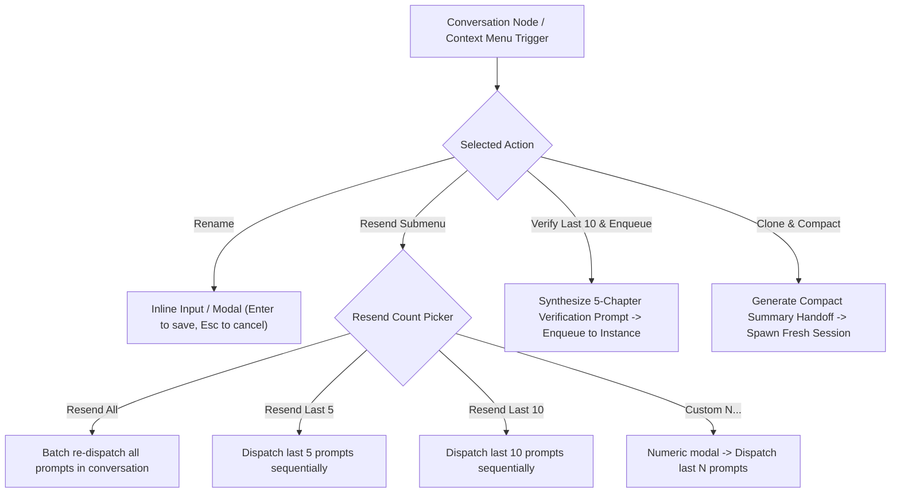
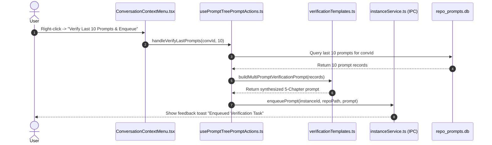
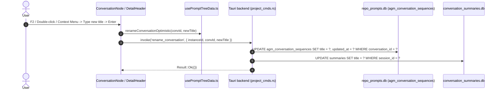

# Specification: Typography (Poppins & Ubuntu), Header Copy Button, Sequence Code Tooltips, Conversation Actions & Charming Markdown Studio

> **Task Slug:** `prompt-tree-subtree-and-import-export`  
> **Spec ID:** `03-typography-actions-and-compact-spec`  
> **Status:** APPROVED & ARCHITECTED  
> **Target Version:** `v4.222.0`  
> **Domain:** Frontend Typography & Theming, UI Action Controls, Context Menu & Hotkeys, Prompt Synthesis & Memory Compaction, Markdown Studio  
> **Related Plans:** `.ai-memory/plans/prompt-tree-subtree-and-import-export.md`, `.ai-memory/plans/subtasks/prompt-tree-subtree-and-import-export/03-typography-actions-and-compact.md`  
> **Target Files:**
> - `index.html` (Google Font CDN: Poppins + Ubuntu)
> - `tailwind.config.js` (Extend `fontFamily.poppins` and `fontFamily.ubuntu`)
> - `src/App.css` (Global typography hierarchy: Ubuntu for headings, Poppins for body/badges)
> - `src/components/instances/PromptTreeView/DetailHeader.tsx` (1-click title copy button beside `<h3>`, `font-ubuntu` titles)
> - `src/components/instances/PromptTreeView/ConversationNode.tsx` (Sequence hover tooltip `Conversation #226`, F2 hotkey, double-click rename)
> - `src/components/instances/PromptTreeView/ProjectNode.tsx` (Sequence hover tooltip `Project #003`)
> - `src/components/instances/PromptTreeView/ConversationContextMenu.tsx` (Rename, Resend submenu, Verify & Enqueue, Clone & Compact)
> - `src/components/instances/PromptTreeView/usePromptTreePromptActions.ts` (Batch prompt resend, verification prompt generator, clone & compact)
> - `src/components/instances/PromptTreeView/verificationTemplates.ts` (5-Chapter verification template for multi-prompt verification)
> - `src/components/instances/PromptTreeView/PromptMarkdownPreview.tsx` (Charming markdown preview, syntax-highlighted codeblocks, lavender thinking cards)
> - `src/components/instances/PromptTreeView/PromptTreeViewModal.tsx` (Dual-pane input/output studio, modal integration)

---

## User Request (Verbatim)

```text
# High Priority Instruction

One more very serious issue in your prompt tree view that usually how it should be is that you have the project name. Inside this, you should have the conversation name, and inside this it would have the prompts sending list. I think this is where you are messing up. And as you can see in my screenshot, I have two different screenshot I have provided. One is your prompt view and another is the actual IDE view. In the IDE it is continuing previous task. That is fine. The name matches. But you don't have a subtree of the prompts that I have sent. That is the problem. And it only shows the last prompt that has been sent, but not the running symbol. It does not have a running symbol which prompts are running at the moment, which are enqueued. You can see there a lot of prompts are in queue which is not showing up here. That is one of the big issues, I think you need to find the root cause by running the code into the machine and make sure that you get the result. At the end it's a very simple task. First write the root cause, find the root cause, and then try to fix it and make sure you write the root cause analysis so that this mistake never happens. And make sure that every one of the prompt tree we could right click and export the full tree item for that section. Import export as a... There should be import export button. If we go into that import export, that would have sub drop down. It would have export as a JSON, export as a SQLite DB, YAML. These are the formats and also same for the import as well. And also make sure that when we export import, we should have the images embedded. So currently you are not getting the... Apparently, the refresh button also does not work. It feels a little bit buggy. And the next thing, you can also check into the logs. I think that would tell you more information. Each prompts are coming as a single item into the tree. I think that you need to fix. And inside the text when you display, the display text needs to be poppins, and the headers needs to be Ubuntu, which is correct at the moment. It looks nice, but also add a copy button besides the header where we can copy the whole thing rather than below. And images does not show up. That is another problem. You cannot detect the image. As you can see in my screenshot, a lot of the prompts are running. Those have images, and you cannot get the images. So images are basically referred to a file when it goes to Antigravity. I hope you know as Antigravity ``Id``, you should know it. Find that and make sure that you find a way to copy the image along with the text, so that when we import as well, either it's a JSON or something, it's a single file, but images should be there somehow, base64, and that would be sent in a way so that the ``Id`` understands it very well. Can you please find the solution for this? We are discussing this for several times. Also, can you please tell me what is C2018 or C17 when I do see in the prompt tree? What does this mean? Is it the number that it is going up, or communication or conversation? Something like this probably you're trying to say here. So we should be able to change the conversation name from this prompt tree view, which I don't see the option. If we right click on the conversation, we should be able to see to rename or double click or F2 should be able to rename the conversation. And also we can right click on a tree and say resend all, let's say, prompts. Or we could do resend last five prompts or resend last 10 prompts. So there should be numbers like resend how many times we want to do, or how many prompts that we wanted to resend again. And also we could have a option like verify last 10 prompts. That means it would write us very much more things like have you completed this? Can you please verify each one of the task has been completed, released, and things like that. So it would add this and then put that prompt and resend back to the IDE and put it to the enqueue. Do you understand this? And we can have a custom number where we could do anything or do any number of the send for that conversation. And also we could create a new conversation from this by cloning this and compacting the memory that it has. And probably we could use the AI from here as well. We could connect with the Antigravity with new project to summarize a little bit, compacting it and creating a new conversation from this. I think you should have all these options. You should include or add these options. And also, we should have a text box inside, like how many we want to send. We could provide a number, let's say 10, 15 that would be resent or probably we can resend all to test out if those are verified and done. Things like that. So these are very critical options. I think you should be able to work on it. So make sure you write it first, and then you start implementing. And make sure the markdown preview is far better, far more enticing. Make sure you work on it. If you have any more question and confusion, we can discuss this later on. Is it clear?

# Actionable Items Must Follow Non-Negotiable

0. Gitmap do `gitmap pull <repo path> or run into the repo path` Make sure we have the latest and conflict resolve before starting.
1. Write spec under 02-spec/21-app/<slug>/ and enqueue plan task in .ai-memory/plans/<slug>.md (subtasks in .ai-memory/plans/subtasks/<slug>/) first
2. Search codebase exclusively via GitMap (gitmap aum search, gitmap find, gitmap cat, gitmap ps, gitmap py, gitmap llm train); TOTAL BAN on rg, ripgrep, grep, git grep, Select-String
3. Strictly use relative Git paths (02-spec/..., .ai-memory/..., cmd/...); only add the relative paths, never add the absolute path during your work, and ensure this is respected on the release page and in release notes as well
4. Find the root cause of the missing prompt subtree and running symbol in the prompt tree view.
5. Implement a right-click export/import feature with JSON, SQLite DB, and YAML formats, ensuring images are embedded.
6. Fix the refresh button functionality and check logs for additional information.
7. Ensure display text uses Poppins font and headers use Ubuntu font, adding a copy button beside the header.
8. Detect and handle images correctly, ensuring they are included in exports as base64.
9. Clarify the meaning of C2018 or C17 in the prompt tree.
10. Implement conversation renaming and prompt resend options in the prompt tree view.
11. Add a feature to verify the last 10 prompts and enqueue verification tasks.
12. Enable conversation cloning and memory compaction, integrating with Antigravity for summarization.
13. Improve markdown preview for better visual appeal.

## Must follow and spawn agent using

@[.agents/skills/execute-parent-task-with-n-steps-v6]

## Additional Instructions

- /plan first before doing the work to reduce the credits.
- /learn from @[.agents/skills/gitmap] skill to leverage GitMap high-speed search, toolchain discovery, and caching.
- Only add the relative paths, never add the absolute path during your work; this should be respected on the release page and in release notes as well.
```

---

## 1. Executive Summary & Defect Decomposition Matrix

The user has highlighted five fundamental UI/UX requirements for the Prompt Tree View:
1. **Typography Refinement**: Display body text must use **Poppins** font (`font-poppins`), while all headers/titles must use **Ubuntu** font (`font-ubuntu`). Currently, `tailwind.config.js` and `index.html` only load Ubuntu, leading to an inconsistent aesthetic.
2. **Top-Level Conversation Header 1-Click Copy**: In `DetailHeader.tsx`, users need to copy the entire prompt or conversation without hunting for the bottom toolbar copy button. A dedicated 1-click Copy button must reside directly beside the conversation title `<h3>`.
3. **Sequence Code Clarification**: Users are confused by sequence codes like `C218`, `C17`, and `P003`. These represent persistent sequential indices (`C` for Conversation, `P` for Project) managed in SQLite (`agm_conversation_sequences`, `agm_project_sequences`). Informative tooltips and UI affordances must explicitly clarify their meaning.
4. **Conversation Lifecycle Actions**:
   - Renaming via triple trigger: inline double-click, F2 keyboard hotkey, and right-click context menu.
   - Multi-Prompt Resend submenu: "Resend All Prompts", "Resend Last 5 Prompts", "Resend Last 10 Prompts", "Resend Custom N Prompts..." (with numeric modal/input).
   - "Verify Last 10 Prompts & Enqueue": Automated synthesis of a 5-Chapter verification audit checking task completion, tests, and release gates, immediately enqueued to the active instance.
   - "Clone Conversation & Compact Memory": Session handoff creating a fresh conversation initialized with a compacted, high-signal summary prompt of the predecessor conversation.
5. **Charming Markdown Preview & Studio**: A dual-pane studio layout (Input Prompt Instruction vs Output Results & Tool Pipeline) featuring syntax-highlighted codeblocks with copy buttons, collapsible reasoning `<thinking>` blocks in translucent lavender glass, and responsive split view.

```
┌───────────────────────────────────────────────────────────────────────────────────────────────────┐
│                                    Defect & Solution Matrix                                       │
├──────────────────────┬────────────────────────────────────────────┬───────────────────────────────┤
│ Defect Class         │ Current State                              │ Target Architecture           │
├──────────────────────┼────────────────────────────────────────────┼───────────────────────────────┤
│ 1. Typography        │ Ubuntu font applied globally to body text; │ Headers: Ubuntu (font-ubuntu) │
│    Configuration     │ Poppins missing from tailwind.config.js,   │ Body/Text: Poppins            │
│                      │ index.html, and CSS definitions            │ (font-poppins, weights 300-700│
├──────────────────────┼────────────────────────────────────────────┼───────────────────────────────┤
│ 2. Header Copy       │ Users must scroll down to Segment 1 of     │ 1-Click Copy button mounted   │
│    Affordance        │ the floating toolbar to copy content       │ directly beside <h3> title in │
│                      │                                            │ DetailHeader.tsx with toast   │
├──────────────────────┼────────────────────────────────────────────┼───────────────────────────────┤
│ 3. Sequence Code     │ Raw badges (C218, P003) appear opaque      │ Clear hover tooltips:         │
│    Ambiguity         │ without contextual explanation             │ "Conversation #226 (Sequential│
│                      │                                            │ AGM Index)", "Project #003"   │
├──────────────────────┼────────────────────────────────────────────┼───────────────────────────────┤
│ 4. Conversation      │ Limited to single-shot rename and copy ID; │ - F2 / double-click / context │
│    Actions           │ no multi-prompt resend, no verification,   │ - Resend All / 5 / 10 / N     │
│                      │ no session clone & memory compact          │ - Verify Last 10 & Enqueue    │
│                      │                                            │ - Clone & Compact Memory      │
├──────────────────────┼────────────────────────────────────────────┼───────────────────────────────┤
│ 5. Markdown Preview  │ Flat rendering without clear input/output  │ Dual-Pane Studio:             │
│    & Studio          │ distinction; plain codeblocks              │ - Left/Top: Input Instruction │
│                      │                                            │ - Right/Bottom: Output/Results│
│                      │                                            │ - Lavender glass <thinking>   │
│                      │                                            │ - Codeblock syntax + copy     │
└──────────────────────┴────────────────────────────────────────────┴───────────────────────────────┘
```

---

## 2. Typography Architecture & Header Copy Button

### 2.1 Font Stack Invariant & Configuration

The application design system establishes a strict two-family typography hierarchy:
- **Heading Font:** **Ubuntu** (`font-ubuntu`, fallback `-apple-system, BlinkMacSystemFont, Segoe UI, Roboto, sans-serif`). Enforced on all `h1`, `h2`, `h3`, `h4`, modal headers, project titles, and conversation title headers.
- **Body & Display Font:** **Poppins** (`font-poppins`, fallback `-apple-system, BlinkMacSystemFont, Segoe UI, Roboto, sans-serif`). Enforced on all body text, paragraph copy, prompt content previews, inspector text, badges, status capsules, and form labels.
- **Code & Sequence Font:** **Ubuntu Mono** (`font-mono`, fallback `ui-monospace, SFMono-Regular, Menlo, Monaco, Consolas, monospace`). Enforced on sequence codes (`C218`, `P003`), PID badges, byte counters, timestamps, and codeblocks.

#### Updates to `index.html`:
```html
<link rel="preconnect" href="https://fonts.googleapis.com">
<link rel="preconnect" href="https://fonts.gstatic.com" crossorigin>
<link href="https://fonts.googleapis.com/css2?family=Poppins:ital,wght@0,300;0,400;0,500;0,600;0,700;1,300;1,400;1,500;1,600;1,700&family=Ubuntu:ital,wght@0,300;0,400;0,500;0,700;1,300;1,400;1,500;1,700&family=Ubuntu+Mono:ital,wght@0,400;0,700;1,400;1,700&display=swap" rel="stylesheet">
```

#### Updates to `tailwind.config.js`:
```javascript
theme: {
    extend: {
        fontFamily: {
            sans: ['Poppins', '-apple-system', 'BlinkMacSystemFont', 'Segoe UI', 'Roboto', 'sans-serif'],
            poppins: ['Poppins', '-apple-system', 'BlinkMacSystemFont', 'Segoe UI', 'Roboto', 'sans-serif'],
            ubuntu: ['Ubuntu', '-apple-system', 'BlinkMacSystemFont', 'Segoe UI', 'Roboto', 'sans-serif'],
            mono: ['Ubuntu Mono', 'ui-monospace', 'SFMono-Regular', 'Menlo', 'Monaco', 'Consolas', 'monospace'],
            'ubuntu-mono': ['Ubuntu Mono', 'monospace'],
        },
    },
}
```

#### Updates to `src/App.css`:
```css
@import url('https://fonts.googleapis.com/css2?family=Poppins:ital,wght@0,300;0,400;0,500;0,600;0,700;1,300;1,400;1,500;1,600;1,700&family=Ubuntu:ital,wght@0,300;0,400;0,500;0,700;1,300;1,400;1,500;1,700&family=Ubuntu+Mono:ital,wght@0,400;0,700;1,400;1,700&display=swap');

/* Headers & Titles: Ubuntu */
h1, h2, h3, h4, .font-heading, .font-ubuntu {
  font-family: 'Ubuntu', -apple-system, BlinkMacSystemFont, 'Segoe UI', 'Roboto', sans-serif;
}

/* Body & Content: Poppins */
body, p, span, div, input, textarea, button, .font-poppins {
  font-family: 'Poppins', -apple-system, BlinkMacSystemFont, 'Segoe UI', 'Roboto', sans-serif;
}

/* Monospace for Code & Sequence Identifiers */
code, pre, kbd, samp, .font-mono {
  font-family: 'Ubuntu Mono', ui-monospace, SFMono-Regular, Menlo, Monaco, Consolas, monospace;
}
```

### 2.2 1-Click Header Copy Button beside Conversation Title

In `src/components/instances/PromptTreeView/DetailHeader.tsx` (lines 304–314), the conversation title `<h3>` is rendered in Row 1. Directly beside this heading, a high-affordance 1-click Copy button is mounted:

```tsx
<div className="flex items-center gap-1.5 min-w-0">
    <h3
        onDoubleClick={(e) => {
            e.stopPropagation();
            setIsEditingTitle(true);
        }}
        className="text-xs font-bold font-ubuntu text-slate-900 dark:text-white truncate max-w-[200px] md:max-w-xs cursor-pointer hover:text-purple-600 dark:hover:text-purple-300 transition-colors"
        title={`${selectedConversation.title || selectedConversation.short_id} (Double-click to rename)`}
    >
        {selectedConversation.title || selectedConversation.short_id}
    </h3>

    {/* 1-Click Quick Copy Button beside Title */}
    <button
        type="button"
        onClick={handleQuickCopyHeader}
        data-ui-name="header-quick-copy-btn"
        className="p-1 rounded-md text-slate-400 hover:text-purple-600 dark:hover:text-purple-300 hover:bg-purple-50 dark:hover:bg-purple-950/40 transition-all duration-150 ease-out active:scale-95 cursor-pointer shrink-0"
        title="Copy full prompt text & attachments (1-click)"
    >
        {isHeaderCopied ? (
            <Check className="w-3.5 h-3.5 text-emerald-500 animate-in zoom-in-75 duration-150" />
        ) : (
            <Copy className="w-3.5 h-3.5" />
        )}
    </button>
</div>
```

**Feedback Toast Behavior:**
- Clicking copies full prompt text and embedded base64 images via `copyPromptWithRichImages`.
- Replaces the icon with `<Check className="text-emerald-500" />` for 2,000ms.
- Triggers a subtle notification pill toast: `"Copied full prompt to clipboard"`.

---

## 3. Sequence Code (`C218`, `C17`, `P003`) Clarification

### 3.1 Architectural Clarification: What `C` and `P` Mean

The sequence codes in AGM provide human-friendly, deterministic sequence numbers that persist across sessions and survive workspace restarts:

| Prefix | Name | Table in `repo_prompts.db` | Description | Example |
| :--- | :--- | :--- | :--- | :--- |
| `C` | **Conversation Sequence Code** | `agm_conversation_sequences` | Monotonically increasing sequential index assigned to each unique conversation session across instances. | `C017` = 17th conversation created in AGM.<br/>`C218` = 218th conversation created in AGM. |
| `P` | **Project Sequence Code** | `agm_project_sequences` | Monotonically increasing sequential index assigned to each registered workspace repository directory. | `P001` = Primary AGM repository.<br/>`P003` = Third registered project directory. |

### 3.2 Explanatory Tooltip & Visual Affordance

To completely eliminate user confusion, sequence badges in `ConversationNode.tsx`, `ProjectNode.tsx`, and `DetailHeader.tsx` are upgraded with descriptive tooltips:

```tsx
// In ConversationNode.tsx:
<span
    className={cn(
        'text-[9px] font-mono px-1 py-0.2 rounded-[3px] shrink-0 font-medium whitespace-nowrap cursor-help',
        isSelected
            ? 'bg-blue-700/80 text-white'
            : 'bg-slate-200/90 dark:bg-[#40285e] text-slate-600 dark:text-cyan-300'
    )}
    title={`Conversation #${conv.seq_code?.replace(/^C/i, '') || '001'} (Sequential AGM Index · ${conv.short_id || 'ID'})`}
>
    {formatSeqBadge(conv.seq_code, 'C001')}
</span>
```

```tsx
// In ProjectNode.tsx:
<span
    className="text-[9px] font-mono px-1 py-0.2 rounded-[3px] bg-purple-500/10 text-purple-600 dark:text-purple-300 border border-purple-500/20 shrink-0 font-medium cursor-help"
    title={`Project #${project.seq_code?.replace(/^#?P/i, '') || '001'} (Sequential Project Index · ${project.repo_path})`}
>
    {formatSeqBadge(project.seq_code, '#P001')}
</span>
```

---

## 4. Conversation Actions Architecture



### 4.1 Conversation Renaming (Double-Click, F2 Hotkey, Context Menu)

1. **Trigger Modes:**
   - **Double-click:** Double-clicking the title text in `ConversationNode.tsx` or `DetailHeader.tsx` activates inline editing mode.
   - **F2 Hotkey:** Pressing `F2` while a conversation row has keyboard focus immediately enters edit mode.
   - **Right-Click Context Menu:** Selecting "Rename Conversation" from `ConversationContextMenu.tsx` invokes the edit state.
2. **Persistence Guarantee:**
   - Optimistically updates React state and Zustand store `useInstanceStore`.
   - Dispatches Tauri command `rename_conversation(instance_id, conversation_id, new_title)`.
   - Persists to both `agm_conversation_sequences` in `repo_prompts.db` and the instance's `conversation_summaries.db`.
   - Reverts state with an error toast if SQLite write fails.

### 4.2 Multi-Prompt Resend Submenu

When right-clicking a conversation in the tree view or clicking the secondary dropdown in the detail header, the **Multi-Prompt Resend** submenu is available:
- **Resend All Prompts (`Count: All`):** Iterates through all prompts recorded for the conversation in FIFO order and dispatches them with a 500ms safety interval.
- **Resend Last 5 Prompts (`Count: 5`):** Extracts the trailing 5 prompt submissions and dispatches them sequentially.
- **Resend Last 10 Prompts (`Count: 10`):** Extracts the trailing 10 prompt submissions and dispatches them sequentially.
- **Resend Custom N Prompts...:** Opens an inline popover or modal containing a numeric input `[ 1..100 ]` and a "Send Batch" confirmation button.

```typescript
export interface MultiPromptResendOptions {
    conversationId: string;
    instanceId: string;
    repoPath: string;
    count: number | 'all';
    delayMs?: number; // Default 500ms between prompts
}

export async function dispatchMultiPromptResend(options: MultiPromptResendOptions): Promise<{ sent: number; failed: number }>;
```

### 4.3 "Verify Last 10 Prompts & Enqueue"

This action addresses the user's specific request:
> *"And also we could have a option like verify last 10 prompts. That means it would write us very much more things like have you completed this? Can you please verify each one of the task has been completed, released, and things like that. So it would add this and then put that prompt and resend back to the IDE and put it to the enqueue."*

When triggered:
1. The system retrieves the last 10 prompts submitted to the conversation.
2. It synthesizes a structured 5-Chapter **Autonomous Verification Prompt** adhering to the following blueprint:
   - **Chapter 1: Verification Mandate & Goal**: High-priority instruction to audit, verify, and confirm full task completion.
   - **Chapter 2: Grounded Inventory of Last 10 Prompts**: Bulleted list summarizing each of the 10 prior user directives.
   - **Chapter 3: Verification Dimensions**:
     * *Completeness Check:* Is every requirement implemented, tested, and passing?
     * *Build & Pre-flight Gate:* Run `cargo fmt -- --check`, `cargo clippy`, and `npm run build`.
     * *CI/CD & GitMap Status:* Check pipeline health via `gitmap pe -t` or `gitmap e d`.
     * *Attribution & Release:* Ensure changelogs attribute `@aukgit` and follow release protocol.
   - **Chapter 4: Concrete Deliverables**: Demand a structured Markdown checklist with explicit PASS / FAIL grades.
   - **Chapter 5: Execution Directive**: Instructions to remedy any discovered deficiencies immediately.
3. The synthesized prompt is enqueued into the FIFO background task queue via `enqueuePrompt(instanceId, repoPath, verificationPrompt)`.
4. A notification toast confirms: `"Synthesized 10-prompt audit & enqueued to instance"`.

### 4.4 "Clone Conversation & Compact Memory"

This action addresses the session handoff requirement:
> *"And also we could create a new conversation from this by cloning this and compacting the memory that it has. And probably we could use the AI from here as well. We could connect with the Antigravity with new project to summarize a little bit, compacting it and creating a new conversation from this."*

When triggered:
1. **Compaction Synthesis:**
   - Extracts all prompt iterations, subagent instructions, and final tool outputs from the current conversation transcript.
   - Synthesizes a structured **Session Handoff & Memory Compaction Context**:
     * Summary of verified achievements and active files.
     * Architectural invariants established in the session.
     * Pending tasks and unresolved edge cases.
     * Clean handoff prompt instructing the agent in the new session to resume seamlessly without context loss.
2. **Session Initialization:**
   - Allocates a fresh conversation identifier in `repo_prompts.db`.
   - Injects the compacted context as the seeding initial prompt.
   - Focuses or launches the target Antigravity instance in the fresh conversation.

---

## 5. Charming Markdown Preview & Studio

### 5.1 Dual-Pane Studio Layout (Input vs Output)

In `src/components/instances/PromptTreeView/PromptTreeViewModal.tsx` and `PromptInstructionView.tsx`, the preview is structured as a **Dual-Pane Studio**:

```
┌────────────────────────────────────────────────────────────────────────────────────────────────────────┐
│                                 Charming Markdown Preview Studio                                       │
├───────────────────────────────────────────────────┬────────────────────────────────────────────────────┤
│                  INPUT PANE                       │                   OUTPUT PANE                      │
│             (Prompt Instruction)                  │             (Results & Tool Pipeline)              │
├───────────────────────────────────────────────────┼────────────────────────────────────────────────────┤
│ - 4-Tier Origin Badge (USER_PROMPT, SUBAGENT...)  │ - Execution Status Capsule (RUNNING, COMPLETED)    │
│ - Typography: font-poppins text-slate-800         │ - Translucent Lavender Glass <thinking> block      │
│ - Attached Images Gallery (Base64 click-to-zoom)  │ - Tool Call Execution Accordions                   │
│ - Codeblocks with language badges & copy button   │ - Streamed response text in font-poppins           │
│ - Full Word Count & Byte Footprint Pill           │ - Performance Telemetry (Duration, Token Usage)    │
└───────────────────────────────────────────────────┴────────────────────────────────────────────────────┘
```

**Responsive Modes:**
- **Split View (Dual-Pane):** For screens $\ge 1024\text{px}$, input and output render side-by-side with an adjustable divider.
- **Tabbed View (Stacked):** For screens $< 1024\text{px}$, toggles between `[ Input ]` and `[ Output ]` tabs.

### 5.2 Translucent Lavender Glass Reasoning Cards (`<thinking>`)

All `<thinking>` blocks emitted by Gemini or Claude models are rendered inside translucent lavender glass cards:
```tsx
<div className="my-3 overflow-hidden rounded-xl border border-purple-500/30 bg-purple-950/20 backdrop-blur-md shadow-xs">
    <button
        type="button"
        onClick={() => setIsExpanded((prev) => !prev)}
        className="w-full flex items-center justify-between px-3.5 py-2 text-left bg-purple-500/5 hover:bg-purple-500/10 transition-colors cursor-pointer"
    >
        <div className="flex items-center gap-2 text-xs font-semibold text-purple-700 dark:text-purple-300 font-ubuntu">
            <Brain className="w-3.5 h-3.5 text-purple-500 shrink-0" />
            <span>Agent Reasoning Trace</span>
            <span className="text-[10px] font-mono font-normal opacity-75">
                ({wordCount} words)
            </span>
        </div>
        <div className="flex items-center gap-1 text-[11px] text-purple-500 font-poppins">
            <span>{isExpanded ? 'Collapse' : 'Expand'}</span>
            {isExpanded ? <ChevronDown className="w-3.5 h-3.5" /> : <ChevronRight className="w-3.5 h-3.5" />}
        </div>
    </button>
    {isExpanded && (
        <div className="px-3.5 py-2.5 text-xs font-poppins leading-relaxed text-purple-900/90 dark:text-purple-200/90 border-t border-purple-500/20 whitespace-pre-wrap select-text">
            {thinkingContent}
        </div>
    )}
</div>
```

### 5.3 Charming Syntax-Highlighted Codeblocks

Fenced code blocks (` ```lang ... ``` `) are rendered with:
- Top bar with language tag (uppercase, purple font) and one-click copy button with copy feedback.
- Monospace font (`font-mono` / Ubuntu Mono).
- Subtle dark-glass border and background contrast.

---

## 6. Sequence & State Flow Diagrams

### 6.1 Multi-Prompt Resend & Verification Enqueue Flow



### 6.2 Conversation Renaming Sequence



---

## 7. Acceptance Criteria & Verification Protocol

| ID | Category | Requirement / Verification Step | Expected Outcome |
| :--- | :--- | :--- | :--- |
| **AC-01** | Typography | Inspect `index.html` and `tailwind.config.js`. | Poppins and Ubuntu fonts loaded from Google Fonts CDN and declared in Tailwind configuration. |
| **AC-02** | Typography | Inspect CSS rendering of all headings (`h1`, `h2`, `h3`, `h4`, modal titles). | Rendered in `font-ubuntu` (`family: 'Ubuntu'`). |
| **AC-03** | Typography | Inspect CSS rendering of body text, prompt text, preview markdown, and badge labels. | Rendered in `font-poppins` (`family: 'Poppins'`). |
| **AC-04** | Header Copy | Double-check `DetailHeader.tsx` row 1. | 1-Click Copy button is rendered directly beside conversation title `<h3>`, copies full text/images, shows `<Check>` toast for 2,000ms. |
| **AC-05** | Sequence Codes | Hover over `C218` or `P003` badge. | Clean tooltip appears: `Conversation #218 (Sequential AGM Index)` or `Project #003 (Sequential Project Index)`. |
| **AC-06** | Renaming | Press `F2` on selected conversation or double-click title text. | Enters inline text editing; pressing `Enter` persists title to both SQLite databases; `Escape` cancels. |
| **AC-07** | Multi-Resend | Right-click conversation -> select "Resend Last 5 Prompts". | Prompts are extracted and dispatched sequentially to target instance with 500ms intervals. |
| **AC-08** | Verify Enqueue | Right-click conversation -> select "Verify Last 10 Prompts & Enqueue". | Synthesizes a structured 5-Chapter prompt audit and enqueues to the active instance queue. |
| **AC-09** | Clone & Compact | Right-click conversation -> select "Clone Conversation & Compact Memory". | Produces a compacted memory handoff summary and initializes a fresh session. |
| **AC-10** | Studio Preview | Open inspector or view markdown preview. | Codeblocks render with language tags and copy buttons; `<thinking>` tags render in translucent lavender glass. |
