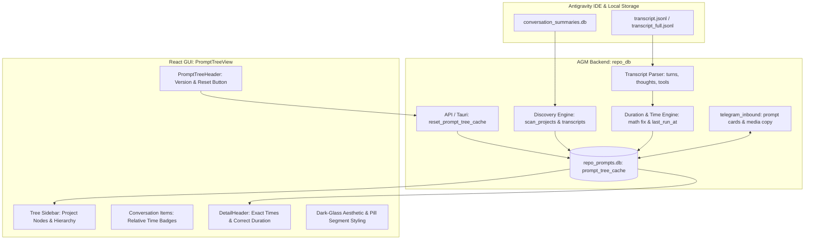

# Architecture Specification: Prompt Tree View Synchronization and UI Enhancement

## 1. Executive Summary & Purpose
The Antigravity-Manager (AGM) Prompt Tree View is designed to provide high-fidelity real-time visibility into all active and completed Antigravity IDE conversations, prompt turns, tool executions, and subagent hierarchies across all managed workspaces.

However, recent user inspections and visual evidence (`assets/screenshots/prompt-tree-view-synchronization-and-ui-enhancement-01.png` vs. `02.png`) revealed critical synchronization, mathematical, hierarchy, and design discrepancies:
1. **Conversation Indexing & Workspace Omission**: Conversations from other active workspaces (such as `coding-guidelines` with `Letterly Prompt Length Optimization`, or older conversations in `gitmap` like `Read & Understand: agy-rec-real-217945324` from 6 hours ago) are either missing, filtered out, or fail to sync promptly with the IDE's authentic conversation history.
2. **Incorrect Conversation Hierarchy & Parent-Child Nesting**: In the tree view, distinct top-level conversations (e.g. `Read & Understand: agy-rec-real-65069705`) were incorrectly rendered as nested sub-items beneath unrelated conversations (such as `C209 ENT Goal Migration And Email Commands`), rather than appearing as sibling conversations under their proper project node.
3. **Erroneous Duration Arithmetic**: The conversation header displayed `11h 39m (18:40 -> 22:19)`, which is mathematically incorrect (the span from 18:40 to 22:19 is 3 hours 39 minutes, not 11 hours 39 minutes).
4. **Missing Relative Last-Run Time Badges**: Unlike the IDE which prominently displays intuitive relative recency (`now`, `30m`, `6h`, `12h`, `1d`), AGM lacked human-readable relative last-run time badges on conversation nodes.
5. **Non-Functional Reset & Version Invalidation**: The Reset button did not thoroughly flush the SQLite prompt tree caches or reload backend states, and version bumps did not automatically invalidate stale tree caches.
6. **Flat UI & Telegram Feature Gap**: The Prompt Tree View UI lacked visual polish, dark-glass depth, and refined pill styling. Telegram remote control also lacked full prompt image attachment view, copy-back, and high-fidelity interaction capabilities.

## 2. Architectural Blueprint & Data Flow

## 3. Subsystem Invariants & Core Technical Requirements

### 3.1 FIFO Ordering & Flat Conversation Siblings
- Top-level conversations within a project must NEVER be nested inside another conversation unless they are genuine subagents spawned by that parent conversation (verified via parent transcript `invoke_subagent`).
- Conversations must be ordered by `last_run_at DESC` (or `created_at DESC` for historical view), ensuring the most recently active prompt in the IDE appears at the top of the project's conversation list.

### 3.2 Duration Calculation Invariant
- The duration displayed as `(start_time -> end_time)` must equal `end_time - start_time` without timezone drift or epoch hour offsets.
- Formula: `duration_ms = end_timestamp_ms - start_timestamp_ms`. If `duration_ms < 0`, fallback to `0`. Format as `Xh Ym` or `Xm Ys`.

### 3.3 Relative Last-Run Time Badges
- Every conversation node must compute and render a relative last-run badge matching IDE semantics:
  - `< 2 minutes`: `now` (with emerald pulsing status dot).
  - `< 60 minutes`: `${minutes}m` (e.g. `30m`).
  - `< 24 hours`: `${hours}h` (e.g. `6h`, `12h`).
  - `>= 24 hours`: `${days}d` (e.g. `1d`, `2d`).
- Hover tooltip must display full ISO/local timestamp: `YYYY-MM-DD HH:mm:ss`.

### 3.4 Reset Cache & Version Bump Invalidation
- The Reset button must call `reset_prompt_tree_cache` (or Tauri invoke `cmd_reset_prompt_tree`), which:
  1. Executes `DELETE FROM prompt_tree_cache`.
  2. Clears in-memory cache slots.
  3. Immediately triggers fresh discovery from disk transcripts.
- When AGM boots with a different version or after an update, `last_seen_version` in settings/cache is compared against current `app_version`. If mismatched, cache is automatically invalidated.
- The Prompt Tree View header must explicitly render the active version badge (e.g. `v4.238.0`).

### 3.5 High-End Dark-Glass UI & Telegram Media Parity
- Replace flat borders with modern `backdrop-blur-md bg-zinc-950/80 border-white/10 shadow-2xl`.
- Adjacent actions are grouped in segmented pill capsules (`rounded-full`, shared border, dark-glass styling).
- Telegram inbound commands `/prompts` and `/inspect` provide interactive buttons to view prompt details, fetch attached images, and send images directly to Telegram.
