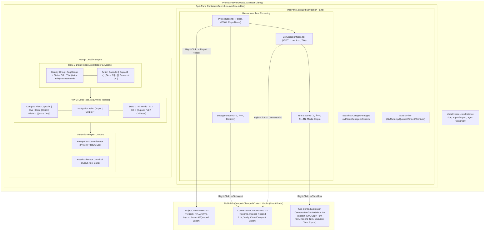
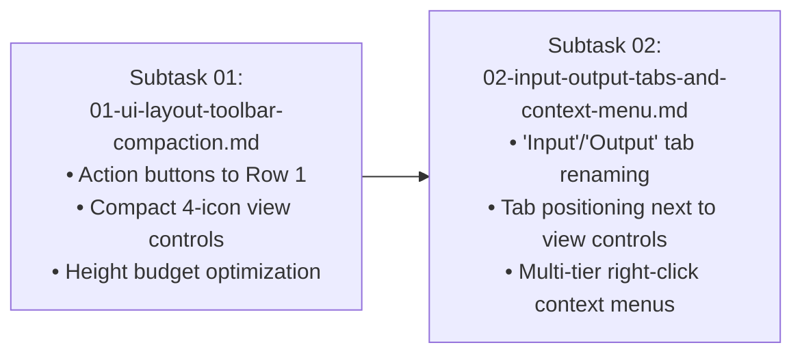

# Architecture Specification: Prompt View Layout Compaction, Header Action Relocation, Compact View Controls, Input/Output Tabs, and Multi-Tier Tree Context Menus

> **Spec ID:** `02-spec/21-app/prompt-view-layout-and-action-fixes/01-architecture-spec.md`  
> **Status:** APPROVED & READY FOR IMPLEMENTATION  
> **Author:** Spec Author 01 (Frontend Architecture & UI Systems)  
> **Scope:** Header Action Relocation (`DetailHeader.tsx`), Compact View Controls & Input/Output Tabs (`DetailTabs.tsx`), Multi-Tier Tree Context Menus (`ProjectContextMenu.tsx`, `ConversationContextMenu.tsx`, `ConversationNode.tsx`, `ProjectNode.tsx`, `TreePanel.tsx`), Modal Orchestration (`PromptTreeViewModal.tsx`, `PromptTreeDetail.tsx`)  
> **Related Subtasks:**
> - [01-ui-layout-toolbar-compaction.md](../../../.ai-memory/plans/subtasks/prompt-view-layout-and-action-fixes/01-ui-layout-toolbar-compaction.md)  
> - [02-input-output-tabs-and-context-menu.md](../../../.ai-memory/plans/subtasks/prompt-view-layout-and-action-fixes/02-input-output-tabs-and-context-menu.md)  
> **Visual Reference:** `assets/screenshots/prompt-view-layout-and-action-fixes-01.png`  
> **Coding Guidelines:** [coding-guidelines.md](../../../coding-guidelines.md) | [AGENTS.md](../../../AGENTS.md)

---

## 1. Executive Summary & Problem Classification

The Antigravity Manager (`AGM`) **Prompt Tree View** (`src/components/instances/PromptTreeView/`) is the central visual orchestrator for workspace instances, repository projects, conversation threads, subagent tasks, and individual prompt execution turns.

A visual design audit (captured in `assets/screenshots/prompt-view-layout-and-action-fixes-01.png`) identified critical ergonomic deficiencies and layout redundancies that constrain viewport visibility on standard displays (1080p and laptop screens):

1. **Header Space Underutilization vs Toolbar Clutter:**
   - The top conversation header row (Row 1) currently contains sequence badges, status indicators, the title, and the `#C{seq} · default` breadcrumb tag, leaving over 50% of the horizontal header width completely empty on the right.
   - The primary action buttons (`[ Copy All | v ]`, `[ Send N | v ]`, `[ Rerun xN | v ]`) occupy a dedicated secondary row (Row 2), forcing the navigation tabs and view controls into an awkward split configuration.
2. **Text-Heavy, Disconnected View Mode Controls:**
   - The view mode controls (`[ Preview ]`, `[ Raw ]`, `[ Edit ]`) render verbose text labels (`Eye` + "Preview", `Code` + "Raw", `Edit3` + "Edit"), while the `[ Details ]` button sits detached as a separate rectangular badge.
   - These controls consume excessive horizontal space and visual weight, violating the compact dark-glass segmented capsule standards defined in `AGENTS.md`.
3. **Verbose Tab Labels & Vertical Row Bloat:**
   - The primary navigation tabs currently use lengthy names: `"Prompt Instruction"` and `"AI Results & Outputs"`.
   - Because the action buttons occupy the left side of Row 2, the tabs are forced to the right, and the view mode controls + stats are pushed down into a third row (Row 3). This 3-row stacked header consumes over **110px of vertical space**, pushing the actual prompt markdown and output viewports downward.
4. **Incomplete Right-Click Context Menu Coverage:**
   - Right-click handling across the tree view is fragmented: while basic menus exist for conversations, subagents and prompt execution turns lack dedicated turn-level actions (e.g. Inspect Turn, Copy Turn Text, Resend Turn, Enqueue Turn).
   - Global right-click event interception in `PromptTreeViewModal.tsx` uses fragile DOM query selectors (`[title^="Project: "]`) that fail when clicking child elements or non-matching titles.

This specification details the architectural redesign to eliminate vertical bloat, consolidate view controls into a compact 4-icon segmented capsule, rename and relocate navigation tabs to `"Input"` and `"Output"`, position action buttons in the header row, and provide robust multi-tier context menus for Projects, Conversations, and Turns.

---

## 2. Visual Analysis & Design Directives

### 2.1 Analysis of `assets/screenshots/prompt-view-layout-and-action-fixes-01.png`

The reference screenshot highlights the precise layout transformation using red bounding boxes and directional arrows:

```
┌────────────────────────────────────────────────────────────────────────────────────────────────────────┐
│ Current Layout: 3 Rows (High Vertical Bloat ~115px)                                                   │
├────────────────────────────────────────────────────────────────────────────────────────────────────────┤
│ Row 1: [ C198 ] [ IDLE ]  GitMap CLI Pull And Conflict Fixes [Copy] #C198 · default   [EMPTY SPACE] ◄─┐│
│                                                                                                        ││
│ Row 2: [ Copy All | v ] [ Send N | v ] [ Rerun x2 | v ] ───────(MOVE UP TO ROW 1)──────────────────────┘│
│        [Tabs:  Prompt Instruction  |  AI Results & Outputs •] ───(RENAME TO "Input" / "Output")────────┐│
│                                                                                                        ││
│ Row 3: 2722 words · 21.7 KB  [v Expand Full]             [ Preview ] [ Raw ] [ Edit ]  [ Details ]     ││
│                                                          └───(COMPACT 4 ICONS, MOVE LEFT NEXT TO TABS)─┘│
├────────────────────────────────────────────────────────────────────────────────────────────────────────┤
│ Content Area: Markdown Preview / Raw Text / AI Output (Constrained Viewport)                           │
└────────────────────────────────────────────────────────────────────────────────────────────────────────┘
```

### 2.2 Target Layout Topology (2 Compact Rows ~68px)

```
┌────────────────────────────────────────────────────────────────────────────────────────────────────────┐
│ Target Layout: 2 Compact Rows (Reclaims ~45px Vertical Viewport)                                      │
├────────────────────────────────────────────────────────────────────────────────────────────────────────┤
│ Row 1 (Header):                                                                                        │
│ [ C198 ] [ IDLE ] GitMap CLI Pull And Conflict Fixes [Copy] #C198 · default                            │
│                                               [ Copy All | v ] [ Send N | v ] [ Rerun xN | v ] (Right) │
├────────────────────────────────────────────────────────────────────────────────────────────────────────┤
│ Row 2 (Unified Toolbar):                                                                               │
│ [ Eye | Code | Edit3 | FileText ]   [ Input | Output • ]                 2722 words · 21.7 KB [Expand] │
│ (Compact View Controls - Left)      (Renamed Navigation Tabs)            (Metadata & Toggle - Right)   │
├────────────────────────────────────────────────────────────────────────────────────────────────────────┤
│ Content Area: Maximized Viewport for Markdown / Monospace / Terminal Output                            │
└────────────────────────────────────────────────────────────────────────────────────────────────────────┘
```

---

## 3. Architecture & Subsystem Decomposition



---

## 4. UI Layout Specifications

### 4.1 Row 1: Header Row & Action Buttons Relocation

#### Current State
- `DetailHeader.tsx` renders Row 1 containing identity badges on the left, but leaves the right side empty.
- Row 2 renders the action capsule on the left and navigation tabs on the right.

#### Target State
- Action Buttons (`[ Copy All | v ]`, `[ Send N | v ]`, `[ Rerun xN | v ]`) are relocated into Row 1, positioned on the right using a flex container with `justify-between` and `items-center`.
- Left Side:
  - Origin Tier icon + Sequence code (`[ C198 ]`).
  - Status capsule (`[ RUNNING PID:1234 00:45 ]`, `[ QUEUED ]`, or `[ IDLE ]`).
  - Conversation Title with double-click inline renaming and 1-click title copy button.
  - Instance Breadcrumb tag (`#C198 · default`).
- Right Side:
  - Unified segmented dark-glass action capsule (`[ Copy All | v ] [ Send N | v ] [ Rerun xN | v ]`).
  - When viewport width drops below `768px`, the action capsule wraps gracefully with `flex-wrap gap-2`.
- Dropdown Popovers (`isCopyMenuOpen`, `isSendMenuOpen`, `isRerunMenuOpen`):
  - Popovers anchor to the bottom-right of the Row 1 action capsule (`absolute right-0 top-full mt-1.5 z-50`).
  - Styled with dark-glass backdrop blur (`bg-white dark:bg-[#171025] border border-slate-200 dark:border-[#40285e] shadow-xl p-2 rounded-xl backdrop-blur-md`).

### 4.2 Row 2: Unified Toolbar with Compact View Controls & "Input"/"Output" Tabs

#### 4.2.1 Compact View Controls Capsule (Icons Only, No Text)
- The four view controls are consolidated into a single contiguous segmented capsule:
  1. **Preview**: `<Eye className="w-3.5 h-3.5" />`  
     Tooltip: `"Rich Markdown Preview"` | `aria-label="Preview markdown"`
  2. **Raw**: `<Code className="w-3.5 h-3.5" />`  
     Tooltip: `"Plain Monospace Raw View"` | `aria-label="Raw text"`
  3. **Edit**: `<Edit3 className="w-3.5 h-3.5" />`  
     Tooltip: `"Editable Textarea Mode"` | `aria-label="Edit prompt"`
  4. **Details**: `<FileText className="w-3.5 h-3.5" />`  
     Tooltip: `"Full Conversation & Turn Details"` | `aria-label="Conversation details"`
- **Styling Invariants:**
  - Container: `inline-flex items-center rounded-full bg-slate-100/90 dark:bg-[#120a1f]/90 backdrop-blur-md border border-slate-200/80 dark:border-purple-500/30 p-0.5 divide-x divide-slate-200/70 dark:divide-purple-500/20 shadow-2xs shrink-0`.
  - Active button: `bg-blue-600 text-white shadow-2xs font-semibold`.
  - Inactive button: `text-slate-600 dark:text-slate-300 hover:text-slate-900 dark:hover:text-white hover:bg-slate-200/60 dark:hover:bg-[#40285e]/60`.
  - Padding: `px-2.5 py-1` (compact icon touch target).
  - First child: `rounded-l-full`.
  - Middle children: `rounded-none`.
  - Last child: `rounded-r-full`.
  - **Tab Context Sensitivity:** When `previewTab === 'results'` (Output view), clicking `Preview`, `Raw`, or `Edit` automatically switches `previewTab` to `'instruction'` and sets the respective `viewMode`. The `Details` button functions identically across both tabs, opening `DetailsModal`.

#### 4.2.2 Renamed Navigation Tabs: "Input" & "Output"
- Positioned on the same row, directly adjacent to the compact view controls capsule with a small gap (`gap-2.5`).
- Labels renamed:
  - `"Prompt Instruction"` $\rightarrow$ **`"Input"`**
  - `"AI Results & Outputs"` $\rightarrow$ **`"Output"`**
- **Indicators:**
  - Tab 1 ("Input"): `<MessageSquare className="w-3.5 h-3.5" />` + `<span>Input</span>`.
  - Tab 2 ("Output"): `<Terminal className="w-3.5 h-3.5 text-cyan-500" />` + `<span>Output</span>`.
  - When `selectedConversation.is_running === true`: Output tab displays an animated green pulsing radar dot (`animate-ping` / `animate-pulse`).
  - When execution results or latest response exist: Output tab displays a subtle cyan presence dot (`w-1.5 h-1.5 rounded-full bg-cyan-400`).
- Container: Segmented dark-glass pill capsule matching the style of the view controls.

#### 4.2.3 Metadata Stats & Expand Toggle
- Positioned on the right side of Row 2 (`ml-auto flex items-center gap-2`).
- Content:
  - Word & byte statistics: `<span className="text-xs font-semibold text-slate-500 dark:text-slate-400 font-mono">{activeWordCount} words · {formatByteSize(activeByteCount)}</span>`.
  - Expand/Collapse pill button: Rendered when truncated or when expanded. Uses `ChevronUp` / `ChevronDown` with compact text `"Collapse"` / `"Expand Full"`.

---

## 5. Multi-Tier Tree View Context Menu Subsystem

### 5.1 Context Menu Architecture & Viewport Clamping

All context menus are rendered via React Portals (`createPortal(..., document.body)`) to escape parent clipping boundaries (`overflow-hidden` / `overflow-y-auto`).

#### Clamping Algorithm
```typescript
// Prevent context menu from overflowing the right or bottom edges of the viewport
const MENU_WIDTH = 240;
const MENU_HEIGHT = 380;
const PADDING = 8;

const clampedX = Math.max(PADDING, Math.min(x, window.innerWidth - MENU_WIDTH - PADDING));
const clampedY = Math.max(PADDING, Math.min(y, window.innerHeight - MENU_HEIGHT - PADDING));
```

#### Event Invariants
- `e.preventDefault()` and `e.stopPropagation()` must be invoked on all `onContextMenu` handlers to suppress the default browser context menu.
- Menus listen to `keydown` (`Escape`), `mousedown` (click outside), and `scroll` (captured on window) to close automatically.

### 5.2 Project Node Context Menu (`ProjectContextMenu.tsx`)

| Menu Action | Icon | Trigger / Effect |
| :--- | :--- | :--- |
| **Refresh Project** | `RotateCw` | Re-scans project conversations and refreshes SQLite state. |
| **Pin / Unpin Project** | `Pin` | Toggles pinned status in `pinnedProjectIds`. |
| **Archive / Unarchive** | `Archive` / `ArchiveRestore` | Moves project to archived group in `archivedProjectIds`. |
| **Import Scoped to Project** | `FolderInput` | Opens `PromptTreeImportModal` with target project locked. |
| **Rerun Queued Prompts** | `Repeat` | Bulk-reruns all queued prompts for this project in FIFO order. |
| **Rerun All Prompts** | `Repeat` | Bulk-reruns all prompts for this project. |
| **Export as JSON** | `FileJson` | Downloads complete project hierarchy as `.json`. |
| **Export as SQLite** | `Database` | Tauri IPC `export_prompt_tree_section` to SQLite database. |
| **Export as YAML** | `FileText` | Formats and downloads project metadata as `.yaml`. |

### 5.3 Conversation Node Context Menu (`ConversationContextMenu.tsx`)

| Menu Action | Icon | Trigger / Effect |
| :--- | :--- | :--- |
| **Rename Conversation** | `Pencil` | Activates inline title editing mode (`isEditingTitle = true`). |
| **Inspect Full Conversation** | `FileSearch` | Opens `InspectorModal` with full transcript, metadata, and JSON. |
| **Resend Prompts (Submenu)** | `RotateCw` | Flyout submenu: Last 1, Last 3, Last 5, Custom N, All Prompts. |
| **Verify Last Prompts & Enqueue** | `ShieldCheck` | Executes verification template and enqueues confirmation. |
| **Clone & Compact Conversation**| `CopyCheck` | Clones thread into a fresh conversation without stale context. |
| **Export (JSON / SQLite / YAML)**| `FileJson` | Exports conversation transcript and turns to selected format. |
| **Copy Conversation ID** | `Copy` | Copies `conversation_id` or `short_id` to clipboard. |

### 5.4 Turn Subtree Context Menu (Turn-Level Operations)

When right-clicking an individual prompt turn row (`TurnNode` in `ConversationNode.tsx` Tier 3):

```typescript
export interface TurnContextMenuState {
    x: number;
    y: number;
    turnNumber: number;
    stepIndex: number;
    turnConv: AgmConversationNode;
    hasImages: boolean;
    mediaPaths: string[];
}
```

| Turn Action | Icon | Description |
| :--- | :--- | :--- |
| **Inspect Turn** | `FileSearch` | Opens `InspectorModal` scoped specifically to this turn's prompt and result. |
| **Copy Turn Prompt** | `Copy` | Copies the exact prompt text of this execution turn to clipboard. |
| **Copy Turn with Images** | `Copy` / `ImageIcon` | Copies turn prompt with rich HTML image tags (rendered if `hasImages === true`). |
| **Send Turn Immediately** | `RotateCw` | Injects this specific turn prompt directly into the active instance. |
| **Enqueue Turn (FIFO)** | `ListPlus` | Enqueues this specific turn prompt into the background FIFO queue. |
| **Export Turn Markdown** | `FileText` | Downloads prompt turn as a formatted `.md` file. |

---

## 6. Component Hierarchy & Modified Interfaces

### 6.1 `DetailHeader.tsx` Interface Updates

```typescript
export interface DetailHeaderProps {
    // Navigation tab state (optional if rendered in DetailTabs, but passed for coordination)
    previewTab?: 'instruction' | 'results';
    setPreviewTab?: (v: 'instruction' | 'results') => void;
    
    // Conversation data
    selectedConversation: AgmConversationNode;
    activePromptText: string;
    
    // Action state
    isCopiedAll?: boolean;
    setIsCopiedAll?: (v: boolean) => void;
    isCopied?: boolean;
    setIsCopied?: (v: boolean) => void;
    isResending?: boolean;
    isEnqueueing?: boolean;
    
    // Menu visibility states (positive boolean naming)
    isCopyMenuOpen: boolean;
    setIsCopyMenuOpen: (v: boolean | ((prev: boolean) => boolean)) => void;
    isSendMenuOpen: boolean;
    setIsSendMenuOpen: (v: boolean | ((prev: boolean) => boolean)) => void;
    isRerunMenuOpen?: boolean;
    setIsRerunMenuOpen?: (v: boolean | ((prev: boolean) => boolean)) => void;
    
    // Instance telemetry & metadata
    instancePid?: number;
    instanceSeqNum?: number;
    instanceExeName?: string;
    instanceNameDisplay?: string;
    formatDuration: (seconds: number) => string;
    elapsedSeconds: number;
    hasImages?: boolean;
    
    // Action callbacks
    onCopyAllWithRichImages?: () => void;
    onCopyCleanText?: () => void;
    onSaveImages?: () => void;
    onExport?: (format: 'md' | 'json' | 'sqlite' | 'yaml') => void;
    onResend?: () => Promise<void>;
    onEnqueue?: () => Promise<void>;
    rerunRepoPath?: string;
    onOpenInspector?: (conv: AgmConversationNode) => void;
}
```

### 6.2 `DetailTabs.tsx` Interface Updates

```typescript
export interface DetailTabsProps {
    // Navigation Tabs ("Input" vs "Output")
    previewTab: 'instruction' | 'results';
    setPreviewTab: (v: 'instruction' | 'results') => void;
    selectedConversation?: AgmConversationNode;
    
    // Compact View Controls (Preview, Raw, Edit, Details)
    viewMode: ViewMode; // 'preview' | 'raw' | 'edit'
    setViewMode: (v: ViewMode) => void;
    setIsDetailsModalOpen: (v: boolean) => void;
    
    // Metadata stats & Expand toggle
    activeWordCount: number;
    activeByteCount: number;
    formatByteSize: (bytes: number) => string;
    isTruncated: boolean;
    activePromptText: string;
    showAllWords: boolean;
    setShowAllWords: (v: boolean | ((prev: boolean) => boolean)) => void;
}
```

---

## 7. Positive Boolean Naming & Coding Invariants

In strict compliance with `AGENTS.md` and repository standards:

1. **Positive Boolean Naming:**
   - Use `isCompact`, `hasDetailsOpen`, `isCopyMenuOpen`, `isSendMenuOpen`, `isRerunMenuOpen`, `isTurnMenuOpen`, `showAllWords`.
   - Never use inverted names like `isNotExpanded`, `hideControls`, or `disableContextMenu`.
2. **Relative Paths Invariant:**
   - All imports and references use strict relative paths (`./DetailHeader`, `../types`, `../../../utils/cn`).
   - No absolute paths or `file:///` URIs anywhere in code or documentation.
3. **No Silent Errors:**
   - Any fallible clipboard, export, or Tauri IPC invocation must be caught and routed to `useErrorStore.getState().captureException(err, { source: '...', triggerAction: '...' })`.
4. **Segmented Capsule Styling:**
   - All adjacent button groups must use contiguous segmented capsules (`rounded-full`, `divide-x`, dark-glass styling) to prevent loose, disjointed button defects.

---

## 8. Verification & Acceptance Criteria

| Checkpoint | Target | Verification Method |
| :--- | :--- | :--- |
| **Header Row Layout** | Action buttons reside in Row 1 next to `#C{seq} · default`. | Visual inspection of top header row; verify zero overflow and clean wrap on narrow viewports. |
| **Compact View Controls** | 4 icons (`Eye`, `Code`, `Edit3`, `FileText`), no text, hover tooltips. | Hover over each icon; verify tooltip displays; verify active state changes correctly. |
| **Input/Output Tabs** | Renamed to "Input" and "Output" on Row 2 next to view controls. | Verify tab labels; verify active tab toggle; verify presence/running indicators function. |
| **Vertical Space Savings** | Overall header height reduced by 40–50px. | Inspect DOM bounding client rects; compare against baseline screenshot. |
| **Project Context Menu** | Right-click project header opens clamped menu with all 9 options. | Right-click on project header; trigger Refresh, Pin, Export; verify coordinate clamping. |
| **Conversation Context Menu** | Right-click conversation opens clamped menu with 7 options. | Right-click conversation; test Rename (F2), Resend, Inspect. |
| **Turn Context Menu** | Right-click prompt turn opens turn-scoped menu. | Right-click T1, T2 turn rows; verify Inspect Turn, Copy Turn, Send Turn, Enqueue Turn. |
| **Pre-flight Quality Gates** | Rust & Frontend tests, clippy, fmt, and build pass. | `npm run build` executes without TypeScript or lint errors. |

---

## 9. Subtask Execution Sequencing



1. **Subtask 01:** Implement header action button relocation into Row 1 of `DetailHeader.tsx` and compact 4-icon view mode controls (`Eye`, `Code`, `Edit3`, `FileText`) in `DetailTabs.tsx`.
2. **Subtask 02:** Rename navigation tabs to `"Input"` and `"Output"`, position them next to the compact view controls on Row 2, and implement robust multi-tier context menus for Projects, Conversations, and Turns across `ConversationNode.tsx`, `ProjectNode.tsx`, `ConversationContextMenu.tsx`, and `ProjectContextMenu.tsx`.
