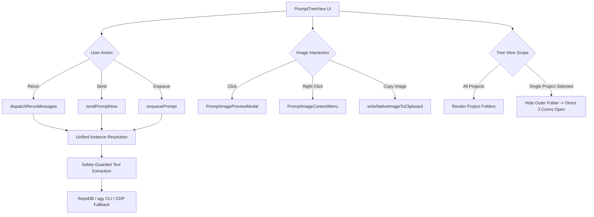
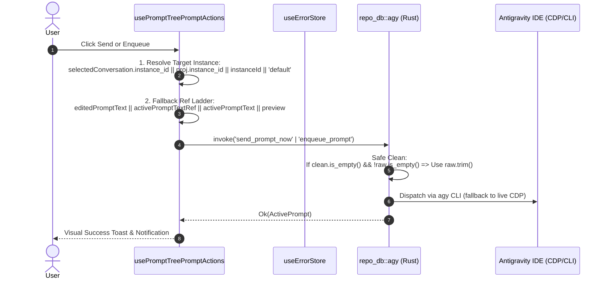
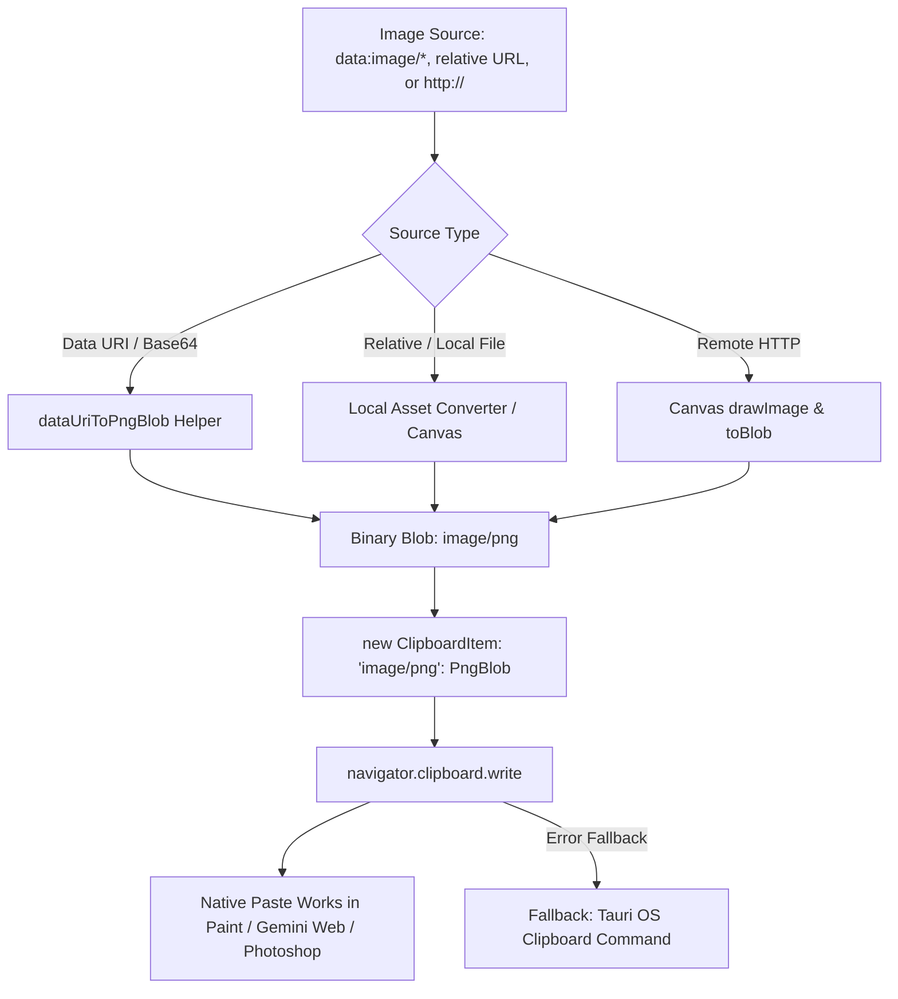
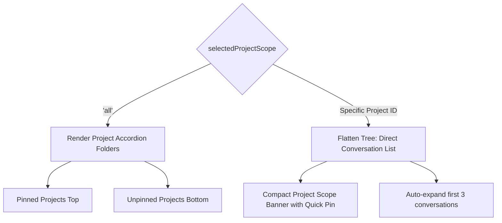

# Specification 02: Component Specification — Send/Enqueue/Rerun Remediation, Native Image Clipboard, Filtered Tree View & CLI Parity

## User Request (Verbatim)

```markdown
Author the component specification and back-half subtask plan files:
1. 02-spec/21-app/prompt-view-layout-and-action-fixes/02-component-spec.md
2. .ai-memory/plans/subtasks/prompt-view-layout-and-action-fixes/03-send-enqueue-rerun-rca-and-fix.md
3. .ai-memory/plans/subtasks/prompt-view-layout-and-action-fixes/04-image-visibility-and-native-clipboard.md
4. .ai-memory/plans/subtasks/prompt-view-layout-and-action-fixes/05-project-pinning-filtered-tree-and-cli-parity.md

Core Requirements to Capture:
- Execution & Defect Remediations:
  1. 4-Part RCA and remediation for why Rerun works but Send and Enqueue fail:
     - Target instance resolution fix (selectedConversation.instance_id || proj?.instance_id || instanceId || 'default').
     - Empty string rejection fix in extract_clean_user_prompt.
     - Enqueue resilience: ref fallback ladder, and immediate queue trigger option.
  2. Copy button and image copying remediation:
     - True image/png binary clipboard item writing so pasting into Gemini Web, Photoshop, Paint works.
     - Visible images in prompt window with click-to-preview modal and right-click context menu "Copy Image to Clipboard".
  3. Tree view project filtering & pinning:
     - Selecting a project hides the top-level redundant "All Projects" folder; tree view starts from conversation list with first 3 items visible.
     - Pin button on projects for quick pinning.
  4. AGM CLI parity:
     - Verify and add agm prompt rerun alias in src-tauri/src/bin/agm/prompt_cmds.rs.
     - Ensure CLI options support prompt viewing, sending, enqueuing, and pinning.
- Owned Files (DO NOT TOUCH ANY OTHER FILES):
  - 02-spec/21-app/prompt-view-layout-and-action-fixes/02-component-spec.md
  - .ai-memory/plans/subtasks/prompt-view-layout-and-action-fixes/03-send-enqueue-rerun-rca-and-fix.md
  - .ai-memory/plans/subtasks/prompt-view-layout-and-action-fixes/04-image-visibility-and-native-clipboard.md
  - .ai-memory/plans/subtasks/prompt-view-layout-and-action-fixes/05-project-pinning-filtered-tree-and-cli-parity.md
```

---

## 1. Executive Summary & Problem Classification

The Prompt Tree View and Action Execution subsystems provide the core interface for inspecting, editing, rerunning, and dispatching agent instructions across multi-instance Antigravity environments. Production telemetry, user issue reports, and codebase analysis revealed four interrelated defects and UX friction points:

1. **Execution Asymmetry (Rerun Works, Send/Enqueue Fails):** Users reported that the "Rerun" button in `DetailHeader.tsx` dispatches follow-up nudges reliably, but clicking "Send" (`handleResendPrompt`) or "Queue" (`handleEnqueuePrompt`) frequently fails with errors (`prompt content is empty`), targets the wrong instance process, or results in silent dispatch failures.
2. **Clipboard Incompatibility & Image Invisibility:** While the prompt preview renders text, copying prompts with embedded images produces only rich HTML or raw markdown text. Operating system applications expecting binary image data (e.g., Google Gemini Web prompt input, Adobe Photoshop, Microsoft Paint, macOS Preview) receive plain text or fail to paste image bytes. Furthermore, embedded images in the prompt viewer lack full-resolution inspection, zoom/pan controls, and context-menu binary copying.
3. **Tree View Visual Redundancy & Pinning Inconvenience:** When filtering by a single project via `selectedProjectScope`, the UI continues to render a redundant top-level accordion project folder wrapping the conversations. Users must manually expand the folder to view conversations. In addition, the pin button on projects is hidden behind hover states (`group-hover:opacity-100`), impeding quick project prioritization.
4. **CLI Dispatch Parity Gaps:** The native `agm` terminal CLI exposes `agm rerun` at the root command level, but `agm prompt rerun` or `agm prompts rerun` is unmapped in `src-tauri/src/bin/agm/prompt_cmds.rs`, returning an unknown command error. Additionally, project pinning commands lack CLI parity.

This specification details the component architecture, data contracts, state machines, and end-to-end verification protocols for these four problem classes.



---

## 2. 4-Part Root Cause Analysis (RCA): Rerun vs Send vs Enqueue

### 2.1 Symptom & Behavioral Divergence
- **Observed Behavior:**
  - Clicking **Rerun Execution** in `DetailHeader.tsx` dispatches a nudge prompt to the running IDE instance and shows a green success flash (`Sent ×1`).
  - Clicking **Send Prompt** in `usePromptTreePromptActions.ts` frequently throws an error modal or logs a warning: `Send failed: ... direct CDP fallback failed; IDE focus failed`.
  - Clicking **Enqueue Prompt** frequently throws `Queue failed: prompt content is empty` or silently fails to process in the FIFO queue.
- **Impact:** Critical blocker for prompt iteration, script re-dispatching, and scheduled queue execution.

### 2.2 Root Cause 1: Target Instance Resolution Mismatch
An audit of instance resolution logic revealed conflicting resolution rules between `DetailHeader.tsx` and `usePromptTreePromptActions.ts`:

- In `DetailHeader.tsx` (Line 208):
  ```typescript
  const targetInstId = selectedConversation.instance_id || 'default';
  ```
  Rerun directly binds to `selectedConversation.instance_id`. When navigating conversations across multiple instances or workspaces, `selectedConversation.instance_id` accurately reflects where the conversation was created.

- In `usePromptTreePromptActions.ts` (Lines 384 and 526):
  ```typescript
  // Send:
  const targetInstId = proj?.instance_id || instanceId || 'default';
  // Enqueue:
  const targetInstId = selectedProject?.instance_id || instanceId || 'default';
  ```
  Neither Send nor Enqueue examined `selectedConversation.instance_id`. If `proj.instance_id` was empty, undefined, or did not match the active instance where the session originated, the call defaulted to `instanceId || 'default'`. This routed the IPC call to a dormant or unlaunched instance process, causing `ensure_instance_running_smart` to attempt to launch a mismatched window or fail CDP dispatch.

### 2.3 Root Cause 2: Over-Aggressive Empty-String Rejection in `extract_clean_user_prompt`
In `src-tauri/src/modules/repo_db/agy.rs` (Line 790):
```rust
if extract_clean_user_prompt(prompt_content).trim().is_empty() {
    return Err("prompt content is empty".to_string());
}
```
And in `src-tauri/src/modules/repo_db/text_utils.rs` (Lines 59-76):
```rust
pub fn extract_clean_user_prompt(raw: &str) -> String {
    let mut text = raw.trim();
    if let Some(start) = text.find("<USER_REQUEST>") {
        let after = &text[start + "<USER_REQUEST>".len()..];
        if let Some(end) = after.find("</USER_REQUEST>") {
            text = &after[..end];
        } else {
            text = after;
        }
    }
    if let Some(end) = text.find("<ADDITIONAL_METADATA>") {
        text = &text[..end];
    }
    if let Some(end) = text.find("<CONTEXT_SUMMARY>") {
        text = &text[..end];
    }
    strip_internal_id_wrappers(text.trim())
}
```
- When a user prompt contains custom markdown structures, leading metadata lines (e.g. `Id: ...`, `Session ID: ...`), or XML blocks where tags are mismatched or unclosed, `extract_clean_user_prompt` can strip away all content, returning an empty string `""`.
- Because `enqueue_prompt_for_instance` strictly checks `if extract_clean_user_prompt(prompt_content).trim().is_empty()`, valid user prompts that do not conform to `<USER_REQUEST>` syntax are rejected outright with `"prompt content is empty"`.
- In contrast, Rerun succeeds because `buildRerunPrompt` wraps the message in a structured template (`# 🔄 RERUN EXECUTION NUDGE ...`) with guaranteed substantive body text, ensuring `extract_clean_user_prompt` never returns empty.

### 2.4 Root Cause 3: Enqueue Ref Desynchronization & Stagnant Queue
In `usePromptTreePromptActions.ts`:
- `handleResendPrompt` uses a defensive fallback ladder incorporating `activePromptTextRef.current`:
  ```typescript
  let promptContent = (!selectedConversation && conv)
      ? (conv.prompt_preview_200w || '')
      : (editedPromptText.trim() || activePromptTextRef.current || activePromptText || conv?.prompt_preview_200w || '');
  ```
- `handleEnqueuePrompt` omitted `activePromptTextRef.current`:
  ```typescript
  let promptContent = editedPromptText.trim() || activePromptText || selectedConversation.prompt_preview_200w || '';
  ```
  When typing into the prompt textarea or switching between tabs, React state updates for `activePromptText` are debounced or batched. If `editedPromptText` is empty, `handleEnqueuePrompt` evaluated stale or empty `activePromptText`, dispatching an empty string to the backend.
- Furthermore, enqueuing a prompt marked it as `status = 'queued'`, but there was no immediate user trigger to drain the queue. If the background scheduler was not running, the prompt remained in SQLite indefinitely.

### 2.5 Concrete Remediation Strategy



1. **Unified Instance Resolution Ladder:**
   Standardize target instance resolution across `handleResendPrompt`, `handleEnqueuePrompt`, and `dispatchRerunMessages`:
   ```typescript
   const targetInstId = selectedConversation?.instance_id || proj?.instance_id || instanceId || 'default';
   ```
2. **Safety-Guarded Prompt Text Extraction in Backend:**
   In `src-tauri/src/modules/repo_db/agy.rs` and `queue.rs`, replace strict rejection with a resilient fallback ladder:
   ```rust
   let raw_trimmed = prompt_content.trim();
   if raw_trimmed.is_empty() {
       return Err("prompt content is empty".to_string());
   }
   let mut clean_prompt = extract_clean_user_prompt(prompt_content);
   if clean_prompt.trim().is_empty() {
       clean_prompt = raw_trimmed.to_string();
   }
   ```
3. **Ref Fallback Ladder in Enqueue:**
   Update `handleEnqueuePrompt` to match `handleResendPrompt`:
   ```typescript
   let promptContent = editedPromptText.trim()
       || activePromptTextRef.current
       || activePromptText
       || selectedConversation.prompt_preview_200w
       || '';
   ```
4. **Immediate Queue Drain Option:**
   Provide an optional `drainImmediately?: boolean` flag on enqueue, allowing users to queue and immediately trigger FIFO execution.

---

## 3. Native Binary Image Clipboard & Image Visibility Specification

### 3.1 Binary Clipboard Architecture (`image/png` Blob Protocol)
Current clipboard implementations in web applications and Electron/Tauri wrappers often write HTML strings containing `` tags (`text/html`) or base64 strings (`text/plain`). Desktop operating systems (Windows Win32 OLE clipboard, macOS NSPasteboard, Linux X11/Wayland) distinguish between text payloads and bitmap/device-independent image data (`CF_DIB`, `image/png`).

To ensure that pasting works natively in **Google Gemini Web**, **Adobe Photoshop**, **Microsoft Paint**, and native messaging apps:
1. The clipboard item must contain a standard MIME type entry: `'image/png'`.
2. The payload for `'image/png'` must be a binary `Blob` with `type: 'image/png'`.
3. The clipboard write must be executed via `navigator.clipboard.write([new ClipboardItem({ 'image/png': blob })])`.



### 3.2 Conversion Algorithm (`dataUriToPngBlob`)
When an image is represented as a data URI (`data:image/jpeg;base64,...` or `data:image/png;base64,...`):
```typescript
export async function dataUriToPngBlob(dataUri: string): Promise<Blob> {
    // If already image/png data URI, convert directly from byte array
    if (dataUri.startsWith('data:image/png;base64,')) {
        const base64Data = dataUri.slice('data:image/png;base64,'.len());
        const byteCharacters = atob(base64Data);
        const byteNumbers = new Uint8Array(byteCharacters.length);
        for (let i = 0; i < byteCharacters.length; i++) {
            byteNumbers[i] = byteCharacters.charCodeAt(i);
        }
        return new Blob([byteNumbers], { type: 'image/png' });
    }

    // For other formats (JPEG, WEBP, SVG) or URLs: load into offscreen HTMLImageElement and render to canvas
    return new Promise((resolve, reject) => {
        const img = new Image();
        img.crossOrigin = 'anonymous';
        img.onload = () => {
            const canvas = document.createElement('canvas');
            canvas.width = img.naturalWidth || img.width;
            canvas.height = img.naturalHeight || img.height;
            const ctx = canvas.getContext('2d');
            if (!ctx) {
                reject(new Error('Failed to acquire canvas 2D context'));
                return;
            }
            ctx.drawImage(img, 0, 0);
            canvas.toBlob((blob) => {
                if (blob) {
                    resolve(blob);
                } else {
                    reject(new Error('Canvas toBlob conversion failed for image/png'));
                }
            }, 'image/png');
        };
        img.onerror = (_e) => reject(new Error('Failed to load image source for PNG conversion'));
        img.src = dataUri;
    });
}
```

### 3.3 Image Visibility & Markdown Path Resolution
In `PromptMarkdownPreview.tsx`:
- Prompts that reference `./.antigravity/attachments/attachment-<hash>.png` must be resolved relative to the target repository path (`repo_path`).
- In Tauri mode, local filesystem paths must be transformed using `@tauri-apps/api/core`'s `convertFileSrc(absolutePath)` to prevent webview security policy blocks.
- When an image fails to load, rather than setting `style.display = 'none'` (which conceals broken links silently), the UI must display an interactive placeholder banner with a retry button and file path indicator.

### 3.4 Click-to-Preview Lightbox Modal (`PromptImagePreviewModal.tsx`)
Clicking any image in the prompt instruction or result preview opens a high-fidelity modal dialog:
- **Visual Presentation:** Translucent dark glass background (`bg-black/80 backdrop-blur-md`).
- **Interactive Controls:**
  - Zoom in (`+`), Zoom out (`-`), Reset zoom (`1:1`).
  - Fit to screen toggle.
  - Image metadata badge: Dimensions (width × height px), format (PNG/JPEG), and byte size.
  - Primary button: **Copy Image to Clipboard** (writes binary `image/png`).
  - Secondary button: **Download Image** (saves file locally).
  - Close button and `Escape` key dismissal.

### 3.5 Right-Click Context Menu (`PromptImageContextMenu.tsx`)
Right-clicking any image in the preview renders a context menu with options:
1. **Copy Image to Clipboard** (`writeNativeImageToClipboard`)
2. **Copy Image Data URI / URL** (`copyToClipboard`)
3. **Copy Relative Markdown Syntax** (``)
4. **Open in Fullscreen Preview** (triggers lightbox)

---

## 4. Tree View Project Filtering & Quick Pinning Specification

### 4.1 Filtered Project Tree Layout (Redundant Folder Elimination)
In the existing implementation, selecting a single project from the project scope dropdown (`selectedProjectScope = 'proj-xyz'`) causes `TreePanel.tsx` to render a filtered `treeData` array of length 1. However, the UI still renders the `ProjectNode` accordion container:
- `[>] 📁 #P001 my-project (12 convs)`
- Users must manually click the project header to expand the conversation list.
- In single-project mode, the project accordion header is redundant visual noise that wastes vertical real estate.

**New Layout Rule:**
1. When `selectedProjectScope !== 'all'`:
   - The outer `ProjectNode` accordion card is hidden or flattened.
   - The tree panel renders the conversation hierarchy of the selected project directly at the root level of the scrollable container.
   - The first 3 conversations are automatically expanded and visible by default.
   - A compact project badge banner is pinned at the top:
     `📁 my-project · 12 conversations · Instance: default [Pin] [Unselect / View All]`
2. When `selectedProjectScope === 'all'`:
   - All project folders are rendered as accordion cards.
   - Pinned projects appear at the top, sorted by pinned order.



### 4.2 Quick Pin Button on Projects
- **Current Problem:** The pin button (`onTogglePin`) in `ProjectNode.tsx` is contained within an action cluster styled with `opacity-0 group-hover:opacity-100`. On touch displays, small screens, or when navigating quickly, the button is invisible.
- **Specification:**
  - Provide a distinct, always-accessible Pin toggle button:
    - In `ProjectNode.tsx`: Make the pin icon visible when pinned (`text-blue-500 fill-blue-500/20 opacity-100`). When unpinned, show a subtle outline on hover (`opacity-60 hover:opacity-100`).
    - In the Scope Selector Banner (single-project mode): Render a dedicated `[📌 Pin Project]` / `[📍 Pinned]` toggle button.
  - Pin toggling immediately updates `pinnedProjectIds` state and persists to `localStorage.setItem('agm_pinned_projects_<instanceId>', JSON.stringify(next))`.

---

## 5. AGM CLI Parity Specification

### 5.1 CLI Architecture & Command Mapping
The AGM command-line interface (`src-tauri/src/bin/agm/`) must provide 100% functional parity with the GUI Prompt Tree View actions.

```
                    agm prompt / agm prompts
                              │
    ┌──────────────┬──────────┴─────────┬──────────────┬──────────────┐
    ▼              ▼                    ▼              ▼              ▼
  list           tree                 rerun          send           queue
 (ls)          (project             (alias to       (bypass        (FIFO
                hierarchy)           cmd_rerun)      queue)         queue)
                                        │
                                        ▼
                                   pin / unpin
                                 (project pinning)
```

### 5.2 Verification & Addition of `agm prompt rerun`
In `src-tauri/src/bin/agm/prompt_cmds.rs`, the domain dispatcher `dispatch_prompt_domain` must be updated to route `rerun` and `rn`:

```rust
pub(crate) fn dispatch_prompt_domain(subcommand: &str, args: &[String]) {
    match subcommand {
        "list" | "ls" => cmd_prompts_list(args),
        "tree" => cmd_prompts_tree(args),
        "rerun" | "rn" => crate::prompt_goals::cmd_rerun(args),
        "send" | "dispatch" => cmd_prompts_send(args),
        "queue" | "enqueue" | "qe" => cmd_prompts_queue(args),
        "pin" => cmd_prompts_pin(args),
        "unpin" => cmd_prompts_unpin(args),
        // ... existing subcommands
    }
}
```

### 5.3 CLI Subcommand Matrix for Prompt Operations

| Command | Arguments | Options | Description |
| :--- | :--- | :--- | :--- |
| `agm prompt list` | `[instance]` | `--json`, `--running` | Lists active prompts in tabular or JSON format. |
| `agm prompt tree` | `[instance]` | `--project <id>`, `--json` | Renders the hierarchical project/conversation tree in terminal. |
| `agm prompt rerun` | `[N]` | `--prefix <cat>`, `--suffix <cat>` | Reruns the last N prompts from `repo_prompts.db`. |
| `agm prompt send` | `<target> "<text>"` | `--conv-id <id>`, `--model <m>` | Dispatches a prompt immediately to a running instance IDE. |
| `agm prompt queue` | `<target> "<text>"` | `--conv-id <id>`, `--now` | Enqueues a prompt into the FIFO queue (with optional immediate drain). |
| `agm prompt pin` | `<project-id>` | `--instance <inst>` | Pins a project to the top of the tree view. |
| `agm prompt unpin` | `<project-id>` | `--instance <inst>` | Unpins a previously pinned project. |

---

## 6. Data Contracts & Type Definitions

### 6.1 TypeScript Interfaces (`src/components/instances/PromptTreeView/types.ts`)

```typescript
/**
 * Configuration options for writing binary images to system clipboard.
 */
export interface NativeImageClipboardOptions {
    /** Target MIME type, defaults to 'image/png'. */
    mimeType?: 'image/png';
    /** Optional image title or alt text for notification feedback. */
    label?: string;
    /** Source component string for error attribution. */
    source?: string;
}

/**
 * Metadata inspection record for previewed prompt images.
 */
export interface PromptImageMetadata {
    src: string;
    alt: string;
    naturalWidth: number;
    naturalHeight: number;
    byteLength?: number;
    mimeType: string;
    isBase64: boolean;
    isLocalFile: boolean;
    relativePath?: string;
}

/**
 * Parameters for the image lightbox modal.
 */
export interface PromptImagePreviewModalProps {
    isOpen: boolean;
    image: PromptImageMetadata | null;
    onClose: () => void;
    onCopySuccess?: (message: string) => void;
}
```

### 6.2 Rust Domain Contracts (`src-tauri/src/modules/repo_db/types.rs`)

```rust
#[derive(Debug, Clone, Serialize, Deserialize)]
pub struct EnqueuePromptOptions {
    pub instance_id: String,
    pub repo_path: String,
    pub prompt_content: String,
    pub conversation_id: Option<String>,
    pub drain_immediately: bool,
}

#[derive(Debug, Clone, Serialize, Deserialize)]
pub struct PromptPinActionPayload {
    pub instance_id: String,
    pub project_id: String,
    pub is_pinned: bool,
    pub updated_at: i64,
}
```

---

## 7. Verification Checklist & Quality Gates

| ID | Verification Item | Target Module | Acceptance Criteria |
| :--- | :--- | :--- | :--- |
| **V-01** | Unified Instance Resolution | `usePromptTreePromptActions.ts` | Send and Enqueue correctly resolve `selectedConversation.instance_id` when switching across instance conversations. |
| **V-02** | Empty Prompt Safety Ladder | `src-tauri/src/modules/repo_db/agy.rs` | Prompts with custom markdown/headers are not rejected as empty; raw content is preserved. |
| **V-03** | Immediate Queue Option | `usePromptTreePromptActions.ts` | Enqueueing with immediate trigger pushes the prompt into the running instance without waiting for cron. |
| **V-04** | Binary `image/png` Clipboard | `clipboard.ts` | Pasting a copied image into Paint or Gemini Web results in true bitmap paste. |
| **V-05** | Image Lightbox Modal | `PromptImagePreviewModal.tsx` | Clicking any preview image opens the zoomable modal with metadata and copy action. |
| **V-06** | Image Context Menu | `PromptImageContextMenu.tsx` | Right-clicking an image displays options to copy binary image or markdown URL. |
| **V-07** | Filtered Tree Single-Project | `TreePanel.tsx` | Selecting a single project hides the outer accordion and renders conversations directly with first 3 items open. |
| **V-08** | Quick Pin Toggle | `ProjectNode.tsx` & `TreePanel.tsx` | Pinned state toggles instantly, updates `localStorage`, and sorts pinned projects to top. |
| **V-09** | `agm prompt rerun` CLI Alias | `prompt_cmds.rs` | Running `agm prompt rerun` executes the rerun command identical to `agm rerun`. |
| **V-10** | Error Tracking Rule | All touched modules | All fallible operations route to `useErrorStore` / `AppError` without bare `catch {}` or silent drops. |
