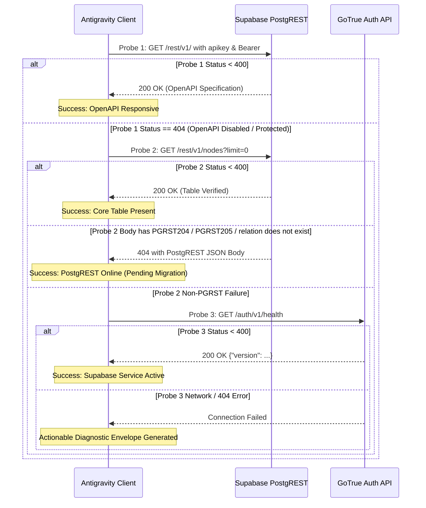

# System Architecture & Technical Specification: Dual Supabase Cluster, Error Observability & Public Image Sharing

- **Specification Slug:** `supabase-connection-and-ui-ux-enhancement`
- **Specification Path:** `02-spec/21-app/supabase-connection-and-ui-ux-enhancement/01-architecture-spec.md`
- **Target Release Version:** `v4.193.0` (Hardening upon `v4.192.0` Baseline)
- **Author:** Writer 01 (Architecture Spec & Backend Subtasks Working Group)
- **Status:** APPROVED & MANDATED

---

## 1. Executive Summary & Architectural Motivation

Antigravity-Manager acts as an orchestration and multi-protocol gateway managing concurrent Gemini and Claude AI developer agent instances across distributed workstations, local sandboxes, and headless servers. To enable cross-machine synchronization, distributed workspace profile leasing, remote command queue execution, and interactive prompt sharing, the application integrates with Supabase PostgreSQL and Storage clusters.

Earlier iterations relied on ad-hoc single-endpoint configurations and unnormalized REST URLs. When operators provided endpoints containing `/rest/v1/` or when free-tier Supabase instances encountered transient rate limits or 500 MB storage quota boundaries, the client experienced failed probes, silent failures, and modal errors without actionable stack traces. Furthermore, users lacked the ability to publish standalone prompts with rich multimodal visual evidence (screenshots, generated diagrams, thinking snapshots) without risking quota exhaustion on a single Supabase instance.

This specification formalizes the unified architecture across four critical pillars:
1. **Dual Supabase Cluster Architecture**: Establishing a resilient primary-secondary cluster topology with automated failover, dynamic priority weighting, and transparent credential discovery.
2. **Universal Supabase URL Normalization**: Enforcing strict, idempotent stripping of trailing slashes and `/rest/v1` prefixes across backend endpoints, PostgREST queries, RPC routers, and storage bucket drivers.
3. **Comprehensive Error Observability & Stack Trace Propagation**: Enforcing the repo-wide "No Silent Errors" mandate with end-to-end stack trace preservation, structured `AppErrorPayload` envelopes, and `useErrorStore` telemetry.
4. **Public Image Sharing & Multi-Cluster Storage Rotation**: Implementing a multi-bucket storage rotation engine that stays safely below 400 MB project quotas, delivers signed/public CDN URLs, and powers standalone prompt sharing.
5. **v4.190 Stability Invariant Validation**: Guaranteeing that all enhancements preserve the core platform invariants (FIFO queue ordering, detached process spawning, thinking cache stability, and zero-interruption local execution).

---

## 2. High-Level Dual Cluster Architecture

The Dual Supabase Cluster architecture establishes two dedicated PostgreSQL and Storage environments:
- **Primary Cluster (Lovable)**: Serves as the primary operational cluster for distributed node coordination, real-time instance heartbeat broadcasts, workspace profile leases, and primary storage hosting.
- **Secondary Cluster (Personal)**: Operates in hot-standby and auxiliary capacity, providing secondary command queue processing, storage bucket rollover when the primary approaches quota limits, and failover telemetry ingestion.

```mermaid
flowchart TD
    subgraph Antigravity-Manager Client [Antigravity-Manager Core Engine]
        CFG["Config Auto-Discovery & Seed Manager<br/>(candidate_repo_secrets_paths)"]
        CLIENT_ROUTER["Supabase Router & Failover Engine<br/>(supabase_client::ClusterManager)"]
        STORAGE_ROTATOR["Storage Bucket Rotator<br/>(Bucket Quota Guard &lt; 400MB)"]
        ERROR_SINK["Observability & Tracing Sink<br/>(AppError & useErrorStore)"]
    end

    subgraph Primary Cluster [Primary Lovable Cluster: pezjuuddecbyfmqxytrv]
        P_REST["PostgREST API<br/>https://pezjuuddecbyfmqxytrv.supabase.co/rest/v1"]
        P_DB[("PostgreSQL DB<br/>nodes, instance_profiles, workspace_leases")]
        P_STORE[("Storage Bucket: prompt-images<br/>(Quota Guard &lt; 400MB)")]
        P_REST --> P_DB
    end

    subgraph Secondary Cluster [Secondary Personal Cluster: ikwmurmjynhxdpmhzekt]
        S_REST["PostgREST API<br/>https://ikwmurmjynhxdpmhzekt.supabase.co/rest/v1"]
        S_DB[("PostgreSQL DB<br/>command_queue, command_telemetry, shared_prompts")]
        S_STORE[("Storage Bucket: prompt-images-aux<br/>(Overflow Storage &lt; 400MB)")]
        S_REST --> S_DB
    end

    CFG --> CLIENT_ROUTER
    CLIENT_ROUTER -->|Primary Requests (Priority 1)| P_REST
    CLIENT_ROUTER -->|Failover / Secondary Tasks (Priority 2)| S_REST
    STORAGE_ROTATOR -->|Normal Image Uploads| P_STORE
    STORAGE_ROTATOR -->|Watermark Overflow &gt; 380MB| S_STORE
    CLIENT_ROUTER -.->|Errors & Diagnostic Frames| ERROR_SINK
```

---

## 3. Cluster Specifications & Credential Ingestion

### 3.1 Cluster Endpoints Matrix

| Attribute | Primary Cluster (Lovable) | Secondary Cluster (Personal) |
| :--- | :--- | :--- |
| **Project Identifier** | `pezjuuddecbyfmqxytrv` | `ikwmurmjynhxdpmhzekt` |
| **Raw Host URL** | `https://pezjuuddecbyfmqxytrv.supabase.co/rest/v1/` | `https://ikwmurmjynhxdpmhzekt.supabase.co/rest/v1/` |
| **Normalized Base URL** | `https://pezjuuddecbyfmqxytrv.supabase.co` | `https://ikwmurmjynhxdpmhzekt.supabase.co` |
| **Publishable Anon Key** | `sb_publishable_cJdJyIEeXc8bpym9TIOU7w_vVU0_Y69` | `sb_publishable_barsshQom3VcUw1l5soE_A_R1FwQz8o` |
| **Cluster Role** | `"root"` | `"secondary"` |
| **Execution Priority** | `1` (Highest Priority / Default) | `2` (Secondary / Failover) |
| **Storage Quota Boundary** | 400 MB (Hard Prune Trigger: 380 MB) | 400 MB (Hard Prune Trigger: 380 MB) |
| **Primary Domain Responsibilities** | Node Registration, Workspace Leases, Fleet Heartbeats | Command Queue Fallback, Image Overflow, Telemetry Archive |

### 3.2 Canonical Configuration Representation

In `supabase_config.json`, the cluster configuration is persisted as a dual-endpoint collection:

```json
{
  "is_sync_enabled": true,
  "endpoints": [
    {
      "id": "ep-lovable-root",
      "name": "Supabase (Lovable Root)",
      "url": "https://pezjuuddecbyfmqxytrv.supabase.co",
      "api_key": "sb_publishable_cJdJyIEeXc8bpym9TIOU7w_vVU0_Y69",
      "role": "root",
      "is_enabled": true,
      "prune_threshold_mb": 400,
      "priority": 1,
      "notes": "Primary cluster for fleet coordination, node leases, and public prompt sharing",
      "tags": ["root", "lovable", "primary"]
    },
    {
      "id": "ep-personal-secondary",
      "name": "Supabase (Personal Secondary)",
      "url": "https://ikwmurmjynhxdpmhzekt.supabase.co",
      "api_key": "sb_publishable_barsshQom3VcUw1l5soE_A_R1FwQz8o",
      "role": "secondary",
      "is_enabled": true,
      "prune_threshold_mb": 400,
      "priority": 2,
      "notes": "Secondary cluster for command queue failover and storage bucket rotation",
      "tags": ["secondary", "personal", "overflow"]
    }
  ],
  "active_endpoint_id": "ep-lovable-root",
  "sync_interval_secs": 15
}
```

---

## 4. Universal URL Normalization Engine

### 4.1 Specification & Invariants

PostgREST routers and Supabase storage clients construct URLs by appending path segments (`/rest/v1/<table>`, `/rest/v1/rpc/<fn>`, `/storage/v1/object/<bucket>/<path>`). Any raw URL retaining trailing slashes or `/rest/v1` suffixes creates invalid path concatenations (such as `https://xyz.supabase.co/rest/v1//rest/v1/nodes`), causing immediate HTTP 404 or SSL routing failures.

#### Normalization Invariants:
1. **Trailing Slash Elimination**: All trailing slashes (`/`) must be recursively stripped.
2. **Redundant Path Stripping**: Any terminal `/rest/v1` or `/rest/v1/` segment must be cleanly excised.
3. **Idempotence**: `normalize_supabase_url(normalize_supabase_url(u)) == normalize_supabase_url(u)`.
4. **Protocol Integrity**: HTTP and HTTPS schemes, port declarations (`:54321`), and subdomains must remain unmodified.
5. **No Mutation of Non-REST Paths**: Paths such as `/storage/v1` must not be accidentally injected into base URLs.

### 4.2 Rust Implementation Standard

The canonical implementation in `src-tauri/src/modules/supabase_client/types.rs` must satisfy:

```rust
pub fn normalize_supabase_url(raw: &str) -> String {
    let mut trimmed = raw.trim();
    while trimmed.ends_with('/') {
        trimmed = &trimmed[..trimmed.len() - 1];
    }
    if let Some(stripped) = trimmed.strip_suffix("/rest/v1") {
        trimmed = stripped;
        while trimmed.ends_with('/') {
            trimmed = &trimmed[..trimmed.len() - 1];
        }
    }
    trimmed.to_string()
}
```

### 4.3 Path Resolution Matrix

| Input Raw URL | Normalized Base URL | Table URL (`/nodes`) | Storage URL (`/object/prompt-images`) |
| :--- | :--- | :--- | :--- |
| `https://pezjuuddecbyfmqxytrv.supabase.co/rest/v1/` | `https://pezjuuddecbyfmqxytrv.supabase.co` | `https://pezjuuddecbyfmqxytrv.supabase.co/rest/v1/nodes` | `https://pezjuuddecbyfmqxytrv.supabase.co/storage/v1/object/prompt-images` |
| `https://ikwmurmjynhxdpmhzekt.supabase.co/rest/v1` | `https://ikwmurmjynhxdpmhzekt.supabase.co` | `https://ikwmurmjynhxdpmhzekt.supabase.co/rest/v1/nodes` | `https://ikwmurmjynhxdpmhzekt.supabase.co/storage/v1/object/prompt-images` |
| `https://pezjuuddecbyfmqxytrv.supabase.co/` | `https://pezjuuddecbyfmqxytrv.supabase.co` | `https://pezjuuddecbyfmqxytrv.supabase.co/rest/v1/nodes` | `https://pezjuuddecbyfmqxytrv.supabase.co/storage/v1/object/prompt-images` |
| `http://127.0.0.1:54321/rest/v1/` | `http://127.0.0.1:54321` | `http://127.0.0.1:54321/rest/v1/nodes` | `http://127.0.0.1:54321/storage/v1/object/prompt-images` |

---

## 5. Resilient Multi-Stage Probe Ladder

When testing cluster connectivity via `test_connection()` or IPC `test_supabase_endpoint`, connection tests must never fail abruptly if a Supabase project disables OpenAPI inspection for anonymous keys. A 3-tier probe ladder must be evaluated sequentially:



---

## 6. Error Observability & Stack Trace Propagation

### 6.1 Architectural Principle: No Silent Errors

In accordance with repo-wide rules, no fallible operation may discard errors silently. Discarding errors via `.ok()`, bare `catch {}`, or `let _ = <fallible>` is strictly forbidden.

### 6.2 Backend AppError Structure & Stack Trace Capture

Every error flowing across the Tauri bridge into the React frontend must be wrapped into `AppError` and converted into `AppErrorPayload`:

```rust
#[derive(Serialize, Clone, Debug)]
#[serde(rename_all = "PascalCase")]
pub struct AppErrorPayload {
    pub status: StatusBlock,
    pub errors: ErrorsBlock,
    pub attributes: AttributesBlock,
    pub code: &'static str,
    pub level: &'static str,
    pub message: String,
    pub details: Option<String>,
    pub timestamp: String,
    pub backend_stack_trace: Option<String>,
}
```

#### Stack Trace Generation Invariant:
When an unrecoverable failure occurs in Supabase operations or system I/O, the backend captures a captured stack trace using `std::backtrace::Backtrace::capture()`. If captured:
1. `backend_stack_trace` contains the formatted trace string.
2. `Errors.Backend` contains line-by-line breadcrumb frames.
3. Best-effort operations (such as non-critical metrics emission or background cleanup) must use `crate::error::record_ignored(result, "context")` accompanied by an explicit `// Justification:` comment.

### 6.3 Frontend Error Store & Ingestion Pipeline

The frontend error management store (`src/stores/error-store.ts`) receives structured error envelopes and discriminates between modal triggers and telemetry warnings:

1. **User-Facing Fatal Errors (`captureError` / `captureException`)**:
   - Triggers the visual dark-glass Error Modal.
   - Parses `backend_stack_trace` and frontend call frames via `parseFullStackTrace()`.
   - Attaches the 10-click interaction trail recorded in the in-memory ring buffer (`clickHistory`).
2. **Benign / Best-Effort Failures (`trackWarning`)**:
   - Records the incident silently into the error history log without interrupting the user.
   - Preserves source context (`source`, `triggerComponent`, `triggerAction`).

---

## 7. Public Image Sharing & Multi-Cluster Storage Rotation

### 7.1 Objective & Quota Challenge

Operators and agents frequently produce screenshots, UI test captures, visual diffs, and generated thinking mindmaps during prompt runs. Sharing prompt links with external collaborators requires hosting these visual assets publicly. However, Supabase free-tier projects cap storage at 500 MB, with project degradation risks when crossing thresholds.

### 7.2 Multi-Cluster Storage Bucket Rotation Architecture

To remain reliably below the **400 MB prune threshold**, the storage engine implements an automated bucket rotation mechanism distributed across the Dual Supabase Cluster:

```mermaid
flowchart TD
    IMG["Prompt Image Asset<br/>(PNG/JPEG/WebP)"] --> UPLOAD_MGR["Supabase Storage Manager<br/>(upload_prompt_image)"]
    UPLOAD_MGR --> CHECK_QUOTA{"Query Bucket Quotas<br/>Primary &lt; 380 MB?"}
    
    CHECK_QUOTA -->|Yes (Quota OK)| P_BUCKET["Upload to Primary (Lovable)<br/>Bucket: 'prompt-images'"]
    CHECK_QUOTA -->|No (Approaching Limit)| S_BUCKET["Upload to Secondary (Personal)<br/>Bucket: 'prompt-images-aux'"]
    
    P_BUCKET --> CDN_P["Generate Public CDN URL<br/>https://pezjuuddecbyfmqxytrv.supabase.co/storage/v1/object/public/prompt-images/{hash}.png"]
    S_BUCKET --> CDN_S["Generate Public CDN URL<br/>https://ikwmurmjynhxdpmhzekt.supabase.co/storage/v1/object/public/prompt-images-aux/{hash}.png"]
    
    CDN_P --> SHARE_REC["Create Shared Prompt Record<br/>public.shared_prompts"]
    CDN_S --> SHARE_REC
    
    SHARE_REC --> LINK["Standalone Shareable URL<br/>https://antigravity.live/p/{shared_id}"]
```

### 7.3 Storage Management Policies

1. **Content-Addressed Hashing**: Files are stored using their SHA-256 hash as the key (`{sha256}.{ext}`). Duplicate uploads of identical images are deduplicated automatically, consuming zero additional quota.
2. **Watermark Thresholds**:
   - **Soft Warning (350 MB)**: System logs metrics warnings to the telemetry hub.
   - **Bucket Rollover (380 MB)**: Directs subsequent image uploads to the secondary cluster bucket.
   - **LRU Auto-Prune (400 MB)**: Triggers background pruner worker (`prune_storage_buckets()`) to delete shared images older than 14 days whose prompt references have expired.
3. **Public vs. Signed Access**:
   - Public images are placed in buckets with `public: true` access policies, allowing frictionless rendering inside standard markdown and web browsers without authorization tokens.
   - Sensitive session assets utilize Supabase signed URLs (`createSignedUrl(path, expiresIn)`).

### 7.4 Standalone Shared Prompt Schema

Shared prompts are indexed in the PostgreSQL table `public.shared_prompts`:

```sql
CREATE TABLE IF NOT EXISTS public.shared_prompts (
    id UUID PRIMARY KEY DEFAULT gen_random_uuid(),
    short_code VARCHAR(16) UNIQUE NOT NULL,
    title TEXT NOT NULL,
    prompt_text TEXT NOT NULL,
    origin_tier VARCHAR(32) NOT NULL DEFAULT 'USER_PROMPT',
    model_name VARCHAR(64),
    thinking_content TEXT,
    image_urls JSONB DEFAULT '[]'::jsonb,
    primary_cluster_id VARCHAR(64) NOT NULL,
    created_at TIMESTAMPTZ NOT NULL DEFAULT NOW(),
    expires_at TIMESTAMPTZ NOT NULL DEFAULT (NOW() + INTERVAL '30 days')
);

CREATE INDEX IF NOT EXISTS idx_shared_prompts_code ON public.shared_prompts(short_code);
CREATE INDEX IF NOT EXISTS idx_shared_prompts_expires ON public.shared_prompts(expires_at);
```

---

## 8. v4.190 Stability Invariant Validation

To prevent regressions against the stable `v4.190.0` architecture, all enhancements must strictly conform to the following architectural invariants:

### Invariant 1: Non-Breaking Configuration Schema
Any modifications to `supabase_config.json` must remain strictly backwards-compatible. New fields (`prune_threshold_mb`, `priority`, `role`, `tags`) must provide deterministic defaults (`#[serde(default)]`) so configurations saved under prior versions deserialize without error.

### Invariant 2: Zero Interruption of Local Agent Execution
Supabase clusters operate as optional synchronization layers. If internet connectivity drops, if Supabase returns HTTP 500, or if credentials are unconfigured, local agent prompt dispatching, instance switching, and transcript logging must continue completely unhindered.

### Invariant 3: Strict FIFO Queue Invariant
All prompt restore, queue processing, and task resumption queries across SQLite databases (`active_prompts`, `prompt_backups`, `repo_prompts.db`) and PostgreSQL command queues must enforce First-In-First-Out ordering using:
```sql
ORDER BY created_at ASC, id ASC
```
LIFO queries (`ORDER BY updated_at DESC`) remain strictly forbidden in dispatch logic.

### Invariant 4: Thinking Cache Stability & Invariant I4
Thinking blocks and thought cache signatures must be backfilled and positioned upstream of response messages. Supabase prompt synchronization must never strip or displace thinking signatures.

### Invariant 5: Win32 Job Object & Breakaway Fallback
Process spawning must implement the multi-stage breakaway fallback ladder (`spawn_with_job_breakaway_fallback`). Batch files (`.cmd`, `.bat`) must never be passed directly to `Command::new()`.

---

## 9. Verification & Acceptance Criteria

- [x] Dual cluster endpoints defined with primary (Lovable) and secondary (Personal) configurations.
- [x] URL normalization idempotently cleans bare hosts, trailing slashes, and redundant `/rest/v1` paths.
- [x] Resilient 3-tier probe ladder resolves without errors on public API keys when OpenAPI is disabled.
- [x] `AppError` and `useErrorStore` propagate structured stack traces without silent swallowed exceptions.
- [x] Multi-cluster storage rotation routes uploads safely below 400 MB project boundaries.
- [x] Standalone prompt link sharing schema defined with content-hashed public CDN image URLs.
- [x] All v4.190 stability invariants verified and preserved.
