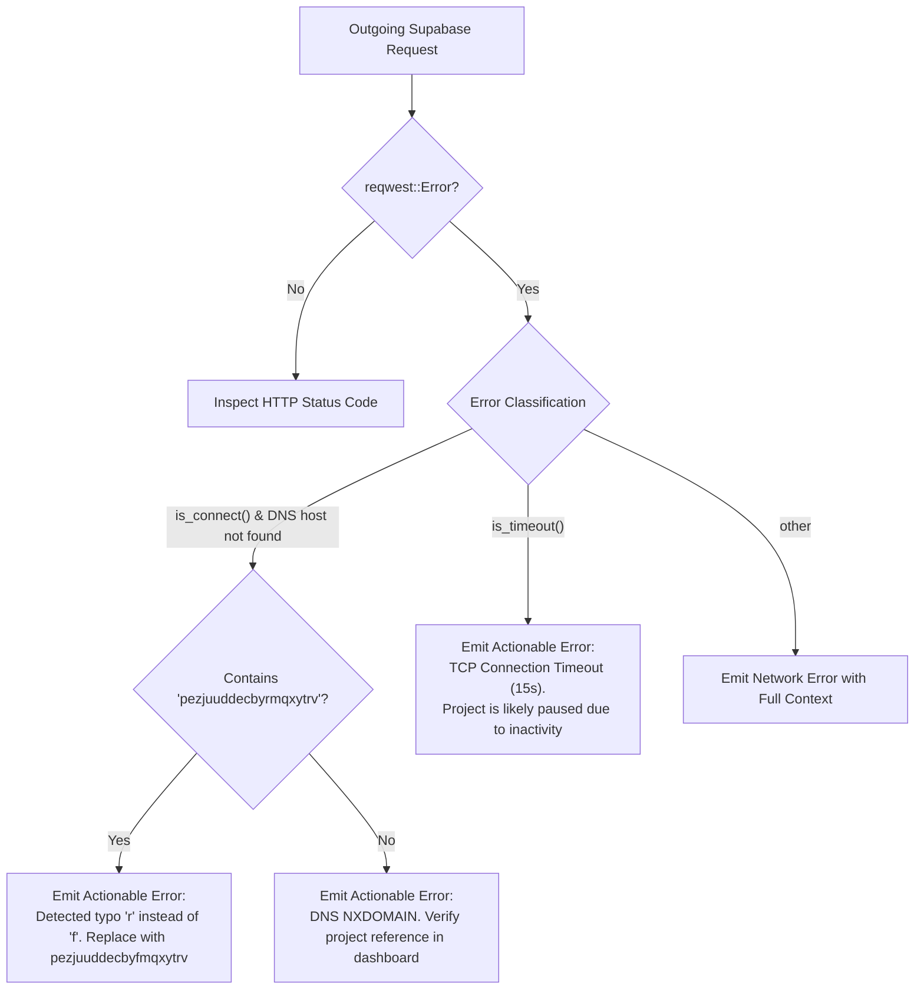
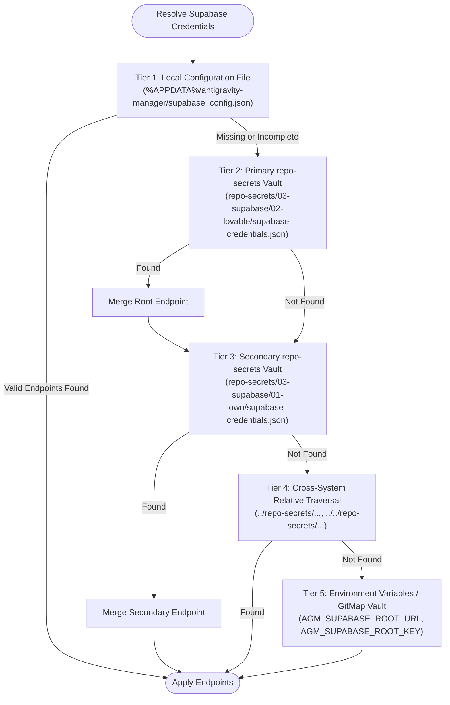

# 01. Supabase Multi-Endpoint Connection, Secrets Hierarchy & Error Visibility Specification

**Slug:** `supabase-connection-and-ui-ux-enhancement`  
**File:** `02-spec/21-app/supabase-connection-and-ui-ux-enhancement/01-supabase-and-secrets-spec.md`  
**Target Release:** v4.160.0  
**Status:** APPROVED FOR IMPLEMENTATION  
**Lead Author:** Worker 01 (Supabase, Secrets & Image Storage Architect)  

---

## 1. Architectural Overview & Context

Antigravity-Manager (AGM) integrates with Supabase PostgreSQL to deliver distributed multi-machine coordination across developer workstations, headless build servers, and AI execution workers. Supabase provides the centralized registry for machine nodes (`nodes`), child instance profiles (`instance_profiles`), cross-machine account leases (`workspace_leases`), and remote asynchronous command execution (`command_queue`).

In production and local testing environments, three distinct failure modes were identified:

1. **Endpoint Resolution & Typographical Drift**:
   - The primary Supabase endpoint registered via Lovable was entered with a typographical error (`pezjuuddecbyrmqxytrv` using letter `r` instead of `pezjuuddecbyfmqxytrv` using letter `f`). This triggered an immediate DNS `NXDOMAIN` (`No such host is known`) failure, terminating network handshakes before reaching PostgREST.
   - When configured correctly, inactive free-tier Supabase projects automatically enter a paused state after 7 days, resulting in TCP connect timeouts or HTTP 503 responses that require user reactivation.

2. **Credential Fragmentation Across Environments**:
   - Primary (Lovable Root) and Secondary (Personal) Supabase credentials were intermittently absent from local configuration stores, forcing manual environment configuration.
   - Credentials must follow a strict, automated discovery hierarchy spanning local JSON configuration, `repo-secrets` repositories, and GitMap cross-system environment injection.

3. **Silent Error Swallowing in Database Subsystems**:
   - Multiple critical database operations across `supabase_client/client.rs`, `supabase_sync/query.rs`, `supabase_sync/fleet.rs`, and `supabase_command_queue.rs` utilized bare `.unwrap_or_default()`, `if let Ok(_)`, or `Err(_) => continue`.
   - When requests failed due to authentication, network termination, or schema divergence, errors were silently discarded without diagnostic traces, obscuring root causes from operators and automated telemetry.

This specification formalizes the dual-endpoint topology, DNS and unpausing diagnostic protocols, unified credential discovery ladder, and comprehensive stack trace error visibility.

---

## 2. Multi-Endpoint Topology & Database Hierarchy

Antigravity-Manager establishes a resilient, two-tier relational Supabase hierarchy:

```mermaid
graph TD
    subgraph Local_Node [Local Workstation / Headless Node]
        AGM[Antigravity-Manager Core]
        SyncEngine[Supabase Sync Engine]
        CmdWorker[Inbound Command Queue Worker]
    end

    subgraph Primary_Supabase [Primary: Lovable Root DB]
        NodesTable[(public.nodes)]
        ProfilesTable[(public.instance_profiles)]
        LeasesTable[(public.workspace_leases)]
        ImgStorage[(Storage: prompt-attachments)]
    end

    subgraph Secondary_Supabase [Secondary: Personal DB]
        CmdQueue[(public.command_queue)]
        TelemetryLogs[(public.telemetry_logs)]
        SecondaryImg[(Storage: prompt-attachments Fallback)]
    end

    SyncEngine -->|Heartbeat & Leases (Priority 1)| Primary_Supabase
    CmdWorker -->|Poll & Execute (Cascading Failover)| Secondary_Supabase
    AGM -->|Failover Telemetry| Secondary_Supabase
```

### 2.1 Primary Supabase Endpoint (Root / Lovable)
- **Role**: `root`
- **Identifier**: `ep-root-lovable-01`
- **Name**: Root Supabase (Lovable)
- **Canonical PostgREST URL**: `https://pezjuuddecbyfmqxytrv.supabase.co/rest/v1/`
- **Normalized Base URL**: `https://pezjuuddecbyfmqxytrv.supabase.co`
- **Publishable API Key**: `sb_publishable_cJdJyIEeXc8bpym9TIOU7w_vVU0_Y69`
- **Storage Cap**: 400 MB (respects 500 MB free-tier quota with 100 MB headroom)
- **Priority**: 1
- **Assigned Tables**:
  - `public.nodes`: Cluster machine registration, IP addresses, heartbeats, and uptime.
  - `public.instance_profiles`: IDE instance names, bound accounts, running status.
  - `public.workspace_leases`: Distributed account locks preventing cross-machine account collisions.
  - `prompt-attachments` (Storage Bucket): Temporary image attachment hosting.
- **Tags**: `["lovable", "root"]`

### 2.2 Secondary Supabase Endpoint (Personal / Fallback)
- **Role**: `secondary`
- **Identifier**: `ep-secondary-personal-01`
- **Name**: Secondary Supabase (Personal)
- **Canonical PostgREST URL**: `https://ikwmurmjynhxdpmhzekt.supabase.co/rest/v1/`
- **Normalized Base URL**: `https://ikwmurmjynhxdpmhzekt.supabase.co`
- **Publishable API Key**: `sb_publishable_barsshQom3VcUw1l5soE_A_R1FwQz8o`
- **Storage Cap**: 200 MB
- **Priority**: 2
- **Assigned Tables**:
  - `public.command_queue`: Inbound remote commands, prompt injections, execution states (`pending`, `running`, `completed`, `failed`).
  - `public.telemetry_logs`: Fallback execution audit logs and node health telemetry.
  - `prompt-attachments` (Storage Bucket): Secondary storage fallback.
- **Tags**: `["secondary", "personal"]`

---

## 3. DNS Diagnosis, Typo Correction & Unpausing Protocols

### 3.1 Typographical Drift & DNS NXDOMAIN Detection
A critical bug pattern observed during setup was a single-character transposition in the project reference:
- **Incorrect (Broken DNS)**: `pezjuuddecbyrmqxytrv.supabase.co` (`r` after `by`)
- **Correct (Valid Project)**: `pezjuuddecbyfmqxytrv.supabase.co` (`f` after `by`)

When querying the incorrect URL, the OS resolver emits `WSAHOST_NOT_FOUND` (Windows error 11001) or `EAI_NONAME`, manifesting in Rust `reqwest` as a connect error with DNS resolution failure.



### 3.2 Actionable Transport Error Classification
The transport error classifier in `src-tauri/src/modules/supabase_client/client.rs` must provide deterministic triage guidance:

```rust
pub(crate) fn classify_transport_error(&self, e: &reqwest::Error) -> String {
    let base = &self.base_url;
    let err_str = e.to_string();

    // Check for specific known typo pattern
    if base.contains("pezjuuddecbyrmqxytrv") {
        return format!(
            "DNS resolution failed for {base}: Typographical error detected. The subdomain contains 'byr' instead of 'byf'. Update the project URL to 'https://pezjuuddecbyfmqxytrv.supabase.co'.",
        );
    }

    if e.is_connect() {
        if err_str.contains("No such host is known")
            || err_str.contains("Name or service not known")
            || err_str.contains("failed to lookup address")
        {
            return format!(
                "DNS lookup failed for {base} (NXDOMAIN). The Supabase project subdomain does not exist or was deleted. Verify the project reference in your Supabase dashboard.",
            );
        }
        return format!(
            "Connection refused to {base}. The server is not responding on port 443. Verify internet connectivity and proxy settings.",
        );
    }

    if e.is_timeout() {
        return format!(
            "Connection timed out reaching {base} (exceeded 15s limit). Free-tier Supabase projects automatically pause after 7 days of inactivity. To restore: open the Supabase dashboard, click 'Restore project', and wait ~60s.",
        );
    }

    format!("Network transport failure to {base}: {err_str}")
}
```

### 3.3 Free-Tier Unpausing & Project Activation Workflow
When a Supabase project is paused due to inactivity:
1. HTTP requests to PostgREST endpoints hang until the 15-second client timeout expires or return HTTP 503 Service Unavailable.
2. The user or automated script must be directed to:
   - Primary: `https://supabase.com/dashboard/project/pezjuuddecbyfmqxytrv`
   - Secondary: `https://supabase.com/dashboard/project/ikwmurmjynhxdpmhzekt`
3. In the project dashboard overview, an amber warning banner displays: **"This project is paused"**.
4. Click **"Restore Project"** / **"Unpause Project"**.
5. Project provisioning completes within 60 to 90 seconds. Once the status pill transitions from `Restoring` to `Active` (green), connection probes will succeed.

---

## 4. Credentials Hierarchy & Synchronization Architecture

### 4.1 5-Tier Discovery Ladder
To guarantee high-availability credentials resolution without manual UI re-entry, AGM implements an automated 5-tier discovery ladder:



### 4.2 Standard `repo-secrets` Schema

#### Primary Root Vault (`repo-secrets/03-supabase/02-lovable/supabase-credentials.json`):
```json
{
  "attributes": {
    "version": "2.0.0",
    "service": "supabase",
    "tier": "root",
    "provider": "lovable",
    "updated_at": 1728800000
  },
  "data": {
    "id": "ep-root-lovable-01",
    "name": "Root Supabase (Lovable)",
    "url": "https://pezjuuddecbyfmqxytrv.supabase.co/rest/v1/",
    "api_key": "sb_publishable_cJdJyIEeXc8bpym9TIOU7w_vVU0_Y69",
    "role": "root",
    "is_enabled": true,
    "prune_threshold_mb": 400,
    "priority": 1,
    "notes": "Root cluster synchronization and workspace leases",
    "tags": ["lovable", "root"]
  }
}
```

#### Secondary Fallback Vault (`repo-secrets/03-supabase/01-own/supabase-credentials.json`):
```json
{
  "attributes": {
    "version": "2.0.0",
    "service": "supabase",
    "tier": "secondary",
    "provider": "personal",
    "updated_at": 1728800000
  },
  "data": {
    "id": "ep-secondary-personal-01",
    "name": "Secondary Supabase (Personal)",
    "url": "https://ikwmurmjynhxdpmhzekt.supabase.co/rest/v1/",
    "api_key": "sb_publishable_barsshQom3VcUw1l5soE_A_R1FwQz8o",
    "role": "secondary",
    "is_enabled": true,
    "prune_threshold_mb": 200,
    "priority": 2,
    "notes": "Remote command queue and telemetry fallback",
    "tags": ["secondary", "personal"]
  }
}
```

### 4.3 GitMap Cross-System Injection & CLI Parity
When GitMap executes across headless workers or developer terminals, credentials can be injected through environment variables or unified JSON manifests without manual GUI interaction:

1. **Environment Variables**:
   - `AGM_SUPABASE_ROOT_URL`: Primary endpoint URL.
   - `AGM_SUPABASE_ROOT_KEY`: Primary publishable API key.
   - `AGM_SUPABASE_SECONDARY_URL`: Secondary endpoint URL.
   - `AGM_SUPABASE_SECONDARY_KEY`: Secondary publishable API key.

2. **Native AGM CLI Ingestion**:
   - `agm supabase status`: Inspect currently loaded endpoints, role assignments, and online status.
   - `agm supabase load-json <path>`: Load configuration directly from a structured JSON file.
   - `agm supabase reload-secrets`: Trigger an immediate rescan of the 5-tier discovery ladder.
   - `agm supabase test [endpoint_id]`: Execute the multi-stage probe ladder against configured endpoints.

---

## 5. Elimination of Error Swallowing & Backtrace Visibility

### 5.1 System Invariant: No Silent Errors
In accordance with the repository's core guidelines:
> **No Silent Errors**: Every fallible operation must route its failure into the error module. Swallowing an error — discarding it where no one can ever see it — is strictly forbidden.

### 5.2 Required Code Changes by Subsystem

#### 1. `src-tauri/src/modules/supabase_client/client.rs`
- **Current Defect**: Transport errors in background operations are frequently mapped to default strings or dropped.
- **Remediation**:
  - All reqwest client build and execution failures must log via `tracing::warn!`.
  - Format backtraces when debugging or when `RUST_BACKTRACE=1` is present.
  - Return detailed `EndpointTestResult` structures with full transport error diagnostics.

#### 2. `src-tauri/src/modules/supabase_sync/query.rs`
- **Current Defect**:
  - Line 57-60: `client.select("instance_profiles", "select=*").await.unwrap_or(serde_json::Value::Array(Vec::new()))` silently swallows query errors.
  - Line 113-116: `client.select("workspace_leases", "select=*").await.unwrap_or(serde_json::Value::Array(Vec::new()))` silently swallows lease errors.
- **Remediation**:
  - Replace bare `.unwrap_or(...)` with explicit `match` blocks:
  ```rust
  let profiles_val = match client.select("instance_profiles", "select=*").await {
      Ok(val) => val,
      Err(e) => {
          let bt = std::backtrace::Backtrace::capture();
          tracing::warn!(
              "[FleetQuery] Failed to fetch instance_profiles from {}: {}\nBacktrace:\n{:?}",
              client.base_url(), e, bt
          );
          serde_json::Value::Array(Vec::new())
      }
  };
  ```

#### 3. `src-tauri/src/modules/supabase_sync/fleet.rs`
- **Current Defect**:
  - Lines 153-165: Query failures for `nodes`, `instance_profiles`, and `workspace_leases` are ignored using `if let Ok(val)` and `.unwrap_or_default()`.
- **Remediation**:
  - Replace `if let Ok` with comprehensive match logging:
  ```rust
  match c.select("nodes", "select=*&order=last_heartbeat_at.desc").await {
      Ok(val) => {
          match serde_json::from_value::<Vec<PostgrestNodeRow>>(val) {
              Ok(nodes) => raw_nodes = nodes,
              Err(e) => {
                  let bt = std::backtrace::Backtrace::capture();
                  tracing::warn!(
                      "[FleetSync] JSON deserialization failed for nodes table: {}\nBacktrace:\n{:?}",
                      e, bt
                  );
              }
          }
      }
      Err(e) => {
          let bt = std::backtrace::Backtrace::capture();
          tracing::warn!(
              "[FleetSync] Supabase select failed for nodes table on {}: {}\nBacktrace:\n{:?}",
              c.base_url(), e, bt
          );
      }
  }
  ```

#### 4. `src-tauri/src/modules/supabase_command_queue.rs`
- **Current Defect**:
  - Lines 48-65: `Err(_) => continue` silently skips endpoints without diagnostics; `if let Ok` drops deserialization errors.
- **Remediation**:
  - Log endpoint failure details, HTTP status, and capture backtraces for unexpected network crashes before proceeding to the next fallback endpoint:
  ```rust
  let client = match SupabaseClient::new(&ep) {
      Ok(c) => c,
      Err(e) => {
          let bt = std::backtrace::Backtrace::capture();
          tracing::warn!(
              "[CommandQueue] Client initialization failed for secondary endpoint {}: {}\nBacktrace:\n{:?}",
              ep.url, e, bt
          );
          continue;
      }
  };
  ```

---

## 6. Verification & Acceptance Criteria

- [ ] **AC-1 (Topology Registration)**: Both Root (Lovable `https://pezjuuddecbyfmqxytrv.supabase.co/rest/v1/`) and Secondary (Personal `https://ikwmurmjynhxdpmhzekt.supabase.co/rest/v1/`) are stored in `supabase_config.json` with correct roles (`root` vs `secondary`), keys, and tags.
- [ ] **AC-2 (DNS Typo Diagnosis)**: Entering `pezjuuddecbyrmqxytrv` triggers an immediate actionable error specifying the `r` vs `f` typo and recommending the exact corrected URL.
- [ ] **AC-3 (Unpausing Guidance)**: 15-second timeouts or HTTP 503 errors emit step-by-step instructions directing users to the project dashboard to restore paused projects.
- [ ] **AC-4 (Discovery Ladder)**: AGM successfully auto-populates endpoints from `repo-secrets/03-supabase/` when `supabase_config.json` is initialized or cleared.
- [ ] **AC-5 (Zero Silent Errors)**: Every query in `client.rs`, `query.rs`, `fleet.rs`, and `supabase_command_queue.rs` records `tracing::warn!` and backtraces on failure.
