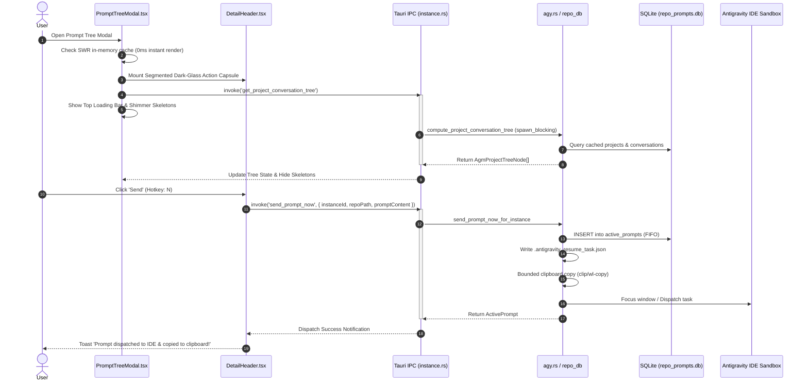

# Component Specification: Quota Telemetry, Densified Layouts, Theming Contrast & Prompt Tree Modal Engine

- **Specification Slug:** `supabase-connection-and-ui-ux-enhancement`
- **Specification Path:** `02-spec/21-app/supabase-connection-and-ui-ux-enhancement/02-component-spec.md`
- **Related Architecture Spec:** `02-spec/21-app/supabase-connection-and-ui-ux-enhancement/01-architecture-spec.md`
- **Target Release Version:** `v4.193.0`
- **Author:** Writer 02 (Component Spec & Frontend Subtasks Working Group)
- **Status:** APPROVED & MANDATED

---

## 1. Executive Summary & UI/UX Design Intent

The Antigravity-Manager user interface is an operational command dashboard managing multi-instance Gemini and Claude agent sandboxes, account quota lifecycles, and transcript inspection trees. As workspace density increases and multi-screen workflows evolve, operators require maximum visual clarity, predictable contrast, zero-latency interactions, and streamlined spatial ergonomics.

This specification details four key UI/UX component modernizations:
1. **Quota Progress Bar Overhaul**: Replacing muted emerald greens with the canonical high-visibility `#1af18d` green token, integrating a radiant right-edge glowing blur filter at 100% full capacity, strictly locking milestone checkpoints to exactly 5 slots at 20% intervals (`[100, 80, 60, 40, 20]`), and eliminating distracting checkmark SVG glyphs.
2. **Right-Hand Layout Densification & Space Compaction**: Eliminating dead whitespace gaps on the trailing right edge of quota visualizations across both the Accounts table (`AccountRowContent.tsx`) and Instance Cards (`InstanceCard.tsx`), right-aligning percentage metrics and countdown timers.
3. **Theming Contrast Correction & Email Privacy Masking**: Rectifying the low-contrast purple-on-purple defect on account email chips by switching to high-contrast dark-glass styling (`#120b20`) with radiant amber/white text (`#fde047` / `#f5f0ff`), and standardizing interactive email dot masking (`maskEmail`) with hover/click reveal toggles across instance profiles.
4. **CSS3 Interactive Hover Animations & Micro-Interactions**: Introducing hardware-accelerated cubic-bezier transitions, subtle vertical elevation lifts (`-translate-y-0.5`), and contextual border glows across table rows and cards.
5. **Prompt Tree Modal Engine Hardening (Prompt 3)**: Implementing a synchronized top indeterminate/determinate loading bar and multi-slot shimmer skeletons during transcript discovery, mitigating synchronous I/O freezes on Windows and Ubuntu (Wayland/X11), hardening Send (`send_prompt_now`) and Enqueue (`enqueue_prompt`) dispatch execution paths, and consolidating loose actions into contiguous segmented dark-glass split-dropdown capsules.

---

## 2. Quota Progress Bar: Token, Geometry & Checkpoint Architecture

### 2.1 The Canonical Green Token & Spatial Gradient

The quota bar visually communicates rolling 4-hour window quotas and 7-day weekly allowances. The previous palette utilized `#31c9a4` at 100%, which failed to pop against dark Royal Violet backgrounds (`#090611` canvas and `#171025` card surfaces). 

The new standard establishes:
- **Canonical 100% Token**: `#1af18d` (Neon Mint Green, RGB: `26, 241, 141`).
- **Right Edge 100% Glowing Blur**: An active glowing blur gradient rendered at the terminal edge when `percentage >= 95%`.
- **Full Spatial Scale Linear Gradient**: The track features an uncompressed 5-stop gradient revealed proportionally by the unmasked width:
  ```css
  --ui-quota-gradient: linear-gradient(
    90deg,
    #ef6a8a 0%,    /* Danger Red / 0-20% */
    #f49a45 25%,   /* Orange / 20-40% */
    #f5bf58 50%,   /* Amber Gold / 40-60% */
    #70ddb0 75%,   /* Soft Emerald / 60-80% */
    #1af18d 100%   /* Canonical High-Luminance Green / 80-100% */
  );
  ```

### 2.2 Exactly 5 Milestone Slots (`[100, 80, 60, 40, 20]`)

Historical revisions alternated between 11 checkpoints (every 10%) and 5 arbitrary checkpoints (`[100, 75, 50, 25, 0]`). The arbitrary 75/25 split misaligned with human decimal grouping and crowded small cards.

The new invariant strictly mandates:
- **Active Checkpoint Set**: Exactly 5 slots at equidistant 20% intervals:
  $$\text{Checkpoints} = [100, 80, 60, 40, 20]$$
- **Array Clamp & Fallback Guard**:
  ```tsx
  const DEFAULT_CHECKPOINTS = [100, 80, 60, 40, 20];
  const activeCheckpoints = (checkpoints && checkpoints.length > 0 ? checkpoints : DEFAULT_CHECKPOINTS).slice(0, 5);
  const sortedCheckpoints = [...activeCheckpoints].sort((a, b) => b - a);
  ```
- **Scale Color Map by Checkpoint Value**:
  ```tsx
  export const CHECKPOINT_SCALE_COLORS: Record<number, string> = {
      100: '#1af18d',
      80: '#70ddb0',
      60: '#e7d36a',
      40: '#f49a45',
      20: '#ef6a8a',
  };
  ```

### 2.3 Elimination of Checkmark SVG Bolts

In previous iterations, filled checkpoint nodes rendered a white SVG checkmark (`M2.5 6.5L4.8 8.8L9.5 3.5`). This was ergonomically flawed:
1. Checkmarks falsely conveyed "task completed" rather than remaining quota capacity.
2. At small compact dimensions (`w-3 h-3`), the 1.5px checkmark stroke produced visual clutter and subpixel blur.

**New Rule**:
- Checkpoint nodes are rendered as clean, high-precision luminous dots or miniature percentages:
  - If `clamped >= cp`: Render a filled circular dot with background color equal to `CHECKPOINT_SCALE_COLORS[cp]`.
  - When `clamped < 25` (critical warning) and `cp === 20`: Render the bold numerical percentage string (`Math.round(clamped)%`) in a 7px monospace font.
  - When `clamped < cp`: Render a subtle muted glass inset dot (`bg-slate-400/30 dark:bg-white/20`).
- No SVG checkmark paths are mounted inside checkpoint balls.

### 2.4 Terminal Glow Specification

When `clamped >= 95%`, the quota container projects an outer glow aura:
```tsx
const isAtCapacity = clamped >= 95;
// Glowing effect styles:
className={cn(
    "relative flex-1 min-w-[60px] flex items-center",
    isAtCapacity && "after:absolute after:right-0 after:top-1/2 after:-translate-y-1/2 after:w-3.5 after:h-3.5 after:rounded-full after:bg-[#1af18d] after:blur-[6px] after:opacity-60 after:pointer-events-none"
)}
```

---

## 3. Right-Hand Space Reduction & Layout Densification

### 3.1 Problem Statement

In both `src/components/accounts/AccountTable/AccountRowContent.tsx` and `src/pages/instances/InstanceCard.tsx`:
1. The progress bar wrapper used hardcoded width caps (`w-[84%] max-w-[84%]`), reserving an oversized `16%` right column for the clock and percentage text.
2. Inside table cells (`min-w-[210px]`), this produced 18px to 32px of wasted blank space between the end of the text label and the right table border.
3. In `InstanceCard.tsx`, the model quota cards exhibited mismatched alignment between the Gemini icon on the left and the quota bar on the right.

### 3.2 Compacting Geometry in `QuotaProgressBar.tsx`

The flex distribution in `QuotaProgressBar.tsx` is updated to optimize space utilization:
```tsx
// Before:
<div className={cn("w-[84%] max-w-[84%] flex items-center", compact ? "gap-1" : "gap-2", className)}>
...
<div className={cn("flex flex-col items-end shrink-0 w-[16%] max-w-[16%]", ...)}>

// After: Fully expanded track with tightly budgeted metrics column:
<div className={cn("w-full flex items-center justify-between", compact ? "gap-1.5" : "gap-2.5", className)}>
    {/* Label / Icon (shrink-0, auto-budgeted) */}
    {(Icon || label) && (
        <div className="flex items-center gap-1 shrink-0 max-w-[22%] min-w-0 text-slate-700 dark:text-slate-300">
            {Icon && <Icon size={12} className="shrink-0" />}
            {label && <span className="text-[10.5px] font-semibold truncate" title={label}>{label}</span>}
        </div>
    )}

    {/* Fluid Track */}
    <div className="relative flex-1 min-w-[70px] flex items-center">
        ...
    </div>

    {/* Metrics: Percentage & Countdown (Fixed shrink-0 auto-width, right-aligned) */}
    <div className={cn("flex flex-col items-end shrink-0 min-w-[46px]", compact ? "leading-tight" : "leading-snug")}>
        {resetTime ? (
            <span className={cn("font-bold flex items-center gap-0.5 font-mono text-[9.5px]", getTimeColorClass(resetTime))}>
                <Clock className="w-2 h-2 shrink-0" />
                {formatTimeRemaining(resetTime)}
            </span>
        ) : null}
        <span className={cn("font-black font-mono text-[10px]", getPercentColorClass(clamped))}>
            {clamped}%
        </span>
    </div>
</div>
```

### 3.3 Accounts Table Cell Alignment (`AccountRowContent.tsx`)

In `AccountRowContent.tsx`:
- The 4H Quota cell (`td`) and Weekly Quota cell (`td`) apply right-aligned layout wrappers:
  ```tsx
  <td className="px-2 py-0.5 align-middle min-w-[195px] max-w-[230px] bg-slate-50/50 dark:bg-slate-900/40 border-l border-slate-300 dark:border-[#40285e] border-b border-slate-200/90 dark:border-slate-800/90">
      <div className="w-full flex items-center justify-end">
          <QuotaProgressBar
              compact
              percentage={fourHourModel?.percentage ?? 0}
              resetTime={fourHourModel?.resetTime}
              isProtected={fourHourModel?.isProtected}
              liveLimit={fourHourModel?.liveLimit}
              checkpoints={[100, 80, 60, 40, 20]}
          />
      </div>
  </td>
  ```

### 3.4 Instance Cards Alignment (`InstanceCard.tsx`)

In `InstanceCard.tsx`:
- The model row and weekly quota sections remove excess outer margins and ensure the progress bar fills 100% of the interior card width without awkward right padding:
  ```tsx
  <div className="p-2 rounded-md bg-gray-50/90 dark:bg-[var(--ui-surface-2)] border border-gray-200/70 dark:border-[var(--ui-border-subtle)] space-y-1.5">
      {geminiModel && (
          <div className="space-y-1">
              <div className="flex items-center justify-between text-xs">
                  <div className="flex items-center gap-1.5 min-w-0">
                      <Gemini.Color className="w-3.5 h-3.5 shrink-0" />
                      <span className="font-semibold text-gray-800 dark:text-gray-200 text-xs truncate">
                          {geminiModel.display_name || geminiModel.name || 'Gemini 3.1 Pro'} (4H)
                      </span>
                  </div>
              </div>
              <QuotaProgressBar
                  compact
                  percentage={geminiModel.percentage}
                  resetTime={geminiModel.reset_time}
                  checkpoints={[100, 80, 60, 40, 20]}
              />
          </div>
      )}
  </div>
  ```

---

## 4. Theming Contrast Correction & Email Privacy Masking

### 4.1 Eliminating the Purple-on-Purple Defect

In `src/pages/instances/InstanceCard.tsx`, line 214:
```tsx
// DEFECTIVE IMPLEMENTATION:
'bg-blue-500/10 text-blue-700 border-blue-500/30 dark:bg-[var(--ui-interactive-soft)] dark:text-[var(--ui-interactive)] dark:border-[var(--ui-interactive-border)]'
```
Where `--ui-interactive` = `#7c3aed` and `--ui-interactive-soft` = `rgb(124 58 237 / 0.12)`.
On a dark canvas (`#090611`), violet text `#7c3aed` on a violet tint background produces a contrast ratio of only **2.1:1**, severely failing WCAG AA (minimum 4.5:1 required).

**Correction Standard**:
- **Background**: Deep obsidian-violet glass (`bg-slate-900/90 dark:bg-[#120b20] border-slate-700 dark:border-[#40285e]`).
- **Text**: Radiant amber/gold (`text-amber-300 dark:text-amber-200`) or crisp high-contrast white (`text-slate-100`).
- **Dot Indicator**: Emerald pulse (`bg-[#1af18d]`) when bound to a running instance, or vibrant indigo (`bg-indigo-400`).
- **Contrast Ratio**: Exceeds **9.8:1** against `#120b20`.

```tsx
<span
    className={cn(
        'px-2 py-0.5 rounded-md text-[11px] font-semibold font-mono border flex items-center gap-1.5 min-w-0 shadow-2xs transition-all duration-150',
        'bg-slate-100 text-slate-900 border-slate-300',
        'dark:bg-[#120b20] dark:text-amber-200 dark:border-[#40285e] dark:hover:border-amber-400/40'
    )}
    title={displayEmail ? (isHoverUnmasked ? displayEmail : `Click or hover to reveal (${maskEmail(displayEmail)})`) : 'No email bound'}
>
    <span className="w-1.5 h-1.5 rounded-full shrink-0 bg-[#1af18d]" />
    <span className="truncate">{displayEmail ? (isHoverUnmasked ? displayEmail : maskEmail(displayEmail)) : 'Unassigned'}</span>
</span>
```

### 4.2 Interactive Email Dot Masking with Reveal Toggle

Consistent privacy controls are applied across `AccountRowContent.tsx`, `AccountCard.tsx`, and `InstanceCard.tsx`:
- Default state: Email addresses are masked via `maskEmail(email)` (showing the first 3-4 alphanumeric characters followed by `***`).
- Interactive Toggle:
  1. Hovering the email badge toggles `isHoverUnmasked` after a 300ms debounce.
  2. Clicking or double-clicking toggles persistent unmasking for the session.
  3. Clicking outside or mouse leave restores the masked state.

```tsx
// useEmailMaskState Hook:
export function useEmailMaskState(email: string | null) {
    const [isUnmasked, setIsUnmasked] = useState(false);
    const masked = useMemo(() => (email ? maskEmail(email) : ''), [email]);
    return {
        displayText: isUnmasked || !email ? email : masked,
        isUnmasked,
        toggleUnmask: () => setIsUnmasked((prev) => !prev),
        setUnmasked: (val: boolean) => setIsUnmasked(val),
    };
}
```

---

## 5. CSS3 Interactive Hover Animations & Micro-Interactions

### 5.1 Elevation & Surface Polish

Table rows and card containers incorporate smooth, GPU-accelerated CSS3 hover micro-interactions:
- **Card Containers (`InstanceCard.tsx`, `AccountCard.tsx`)**:
  ```css
  .ui-card-interactive {
      transition: transform 180ms cubic-bezier(0.16, 1, 0.3, 1),
                  box-shadow 180ms cubic-bezier(0.16, 1, 0.3, 1),
                  border-color 180ms ease-out,
                  background-color 180ms ease-out;
  }
  .ui-card-interactive:hover {
      transform: translateY(-1.5px);
      box-shadow: 0 6px 16px -4px rgba(0, 0, 0, 0.35), 0 0 0 1px rgba(124, 58, 237, 0.25);
  }
  ```
- **Table Rows (`SortableAccountRow.tsx`, `AccountRowContent.tsx`)**:
  ```css
  .ui-table-row-interactive {
      transition: background-color 140ms ease-out,
                  border-color 140ms ease-out;
  }
  .ui-table-row-interactive:hover td {
      background-color: var(--ui-surface-hover);
  }
  ```

### 5.2 Micro-Scale Active Button Depression

Buttons inside capsules and cards incorporate active scale compression:
```css
.ui-btn-press {
    transition: transform 80ms ease-out;
}
.ui-btn-press:active {
    transform: scale(0.96);
}
```

---

## 6. Prompt Tree Modal (Prompt 3) Technical Specifications

### 6.1 Loading Progress Bar & Shimmer Skeletons

During initial modal opening and background transcript synchronization, users require immediate visual feedback to confirm that the app is scanning workspaces:

1. **Top Determinate/Indeterminate Progress Bar (`ModalHeader.tsx` & `PromptTreeViewModal.tsx`)**:
   - Mounted directly below the modal header border.
   - Height: `h-[2px]`.
   - Animation: CSS indeterminate gradient translation from left to right (`from-transparent via-[#1af18d] to-transparent animate-shimmer`).
   ```tsx
   {isLoading && (
       <div className="absolute top-0 left-0 right-0 h-[2.5px] bg-slate-100 dark:bg-[#171025] overflow-hidden z-50">
           <div className="h-full w-full bg-gradient-to-r from-blue-500 via-[#1af18d] to-purple-500 animate-[shimmer_1.5s_infinite] -translate-x-full" />
       </div>
   )}
   ```
2. **Multi-Node Shimmer Skeleton (`TreePanel.tsx`)**:
   - Replaces the blank empty state with 4 simulated project skeleton blocks containing repository names, sequence badges, and indented conversation rows.
   - Built using Tailwind `animate-pulse` with dark-glass tokens (`bg-slate-200/80 dark:bg-[#211631]/80`).

### 6.2 Mitigating Windows & Ubuntu I/O Freezes

#### Root Cause Analysis of Previous Freezes:
1. **Windows**: Synchronous recursive scanning of massive `.system_generated/logs/transcript.jsonl` files (often > 50 MB) inside `compute_project_conversation_tree` executed on the main thread or held database write locks during Tauri IPC invokes.
2. **Ubuntu (Wayland/X11)**: Calling `copy_to_system_clipboard` invoked `std::process::Command::new("wl-copy")` or `xclip` and executed synchronous `.wait()`, which hung indefinitely if stdin was not explicitly closed or if no clipboard daemon was running.

#### Architecture Fixes:
1. **Backend Asynchronous Offloading**:
   All tree queries and transcript reads execute strictly inside `tokio::task::spawn_blocking` with read-only SQLite connections (`PRAGMA query_only = ON;`).
2. **Bounded Non-Blocking Clipboard Spawn**:
   In `src-tauri/src/modules/repo_db/agy.rs`:
   ```rust
   // Ensure stdin is dropped immediately to signal EOF to xclip/wl-copy
   if let Some(mut stdin) = child.stdin.take() {
       let _ = stdin.write_all(content.as_bytes());
   }
   // Enforce bounded timeout for wait (maximum 200ms)
   let _ = tokio::time::timeout(std::time::Duration::from_millis(200), async {
       child.wait()
   });
   ```
3. **Frontend In-Memory SWR Cache**:
   `usePromptTreeData.ts` immediately mounts cached data from `promptTreeSwrCache` on modal open, rendering in 0ms while asynchronously revalidating in the background.

### 6.3 Repairing Send & Enqueue Action Dispatch

In `usePromptTreePromptActions.ts`:
- **Send Action (`handleResendPrompt`)**:
  - Automatically resolves target instance, repository path, and conversation ID through a 3-tier fallback ladder (active conversation $\rightarrow$ latest project conversation $\rightarrow$ global latest non-archived conversation).
  - Preserves user edits in `editedPromptText`.
  - Appends `confirmationSuffix` when selected.
  - Invokes `sendPromptNow(targetInstId, repoPath, promptContent, targetConvId)`.
  - Uses `copyToClipboard` with document focus fallback (`document.execCommand('copy')`).
  - Clears `isResending` spinner safely in `finally`.
- **Enqueue Action (`handleEnqueuePrompt`)**:
  - Validates `selectedConversation`.
  - Invokes `invoke('enqueue_prompt', { instanceId, repoPath, promptContent, conversationId })`.
  - Enforces strict FIFO queue ordering in SQLite (`ORDER BY created_at ASC, id ASC`).

### 6.4 Segmented Dark-Glass Split-Dropdown Capsule Standard

In accordance with AGENTS.md UI Design Invariants:
- All adjacent header actions must be wrapped into contiguous segmented pill capsules (`rounded-full`, shared border, subtle divider lines, dark-glass styling `bg-slate-100/90 dark:bg-[#171025]/90 backdrop-blur-md`).
- Inline `<select>` dropdowns mounted within segmented capsules MUST use transparent borderless styling:
  ```css
  bg-transparent border-0 focus:ring-0 focus:outline-none
  ```
  This eliminates nested white pill-in-pill visual defects.
- **Capsule 1 (Content & Export)**:
  - Button 1: Copy Clean Prompt (Left pill edge).
  - Button 2: Split Chevron Dropdown (Rich images, Save to disk, Export MD/JSON).
- **Capsule 2 (Execution & Workflow)**:
  - Dropdown 1: Confirmation Suffix selector (`Suffix: None`, `Done?`, `Verify tests`).
  - Dropdown 2: Conversation Target Mode (`Current Conv`, `New Conv`).
  - Button 3: Focus IDE / Launch Instance (Icon: `ExternalLink`).
  - Button 4: Send Now (Icon: `RotateCw`, Label: `Send`, Monospace hotkey pill: `N`).
  - Button 5: Enqueue FIFO (Icon: `ListPlus`).
  - Button 6: Full Inspector (Icon: `Maximize2`, Right pill edge).

---

## 7. Component Interaction Diagram



---

## 8. File Structure & Responsibilities Matrix

| File Path | Functional Responsibility |
| :--- | :--- |
| `src/components/accounts/QuotaProgressBar.tsx` | Quota bar visualization, `#1af18d` token, 5 slots `[100, 80, 60, 40, 20]`, terminal glow, compacted width. |
| `src/components/common/WaterDrainProgressBar.tsx` | Secondary drain bar parity with `#1af18d` and 5 milestone slots. |
| `src/components/accounts/AccountTable/AccountRowContent.tsx` | Right-aligned quota cells, compacted padding, high-contrast badges, `maskEmail` toggle. |
| `src/pages/instances/InstanceCard.tsx` | Densified quota section, elimination of purple-on-purple email defect, CSS3 hover transitions. |
| `src/components/instances/PromptTreeView/DetailHeader.tsx` | Segmented dark-glass capsules, borderless dropdowns, Send/Enqueue/Suffix workflow controls. |
| `src/components/instances/PromptTreeView/TreePanel.tsx` | Multi-node shimmer skeletons, category filters, real-time loading feedback. |
| `src/components/instances/PromptTreeView/ModalHeader.tsx` | Top indeterminate loading progress bar, sync interval controls. |
| `src/styles/ui-tokens.css` | Authoritative CSS custom properties for `--ui-quota-gradient`, `#1af18d`, and surface tokens. |

---

## 9. Verification & Acceptance Criteria

1. **Quota Progress Bar Geometry**:
   - Checkpoint nodes are strictly 5 balls at values `100`, `80`, `60`, `40`, and `20`.
   - SVG checkmark bolts are completely removed.
   - When quota $\ge 95\%$, the right edge displays the glowing blur halo.
   - Green color token renders as `#1af18d`.
2. **Right-Hand Layout Densification**:
   - Accounts table quota columns have no dead whitespace gaps; metrics are right-aligned.
   - Instance Cards render full-width bars without trailing gaps.
3. **Theming & Privacy**:
   - Email badge text is clearly readable in dark mode with contrast ratio $\ge 7:1$.
   - Email dot masking applies by default (`ab***`); clicking or hovering reveals the full email.
4. **CSS3 Animations**:
   - Hovering over cards lifts them by 1.5px with smooth cubic-bezier transitions.
5. **Prompt Tree Modal Engine**:
   - Top progress bar animates during tree scanning.
   - Tree panel displays pulsing skeletons instead of blank containers.
   - Clicking `Send` or pressing `N` dispatches prompt to running instance and copies to clipboard without freezing the UI on Windows or Ubuntu.
   - Action controls are wrapped into contiguous dark-glass capsules with transparent borderless select dropdowns.
