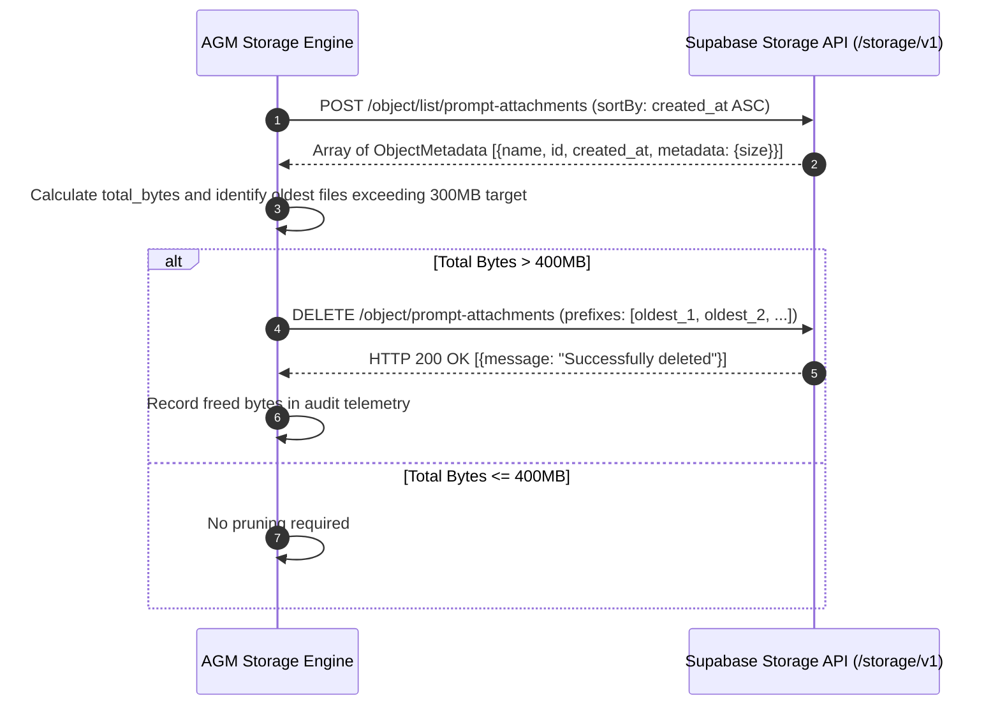

# 03. Multi-Supabase Temporary Image Storage & Public URL Architecture Specification

**Slug:** `supabase-connection-and-ui-ux-enhancement`  
**File:** `02-spec/21-app/supabase-connection-and-ui-ux-enhancement/03-image-storage-spec.md`  
**Target Release:** v4.160.0  
**Status:** APPROVED FOR IMPLEMENTATION  
**Lead Author:** Worker 01 (Supabase, Secrets & Image Storage Architect)  

---

## 1. Architectural Overview & Context

Antigravity-Manager manages prompt execution, task resumption, and multi-instance orchestration across complex developer workflows. During prompt construction, subagent delegation, and task debugging, operators and automated agents frequently attach visual assets — including user interface mockups, application screenshots, diagnostic waveforms, and architecture diagrams.

### 1.1 The Base64 Token Exhaustion Problem
Previously, image attachments were either converted to in-memory Base64 data URIs (`data:image/png;base64,...`) or stored as raw binary blobs in local SQLite databases (`repo_prompts.db`, `active_prompts`). This architecture created severe bottlenecks:
1. **Payload Inflation**: Base64 encoding inflates binary payload size by approximately 33%, causing multi-megabyte JSON payloads across the Tauri IPC bridge and WebSocket channels.
2. **Context Window Waste**: Modern multimodal AI models (Gemini 2.0 Flash, Claude 3.5 Sonnet, GPT-4o) consume substantial context budget when ingesting raw inline base64 blobs compared to fetching optimized images via public HTTPS URLs.
3. **Database Bloat**: Persisting raw megabyte strings into SQLite prompt restore queues severely degrades disk I/O, search speed, and compaction operations.

### 1.2 The Supabase Storage Solution
To address these limitations, Antigravity-Manager introduces an ephemeral **Multi-Supabase Temporary Image Storage Engine**. Visual attachments are uploaded to a public Supabase Storage bucket (`prompt-attachments`), generating immutable, CDN-cached public URLs. These URLs are injected into prompt payloads and multimodal API requests. Ephemeral attachments are governed by an automated FIFO pruning engine that strictly enforces a **400 MB storage cap** to respect Supabase free-tier resource boundaries.

---

## 2. Multi-Supabase Storage Architecture & Redundancy

```mermaid
flowchart TD
    UI[Frontend / Subagent Image Attachment] --> Mgr[Supabase Storage Manager<br/>src-tauri/src/modules/supabase_storage.rs]
    
    Mgr --> CheckCap{Check Storage Usage<br/>against 400 MB cap}
    CheckCap -- Exceeds 400 MB --> Pruner[FIFO Auto-Pruner<br/>Delete oldest objects until < 300 MB]
    Pruner --> UploadPrimary
    CheckCap -- Within Quota --> UploadPrimary[Upload to Primary Root DB<br/>Lovable: pezjuuddecbyfmqxytrv]

    UploadPrimary -->|Success (200 OK)| GenURL[Generate Public CDN URL]
    UploadPrimary -->|Failure / Quota Error / Network Timeout| Failover[Failover to Secondary DB<br/>Personal: ikwmurmjynhxdpmhzekt]
    Failover -->|Success (200 OK)| GenURL
    Failover -->|Failure / All Offline| LocalFallback[Graceful Local Data URI Fallback]

    GenURL --> PromptPayload[Inject URL into Markdown &<br/>Gemini Multimodal IR Payload]
```

### 2.1 Storage Bucket Configuration
Both Primary and Secondary Supabase instances configure a dedicated public storage bucket:
- **Bucket Identifier**: `prompt-attachments`
- **Public Visibility**: `public = true` (enables direct public URL access without expiring token query parameters)
- **File Size Cap**: 10 MB per individual file
- **Supported MIME Types**:
  - `image/png`
  - `image/jpeg`
  - `image/webp`
  - `image/gif`
  - `image/svg+xml`

### 2.2 Endpoint Roles & Allocation
1. **Primary Storage (Root / Lovable)**:
   - Endpoint: `https://pezjuuddecbyfmqxytrv.supabase.co`
   - Target Bucket: `prompt-attachments`
   - Active Usage Ceiling: 400 MB (leaving 100 MB headroom for PostgreSQL WAL and database storage under the 500 MB free-tier limit)
2. **Secondary Storage (Fallback / Personal)**:
   - Endpoint: `https://ikwmurmjynhxdpmhzekt.supabase.co`
   - Target Bucket: `prompt-attachments`
   - Active Usage Ceiling: 200 MB
   - Activated automatically if Primary returns HTTP 4xx/5xx, timeouts, or exceeds its storage cap.

---

## 3. 400 MB Free-Tier Storage Cap & FIFO Auto-Pruning Engine

Supabase free-tier projects enforce a rigid 500 MB aggregate storage limit. Crossing this boundary risks project suspension or write-blocking. AGM establishes strict automated guardrails.

### 3.1 Dual-Trigger Pruning Lifecycle
Pruning is executed under two distinct triggers:
1. **Pre-Upload Guard**: Before dispatching an upload request, AGM calculates `current_bucket_usage_bytes + incoming_file_bytes`. If the projected aggregate exceeds 400 MB (419,430,400 bytes), pruning is invoked synchronously before the upload proceeds.
2. **Background Sweep**: Integrated into the 15-minute background maintenance cycle (`supabase_pruner.rs`), verifying that aggregate usage remains well below threshold limits.

### 3.2 FIFO Pruning Algorithm & Hysteresis
To prevent thrashing (repeatedly deleting a single file per upload), the pruning engine implements a high-water / low-water hysteresis:
- **High-Water Mark**: 400 MB (Trigger point)
- **Low-Water Mark**: 300 MB (Target reduction point)



### 3.3 Strict FIFO Query & Deletion Invariant
In compliance with repository core invariants (strict First-In-First-Out ordering):
- Object listing queries **must** sort by creation time ascending:
  ```json
  {
    "prefix": "",
    "limit": 100,
    "offset": 0,
    "sortBy": {
      "column": "created_at",
      "order": "asc"
    }
  }
  ```
- Files created earliest are deleted first until aggregate storage falls below 300 MB.
- In-flight prompt protection: Files uploaded within the preceding 10 minutes are granted an active grace period and will not be pruned unless absolute disk exhaustion occurs.

---

## 4. Public URL Generation & Multimodal Prompt Injection

### 4.1 Canonical Public URL Format
Supabase Storage exposes public bucket objects through standard REST endpoints without requiring Bearer authentication headers:
```text
{normalized_base_url}/storage/v1/object/public/{bucket}/{object_path}
```

#### Example Formats:
- **Primary Root (Lovable)**:
  `https://pezjuuddecbyfmqxytrv.supabase.co/storage/v1/object/public/prompt-attachments/inst-01/1728800000_8f3a1b2c.png`
- **Secondary (Personal)**:
  `https://ikwmurmjynhxdpmhzekt.supabase.co/storage/v1/object/public/prompt-attachments/inst-01/1728800000_8f3a1b2c.png`

### 4.2 Object Path Naming Convention
To prevent key collisions between concurrent instances and ensure deterministic cleanup, object keys adhere to the following schema:
```text
{instance_id}/{timestamp_millis}_{sha256_short}.{extension}
```
- `instance_id`: Unique identifier of the originating IDE instance profile (e.g., `inst-01`, `default`).
- `timestamp_millis`: Epoch milliseconds of creation.
- `sha256_short`: First 8 hexadecimal characters of the image content hash (prevents duplicate uploads of identical images).
- `extension`: Canonical extension matching the normalized MIME type (`.png`, `.jpg`, `.webp`).

### 4.3 Integration with Prompt Payloads & Multimodal LLM Pipelines

#### 1. Markdown Presentation in Prompt Tree View:
In prompt inspection trees, history views, and transcript monitors, visual attachments render cleanly via standard markdown:
```markdown

```

#### 2. Multimodal Canonical IR Normalization (Pipeline Stage):
When compiling prompts for the Gemini / Claude / OpenAI gateway adapters:
```json
{
  "role": "user",
  "parts": [
    {
      "text": "Review this UI layout bug and diagnose why the close button wraps onto a second line:"
    },
    {
      "file_data": {
        "mime_type": "image/png",
        "file_uri": "https://pezjuuddecbyfmqxytrv.supabase.co/storage/v1/object/public/prompt-attachments/inst-01/1728800000_8f3a1b2c.png"
      }
    }
  ]
}
```
Adapters stream the asset directly from the Supabase public CDN edge, completely eliminating local memory pressure and oversized HTTP request envelopes.

---

## 5. Technical Implementation Contracts (Rust Backend)

### 5.1 Storage Manager Module Contract
Defined in `src-tauri/src/modules/supabase_storage.rs`:

```rust
use crate::error::AppError;
use serde::{Deserialize, Serialize};

#[derive(Debug, Clone, Serialize, Deserialize)]
pub struct StorageUploadResult {
    pub is_success: bool,
    pub public_url: String,
    pub object_path: String,
    pub bucket: String,
    pub size_bytes: u64,
    pub endpoint_role: String,
}

#[derive(Debug, Clone, Serialize, Deserialize)]
pub struct BucketUsageSummary {
    pub bucket: String,
    pub total_bytes: u64,
    pub object_count: usize,
    pub usage_mb: f64,
}

pub struct SupabaseStorageManager;

impl SupabaseStorageManager {
    /// Upload an image to the primary Supabase storage bucket with automatic secondary failover.
    /// Enforces the 400MB storage ceiling and invokes FIFO pruning if necessary.
    pub async fn upload_prompt_attachment(
        instance_id: &str,
        file_bytes: Vec<u8>,
        mime_type: &str,
    ) -> Result<StorageUploadResult, AppError>;

    /// Calculate total usage in bytes for the specified bucket.
    pub async fn get_bucket_usage(
        client: &crate::modules::supabase_client::SupabaseClient,
        bucket: &str,
    ) -> Result<BucketUsageSummary, AppError>;

    /// Perform FIFO pruning on the bucket to bring aggregate usage below target_mb.
    pub async fn prune_bucket_fifo(
        client: &crate::modules::supabase_client::SupabaseClient,
        bucket: &str,
        target_mb: u64,
    ) -> Result<usize, AppError>;

    /// Construct canonical public CDN URL for an object path.
    pub fn build_public_url(base_url: &str, bucket: &str, path: &str) -> String {
        let clean_base = base_url.trim_end_matches('/').trim_end_matches("/rest/v1");
        format!("{clean_base}/storage/v1/object/public/{bucket}/{path}")
    }
}
```

### 5.2 Error Visibility & No Silent Errors Compliance
Every storage API operation must enforce structured error logging:
- HTTP 403 (Invalid token / storage bucket permissions): Logged via `tracing::warn!` with full response text and guidance on checking public bucket access policies.
- HTTP 507 (Storage quota exceeded): Explicitly caught, triggering immediate secondary failover and alerting operators.
- Zero bare `.unwrap_or_default()` calls: All deserialization errors log captured stack traces via `std::backtrace::Backtrace::capture()`.

---

## 6. Acceptance Criteria & Verification Matrix

- [ ] **AC-1 (Bucket Provisioning)**: `prompt-attachments` bucket verified as public on both Primary (Lovable) and Secondary (Personal) Supabase instances.
- [ ] **AC-2 (Public URL Generation)**: `upload_prompt_attachment` returns an immutable, directly accessible HTTPS URL conforming to `{base_url}/storage/v1/object/public/prompt-attachments/{instance_id}/{timestamp}_{hash}.{ext}`.
- [ ] **AC-3 (400 MB Hard Cap)**: When simulated storage reaches or exceeds 400 MB, the pre-upload check halts additional growth and successfully prunes oldest objects down to 300 MB.
- [ ] **AC-4 (Strict FIFO Ordering)**: Pruning queries sort objects by `created_at ASC`, ensuring older attachments are purged before newer ones.
- [ ] **AC-5 (Secondary Failover)**: If the primary endpoint is unreachable or paused, visual attachments automatically upload to the secondary storage bucket without prompt rejection.
- [ ] **AC-6 (Zero Silent Errors)**: Storage network or JSON parsing failures log `tracing::warn!` and backtraces in compliance with the system error discipline.
