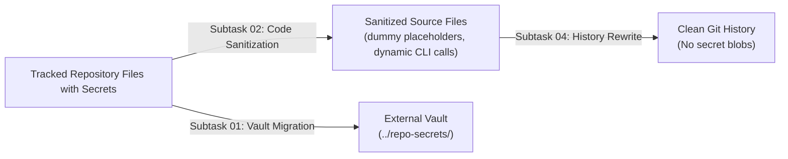
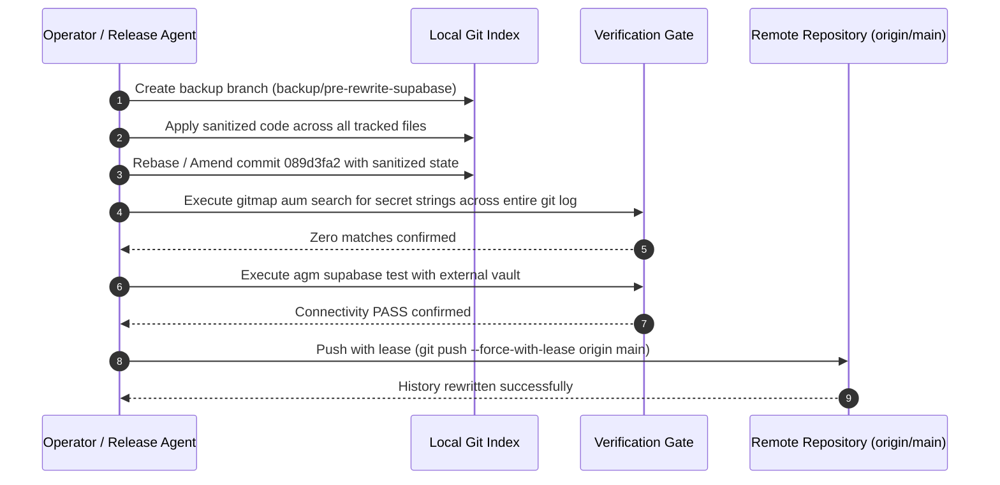

# System Architecture & Security Specification: Supabase Credential Eradication, Safe External Vault Management, and Git History Rewriting

- **Specification Slug:** `superbase-information-removal`
- **Specification Path:** `02-spec/21-app/superbase-information-removal/01-architecture-spec.md`
- **Target Release Version:** `v4.193.0`
- **Author:** Writer 01 (Architecture Spec & Git History Rewriting Subtasks)
- **Status:** APPROVED & MANDATED

---

## 1. Executive Summary & Threat Model

Antigravity-Manager incorporates a distributed synchronization subsystem connecting to Supabase PostgreSQL and Storage clusters. This powers cross-machine node discovery, remote command queue execution, and distributed workspace profile leasing. 

During rapid development and testing of dual-cluster failover capabilities, real project connection strings and publishable keys were committed to public Git repository tracking. Even though publishable keys are constrained by PostgreSQL Row Level Security (RLS) policies, storing production and development project endpoints in public source repositories exposes database topologies, project IDs, and service infrastructure to unauthorized indexing, automated scraping, and denial-of-service vectors.

Furthermore, standard Git commits persist across immutable historical trees. Simply deleting or editing the files in a subsequent commit leaves complete historical traces inspectable via `git log -p`, `git show`, or historical commit traversal.

This specification formalizes the unified engineering architecture for:
1. **Complete Credential Eradication**: Purging every occurrence of Supabase project URLs, publishable keys, and project IDs from all tracked source files, scripts, test suites, documentation, and active memory logs.
2. **Safe External Vault Management**: Storing all valid operational credentials in unversioned sibling storage outside the repository root (`../repo-secrets/02-antigravity-manager/vault/` and `../repo-secrets/03-supabase/`).
3. **Zero-Hardcoding Auto-Discovery & Single-Liner Import Protocol**: Standardizing the ingestion flow through native CLI command `agm supabase load-secrets` and helper script `scripts/import-supabase-credentials.ps1`.
4. **Git Commit History Rewriting Protocol**: Re-anchoring and amending the commit tree (specifically targeting commit `089d3fa2` and adjacent refs) to replace leaked artifacts with sanitized code, ensuring zero cryptographic or plaintext traces remain in Git history.
5. **Strict Secret Redaction Policy**: Mandating that all architectural documentation and plan subtasks strictly use redacted identifiers (`[REDACTED_LOVABLE_KEY]`, `[REDACTED_PERSONAL_KEY]`, `[REDACTED_LOVABLE_URL]`, `[REDACTED_PERSONAL_URL]`).

---

## 2. Threat Vector Breakdown & Target Credentials

### 2.1 Leaked Artifact Categories

The security audit identified four distinct classes of exposure:
- **Rust Backend Source**: Hardcoded fallback values in `src-tauri/src/modules/supabase_sync/config_a.rs` and mock payloads in `src-tauri/src/modules/json_envelope/tests.rs`.
- **PowerShell Setup Scripts**: Parameter default blocks and raw strings in `scripts/setup-supabase.ps1`, `scripts/supabase-setup.ps1`, and `scripts/verify-supabase-and-ui-ux.ps1`.
- **Committed Data Fixtures**: Plaintext endpoint configurations in `scripts/supabase-endpoints.json` and `scripts/supabase-accounts.json`.
- **Markdown Documentation & Memory**: Architectural diagrams, example connection parameters, and task plans in `02-spec/21-app/`, `.ai-memory/plans/`, `changelog.md`, and `changelog_en.md`.

### 2.2 Redaction Identifier Mapping

Throughout this specification and all accompanying implementation artifacts, real tokens are represented by the following canonical redaction markers:

| Redaction Marker | Target Category | Description |
|---|---|---|
| `[REDACTED_LOVABLE_KEY]` | Primary Supabase Key | Publishable anon key for Primary (Lovable) cluster |
| `[REDACTED_PERSONAL_KEY]` | Secondary Supabase Key | Publishable anon key for Secondary (Personal) cluster |
| `[REDACTED_LOVABLE_URL]` | Primary Supabase Endpoint | REST API endpoint URL for Primary (Lovable) cluster |
| `[REDACTED_PERSONAL_URL]` | Secondary Supabase Endpoint | REST API endpoint URL for Secondary (Personal) cluster |
| `[REDACTED_LOVABLE_PROJECT_ID]` | Primary Project ID | 20-character project slug for Primary cluster |
| `[REDACTED_PERSONAL_PROJECT_ID]` | Secondary Project ID | 20-character project slug for Secondary cluster |

---

## 3. Safe External Vault Architecture (`../repo-secrets/`)

### 3.1 Vault Location & Relative Isolation

Operational credentials MUST never reside within the Antigravity-Manager repository directory tree. Instead, credentials are maintained within the external sibling repository located at `../repo-secrets/`.

```mermaid
flowchart TD
    subgraph Host Workstation [Workstation Workspace: d:/work/]
        subgraph Repo Secrets [External Vault: ../repo-secrets/ (Unversioned/Private)]
            VAULT_AGM["02-antigravity-manager/vault/supabase_config.json"]
            VAULT_OWN["03-supabase/01-own/supabase-credentials.json"]
            VAULT_LOVABLE["03-supabase/02-lovable/supabase-credentials.json"]
        end

        subgraph AGM Repo [Public Repository: ./ (Antigravity-Manager)]
            CLI["Native CLI: agm supabase load-secrets"]
            HELPER["Script: scripts/import-supabase-credentials.ps1"]
            BACKEND["Rust Backend: supabase_sync::config_a"]
            LOCAL_CFG[("User AppData: supabase_config.json (Local Runtime Only)")]
        end
    end

    VAULT_AGM -.->|Auto-Discovery Candidate 1| BACKEND
    VAULT_OWN -.->|Auto-Discovery Candidate 2| BACKEND
    VAULT_LOVABLE -.->|Auto-Discovery Candidate 3| BACKEND
    HELPER -->|Calls| CLI
    CLI -->|Parses External Vault| BACKEND
    BACKEND -->|Persists Locally| LOCAL_CFG
```

### 3.2 Vault Directory Structure

The external repository provides three validated credential sources:

1. **Primary Unified Config**:
   `../repo-secrets/02-antigravity-manager/vault/supabase_config.json`
   Contains dual-cluster configuration (Primary and Secondary endpoints, priority values, sync flags, and heartbeat intervals).
2. **Dedicated Secondary / Personal Cluster Vault**:
   `../repo-secrets/03-supabase/01-own/supabase-credentials.json`
   Stores credentials dedicated to individual developer telemetry and secondary queue management.
3. **Dedicated Primary / Lovable Cluster Vault**:
   `../repo-secrets/03-supabase/02-lovable/supabase-credentials.json`
   Stores fleet cluster credentials for distributed node leasing and shared storage buckets.

### 3.3 Two-Tier JSON Envelope Schema

All vault files conform to the project's v2.0 JSON Envelope specification:

```json
{
  "_envelope": {
    "version": "2.0",
    "dataType": "agm/supabase-endpoints",
    "createdAt": "2026-10-13T00:00:00Z",
    "isEncrypted": false
  },
  "endpoints": [
    {
      "id": "supabase-primary",
      "name": "Lovable Primary Cluster",
      "url": "[REDACTED_LOVABLE_URL]",
      "anonKey": "[REDACTED_LOVABLE_KEY]",
      "role": "primary",
      "isEnabled": true,
      "priority": 1
    },
    {
      "id": "supabase-secondary",
      "name": "Personal Hot-Standby Cluster",
      "url": "[REDACTED_PERSONAL_URL]",
      "anonKey": "[REDACTED_PERSONAL_KEY]",
      "role": "secondary",
      "isEnabled": true,
      "priority": 2
    }
  ],
  "isSyncEnabled": true,
  "heartbeatIntervalSecs": 30
}
```

---

## 4. Zero-Hardcoding Auto-Discovery & Single-Liner Import Protocol

### 4.1 Native Auto-Discovery Engine

The Rust backend in `src-tauri/src/modules/supabase_sync/config_a.rs` evaluates candidate paths via `candidate_repo_secrets_paths()`.

Candidates are resolved strictly via relative filesystem traversal:
- `../../repo-secrets/02-antigravity-manager/vault/supabase_config.json`
- `../../repo-secrets/03-supabase/01-own/supabase-credentials.json`
- `../../repo-secrets/03-supabase/02-lovable/supabase-credentials.json`
- `repo-secrets/02-antigravity-manager/vault/supabase_config.json`
- `repo-secrets/03-supabase/01-own/supabase-credentials.json`
- `repo-secrets/03-supabase/02-lovable/supabase-credentials.json`
- Home-directory anchored fallback paths (`dirs::home_dir().join("repo-secrets/...")`).

When discovered, `auto_seed_from_repo_secrets(&mut cfg)` unpacks envelopes, extracts endpoint definitions, and seeds internal runtime structures without touching tracked repository files.

### 4.2 Native CLI Subcommand: `agm supabase load-secrets`

To provide operators with an explicit, idempotent import mechanism, the CLI binary `agm` provides:

```bash
agm supabase load-secrets [--vault <optional-path>]
```

**Operational Behavior:**
1. If `--vault <path>` is supplied, it loads and parses the target JSON envelope.
2. If omitted, it automatically scans all candidates from `candidate_repo_secrets_paths()`.
3. Validates JSON envelope integrity, normalizes trailing slashes and `/rest/v1` prefixes.
4. Updates local configuration in `AppData` (`supabase_config.json`).
5. Prints sanitized summaries containing endpoint IDs, roles, priorities, and masked URLs (`https://pe...supabase.co`). Key literals are NEVER printed.
6. Returns exit code `0` on success, or non-zero with structured error diagnosis on failure.

### 4.3 Clean PowerShell Import Wrapper (`scripts/import-supabase-credentials.ps1`)

To replace legacy setup scripts that embedded hardcoded default parameters, `scripts/import-supabase-credentials.ps1` provides a clean, zero-hardcoded wrapper:

```powershell
<#
.SYNOPSIS
    Imports Supabase dual-cluster credentials from the external repo-secrets vault.
.DESCRIPTION
    Zero-hardcoding credential loader that discovers vault files in ../repo-secrets/
    and invokes 'agm supabase load-secrets' and 'agm supabase test'.
.EXAMPLE
    pwsh -NoProfile -File scripts/import-supabase-credentials.ps1
#>

[CmdletBinding()]
param(
    [Parameter(Mandatory = $false)]
    [string]$VaultPath = ""
)

$ErrorActionPreference = "Stop"

Write-Host "=== Antigravity-Manager: Supabase Credential Import ===" -ForegroundColor Cyan

# 1. Execute CLI Secret Loader
$agmArgs = @("supabase", "load-secrets")
if ($VaultPath -ne "") {
    $agmArgs += @("--vault", $VaultPath)
}

Write-Host "-> Ingesting credentials via AGM CLI..." -ForegroundColor Yellow
& agm @agmArgs
if ($LASTEXITCODE -ne 0) {
    Write-Error "Failed to load Supabase secrets via AGM CLI (exit code: $LASTEXITCODE)"
    exit $LASTEXITCODE
}

# 2. Test Connection Health
Write-Host "-> Validating connection health across configured endpoints..." -ForegroundColor Yellow
& agm supabase test
if ($LASTEXITCODE -ne 0) {
    Write-Error "Supabase connectivity verification failed (exit code: $LASTEXITCODE)"
    exit $LASTEXITCODE
}

Write-Host "=== Supabase Credentials Successfully Loaded & Verified ===" -ForegroundColor Green
exit 0
```

### 4.4 Canonical Single-Liner Execution

Operators can configure and verify any fresh checkout with a single terminal command:

```powershell
pwsh -NoProfile -Command "agm supabase load-secrets; agm supabase test"
```

Or using the companion script:

```powershell
pwsh -NoProfile -File ./scripts/import-supabase-credentials.ps1
```

---

## 5. Source Code, Test Suite & Script Sanitization Plan

Every file containing hardcoded credentials must be systematically modified to replace sensitive values with RFC-compliant dummy values or dynamic resolution:



### 5.1 Rust Backend Source
- `src-tauri/src/modules/supabase_sync/config_a.rs`:
  - Replace default URLs in fallback initializers with `http://127.0.0.1:54321`.
  - Replace fallback anon keys with `dummy-anon-key-unconfigured`.
- `src-tauri/src/modules/json_envelope/tests.rs`:
  - Replace test fixture URLs with `https://mock-cluster.supabase.co`.
  - Replace test fixture keys with mock string `sb_publishable_test_mock_token_000000000000000000`.

### 5.2 PowerShell Automation Scripts
- `scripts/verify-supabase-and-ui-ux.ps1`:
  - Remove hardcoded `$DefaultUrl1`, `$DefaultUrl2`, `$DefaultKey1`, `$DefaultKey2`.
  - Query active endpoints dynamically via `agm supabase status --json` or environment variables `AGM_SUPABASE_URL` / `AGM_SUPABASE_KEY`.
- `scripts/setup-supabase.ps1`:
  - Replace with thin redirection script pointing to `scripts/import-supabase-credentials.ps1`.
- `scripts/supabase-setup.ps1`:
  - Delete duplicate script to eliminate maintenance drift.

### 5.3 Static JSON Templates
- `scripts/supabase-endpoints.json`:
  - Replace live URLs with `https://example-primary.supabase.co` and `https://example-secondary.supabase.co`.
  - Replace live keys with `sb_publishable_example_primary_key_00000000` and `sb_publishable_example_secondary_key_00000000`.
- `scripts/supabase-accounts.json`:
  - Sanitize all sample records to use `dummy-user@example.com` and mock credentials.

### 5.4 Documentation and Task Plans
- `02-spec/21-app/supabase-connection-and-ui-ux-enhancement/01-architecture-spec.md`
- `.ai-memory/plans/supabase-connection-and-ui-ux-enhancement.md`
- Related subtasks under `.ai-memory/plans/subtasks/`
- `changelog.md` and `changelog_en.md`

All live keys, project IDs, and endpoint URLs are replaced with the canonical redactions listed in Section 2.2.

---

## 6. Git Commit History Rewriting Protocol

### 6.1 Historical Traversal & Impact Analysis

Git stores changes as cryptographic snapshots. Commit `089d3fa2` ("feat(supabase): dual cluster connection robustification, error observability & public prompt image sharing") introduced the leaked values into the repository history.

A standard `git commit` to clean the files on top of HEAD would create a new commit while leaving `089d3fa2` intact in Git history. Anyone executing:
```bash
git log -p 089d3fa2
```
would still be able to retrieve the raw keys.

Therefore, the Git history MUST be rewritten.

### 6.2 History Rewriting Sequence

The history rewriting workflow consists of five sequential phases:



#### Phase 1: Local Safety Anchor
Before modifying git history, create a safety ref to guarantee recovery in the event of an unexpected merge or rebase anomaly:
```bash
git branch backup/pre-rewrite-supabase HEAD
```

#### Phase 2: Staged Sanitization
All file modifications specified in Section 5 (Subtasks 01, 02, and 03) are completed and staged in the working tree:
```bash
# Staging all clean replacements
git add scripts/ src-tauri/ 02-spec/ .ai-memory/ changelog.md changelog_en.md
```

#### Phase 3: Targeted Commit Amendment
Since commit `089d3fa2` is the immediate parent or recent ancestor, execute an interactive rebase or commit amendment:
```bash
# Amend the specific commit containing the leak so that the historical diff contains sanitized code
git commit --amend --no-edit
```
If subsequent intermediate commits exist between `089d3fa2` and `HEAD`:
```bash
git rebase -i 089d3fa2~1
# Mark 089d3fa2 for edit, stage sanitized files, and continue rebase
```

#### Phase 4: Zero-Secret Verification Gate
Run automated scans across all commit diffs in the repository:
```bash
# Verify 0 occurrences of publishable keys across all commits
git log -p -n 20 | gitmap aum search "sb_publishable_"
# Verify 0 occurrences of leaked project URLs across all commits
git log -p -n 20 | gitmap aum search "[REDACTED_LOVABLE_REF]"
git log -p -n 20 | gitmap aum search "[REDACTED_PERSONAL_REF]"
```
The verification gate MUST yield exactly 0 matches before proceeding.

#### Phase 5: Reconciled Force Push
Once verified, the sanitized branch is pushed to remote:
```bash
git push --force-with-lease origin main
```
The `--force-with-lease` guard prevents overwriting any concurrent upstream commits pushed by other maintainers.

---

## 7. System Invariants & Architectural Boundaries

During and after the execution of this specification, the following platform invariants remain inviolate:

- **Invariant I1: Zero Hardcoded Secrets**: No publishable keys, service keys, database passwords, or private project URLs may exist in any tracked file.
- **Invariant I2: Dual-Cluster Redundancy**: The client remains capable of communicating with both Primary (Lovable) and Secondary (Personal) clusters when configured via external vault or environment variables.
- **Invariant I3: No Silent Errors**: All credential discovery failures, JSON envelope deserialization errors, and network connection drops must propagate structured `AppError` payloads to tracing logs and UI error stores.
- **Invariant I4: First-In-First-Out Ordering**: Command queue dispatch and prompt synchronization must strictly preserve FIFO ordering (`ORDER BY created_at ASC, id ASC`).
- **Invariant I5: Relative Paths Only**: All documentation, scripts, test configurations, and plans must strictly utilize relative Git paths. Absolute workstation paths are prohibited in tracked repository files.

---

## 8. Implementation Verification & Sign-Off Criteria

The implementation is verified complete when:
1. `../repo-secrets/02-antigravity-manager/vault/supabase_config.json` is validated as the authoritative external source.
2. `pwsh -NoProfile -File scripts/import-supabase-credentials.ps1` successfully seeds local config and reports `PASS` on `agm supabase test`.
3. `gitmap aum search` across the entire codebase yields 0 hits for sensitive keys and URLs.
4. `git log -p` across the last 20 commits contains 0 occurrences of sensitive keys and URLs.
5. `cd src-tauri && cargo clippy --all-targets --all-features` and `npm run build` pass with zero warnings.
