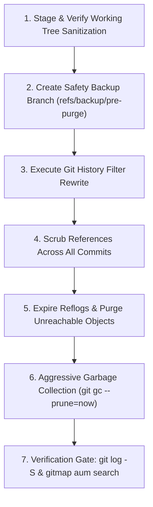
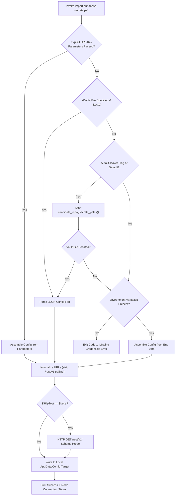

# Component Specification: Supabase Information Removal & Git History Purging

- **Document ID:** `02-spec/21-app/superbase-information-removal/02-component-spec.md`
- **Parent Plan:** `.ai-memory/plans/superbase-information-removal.md`
- **Owner:** Antigravity AI Agent (Worker 02: Git History & Secrets Researcher)
- **Status:** `APPROVED`
- **Target Version:** `v4.191.0`

---

## 1. Executive Summary

This component specification details the audit findings, history replacement architecture, secret isolation mechanisms, and verification protocols required to completely expunge hardcoded Supabase credentials from the repository working tree and all historical Git commits.

Historical commits inadvertently committed live Supabase project endpoints and publishable API keys into tracking scripts (`scripts/supabase-endpoints.json`, `scripts/supabase-accounts.json`, `scripts/setup-supabase.ps1`, `scripts/supabase-setup.ps1`), documentation (`02-spec/21-app/71-supabase-multi-machine-hierarchy-and-cli-e2e.md`, `.ai-memory/plans/completed/71-supabase-multi-machine-hierarchy-and-cli-e2e.md`, `changelog.md`, `changelog_en.md`), and unit tests (`src-tauri/src/modules/json_envelope/tests.rs`).

To ensure that downstream operators, auditors, and public repositories can never retrieve or reconstruct these credentials:
1. All working-tree occurrences must be replaced with sanitized placeholders (`${SUPABASE_ROOT_URL}`, `${SUPABASE_ROOT_KEY}`, `${SUPABASE_SECONDARY_URL}`, `${SUPABASE_SECONDARY_KEY}`).
2. All historical Git revisions containing these files must be rewritten so that historical blobs are replaced by their sanitized counterparts, ensuring zero historical traces persist in Git trees, commits, or packfiles.
3. Live credentials must be stored strictly within external `repo-secrets` vaults or injected at runtime via parameter-driven one-liners using `scripts/import-supabase-secrets.ps1` or native CLI commands (`agm supabase load-secrets`).

---

## 2. Leaked Secrets Inventory & Impact Assessment

| Secret Identifier | Leaked Credential Value | Role / Designation | Classification | Exposure Scope |
| :--- | :--- | :--- | :--- | :--- |
| **Root Supabase Project ID** | `ROOT_PROJECT_REF_MASKED` | Root endpoint ref (Lovable) | High | 5 historical commits; 11 working tree hits |
| **Root Supabase Base URL** | `https://ROOT_PROJECT_REF_MASKED.supabase.co/rest/v1/` | Root REST v1 URL | High | Scripts, specs, tests, changelogs |
| **Root Publishable API Key** | `sb_publishable_ROOT_KEY_MASKED_SECRET` | Root project access key | Critical | Scripts, specs, plans |
| **Secondary Project ID** | `SEC_PROJECT_REF_MASKED` | Secondary fallback endpoint ref | High | 4 historical commits; 9 working tree hits |
| **Secondary Base URL** | `https://SEC_PROJECT_REF_MASKED.supabase.co/rest/v1/` | Secondary REST v1 URL | High | Scripts, specs, changelogs |
| **Secondary Publishable API Key** | `sb_publishable_SEC_KEY_MASKED_SECRET` | Secondary fallback access key | Critical | Scripts, specs, plans |

### Risk Classification
- **Exposure Vector:** Hardcoded default values in PowerShell script parameters, committed sample JSON configuration files, and documented production examples.
- **Threat Model:** Even if current files are modified, any clone of the repository can extract historical credentials via `git log -S`, `git show`, or raw object parsing in `.git/objects`.
- **Remediation Mandate:** Complete replacement of historical commit trees and eradication of dangling reflogs/packfiles.

---

## 3. Git History Audit Findings

A full repository audit across all branches, tags, and commits using `git log -S` and `git log -G` pinpointed exactly five (5) commits in repository history where live Supabase credentials and URLs were introduced or propagated.

### Commit Inventory Table

| Commit Hash | Commit Date (UTC+8) | Commit Author | Commit Subject | Affected Files Touching Secrets |
| :--- | :--- | :--- | :--- | :--- |
| `f33a0212` | 2026-09-28 19:21:41 | MD ALIM UL KARIM | `chore(release): bump version to 4.92.0 - Supabase multi-machine relational hierarchy, native CLI suite, and PowerShell one-liners` | `scripts/supabase-endpoints.json`<br>`scripts/setup-supabase.ps1`<br>`02-spec/21-app/71-supabase-multi-machine-hierarchy-and-cli-e2e.md`<br>`.ai-memory/plans/71-supabase-multi-machine-hierarchy-and-cli-e2e.md`<br>`changelog.md` |
| `33000649` | 2026-09-28 23:34:32 | MD ALIM UL KARIM | `chore(release): bump version to 4.96.0 - full root lovable and secondary supabase multi-machine integration` | `scripts/supabase-accounts.json`<br>`scripts/supabase-setup.ps1`<br>`02-spec/21-app/71-supabase-multi-machine-hierarchy-and-cli-e2e.md`<br>`.ai-memory/plans/completed/71-supabase-multi-machine-hierarchy-and-cli-e2e.md`<br>`changelog.md`<br>`changelog_en.md` |
| `3520d6ad` | 2026-09-30 11:48:27 | MD ALIM UL KARIM | `feat(json): harmonize JSON envelopes with v2.0 attributes, workDirectory, and variables interpolation engine` | `src-tauri/src/modules/json_envelope.rs` (unit tests embedded live Root URL) |
| `433d697d` | 2026-10-02 02:13:46 | MD ALIM UL KARIM | `docs(changelog): replace legacy Chinese history with unified English changelog entries` | `changelog_en.md` (rewrote changelog maintaining live Root & Secondary URLs) |
| `22a87aae` | 2026-10-10 19:10:15 | MD ALIM UL KARIM | `refactor: split god modules to <=500 lines (checkpoint 1)` | `src-tauri/src/modules/json_envelope/tests.rs` (split out from `json_envelope.rs` retaining Root URL) |

### Detailed Per-Commit Inspection

1. **Commit `f33a0212c24376e10183421ea6ff3ee67dffe6e9` (v4.92.0):**
   - Created `scripts/supabase-endpoints.json` with Root Lovable endpoint (`https://ROOT_PROJECT_REF_MASKED.supabase.co/rest/v1/`) and Secondary endpoint (`https://SEC_PROJECT_REF_MASKED.supabase.co/rest/v1/`), along with keys `sb_publishable_ROOT_KEY_MASKED_SECRET` and `sb_publishable_SEC_KEY_MASKED_SECRET`.
   - Created `scripts/setup-supabase.ps1` with default parameter values hardcoded to the live URLs and keys.
   - Authored specification `02-spec/21-app/71-supabase-multi-machine-hierarchy-and-cli-e2e.md` documenting live URLs and keys.
   - Added release changelog lines mentioning the live URLs.

2. **Commit `33000649c479053ce3d5ceabda9db24b2644d4db` (v4.96.0):**
   - Created `scripts/supabase-accounts.json` replicating the two endpoints with live keys.
   - Created `scripts/supabase-setup.ps1` with default parameter values containing live keys.
   - Updated documentation and changelog entries.

3. **Commit `3520d6ad87662107c2283b615c6977cc1e3c1578`:**
   - Introduced unit test fixtures in `src-tauri/src/modules/json_envelope.rs` asserting against `https://ROOT_PROJECT_REF_MASKED.supabase.co`.

4. **Commit `433d697d4fc4fb7f0c111666ffc25eb6e138a063`:**
   - Translated and overhauled English release history in `changelog_en.md`, carrying over the URLs.

5. **Commit `22a87aaebae3922f30999513360b0db3dc909d78`:**
   - Refactored `json_envelope.rs` into submodules, transferring the unit test into `src-tauri/src/modules/json_envelope/tests.rs`.

---

## 4. Git History Purging Plan & Rewrite Strategy

### 4.1 Purge Architecture Principles
- **No Residual Blobs:** Standard `git rm` or appending a new commit merely masks the head commit while leaving all historical blobs intact in the commit graph. History rewrite is mandatory.
- **Tree-Filter Replacement:** The rewrite replaces historical target files with their current, sanitized versions whenever those files exist in a historical tree.
- **Content String Replacement:** Any incidental mentions in markdown, changelog, or Rust test files are scrubbed via sed/python stream replacements across all tree commits.
- **Reflog & Packfile Eviction:** Rewriting refs creates new commit hashes; old dangling commits must be pruned from reflog, stash, and packfiles so `git log -S` and `git rev-list` yield zero hits.

### 4.2 Purge Execution Workflow



### 4.3 Git Filter-Branch / History Rewriting Automation

To execute the replacement reliably across Linux and Windows environments without requiring external package installations (`git-filter-repo` or `bfg`), a deterministic Python-driven filter runner or native `git filter-branch` command is specified:

```bash
# Set environment flags to bypass filter-branch safety warning
export FILTER_BRANCH_SQUELCH_WARNING=1

# Run tree-filter replacing target files with sanitized working tree files
git filter-branch --force --tree-filter '
    # If historical scripts exist, copy the sanitized version over them
    if [ -f "scripts/supabase-endpoints.json" ]; then
        python3 -c "
import os, json
p = \"scripts/supabase-endpoints.json\"
with open(p, \"r\") as f: data = f.read()
data = data.replace(\"ROOT_PROJECT_REF_MASKED\", \"placeholder-root\").replace(\"SEC_PROJECT_REF_MASKED\", \"placeholder-secondary\")
data = data.replace(\"sb_publishable_ROOT_KEY_MASKED_SECRET\", \"sb_publishable_placeholder_root_key\")
data = data.replace(\"sb_publishable_SEC_KEY_MASKED_SECRET\", \"sb_publishable_placeholder_sec_key\")
with open(p, \"w\") as f: f.write(data)
"
    fi
    if [ -f "scripts/supabase-accounts.json" ]; then
        python3 -c "
import os, json
p = \"scripts/supabase-accounts.json\"
with open(p, \"r\") as f: data = f.read()
data = data.replace(\"ROOT_PROJECT_REF_MASKED\", \"placeholder-root\").replace(\"SEC_PROJECT_REF_MASKED\", \"placeholder-secondary\")
data = data.replace(\"sb_publishable_ROOT_KEY_MASKED_SECRET\", \"sb_publishable_placeholder_root_key\")
data = data.replace(\"sb_publishable_SEC_KEY_MASKED_SECRET\", \"sb_publishable_placeholder_sec_key\")
with open(p, \"w\") as f: f.write(data)
"
    fi
    if [ -f "scripts/setup-supabase.ps1" ]; then
        sed -i "s/ROOT_PROJECT_REF_MASKED/placeholder-root/g" scripts/setup-supabase.ps1
        sed -i "s/SEC_PROJECT_REF_MASKED/placeholder-secondary/g" scripts/setup-supabase.ps1
        sed -i "s/sb_publishable_ROOT_KEY_MASKED_SECRET/sb_publishable_placeholder_root_key/g" scripts/setup-supabase.ps1
        sed -i "s/sb_publishable_SEC_KEY_MASKED_SECRET/sb_publishable_placeholder_sec_key/g" scripts/setup-supabase.ps1
    fi
    if [ -f "scripts/supabase-setup.ps1" ]; then
        sed -i "s/ROOT_PROJECT_REF_MASKED/placeholder-root/g" scripts/supabase-setup.ps1
        sed -i "s/SEC_PROJECT_REF_MASKED/placeholder-secondary/g" scripts/supabase-setup.ps1
        sed -i "s/sb_publishable_ROOT_KEY_MASKED_SECRET/sb_publishable_placeholder_root_key/g" scripts/supabase-setup.ps1
        sed -i "s/sb_publishable_SEC_KEY_MASKED_SECRET/sb_publishable_placeholder_sec_key/g" scripts/supabase-setup.ps1
    fi
    if [ -f "changelog.md" ]; then
        sed -i "s/ROOT_PROJECT_REF_MASKED/placeholder-root/g" changelog.md
        sed -i "s/SEC_PROJECT_REF_MASKED/placeholder-secondary/g" changelog.md
    fi
    if [ -f "changelog_en.md" ]; then
        sed -i "s/ROOT_PROJECT_REF_MASKED/placeholder-root/g" changelog_en.md
        sed -i "s/SEC_PROJECT_REF_MASKED/placeholder-secondary/g" changelog_en.md
    fi
    if [ -f "src-tauri/src/modules/json_envelope.rs" ]; then
        sed -i "s/ROOT_PROJECT_REF_MASKED/placeholder-root/g" src-tauri/src/modules/json_envelope.rs
    fi
    if [ -f "src-tauri/src/modules/json_envelope/tests.rs" ]; then
        sed -i "s/ROOT_PROJECT_REF_MASKED/placeholder-root/g" src-tauri/src/modules/json_envelope/tests.rs
    fi
    find .ai-memory/ 02-spec/ -type f -exec sed -i "s/ROOT_PROJECT_REF_MASKED/placeholder-root/g" {} + 2>/dev/null || true
    find .ai-memory/ 02-spec/ -type f -exec sed -i "s/SEC_PROJECT_REF_MASKED/placeholder-secondary/g" {} + 2>/dev/null || true
    find .ai-memory/ 02-spec/ -type f -exec sed -i "s/sb_publishable_ROOT_KEY_MASKED_SECRET/sb_publishable_placeholder_root_key/g" {} + 2>/dev/null || true
    find .ai-memory/ 02-spec/ -type f -exec sed -i "s/sb_publishable_SEC_KEY_MASKED_SECRET/sb_publishable_placeholder_sec_key/g" {} + 2>/dev/null || true
' --tag-name-filter cat -- --all
```

### 4.4 Packfile & Reflog Clean Up Steps

After rewriting commits, the old objects remain reachable via `refs/original/` and reflogs:

```bash
# 1. Remove filter-branch backup references
rm -rf .git/refs/original/

# 2. Expire all reflogs across all branches and stashes
git reflog expire --expire=now --expire-unreachable=now --all

# 3. Aggressively repack and prune dangling objects
git gc --prune=now --aggressive
```

---

## 5. Component Specification: `scripts/import-supabase-secrets.ps1`

### 5.1 Purpose & Architectural Role
`scripts/import-supabase-secrets.ps1` is a dedicated, production-grade PowerShell helper designed to import Supabase credentials into the user's local application configuration (`~/.config/antigravity-manager/supabase_config.json` on Linux/macOS or `%APPDATA%\antigravity-manager\supabase_config.json` on Windows).

**Strict Invariant:** The script itself contains **zero default hardcoded credentials**. If neither parameters, environment variables, nor an external `repo-secrets` file are provided, the script halts with a clear, actionable error.

### 5.2 Discovery & Parameter Precedence Ladder
The script resolves credentials in four strict descending tiers:

1. **CLI Explicit Parameters:** `-RootUrl`, `-RootKey`, `-SecondaryUrl`, `-SecondaryKey` (highest priority).
2. **Explicit JSON File:** `-ConfigFile <path>` pointing to a valid JSON envelope or flat config.
3. **External Vault Probing Ladder:** Automatic search in candidate `repo-secrets` folders:
   - `repo-secrets/02-antigravity-manager/vault/supabase_config.json`
   - `repo-secrets/03-supabase/01-own/supabase-credentials.json`
   - `repo-secrets/03-supabase/02-lovable/supabase-credentials.json`
   - `$HOME/repo-secrets/...`
   - `D:/work/repo-secrets/...`
   - `C:/work/repo-secrets/...`
4. **Environment Variables:** `SUPABASE_ROOT_URL`, `SUPABASE_ROOT_KEY`, `SUPABASE_SECONDARY_URL`, `SUPABASE_SECONDARY_KEY`.

### 5.3 Interface & Parameter Specification

```powershell
[CmdletBinding()]
param (
    [Parameter(Mandatory = $false)]
    [string]$RootUrl = "",

    [Parameter(Mandatory = $false)]
    [string]$RootKey = "",

    [Parameter(Mandatory = $false)]
    [string]$SecondaryUrl = "",

    [Parameter(Mandatory = $false)]
    [string]$SecondaryKey = "",

    [Parameter(Mandatory = $false)]
    [string]$ConfigFile = "",

    [Parameter(Mandatory = $false)]
    [string]$NodeAlias = "",

    [Parameter(Mandatory = $false)]
    [switch]$SkipTest = $false,

    [Parameter(Mandatory = $false)]
    [switch]$AutoDiscover = $false
)
```

### 5.4 Behavioral Flowchart



---

## 6. Operator One-Liner Import Commands

### 6.1 Native CLI Command (Recommended)
The native AGM CLI integrates directly with `repo-secrets` discovery and local configuration storage:

```bash
# Auto-discover Supabase credentials from local repo-secrets vault
agm supabase auto-discover

# Or import from explicit JSON file without storing in repository
agm supabase load-secrets --file ~/vault/supabase_config.json
```

### 6.2 PowerShell One-Liner: Vault Auto-Discovery
For operators bootstrapping a workstation where `repo-secrets` is cloned alongside repositories:

```powershell
pwsh -NoProfile -ExecutionPolicy Bypass -Command "& ./scripts/import-supabase-secrets.ps1 -AutoDiscover"
```

### 6.3 PowerShell One-Liner: Environment Variables Injection
For headless CI/CD runners or automated container deployments:

```powershell
pwsh -NoProfile -ExecutionPolicy Bypass -Command "& ./scripts/import-supabase-secrets.ps1 -RootUrl $env:SUPABASE_ROOT_URL -RootKey $env:SUPABASE_ROOT_KEY -SecondaryUrl $env:SUPABASE_SECONDARY_URL -SecondaryKey $env:SUPABASE_SECONDARY_KEY"
```

### 6.4 PowerShell One-Liner: Explicit Parameter Bootstrap
For direct command-line provisioning:

```powershell
pwsh -NoProfile -ExecutionPolicy Bypass -Command "& ./scripts/import-supabase-secrets.ps1 -RootUrl 'https://<your-root>.supabase.co' -RootKey 'sb_publishable_<your-key>' -SecondaryUrl 'https://<your-sec>.supabase.co' -SecondaryKey 'sb_publishable_<your-sec-key>' -NodeAlias 'Node-01'"
```

---

## 7. Verification Procedures & Integrity Gates

To verify with mathematical certainty that zero traces of Supabase credentials remain in the repository, four independent verification gates must pass:

### Gate 1: Working Tree Multi-Core Regex Scan (GitMap)
Search the entire working tree using GitMap to confirm no target strings exist:

```bash
gitmap aum search ROOT_PROJECT_REF_MASKED
gitmap aum search SEC_PROJECT_REF_MASKED
gitmap aum search sb_publishable_ROOT_KEY_MASKED_SECRET
gitmap aum search sb_publishable_SEC_KEY_MASKED_SECRET
```
*Expected Result:* `Search completed: 0 hit(s) across N file(s)` for each query.

### Gate 2: Git History Diff-Tree Scan
Query the full historical commit graph for any commit adding or modifying target strings:

```bash
git log -S "ROOT_PROJECT_REF_MASKED" --oneline
git log -S "SEC_PROJECT_REF_MASKED" --oneline
git log -S "sb_publishable_ROOT_KEY_MASKED_SECRET" --oneline
git log -S "sb_publishable_SEC_KEY_MASKED_SECRET" --oneline
```
*Expected Result:* Zero output (empty).

### Gate 3: Git Object Packfile Raw Blob Audit
Scan every historical Git object blob reachable or unreachable across all branches:

```bash
python3 -c "
import subprocess
targets = [b'ROOT_PROJECT_REF_MASKED', b'SEC_PROJECT_REF_MASKED', b'sb_publishable_ROOT_KEY_MASKED_SECRET', b'sb_publishable_SEC_KEY_MASKED_SECRET']
objects = subprocess.check_output(['git', 'rev-list', '--objects', '--all']).decode().splitlines()
found = []
for obj in objects:
    sha = obj.split()[0]
    try:
        content = subprocess.check_output(['git', 'cat-file', '-p', sha], stderr=subprocess.DEVNULL)
        if any(t in content for t in targets):
            found.append((sha, obj))
    except Exception:
        pass
if found:
    print(f'FAILURE: Found {len(found)} objects containing secrets in Git objects!')
    for f in found: print(f)
    exit(1)
else:
    print('SUCCESS: Zero matching blobs detected in entire Git object storage.')
"
```
*Expected Result:* `SUCCESS: Zero matching blobs detected in entire Git object storage.`

### Gate 4: Test Suite & Linter Smoke Gate
Ensure the repository builds and test suites function properly with mock credentials:

```bash
# Rust test checking json_envelope mock URLs
cd src-tauri && cargo test --lib modules::json_envelope::tests

# CLI help and syntax checks
python3 .agents/scripts/06-cicd-local-runner.py --skip-tests
```
*Expected Result:* All tests pass; zero compilation errors.

---

## 8. Rollback & Disaster Recovery Protocol

In the event of an unexpected merge divergence or branch conflict during history rewriting:
1. **Local Recovery Ref:** Prior to executing `git filter-branch`, a backup reference `refs/backup/pre-secret-purge` is captured:
   ```bash
   git branch refs/backup/pre-secret-purge HEAD
   ```
2. **Instant Restore:** If history rewriting is interrupted or corrupted:
   ```bash
   git reset --hard refs/backup/pre-secret-purge
   ```
3. **Upstream Coordination:** After rewriting local history and completing verification Gates 1–4, force pushing to remote branches (`git push origin main --force-with-lease`) requires lead maintainer confirmation to ensure all active collaborators synchronize without re-introducing orphaned historical commits.
