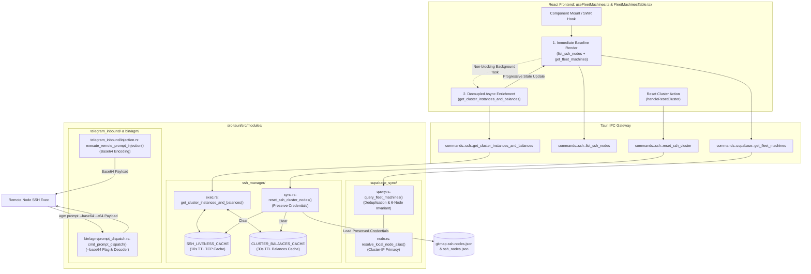
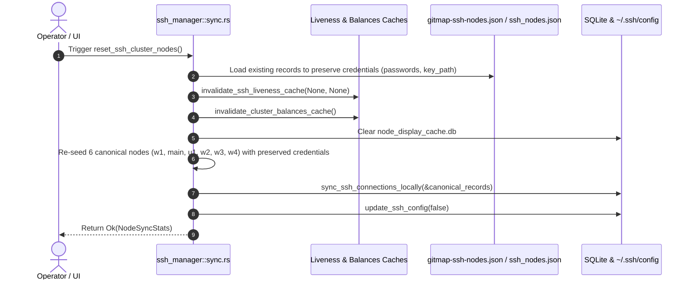

# System Architecture & Technical Specification: Fleet Machine Identity, Caching, Cluster Reset, and Cross-Machine Dispatch

- **Specification Slug:** `telegram-backup-and-fleet-management-enhancements`
- **Specification Path:** `02-spec/21-app/telegram-backup-and-fleet-management-enhancements/01-architecture-spec.md`
- **Subtask Plan Path:** `.ai-memory/plans/subtasks/telegram-backup-and-fleet-management-enhancements/01-fleet-identity-caching-and-reset.md`
- **Author:** System Architecture & Fleet Infrastructure Working Group
- **Status:** APPROVED & MANDATED

---

## 1. User Request (Verbatim)

```text
Author the specification and subtask plan for Fleet Machine Identity, Caching, Cluster Reset, and Cross-Machine Dispatch:
1. Create `02-spec/21-app/telegram-backup-and-fleet-management-enhancements/01-architecture-spec.md`. Document:
   - System Overview: Fleet topology, GitMap node registry, and Cluster-IP primacy.
   - Machine Identity & 5-Node Collision Fix: Reconciling `192.168.1.3` to `w1` (local lead) and `192.168.1.20` to `main`, fixing `query_fleet_machines` in `src-tauri/src/modules/supabase_sync/query.rs` deduplication so `w1` and `main` never drop each other, and fixing `SshNodeItem.ip_address` in `src/components/instances/fleet/useFleetMachines.ts`.
   - 30-Second TTL Caching & SWR: Adding `CLUSTER_BALANCES_CACHE` in `src-tauri/src/modules/ssh_manager/exec.rs` with 30s TTL, and decoupling `enrichFleetMachines()` in `useFleetMachines.ts` to prevent UI freezing.
   - SSH Cluster Reset: Reloading clean configurations from `gitmap-ssh-nodes.json` preserving passwords and key paths, clearing `SSH_LIVENESS_CACHE`, and refreshing the UI.
   - Cross-Machine Prompt Dispatch: Base64 payload encoding for remote `agm prompt` execution in `src-tauri/src/modules/telegram_inbound/injection.rs` and `src-tauri/src/bin/agm/prompt_dispatch.rs`.
2. Create `.ai-memory/plans/subtasks/telegram-backup-and-fleet-management-enhancements/01-fleet-identity-caching-and-reset.md` documenting task breakdown, owned files, and verification steps.
Strict rules: Only write to your owned files. Only use relative Git paths. Do not run any git commands. When done, send your completion report.
```

---

## 2. Executive Summary & Architectural Motivation

Antigravity Manager (AGM) orchestrates distributed, multi-instance desktop developer agent environments across physical workstations, local developer VMs, and remote GPU/runner compute nodes. Fleet coordination relies on a hybrid mesh architecture connecting through Supabase cloud synchronization, local OpenSSH configurations, and GitMap cluster peers.

Field operations uncovered four distinct operational vulnerabilities in fleet management and cross-machine orchestration:

1. **Machine Identity Collision & 5-Node Drop Bug**:
   - The cluster consists of 6 canonical nodes: `w1` (local worker/execution lead on `192.168.1.3`), `main` (cluster controller on `192.168.1.20`), `u1` (Linux on `192.168.1.22`), `w2` (`192.168.1.7`), `w3` (`192.168.1.12`), and `w4` (`192.168.1.13`).
   - When local SSH configuration or display caches incorrectly mapped `192.168.1.3` to `main`, or when `query_fleet_machines` in `src-tauri/src/modules/supabase_sync/query.rs` ran deduplication matching `conn.ip_address == local_ip || conn.alias == local_alias`, `w1` and `main` collided, causing one of the nodes to be dropped from the active fleet view.
   - Furthermore, `src/components/instances/fleet/useFleetMachines.ts` typed SSH nodes as `{ ip: string }` instead of `{ ip_address: string }` returned by Tauri IPC command `list_ssh_nodes`, resulting in undefined IP addresses in the UI and broken fallback filtering.

2. **UI Freezing & Synchronous Blocking during Balance Enrichment**:
   - `enrichFleetMachines()` in `useFleetMachines.ts` executed synchronously before setting the `machines` state, blocking UI rendering on every poll or refresh while `get_cluster_instances_and_balances` probed every remote node via SSH TCP and child processes (`agm instances list --json`, `agm accounts list --json`).
   - The absence of an in-memory cache in `src-tauri/src/modules/ssh_manager/exec.rs` subjected every query to round-trip SSH latency (1.5s to 5.0s per node).

3. **Destructive SSH Cluster Reset & Cache Stagnation**:
   - Triggering a cluster reset previously deleted `ssh_nodes.json` and generated blank records with empty passwords and empty key paths, discarding credentials stored in `gitmap-ssh-nodes.json`.
   - Additionally, `SSH_LIVENESS_CACHE` was not flushed, causing unreachable TCP statuses or stale liveness flags to persist up to 10 seconds post-reset.

4. **Fragile Cross-Machine Shell Command Prompt Dispatch**:
   - Prompt dispatching across cluster nodes (`agm prompt --node <alias>` and Telegram bot `/prompt <target> <text>`) constructed raw shell strings via `format!("{agm_bin} prompt ... \"{escaped_prompt}\"")`.
   - Multi-line prompts, markdown tables, shell variables (`$HOME`), and embedded quotes collapsed or triggered syntax errors during remote shell evaluation over SSH and GitMap cluster exec.

This specification defines the unified technical architecture to resolve these failure modes permanently.

---

## 3. High-Level System Architecture & Component Interaction



---

## 4. Machine Identity & 5-Node Collision Resolution

### 4.1. Cluster-IP Primacy Principle

Machine identity must derive from physical network addressing rather than volatile hostnames or transient local alias configurations. In the canonical 6-node cluster:

| Node Alias | Physical Cluster IP | Default User | Operating System | Cluster Role | Primary Bound Account |
|:---|:---|:---|:---|:---|:---|
| `w1` | `192.168.1.3` | `Administrator` | Windows | Local Execution Lead / Worker 1 | `cirajayu11@gmail.com` |
| `main` | `192.168.1.20` | `Administrator` | Windows | Cluster Orchestration Lead | `sakibagjdjg@gmail.com` |
| `u1` | `192.168.1.22` | `root` | Linux | Worker Linux Ubuntu Node | (Dynamic / Leased) |
| `w2` | `192.168.1.7` | `Administrator` | Windows | Worker Node 2 | (Dynamic / Leased) |
| `w3` | `192.168.1.12` | `Administrator` | Windows | Worker Node 3 | (Dynamic / Leased) |
| `w4` | `192.168.1.13` | `Administrator` | Linux | Worker Node 4 | (Dynamic / Leased) |

### 4.2. Local Node Alias Resolution Ladder

In `src-tauri/src/modules/supabase_sync/node.rs`, `resolve_local_node_alias()` implements the authoritative resolution sequence:

1. **Step 1: Cluster-IP Direct Match (Top Authority)**:
   Extract local IP via UDP socket probing (`get_local_ip()`). If `local_ip == "192.168.1.3"`, the node alias is deterministically `"w1"`. If `local_ip == "192.168.1.20"`, the node alias is deterministically `"main"`. Cluster-IP constant `GITMAP_CLUSTER_NODES` takes absolute precedence over user configurations or disk caches.
2. **Step 2: Stored SSH Connection IP Lookup**:
   If the local IP is not in `GITMAP_CLUSTER_NODES`, search `load_ssh_connections()` for an exact `ip_address` match.
3. **Step 3: Email Watcher Hostname Telemetry**:
   Check `email_watcher::detect_machine_name()`.
4. **Step 4: Configured Node Alias**:
   Read `node_alias` from `supabase_sync::load_config()`.
5. **Step 5: Default Fallback**:
   Fallback to `"w1"`.

### 4.3. Deduplication Logic in `supabase_sync/query.rs`

In `build_local_and_ssh_fleet()` and `query_fleet_machines()`:
- **Flawed Legacy Behavior**:
  ```rust
  // BUG: If local_alias was erroneously "main" on 192.168.1.3, this dropped both w1 and main
  if conn.ip_address == local_ip || conn.alias.eq_ignore_ascii_case(&local_alias) { ... }
  ```
- **Authoritative Invariant**:
  The local machine must identify strictly by matching IP address with `local_ip`, OR matching alias when the connection's IP address matches `local_ip`.
  A remote peer with `conn.alias == "main"` on `192.168.1.20` must NEVER be dropped when running locally on `192.168.1.3` (`w1`), and vice-versa.
- **Deduplication Filter Fix**:
  ```rust
  for conn in all_conns {
      let is_local_machine = conn.ip_address == local_ip 
          || (conn.alias.eq_ignore_ascii_case(&local_alias) && conn.ip_address == local_ip);
      
      if is_local_machine {
          if let Some(local_machine) = machines.first_mut() {
              local_machine.node_alias = conn.alias.clone();
              local_machine.alias = conn.alias;
          }
          continue;
      }
      
      // Ensure w1 and main are never dropped against each other
      let is_dup = machines.iter().any(|m| {
          m.ip_address == conn.ip_address
              || (m.node_alias.eq_ignore_ascii_case(&conn.alias) && m.ip_address == conn.ip_address)
      });
      if !is_dup {
          machines.push(build_ssh_mesh_machine_info(&conn, now));
      }
  }
  ```

### 4.4. Frontend Type Parity in `useFleetMachines.ts`

In `src/components/instances/fleet/useFleetMachines.ts`, the interface `SshNodeItem` must reflect the Rust backend struct `SshNodeRecord` (`src-tauri/src/commands/ssh.rs`):

```typescript
interface SshNodeItem {
    alias: string;
    ip_address?: string;
    ip?: string;
    status?: string;
    port?: number;
    os?: string;
}
```

In `mapSshNodesToFleet`:
```typescript
const rawIp = n.ip_address || n.ip || '';
let ip = rawIp.trim();
```
This guarantees that `mapSshNodesToFleet` correctly extracts the IP returned by `invoke('list_ssh_nodes')`, preventing empty string fallbacks, broken IP copies, and erroneous alias flips.

---

## 5. 30-Second TTL Caching & Stale-While-Revalidate (SWR) Decoupling

### 5.1. Backend Caching in `ssh_manager/exec.rs`

To eliminate synchronous child-process latency during cluster polling, an in-memory cache is introduced:

```rust
/// Thread-safe 30-second TTL cache for cluster instances and quota balances
pub static CLUSTER_BALANCES_CACHE: Lazy<RwLock<Option<(Vec<ClusterInstanceBalanceItem>, Instant)>>> =
    Lazy::new(|| RwLock::new(None));

/// Invalidate cluster balances cache on demand (e.g. cluster reset or instance update)
pub fn invalidate_cluster_balances_cache() {
    if let Ok(mut cache) = CLUSTER_BALANCES_CACHE.write() {
        *cache = None;
    }
}
```

In `get_cluster_instances_and_balances()`:
1. **Cache Hit Check (<1ms)**:
   Acquire read lock on `CLUSTER_BALANCES_CACHE`. If cached data exists and `instant.elapsed() < Duration::from_secs(30)`, return the cached `Vec<ClusterInstanceBalanceItem>` immediately.
2. **Cache Miss & Live Remote Scan**:
   Gather local instance and quota data.
   Spawn parallel threads scoped to online remote nodes with minimum TCP liveness check (1500ms timeout).
   Execute remote queries (`agm instances list --json` and `agm accounts list --json`).
3. **Cache Storage**:
   Acquire write lock on `CLUSTER_BALANCES_CACHE`, update cache with `(items.clone(), Instant::now())`, and return.

### 5.2. Frontend SWR Decoupling in `useFleetMachines.ts`

Previously, `fetchMachines` in `useFleetMachines.ts` awaited `enrichFleetMachines()` sequentially before updating state:

```typescript
// Legacy Freezing Pattern (BLOCKED UI):
const data = await fetchFleetMachinesApi();
const enriched = await enrichFleetMachines(data);
setMachines(sortFleetMachines(enriched)); // Delayed by 3-5 seconds
```

The decoupled Stale-While-Revalidate pattern splits baseline machine discovery from quota balance enrichment:

```typescript
// Non-Blocking SWR Pattern:
const fetchMachines = useCallback(async (showLoadingSpinner: boolean = false) => {
    if (showLoadingSpinner) setIsRefreshing(true);
    try {
        // 1. Instant baseline retrieval (<50ms)
        const baselineData = await fetchFleetMachinesApi();
        let effectiveMachines = baselineData;
        if (effectiveMachines.length === 0) {
            const sshNodes = await invoke<SshNodeItem[]>('list_ssh_nodes');
            if (sshNodes && sshNodes.length > 0) {
                effectiveMachines = mapSshNodesToFleet(sshNodes, effectiveLocalId);
            }
        }
        
        // 2. Immediate render of machine cards & online status
        setMachines(sortFleetMachines(effectiveMachines));
        
        // 3. Decoupled async enrichment without blocking table interactivity
        enrichFleetMachines(effectiveMachines)
            .then((enriched) => {
                setMachines(sortFleetMachines(enriched));
            })
            .catch((e) => {
                useErrorStore.getState().trackWarning(e, {
                    source: 'useFleetMachines.asyncEnrich',
                    triggerAction: 'enrich_fleet_machines',
                });
            });
    } finally {
        setIsRefreshing(false);
    }
}, [...]);
```

This ensures the table renders instantly upon navigation or refresh, while quota badges and active instance details populate asynchronously as cluster balance telemetry arrives.

---

## 6. SSH Cluster Reset Subsystem

### 6.1. Credential Preservation Invariant

The SSH cluster reset mechanism must restore the canonical 6-node topology without discarding encrypted passwords, RSA keys, or custom ports configured in candidate JSON files (`gitmap-ssh-nodes.json` and `ssh_nodes.json`).

### 6.2. Reset Workflow in `ssh_manager/sync.rs`

When `reset_ssh_cluster_nodes()` executes:



1. **Step 1: Ingest Existing Credentials**:
   Scan `candidate_seed_node_paths()` for `gitmap-ssh-nodes.json` and load existing `ssh_nodes.json`. Build an in-memory credential map indexed by `alias.to_lowercase()` and `ip_address`:
   - `encrypted_password`
   - `encryption_algo`
   - `key_path`
   - `port`
2. **Step 2: Flush Liveness and Balance Caches**:
   - Invoke `invalidate_ssh_liveness_cache(None, None)` to force immediate TCP re-verification.
   - Invoke `invalidate_cluster_balances_cache()` to purge cached instance quota metrics.
   - Truncate `node_display_cache.db` to remove stale telemetry rows.
3. **Step 3: Construct Canonical Records**:
   Iterate across `GITMAP_CLUSTER_NODES`. For each canonical tuple `(alias, ip, user, os)`, pull existing credentials from the credential map if available; default to empty strings only when no prior credential existed.
4. **Step 4: Persist and Refresh SSH Config**:
   Save canonical records via `sync_ssh_connections_locally(&canonical_records)` and rewrite `~/.ssh/config` using `update_ssh_config(false)`.
5. **Step 5: Frontend State Invalidation**:
   In `useFleetMachines.ts`, `handleResetCluster()` awaits `sshService.resetSshCluster()`, displays a success toast, and immediately invokes `fetchMachines(true)` to reload live cluster telemetry.

---

## 7. Cross-Machine Prompt Dispatch via Base64 Encoding

### 7.1. Shell Escaping Fragility Analysis

Cross-machine prompt dispatch allows an operator on one node or a Telegram bot command to execute prompts on remote machines:
- Telegram injection: `/prompt w3:default Audit database schema`
- CLI dispatch: `agm prompt P001 --node w2 "Run integration tests"`

**Legacy Failure Mode**:
```bash
# Problematic construction:
agm.exe prompt default --instance default "Write unit tests for "User" class with $PATH check"
```
Passing raw prompt text through remote SSH wrappers (`gitmap cluster exec`, OpenSSH, PowerShell) results in:
- Premature string termination when prompts contain double quotes (`"`) or escaped backslashes (`\`).
- Unintended variable interpolation of `$env:VAR` or `$VARIABLE` in PowerShell/Bash.
- Loss of multiline indentation and markdown fences (```` ``` ````).

### 7.2. Base64 Encoding Protocol

To achieve 100% shell-agnostic transport, prompts dispatched across machines must be serialized using standard RFC 4648 Base64:

```mermaid
flowchart LR
    A["Raw Prompt Text<br/>(Markdown, Quotes, Variables, Emojis)"] -->|BASE64.encode()| B["Base64 String Payload<br/>(e.g. V3JpdGUgdW5pdCB0ZXN0cw==)"]
    B -->|SSH / GitMap Cluster Exec| C["agm prompt &lt;target&gt; --base64 &lt;payload&gt;"]
    C -->|BASE64.decode()| D["Lossless Prompt Execution<br/>(repo_db::enqueue_prompt_for_instance)"]
```

### 7.3. Dispatching Pipeline Updates

1. **In `src-tauri/src/modules/telegram_inbound/injection.rs`**:
   In `execute_remote_prompt_injection`:
   ```rust
   let b64_prompt = base64::engine::general_purpose::STANDARD.encode(prompt_text.as_bytes());
   let remote_cmd = format!("{agm_bin} prompt {target_proj}{inst_flag} --base64 {b64_prompt}");
   ```
2. **In `src-tauri/src/bin/agm/prompt_dispatch.rs`**:
   When `--node <alias>` is supplied:
   ```rust
   let b64_prompt = base64::engine::general_purpose::STANDARD.encode(final_prompt.as_bytes());
   let remote_cmd = format!("agm prompt {}{} --base64 {}", target_arg, inst_arg, b64_prompt);
   ```

### 7.4. Receiver CLI Argument Parser

In `src-tauri/src/bin/agm/prompt_dispatch.rs`, `cmd_prompt_dispatch(args)` supports `--base64` and `--b64`:

```rust
if arg == "--base64" || arg == "-b64" || arg == "--b64" {
    if i + 1 < args.len() {
        if let Ok(bytes) = base64::engine::general_purpose::STANDARD.decode(args[i + 1].trim()) {
            if let Ok(decoded_text) = String::from_utf8(bytes) {
                text_parts.push(decoded_text);
            }
        }
        i += 2;
        continue;
    }
}
```

This guarantees seamless cross-platform execution across Windows Command Prompt, PowerShell, and Linux Bash.

---

## 8. Data Contracts & Type Definitions

### 8.1. Rust Data Contracts

```rust
// In src-tauri/src/modules/ssh_manager/exec.rs
#[derive(Debug, Clone, Serialize, Deserialize)]
pub struct ClusterInstanceBalanceItem {
    pub machine_alias: String,
    pub ip_address: Option<String>,
    pub machine_ip: String,
    pub is_local: bool,
    pub online: bool,
    pub instance_id: String,
    pub instance_name: String,
    pub running: bool,
    pub pid: Option<u32>,
    pub bound_email: String,
    pub tier: String,
    pub quota_4h_pct: f64,
    pub quota_weekly_pct: f64,
    pub active_model: String,
    pub status_label: String,
    pub error_message: Option<String>,
    pub latency_ms: Option<u128>,
}

// In src-tauri/src/modules/ssh_manager/sync.rs
#[derive(Debug, Clone, Serialize, Deserialize)]
pub struct NodeSyncStats {
    pub total: usize,
    pub matched: usize,
    pub updated: usize,
    pub inserted: usize,
    pub unchanged: usize,
}
```

### 8.2. TypeScript Data Contracts

```typescript
// In src/components/instances/fleet/useFleetMachines.ts
export interface SshNodeItem {
    alias: string;
    ip_address?: string;
    ip?: string;
    status?: string;
    port?: number;
    os?: string;
}

export interface FleetMachineInfo {
    node_id: string;
    node_alias: string;
    alias?: string;
    ip_address: string;
    is_online: boolean;
    last_heartbeat_timestamp: number;
    uptime_seconds: number;
    in_flight_prompts_count: number;
    is_lead?: boolean;
    is_local?: boolean;
    source: string;
    active_instances: Array<{
        profile_id: string;
        profile_name: string;
        is_running: boolean;
        bound_account_id?: string;
        bound_account_email?: string;
    }>;
    bound_emails: string[];
    git_repo?: string;
    git_link?: string;
}
```

---

## 9. Quality Gates & Verification Protocols

1. **Pre-flight Quality Gate**:
   - Code formatting: `cd src-tauri && cargo fmt -- --check`
   - Rust linting gate: `cd src-tauri && cargo clippy --all-targets --all-features`
   - Frontend production build: `npm run build`
2. **Cluster-IP Primacy Verification**:
   - Verify `resolve_local_node_alias()` returns `"w1"` on host `192.168.1.3`.
   - Verify `build_local_and_ssh_fleet()` and `query_fleet_machines()` output all 6 cluster nodes without dropping `w1` or `main`.
3. **Cache & Latency Verification**:
   - Verify subsequent calls to `get_cluster_instances_and_balances()` return in `<5ms` when cached within 30s TTL.
   - Verify UI renders baseline machines in `<100ms` without waiting for balance enrichment.
4. **Cluster Reset Verification**:
   - Verify `reset_ssh_cluster_nodes()` retains passwords and keys from `gitmap-ssh-nodes.json`.
   - Verify `SSH_LIVENESS_CACHE` and `CLUSTER_BALANCES_CACHE` are cleared upon reset.
5. **Base64 Dispatch Verification**:
   - Execute `agm prompt default --base64 <b64>` and confirm verbatim recovery of multiline prompts containing quotes, markdown tables, and shell variables.
