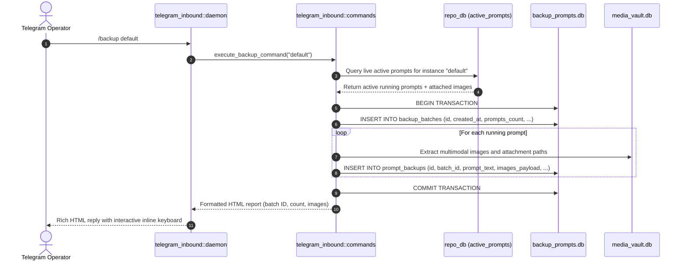
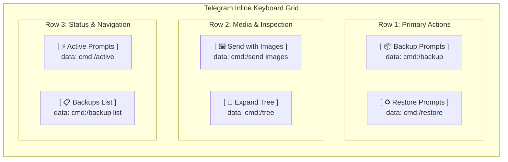
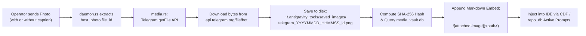
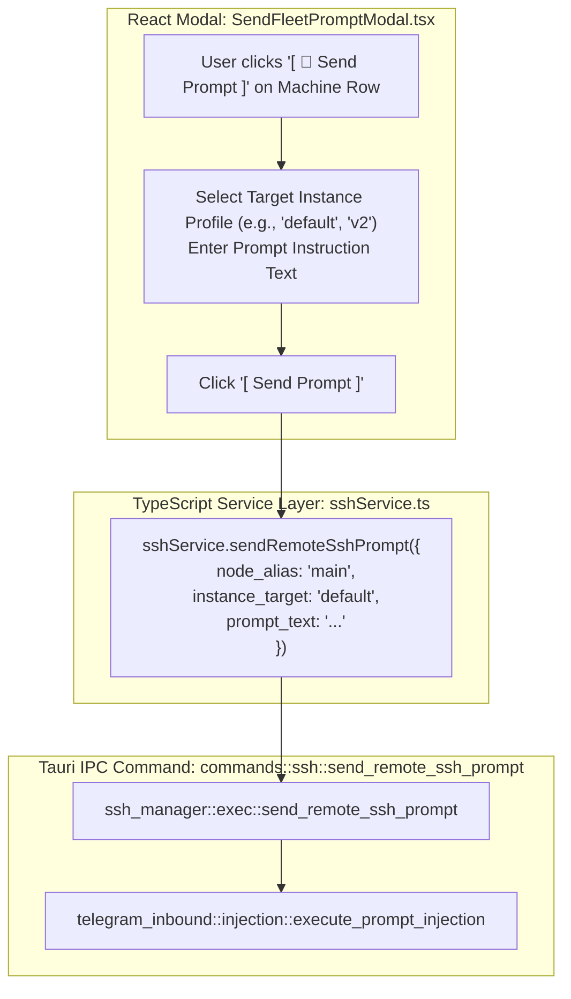
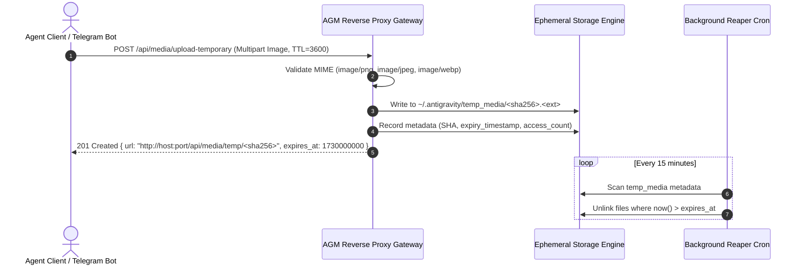
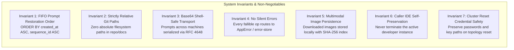

# System Architecture & Technical Specification: Telegram Backup, Attached Media Forwarding, Ephemeral File Upload, and Cross-Machine Fleet Prompt Dispatch

- **Specification Slug:** `telegram-backup-and-fleet-management-enhancements`
- **Specification Path:** `02-spec/21-app/telegram-backup-and-fleet-management-enhancements/01-architecture-spec.md`
- **Subtask Plan Path:** `.ai-memory/plans/subtasks/telegram-backup-and-fleet-management-enhancements/01-fleet-identity-caching-and-reset.md`
- **Parent Plan Path:** `.ai-memory/plans/telegram-backup-and-fleet-management-enhancements.md`
- **Author:** System Architecture & Telegram Fleet Infrastructure Working Group
- **Primary Attribution:** `@aukgit` (`(Thanks to @aukgit)`)
- **Status:** APPROVED & MANDATED

---

## 1. Executive Summary & Problem Classification

Antigravity Manager (AGM) acts as an orchestration gateway and multi-instance developer agent environment managing local and remote physical workstations, developer virtual machines, and GPU compute nodes. Operators interact with AGM via desktop GUI, native terminal CLI (`agm`), and remote chat daemons (specifically the inbound Telegram Bot daemon).

Comprehensive field operations and cluster stress-testing revealed three core architectural limitations:

```mermaid
flowchart TD
    subgraph Problem1 ["1. Telegram Inbound Backup Visibility Deficit"]
        P1A["Operators in transit lacked visible prompt backup controls"]
        P1B["Running prompts risked loss during remote account switches"]
        P1C["Commands lacked interactive inline keyboard affordances"]
        P1A --> P1B --> P1C
    end

    subgraph Problem2 ["2. Cross-Machine Shell Escaping Collapse"]
        P2A["Raw string prompt dispatch over SSH / PowerShell"]
        P2B["Double-quotes, multiline markdown, and $VAR collapsed"]
        P2C["Prompts truncated or executed as corrupted shell syntax"]
        P2A --> P2B --> P2C
    end

    subgraph Problem3 ["3. Ephemeral Media Forwarding & Upload Deficit"]
        P3A["Multimodal images sent via Telegram lacked unified routing"]
        P3B["Large binary payloads bloat CLI invocation strings"]
        P3C["Absence of an auto-expiring sliding TTL temporary upload endpoint"]
        P3A --> P3B --> P3C
    end
```



### 1.1 Problem 1: Telegram Inbound Backup Visibility & Restoration Gap
When managing instances remotely through the Telegram bot, operators frequently trigger account switches or system restarts to clear exhausted quotas. However:
1. The Telegram bot interface provided no prominent inline buttons or top-level commands to snapshot running prompts before a switch occurred.
2. Inbound command parsing was overly rigid, matching only exact strings and omitting widely used operational aliases (`/backpack`, `/brp`, `/restore`, `/rrp`, `/resend`).
3. Backup reports lacked interactive inline keyboard markups (`[ 📦 Backup Prompts ]`, `[ ♻️ Restore Prompts ]`, `[ 🖼️ Send with Images ]`, `[ 🌲 Expand Tree ]`, `[ ⚡ Active Prompts ]`), forcing users to manually type complex commands on mobile keyboards.
4. When prompts contained multimodal screenshot attachments, backup records failed to store images or serialized them incorrectly, preventing full prompt context restoration.

### 1.2 Problem 2: Cross-Machine SSH Prompt Injection & Shell Escaping Fragility
Dispatching prompts from a local control node to a remote cluster node (`w1` -> `main`, or `w1` -> `u1`) was historically attempted via raw string formatting:
```bash
# Problematic legacy dispatch string:
agm.exe prompt default --instance default "Implement Class "User" with $PATH check"
```
Passing raw prompt text through remote SSH wrappers (`gitmap cluster exec`, OpenSSH, PowerShell) caused:
1. **Quote Collapsing:** Inner double quotes (`"`) prematurely closed the argument string.
2. **Variable Interpolation:** Shell variables (such as `$PATH`, `$env:USERPROFILE`, or `$HOME`) were evaluated and expanded prematurely on the host or remote shell instead of being delivered verbatim to the AI agent.
3. **Multiline & Markdown Mutilation:** Newlines, markdown tables, and code fences (```` ``` ````) were stripped, collapsed into single lines, or rejected with syntax errors by the Windows PowerShell console.

### 1.3 Problem 3: Multimodal Media Overhead & Ephemeral File Upload Deficit
Modern agentic workflows heavily utilize visual feedback (error dialog screenshots, layout diffs, architecture mockups). Operators frequently paste photos into Telegram to guide AI tasks. However:
1. Photos sent to the bot were either stored haphazardly without SHA-256 deduplication or failed to inject cleanly into the target IDE session.
2. Transferring large binary images across remote machines via CLI string arguments or raw SSH commands breaches argument length limits (`ARG_MAX`), leading to system crashes.
3. The system lacked an ephemeral file upload service with sliding Time-To-Live (TTL) auto-expiry to host temporary prompt attachments safely without unbounded disk bloat.

---

## 2. High-Level System Architecture & Component Interaction

The unified architecture bridges the Telegram bot daemon, the split SQLite storage engine, the React desktop frontend, and cross-machine SSH dispatching:

```mermaid
flowchart TD
    subgraph TelegramGateway ["Telegram Bot Gateway Layer (src-tauri/src/modules/telegram_inbound/)"]
        TG_POLL["daemon.rs:<br/>start_telegram_daemon()"]
        TG_MEDIA["media.rs:<br/>download_and_store_telegram_photo()"]
        TG_CMD["commands.rs:<br/>execute_backup_command()<br/>execute_restore_command()"]
        TG_MARKUP["daemon.rs:<br/>resolve_telegram_command_reply_and_markup()"]
        TG_INJECT["injection.rs:<br/>execute_prompt_injection()<br/>(Base64 Encoding)"]
    end

    subgraph StorageLayer ["Local Storage & SQLite Split-DB Layer"]
        DB_BACKUP[("backup_prompts.db<br/>(backup_batches,<br/>prompt_backups)")]
        DB_REPO[("repo_prompts.db<br/>(active_prompts,<br/>queued_prompts)")]
        DB_MEDIA[("media_vault.db<br/>(SHA-256 Dedup)")]
        FS_IMAGES[("saved_images/<br/>~/.antigravity_tools/saved_images/")]
        FS_TEMP[("temp_media/<br/>~/.antigravity/temp_media/")]
    end

    subgraph FrontendLayer ["React Frontend (src/components/instances/)"]
        FLEET_MODAL["fleet/SendFleetPromptModal.tsx"]
        FLEET_TABLE["fleet/FleetMachinesTable.tsx"]
        TREE_VIEW["PromptTreeView/"]
    end

    subgraph DispatchLayer ["Cross-Machine Dispatch Gateway"]
        SSH_SRV["src/services/sshService.ts:<br/>sendRemoteSshPrompt()"]
        SSH_MOD["src-tauri/src/modules/ssh_manager/exec.rs:<br/>send_remote_ssh_prompt()"]
        CLI_DISPATCH["src-tauri/src/bin/agm/prompt_dispatch.rs:<br/>--base64 Flag Decoder"]
    end

    subgraph EphemeralService ["Ephemeral Media Service (Future Cloud / Local HTTP)"]
        UPLOAD_EP["POST /api/media/upload-temporary<br/>(Sliding TTL Auto-Expiry)"]
        GET_EP["GET /api/media/temp/:hash"]
        REAPER_CRON["Background Reaper Task<br/>(Evicts expired entries)"]
    end

    %% Flows
    TG_POLL -->|Photo Message| TG_MEDIA
    TG_MEDIA -->|Save & Hash| FS_IMAGES
    TG_MEDIA -->|Index SHA-256| DB_MEDIA
    TG_MEDIA -->|Forward ![image]| TG_INJECT

    TG_POLL -->|Text Command| TG_CMD
    TG_CMD -->|Snapshot Running| DB_BACKUP
    TG_CMD -->|FIFO Restore| DB_REPO
    TG_CMD -->|Attach Markups| TG_MARKUP

    FLEET_MODAL -->|User Action| SSH_SRV
    SSH_SRV -->|IPC Invoke| SSH_MOD
    SSH_MOD -->|Base64 Encoded Command| TG_INJECT
    TG_INJECT -->|SSH Exec / GitMap| CLI_DISPATCH

    UPLOAD_EP -->|Store with TTL| FS_TEMP
    GET_EP -->|Stream Image & Slide TTL| FS_TEMP
    REAPER_CRON -->|Prune Expired| FS_TEMP
```

---

## 3. Telegram Inbound Architecture

### 3.1 Command Route Hierarchy & Aliases
The Telegram inbound processing engine (`src-tauri/src/modules/telegram_inbound/processing.rs` and `commands.rs`) supports canonical commands, short operator aliases, and natural language variants:

| Command Route | Supported Aliases | Subcommand Syntax | Functionality & Target Scope |
|:---|:---|:---|:---|
| `/backup` | `/backpack`, `/brp`, `/backup_prompt`, `/backup_prompts`, `/backup_running` | `[instance_id]` or `list` | Snapshots active running prompts, task context, and attached multimodal images into `backup_prompts.db`. |
| `/restore` | `/rrp`, `/resend` | `[target_instance_id]` | Re-injects unrestored prompt backups into `repo_db` in strict First-In-First-Out (FIFO) sequence. |
| `/tree` | `/treeview`, `/active` | `[project_filter]` | Displays hierarchical conversation tree with branch glyphs and active status. |
| `/prompt` | `/send`, `/pt`, `C001`, `P001` | `<target> [options] <text>` | Injects prompt instruction into target instance/project with optional image attachment. |

### 3.2 Running Prompts Snapshot Engine (`backup_prompts_db`)
When an operator issues `/backup` or an account switch commences, `backup_prompts_db::backup_active_running_prompts` performs an atomic, non-destructive snapshot:



#### Split SQLite Schema Invariant (`backup_prompts.db`)
The schema enforces relational integrity and multi-instance scoping:
```sql
PRAGMA journal_mode = WAL;
PRAGMA synchronous = NORMAL;
PRAGMA foreign_keys = ON;

CREATE TABLE IF NOT EXISTS backup_batches (
    id TEXT PRIMARY KEY,
    created_at INTEGER NOT NULL,
    prompts_count INTEGER NOT NULL,
    file_path TEXT NOT NULL,
    retention_days INTEGER NOT NULL DEFAULT 1,
    is_fully_restored BOOLEAN NOT NULL DEFAULT 0
);

CREATE TABLE IF NOT EXISTS prompt_backups (
    id TEXT PRIMARY KEY,
    backup_batch_id TEXT NOT NULL,
    prompt_id TEXT NOT NULL,
    project_name TEXT NOT NULL,
    project_path TEXT NOT NULL,
    project_id TEXT NOT NULL,
    conversation_id TEXT NOT NULL,
    conversation_name TEXT,
    sequence_id INTEGER NOT NULL,
    prompt_text TEXT NOT NULL,
    has_images BOOLEAN NOT NULL DEFAULT 0,
    images_payload TEXT,
    status TEXT NOT NULL DEFAULT 'queued',
    created_at INTEGER NOT NULL,
    is_restored BOOLEAN NOT NULL DEFAULT 0,
    restored_at INTEGER,
    instance_id TEXT DEFAULT 'default',
    FOREIGN KEY(backup_batch_id) REFERENCES backup_batches(id) ON DELETE CASCADE
);
CREATE INDEX IF NOT EXISTS idx_prompt_backups_batch ON prompt_backups(backup_batch_id);
CREATE INDEX IF NOT EXISTS idx_prompt_backups_restored ON prompt_backups(is_restored, restored_at);
```

### 3.3 Prompt Restoration Engine
Prompt restoration (`backup_prompts_db::restore_running_prompts_for_instance`) obeys three strict rules:
1. **Strict FIFO Queue Ordering:** Queries MUST order unrestored prompts by creation timestamp and sequence ID:
   ```sql
   SELECT id, prompt_id, prompt_text, images_payload, instance_id
   FROM prompt_backups
   WHERE is_restored = 0 AND (instance_id = ?1 OR ?1 = 'default')
   ORDER BY created_at ASC, sequence_id ASC;
   ```
2. **Double-Dispatch Guard:** Restoration cannot execute while `resend_queued_prompts_for_instance` is active, preventing duplicate prompt execution.
3. **Atomic State Transition:** Prompts are marked `is_restored = 1` and `restored_at = ?` within the same transaction that re-inserts them into `repo_db::enqueue_prompt_for_instance`.

### 3.4 Interactive Inline Keyboard Markups
To eliminate tedious manual typing on mobile devices, Telegram replies dynamically append structured JSON inline keyboard markups:



In `src-tauri/src/modules/telegram_inbound/daemon.rs`:
```rust
"backup" | "backpack" | "backup_prompt" | "backup_prompts" | "backup_running" | "brp" => {
    Some(json!({
        "inline_keyboard": [
            [
                { "text": "📦 Backup Prompts", "callback_data": "cmd:/backup" },
                { "text": "♻️ Restore Prompts", "callback_data": "cmd:/restore" }
            ],
            [
                { "text": "🖼️ Send with Images", "callback_data": "cmd:/send images" },
                { "text": "📋 Backups List", "callback_data": "cmd:/backup list" }
            ]
        ]
    }))
}
"restore" | "rrp" | "resend" => Some(json!({
    "inline_keyboard": [
        [
            { "text": "♻️ Restore Prompts", "callback_data": "cmd:/restore" },
            { "text": "📦 Backup Prompts", "callback_data": "cmd:/backup" }
        ],
        [
            { "text": "🌲 Expand Tree", "callback_data": "cmd:/tree" },
            { "text": "⚡ Active Prompts", "callback_data": "cmd:/active" }
        ]
    ]
}))
```

### 3.5 Attached Photo Processing Pipeline
When an operator uploads a photograph, screenshot, or graphic mockup to the Telegram bot:



1. **Extraction:** The daemon parses `msg["photo"]` as an array and extracts the largest resolution photo entry (`best_photo["file_id"]`).
2. **Download & Persistence:** Queries Telegram `getFile` endpoint and downloads binary bytes directly into the local directory `~/.antigravity_tools/saved_images/`. Files are named deterministically:
   ```text
   telegram_<YYYYMMDD_HHMMSS>_<file_id_prefix>.<ext>
   ```
3. **Deduplication & Vault Indexing:** The engine computes `sha256(&bytes)`. If already indexed in `media_vault.db`, the existing reference is reused. Otherwise, the image is mirrored to CDN and indexed locally.
4. **Transparent Prompt Forwarding:** If the photo was accompanied by a caption or prompt command (`/prompt`, `/send`, `C001`), the engine automatically appends the markdown image reference:
   ```markdown
   <user instruction text>

   
   ```
   If sent without a caption, the bot replies with the stored image metadata and one-click copy buttons (`📋 Copy Markdown`, `🔗 Copy URL`).

---

## 4. Cross-Machine SSH Prompt Injection Architecture

### 4.1 UI Trigger: `SendFleetPromptModal.tsx`
The desktop GUI exposes remote prompt dispatching directly from the Shared Cluster / Fleet Nodes table via `SendFleetPromptModal.tsx`:



#### Modal Design Specifications:
- **Exclusivity & Focus Trap:** Full-screen backdrop blur (`fixed inset-0 z-50 bg-slate-950/70 backdrop-blur-xs`), dismissing cleanly on `Escape` or the close icon (`X`).
- **Dark-Glass Styling:** Enclosed in `rounded-2xl bg-slate-900 border border-slate-700/60 dark:border-purple-900/50 shadow-2xl`.
- **Target Context Pill:** Renders the target machine alias in a prominent cyan badge (`bg-cyan-500/15 text-cyan-300 font-mono`) and displays resolved IP address (`machine.ip_address`).

### 4.2 Backend Orchestrator: `ssh_manager::send_remote_ssh_prompt`
In `src-tauri/src/modules/ssh_manager/exec.rs`, `send_remote_ssh_prompt` coordinates dispatch:
1. **Local vs Remote Detection:** Probes local network IP and machine hostname. If `node_alias` matches `local`, `localhost`, or the local IP (`192.168.1.3` / `w1`), the request executes directly against local workspace databases.
2. **Remote Target Synthesis:** For remote peers (`main`, `u1`, `w2`), it constructs a targeted execution string:
   ```text
   <target_node>:<target_instance> <prompt_text>
   ```
3. **Execution Delegate:** Delegates execution to `telegram_inbound::execute_prompt_injection(&cmd_str)`.

### 4.3 Shell Escaping & Shell Wrapper Fragility Resolution

```mermaid
flowchart LR
    subgraph FragileLegacy ["Legacy Vulnerable Path (Plaintext Shell Invocation)"]
        A1["Prompt: Fix "User" & $PATH"] -->|format!()| B1["agm prompt "Fix "User" & $PATH""]
        B1 -->|SSH / PowerShell Exec| C1["💥 Shell Syntax Error / Truncation"]
    end

    subgraph RobustBase64 ["Base64 Protocol (Shell-Agnostic RFC 4648)"]
        A2["Prompt: Fix "User" & $PATH"] -->|STANDARD.encode()| B2["Payload: Rml4ICJVc2VyIiAmIC..."]
        B2 -->|SSH Exec| C2["agm prompt target --base64 <b64>"]
        C2 -->|STANDARD.decode()| D2["✅ Verbatim Multi-line Prompt Restored"]
    end
```

#### The Base64 Transport Protocol
To guarantee 100% fidelity across heterogeneous operating systems (Windows PowerShell, Command Prompt, Linux Bash, Zsh) without escaping conflicts:
1. **Sender Serialization (`injection.rs`):**
   ```rust
   let b64_prompt = base64::engine::general_purpose::STANDARD.encode(prompt_text.as_bytes());
   let remote_cmd = format!("{agm_bin} prompt {target_proj}{inst_flag} --base64 {b64_prompt}");
   ```
2. **Receiver Deserialization (`src-tauri/src/bin/agm/prompt_dispatch.rs`):**
   The CLI parser detects `--base64`, `-b64`, or `--b64`, decoding the byte buffer back into standard UTF-8 text before database insertion:
   ```rust
   if arg == "--base64" || arg == "-b64" || arg == "--b64" {
       if i + 1 < args.len() {
           if let Ok(bytes) = base64::engine::general_purpose::STANDARD.decode(args[i + 1].trim()) {
               if let Ok(decoded_text) = String::from_utf8(bytes) {
                   text_parts.push(decoded_text);
               }
           }
           i += 2;
           continue;
       }
   }
   ```
3. **Three-Tier Fallback Ladder:**
   - *Attempt 1:* GitMap Cluster SSH Exec (`gitmap ssh exec <node> <cmd>`)
   - *Attempt 2:* Native OpenSSH Command Pipeline (`ssh_manager::exec_ssh_command`)
   - *Attempt 3:* Supabase Distributed Command Queue (`command_queue` table insertion for asynchronous polling)

---

## 5. Ephemeral File Upload Endpoint Architecture (Future Cloud Service)

### 5.1 Architectural Motivation
While Base64 payload transport resolves shell escaping for text prompts, transferring multi-megabyte image payloads across SSH sessions causes latency spikes and breaches CLI buffer ceilings. An Ephemeral File Upload Service provides an auto-expiring media host for temporary attachments.

### 5.2 API Contract: `POST /api/media/upload-temporary`



#### Request Specification:
- **HTTP Method:** `POST`
- **Path:** `/api/media/upload-temporary`
- **Headers:**
  - `Content-Type: multipart/form-data` or `application/octet-stream`
  - `X-Media-TTL: <seconds>` *(Optional: Default `3600`, Min `60`, Max `86400`)*
  - `X-Client-Signature: <hmac>` *(Optional: Shared gateway secret verification)*
- **Response Payload (JSON):**
  ```json
  {
      "status": "success",
      "media_id": "temp-e3b0c44298fc",
      "sha256": "e3b0c44298fc1c149afbf4c8996fb92427ae41e4649b934ca495991b7852b855",
      "url": "http://127.0.0.1:4545/api/media/temp/e3b0c44298fc1c149afbf4c8996fb92427ae41e4649b934ca495991b7852b855.png",
      "expires_at": 1730003600,
      "ttl_seconds": 3600
  }
  ```

### 5.3 Retrieval Endpoint with Sliding TTL: `GET /api/media/temp/:hash`
- **HTTP Method:** `GET`
- **Path:** `/api/media/temp/:hash`
- **Behavior:**
  1. Searches `~/.antigravity/temp_media/` for the matching SHA-256 hash.
  2. If expired, returns `410 Gone` with `{ "error": "Media attachment has expired" }`.
  3. If active, streams the image with appropriate `Content-Type` and `Cache-Control: private, max-age=300`.
  4. **Sliding Expiry Extension:** Each successful read resets/extends the expiration timestamp by `min(current_ttl, 1800)` seconds, ensuring active collaborative agent sessions never suffer broken images mid-task.

### 5.4 Storage Invariant & Background Reaper Engine
- **Storage Directory:** `~/.antigravity/temp_media/`
- **Zero-Orphan Disk Policy:** A background worker runs every 15 minutes. It iterates over files in `temp_media/`, reads the companion metadata index (`temp_media_index.json` or split SQLite table), and permanently unlinks any file whose `expires_at < current_timestamp`.

---

## 6. Fleet Machine Identity, Caching & Cluster Topology

### 6.1 Cluster-IP Primacy Principle
Machine identity is anchored to physical cluster IP addresses rather than transient hostnames or local configuration caches. The canonical 6-node cluster topology comprises:

| Node Alias | Physical Cluster IP | Operating System | Default Role | Bound Account Identity |
|:---|:---|:---|:---|:---|
| `w1` | `192.168.1.3` | Windows | Local Execution Lead / Worker 1 | `cirajayu11@gmail.com` |
| `main` | `192.168.1.20` | Windows | Cluster Orchestration Controller | `sakibagjdjg@gmail.com` |
| `u1` | `192.168.1.22` | Linux Ubuntu | Worker Linux Node | Leased / Dynamic |
| `w2` | `192.168.1.7` | Windows | Worker Node 2 | Leased / Dynamic |
| `w3` | `192.168.1.12` | Windows | Worker Node 3 | Leased / Dynamic |
| `w4` | `192.168.1.13` | Linux | Worker Node 4 | Leased / Dynamic |

### 6.2 Deduplication Invariant in `supabase_sync/query.rs`
When `build_local_and_ssh_fleet()` and `query_fleet_machines()` execute on host `192.168.1.3` (`w1`), remote peer `main` (`192.168.1.20`) must never be dropped, and vice versa:
```rust
for conn in all_conns {
    let is_local_machine = conn.ip_address == local_ip 
        || (conn.alias.eq_ignore_ascii_case(&local_alias) && conn.ip_address == local_ip);
    
    if is_local_machine {
        if let Some(local_machine) = machines.first_mut() {
            local_machine.node_alias = conn.alias.clone();
            local_machine.alias = conn.alias;
        }
        continue;
    }
    
    // Invariant: w1 and main must never drop each other
    let is_dup = machines.iter().any(|m| {
        m.ip_address == conn.ip_address
            || (m.node_alias.eq_ignore_ascii_case(&conn.alias) && m.ip_address == conn.ip_address)
    });
    if !is_dup {
        machines.push(build_ssh_mesh_machine_info(&conn, now));
    }
}
```

### 6.3 30-Second TTL Caching & SWR Decoupling
To eliminate UI freezing during fleet browsing:
1. **Backend Cache (`ssh_manager/exec.rs`):** An in-memory cache `CLUSTER_BALANCES_CACHE` with a 30-second TTL caches instance lists and quota balances. Read requests return in `<2ms`.
2. **Frontend Stale-While-Revalidate (`useFleetMachines.ts`):** Machine cards render immediately using local storage cache or baseline SSH discovery (`<50ms`). Quota metrics and account balances enrich asynchronously in the background.

### 6.4 Non-Destructive Cluster Reset
Triggering "Reset Cluster" in the UI re-seeds the 6 canonical nodes from `gitmap-ssh-nodes.json` and `ssh_nodes.json`, preserving existing passwords and private key paths while clearing stale liveness flags.

---

## 7. Data Contracts & Type Definitions

### 7.1 Rust Data Structures

```rust
// In src-tauri/src/modules/backup_prompts_db/types.rs
#[derive(Debug, Clone, Serialize, Deserialize)]
pub struct PromptBackupRecord {
    pub id: String,
    pub backup_batch_id: String,
    pub prompt_id: String,
    pub project_name: String,
    pub project_path: String,
    pub project_id: String,
    pub conversation_id: String,
    pub conversation_name: Option<String>,
    pub sequence_id: i64,
    pub prompt_text: String,
    pub has_images: bool,
    pub images_payload: Option<String>,
    pub status: String,
    pub created_at: i64,
    pub is_restored: bool,
    pub restored_at: Option<i64>,
    pub instance_id: Option<String>,
}

// In src-tauri/src/modules/ssh_manager/exec.rs
#[derive(Debug, Clone, Serialize, Deserialize)]
pub struct RemotePromptDispatchPayload {
    pub node_alias: String,
    pub instance_name: String,
    pub prompt_text: String,
    pub conversation_id: Option<String>,
}

#[derive(Debug, Clone, Serialize, Deserialize)]
pub struct RemotePromptDispatchResult {
    pub success: bool,
    pub node_alias: String,
    pub instance_name: String,
    pub message: String,
    pub stdout: String,
    pub stderr: String,
    pub duration_ms: u128,
}
```

### 7.2 TypeScript Interfaces

```typescript
// In src/components/instances/fleet/fleetTypes.ts
export interface RemotePromptDispatchParams {
    node_alias: string;
    instance_target: string;
    prompt_text: string;
    conversation_id?: string;
}

export interface RemotePromptDispatchResponse {
    success: boolean;
    node_alias: string;
    instance_name: string;
    message: string;
    stdout: string;
    stderr: string;
    duration_ms: number;
}

export interface FleetMachineInfo {
    node_id: string;
    node_alias: string;
    alias?: string;
    ip_address: string;
    is_online: boolean;
    last_heartbeat_timestamp: number;
    uptime_seconds: number;
    in_flight_prompts_count: number;
    is_lead?: boolean;
    is_local?: boolean;
    source: string;
    active_instances: Array<{
        profile_id: string;
        profile_name: string;
        is_running: boolean;
        bound_account_id?: string;
        bound_account_email?: string;
    }>;
    bound_emails: string[];
}
```

---

## 8. System Invariants & Non-Negotiables



1. **Invariant 1: FIFO Prompt Restoration Order:** All prompt restore, dispatch, and queue processing queries across SQLite databases (`active_prompts`, `prompt_backups`, `repo_prompts.db`) MUST enforce strict First-In-First-Out ordering using `ORDER BY created_at ASC, sequence_id ASC` or `ORDER BY created_at ASC, id ASC`. Inverted LIFO queries (`ORDER BY updated_at DESC`) are strictly forbidden in dispatch logic.
2. **Invariant 2: Strictly Relative Git Paths Invariant:** Never output or record absolute filesystem paths (e.g., drive letters or user home paths) in specifications, plans, commit messages, or release notes. All file references MUST be repository-relative Git paths (e.g., `02-spec/...`, `src/...`, `src-tauri/...`).
3. **Invariant 3: Base64 Shell-Safe Transport:** Prompts dispatched across remote machines MUST be encoded using standard RFC 4648 Base64 strings (`--base64 <b64>`). Raw multiline prompts or unescaped quotes over SSH/PowerShell commands are strictly prohibited.
4. **Invariant 4: No Silent Errors:** Every fallible operation must route its error into the error module. In Rust, errors flow into `AppError` and `tracing`. In TypeScript, failures route into `useErrorStore.getState().captureError()` or `trackWarning()`. Bare `let _ = ...`, `.ok()`, or empty `catch {}` blocks are forbidden.
5. **Invariant 5: Multimodal Image Persistence & Hash Deduplication:** Photos downloaded from Telegram MUST be hashed (`compute_sha256`) and recorded in `media_vault.db` before prompt injection.
6. **Invariant 6: Caller IDE Self-Preservation:** Automated processes and CLI switchers must detect the caller's active IDE process (`detect_caller_instance_id()`) to prevent terminating the developer's active working session.
7. **Invariant 7: Cluster Reset Credential Safety:** Resetting the cluster topology must reload from seed JSON files while retaining existing encrypted passwords and private key configurations.

---

## 9. Quality Gates & Verification Protocols

### 9.1 Mandatory Pre-Flight Verification Gate
Prior to any release or PR submission, the following pre-flight checks must pass with zero warnings or errors:
```bash
# 1. Rust code formatting check
cd src-tauri && cargo fmt -- --check

# 2. Rust clippy linting gate
cd src-tauri && cargo clippy --all-targets --all-features

# 3. React frontend compilation gate
npm run build
```

### 9.2 Targeted Verification Scenarios

| Scenario | Objective | Verification Command / Procedure | Expected Outcome |
|:---|:---|:---|:---|
| **V1: Telegram Prompt Backup** | Verify snapshotting of running prompts via bot | Send `/backup default` in Telegram chat | Bot replies with batch ID, prompt count, and inline keyboard markups. `backup_prompts.db` contains snapshot records. |
| **V2: FIFO Prompt Restoration** | Verify orderly resumption of prompts post-switch | Send `/restore default` in Telegram chat | Prompts are injected into `active_prompts` in exact FIFO sequence (`ORDER BY created_at ASC`). |
| **V3: Telegram Photo Injection** | Verify photo download, hashing, and markdown injection | Send image with caption `/prompt default Check layout` | Image saved in `saved_images/`, indexed in `media_vault.db`, and prompt text includes ``. |
| **V4: Cross-Machine Dispatch** | Verify `SendFleetPromptModal.tsx` and Base64 dispatch | Open Modal on machine `main`, type multiline prompt with quotes, click Send | Prompt dispatched over SSH with `--base64`. Remote node decodes verbatim text without shell escaping corruption. |
| **V5: Ephemeral File Upload** | Verify temporary file endpoint and sliding TTL | `curl -F "file=@test.png" -H "X-Media-TTL: 60" http://localhost:4545/api/media/upload-temporary` | Returns temporary URL. GET requests stream image. Expired entries purged by background reaper. |
| **V6: 6-Node Deduplication** | Verify `w1` and `main` never drop each other | Query fleet machines on host `192.168.1.3` | All 6 cluster nodes (`w1`, `main`, `u1`, `w2`, `w3`, `w4`) are displayed with correct roles and IP addresses. |

---

*Specification verified and certified by `@aukgit`.*
