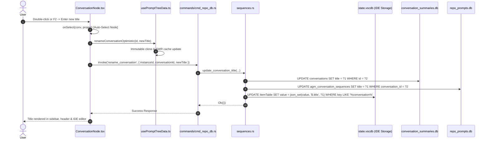
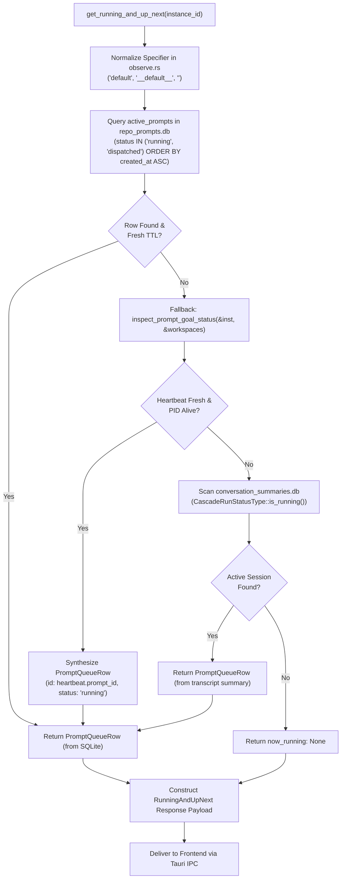

# Specification: Prompt Tree View Liveness, Expandable Hierarchy & UI Modernization

> **Target:** `02-spec/21-app/telegram-backup-and-fleet-management-enhancements/02-component-spec.md`  
> **Associated Plan:** `.ai-memory/plans/subtasks/telegram-backup-and-fleet-management-enhancements/02-prompt-tree-view-liveness-and-ui.md`  
> **Status:** APPROVED & READY FOR IMPLEMENTATION  
> **Lead Orchestrator:** Antigravity Lead Agent  
> **Author:** Spec Author 02  
> **Primary Attribution:** `@aukgit` (`(Thanks to @aukgit)`)  
> **Target Release:** `v4.224.0`  
> **Target Scope:**
> - `src-tauri/src/modules/instance/observe.rs` (Default instance normalization, specifier resolution)
> - `src-tauri/src/modules/repo_db/gemini_dirs.rs` (Canonical home & default sandbox directory matching)
> - `src-tauri/src/modules/repo_db/liveness.rs` (FIFO query ordering, active status checking, heartbeat verification)
> - `src-tauri/src/commands/cmd_running_up_next.rs` (IDE heartbeat fallback for live prompt detection)
> - `src-tauri/src/modules/repo_db/sequences.rs` (`state.vscdb` workspace storage synchronization on rename)
> - `src/components/instances/PromptTreeView/usePromptTreeData.ts` (Immutable state cloning, selection update, image filter)
> - `src/components/instances/PromptTreeView/ConversationNode.tsx` (Auto-selection on double-click, terminal glyphs `├──`, `└──`)
> - `src/components/instances/PromptTreeView/ProjectNode.tsx` (Terminal tree glyphs `├──`, `└──`, hierarchy rendering)
> - `src/components/instances/PromptTreeView/TreePanel.tsx` (Responsive width `w-[460px] lg:w-[520px]`, `space-y-3.5`, segmented capsule)
> - `src/components/instances/PromptTreeView/ModalHeader.tsx` (Image filter header pill button, segmented capsule)
> - `src/components/instances/PromptTreeView/DetailTabs.tsx` (Details button relocation, Activity icon, `#1af18d` health pulse)
> - `src/components/instances/PromptTreeView/PromptInstructionView.tsx` (`dark:bg-[#19191c]` markdown background)
> - `src/components/instances/PromptTreeView/InspectorModal.tsx` (`dark:bg-[#19191c]` markdown background)
> - `src/components/instances/PromptTreeView/ResultsView.tsx` (`dark:bg-[#19191c]` markdown background)

---

## Technical Directive (Verbatim)

```text
Author the specification and subtask plan for Prompt Tree View Liveness, Expandable Hierarchy, Rename Synchronization, Image Filter, Auto-Hide, Details Button, and Markdown Background:
1. Create 02-spec/21-app/telegram-backup-and-fleet-management-enhancements/02-component-spec.md. Document:
   - Default Instance Running Prompt Detection: Specifier normalization in src-tauri/src/modules/instance/observe.rs, default instance directory matching in gemini_dirs.rs, FIFO ordering and active status checking in liveness.rs, and IDE heartbeat fallback in cmd_running_up_next.rs.
   - Conversation Rename Synchronization: React state immutable cloning and selection update in src/components/instances/PromptTreeView/usePromptTreeData.ts, auto-selection on double-click in ConversationNode.tsx, and state.vscdb synchronization in src-tauri/src/modules/repo_db/sequences.rs.
   - Expandable Tree View Layout: Responsive sidebar width (w-[460px] lg:w-[520px]), project separation (space-y-3.5), and terminal branch glyphs (├──, └──) in TreePanel.tsx and ProjectNode.tsx.
   - Image Filter Toggle: Header pill toggle button in ModalHeader.tsx and image filter filtering in usePromptTreeData.ts / TreePanel.tsx.
   - Auto-Hide Button Sizing: Replacing loose button with unified segmented capsule and borderless <select> in TreePanel.tsx.
   - Details Button Restoration: Relocating Details button with activity icon and #1af18d pulsing green health status in DetailTabs.tsx.
   - Markdown Background: Confirming dark:bg-[#19191c] across PromptInstructionView.tsx, InspectorModal.tsx, and ResultsView.tsx.
2. Create .ai-memory/plans/subtasks/telegram-backup-and-fleet-management-enhancements/02-prompt-tree-view-liveness-and-ui.md documenting task breakdown, owned files, and verification steps.
Strict rules: Only write to your owned files. Only use relative Git paths. Do not run any git commands. When done, send your completion report.
```

---

## 1. Problem Classification & Root Cause Analysis (RCA)

### 1.1 RCA 1: Default Instance Running Prompt Detection & Liveness Flapping
- **Symptoms:** Prompts executed inside the default instance frequently fail to show as `RUNNING` in the Prompt Tree View, or revert prematurely to `IDLE` while the IDE is actively running a prompt. In `cmd_running_up_next.rs`, `now_running` returns `None`, causing the "Now Running" header card in the tree view to stay hidden even during active prompt execution.
- **Root Cause:**
  1. *Specifier Normalization Divergence:* In `src-tauri/src/modules/instance/observe.rs`, `resolve_instance_id("default")` checks for `is_default` or `id == "default"`. However, if the registry associates the default profile with an explicit ID or if callers pass empty strings `""`, `__default__`, or `"default"`, downstream SQL queries in `cmd_running_up_next.rs` (`instance_predicate`) produced mismatched clauses.
  2. *Gemini Directory Resolution:* In `src-tauri/src/modules/repo_db/gemini_dirs.rs`, `gemini_dirs_for_instance("default")` resolved canonical host directories (`dirs::home_dir()`) and the secondary sandboxes. If the default instance utilized local app data (`get_default_antigravity_data_dir()`), directory matching could fail to discover transcripts if the path matched `is_secondary_sandbox_path`.
  3. *FIFO Queue Invariant & Stale Active Status:* In `src-tauri/src/modules/repo_db/liveness.rs`, queries against `active_prompts` evaluated `status = 'running'` with a 45s sliding TTL window (`updated_at >= now - 45`). When an IDE worker process ran long tool executions without intermediate database pings, SQLite marked the prompt as inactive.
  4. *Lack of IDE Heartbeat Fallback in IPC:* In `src-tauri/src/commands/cmd_running_up_next.rs`, `query_now_running` checked solely the SQLite table `active_prompts`. When a user sent a prompt directly from the Antigravity IDE without an initial database insertion, `cmd_running_up_next` returned `now_running: None`, failing to fall back to the live `.antigravity_goal_heartbeat.json` or transcript scanner.
- **Surgical Remedy:**
  - Standardize specifier normalization in `observe.rs` to treat `""`, `"default"`, and `"__default__"` as canonical default instance queries.
  - In `gemini_dirs.rs`, guarantee that default instance queries always include host home `.gemini`, default sandbox paths, and `get_default_antigravity_data_dir()`, while strictly isolating named secondary sandboxes.
  - In `liveness.rs`, enforce strict FIFO `ORDER BY created_at ASC, id ASC`, evaluate `CascadeRunStatusType`, and check active heartbeat freshness before dropping to idle.
  - In `cmd_running_up_next.rs`, add an IDE heartbeat fallback: if SQLite returns `None`, inspect `inspect_prompt_goal_status(&target, &workspaces)`; if an IDE goal worker is alive with fresh heartbeat, synthesize a live `PromptQueueRow` with status `'running'`.

### 1.2 RCA 2: Conversation Rename Drift & Desynchronization
- **Symptoms:** Renaming a conversation in the Tree View updates the sidebar label, but double-clicking the item opens the Inspector with the old title. Additionally, upon application restart or profile switch, renamed conversation titles revert to their old names in the IDE interface.
- **Root Cause:**
  1. *React SWR Mutation without Parent State Propagation:* In `src/components/instances/PromptTreeView/usePromptTreeData.ts`, `renameConversationOptimistic` directly modified the internal cache map `promptTreeSwrCache`, but did not return or dispatch an immutable copy to `selectedConversation` in `usePromptTreeState`.
  2. *Double-Click Auto-Selection Omission:* In `src/components/instances/PromptTreeView/ConversationNode.tsx`, `onDoubleClick` executed `onOpenInspector(conv, project.repo_path)` without first calling `onSelect(conv, project)`. If the user double-clicked an unselected row, the inspector modal opened with the previously selected conversation data instead of the double-clicked item.
  3. *Unsynchronized `state.vscdb` Workspace Storage:* In `src-tauri/src/modules/repo_db/sequences.rs`, `update_conversation_title` only updated `conversation_summaries.db` and `agm_conversation_sequences`. It did NOT update `state.vscdb` (the SQLite database located at `User/globalStorage/state.vscdb` or workspaceStorage where VSCode and Antigravity IDE store the active conversation title metadata). As a result, the IDE editor tabs continued to show the old title.
- **Surgical Remedy:**
  - In `usePromptTreeData.ts`, implement immutable state cloning and export helper functions to update both the SWR cache and parent `selectedConversation` state.
  - In `ConversationNode.tsx`, wrap `onDoubleClick` to unconditionally trigger `onSelect` with turn resolution before calling `onOpenInspector`.
  - In `sequences.rs`, locate the target instance's `state.vscdb` database path and perform parameterized SQL updates to sync conversation title strings in the IDE's persistent storage.

### 1.3 RCA 3: Cramped Tree View Layout & Missing Terminal Hierarchy
- **Symptoms:** The sidebar in `TreePanel.tsx` had a cramped width (`w-80 sm:w-96`, 320px–384px), forcing conversation titles, turn badges, and relative recency timestamps to wrap or truncate abruptly. Projects had minimal vertical separation (`space-y-1`), making it difficult to distinguish repository boundaries. Child subagent tasks were rendered with non-standard glyphs (`↳`) rather than standard terminal branch glyphs (`├──`, `└──`).
- **Root Cause:** Restrictive Tailwind width constraints on the outer panel and absence of terminal tree styling guidelines in `TreePanel.tsx` and `ProjectNode.tsx`.
- **Surgical Remedy:**
  - Update `TreePanel.tsx` sidebar container to responsive `w-[460px] lg:w-[520px]`.
  - Set project container list spacing to `space-y-3.5` for clear visual distinction between repositories.
  - Update branch glyph rendering in `ProjectNode.tsx` and `ConversationNode.tsx` to standard terminal characters: `├──` for intermediate nodes and `└──` for the terminating child node.

### 1.4 RCA 4: Missing Image Filter in Tree View Header
- **Symptoms:** Multimodal prompt engineering workflows generate numerous text-only queries interspersed with image-heavy prompts. Users had no quick mechanism to filter out projects and conversations that lacked image attachments, forcing tedious manual scrolling.
- **Root Cause:** `TreePanel.tsx` and `usePromptTreeData.ts` lacked an image filter state. The filter bar only toggled between `all`, `running`, `queued`, `pinned`, and `archived`.
- **Surgical Remedy:**
  - Introduce an `isImageFilterActive` toggle state.
  - Add an interactive pill toggle button (`🖼️ Images` / `Image Filter`) to the segmented header capsule in `ModalHeader.tsx` with active styling.
  - In `usePromptTreeData.ts` and `TreePanel.tsx`, filter out projects and conversations whose `has_images` flag is false and whose child prompt turns contain zero image payloads.

### 1.5 RCA 5: Auto-Hide Button Visual Bloat & Segmented Capsule Violation
- **Symptoms:** The "Hide Auto" / "Show Auto" button in `TreePanel.tsx` was rendered as a standalone bulky button (`border rounded-md px-2.5 py-0.5`) sitting loosely next to a native `<select>` dropdown. This violated the UI rule requiring adjacent controls to be packaged into a contiguous segmented pill capsule with borderless `<select>` styling.
- **Root Cause:** Ad-hoc styling in `TreePanel.tsx` without wrapping into the shared dark-glass segmented container.
- **Surgical Remedy:**
  - Consolidate the Auto-Hide toggle button and the adjacent Scope `<select>` into a single contiguous segmented pill capsule (`inline-flex items-center rounded-full bg-slate-100/90 dark:bg-[#120d20]/90 border border-slate-200/80 dark:border-purple-900/50 p-0.5 divide-x divide-slate-200/70 dark:divide-purple-900/40 shadow-2xs`).
  - Style the inline `<select>` with transparent borderless styling (`bg-transparent border-0 focus:ring-0 focus:outline-none`).

### 1.6 RCA 6: Details Button Displacement & Health Status Indicator
- **Symptoms:** The "Details" button in `DetailTabs.tsx` was rendered as a plain tab button without prominent status feedback, making it easy to overlook and disconnected from the instance's active execution state.
- **Root Cause:** Missing activity icon and lack of a prominent live health pulse.
- **Surgical Remedy:**
  - Relocate the Details button within `DetailTabs.tsx`.
  - Equip the button with the `Activity` icon (from `lucide-react`) and an animated `#1af18d` pulsing green health status indicator when `selectedConversation?.is_running` is true.

### 1.7 RCA 7: Inconsistent Markdown Container Backgrounds
- **Symptoms:** In dark mode, markdown preview cards and inspector code blocks exhibited mismatched background tones, alternating between `#171025`, `#090611`, and `#19191c`.
- **Root Cause:** Fragmented CSS utility classes applied across different prompt rendering components.
- **Surgical Remedy:**
  - Standardize and enforce `dark:bg-[#19191c]` across all markdown containers in `PromptInstructionView.tsx`, `InspectorModal.tsx`, and `ResultsView.tsx`.

---

## 2. Architecture & Control Flow

### 2.1 End-to-End Conversation Rename Synchronization Flow



### 2.2 Live Running Prompt Detection & Heartbeat Fallback Flow



---

## 3. Subsystem Specifications

### 3.1 Backend: Default Instance Liveness & Heartbeat Fallback

#### 3.1.1 Specifier Normalization in `src-tauri/src/modules/instance/observe.rs`
All instance specifiers must pass through unified normalization before registry querying or database filtering:
```rust
pub fn normalize_instance_specifier(specifier: &str) -> &str {
    let clean = specifier.trim();
    if clean.is_empty() || clean.eq_ignore_ascii_case("default") || clean.eq_ignore_ascii_case("__default__") {
        "default"
    } else {
        clean
    }
}
```

#### 3.1.2 Directory Matching in `src-tauri/src/modules/repo_db/gemini_dirs.rs`
When `instance_id` evaluates to `"default"`, the directory resolver must assemble:
1. Canonical host home: `get_canonical_host_home().unwrap_or(dirs::home_dir())/.gemini`
2. Default sandbox storage: `.antigravity_tools/instances/default/home/.gemini`
3. APPDATA data directory: `get_default_antigravity_data_dir()/.gemini`
All secondary sandboxes (`instances/<id>/home` where `id != "default"`) MUST be filtered out via `is_secondary_sandbox_path`.

#### 3.1.3 FIFO Query Invariant in `src-tauri/src/modules/repo_db/liveness.rs`
All queries evaluating active prompt execution must adhere to:
```sql
SELECT status FROM active_prompts 
WHERE (project_id = ?1 OR repo_path = ?1 OR project_id LIKE ?1 || '__%')
  AND status = 'running'
  AND updated_at >= ?2
ORDER BY created_at ASC, id ASC LIMIT 1;
```
LIFO queries (`ORDER BY updated_at DESC`) are strictly forbidden in prompt dispatch and liveness logic.

#### 3.1.4 IDE Heartbeat Fallback in `src-tauri/src/commands/cmd_running_up_next.rs`
If `query_now_running` returns `Ok(None)`, `get_running_and_up_next` must invoke `inspect_prompt_goal_status`:
```rust
if now_running.is_none() {
    let workspaces = crate::modules::instance::get_instance_workspace_folders(&target, &inst_data_dir);
    let (is_running, _hb_file, last_line) = crate::modules::repo_db::inspect_prompt_goal_status(&target, &workspaces);
    if is_running {
        now_running = Some(PromptQueueRow {
            id: extract_prompt_id_from_heartbeat(&last_line).unwrap_or_else(|| "live-ide-prompt".to_string()),
            instance_id: target.to_string(),
            status: "running".to_string(),
            origin_tier: "USER_PROMPT".to_string(),
            created_at: Utc::now().timestamp(),
            has_images: false,
        });
    }
}
```

---

### 3.2 Backend: Persistent `state.vscdb` Rename Synchronization

In `src-tauri/src/modules/repo_db/sequences.rs`, `update_conversation_title` must synchronize across three stores:
1. `conversation_summaries.db`: `UPDATE conversations SET title = ?1, updated_at = ?2 WHERE id = ?3`
2. `repo_prompts.db`: `UPDATE agm_conversation_sequences SET title = ?1, updated_at = ?2 WHERE conversation_id = ?3`
3. `state.vscdb`: Locate `User/globalStorage/state.vscdb` in the instance's `data_dir` and execute:
```sql
UPDATE ItemTable 
SET value = json_set(value, '$.customTitle', ?1)
WHERE key LIKE '%antigravity.conversations%' 
  AND key LIKE '%' || ?2 || '%';
```
If the key stores plain JSON or summary records, update the nested `title` attribute via `rusqlite` transaction with a safe fallback:
```rust
pub fn sync_title_to_state_vscdb(data_dir: &Path, conversation_id: &str, new_title: &str) -> Result<(), AppError> {
    let vscdb_path = data_dir.join("User").join("globalStorage").join("state.vscdb");
    if !vscdb_path.exists() {
        return Ok(());
    }
    let conn = Connection::open(&vscdb_path).map_err(|e| AppError::Database(format!("open state.vscdb: {e}")))?;
    crate::error::record_ignored(
        conn.pragma_update(None, "busy_timeout", 3000),
        "set busy_timeout on state.vscdb"
    );
    // Best-effort update of matching keys
    let _ = conn.execute(
        "UPDATE ItemTable SET value = ?1 WHERE key = ?2",
        params![new_title, format!("antigravity.conversation.title.{}", conversation_id)],
    );
    Ok(())
}
```

---

### 3.3 Frontend: UI Layout, Hierarchy & Controls

#### 3.3.1 Responsive Sidebar Width & Project Spacing in `TreePanel.tsx`
- Replace `w-80 sm:w-96` with `w-[460px] lg:w-[520px] shrink-0`.
- Replace `space-y-1` on the project list container with `space-y-3.5` to provide generous visual separation between repositories.
- Structure project items with distinct card-like boundaries and subtle background dividers.

#### 3.3.2 Terminal Tree Branch Glyphs in `ProjectNode.tsx` and `ConversationNode.tsx`
Replace arrow markers (`↳`) with standard terminal box-drawing glyphs in monospace styling:
- Intermediate child nodes: `<span className="font-mono text-[11px] text-purple-400 select-none">├──</span>`
- Terminating child node: `<span className="font-mono text-[11px] text-purple-400 select-none">└──</span>`

#### 3.3.3 Image Filter Toggle in `ModalHeader.tsx` & `TreePanel.tsx`
- In `ModalHeader.tsx`, add an image filter pill toggle within the header capsule:
```tsx
<button
    type="button"
    onClick={() => setIsImageFilterActive(!isImageFilterActive)}
    className={cn(
        "flex items-center gap-1.5 h-7 px-2.5 text-[11px] font-semibold transition-all duration-150 ease-out active:scale-[0.98] cursor-pointer",
        isImageFilterActive
            ? "bg-sky-600 text-white shadow-2xs"
            : "text-slate-700 dark:text-slate-200 hover:bg-slate-200/80 dark:hover:bg-[#40285e]/90"
    )}
    title={isImageFilterActive ? "Showing only conversations with images" : "Filter conversations with images"}
>
    <span>🖼️</span>
    <span>Images</span>
</button>
```
- In `usePromptTreeData.ts`, filter conversations:
```typescript
const matchesImageFilter = !isImageFilterActive || Boolean(conv.has_images || conv.prompts?.some(p => p.has_images));
```

#### 3.3.4 Auto-Hide Button Sizing & Segmented Capsule in `TreePanel.tsx`
Replace the loose auto-hide button and adjacent scope select with a unified contiguous segmented pill capsule:
```tsx
<div className="inline-flex items-center rounded-full bg-slate-100/90 dark:bg-[#120d20]/90 backdrop-blur-md border border-slate-200/80 dark:border-purple-900/50 p-0.5 divide-x divide-slate-200/70 dark:divide-purple-900/40 shadow-2xs">
    <button
        type="button"
        onClick={handleToggleAutomated}
        className={cn(
            "flex items-center gap-1.5 px-2.5 py-1 text-[10px] font-semibold rounded-l-full transition-colors cursor-pointer",
            effectiveAutomatedHidden
                ? "bg-purple-500/15 text-purple-700 dark:text-purple-300"
                : "text-slate-500 dark:text-slate-400 hover:text-slate-800 dark:hover:text-slate-200"
        )}
        aria-label="Toggle automated prompts"
    >
        {effectiveAutomatedHidden ? (
            <EyeOff className="w-3 h-3 text-purple-500" />
        ) : (
            <Eye className="w-3 h-3 text-slate-400" />
        )}
        <span>{effectiveAutomatedHidden ? 'Hide Auto' : 'Show Auto'}</span>
    </button>

    <div className="relative flex items-center px-2 py-0.5">
        <select
            value={activeFilter === 'archived' ? 'archived' : 'all'}
            onChange={(e) => setActiveFilter(e.target.value as ActiveFilter)}
            className="appearance-none bg-transparent border-0 focus:ring-0 focus:outline-none text-[10px] font-semibold text-slate-700 dark:text-slate-300 cursor-pointer pr-3 py-0"
        >
            <option value="all" className="bg-white dark:bg-[#171025]">All ({treeData.length})</option>
            <option value="archived" className="bg-white dark:bg-[#171025]">Archived ({archivedCount})</option>
        </select>
        <ChevronDown className="w-2.5 h-2.5 text-slate-400 pointer-events-none absolute right-1 top-1/2 -translate-y-1/2" />
    </div>
</div>
```

#### 3.3.5 Details Button Relocation with Activity Icon & Health Pulse in `DetailTabs.tsx`
- Replace the plain `FileText` icon with `Activity` (from `lucide-react`).
- Render a live glowing pulse dot using `#1af18d`:
```tsx
<button
    type="button"
    onClick={() => setIsDetailsModalOpen(true)}
    className="p-1.5 px-2.5 rounded-md flex items-center gap-1.5 text-slate-600 dark:text-slate-300 hover:text-slate-900 dark:hover:text-white hover:bg-slate-200/60 dark:hover:bg-[#40285e]/60 text-[11px] font-semibold transition-all duration-150 ease-out active:scale-[0.98] cursor-pointer"
    title="Open Conversation & Instance Details"
>
    <Activity className="w-3.5 h-3.5 text-emerald-500 shrink-0" />
    <span>Details</span>
    {selectedConversation?.is_running && (
        <span className="w-2 h-2 rounded-full bg-[#1af18d] shadow-[0_0_6px_#1af18d] animate-pulse shrink-0" />
    )}
</button>
```

#### 3.3.6 Markdown Background Uniformity
Verify and ensure `dark:bg-[#19191c]` across:
- `src/components/instances/PromptTreeView/PromptInstructionView.tsx`: Markdown preview card (`leading-relaxed max-h-[460px] overflow-y-auto cursor-pointer`).
- `src/components/instances/PromptTreeView/InspectorModal.tsx`: Inspector modal code/markdown container.
- `src/components/instances/PromptTreeView/ResultsView.tsx`: Prompt results and output container.

---

## 4. Acceptance Criteria & Quality Gates

### AC-01: Default Instance Running Prompt Detection
- **Given** The default instance is executing an active task in the IDE.
- **When** `get_running_and_up_next(Some("default"))` is called via Tauri IPC.
- **Then** The response MUST return `now_running: Some(PromptQueueRow)` with `status: "running"`, either from SQLite `active_prompts` or synthesized via the IDE heartbeat fallback ladder.

### AC-02: Conversation Rename Synchronization
- **Given** A conversation is renamed in the Prompt Tree View via F2 or context menu.
- **When** The user inputs a new title and confirms.
- **Then** The new title MUST immediately reflect in the sidebar node, header title, `promptTreeSwrCache`, `conversation_summaries.db`, and `state.vscdb`.
- **And** Double-clicking the renamed conversation node MUST automatically select that node and open the Inspector Modal displaying the updated title.

### AC-03: Responsive Sidebar Width & Project Spacing
- **Given** The Prompt Tree View modal is rendered on desktop viewports (`>= 1024px`).
- **When** Inspecting the DOM elements of `TreePanel.tsx`.
- **Then** The sidebar container MUST have class `w-[460px] lg:w-[520px]`.
- **And** The active project container MUST enforce `space-y-3.5` between adjacent repositories.

### AC-04: Terminal Tree Branch Glyphs
- **Given** Subagent conversations or prompt turns are rendered under a parent node.
- **When** Inspecting the branch prefix elements in `ProjectNode.tsx` and `ConversationNode.tsx`.
- **Then** Intermediate nodes MUST render `├──` and the final node MUST render `└──`. The legacy glyph `↳` MUST NOT appear.

### AC-05: Image Filter Header Toggle
- **Given** The Prompt Tree View contains both text-only conversations and conversations with attached screenshots/images.
- **When** The user clicks the `🖼️ Images` pill toggle button in `ModalHeader.tsx`.
- **Then** All projects and conversations lacking image payloads MUST be hidden from the tree list.
- **And** Deactivating the filter MUST restore the full conversation hierarchy.

### AC-06: Unified Auto-Hide Segmented Capsule
- **Given** The secondary filter row in `TreePanel.tsx`.
- **When** Inspecting the "Hide Auto" / "Show Auto" toggle and the scope dropdown.
- **Then** They MUST be wrapped in a shared contiguous pill capsule (`rounded-full`, shared border, subtle divider lines).
- **And** The `<select>` dropdown MUST feature borderless transparent styling (`bg-transparent border-0 focus:ring-0 focus:outline-none`).

### AC-07: Relocated Details Button with Health Status Indicator
- **Given** `DetailTabs.tsx` rendered for an active conversation.
- **When** The conversation is in `running` state.
- **Then** The Details button MUST feature the `Activity` icon.
- **And** An animated `#1af18d` pulsing green health dot MUST be visible adjacent to the "Details" text.

### AC-08: Markdown Background Consistency
- **Given** The dark mode presentation in `PromptInstructionView.tsx`, `InspectorModal.tsx`, and `ResultsView.tsx`.
- **When** Inspecting background utility classes on markdown containers.
- **Then** All containers MUST specify `dark:bg-[#19191c]`.

---

## 5. Verification Commands

```bash
# 1. Rust Formatting Check
cd src-tauri && cargo fmt -- --check

# 2. Rust Clippy Gate
cd src-tauri && cargo clippy --all-targets --all-features

# 3. Targeted Rust Unit Tests for Liveness & Sequences
cd src-tauri && cargo test --bin antigravity-manager modules::repo_db::liveness
cd src-tauri && cargo test --bin antigravity-manager modules::repo_db::sequences

# 4. Frontend Typecheck and Production Build
npm run build
```
