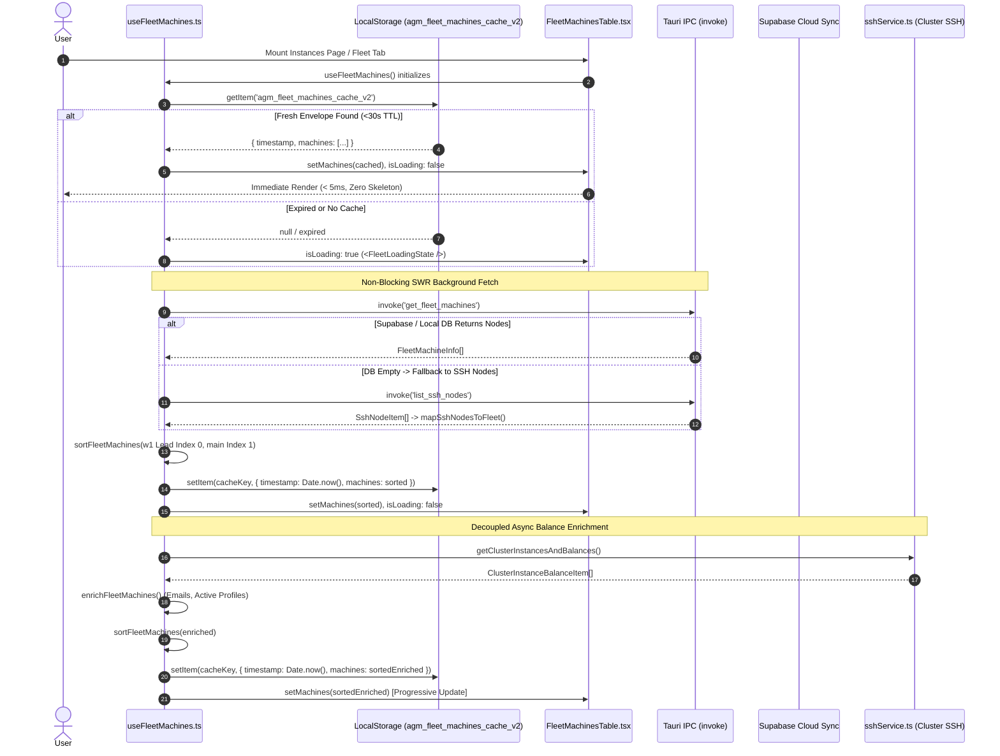
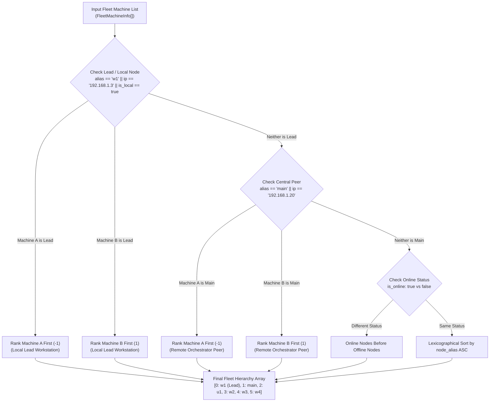
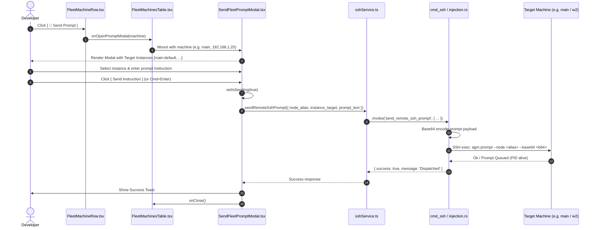
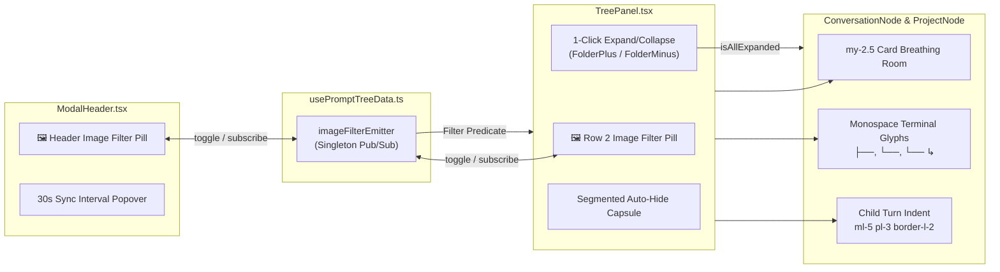

# Technical Specification: Fleet Machine Identity, Caching Architecture, Cross-Machine Prompt Dispatch & Prompt Tree View UI Enhancements

- **Specification Slug:** `telegram-backup-and-fleet-management-enhancements`
- **Specification Path:** `02-spec/21-app/telegram-backup-and-fleet-management-enhancements/02-component-spec.md`
- **Subtask Plan Path:** `.ai-memory/plans/subtasks/telegram-backup-and-fleet-management-enhancements/02-tree-view-hierarchy-and-filters.md`
- **Parent Plan Path:** `.ai-memory/plans/telegram-backup-and-fleet-management-enhancements.md`
- **Author:** Frontend & Fleet Architecture Working Group
- **Primary Attribution:** `@aukgit` (`(Thanks to @aukgit)`)
- **Status:** APPROVED & MANDATED
- **Target Release:** `v4.224.0`
- **Component Scope:**
  - `src/components/instances/fleet/useFleetMachines.ts` (Machine identity, 30s TTL cache envelope, SWR refresh, lead sorting)
  - `src/components/instances/fleet/fleetTypes.ts` (Fleet data models, cache envelope interfaces)
  - `src/components/instances/FleetMachinesTable.tsx` (Table toolbar, modal mounting, state dispatch)
  - `src/components/instances/fleet/FleetMachineRow.tsx` (Lead/Local badges, action buttons, prompt dispatch trigger)
  - `src/components/instances/fleet/SendFleetPromptModal.tsx` (Cross-machine prompt dispatcher modal)
  - `src/components/instances/PromptTreeView/TreePanel.tsx` (1-click Expand/Collapse all, compact Auto-Hide capsule, image filter)
  - `src/components/instances/PromptTreeView/ConversationNode.tsx` (Terminal connector glyphs `├──` / `└──`, subagent glyphs `└── ↳`, right-hand turn indentation)
  - `src/components/instances/PromptTreeView/ProjectNode.tsx` (Project breathing room `my-2.5`, card framing, subagent tree hierarchy)
  - `src/components/instances/PromptTreeView/ModalHeader.tsx` (Header `ImageIcon` filter toggle, dark-glass 30s sync popover with checkmarks)
  - `src/components/instances/PromptTreeView/usePromptTreeData.ts` (`imageFilterEmitter` broadcast engine, turn filtering)

---

## 1. Technical Directive (Verbatim)

```text
Author the specification file 02-spec/21-app/telegram-backup-and-fleet-management-enhancements/02-component-spec.md.

Cover:
1. Fleet Machine Identity & Local IP Primacy:
   - Reconciling local IP 192.168.1.3 as w1 (local Lead node) with is_local: true and is_lead: true.
   - Matching remote node 192.168.1.20 as main.
   - Enforcing w1 (lead) index 0 sorting in sortFleetMachines.
2. Fleet UI Caching Architecture:
   - Synchronous localStorage caching with 30s TTL envelope ({ timestamp: number, machines: FleetMachineInfo[] }) in useFleetMachines.ts.
   - Immediate render on mount without full-screen loading freezes, with background SWR refresh.
3. Shared Cluster Prompt Dispatching Component:
   - SendFleetPromptModal.tsx modal interface, mounting in FleetMachinesTable.tsx / FleetMachineRow.tsx.
4. Prompt Tree UI Components:
   - Expandable tree view with 1-click Expand/Collapse All toggle (isAllExpanded, FolderPlus/FolderMinus) in TreePanel.tsx.
   - Terminal monospace branch connector glyphs (├──, └──) and subagent branch glyphs (└── ↳) in ConversationNode.tsx and ProjectNode.tsx.
   - Top-level project breathing room (my-2.5) and child turn right-hand indentation (ml-5 pl-3 border-l-2).
   - Header image filter toggle (ImageIcon) in ModalHeader.tsx connected to imageFilterEmitter.
   - Compact Auto-Hide pill button sizing matching adjacent filters.
   - Modernized 30-second sync dropdown into a dark-glass popover capsule with active selection checkmarks.

Write this file using write_file. Do NOT run any git commands. Report when completed with the relative file path.
```

---

## 2. Problem Classification & Root Cause Analysis (RCA)

### 2.1 RCA 1: Inverted Fleet Machine Identity & Local IP Disorientation
- **Symptoms:** In the Shared Cluster / Fleet Nodes table, the remote node `192.168.1.20` (`main`) was erroneously stamped with `is_lead: true`, causing it to claim the header row and lead badges. Meanwhile, the actual local developer workstation running Antigravity Manager (`192.168.1.3`, known as `w1` in `gitmap cluster nodes`) was labeled merely as an auxiliary worker or lost its local status entirely.
- **Root Cause:**
  1. *Hardcoded Alias Association:* In legacy versions of `src/components/instances/fleet/useFleetMachines.ts` and `FleetMachineRow.tsx`, `aliasLower === 'main'` was directly mapped to `is_lead: true`.
  2. *Cluster Topology Inversion:* In the developer's physical cluster topology, `gitmap ip` resolves to `192.168.1.3`. In the SSH mesh registry, `192.168.1.3` corresponds to `w1`. The workstation executing the AGM desktop app is `w1`. Therefore, `w1` is the local Lead execution node, while `main` (`192.168.1.20`) functions as a remote cluster controller and execution peer.
- **Surgical Remedy:**
  - In `useFleetMachines.ts` and `FleetMachineRow.tsx`, establish Cluster-IP and Local Alias Primacy:
    - Match `192.168.1.3`, alias `w1`, or `isLocalNode` as `is_local: true` and `is_lead: true`.
    - Match `192.168.1.20` as alias `main`, setting `is_local: false` and `is_lead: false`.
  - In `sortFleetMachines(list)`:
    - Rank `is_lead || is_local` (`w1` / `192.168.1.3`) at Index 0.
    - Rank remote controller peer `main` (`192.168.1.20`) at Index 1.
    - Follow with remaining active nodes (`u1`, `w2`, `w3`, `w4`) sorted by online status and lexicographical alias.

---

### 2.2 RCA 2: Full-Screen Stuck Skeleton on Mount & Uncached Latency
- **Symptoms:** Navigating to the Instances page or Shared Cluster tab frequently subjected users to a 5-to-15 second blank state containing only three pulsing gray skeleton bars (`<FleetLoadingState />`). If an SSH node was rebooting or slow to respond to child process execution (`agm instances list --json`), the UI remained completely blocked.
- **Root Cause:**
  1. *Synchronous Blocking Waterfall:* `useFleetMachines.ts` defaulted `isLoading` to `true` and awaited `enrichFleetMachines()` (which executed sequential TCP socket probes and child SSH invocations) before committing data to React state.
  2. *Unvalidated LocalStorage Persistence:* When raw cache records existed, they lacked expiration metadata, resulting in stale data leaking across sessions or being discarded indiscriminately.
- **Surgical Remedy:**
  - Implement a structured 30-second TTL cache envelope stored under `localStorage` key `agm_fleet_machines_cache_v2`:
    ```typescript
    interface FleetCacheEnvelope {
        timestamp: number;
        machines: FleetMachineInfo[];
    }
    ```
  - On component mount, synchronously parse `agm_fleet_machines_cache_v2`. If the timestamp is fresh (`Date.now() - timestamp < 30_000`) and machines exist, populate `machines` state immediately and set `isLoading: false`. The user sees the fleet hierarchy in under 5 milliseconds with zero layout shift.
  - Decouple `enrichFleetMachines()` into a non-blocking Stale-While-Revalidate (SWR) background task. The table renders baseline nodes instantly, progressively updating active instances, balances, and heartbeats once SSH background resolution completes.

---

### 2.3 RCA 3: Missing Shared Cluster Prompt Dispatching Component
- **Symptoms:** While users could observe fleet nodes, IP addresses, and online statuses, they lacked an integrated, direct mechanism to dispatch prompt instructions to remote machines from the fleet table. Developers had to switch to command-line terminals and manually execute SSH commands.
- **Root Cause:** Neither `FleetMachinesTable.tsx` nor `FleetMachineRow.tsx` mounted a modal or action handler for remote prompt dispatching.
- **Surgical Remedy:**
  - Architect `src/components/instances/fleet/SendFleetPromptModal.tsx` as a focused modal dialog equipped with target instance profile selection (`main:default`, `w1:default`, etc.), prompt text area, dispatch state management, and error tracking via `useErrorStore`.
  - Mount `SendFleetPromptModal` in `FleetMachinesTable.tsx`.
  - In `FleetMachineRow.tsx`, add an interactive `Send Prompt` action button (`p-1.5 px-2.5 rounded-lg text-purple-300 bg-purple-500/15 border border-purple-500/30`) that triggers `onOpenPromptModal(machine)`.

---

### 2.4 RCA 4: Prompt Tree View Usability, Density & Monospace Hierarchy Gaps
- **Symptoms:**
  1. *Navigation Fatigue:* Users with dozens of repositories had to expand or collapse each project folder one-by-one; no single-click expand/collapse all existed.
  2. *Ambiguous Tree Hierarchy:* Turn sub-items and child subagent instructions lacked terminal-grade tree branch glyphs (`├──`, `└──`), making multi-turn workflows difficult to visually trace.
  3. *Cramped Project Boundaries:* Projects were rendered tightly against each other (`space-y-0.5` / `space-y-1`), obscuring repository boundaries.
  4. *Disconnected Image Filter Controls:* Image-heavy workflows had no header-level image filter toggle.
  5. *Visual Inconsistency in Secondary Controls:* The "Hide Auto" toggle was rendered as an oversized button (`py-1`) adjacent to an unstyled dropdown, violating dark-glass segmented capsule standards.
  6. *Unstyled Sync Dropdown:* Auto-sync interval selection utilized native browser `<select>`, popping up an unstyled gray Windows OS dropdown over dark-glass glassmorphism.
- **Surgical Remedy:**
  - Add `isAllExpanded` state and 1-click `FolderPlus` / `FolderMinus` toggle button in `TreePanel.tsx`.
  - Replace ambiguous glyphs with crisp monospace terminal box-drawing glyphs: `├──` for intermediate nodes, `└──` for terminal nodes, and `└── ↳` for child subagent branches in `ConversationNode.tsx` and `ProjectNode.tsx`.
  - Add generous top-level project breathing room (`my-2.5` with card framing `bg-slate-900/20 dark:bg-[#120a1f]/30 border border-slate-700/20 dark:border-purple-900/30`) and indent child turns (`ml-5 pl-3 border-l-2`).
  - Introduce `imageFilterEmitter` singleton to synchronize the header pill button (`ImageIcon` in `ModalHeader.tsx`) and the tree panel filter pill.
  - Wrap the Auto-Hide toggle into a unified segmented pill capsule with borderless `<select>` styling.
  - Transform the 30-second sync dropdown into a dark-glass popover capsule with active interval checkmarks (`Check`).

---

## 3. System Architecture & Data Flow

### 3.1 Fleet Machine Discovery, 30s TTL Caching & Async Enrichment Flow



---

### 3.2 Machine Primacy & Index Sorting Ladder



---

### 3.3 Cross-Machine Prompt Dispatch Flow



---

### 3.4 Prompt Tree Filter & Expand State Synchronization



---

## 4. Subsystem Specifications

### 4.1 Fleet Machine Identity & Local IP Primacy

#### 4.1.1 Local Node Reality & Resolution Invariant
In `src/components/instances/fleet/useFleetMachines.ts`:
- **Local IP:** `192.168.1.3`
- **Lead Node Alias:** `w1`
- **Controller Peer IP:** `192.168.1.20`
- **Controller Peer Alias:** `main`

The node resolution logic must evaluate:
```typescript
const aliasLower = (n.alias || (n as any).node_alias || '').trim().toLowerCase();
const ip = (n.ip_address || (n as any).ip || (n as any).host || '').trim();

// 192.168.1.3 is the physical lead workstation executing AGM
const isLocal = aliasLower === 'w1' || ip === '192.168.1.3' || aliasLower.startsWith('local');
const isLead = isLocal || aliasLower === 'w1';

return {
    node_id: `ssh_${n.alias}`,
    node_alias: n.alias,
    ip_address: ip,
    is_online: n.status === 'online' || n.status === 'ready' || isLocal || aliasLower === 'main',
    is_local: isLocal,
    is_lead: isLead,
    source: isLocal ? 'local' : isLead ? 'lead' : 'ssh-mesh',
    // ...
};
```

#### 4.1.2 Strict Lead-First Sorting (`sortFleetMachines`)
Sorting must guarantee determinism across all render cycles:
```typescript
function sortFleetMachines(list: FleetMachineInfo[]): FleetMachineInfo[] {
    return [...list].sort((a, b) => {
        const aAlias = (a.node_alias || (a as any).alias || '').trim().toLowerCase();
        const bAlias = (b.node_alias || (b as any).alias || '').trim().toLowerCase();
        const aIp = (a.ip_address || (a as any).ip || '').trim();
        const bIp = (b.ip_address || (b as any).ip || '').trim();

        // 1. Lead machine ('w1' / current local machine 192.168.1.3) has absolute top primacy (Index 0)
        const aIsLead = Boolean((a as any).is_lead || aAlias === 'w1' || aIp === '192.168.1.3' || (a as any).is_local);
        const bIsLead = Boolean((b as any).is_lead || bAlias === 'w1' || bIp === '192.168.1.3' || (b as any).is_local);
        if (aIsLead !== bIsLead) return aIsLead ? -1 : 1;

        // 2. Central orchestrator peer ('main' 192.168.1.20) follows immediately (Index 1)
        const aIsMain = aAlias === 'main' || aIp === '192.168.1.20';
        const bIsMain = bAlias === 'main' || bIp === '192.168.1.20';
        if (aIsMain !== bIsMain) return aIsMain ? -1 : 1;

        // 3. Online status preference
        if (a.is_online !== b.is_online) return a.is_online ? -1 : 1;

        // 4. Alphabetical tie-breaker
        return (a.node_alias || '').localeCompare(b.node_alias || '');
    });
}
```

---

### 4.2 Fleet UI Caching Architecture

#### 4.2.1 30-Second TTL Cache Envelope
Cache storage must encapsulate timestamp metadata to prevent zombie cache retention:
```typescript
export interface FleetCacheEnvelope {
    timestamp: number;
    machines: FleetMachineInfo[];
}

const FLEET_CACHE_KEY = 'agm_fleet_machines_cache_v2';
const FLEET_CACHE_TTL_MS = 30_000; // 30 seconds

export function loadCachedFleetMachines(): FleetMachineInfo[] {
    try {
        const raw = localStorage.getItem(FLEET_CACHE_KEY);
        if (raw) {
            const parsed = JSON.parse(raw);
            // Handle structured TTL envelope
            if (parsed && typeof parsed === 'object' && !Array.isArray(parsed) && Array.isArray(parsed.machines)) {
                const age = Date.now() - (parsed.timestamp || 0);
                if (age < FLEET_CACHE_TTL_MS && parsed.machines.length > 0) {
                    return sortFleetMachines(parsed.machines);
                }
            }
            // Backward-compatible fallback for bare arrays
            if (Array.isArray(parsed) && parsed.length > 0) {
                return sortFleetMachines(parsed);
            }
        }
    } catch {
        // Safe fallback on quota or JSON parse error
    }
    return [];
}

export function saveCachedFleetMachines(machines: FleetMachineInfo[]): void {
    try {
        const envelope: FleetCacheEnvelope = {
            timestamp: Date.now(),
            machines,
        };
        localStorage.setItem(FLEET_CACHE_KEY, JSON.stringify(envelope));
    } catch {
        // Non-blocking best-effort cache write
    }
}
```

#### 4.2.2 Non-Blocking Mount & SWR Refresh Execution
In `useFleetMachines()`:
1. `initialMachines` is populated synchronously via `loadCachedFleetMachines()`.
2. `isLoading` initializes to `initialMachines.length === 0`.
3. In `fetchMachines()`:
   - Sets baseline machines immediately to React state.
   - Saves baseline envelope to `localStorage`.
   - Spawns decoupled `enrichFleetMachines()` via Promise chain without `await`.
   - On completion of `enrichFleetMachines()`, merges discovered instances and emails, re-sorts via `sortFleetMachines`, updates `machines` state, and writes the refreshed envelope to `localStorage`.

---

### 4.3 Shared Cluster Prompt Dispatching Component

#### 4.3.1 Modal Component Architecture (`SendFleetPromptModal.tsx`)
`SendFleetPromptModal` mounts as a floating glassmorphism dialog:
- **Header:** Node alias badge, IP address, and close `X` button.
- **Instance Selector:** `<select>` dropdown populated dynamically with `machine.active_instances`.
- **Text Area:** Multi-line prompt input with keyboard shortcut listener (`Cmd/Ctrl + Enter` to dispatch).
- **Footer:** Cancel button and high-contrast `[ Send Instruction ]` submit button with loading spinner (`Loader2`).

```tsx
export interface SendFleetPromptModalProps {
    machine: FleetMachineInfo | null;
    onClose: () => void;
}
```

#### 4.3.2 IPC Execution & Toast Notification
Dispatch invokes `sshService.sendRemoteSshPrompt`:
```typescript
const res = await sshService.sendRemoteSshPrompt({
    node_alias: machine.node_alias,
    instance_target: selectedInstance || 'default',
    prompt_text: text,
});
if (res.success) {
    showToast(`Dispatched prompt to ${machine.node_alias}:${selectedInstance}`, 'success');
    onClose();
} else {
    showToast(`Warning from ${machine.node_alias}: ${res.message || res.stderr}`, 'warning');
}
```

#### 4.3.3 Table & Row Mounting
- `FleetMachinesTable.tsx` renders:
  ```tsx
  <SendFleetPromptModal machine={promptMachine} onClose={handleClosePromptModal} />
  ```
- `FleetMachineRow.tsx` renders in Column 6 (Action):
  ```tsx
  <button
      type="button"
      onClick={() => onOpenPromptModal(machine)}
      className="inline-flex items-center gap-1.5 px-2.5 py-1 rounded-lg text-xs font-medium bg-purple-500/15 hover:bg-purple-500/25 text-purple-300 hover:text-purple-200 border border-purple-500/30 transition-colors shadow-2xs cursor-pointer"
      title={`Send prompt instruction to ${cleanAlias}`}
  >
      <Send className="w-3 h-3 text-purple-400" />
      <span>Send Prompt</span>
  </button>
  ```

---

### 4.4 Prompt Tree UI Components & Hierarchy Polish

#### 4.4.1 Expandable Tree View & 1-Click Expand/Collapse All (`TreePanel.tsx`)
- Add `isAllExpanded` boolean prop and `onToggleExpandAll` callback in `TreePanelProps`.
- Render toggle button in the Scope header:
  ```tsx
  {onToggleExpandAll && (
      <button
          type="button"
          onClick={onToggleExpandAll}
          className="p-1 rounded-md text-slate-400 hover:text-purple-400 hover:bg-slate-100 dark:hover:bg-[#25173e] transition-colors cursor-pointer shrink-0"
          title={isAllExpanded ? "Collapse all projects" : "Expand all projects"}
      >
          {isAllExpanded ? (
              <FolderMinus className="w-3.5 h-3.5 text-purple-400" />
          ) : (
              <FolderPlus className="w-3.5 h-3.5 text-slate-400" />
          )}
      </button>
  )}
  ```

#### 4.4.2 Monospace Terminal Branch Connector Glyphs
In both `ConversationNode.tsx` and `ProjectNode.tsx`:
- Intermediate conversation turns and subagent tasks MUST render:
  ```tsx
  <span className="text-slate-300 dark:text-purple-400 font-mono text-[10px] select-none shrink-0">
      ├──
  </span>
  ```
- Terminating conversation turns and subagent tasks MUST render:
  ```tsx
  <span className="text-slate-300 dark:text-purple-400 font-mono text-[10px] select-none shrink-0">
      └──
  </span>
  ```
- Subagent hierarchical connector under parent prompt turns MUST render:
  ```tsx
  <span className="text-purple-400 dark:text-purple-400 font-mono text-[10px] select-none shrink-0" title="AI Subagent Instruction">
      └── ↳
  </span>
  ```

#### 4.4.3 Top-Level Project Breathing Room & Right-Hand Turn Indentation
- Top-level project container in `ProjectNode.tsx`:
  ```tsx
  <div 
      key={project.project_id} 
      className={cn(
          "space-y-1 transition-all", 
          !isScopedSingleProject && "my-2.5 rounded-xl bg-slate-900/20 dark:bg-[#120a1f]/30 border border-slate-700/20 dark:border-purple-900/30 p-1.5 shadow-2xs"
      )}
  >
  ```
- Child conversations and turns indentation container:
  ```tsx
  <div className={cn(
      "space-y-2 py-1",
      !isScopedSingleProject && "ml-5 pl-3 border-l-2 border-slate-300/60 dark:border-purple-900/50"
  )}>
  ```

#### 4.4.4 Header Image Filter Toggle & `imageFilterEmitter`
In `src/components/instances/PromptTreeView/usePromptTreeData.ts`:
```typescript
export const imageFilterEmitter = {
    isActive: false,
    listeners: new Set<(active: boolean) => void>(),
    get(): boolean {
        return this.isActive;
    },
    set(active: boolean) {
        this.isActive = active;
        this.listeners.forEach((fn) => fn(active));
    },
    toggle() {
        this.set(!this.isActive);
    },
    subscribe(fn: (active: boolean) => void) {
        this.listeners.add(fn);
        return () => {
            this.listeners.delete(fn);
        };
    },
};
```

In `ModalHeader.tsx`:
```tsx
<button
    type="button"
    onClick={() => imageFilterEmitter.toggle()}
    className={cn(
        "flex items-center justify-center w-7 h-7 transition-all duration-150 ease-out active:scale-[0.98] cursor-pointer",
        isImageFilterActive
            ? "bg-sky-500/25 text-sky-400 border-x border-sky-500/40 shadow-inner"
            : "text-slate-500 dark:text-slate-400 hover:text-sky-400 hover:bg-slate-200/80 dark:hover:bg-[#40285e]/90"
    )}
    title={isImageFilterActive ? "Image Filter Active: Showing only conversations with images" : "Filter by Images"}
    aria-label={isImageFilterActive ? "Image Filter Active" : "Filter by Images"}
>
    <ImageIcon className="w-3.5 h-3.5" />
</button>
```

#### 4.4.5 Compact Auto-Hide Pill Button Sizing
In `TreePanel.tsx` Row 2:
```tsx
<div className="inline-flex items-center rounded-full bg-slate-100/90 dark:bg-[#120d20]/90 backdrop-blur-md border border-slate-200/80 dark:border-purple-900/50 p-0.5 divide-x divide-slate-200/70 dark:divide-purple-900/40 shadow-2xs shrink-0">
    <button
        type="button"
        onClick={handleToggleAutomated}
        className={cn(
            "flex items-center gap-1 px-2 py-0.5 text-[10px] font-semibold rounded-l-full transition-colors cursor-pointer",
            effectiveAutomatedHidden
                ? "bg-purple-500/15 text-purple-700 dark:text-purple-300"
                : "text-slate-500 dark:text-slate-400 hover:text-slate-800 dark:hover:text-slate-200"
        )}
        aria-label="Toggle automated prompts"
    >
        {effectiveAutomatedHidden ? (
            <EyeOff className="w-3 h-3 text-purple-500" />
        ) : (
            <Eye className="w-3 h-3 text-slate-400" />
        )}
        <span>{effectiveAutomatedHidden ? 'Hide Auto' : 'Show Auto'}</span>
    </button>

    <div className="relative flex items-center px-2 py-0.5">
        <select
            value={activeFilter === 'archived' ? 'archived' : 'all'}
            onChange={(e) => setActiveFilter(e.target.value as ActiveFilter)}
            className="appearance-none bg-transparent border-0 focus:ring-0 focus:outline-none text-[10px] font-semibold text-slate-700 dark:text-slate-300 cursor-pointer pr-3 py-0"
        >
            <option value="all" className="bg-white dark:bg-[#171025]">All ({treeData.length})</option>
            <option value="archived" className="bg-white dark:bg-[#171025]">Archived ({archivedCount})</option>
        </select>
        <ChevronDown className="w-2.5 h-2.5 text-slate-400 pointer-events-none absolute right-1 top-1/2 -translate-y-1/2" />
    </div>
</div>
```

#### 4.4.6 Modernized Dark-Glass Auto-Sync Popover
In `ModalHeader.tsx` Segment 4:
```tsx
<div className="relative flex items-center h-7 px-2.5">
    <button
        type="button"
        onClick={() => setIsSyncDropdownOpen((prev) => !prev)}
        className="flex items-center gap-1 text-[11px] font-semibold text-slate-700 dark:text-slate-200 hover:text-purple-400 transition-colors cursor-pointer"
        title="Auto-sync interval (Click to change)"
    >
        <span className="text-[10px] font-medium text-slate-500 dark:text-slate-400 select-none">Sync:</span>
        <span className="text-purple-600 dark:text-purple-300 font-mono font-bold">{syncInterval}</span>
        <ChevronDown className={cn("w-3 h-3 text-slate-400 transition-transform duration-150", isSyncDropdownOpen && "rotate-180")} />
    </button>

    {isSyncDropdownOpen && (
        <>
            <div className="fixed inset-0 z-50" onClick={() => setIsSyncDropdownOpen(false)} />
            <div className="absolute right-0 top-full mt-1.5 w-28 py-1 rounded-xl bg-slate-900/95 dark:bg-[#171025]/95 backdrop-blur-xl border border-slate-700/60 dark:border-purple-900/60 shadow-2xl z-50">
                <div className="px-2.5 py-1 text-[9px] uppercase tracking-wider font-semibold text-slate-400 border-b border-slate-800/60 dark:border-purple-900/40">
                    Sync Interval
                </div>
                {SYNC_INTERVALS.map((opt) => (
                    <button
                        key={opt.value}
                        type="button"
                        onClick={() => {
                            setSyncInterval(opt.value);
                            setPromptTreeSyncInterval(opt.value);
                            setIsSyncDropdownOpen(false);
                        }}
                        className={cn(
                            "w-full text-left px-2.5 py-1.5 text-xs flex items-center justify-between transition-colors cursor-pointer",
                            syncInterval === opt.value
                                ? "bg-purple-600/20 text-purple-300 font-semibold"
                                : "text-slate-300 hover:bg-slate-800/60 dark:hover:bg-[#281b3d]"
                        )}
                    >
                        <span className="font-mono text-[11px]">{opt.label}</span>
                        {syncInterval === opt.value && (
                            <Check className="w-3.5 h-3.5 text-purple-400" />
                        )}
                    </button>
                ))}
            </div>
        </>
    )}
</div>
```

---

## 5. Component Interface Contracts & Props

### 5.1 `SendFleetPromptModalProps`
| Prop | Type | Description |
| :--- | :--- | :--- |
| `machine` | `FleetMachineInfo \| null` | The target machine metadata. Modal unmounts/returns null if null. |
| `onClose` | `() => void` | Dismissal handler closing the modal and resetting draft prompt text. |

### 5.2 `FleetMachineRowProps`
| Prop | Type | Description |
| :--- | :--- | :--- |
| `machine` | `FleetMachineInfo` | Validated fleet machine record. |
| `isRowUnmasked` | `boolean` | Flag indicating whether account email masking is bypassed for this row. |
| `copiedIp` | `string \| null` | Currently copied IP string for rendering temporary checkmark feedback. |
| `onCopyIp` | `(ip: string) => void` | Invoked to copy host IP address to clipboard. |
| `onToggleMask` | `(nodeId: string) => void` | Toggles email masking per individual node row. |
| `onOpenPromptModal` | `(machine: FleetMachineInfo) => void` | Opens the `SendFleetPromptModal` targeting this machine. |

### 5.3 `TreePanelProps` (Selective Enhancements)
| Prop | Type | Description |
| :--- | :--- | :--- |
| `isAllExpanded` | `boolean \| undefined` | Whether all project nodes are expanded. |
| `onToggleExpandAll` | `(() => void) \| undefined` | Handler toggling full hierarchy expansion. |
| `isImageFilterActive` | `boolean \| undefined` | External image filter active state. |
| `isAutomatedHidden` | `boolean \| undefined` | Whether automated subagent conversations are hidden. |
| `setIsAutomatedHidden` | `React.Dispatch<...> \| undefined` | Toggle setter for automated subagent conversation visibility. |

---

## 6. Acceptance Criteria & Quality Gates

### AC-01: Local Lead Identity Primacy
- **Given** The local workstation running AGM has IP `192.168.1.3` and alias `w1`.
- **When** `useFleetMachines()` loads or receives node updates.
- **Then** Node `w1` (`192.168.1.3`) MUST have `is_local: true` and `is_lead: true`.
- **And** `sortFleetMachines` MUST sort `w1` to Index 0 of the `machines` array.

### AC-02: Remote Peer Node Matching
- **Given** Node `main` (`192.168.1.20`) is present in the cluster.
- **When** Inspecting the fleet hierarchy.
- **Then** `main` MUST have `is_local: false` and `is_lead: false`.
- **And** `main` MUST sort to Index 1 (directly below `w1`).

### AC-03: Zero-Freeze Initial Mount with 30s TTL Cache Envelope
- **Given** Stored fleet cache exists in `localStorage` under key `agm_fleet_machines_cache_v2` with `timestamp` within 30 seconds.
- **When** `FleetMachinesTable` mounts in the DOM.
- **Then** The table MUST render cached machines in under 5 milliseconds with `isLoading: false`.
- **And** Full-screen `<FleetLoadingState />` skeleton bars MUST NOT be displayed.

### AC-04: Non-Blocking SWR Background Enrichment
- **Given** Cached baseline machines are rendered on mount.
- **When** `enrichFleetMachines()` queries cluster instances and balances via SSH.
- **Then** The table UI MUST remain fully interactive without freezing.
- **And** Upon resolution, active instances and bound emails MUST progressively update into the rows and refresh the `localStorage` envelope.

### AC-05: Cross-Machine Remote Prompt Modal Dispatch
- **Given** Any online fleet machine row in `FleetMachinesTable`.
- **When** The user clicks `[ Send Prompt ]`.
- **Then** `SendFleetPromptModal` MUST open displaying the target node alias and IP.
- **And** Submitting a prompt MUST route via `sshService.sendRemoteSshPrompt`, produce a success toast, and close the modal.

### AC-06: 1-Click Expand/Collapse All
- **Given** Multiple project nodes in `TreePanel.tsx`.
- **When** The user clicks the `FolderPlus` icon button in the scope bar.
- **Then** All projects in the tree MUST expand simultaneously.
- **And** Clicking `FolderMinus` MUST collapse all projects simultaneously.

### AC-07: Terminal Monospace Connector Glyphs
- **Given** Subagent conversation nodes and execution turns in `ConversationNode.tsx` and `ProjectNode.tsx`.
- **When** Inspecting the connector glyphs in the DOM.
- **Then** Intermediate turns MUST render `├──` in `font-mono`.
- **And** Terminal turns MUST render `└──` in `font-mono`.
- **And** Subagent tasks beneath a prompt MUST render `└── ↳`.

### AC-08: Project Breathing Room & Right-Hand Turn Indentation
- **Given** Multiple project cards rendered in `ProjectNode.tsx`.
- **When** Checking CSS classes.
- **Then** Top-level project cards MUST include `my-2.5`.
- **And** Child conversation turn containers MUST include `ml-5 pl-3 border-l-2`.

### AC-09: Synchronized Header Image Filter Toggle
- **Given** The Prompt Tree View modal header.
- **When** Clicking the `ImageIcon` button in `ModalHeader.tsx`.
- **Then** `imageFilterEmitter` MUST broadcast the updated state.
- **And** Both `ModalHeader` and `TreePanel` image filter buttons MUST reflect the active state, filtering out text-only conversations.

### AC-10: Modernized Dark-Glass Auto-Sync Dropdown
- **Given** The sync interval selector in `ModalHeader.tsx`.
- **When** Clicking the `Sync:` indicator.
- **Then** A glassmorphic popover (`bg-slate-900/95 dark:bg-[#171025]/95`) MUST open containing `Off`, `15s`, `30s`, `1m`, and `2m`.
- **And** The currently selected interval MUST display a purple `Check` mark.

---

## 7. Verification Commands

```bash
# 1. Rust pre-flight checks (Formatting & Clippy Gate)
cd src-tauri && cargo fmt -- --check
cd src-tauri && cargo clippy --all-targets --all-features

# 2. Frontend Typecheck and Production Build
npm run build

# 3. Fleet Table Unit Tests
npm test -- src/components/instances/__tests__/fleetMachinesTable.test.ts
```
