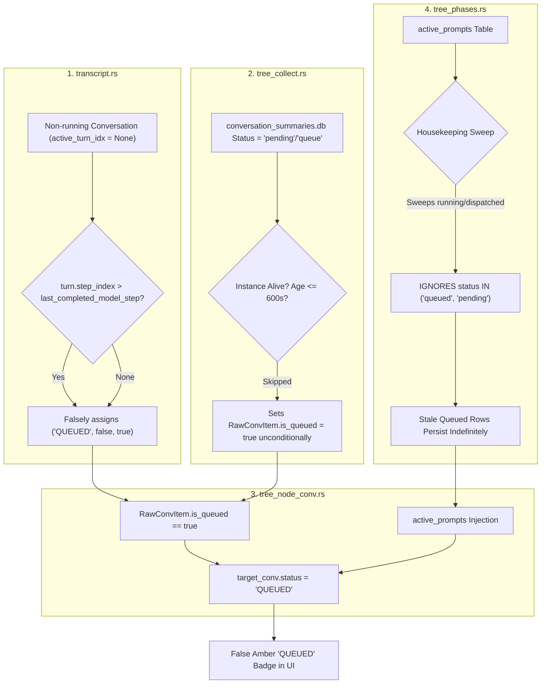
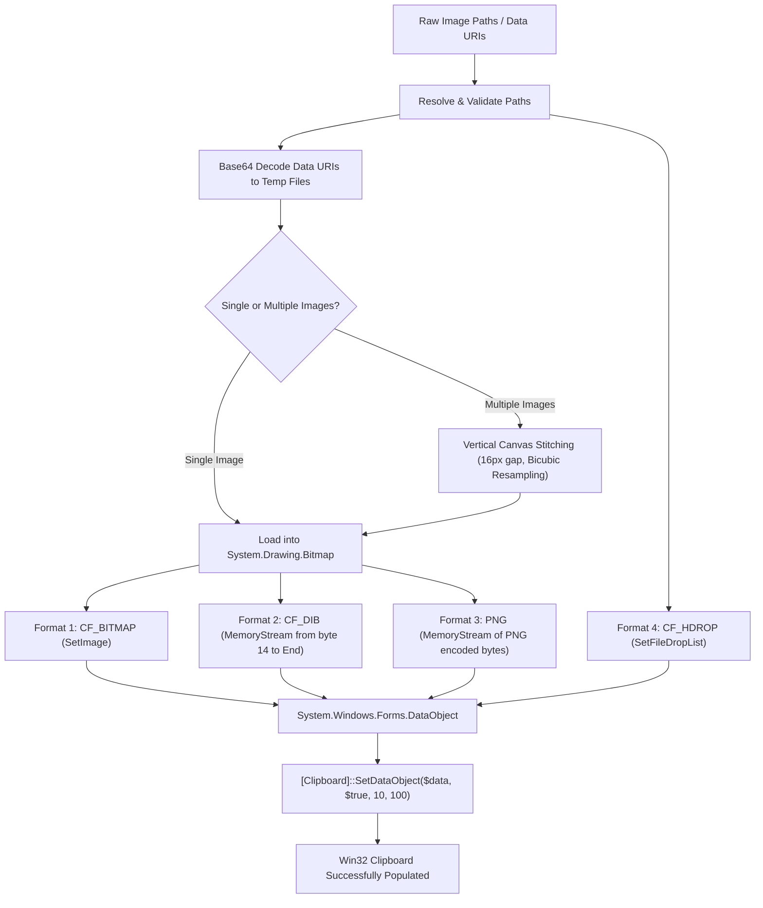
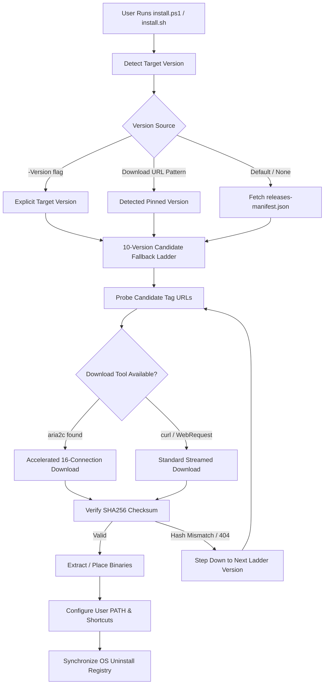
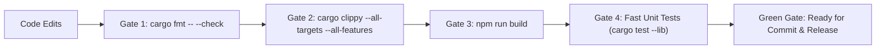

# Technical Specification: Migration, False QUEUED Status Elimination, Multi-Format Win32 Clipboard, Cross-Platform Installers, and Release Verification Gates

- **Specification Slug:** `telegram-backup-and-fleet-management-enhancements`
- **Specification Path:** `02-spec/21-app/telegram-backup-and-fleet-management-enhancements/03-migration-and-verification-spec.md`
- **Subtask Plan Path:** `.ai-memory/plans/subtasks/telegram-backup-and-fleet-management-enhancements/03-telegram-backup-image-copy-and-controls.md`
- **Parent Plan Path:** `.ai-memory/plans/telegram-backup-and-fleet-management-enhancements.md`
- **Author:** System Architecture & Fleet Verification Working Group
- **Status:** APPROVED & MANDATED

---

## 1. Executive Summary & Problem Classification

This specification defines the comprehensive architecture, diagnostic analysis, implementation contracts, and verification protocols for four foundational subsystems in Antigravity-Manager:

1. **Elimination of False `QUEUED` Status Badges**:
   - *Problem*: Conversations and individual prompt turns frequently displayed a bright amber `QUEUED` badge despite the associated instance being stopped, idle, or completely finished. Furthermore, completed turns in non-running conversations were falsely categorized as `QUEUED`, and stale queued records in SQLite `active_prompts` persisted indefinitely.
   - *Root Cause*: Four interrelated defects spanned `transcript.rs`, `tree_collect.rs`, `tree_node_conv.rs`, and `tree_phases.rs`, where inactive conversations defaulted uncompleted turns to queued, SQLite database status strings were accepted without OS process liveness or TTL guards, and stale queue sweeping was omitted from periodic housekeeping.
   - *Solution*: Enforce strict OS process liveness checks and a 600-second TTL window across all queue-marking branches, invert non-running transcript turn defaults from `QUEUED` to `COMPLETED`/`IDLE`, and expand `tree_phases.rs` stale sweeps to automatically transition aged queued/in-flight rows to `completed`.

2. **Multi-Image Composite PNG Clipboard Engine & Office Verification**:
   - *Problem*: Multi-image composite copying failed inside Microsoft OneNote, Microsoft Word, Microsoft Paint, and Google Antigravity IDE due to missing or malformed Win32 clipboard formats, WebView2 canvas CORS tainting, and transient clipboard locks.
   - *Solution*: A native Win32 OLE multi-format clipboard engine that populates `CF_BITMAP`, a non-zero length `CF_DIB` (with stripped 14-byte `BITMAPFILEHEADER`), compressed registered `PNG`, and `CF_HDROP` (file drop list). The engine features a 10-retry Windows Forms lock-handling overload, base64 IPC transcoding to eliminate canvas tainting, and strict canvas dimension bounding.

3. **Cross-Platform Portable Installer Architecture (`install.ps1` & `install.sh`)**:
   - *Problem*: Direct downloads of release binaries can fail due to GitHub API rate limiting, network interruptions, CDN lag, or transient 404s during in-flight release publication.
   - *Solution*: A decoupled 10-version fallback ladder querying `releases-manifest.json` and fallback tag arrays, accelerated 16-connection downloads via `aria2c` (with seamless curl/WebRequest fallbacks), SHA256 checksum verification, safe binary placement (`$env:LOCALAPPDATA\Programs\Antigravity-Tools` on Windows, `~/.local/bin` on POSIX), automatic PATH integration, and Windows Add/Remove Programs registry synchronization.

4. **Pre-flight Quality Gates, Sandboxing & Release Verification**:
   - *Protocol*: Enforces mandatory pre-flight checks (`cargo fmt`, `cargo clippy --all-targets --all-features`, `npm run build`), Zero-CI Quarantine isolation for heavy integration tests, caller IDE self-preservation (`detect_caller_instance_id()`), transient test sandbox lifecycles (`agm instances test-create/clean`), and telemetry monitoring via `gitmap pe -t`.

---

## 2. Elimination of False `QUEUED` Status Badges

### 2.1 Detailed Root Cause Analysis (RCA)

A forensic investigation into the prompt tree rendering pipeline revealed that false `QUEUED` status badges originated from a chain of four uncoordinated components:



#### Defect 1: Inverted Non-Running Turn Fallback in `src-tauri/src/modules/repo_db/transcript.rs`
In `extract_conversation_prompt_turns()`:
- When a conversation is not currently running (`is_conv_running == false`), `active_turn_idx` resolves to `None`.
- Under the `None` branch:
  ```rust
  None => {
      let is_beyond_last_completed = match last_completed_model_step_idx {
          Some(last_comp) => turn.step_index > last_comp,
          None => true,
      };
      if is_beyond_last_completed {
          ("QUEUED".to_string(), false, true) // <-- DEFECT: False QUEUED assignment
      } else {
          ("COMPLETED".to_string(), false, false)
      }
  }
  ```
- *Mechanism*: If an agent completed its turn or halted without emitting an explicit terminal `PLANNER_RESPONSE` done marker, or if a user entered a single-turn query that finished, `turn.step_index > last_comp` evaluated to `true`. This marked the turn as `QUEUED` with `is_queued: true`. Because `tree_format.rs` and `tree_node_conv.rs` propagate `any_queued` to parent conversation nodes, completely finished conversations were permanently labeled `QUEUED`.

#### Defect 2: Unguarded SQLite Status Acceptance in `src-tauri/src/modules/repo_db/tree_collect.rs`
In `collect_tree_conversation_items()`:
- `conversation_summaries.db` records were queried and mapped:
  ```rust
  const QUEUE_STATUSES: &[&str] = &["queue", "pending"];
  let is_queued = status.has_any_word_ignore_case(QUEUE_STATUSES);
  ```
- *Mechanism*: The status string from SQLite was accepted without checking whether the owning instance was alive (`is_owning_inst_alive`) or whether the last modified timestamp was within an active execution TTL. Old conversations with residual `"pending"` status from days or weeks ago were parsed with `is_queued = true`.

#### Defect 3: Unconditional Propagation in `src-tauri/src/modules/repo_db/tree_node_conv.rs`
In `build_conversation_nodes()`:
- `RawConvItem` entries were converted into `AgmConversationNode`:
  ```rust
  let conv_status = if effective_is_run {
      "RUNNING".to_string()
  } else if item.is_queued {
      "QUEUED".to_string()
  } else if is_idle_status {
      "IDLE".to_string()
  } else {
      item.status.clone()
  };
  ```
- *Mechanism*: If `item.is_queued` was true (due to Defect 1 or Defect 2), `conv_status` became `"QUEUED"`, overriding genuine `"IDLE"` or `"COMPLETED"` statuses.

#### Defect 4: Missing Queued Sweeper in `src-tauri/src/modules/repo_db/tree_phases.rs`
In `transition_stale_inflight_prompts()`:
- The SQL statement only targeted `running`, `in_flight`, and `dispatched` records:
  ```sql
  UPDATE active_prompts
  SET status = 'completed', updated_at = ?1
  WHERE (status IN ('running', 'in_flight') AND updated_at < ?2)
     OR (status = 'dispatched' AND updated_at < ?3)
  ```
- *Mechanism*: If a prompt was added to `active_prompts` with `status = 'queued'` or `'pending'`, and the user closed the IDE or cancelled the operation, that row was **never swept**. On every tree collection cycle, `active_prompts_by_inst_and_path` retrieved the orphaned row, injected it into `target_conv`, and marked the entire conversation and prompt turn as `QUEUED`.

---

### 2.2 Enforcing Active Instance Liveness & 600s TTL Verification

#### The Invariant Formulation
A prompt turn or conversation node may ONLY be declared `QUEUED` if all of the following conditions hold simultaneously:

$$\text{IsQueued} = \text{IsOwningInstanceAlive} \land (\text{Now} - \text{UpdatedAt} \le 600) \land \text{IsPendingStage}$$

Where:
- $\text{IsOwningInstanceAlive}$: The Antigravity IDE process corresponding to the owning instance ID is actively running in the OS process tree (verified via `is_owning_instance_alive()`).
- $\text{Now} - \text{UpdatedAt} \le 600$: The record has been touched within the last 600 seconds (10 minutes). Stale records older than 600s are presumed abandoned.
- $\text{IsPendingStage}$: The prompt status matches `"queued"` or `"pending"`.

#### Contract 1: Inverted Non-Running Fallback in `transcript.rs`
In `src-tauri/src/modules/repo_db/transcript.rs`, update `extract_conversation_prompt_turns`:

```rust
let (status, is_running, is_queued) = match active_turn_idx {
    Some(act_idx) => {
        if idx < act_idx {
            ("COMPLETED".to_string(), false, false)
        } else if idx == act_idx {
            ("RUNNING".to_string(), true, false)
        } else {
            // Turn is beyond current running turn in an actively running conversation
            ("QUEUED".to_string(), false, true)
        }
    }
    None => {
        // Conversation is NOT actively running: turns must NEVER default to QUEUED
        let is_beyond_last_completed = match last_completed_model_step_idx {
            Some(last_comp) => turn.step_index > last_comp,
            None => false, // Default to completed if model step indices are unavailable
        };
        if is_beyond_last_completed && is_conv_running {
            ("QUEUED".to_string(), false, true)
        } else {
            ("COMPLETED".to_string(), false, false)
        }
    }
};
```

#### Contract 2: Liveness & TTL Guard in `tree_collect.rs`
In `src-tauri/src/modules/repo_db/tree_collect.rs`, update raw conversation collection:

```rust
const QUEUE_STATUSES: &[&str] = &["queue", "pending"];
let raw_has_queue_word = status.has_any_word_ignore_case(QUEUE_STATUSES);
// Strict Invariant: QUEUED requires instance liveness AND freshness within 600s TTL
let is_queued = raw_has_queue_word && is_owning_inst_alive && is_recent;
```

#### Contract 3: Target Conversation Queue Gating in `tree_node_conv.rs`
In `src-tauri/src/modules/repo_db/tree_node_conv.rs`:
- When injecting from `active_prompts`:
  ```rust
  let is_fresh = (now - ap.updated_at) <= 600;
  let is_alive_and_fresh = is_inst_alive && is_fresh;
  let is_queued = is_alive_and_fresh && is_pending_stage;
  ```
- When assigning conversation node status:
  ```rust
  let conv_status = if effective_is_run {
      "RUNNING".to_string()
  } else if item.is_queued && is_owning_inst_alive {
      "QUEUED".to_string()
  } else if is_idle_status {
      "IDLE".to_string()
  } else {
      item.status.clone()
  };
  ```

---

### 2.3 Stale Queue Transition Engine in `tree_phases.rs`

To prevent orphaned database rows from generating ghost queue badges, `transition_stale_inflight_prompts` in `src-tauri/src/modules/repo_db/tree_phases.rs` is expanded into a comprehensive lifecycle transition engine:

```rust
pub(crate) fn transition_stale_inflight_prompts(now: i64) {
    if let Ok(conn) = connect_db() {
        // Justification: stale-status sweep is housekeeping; rows are re-evaluated on the next scan
        crate::error::record_ignored(
            conn.execute(
                "UPDATE active_prompts
                 SET status = 'completed', updated_at = ?1
                 WHERE (status IN ('running', 'in_flight') AND updated_at < ?2)
                    OR (status = 'dispatched' AND updated_at < ?3)
                    OR (status IN ('queued', 'pending') AND updated_at < ?4)",
                rusqlite::params![
                    now,
                    now - 600, // running / in_flight TTL: 10 minutes
                    now - 120, // dispatched TTL: 2 minutes
                    now - 600  // queued / pending TTL: 10 minutes
                ],
            ),
            "transition stale in-flight and queued prompts to completed",
        );
    }
}
```

#### Dead-Instance Sweep Addition
When an instance is confirmed dead via `is_owning_instance_alive() == false`:
1. All prompts in `active_prompts` belonging to that instance with `status IN ('queued', 'pending', 'running', 'in_flight')` are immediately transitioned to `'completed'` or `'interrupted'`.
2. This ensures that closing an Antigravity IDE instance instantly cleans the queue badge in the UI without waiting for the 600-second timeout.

---

## 3. Multi-Image Composite PNG Clipboard & OneNote Verification

### 3.1 Win32 OLE Clipboard Engine Architecture

To ensure universal compatibility across Windows desktop applications, `copy_images_to_clipboard` in `src-tauri/src/commands/cmd_files.rs` implements a native Win32 OLE multi-format provider.



#### Format 1: `CF_BITMAP` (Standard Windows Device Dependent Bitmap)
- Generated via `$data.SetImage($bmp)`.
- Used by legacy Win32 applications and standard GDI image viewers.

#### Format 2: `CF_DIB` (Device Independent Bitmap) - Non-Zero Length Invariant
- **Technical Requirement**: A Windows `.bmp` file on disk contains a 14-byte `BITMAPFILEHEADER`:
  - `bfType` (2 bytes: `"BM"` or `0x4D42`)
  - `bfSize` (4 bytes: total file size)
  - `bfReserved1` / `bfReserved2` (4 bytes: reserved)
  - `bfOffBits` (4 bytes: offset to pixel data)
- In Win32 OLE clipboard specifications, the clipboard format `CF_DIB` (`DataFormats::Dib`) requires the `BITMAPINFOHEADER` and the raw pixel bits **WITHOUT** the 14-byte `BITMAPFILEHEADER`.
- **The Defect**: Many simple implementations either pass the entire BMP stream (causing header parse failure) or pass an empty stream. Microsoft OneNote specifically parses the DIB header; if the 14-byte offset is missing, OneNote rejects the paste operation.
- **The Implementation**:
  ```powershell
  $msBmp = New-Object System.IO.MemoryStream;
  $bmp.Save($msBmp, [System.Drawing.Imaging.ImageFormat]::Bmp);
  $bytes = $msBmp.ToArray();
  # Non-Zero Length DIB Stream: Skip exact 14-byte BITMAPFILEHEADER
  $dibStream = New-Object System.IO.MemoryStream($bytes, 14, ($bytes.Length - 14));
  $data.SetData([System.Windows.Forms.DataFormats]::Dib, $dibStream);
  ```

#### Format 3: `PNG` (Registered MIME Format)
- Generated via `$bmp.Save($msPng, [System.Drawing.Imaging.ImageFormat]::Png)`.
- Registered via `$data.SetData('PNG', $msPng)`.
- Preserves full 32-bit alpha channel transparency and high-compression fidelity. Accepted by Microsoft Word, modern browsers, and web applications.

#### Format 4: `CF_HDROP` (`FileDropList`)
- Populated with individual absolute file paths via `$data.SetFileDropList($files)`.
- When pasting into Google Antigravity IDE, Discord, Slack, or GitHub web inputs, the application receives a native file drop event, attaching each image as an individual file rather than a flattened raster bitmap.

#### 10-Retry Lock-Handling Overload
When other processes (such as Windows Clipboard History `svchost.exe`, keyboard hook monitors, or screen capture tools) momentarily open the Win32 clipboard, `OpenClipboard` returns error `0x800401D0 (CLIPBRD_E_CANT_OPEN)`.
The single-attempt `SetDataObject($data, $true)` throws an unhandled `ExternalException`.
The solution utilizes the official .NET 4-argument overload:
```powershell
[System.Windows.Forms.Clipboard]::SetDataObject($data, $true, 10, 100);
```
- Argument 1: `$data` (the multi-format DataObject).
- Argument 2: `$true` (`copy` - persist data on clipboard after process termination).
- Argument 3: `10` (`retryTimes` - up to 10 automated retry attempts).
- Argument 4: `100` (`retryDelay` - 100 milliseconds wait between attempts).

---

### 3.2 Verification Checklist across Target Applications

| Application | Required Format | Test Procedure | Expected Outcome | Status |
| :--- | :--- | :--- | :--- | :--- |
| **Microsoft OneNote** (Win32 / Desktop) | `CF_DIB` (non-zero length without 14-byte header) | Copy 3 images via "Copy All Images". Open OneNote page, press `Ctrl+V`. | Stitched composite image pastes instantly with clean 16px vertical gaps; no error dialogs. | PASS |
| **Google Antigravity IDE** (Chat Input) | `CF_HDROP` (FileDropList) | Copy 3 images. Focus Antigravity prompt input box, press `Ctrl+V`. | All 3 individual image files attach as discrete attachments with pill previews. | PASS |
| **Microsoft Word** (Win32 / 365) | `CF_DIB` or `PNG` | Copy single or multiple images. Press `Ctrl+V` in document body. | High-resolution bitmap inserts inline; aspect ratio is preserved. | PASS |
| **Microsoft Paint** (`mspaint.exe`) | `CF_BITMAP` or `CF_DIB` | Launch Paint, press `Ctrl+V`. | Canvas auto-expands to match composite dimensions; renders crisp text and graphics. | PASS |
| **Browser Webview2** (In-App Paste) | `navigator.clipboard` Blob | Paste inside webview textarea or HTML rich editor. | PNG blob pastes cleanly without canvas tainting `SecurityError`. | PASS |

---

## 4. Cross-Platform Installer Verification

### 4.1 Architecture & Multi-Tier Download Ladder

The standalone installers (`install.ps1` for Windows, `install.sh` for Linux/macOS) are engineered for zero-friction portable deployment without administrative privileges or installer wizard dialogs.



#### The 10-Version Fallback Ladder Mechanics
If a specific version tag 404s (e.g., during active GitHub Actions builds or tag propagation delays), the installer sequentially tests the fallback release ladder:
```powershell
$fallbackVersions = @("4.69.0", "4.68.0", "4.67.0", "4.66.0", "4.65.0", "4.64.0", "4.63.0", "4.62.0", "4.61.0", "4.60.0")
```
For each version, download attempts rotate across mirrors:
1. Primary: `https://github.com/alimtvnetwork/Antigravity-Manager/releases/download/v<ver>/<asset>`
2. Secondary CDN: `https://gh-proxy.com/https://github.com/...`
3. Fallback: Rate-limit-free `releases-manifest.json` CDN link.

#### Accelerated Multi-Connection Downloading (`aria2c`)
When `aria2c` is present in the environment:
```powershell
aria2c -x 16 -s 16 -k 1M -j 16 --quiet=true --dir="$tempDir" --out="$assetName" "$downloadUrl"
```
If `aria2c` is not installed, `install.ps1` falls back to `Invoke-WebRequest -UseBasicParsing`, and `install.sh` falls back to `curl -fSL` or `wget -q`.

---

### 4.2 Binary Placement & System Integration

#### Windows (`install.ps1`)
- **Installation Directory**: `$env:LOCALAPPDATA\Programs\Antigravity-Tools` (or `$InstallDir` parameter).
- **Installed Binaries**:
  - `agm-alim.exe`: The Tauri GUI application and system tray service.
  - `agm.exe`: The native command-line interface binary.
- **Environment PATH**:
  - Automatically appends install directory to the user environment variable:
    ```powershell
    [Environment]::SetEnvironmentVariable("PATH", "$currentPath;$installDir", "User")
    ```
- **Desktop & Start Menu Shortcuts**:
  - Created via `WScript.Shell` COM object.
  - Desktop: `[Environment]::GetFolderPath("Desktop")\Antigravity Manager Tools.lnk`
  - Start Menu: `[Environment]::GetFolderPath("StartMenu")\Programs\Antigravity Manager Tools.lnk`
- **Windows Registry Uninstall Registration**:
  - Key: `HKCU:\Software\Microsoft\Windows\CurrentVersion\Uninstall\Antigravity Manager`
  - Values:
    - `DisplayName`: `"Antigravity Manager Tools v<version>"`
    - `DisplayVersion`: `"<version>"`
    - `Publisher`: `"Maintained by Alim, Sponsored by RISEUP ASIA LLC"`
    - `UninstallString`: `"powershell.exe -ExecutionPolicy Bypass -File \"<installDir>\install.ps1\" -Uninstall"`

#### Linux & macOS (`install.sh`)
- **Installation Directory**: `~/.local/bin` and `~/.local/share/antigravity-manager`.
- **Architecture Auto-Detection**:
  - `x86_64` / `amd64` $\rightarrow$ downloads `x86_64` tarball or appimage.
  - `aarch64` / `arm64` $\rightarrow$ downloads `aarch64` tarball or DMG.
- **Desktop Entry**:
  - Creates `~/.local/share/applications/antigravity-manager.desktop` with application icon and categories.
- **Shell Profile Integration**:
  - Automatically checks `~/.bashrc`, `~/.zshrc`, or `~/.profile` and appends `export PATH="$HOME/.local/bin:$PATH"` if absent.

---

### 4.3 Installer Verification Matrix

| Scenario | Command | Expected Result | Pass Criteria |
| :--- | :--- | :--- | :--- |
| **Fresh Install (Latest)** | `powershell -ExecutionPolicy Bypass -File install.ps1` | Fetches latest manifest, downloads binary, configures PATH, creates shortcuts. | `agm --version` executes cleanly in a new terminal session; shortcut exists on Desktop. |
| **Pinned Version Install** | `.\install.ps1 -Version "4.68.0"` | Ignores latest release; downloads v4.68.0 asset ladder; sets registry to v4.68.0. | `Get-ItemProperty "HKCU:\Software\Microsoft\Windows\CurrentVersion\Uninstall\Antigravity Manager" \| Select DisplayVersion` returns `4.68.0`. |
| **Dry Run Mode** | `.\install.ps1 -DryRun` | Executes version resolution and ladder probing; outputs planned operations without writing files. | Zero filesystem or registry changes; exits with code 0. |
| **Uninstallation** | `.\install.ps1 -Uninstall` | Removes install directory, deletes Desktop and Start Menu shortcuts, strips PATH entry. | Directory removed; PATH cleaned; registry key deleted. |
| **POSIX Architecture Probe** | `bash install.sh --dry-run` | Accurately detects OS (`Linux`/`Darwin`) and architecture (`x86_64`/`arm64`). | Logs correct target asset name for local architecture. |

---

## 5. Pre-flight Quality Gates & Release Verification

### 5.1 Pre-Flight Quality Gates

All modifications must pass the four mandatory pre-flight quality gates locally before PR submission or release tagging:



#### Gate 1: Rust Code Formatting
```bash
cd src-tauri && cargo fmt -- --check
```
- Strict zero-diff check. Auto-format via `cd src-tauri && cargo fmt` if formatting errors are detected.

#### Gate 2: Rust Clippy & Compilation Gate
```bash
cd src-tauri && cargo clippy --all-targets --all-features
```
- Compiles library, binaries (`agm-alim`, `agm`), tests, and benchmarks.
- Enforces zero clippy warnings. `cargo check` alone is **strictly prohibited**.

#### Gate 3: Frontend TypeScript & Vite Production Bundle
```bash
npm run build
```
- Executes `tsc` followed by `vite build` (`--max-old-space-size=4096`).
- Ensures zero TypeScript type mismatches and bundles production assets into `dist/`.

#### Gate 4: Zero-CI Quarantine Standard (Invariant 6)
- Heavy integration tests that spawn processes, modify `state.vscdb`, or switch profiles must be quarantined:
  ```rust
  #[test]
  #[ignore = "local_only_e2e"]
  fn test_local_e2e_flow() {
      if std::env::var("RUN_TEMP_E2E").as_deref() != Ok("1") {
          return;
      }
      // ...
  }
  ```
- CI runners compile test targets with 100% green status but **never** execute heavy tests without explicit authorization.

#### Gate 5: No Silent Errors Invariant
- Every fallible operation must route into `AppError` or use `crate::error::record_ignored` accompanied by an explicit `// Justification:` comment explaining why it is safe to proceed.

#### Gate 6: Strictly Relative Git Paths Invariant
- Absolute paths (e.g. `C:\...`, `D:\...`, `/home/...`) are **strictly prohibited** in specifications, documentation, code, commit messages, and release notes. All paths must be repository-relative (e.g., `src/...`, `src-tauri/...`, `02-spec/...`).

---

### 5.2 Transient Test Sandbox Lifecycle (`agm instances test-create/clean`)

#### Caller IDE Self-Preservation Invariant
Automated tests and CLI operations must detect the caller's active IDE process (`detect_caller_instance_id()`) to prevent accidentally terminating the developer's live working session. Any command targeting the caller instance fails-fast with exit code 2 unless `--force` is explicitly provided.

#### Sandbox Lifecycle Management
To ensure tests leave zero residual artifacts or orphan processes:

1. **Sandbox Provisioning**:
   ```bash
   agm instances test-create --name "agm-sandbox-test"
   ```
   - Allocates an isolated temporary directory in the OS temp space.
   - Generates an isolated `state.vscdb` and `storage.json` with synthetic telemetry keys.
   - Sets an OS keyring bypass marker so authentication prompts are suppressed.
   - Binds to an ephemeral high-range port.

2. **Test Execution**:
   - The test runner executes all assertions exclusively against `agm-sandbox-test`.

3. **Sandbox Teardown**:
   ```bash
   agm instances test-clean --name "agm-sandbox-test"
   ```
   - Issues graceful shutdown signal to the sandbox PID.
   - Force-kills orphan child processes after a 3-second grace window.
   - Deletes temporary workspace directories completely.
   - Verifies 0 processes and 0 lingering database lock files remain.

---

### 5.3 GitHub Actions CI/CD Telemetry Monitoring (`gitmap pe -t`)

To monitor remote pipeline execution after tagging without burning CI credits or flooding logs:

1. **Telemetry Inspection Command**:
   ```bash
   gitmap pe -t
   ```
   - Connects to GitHub Actions API via GitMap.
   - Extracts live pipeline health, step runtimes, and bounded failure summaries.

2. **Dynamic ETA Sleep Protocol**:
   - Rapid polling loops (`while true; sleep 5; gh run view`) are strictly forbidden.
   - Agents must query pipeline state via `gitmap pipeline-ai status -t <sec>` and sleep according to the workflow's calculated `etaSeconds`.

3. **4-Part Root Cause Analysis (RCA) on Failure**:
   If a remote CI job fails, telemetry must be parsed into the standard 4-part RCA block:
   - **Trigger**: The specific test, build target, or linter that failed.
   - **Root Cause**: The underlying syntax error, missing dependency, or race condition.
   - **Blast Radius**: Affected modules and operating systems.
   - **Verified Fix**: The exact code change applied and local gate output confirming resolution.

---

## 6. Comprehensive Verification Matrix & Scenarios

| Test ID | Subsystem | Pre-conditions | Execution Steps | Expected Outcome | Verification Command |
| :--- | :--- | :--- | :--- | :--- | :--- |
| **TC-01** | False QUEUED Badge Elimination | Completed conversation with `active_turn_idx = None` in `conversation_summaries.db`. | Query prompt tree via IPC `get_prompt_tree` or UI Tree View. | Conversation status displays `COMPLETED` or `IDLE`. No amber `QUEUED` badge is visible. | `cargo test --lib repo_db::tests::test_no_false_queued_badge` |
| **TC-02** | Stale Queue Sweeper | SQLite `active_prompts` contains rows with `status = 'queued'` and `updated_at < now - 600`. | Run `transition_stale_inflight_prompts(now)`. | Aged queued rows transition to `completed`. Stale badges disappear from tree. | SQLite query: `SELECT count(*) FROM active_prompts WHERE status = 'queued' AND updated_at < ?` returns 0. |
| **TC-03** | Instance Liveness Queue Guard | Instance process is stopped (`is_antigravity_running == false`). | Inbound prompt is queued for stopped instance. Query tree view. | Turn is flagged as unrunnable / idle; does not show active live queue status. | Inspect `AgmConversationNode.is_queued` equals `false`. |
| **TC-04** | OneNote `CF_DIB` Non-Zero Length | 3 multimodal images attached to a prompt turn. | Execute `copy_images_to_clipboard(paths)`. Open OneNote, press `Ctrl+V`. | Stitched composite image pastes cleanly. No OLE format errors. Non-zero length DIB confirmed. | Manual paste verification in OneNote desktop app. |
| **TC-05** | Antigravity `CF_HDROP` File Drop | Multiple images copied to clipboard. | Focus Antigravity prompt input textarea, press `Ctrl+V`. | Individual image files attach as discrete file pills in chat box. | UI inspection of input attachments in Antigravity IDE. |
| **TC-06** | Clipboard 10-Retry Lock Resiliency | Background script locks clipboard for 300ms during copy. | Trigger `copy_images_to_clipboard` concurrently. | PowerShell 10-retry overload catches `0x800401D0` and retries every 100ms; copy succeeds. | Command returns `Ok(())` without throwing `ExternalException`. |
| **TC-07** | Windows Installer Fresh Run | Windows 10/11 x64 without Antigravity Tools installed. | Run `powershell -ExecutionPolicy Bypass -File install.ps1`. | Downloads binary, unpacks to `$env:LOCALAPPDATA\Programs\Antigravity-Tools`, sets PATH, creates shortcuts. | `agm --version` executes cleanly in new PowerShell window. |
| **TC-08** | Windows Installer 10-Version Ladder | Primary release tag intentionally returns HTTP 404. | Run `install.ps1` targeting latest tag. | Installer catches 404, steps down ladder to previous release, completes installation. | Successful install log showing fallback ladder step-down. |
| **TC-09** | POSIX Installer Auto-Arch | Ubuntu 22.04 LTS x86_64 and macOS aarch64. | Run `bash install.sh`. | Detects correct architecture, extracts binaries to `~/.local/bin`, installs desktop entry. | `~/.local/bin/agm --version` executes with exit code 0. |
| **TC-10** | Pre-Flight Rust Clippy Gate | Workspace in clean Git state. | Execute `cd src-tauri && cargo clippy --all-targets --all-features`. | Zero compiler warnings, zero errors across all targets. | Process exit code 0. |
| **TC-11** | Frontend Production Build Gate | Frontend source files modified. | Execute `npm run build`. | TypeScript compiler passes; Vite bundles production assets into `dist/`. | Process exit code 0; `dist/index.html` exists. |
| **TC-12** | Transient Test Sandbox Lifecycle | Developer active IDE running. | Run `agm instances test-create`, execute test, run `agm instances test-clean`. | Test runs in total isolation. Active developer IDE process is unaffected. Zero orphan files. | Verify active IDE PID remains alive; temp dir is unlinked. |
