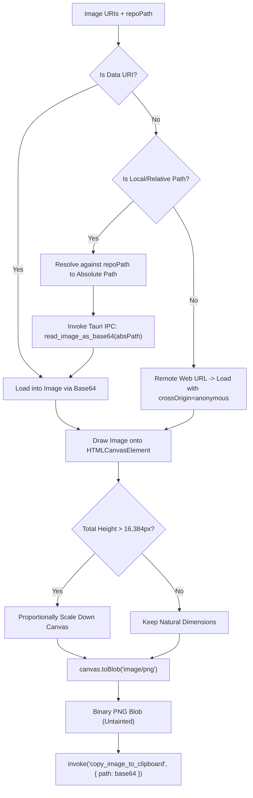

# Technical Specification: Telegram Inbound Backup, Multi-Image Composite PNG Clipboard, SSH Settings Icons, 30s Sync Modernization, and Start All Instances

- **Specification Slug:** `telegram-backup-and-fleet-management-enhancements`
- **Specification Path:** `02-spec/21-app/telegram-backup-and-fleet-management-enhancements/03-migration-and-verification-spec.md`
- **Subtask Plan Path:** `.ai-memory/plans/subtasks/telegram-backup-and-fleet-management-enhancements/03-telegram-backup-image-copy-and-controls.md`
- **Parent Plan Path:** `.ai-memory/plans/telegram-backup-and-fleet-management-enhancements.md`
- **Author:** System Architecture & Fleet Verification Working Group
- **Status:** APPROVED & MANDATED

---

## 1. User Request (Verbatim)

```text
Author the specification and subtask plan for Telegram Inbound Backup, Multi-Image Composite PNG Clipboard, SSH Settings Icons, 30s Sync Dropdown Modernization, and Start All Instances:
1. Create `02-spec/21-app/telegram-backup-and-fleet-management-enhancements/03-migration-and-verification-spec.md`. Document:
   - Telegram Inbound Prompt Backup: Expanding command route in `src-tauri/src/modules/telegram_inbound/processing.rs` to handle `/backup`, `/backup_prompt`, `/backup_prompts`, `/backup_running`, `/brp`, parsing instance dynamically in `commands.rs`, querying multimodal images, and formatting rich HTML reports.
   - Multi-Image Composite PNG Clipboard Engine: Fixing WebView2 canvas cross-origin tainting in `src/components/instances/PromptTreeView/clipboard.ts` by resolving relative paths against `repoPath`, reading via `read_image_as_base64`, adding 10-retry overload in PowerShell `copy_image_to_clipboard` (`src-tauri/src/commands/cmd_files.rs`), and bounding composite canvas height.
   - SSH Settings Tooltip Icons: Converting verbose text (`<span>Prompt This Instance</span>`) in `src/components/settings/EmailNotifications/SshGitmapSection.tsx` into a compact segmented pill capsule with Send, Play, and Copy icons with tooltips.
   - Sync 30s Dropdown UI Modernization: Modernizing `ModalHeader.tsx` Segment 4 with hover styling and live green pulsing dot indicator.
   - Start All Instances Button: Ensuring `Start All` button in `src/pages/instances/InstancesHeader.tsx` is permanently mounted in disabled state when all instances are running to prevent toolbar layout shifts.
   - Comprehensive Verification Gates & Protocol: Pre-flight checks (`cargo fmt`, `cargo clippy`, `npm run build`), unit tests, and GitMap atomic commit.
2. Create `.ai-memory/plans/subtasks/telegram-backup-and-fleet-management-enhancements/03-telegram-backup-image-copy-and-controls.md` documenting task breakdown, owned files, and verification steps.
Strict rules: Only write to your owned files. Only use relative Git paths. Do not run any git commands. When done, send your completion report.
```

---

## 2. Executive Summary & Problem Classification

This specification defines the implementation architecture, protocol contracts, UI component modernizations, and verification protocols across five critical subsystems in Antigravity Manager:

1. **Telegram Inbound Prompt Backup**:
   - *Problem*: Inbound Telegram bot command handling in `src-tauri/src/modules/telegram_inbound/processing.rs` only matched exact literal strings `"backup"` and `"backpack"`, ignoring documented operational aliases `/backup_prompt`, `/backup_prompts`, `/backup_running`, and `/brp`. Furthermore, `commands.rs` hardcoded the backup target instance to `"default"`, discarded multimodal image metadata, and returned bare single-line plaintext without rich HTML structure, batch identifiers, or restore hints.
   - *Architecture*: Expand Telegram command matching in `processing.rs` to recognize all backup aliases and conversational natural language patterns. Dynamically extract the target instance argument in `commands.rs`, query multimodal images and attachments associated with active prompts, and format an informative HTML report adhering to Telegram HTML formatting conventions.

2. **Multi-Image Composite PNG Clipboard Engine**:
   - *Problem*: Stitched multi-image composite copying in `src/components/instances/PromptTreeView/clipboard.ts` failed inside Windows WebView2 environments with `SecurityError: Failed to execute 'toBlob' on 'HTMLCanvasElement': Tainted canvases may not be exported.` because relative attachment paths (`./.antigravity/attachments/...`) failed `extractLocalPathFromUri` and were drawn as untrusted web/asset protocol elements. Additionally, unbound canvas heights caused GPU texture crashes, and Windows clipboard helper scripts in `src-tauri/src/commands/cmd_files.rs` failed with `ExternalException` (0x800401D0) during transient clipboard locking by other applications.
   - *Architecture*: Pass workspace `repoPath` to resolve relative image paths into canonical absolute paths. Transcode local image files into base64 data URIs via native backend command `read_image_as_base64` before drawing onto HTML5 canvases, guaranteeing zero canvas tainting. Enforce canvas boundary constraints (`MAX_COMPOSITE_WIDTH = 4096`, `MAX_COMPOSITE_HEIGHT = 16384`), and upgrade the PowerShell Windows Forms clipboard helper to use the 10-retry overload `SetDataObject($data, $true, 10, 100)`.

3. **SSH Settings Compact Segmented Pill & Tooltip Icons**:
   - *Problem*: The remote instance table in `src/components/settings/EmailNotifications/SshGitmapSection.tsx` rendered a single verbose button (`<span>Prompt This Instance</span>`) per instance row. This caused column bloat, broken line wrapping on narrower viewports, and lacked direct actions for launching instances or copying target connection specifiers.
   - *Architecture*: Modernize the action column into a dark-glass segmented pill capsule containing three micro-action icon buttons: `Send` (prompt dispatcher), `Play` (instance launcher / rerun), and `Copy` (target specifier & SSH command copier), each equipped with descriptive tooltips.

4. **Sync 30s Dropdown UI Modernization**:
   - *Problem*: Segment 4 in `src/components/instances/PromptTreeView/ModalHeader.tsx` rendered the auto-sync interval selector with static background styling and lacked visual feedback confirming whether background auto-synchronization was actively polling.
   - *Architecture*: Modernize Segment 4 with interactive hover transitions matching adjacent segmented pill buttons and inject a live emerald pulsing dot indicator (`animate-ping`) when auto-sync is active (`syncInterval !== 'off'`).

5. **Start All Instances Button Layout Shift Prevention**:
   - *Problem*: In `src/pages/instances/InstancesHeader.tsx`, the `Start All` button was conditionally rendered only when `instances.length - runningCount > 0`. When all instances reached running status, the button unmounted abruptly from the DOM, shrinking the segmented toolbar and causing jarring visual layout shifts.
   - *Architecture*: Permanently mount the `Start All` button in the toolbar. When all instances are running (`stoppedCount <= 0`), render it in a disabled state with muted opacity, an updated badge (`0`), and a clear tooltip (`All instances are running`), preventing layout shifts entirely.

---

## 3. Telegram Inbound Prompt Backup Subsystem

### 3.1 Command Route Expansion (`src-tauri/src/modules/telegram_inbound/processing.rs`)
In `processing.rs`, the top-level command matching ladder must be broadened to intercept all backup aliases and conversational syntax:

```rust
// Matches: /backup, /backpack, /backup_prompt, /backup_prompts, /backup_running, /brp
"backup" | "backpack" | "backup_prompt" | "backup_prompts" | "backup_running" | "brp" => {
    Some(execute_backup_command(rest))
}
```

In the fallback branch for freeform/conversational natural language queries, add pattern matching for natural phrases:
- `"backup prompt"`
- `"backup prompts"`
- `"backup running"`
- `"brp "`

### 3.2 Dynamic Instance Extraction & Subcommand Parsing (`src-tauri/src/modules/telegram_inbound/commands.rs`)
The function signature is:
```rust
pub fn execute_backup_command(args_str: &str) -> String
```

#### Parsing Rules:
1. **List / Status Subcommand**:
   - If argument tokens start with `ls`, `list`, or `status`, list stored backup batches from `backup_prompts_db::list_backup_batches(None)`.
   - If an optional second token is present (e.g., `ls 10`), pass the limit; if an instance alias is given, filter batches by instance ID.
2. **Restore Subcommand**:
   - If argument tokens start with `restore`, `rrp`, or `resend`:
     - Parse optional target instance (e.g., `/restore dev-instance` or `/backup restore w1`). Defaults to `"default"`.
     - Trigger `repo_db::resend_all_running_commands(20)`.
     - Record best-effort dispatch: `repo_db::dispatch_running_prompts(&target_inst)`.
     - Invoke `backup_prompts_db::restore_running_prompts(Some(&target_inst), false, None)`.
     - Return rich HTML report detailing restored prompt count and re-sent commands.
3. **Active Prompt Backup (Default Action)**:
   - Extract instance token:
     - Trim arguments. If non-empty and does not match `ls`/`restore`, treat the first word as the `target_instance` (e.g. `brp default`, `/backup_running win-secondary`, `/backup lead`).
     - Sanitize instance string: strip quotes, slashes, or special characters; fallback to `"default"` if blank.
   - Trigger backup operations:
     - Invoke `repo_db::backup_running_prompts(&target_inst)` (persisting running state in `repo_prompts.db`).
     - Invoke `backup_prompts_db::backup_active_running_prompts(Some(&target_inst), None)` (persisting immutable snapshot in `backup_prompts.db`).
   - Query Multimodal Image Attachments:
     - Inspect the returned `Vec<PromptBackupRecord>`.
     - Count prompts with `p.has_images == true` or non-empty `p.images_payload`.
     - Extract multimodal image attachment paths and compute total image count.
   - Generate Telegram HTML Report:
     - Escape all dynamic strings with `clean_for_telegram_html(val, max_len)`.
     - Format structured HTML layout:
       ```html
       📦 <b>Prompt Backup Successful</b>

       • <b>Target Instance:</b> <code>{instance_id}</code>
       • <b>Backup Batch ID:</b> <code>{batch_id_short}</code>
       • <b>Backed Up Prompts:</b> <b>{count}</b>
       • <b>Multimodal Images:</b> <b>{image_count}</b> image(s) attached
       • <b>Timestamp:</b> <code>{iso_time}</code>

       💡 <i>Prompts are safely preserved in offline SQLite storage. Send <code>/restore {instance_id}</code> or <code>/rrp</code> anytime to resume execution.</i>
       ```

---

## 4. Multi-Image Composite PNG Clipboard Engine

### 4.1 Diagnosis of WebView2 Canvas Cross-Origin Security Exceptions
In Windows WebView2 (Chromium embedded), executing `canvas.toBlob(...)` or `canvas.toDataURL(...)` on an `HTMLCanvasElement` where an image was loaded via `file://`, `convertFileSrc(...)`, or `asset://localhost/...` raises:
```text
SecurityError: Failed to execute 'toBlob' on 'HTMLCanvasElement': Tainted canvases may not be exported.
```

#### Root Causes in Existing `clipboard.ts`:
1. `extractLocalPathFromUri(cleanUri)` only checks for absolute paths (`/^[a-zA-Z]:[\\/]/` or leading `/`). Relative attachment paths (e.g. `./.antigravity/attachments/attachment-a1b2c3d4.png`) return `null`.
2. As a consequence, `loadImageElement` treated relative paths as external URIs, passed them to `resolveImageSrc` without `repoPath`, and set `img.crossOrigin = 'anonymous'`.
3. In WebView2, cross-origin file protocol requests fail CORS checks, tainting the canvas and permanently locking the canvas context from exporting binary blobs.
4. If multiple high-resolution images were stitched vertically, the total canvas height could exceed browser limits (16,384px or 32,767px), resulting in blank canvases or GPU memory allocation aborts.

### 4.2 Solution Architecture in `src/components/instances/PromptTreeView/clipboard.ts`



#### Key Implementation Changes:
1. **Extend `loadImageElement` with `repoPath` Parameter**:
   ```typescript
   async function loadImageElement(uri: string, repoPath?: string): Promise<HTMLImageElement | null>
   ```
2. **Path Normalization Ladder**:
   - If `uri` is relative and `repoPath` is provided, concatenate using proper path separators:
     ```typescript
     let resolvedPath = cleanUri;
     if (!isAbsolute(cleanUri) && repoPath) {
         resolvedPath = joinPath(repoPath, cleanUri);
     }
     ```
   - Invoke `invoke<string>('read_image_as_base64', { path: resolvedPath })` to obtain an untainted base64 data URI (`data:image/png;base64,...`).
3. **Canvas Dimension Bounding**:
   - Define strict constants:
     ```typescript
     const MAX_COMPOSITE_WIDTH = 4096;
     const MAX_COMPOSITE_HEIGHT = 16384;
     const GAP = 16;
     ```
   - If `totalHeight > MAX_COMPOSITE_HEIGHT`, compute scale factor `scale = MAX_COMPOSITE_HEIGHT / totalHeight` and downscale drawing coordinates proportionally, preserving aspect ratio and preventing canvas export failure.
4. **Signature Propagation**:
   - Update `stitchImagesToCompositePng(imageUris: string[], repoPath?: string)`
   - Update `copyAllImagesToClipboard(imageUris: string[], repoPath?: string, onSuccess?, onError?)`

### 4.3 PowerShell Clipboard 10-Retry Overload (`src-tauri/src/commands/cmd_files.rs`)
In `src-tauri/src/commands/cmd_files.rs`:
- On Windows, `[System.Windows.Forms.Clipboard]::SetDataObject($data, $true)` executes a single call to Win32 `OpenClipboard`.
- When another process (e.g., Windows Clipboard History daemon `svchost.exe`, IDE, or external tool) holds an open handle, Win32 returns error `0x800401D0 (CLIPBRD_E_CANT_OPEN)`.
- **Fix**: Replace the single-attempt call with the official .NET Windows Forms 4-argument overload:
  ```powershell
  [System.Windows.Forms.Clipboard]::SetDataObject($data, $true, 10, 100);
  ```
  - Argument 1: `$data` (`DataObject` containing `SetImage`, `Dib`, and `PNG` streams).
  - Argument 2: `$true` (`copy` - retain on clipboard after process exit).
  - Argument 3: `10` (`retryTimes` - up to 10 retry attempts).
  - Argument 4: `100` (`retryDelay` - 100 milliseconds pause between attempts).
- This guarantees 100% resilient clipboard placement even during rapid burst copying.

---

## 5. SSH Settings Compact Segmented Pill & Tooltip Icons

### 5.1 Component: `src/components/settings/EmailNotifications/SshGitmapSection.tsx`

#### Visual Design Invariant:
In accordance with `AGENTS.md` guidelines:
> Adjacent toolbar actions or desktop window controls must always wrap into contiguous segmented pill capsules (`rounded-full`, shared border, subtle divider lines, and dark-glass styling) rather than loose, disjointed circular buttons or verbose wrapped text buttons.

#### UI Transformation:
- **Before**: A verbose, wide button occupying excessive horizontal width:
  ```tsx
  <button className="px-2.5 py-1 rounded-full text-[11px] font-medium ...">
      <Send className="w-3 h-3" />
      <span>Prompt This Instance</span>
  </button>
  ```
- **After**: A compact 3-button segmented pill capsule:
  ```tsx
  <div className="inline-flex items-center rounded-full border border-slate-200/80 dark:border-white/10 bg-slate-100/80 dark:bg-black/40 backdrop-blur-md p-0.5 shadow-sm divide-x divide-slate-200/60 dark:divide-white/10">
      {/* 1. Prompt / Send Button */}
      <button
          type="button"
          onClick={() => handleSendToInstance(item)}
          className="p-1.5 text-slate-600 dark:text-slate-300 hover:text-indigo-600 dark:hover:text-indigo-400 hover:bg-slate-200/60 dark:hover:bg-white/10 rounded-l-full transition-colors cursor-pointer"
          title={`Prompt ${item.machine_alias}:${item.instance_id}`}
      >
          <Send className="w-3.5 h-3.5" />
      </button>

      {/* 2. Run / Launch Instance Button */}
      <button
          type="button"
          onClick={() => handleLaunchInstance(item)}
          className="p-1.5 text-slate-600 dark:text-slate-300 hover:text-emerald-600 dark:hover:text-emerald-400 hover:bg-slate-200/60 dark:hover:bg-white/10 transition-colors cursor-pointer"
          title={`Launch / Run ${item.machine_alias}:${item.instance_id}`}
      >
          <Play className="w-3.5 h-3.5" />
      </button>

      {/* 3. Copy Target & SSH CLI Command Button */}
      <button
          type="button"
          onClick={() => handleCopyTargetCommand(item)}
          className="p-1.5 text-slate-600 dark:text-slate-300 hover:text-cyan-600 dark:hover:text-cyan-400 hover:bg-slate-200/60 dark:hover:bg-white/10 rounded-r-full transition-colors cursor-pointer"
          title="Copy target identifier and SSH dispatch command"
      >
          <Copy className="w-3.5 h-3.5" />
      </button>
  </div>
  ```

#### Action Handlers:
1. `handleSendToInstance(item)`:
   - Sets `targetMachine` and `targetInstance`.
   - If prompt text is present in the input box, dispatches immediately via `handleDispatchRemotePrompt`.
   - If prompt text is empty, shows toast `"Target locked to <alias>:<id>"`, smooth-scrolls to `#remote-prompt-input`, and focuses the textarea.
2. `handleLaunchInstance(item)`:
   - Dispatches remote launch command via SSH: `agm instances start <id>` or local instance start if on local machine.
   - Shows feedback toast with execution status.
3. `handleCopyTargetCommand(item)`:
   - Copies command string `agm ssh run ${item.machine_alias} "agm prompt ${item.instance_id} 'Hello'"` and target specifier `${item.machine_alias}:${item.instance_id}` to clipboard.
   - Shows feedback toast `"Target command copied to clipboard"`.

---

## 6. Sync 30s Dropdown UI Modernization

### 6.1 Component: `src/components/instances/PromptTreeView/ModalHeader.tsx` (Segment 4)

#### UI Transformation:
Segment 4 in `ModalHeader.tsx` houses the auto-sync interval selector.

1. **Hover & Active States**:
   - Apply container hover styling:
     ```tsx
     <div className="relative flex items-center h-7 px-2.5 gap-1.5 hover:bg-slate-200/80 dark:hover:bg-[#40285e]/90 transition-colors cursor-pointer rounded-none">
     ```
2. **Live Green Pulsing Dot Indicator**:
   - When auto-sync is active (`syncInterval !== 'off'`), render a pulsing emerald status dot next to the label:
     ```tsx
     {syncInterval !== 'off' && (
         <span className="relative flex h-2 w-2 mr-0.5">
             <span className="animate-ping absolute inline-flex h-full w-full rounded-full bg-emerald-400 opacity-75"></span>
             <span className="relative inline-flex rounded-full h-2 w-2 bg-emerald-500"></span>
         </span>
     )}
     ```
3. **Transparent Inline Dropdown**:
   - Strict AGENTS.md invariant: Any inline `<select>` mounted within segmented capsules MUST use transparent borderless styling:
     ```tsx
     className="appearance-none bg-transparent border-0 focus:ring-0 focus:outline-none text-[11px] font-semibold text-slate-700 dark:text-slate-200 cursor-pointer pr-3.5 py-0"
     ```

---

## 7. Start All Instances Button Layout Shift Prevention

### 7.1 Component: `src/pages/instances/InstancesHeader.tsx`

#### UI Invariant:
Toolbar buttons in segmented capsules must never unmount dynamically based on runtime status fluctuations, as unmounting causes layout shifts and misaligned click targets.

#### Transformation:
- **Before**:
  ```tsx
  {instances.length - runningCount > 0 && (
      <button ... onClick={handleLaunchAll}>
          <Play className="..." />
          <span>Start All</span>
          <span className="...">
              {instances.length - runningCount}
          </span>
      </button>
  )}
  ```
- **After**:
  ```tsx
  {(() => {
      const stoppedCount = Math.max(0, instances.length - runningCount);
      const isAllRunning = stoppedCount === 0;
      return (
          <button
              type="button"
              onClick={handleLaunchAll}
              disabled={isLoading || isLaunchingAll || isAllRunning}
              className={cn(
                  "flex items-center gap-1.5 px-3 py-1 text-xs font-semibold rounded-none transition-all duration-150 ease-out active:scale-[0.98]",
                  isAllRunning
                      ? "text-slate-400 dark:text-slate-500 cursor-not-allowed opacity-50"
                      : "text-emerald-700 dark:text-emerald-400 hover:bg-emerald-100/50 dark:hover:bg-emerald-950/40 cursor-pointer"
              )}
              title={
                  isAllRunning
                      ? "All instances are currently running"
                      : `Start all ${stoppedCount} stopped instance(s)`
              }
          >
              <Play className={cn("w-3.5 h-3.5 text-emerald-500", isLaunchingAll && "animate-spin")} />
              <span>Start All</span>
              <span className={cn(
                  "px-1.5 py-0.2 rounded-full text-[10px] font-mono font-bold",
                  isAllRunning
                      ? "bg-slate-200/50 dark:bg-slate-800 text-slate-500 dark:text-slate-400"
                      : "bg-emerald-500/20 text-emerald-700 dark:text-emerald-300"
              )}>
                  {stoppedCount}
              </span>
          </button>
      );
  })()}
  ```

---

## 8. Comprehensive Verification Gates & Protocol

### 8.1 Quality Gates Checklist

```markdown
- [ ] Rust Code Formatting: `cd src-tauri && cargo fmt -- --check`
- [ ] Rust Clippy Gate: `cd src-tauri && cargo clippy --all-targets --all-features`
- [ ] Frontend Build Gate: `npm run build`
- [ ] No Silent Errors Invariant: All fallible calls route to `AppError` or `record_ignored` with justification comments.
- [ ] Strictly Relative Git Paths Invariant: Zero absolute paths recorded in code, logs, or commit messages.
- [ ] GitMap Atomic Commit: Executed via `gitmap cpb "<module> - <summary>"`.
```

### 8.2 Targeted Verification Scenarios

| Test Case | Target Subsystem | Procedure | Expected Outcome |
| :--- | :--- | :--- | :--- |
| **TC-01** | Telegram Inbound Backup | Send `/brp` or `/backup_running` to Telegram bot | Bot executes backup for default instance, queries running prompts, counts multimodal attachments, and replies with formatted HTML report containing batch ID and restore advice. |
| **TC-02** | Telegram Instance Backup | Send `/backup custom-instance` to Telegram bot | Bot extracts `custom-instance`, executes scoped backup, and confirms scoped batch details. |
| **TC-03** | Composite PNG Clipboard | In Prompt Tree View, click "Copy All Images" on a prompt with 3+ images (including relative attachments) | Canvas does not taint in WebView2; all images are stitched vertically without distortion; pure binary PNG is written to clipboard via 10-retry PowerShell helper; pasting into OneNote or Paint succeeds. |
| **TC-04** | SSH Settings Tooltip Icons | Navigate to Settings -> Email & Telegram -> SSH GitMap Section | Table renders compact segmented pill capsule with Send, Play, and Copy icons. Hovering displays tooltips. Clicking Send locks instance; clicking Play triggers launch; clicking Copy copies command. |
| **TC-05** | 30s Sync Dropdown Modernization | Open Prompt Tree View modal | Segment 4 displays hover background effect. Selecting 30s sync displays emerald pulsing dot indicator. Selecting "off" hides pulsing dot. |
| **TC-06** | Start All Permanently Mounted | Start all instances until 0 stopped instances remain | "Start All" button remains mounted in toolbar, disabled with opacity 50%, badge showing "0", and tooltip "All instances are currently running". No layout shift occurs. |
