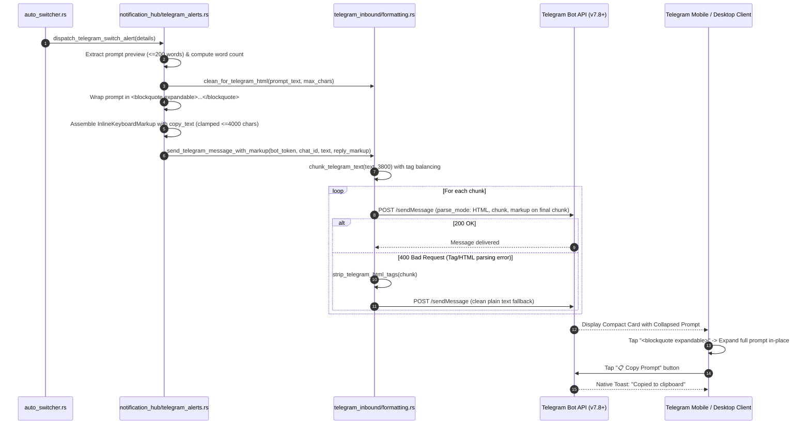
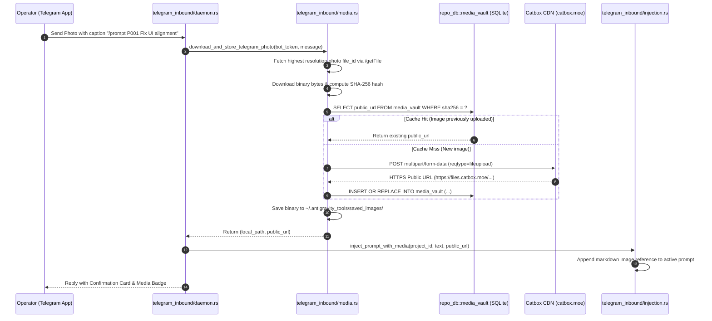
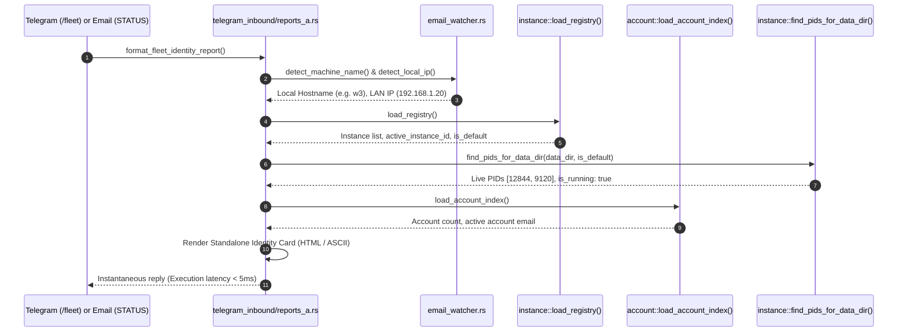

# Architecture Specification: Telegram Chat Enhancement & Integration Solutions

**Document ID:** `02-spec/21-app/telegram-chat-enhancement-and-integration-solutions/01-architecture-spec.md`  
**Status:** Approved  
**Version:** 1.0.0  
**Target Subsystem:** `src-tauri/src/modules/telegram_inbound/` & `src-tauri/src/modules/notification_hub/`  

---

## 1. Executive Summary & Problem Classification

### 1.1 Problem Statement & Visual Evidence Analysis
Antigravity-Manager (AGM) provides multi-channel telemetry broadcasting and inbound remote control across Telegram bots and SMTP email. When inspecting real-world account switch broadcasts delivered to Telegram bots (as evidenced in [telegram-chat-enhancement-and-integration-solutions-01.png](assets/screenshots/telegram-chat-enhancement-and-integration-solutions-01.png)):
- **Monolithic Vertical Consumption:** Active prompt text, system logs, and code snippets are emitted inside plain `<pre><code>...</code></pre>` blocks or raw paragraph text. Long prompts (200–500+ words) monopolize mobile screen real estate, forcing operators to endlessly scroll past prompt bodies to reach previous and subsequent operational status cards.
- **Visual Flatness & Lack of Hierarchy:** Core metrics such as previous accounts, target accounts, rolling balances, threshold activations, and host machine details are rendered in basic flat text without clear visual grouping, card separation, or accent highlights.
- **Friction in Manual Interaction:** Operators who receive a critical switch alert or prompt backup notification cannot easily copy the active prompt text to their mobile clipboard without awkwardly long-pressing, selecting, and manually adjusting selection handles across Telegram mobile UI.
- **External Dependency Risk:** In multi-node cluster observation (`/fleet`, `/observe`), nodes previously risked timeouts or empty reports if the centralized Supabase PostgreSQL database was undergoing maintenance, network partitioning, or unconfigured state.

### 1.2 Technology Opportunity & Bot API Modernization
This specification establishes a modern Telegram interaction standard leveraging Telegram Bot API 7.2+ and 7.8+ capabilities:
1. **Telegram Bot API 7.2+ Expandable Quotes (`<blockquote expandable>`):**
   Telegram introduced expandable blockquotes supporting collapsible sections that collapse multi-line prompts and long outputs to a compact 3-line preview with an interactive "Expand" toggle button handled natively by Telegram clients on iOS, Android, and Desktop.
2. **Telegram Bot API 7.8+ Direct Clipboard Buttons (`copy_text`):**
   Telegram Bot API 7.8 added native clipboard copy buttons within `InlineKeyboardButton` via the `copy_text` property:
   ```json
   {
     "text": "📋 Copy Prompt",
     "copy_text": {
       "text": "<sanitized_prompt_content>"
     }
     ```
   Tapping this button triggers an immediate native toast ("Text copied to clipboard") on the operator's device without sending a callback query back to the server or exposing clipboard data to external webviews.
3. **Multimodal Media Vault & Catbox Mirroring:**
   Telegram photo uploads sent by operators (e.g. mobile screenshots, design comps) are ingested, hashed via SHA-256, deduplicated in local SQLite `media_vault`, and optionally mirrored to Catbox CDN for permanent, publicly resolvable HTTPS URLs injected into AI prompt context.
4. **Supabase-Free Distributed Machine Identity Resolution:**
   Operators querying `/fleet` or sending email `STATUS` commands obtain immediate, zero-latency diagnostic identity cards resolved exclusively from local OS APIs, environment variables, and local split SQLite vaults (`accounts.db`, `instances.db`, `repo_prompts.db`), completely immune to remote database availability.

---

## 2. Architecture & Data Flow Diagrams

### 2.1 Telegram Alert Formatting with Expandable Blocks & Copy Buttons
The following sequence diagram outlines how `notification_hub` and `telegram_inbound` collaborate to format, chunk, and dispatch structured alert cards with expandable blockquotes and copy buttons.



### 2.2 Multimodal Image Ingestion, Cloud Mirroring, and Prompt Mapping
The sequence diagram below illustrates multimodal photo ingestion from inbound Telegram messages, SHA-256 deduplication, Catbox cloud upload, and prompt payload mapping.



### 2.3 Supabase-Free Machine Identity Resolution (`/fleet` & Email `STATUS`)
The sequence diagram demonstrates how local identity resolution occurs without reliance on Supabase or external network calls.



---

## 3. System Invariants & Protocol Guarantees

### 3.1 Invariant I-TG-01: HTML Chunking & Tag Balancing Bound
- **Constraint:** All outgoing Telegram messages must be capped at 3,800 characters per message payload (well below the hard Telegram limit of 4,096 characters).
- **Tag Balance Invariant:** When a message is divided across chunks along line breaks or whitespace, unclosed HTML tags (`<b>`, `<code>`, `<pre>`, `<blockquote>`) in chunk $N$ must be closed at the end of chunk $N$, and re-opened at the beginning of chunk $N+1$.
- **Tag Specification:** The supported tag stack inspected by `get_unclosed_html_tags` must recognize `blockquote` (including `<blockquote expandable>`).

### 3.2 Invariant I-TG-02: Telegram Bot API Clipboard Clamp
- **Constraint:** According to the Telegram Bot API specification for `copy_text_button`, the `text` attribute of `copy_text` has a hard limit of 1 to 4,096 characters.
- **Clamping Safety Factor:** To guarantee immunity from 400 Bad Request errors (`BUTTON_DATA_INVALID` or `REPLY_MARKUP_INVALID`), AGM strictly clamps `copy_text.text` to a maximum of 4,000 characters:
  $$\text{effective\_copy\_len} = \min(\text{prompt\_text.len}(), 4000)$$
- **Boundary Handling:** If the prompt exceeds 4,000 characters, it is truncated on a UTF-8 character boundary with a trailing newline and notice: `\n... [Truncated for clipboard]`.

### 3.3 Invariant I-TG-03: Positive Boolean Design Invariant
All structs, configuration fields, function arguments, and internal flags must use positive booleans exclusively:
- `is_active` (NOT `is_inactive` or `not_active`)
- `is_enabled` (NOT `is_disabled`)
- `is_expandable` (NOT `is_not_collapsed`)
- `has_markup` (NOT `lacks_markup`)
- `has_active_prompts` (NOT `is_empty_prompts`)
- `is_running` (NOT `is_stopped`)
- `is_success` (NOT `is_failed`)

### 3.4 Invariant I-TG-04: Non-Blocking Telemetry & Supabase Resiliency
- Inbound identity discovery (`/fleet`, `/whoami`, `STATUS`) and local observation reports (`/observe`, `/instances`, `/accounts`) must execute entirely within the local process and split SQLite vaults.
- No remote network socket or database connection (such as Supabase Root DB or external OAuth check) may sit in the critical path of local report generation.
- If Supabase cluster node querying is attempted (e.g. for `/nodes`), it must have an explicit timeout ($\le 2\text{s}$) and immediately fall back to local host and GitMap mesh nodes upon error.

### 3.5 Invariant I-TG-05: Secret Redaction & Sanitization Guarantee
- Every prompt content string and error message rendered for Telegram output must pass through `clean_for_telegram_html(text, max_chars)`.
- Sensitive tokens (OAuth refresh tokens, Telegram bot tokens, SMTP passwords) must be stripped via `redact_secrets()` before transmission over network APIs or logging to disk.

---

## 4. Component Design & Code Structure

### 4.1 Subsystem Directory Structure
```
src-tauri/src/modules/
├── notification_hub/
│   ├── mod.rs
│   ├── telegram_alerts.rs          # Alert cards, expandable blocks, copy_text buttons
│   ├── email_alerts.rs             # HTML email reports with synchronized headers
│   └── telemetry.rs                # Machine identity, IP detection, version metadata
└── telegram_inbound/
    ├── mod.rs
    ├── formatting.rs               # HTML tag balancing, 3800-char chunking, clean_for_telegram_html
    ├── media.rs                    # Image download, Catbox CDN upload, media_vault indexing
    ├── reports_a.rs                # /ping, /observe, /fleet, /instances, /accounts
    ├── reports_b.rs                # /expand, /prompts query, /help manual
    ├── cluster.rs                  # GitMap fleet & Supabase node discovery
    ├── processing.rs               # Inbound command routing and dispatching
    └── daemon.rs                   # Telegram Bot API long-polling daemon
```

### 4.2 Expandable HTML Card Template (Account Switch Alert)
```html
🔄 <b>Antigravity Manager: Account Switched</b>
━━━━━━━━━━━━━━━━━━━━━━━━
📦 <b>Version:</b> <code>v4.162.0</code>
👤 <b>Previous Account:</b> <code>rokixshohag1@gmail.com</code>
📉 <b>Previous Balances:</b> <code>4h: 15.0% | Weekly: 40.0%</code>
✅ <b>Selected Account:</b> <code>zihadxshohag2@gmail.com</code>
📈 <b>Target Balances:</b> <code>4h: 100.0% | Weekly: 59.0%</code>
⚙️ <b>Threshold:</b> <code>15.0%</code>
💻 <b>Target Instance:</b> <code>default</code> (default)
📁 <b>Projects:</b> <code>Antigravity-Manager, gitmap, spec-builder</code>
💾 <b>Prompt Backup:</b> <code>5 captured | 5 re-injected</code>
🏷️ <b>Trigger:</b> Auto-Switcher (Quota/Period boundary)
📝 <b>Reason:</b> Critical quota alert on instance 'default': model 'gemini-flash' dropped to 15.0% (<= 15.0%).
🖥️ <b>Host:</b> <code>w3</code> (192.168.1.20)
⏰ <b>Timestamp:</b> 2026-10-11 11:07:41 UTC

💬 <b>Active Prompt:</b> (292 words)
<blockquote expandable>
<code>&lt;USER_REQUEST&gt; ... full prompt content ...</code>
</blockquote>
```

### 4.3 Inline Keyboard Markup Structure
```json
{
  "inline_keyboard": [
    [
      {
        "text": "📋 Copy Prompt",
        "copy_text": {
          "text": "<full_untruncated_prompt_up_to_4000_chars>"
        }
      }
    ],
    [
      {
        "text": "📊 Live Observe",
        "callback_data": "/observe"
      },
      {
        "text": "👥 Accounts",
        "callback_data": "/accounts"
      }
    ]
  ]
}
```

---

## 5. Acceptance Criteria & Quality Gates

| Verification Gate | Expected Behavior | Target Module |
| :--- | :--- | :--- |
| **G-01: Expandable Quotes** | Telegram messages with prompt sections render inside `<blockquote expandable>`, appearing collapsed in Telegram UI. | `telegram_alerts.rs`, `reports_a.rs` |
| **G-02: Copy Button** | Telegram message includes inline keyboard with `copy_text`. Clicking button copies text directly to clipboard without error. | `telegram_alerts.rs`, `formatting.rs` |
| **G-03: Length Clamp** | `copy_text.text` never exceeds 4,000 characters. Input exceeding 4,000 chars is safely clamped. | `telegram_alerts.rs` |
| **G-04: HTML Chunking** | Messages split over multiple chunks balance tags so no chunk has unclosed `<blockquote expandable>`. | `formatting.rs` |
| **G-05: Standalone Fleet** | `/fleet` executes in $<10\text{ms}$ with zero network calls to Supabase, returning local instance & account data. | `reports_a.rs` |
| **G-06: Pre-flight Clean** | `cargo fmt -- --check`, `cargo clippy --all-targets --all-features`, and `npm run build` pass without warnings or errors. | Root repository |

---

## 6. Document History

| Date | Version | Author | Change Description |
| :--- | :--- | :--- | :--- |
| 2026-10-11 | 1.0.0 | Spec Subagent (Author 01) | Initial Architecture Specification for Telegram Chat Enhancement & Integration Solutions. |
