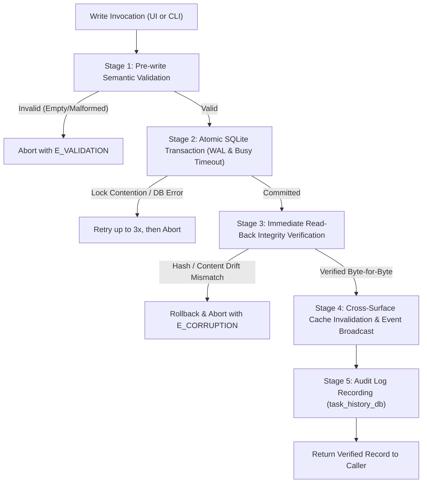

# Specification: Editable "Resend As" Titles and Templates Architecture (UI & CLI Parity)

> **Specification ID:** `02-spec/21-app/telegram-prompt-rerun-verification-templates/03-editable-titles-and-templates-ui-cli-spec.md`  
> **Task Slug:** `telegram-prompt-rerun-verification-templates`  
> **Subtask ID:** `03-editable-titles-and-templates-ui-cli`  
> **Parent Plan:** `.ai-memory/plans/telegram-prompt-rerun-verification-templates.md`  
> **Subtask Plan:** `.ai-memory/plans/subtasks/telegram-prompt-rerun-verification-templates/03-editable-titles-and-templates-ui-cli.md`  
> **Primary Author:** Spec Author 03  
> **Maintainer Attribution:** `@aukgit` (`(Thanks to @aukgit)`)  
> **Status:** APPROVED & SPECIFIED  
> **Target Release:** `v4.223.0`  

---

## 1. Executive Summary

In Antigravity Manager (`AGM`), the **Prompt Tree View** (`src/components/instances/PromptTreeView/`) and the **Terminal CLI Suite** (`src-tauri/src/bin/agm/`) provide powerful interfaces for inspecting historical conversation turns, auditing prompt liveness, re-injecting prompts into running IDE workspaces, and cloning conversations.

During daily engineering workflows, developers repeatedly re-dispatch existing prompts under specialized operational contexts, such as verifying completed tasks, fixing discovered regressions, conducting security audits, or kicking off secondary rerun rounds. When doing so via "Resend As" or verification suffix appending, users require two interconnected capabilities:
1. **Customizable "Resend As" Title Presets**: The ability to select or construct distinct conversation titles (e.g. `[Verify] {title}`, `[Fix] {title}`, `[Rerun] {title}`, `[Audit] {title}`, `[Follow-up] {title}`) bound to target execution modes (`new` conversation vs `current` conversation) and associated verification suffix templates.
2. **Unified Persistence & Full UI/CLI Parity**: Title patterns and suffix templates must not be trapped solely in the browser's `localStorage`. They must be persisted centrally in the SQLite `repo_prompts.db` database, manageable via both full-featured frontend modals (`SuffixTemplateModal.tsx`, `ResendAsModal.tsx`) and first-class CLI commands (`agm prompt template ...`, `agm prompt resend-as ...`).
3. **Rigorous Verification Steps on Writing**: To prevent silent data corruption or partial writes, every template mutation (create, edit, delete, set default) must execute an exhaustive multi-tier verification sequence—including pre-write schema validation, atomic SQLite transactions with retry guards, immediate read-back verification, cross-window IPC synchronization, and audit logging.

This specification establishes the end-to-end architecture, database schema, Rust backend module, Tauri IPC commands, CLI subcommands, UI components, and verification protocols for editable titles and templates.

---

## 2. User Request (Verbatim)

```text
and also where you have resend as, where you can actually have a bunch of titles. These titles and templates can be modified from the UI and also from the CLI, make sure of that, and add more verification steps on writing.
```

---

## 3. Problem Classification & Architectural Context

### 3.1 The "Trapped in LocalStorage" Anti-Pattern
Prior implementations stored custom verification templates exclusively inside the browser's `window.localStorage` under the key `agm_custom_suffix_templates`. This design suffered from four critical defects:
1. **Zero CLI Access**: Terminal operators running `agm prompt` or headless CI runners could not access, list, or apply user-defined suffix templates or title presets.
2. **Cross-Window Inconsistency**: In multi-instance or detached window setups, updates made in one UI context failed to synchronize across other instances without manual page reloads.
3. **Absence of Title Pattern Presets**: "Resend As" lacked a structured template model. Users were forced to manually re-type conversation title prefixes like `[Verify]` or `[Fix]` on every dispatch.
4. **No Write Verification**: Saving templates to `localStorage` lacked integrity verification, schema validation, and audit recording.

### 3.2 The CLI Subcommand Leaking Hazard (Root Cause & Invariant I5)
In the AGM terminal parser (`src-tauri/src/bin/agm/prompt_cmds.rs` and `common.rs`), any CLI invocation of the form `agm prompt <args>` evaluates whether the first argument matches `is_prompt_subcommand(sub)`.
- If `is_prompt_subcommand` returns `false`, the parser assumes the arguments represent a **raw prompt text** intended for immediate dispatch to the active Antigravity IDE workspace.
- **Hazard**: If a user runs `agm prompt template list` or `agm prompt resend-as list` without explicit registration in `is_prompt_subcommand`, the CLI treats `"template"` or `"resend-as"` as prompt text and dispatches it directly into the open IDE composer!
- **Invariant I5**: Subcommands `template`, `templates`, `suffix`, `resend-as`, and `resend-titles` MUST be explicitly whitelisted in `is_prompt_subcommand` in `src-tauri/src/bin/agm/common.rs` to intercept template commands before the raw prompt dispatch fallback ladder.

---

## 4. SQLite Split-DB Architecture (`repo_prompts.db`)

Both suffix templates and "Resend As" title presets are stored within the split database `repo_prompts.db` managed by `src-tauri/src/modules/repo_db/schema.rs` and accessed via `src-tauri/src/modules/suffix_templates.rs`.

```
┌──────────────────────────────────────────────────────────────────────────────────────────────────┐
│                                   repo_prompts.db Schema Topology                                │
├──────────────────────────────────────────────────────────────────────────────────────────────────┤
│                                                                                                  │
│   ┌─────────────────────────────────────────┐          ┌──────────────────────────────────────┐  │
│   │        prompt_suffix_templates          │          │      prompt_resend_as_templates      │  │
│   ├─────────────────────────────────────────┤          ├──────────────────────────────────────┤  │
│   │ id: TEXT (PK)                           │◀────┐    │ id: TEXT (PK)                        │  │
│   │ name: TEXT NOT NULL                     │     │    │ name: TEXT NOT NULL                  │  │
│   │ description: TEXT                       │     │    │ title_pattern: TEXT NOT NULL         │  │
│   │ category: TEXT NOT NULL                 │     │    │ target_mode: TEXT NOT NULL           │  │
│   │ template: TEXT NOT NULL                 │     └─── │ suffix_id: TEXT (Ref/Nullable)       │  │
│   │ is_default: INTEGER NOT NULL DEFAULT 0  │          │ is_default: INTEGER NOT NULL DEFAULT │  │
│   │ created_at: TEXT NOT NULL               │          │ created_at: TEXT NOT NULL            │  │
│   │ updated_at: TEXT NOT NULL               │          │ updated_at: TEXT NOT NULL            │  │
│   └─────────────────────────────────────────┘          └──────────────────────────────────────┘  │
│                                                                                                  │
└──────────────────────────────────────────────────────────────────────────────────────────────────┘
```

### 4.1 Schema DDL: `prompt_suffix_templates`
```sql
CREATE TABLE IF NOT EXISTS prompt_suffix_templates (
    id TEXT PRIMARY KEY,
    name TEXT NOT NULL,
    description TEXT,
    category TEXT NOT NULL DEFAULT 'custom',
    template TEXT NOT NULL,
    is_default INTEGER NOT NULL DEFAULT 0,
    created_at TEXT NOT NULL,
    updated_at TEXT NOT NULL
);

CREATE INDEX IF NOT EXISTS idx_prompt_suffix_templates_category 
ON prompt_suffix_templates(category);

CREATE INDEX IF NOT EXISTS idx_prompt_suffix_templates_default 
ON prompt_suffix_templates(is_default);
```

### 4.2 Schema DDL: `prompt_resend_as_templates`
```sql
CREATE TABLE IF NOT EXISTS prompt_resend_as_templates (
    id TEXT PRIMARY KEY,
    name TEXT NOT NULL,
    title_pattern TEXT NOT NULL,
    target_mode TEXT NOT NULL DEFAULT 'new',
    suffix_id TEXT,
    is_default INTEGER NOT NULL DEFAULT 0,
    created_at TEXT NOT NULL,
    updated_at TEXT NOT NULL
);

CREATE INDEX IF NOT EXISTS idx_prompt_resend_as_default 
ON prompt_resend_as_templates(is_default);
```

### 4.3 Default Built-in Seeds
When `repo_prompts.db` initializes, if the tables are empty, the database seeds the following canonical records:

#### Built-in Title Patterns (`prompt_resend_as_templates`):
| ID | Name | Title Pattern | Target Mode | Bound Suffix ID | Is Default |
| :--- | :--- | :--- | :--- | :--- | :---: |
| `verify` | Verify Task | `[Verify] {title}` | `new` | `is-it-done` | `1` |
| `fix` | Fix Defects | `[Fix] {title}` | `new` | `edge-cases-and-tests` | `0` |
| `rerun` | Rerun Execution | `[Rerun] {title}` | `current` | `rerun-nudge` | `0` |
| `audit` | Code Audit | `[Audit] {title}` | `new` | `security-audit` | `0` |
| `followup` | Follow-up Query | `[Follow-up] {title}` | `new` | `none` | `0` |

#### Built-in Suffix Templates (`prompt_suffix_templates`):
- `is-it-done`: "Is it done? (Evidence Check)" — Category: `verification`, Is Default: `1`.
- `is-it-released`: "Is it released? (Release Protocol)" — Category: `release`, Is Default: `0`.
- `are-you-confident`: "Are you confident? (Failure Audit)" — Category: `quality`, Is Default: `0`.
- `edge-cases-and-tests`: "Edge cases (Boundary Checks)" — Category: `robustness`, Is Default: `0`.
- `security-audit`: "Security (Secrets & Zero-Trust)" — Category: `security`, Is Default: `0`.
- `pr-review-ready`: "PR Review (Single Scope & Clean Commits)" — Category: `governance`, Is Default: `0`.
- `test-and-coverage`: "Tests & Cov (Mock Isolation & Suites)" — Category: `testing`, Is Default: `0`.
- `refactor-dry`: "Refactor DRY (Deduplication & Clean Helpers)" — Category: `architecture`, Is Default: `0`.

---

## 5. Backend Rust Engine (`src-tauri/src/modules/suffix_templates.rs`)

A new dedicated module `src-tauri/src/modules/suffix_templates.rs` implements business logic and database interactions.

### 5.1 Data Models
```rust
use serde::{Deserialize, Serialize};

#[derive(Debug, Clone, Serialize, Deserialize)]
pub struct SuffixTemplateRow {
    pub id: String,
    pub name: String,
    pub description: Option<String>,
    pub category: String,
    pub template: String,
    pub is_default: bool,
    pub created_at: String,
    pub updated_at: String,
}

#[derive(Debug, Clone, Serialize, Deserialize)]
pub struct ResendAsTemplateRow {
    pub id: String,
    pub name: String,
    pub title_pattern: String,
    pub target_mode: String, // "new" | "current"
    pub suffix_id: Option<String>,
    pub is_default: bool,
    pub created_at: String,
    pub updated_at: String,
}

#[derive(Debug, Clone, Deserialize)]
pub struct CreateSuffixTemplateInput {
    pub id: String,
    pub name: String,
    pub description: Option<String>,
    pub category: Option<String>,
    pub template: String,
    pub is_default: Option<bool>,
}

#[derive(Debug, Clone, Deserialize)]
pub struct CreateResendAsTemplateInput {
    pub id: String,
    pub name: String,
    pub title_pattern: String,
    pub target_mode: Option<String>,
    pub suffix_id: Option<String>,
    pub is_default: Option<bool>,
}
```

### 5.2 CRUD API Surface
```rust
pub fn list_suffix_templates() -> Result<Vec<SuffixTemplateRow>, String>;
pub fn get_suffix_template(id: &str) -> Result<Option<SuffixTemplateRow>, String>;
pub fn save_suffix_template(input: &CreateSuffixTemplateInput) -> Result<SuffixTemplateRow, String>;
pub fn delete_suffix_template(id: &str) -> Result<bool, String>;
pub fn set_default_suffix_template(id: &str) -> Result<(), String>;

pub fn list_resend_as_templates() -> Result<Vec<ResendAsTemplateRow>, String>;
pub fn get_resend_as_template(id: &str) -> Result<Option<ResendAsTemplateRow>, String>;
pub fn save_resend_as_template(input: &CreateResendAsTemplateInput) -> Result<ResendAsTemplateRow, String>;
pub fn delete_resend_as_template(id: &str) -> Result<bool, String>;
pub fn set_default_resend_as_template(id: &str) -> Result<(), String>;
```

### 5.3 Title Pattern Interpolation Engine
When resolving a title pattern, the helper `apply_title_pattern` handles variable replacement:
```rust
pub fn apply_title_pattern(
    pattern: &str,
    current_title: &str,
    date_str: Option<&str>,
    seq_num: Option<u64>,
) -> String {
    let base_title = current_title.trim();
    let effective_date = date_str
        .map(|s| s.to_string())
        .unwrap_or_else(|| chrono::Local::now().format("%Y-%m-%d").to_string());
    let effective_time = chrono::Local::now().format("%H:%M").to_string();
    let effective_seq = seq_num.map(|n| format!("{:03}", n)).unwrap_or_default();

    let mut result = pattern
        .replace("{title}", base_title)
        .replace("{date}", &effective_date)
        .replace("{time}", &effective_time)
        .replace("{seq}", &effective_seq);

    // Fallback if title placeholder was omitted: prepend if non-empty
    if !pattern.contains("{title}") && !base_title.is_empty() {
        result = format!("{} - {}", result, base_title);
    }
    result.trim().to_string()
}
```

---

## 6. Verification Steps on Writing (Defensive Data Integrity Protocol)

As specifically commanded in the user directive (*"and add more verification steps on writing"*), every write operation mutating templates or title presets MUST pass through a strict 5-stage verification gate before returning success:



### 6.1 Stage 1: Pre-write Semantic Validation
Before opening a database transaction, input parameters are strictly validated:
1. **ID Sanitation**: Must match `^[a-zA-Z0-9_\-\.]{2,64}$`. Disallows whitespace, slashes, or SQL control characters.
2. **Name Non-Emptiness**: Trimmed string length between 2 and 100 characters.
3. **Template / Pattern Integrity**:
   - `template`: Minimum length 5 characters. Must not contain unescaped null bytes.
   - `title_pattern`: Minimum length 2 characters. Must include at least `{title}` or text content.
4. **Category Restriction**: Suffix template category must be one of the known enums (`verification`, `release`, `quality`, `robustness`, `security`, `governance`, `testing`, `architecture`, `custom`).

### 6.2 Stage 2: Atomic SQLite Transaction with Retry Guards
1. Connection initialized with `PRAGMA journal_mode = WAL` and `PRAGMA busy_timeout = 5000`.
2. Execution wrapped in `conn.transaction()?`.
3. If setting `is_default = true`, the transaction executes:
   ```sql
   UPDATE prompt_suffix_templates SET is_default = 0 WHERE is_default = 1;
   ```
   ensuring the uniqueness invariant of the default flag without table-level triggers.

### 6.3 Stage 3: Immediate Read-Back Integrity Verification (Write-Then-Verify Invariant)
Immediately after committing the insert or update:
1. The engine executes a fresh `SELECT` query by ID from the database.
2. The read-back values (`name`, `title_pattern` or `template`, `target_mode`, `is_default`) are compared field-by-field against the input struct.
3. If the record is missing or content does not match exactly, an `AppError::Database("Post-write verification failed: read-back drift detected")` is returned, terminating the call with zero fake success.

### 6.4 Stage 4: Cross-Surface Cache Invalidation & Event Broadcast
1. If the Tauri runtime is active (`app_handle`), the backend emits an IPC event:
   - `agm://templates/suffix-changed` with payload `{ id: "...", action: "save" | "delete" }`
   - `agm://templates/resend-as-changed` with payload `{ id: "...", action: "save" | "delete" }`
2. Frontend listeners in open modals and dropdowns receive the event and trigger instantaneous SWR cache revalidation.

### 6.5 Stage 5: Audit Log Recording
The mutation is logged via `crate::modules::logger::log_info` and written to `task_history_db` with `AuditAction::ConfigUpdate` recording:
- `actor`: `CLI` or `UI`
- `target_id`: Template ID
- `sha256_hash`: SHA-256 fingerprint of the template content

---

## 7. Tauri IPC Command Contracts (`src-tauri/src/commands/project_cmds.rs`)

The Tauri commands bridge the frontend React layer with the Rust backend. All fallible operations return `Result<T, AppError>` and preserve error visibility.

### 7.1 Command Signatures
```rust
#[tauri::command]
pub async fn list_prompt_suffix_templates() -> Result<Vec<SuffixTemplateRow>, AppError>;

#[tauri::command]
pub async fn get_prompt_suffix_template(id: String) -> Result<Option<SuffixTemplateRow>, AppError>;

#[tauri::command]
pub async fn save_prompt_suffix_template(
    input: CreateSuffixTemplateInput,
) -> Result<SuffixTemplateRow, AppError>;

#[tauri::command]
pub async fn delete_prompt_suffix_template(id: String) -> Result<bool, AppError>;

#[tauri::command]
pub async fn set_default_prompt_suffix_template(id: String) -> Result<(), AppError>;

#[tauri::command]
pub async fn list_prompt_resend_as_templates() -> Result<Vec<ResendAsTemplateRow>, AppError>;

#[tauri::command]
pub async fn get_prompt_resend_as_template(id: String) -> Result<Option<ResendAsTemplateRow>, AppError>;

#[tauri::command]
pub async fn save_prompt_resend_as_template(
    input: CreateResendAsTemplateInput,
) -> Result<ResendAsTemplateRow, AppError>;

#[tauri::command]
pub async fn delete_prompt_resend_as_template(id: String) -> Result<bool, AppError>;

#[tauri::command]
pub async fn set_default_prompt_resend_as_template(id: String) -> Result<(), AppError>;
```

### 7.2 Registration & Dispatch
- Re-exported in `src-tauri/src/commands/mod.rs`:
  ```rust
  pub use project_cmds::*;
  ```
- Registered inside `tauri::Builder::default().invoke_handler(tauri::generate_handler![...])` in `src-tauri/src/lib/run.rs`.

---

## 8. Terminal CLI Suite & Subcommand Whitelist Invariant

### 8.1 Whitelist Invariant Update (`src-tauri/src/bin/agm/common.rs`)
To prevent template management commands from leaking into the raw prompt dispatch engine:
```rust
pub(crate) fn is_prompt_subcommand(sub: &str) -> bool {
    let s = sub
        .trim_start_matches('/')
        .trim_start_matches('-')
        .to_lowercase();
    matches!(
        s.as_str(),
        "list"
            | "ls"
            | "tree"
            | "inspect"
            | "observe"
            | "send"
            | "dispatch"
            | "running"
            | "wpr"
            | "queue"
            | "enqueue"
            | "qe"
            | "history"
            | "export"
            | "backup"
            | "brp"
            | "restore"
            | "rrp"
            | "purge"
            | "clean"
            | "help"
            | "template"
            | "templates"
            | "suffix"
            | "resend-as"
            | "resend-titles"
    )
}
```

### 8.2 CLI Command Grammar (`src-tauri/src/bin/agm/prompt_cmds.rs`)

```text
agm prompt template list [--json]
agm prompt template get <id> [--json]
agm prompt template add <id> --name "<name>" [--category <cat>] (--file <path> | "<template>") [--default]
agm prompt template remove <id>
agm prompt template set-default <id>

agm prompt resend-as list [--json]
agm prompt resend-as get <id> [--json]
agm prompt resend-as add <id> --name "<name>" --pattern "<pattern>" [--mode <new|current>] [--suffix <suffix_id>] [--default]
agm prompt resend-as remove <id>
agm prompt resend-as set-default <id>
```

#### Terminal Execution Examples:
1. **List all suffix templates:**
   ```bash
   agm prompt template list
   ```
   *Output:*
   ```text
   [AGM:TEMPLATES] 8 Suffix Templates Configured:
   • is-it-done          [verification]  (DEFAULT) Is it done? (Evidence Check)
   • is-it-released      [release]       Is it released? (Release Protocol)
   • are-you-confident   [quality]       Are you confident? (Failure Audit)
   • edge-cases-and-tests [robustness]   Edge cases (Boundary Checks)
   • security-audit      [security]      Security (Secrets & Zero-Trust)
   • pr-review-ready     [governance]    PR Review (Single Scope & Clean Commits)
   • test-and-coverage   [testing]       Tests & Cov (Mock Isolation & Suites)
   • refactor-dry        [architecture]  Refactor DRY (Deduplication & Clean Helpers)
   ```

2. **Add a custom verification template from a markdown file with write verification:**
   ```bash
   agm prompt template add memory-check --name "Memory Leak Audit" --category robustness --file ./checks/memory.md
   ```
   *Output:*
   ```text
   [AGM:TEMPLATES] Validating template 'memory-check'... OK
   [AGM:TEMPLATES] Writing to repo_prompts.db... OK
   [AGM:TEMPLATES] Read-back verification (SHA256: 9f8a12...)... VERIFIED
   [SUCCESS] Suffix template 'memory-check' successfully saved and verified.
   ```

3. **List all "Resend As" title presets:**
   ```bash
   agm prompt resend-as list
   ```
   *Output:*
   ```text
   [AGM:RESEND-AS] 5 Title Presets Configured:
   • verify     [Verify] {title}       Target: new      Suffix: is-it-done    (DEFAULT)
   • fix        [Fix] {title}          Target: new      Suffix: edge-cases-and-tests
   • rerun      [Rerun] {title}        Target: current  Suffix: rerun-nudge
   • audit      [Audit] {title}        Target: new      Suffix: security-audit
   • followup   [Follow-up] {title}    Target: new      Suffix: none
   ```

4. **Add a custom "Resend As" title pattern:**
   ```bash
   agm prompt resend-as add perf --name "Performance Benchmark" --pattern "[Perf:{date}] {title}" --mode new --suffix refactor-dry
   ```
   *Output:*
   ```text
   [AGM:RESEND-AS] Validating pattern '[Perf:{date}] {title}'... OK
   [AGM:RESEND-AS] Writing to repo_prompts.db... OK
   [AGM:RESEND-AS] Read-back verification... VERIFIED
   [SUCCESS] Resend-As preset 'perf' successfully saved and verified.
   ```

---

## 9. Frontend UI Modals & Interaction Design

### 9.1 Suffix Template Modal (`src/components/instances/PromptTreeView/SuffixTemplateModal.tsx`)
- Updated from local-only state to bidirectional Tauri IPC synchronization:
  - Invokes `list_prompt_suffix_templates` on mount.
  - Automatically falls back to `getCustomSuffixTemplates()` if Tauri IPC is unavailable (headless web mode).
  - Saving invokes `save_prompt_suffix_template` with optimistic UI update and error reversal on failure.
  - Setting default invokes `set_default_prompt_suffix_template`.
  - Deleting invokes `delete_prompt_suffix_template` with confirmation dialog.
- Segmented capsule category filters, search input, live split markdown preview with KaTeX and syntax highlighting.

### 9.2 Resend As Modal (`src/components/instances/PromptTreeView/ResendAsModal.tsx`)
A new React modal specifically engineered for configuring "Resend As" title presets:
- **Title Pattern Editor**:
  - Live preview box: Shows how an example title `"Fix OAuth Token Expiry"` renders in real time:  
    `Pattern: [Verify] {title} ➔ Output: [Verify] Fix OAuth Token Expiry`
  - Quick-insert variable tokens: Clickable pill tags (`{title}`, `{date}`, `{time}`, `{seq}`) that insert directly into the cursor position.
- **Target Mode Toggle**:
  - Segmented pill switch: `[ New Conversation ]` vs `[ Current Conversation ]`.
- **Suffix Template Binding Dropdown**:
  - Lets operators link a default verification suffix (e.g. `is-it-done`, `edge-cases-and-tests`) to automatically populate whenever this title preset is selected.
- **Default Radio Selector**:
  - Allows marking one preset as the default "Resend As" configuration.

### 9.3 Integration into `DetailHeader.tsx`
In `DetailHeader.tsx`:
1. The **Send / Enqueue Action Capsule** contains a dedicated "Resend As" dropdown trigger.
2. The dropdown lists the configured presets:
   - `[Verify] {title}`
   - `[Fix] {title}`
   - `[Rerun] {title}`
   - `[Audit] {title}`
   - `[Follow-up] {title}`
   - *Divider*
   - `⚙️ Configure Titles & Templates...` (Opens `ResendAsModal.tsx` or `SuffixTemplateModal.tsx`).
3. Selecting a preset immediately:
   - Evaluates the pattern against the current conversation title.
   - Sets `newConversationTitle` in `usePromptTreeState`.
   - Sets `conversationTargetMode` (`new` or `current`).
   - Sets `confirmationSuffix` to the preset's linked suffix template ID.

### 9.4 Integration into `ConversationContextMenu.tsx`
Right-clicking any conversation in the tree renders the context menu:
- Contains a **"Resend As..."** flyout submenu listing the active title presets.
- Selecting any preset immediately prepares the dispatch envelope and focuses the input or dispatches directly based on user preference.

---

## 10. Architectural Invariants

| ID | Name | Statement |
| :--- | :--- | :--- |
| **I1** | **Strict FIFO Queue Order** | All prompt queues and restored prompts must process in strict FIFO order (`ORDER BY created_at ASC, id ASC`). |
| **I2** | **CLI Subcommand Whitelist** | `is_prompt_subcommand` in `common.rs` MUST whitelist `template`, `templates`, `suffix`, `resend-as`, `resend-titles` to prevent raw prompt IDE leakage. |
| **I3** | **Write-Then-Verify Invariant** | Every template and title write must execute immediate read-back verification matching byte-for-byte before returning success. |
| **I4** | **Dual-Mode Persistence Parity** | Frontend components must query Tauri IPC first and fall back gracefully to `localStorage` in browser/headless web environments. |
| **I5** | **Strict `@aukgit` Attribution** | All documentation, changelogs, and release notes must attribute strictly `@aukgit` (`(Thanks to @aukgit)`). |
| **I6** | **Zero Silent Errors** | All fallible operations must propagate errors via `AppError` in Rust and `useErrorStore` in TypeScript. |

---

## 11. Acceptance Criteria & Quality Gates

- [ ] **AC-01 (DB Schema):** Tables `prompt_suffix_templates` and `prompt_resend_as_templates` created with WAL mode, indices, and default seeds in `repo_prompts.db`.
- [ ] **AC-02 (Rust Module):** `suffix_templates.rs` implements all CRUD functions and title pattern interpolation with 100% unit test coverage.
- [ ] **AC-03 (Write Verification):** Pre-write validation and immediate read-back check enforced on all save operations; corruption or drift triggers immediate `AppError`.
- [ ] **AC-04 (Tauri Commands):** 10 IPC commands registered in `commands/mod.rs` and `lib/run.rs`.
- [ ] **AC-05 (CLI Whitelist):** `is_prompt_subcommand` updated in `common.rs`; `agm prompt template ...` never leaks to IDE.
- [ ] **AC-06 (CLI Functionality):** `agm prompt template` and `agm prompt resend-as` support `list`, `get`, `add`, `remove`, `set-default` with `--json` output flags.
- [ ] **AC-07 (UI Modals):** `SuffixTemplateModal.tsx` synced with IPC; `ResendAsModal.tsx` created with live pattern preview and token buttons.
- [ ] **AC-08 (UI Integration):** `DetailHeader.tsx` and `ConversationContextMenu.tsx` render preset dropdowns and wire selection to dispatch state.
- [ ] **AC-09 (Pre-flight Gates):** Clean execution of `cargo fmt -- --check`, `cargo clippy --lib --all-features`, and `npm run build`.
