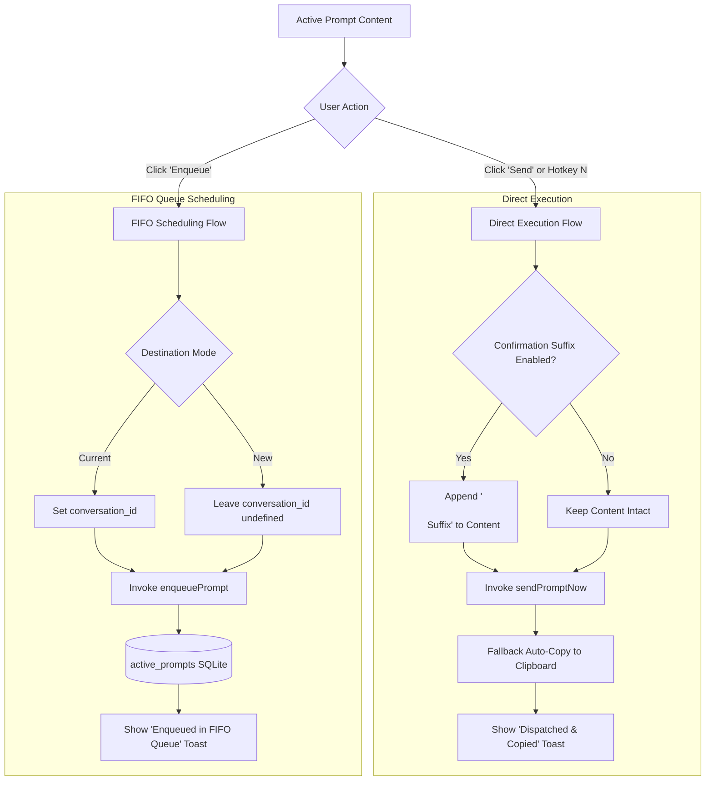

# Architecture Specification: 3-Capsule Action Toolbar, One-Shot Rich Media Copy & Send/Enqueue Separation

**Document ID:** `02-spec/21-app/ui-and-cli-enhancement-and-testing/01-architecture-spec.md`  
**Parent Task:** `ui-and-cli-enhancement-and-testing`  
**Version:** 1.0.0  
**Updated:** 2026-10-15  
**Status:** APPROVED ARCHITECTURE SPECIFICATION  
**Target Release:** v4.200.0  
**Subtask Plan:** [.ai-memory/plans/subtasks/ui-and-cli-enhancement-and-testing/01-ui-enhancements.md](../../../.ai-memory/plans/subtasks/ui-and-cli-enhancement-and-testing/01-ui-enhancements.md)  

---

## 1. Executive Summary & Problem Classification

The Prompt Tree View (`src/components/instances/PromptTreeView/PromptTreeViewModal.tsx`) provides the primary orchestration, inspection, and dispatch interface for developer prompts across local and remote Antigravity IDE instances. While earlier versions successfully introduced 4-tier prompt classification and dark-glass modal headers, the prompt detail header (`src/components/instances/PromptTreeView/DetailHeader.tsx`) currently exhibits three fundamental usability and structural deficiencies:

1. **Coupling of Direct Send and Background Enqueue:**
   - In the previous 2-capsule layout, the secondary action capsule merged immediate live injection (`Send`) and asynchronous scheduling (`Enqueue`) into a single button-plus-dropdown pattern.
   - Enqueueing a prompt into the FIFO queue required opening the dropdown menu, hunting through secondary options, and clicking a sub-item. This obscured the fundamental operational difference between immediate foreground prompt injection (Hotkey: `N`) and non-blocking FIFO queue submission.

2. **Multi-Step Friction in Rich Media & Image Copying:**
   - The primary click of the copy capsule only copied stripped plain text (`stripImagesFromPrompt`), discarding all embedded screenshots, diagrams, and reference assets.
   - Users needing the full prompt with images had to click a separate chevron toggle and select "Copy with Rich Images", causing repeated friction during cross-tool sharing (e.g., pasting into Slack, web browsers, or documentation editors).

3. **Inconsistent UI Tokens & Nested Dropdown Defects:**
   - The confirmation suffix and destination mode selectors suffered from nested pill styling anomalies and mismatched vertical heights.
   - Action controls lacked unified dark-glass tokens, resulting in inconsistent border contrast, arbitrary button radii, and cramped tap targets.

This specification defines the canonical **3-Capsule Action Toolbar Architecture**, establishing complete visual and operational separation between **Content Copy**, **Direct Dispatch**, and **Background Enqueue**, while introducing the one-shot `copyPromptWithRichImages` clipboard pipeline.

---

## 2. Architectural Blueprint: 3-Capsule Action Toolbar

The prompt detail action toolbar is refactored from a 2-capsule cluster into **three independent, contiguous segmented dark-glass capsules**:

```
+-----------------------------------------------------------------------------------------------------------------------------------------+
|                                                   DETAIL HEADER ACTION TOOLBAR                                                          |
+-----------------------------------------------------------------------------------------------------------------------------------------+
|                                                                                                                                         |
|   +-----------------------+     +--------------------------+     +------------------------+                                             |
|   |  CAPSULE 1: COPY ALL  |     |   CAPSULE 2: DIRECT SEND |     |   CAPSULE 3: ENQUEUE   |                                             |
|   +-----------------------+     +--------------------------+     +------------------------+                                             |
|   | [ Copy All ] | [ v ]  |     | [ Send ] [N] | [ v ]     |     | [ Enqueue ] | [ v ]    |                                             |
|   +-----------------------+     +--------------------------+     +------------------------+                                             |
|              |                             |                                |                                                           |
|              v                             v                                v                                                           |
|     Flyout Menu:                  Flyout Menu:                     Flyout Menu:                                                         |
|     - Copy Clean Text             - Destination: [Current | New]   - Destination: [Current | New]                                       |
|     - Save Images to Disk         - Suffix: [None | Done? | ...]   - Queue Status / FIFO Info                                           |
|     - Export as Markdown (.md)    - Focus IDE Window               - Full Inspector Modal                                               |
|     - Export as JSON (.json)                                                                                                            |
|                                                                                                                                         |
+-----------------------------------------------------------------------------------------------------------------------------------------+
```

### 2.1 Capsule 1: Content & Media Copy (`[ Copy All | v ]`)

- **Primary Action (Left Segment):** `Copy All`
  - Single-click invocation of `copyPromptWithRichImages`.
  - Assembles a dual-MIME `ClipboardItem` (`text/html` and `text/plain`) containing full markdown text along with rich inline HTML `` elements for all embedded local, remote, and base64 images.
  - Displays instant visual feedback: icon transitions from `Copy` to `Check`, text transitions to `Copied All!`, with a 2-second automatic reset timer.
- **Dropdown Toggle (Right Segment):** `v` (`ChevronDown`)
  - Toggles a floating dark-glass menu for secondary media and export workflows:
    1. **Copy Clean Text Only:** Strips image tags and markdown image links, copying pure instruction text to the clipboard.
    2. **Save Images to Disk:** Programmatically downloads all embedded images as distinct asset files (`prompt-image-<short_id>-<n>.<ext>`).
    3. **Export as Markdown (.md):** Exports prompt instruction with YAML frontmatter headers (title, project, sequence code, category, timestamp).
    4. **Export as JSON (.json):** Exports canonical JSON envelope containing conversation ID, project ID, step count, and raw prompt text.

### 2.2 Capsule 2: Direct Execution Dispatch (`[ Send N | v ]`)

- **Primary Action (Left Segment):** `Send` + `<kbd>N</kbd>`
  - Dispatches the prompt directly to the running instance IDE via `sendPromptNow`.
  - Hotkey bound to `N` when viewing prompt details.
  - Automatically appends active confirmation suffix (if configured).
  - Displays spinning state (`RotateCw` with `animate-spin`) while dispatch is in-flight (`isResending = true`).
  - Fallback ladder: If direct IDE dispatch fails, automatically copies prompt to system clipboard and tracks failure in `useErrorStore`.
- **Dropdown Toggle (Right Segment):** `v` (`ChevronDown`)
  - Toggles a floating dark-glass execution configuration menu:
    1. **Destination Mode (`select`):** Configures prompt injection target between `Current Conv` (appends to active conversation thread) and `New Conv` (initiates a fresh conversation).
    2. **Confirmation Suffix (`select`):** Preset validation suffixes (`None`, `Is it done?`, `Is it released?`, `Are you sure about it?`, `Double check all edge cases`, `Verify build and tests`).
    3. **Focus IDE Window:** Invokes `focusOrLaunchInstance` to bring the corresponding IDE window into OS foreground focus.

### 2.3 Capsule 3: Asynchronous FIFO Enqueue (`[ Enqueue | v ]`)

- **Primary Action (Left Segment):** `Enqueue`
  - Submits the prompt to the SQLite-backed background FIFO scheduler queue via `enqueuePrompt`.
  - Guarantees strict FIFO ordering (`ORDER BY created_at ASC, id ASC`) in accordance with `AGENTS.md`.
  - Does NOT interrupt or steal focus from currently running IDE tasks.
  - Displays loading state (`ListPlus` with pulsing amber styling) during submission (`isEnqueueing = true`).
- **Dropdown Toggle (Right Segment):** `v` (`ChevronDown`)
  - Toggles a floating dark-glass queue configuration and inspection menu:
    1. **Destination Target Mode (`select`):** Sets target conversation mode for queue execution (`Current Conv` vs `New Conv`).
    2. **Full Inspector Modal:** Opens the expanded full-screen prompt inspector (`InspectorModal`) for reading deep transcript traces and asset trees.
    3. **FIFO Queue Telemetry / Notice:** Displays queue status badge and active queue length context.

---

## 3. Design Tokens & Styling Architecture

In accordance with the `AGENTS.md` UI Design and Headless Compatibility rules, all action controls must adhere strictly to contiguous segmented pill styling:

### 3.1 Segmented Capsule Design Tokens

```css
/* Container: Segmented Pill Capsule */
.segmented-capsule {
    @apply inline-flex items-center rounded-full p-0.5 shadow-2xs shrink-0 backdrop-blur-md;
    @apply bg-slate-100/90 dark:bg-[#120a1f]/90;
    @apply border border-slate-200/80 dark:border-purple-500/30;
    @apply divide-x divide-slate-200/70 dark:divide-purple-500/20;
}

/* Left Segment: Primary Action Button */
.capsule-primary-btn {
    @apply flex items-center gap-1.5 px-3 py-1 rounded-l-full text-[11px] font-semibold;
    @apply transition-all duration-150 ease-out active:scale-[0.98] cursor-pointer;
}

/* Right Segment: Dropdown Toggle Chevron */
.capsule-toggle-btn {
    @apply flex items-center justify-center px-1.5 py-1 rounded-r-full text-[11px];
    @apply transition-all duration-150 ease-out active:scale-[0.98] cursor-pointer;
}
```

### 3.2 Transparent Borderless `<select>` Invariant

To eliminate unsightly "nested white pill-in-pill" defects inside segmented dark-glass capsules, all inline `<select>` controls MUST apply borderless, transparent styling:

```tsx
<select
    value={value}
    onChange={onChange}
    className="bg-transparent border-0 text-slate-700 dark:text-slate-200 text-xs font-semibold focus:ring-0 focus:outline-none cursor-pointer py-0.5 text-right"
>
    <option value="val1" className="bg-white dark:bg-[#171025]">Option 1</option>
    <option value="val2" className="bg-white dark:bg-[#171025]">Option 2</option>
</select>
```

### 3.3 Semantic Color System by Action Role

| Capsule | Primary Text / Accent | Dark Mode Accent | Hover State | Active Icon |
| :--- | :--- | :--- | :--- | :--- |
| **Capsule 1: Copy All** | `text-slate-700` | `dark:text-slate-200` | `hover:bg-slate-200/80 dark:hover:bg-[#40285e]` | `Copy` / `Check` (`text-emerald-500`) |
| **Capsule 2: Send** | `text-emerald-700` | `dark:text-emerald-300` | `hover:bg-emerald-100/80 dark:hover:bg-[#40285e]` | `RotateCw` (`text-emerald-500`) |
| **Capsule 3: Enqueue** | `text-amber-800` | `dark:text-amber-300` | `hover:bg-amber-100/80 dark:hover:bg-[#40285e]` | `ListPlus` (`text-amber-500`) |

---

## 4. One-Shot Rich Media Clipboard Engine (`copyPromptWithRichImages`)

### 4.1 Asset Extraction & HTML Synthesis Sequence

When the user triggers `Copy All`, the engine synchronously parses markdown image declarations, data URIs, and local filesystem references, synthesizing a dual-MIME clipboard object:

```mermaid
sequenceDiagram
    autonumber
    participant User as Developer / UI
    participant Hook as usePromptTreePromptActions
    participant Parser as Asset Extractor
    participant API as Clipboard API (Navigator)
    participant Fallback as copyToClipboard (ExecCommand/Tauri)
    participant Store as ErrorStore

    User->>Hook: Click "Copy All"
    Hook->>Parser: extractAssets(activePromptText)
    Parser-->>Hook: { images: string[], files: string[] }
    Note over Hook: Synthesize text/html payload<br/>Replace  with &lt;img src="src" /&gt;<br/>Preserve newlines as &lt;br /&gt;
    Hook->>API: navigator.clipboard.write([ClipboardItem])
    alt Modern Async Clipboard Success
        API-->>Hook: Promise<void> Resolved
        Hook-->>User: Set "Copied All!" (2.5s banner)
    alt Clipboard API Rejection (Permission / Unfocused)
        API-->>Hook: Catch Exception (NotAllowedError)
        Hook->>Store: trackWarning("clipboard.write", err)
        Hook->>Fallback: copyToClipboard(activePromptText)
        Fallback-->>Hook: Fallback Success (Plain text)
        Hook-->>User: Set "Copied Text (Fallback)"
    end
```

### 4.2 Code Contract: `copyPromptWithRichImages`

```typescript
export async function copyPromptWithRichImages(
    promptText: string,
    onSuccess: (message: string) => void,
    onError: (err: unknown) => void
): Promise<boolean> {
    if (!promptText || !promptText.trim()) {
        return false;
    }

    try {
        // 1. Synthesize rich HTML payload converting Markdown images to styled HTML  tags
        const htmlContent = promptText
            .replace(/!\[(.*?)\]\((.*?)\)/g, '<br />')
            .replace(/\n/g, '<br />');

        const blobHtml = new Blob([htmlContent], { type: 'text/html' });
        const blobText = new Blob([promptText], { type: 'text/plain' });

        const item = new ClipboardItem({
            'text/html': blobHtml,
            'text/plain': blobText,
        });

        await navigator.clipboard.write([item]);
        onSuccess('Copied full prompt with embedded rich images to clipboard!');
        return true;
    } catch (err) {
        // Fallback ladder adhering to "No Silent Errors" rule
        useErrorStore.getState().trackWarning(err, {
            source: 'clipboard.copyPromptWithRichImages',
            triggerAction: 'navigator.clipboard.write',
        });

        const fallbackOk = await copyToClipboard(promptText);
        if (fallbackOk) {
            onSuccess('Copied clean prompt text to clipboard (rich media unsupported in current context)');
            return true;
        }

        onError(err);
        return false;
    }
}
```

---

## 5. Send vs. Enqueue Execution Workflows



### 5.1 Operational Invariants

1. **Strict FIFO Invariant:** In compliance with `AGENTS.md`, prompt restore and background queue queries across SQLite databases MUST enforce strict FIFO ordering using `ORDER BY created_at ASC, id ASC`.
2. **Non-Blocking Guarantee:** `handleEnqueuePrompt` MUST NOT interrupt or steal focus from the user's running IDE instance or cause active editor reloads.
3. **Hotkey Exclusivity:** The hotkey `N` is bound exclusively to `handleResendPrompt` (Direct Send) and MUST NEVER trigger background queueing.

---

## 6. Sizing Rules & Layout Metrics

| Element | Target Height | Horizontal Padding | Typography / Font Size | Border Radius |
| :--- | :--- | :--- | :--- | :--- |
| **Capsule Container** | `28px - 32px` | `p-0.5` | — | `rounded-full` |
| **Primary Button Segment** | `26px - 28px` | `px-2.5` to `px-3` | `11px` (`text-[11px] font-semibold`) | `rounded-l-full` |
| **Chevron Segment** | `26px - 28px` | `px-1.5` | `w-3.5 h-3.5` icon | `rounded-r-full` |
| **Hotkey Badge (`<kbd>`)** | `14px` | `px-1 py-0.2` | `8.5px` (`text-[8.5px] font-mono font-bold`) | `rounded-[3px]` |
| **Dropdown Menus** | Auto (`max-h-72`) | `p-1.5` | `11px - 12px` (`text-xs`) | `rounded-xl` |
| **Action Toolbar Gap** | — | `gap-1.5` | — | — |

---

## 7. Acceptance Criteria & Verification Protocol

- **AC-01 (3 Segmented Capsules):** Detail header renders exactly 3 contiguous segmented capsules: `[ Copy All | v ]`, `[ Send N | v ]`, and `[ Enqueue | v ]`. No monolithic merged containers.
- **AC-02 (One-Shot Copy All):** Clicking `Copy All` executes `copyPromptWithRichImages`, writing both HTML with `` tags and raw markdown text to clipboard.
- **AC-03 (Direct Send Hotkey):** Pressing `N` triggers direct dispatch to the running instance with optional confirmation suffix.
- **AC-04 (Enqueue Isolation):** Clicking `Enqueue` submits to the FIFO scheduler without modifying current running conversation state or stealing window focus.
- **AC-05 (Transparent Selects):** All dropdown selects use `bg-transparent border-0 focus:ring-0` with zero white nested background rectangles.
- **AC-06 (No Silent Errors):** All clipboard and dispatch fallbacks route through `useErrorStore.getState().trackWarning` or `captureException`.
- **AC-07 (Dark-Glass Visual Parity):** All capsules feature backdrop blur, dark-glass background, subtle border divider lines, and consistent hover transitions.

---

## 8. Cross-References

- Master Guidelines: `AGENTS.md`
- Subtask Execution Plan: [.ai-memory/plans/subtasks/ui-and-cli-enhancement-and-testing/01-ui-enhancements.md](../../../.ai-memory/plans/subtasks/ui-and-cli-enhancement-and-testing/01-ui-enhancements.md)
- Detail Header Component: `src/components/instances/PromptTreeView/DetailHeader.tsx`
- Actions Hook: `src/components/instances/PromptTreeView/usePromptTreePromptActions.ts`
- State Hook: `src/components/instances/PromptTreeView/usePromptTreeState.ts`
- Modal View: `src/components/instances/PromptTreeView/PromptTreeViewModal.tsx`
