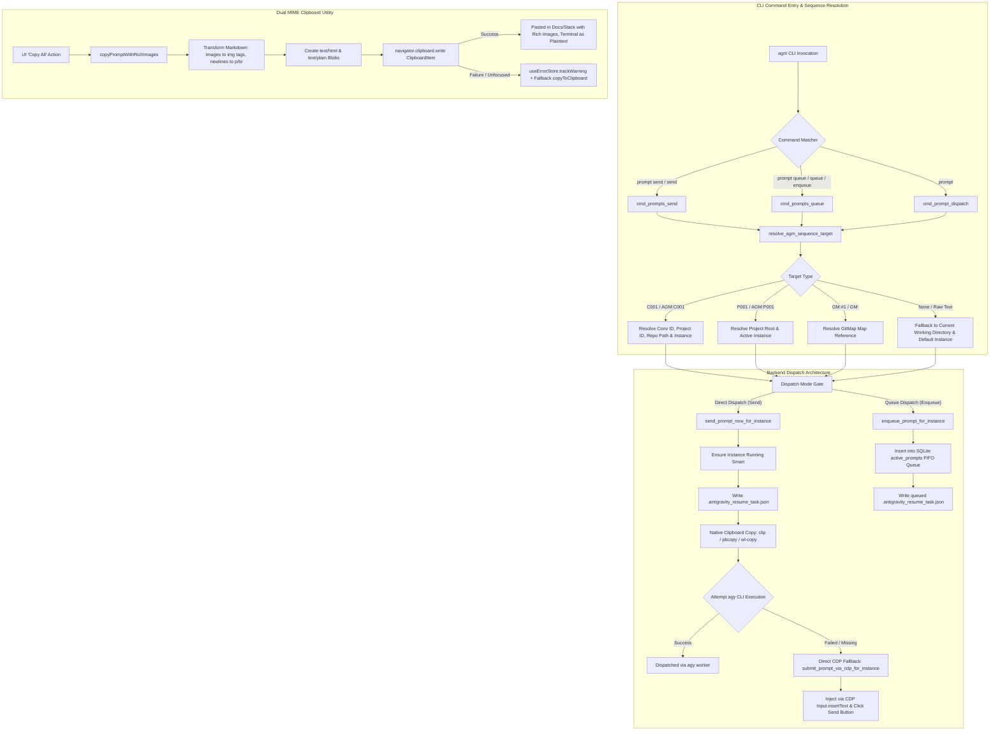
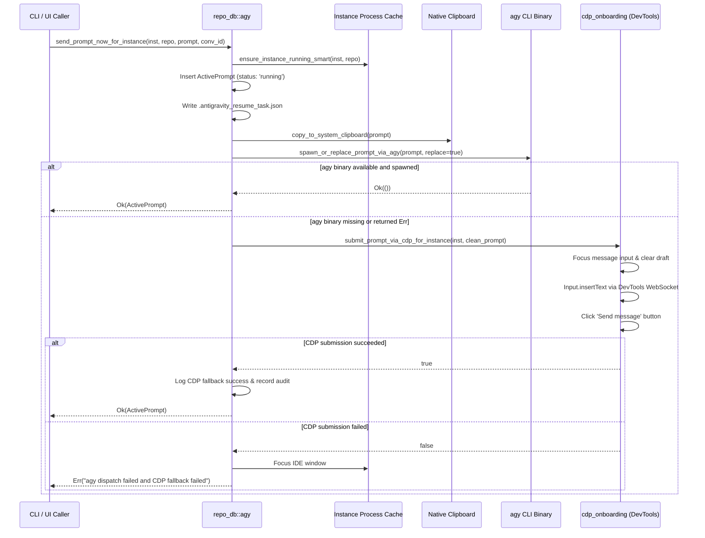

# Specification: CLI Command Dispatch, Sequence Resolution, Direct CDP Fallback & Clipboard Dual MIME

- **Document Version**: `1.0.0`
- **Specification Classification**: CLI Architecture, Prompt Dispatch & Clipboard Integration Specification
- **Task Slug**: `ui-and-cli-enhancement-and-testing`
- **Spec Path**: `02-spec/21-app/ui-and-cli-enhancement-and-testing/02-cli-and-copy-spec.md`
- **Subtask Plan**: `.ai-memory/plans/subtasks/ui-and-cli-enhancement-and-testing/02-cli-and-release.md`
- **Maintainer / Attribution**: Strictly `@aukgit` (`(Thanks to @aukgit)`)

---

## 1. Verbatim User Request Ingestion

> "Okay. So here you can see the dropdown for the prompt actually looks a bit different. So I don't see the dropdown for the enqueue. So send works, but send actually sends as an enqueue. It does not send directly. That is one of the things that you need to fix and check and do the end-to-end testing here. Also, at the same time, you need to correct the CLI methods, CLI sections as well. And if possible, try to enhance and make this UI a little bit compact. And when I click on this section, try to have proper dropdown menus, okay, so that this is lucrative. Can you please do that for me? Then also try to have a standalone copy button where I could copy all this image and everything together as one shot. Okay? Can you please integrate? And finally, you can do a release bump using minor bump actually, and do a release."

---

## 2. Executive Architectural Overview

This specification establishes the architectural contract for:
1. **CLI Command Dispatch**: Distinct and unambiguous subcommands for direct prompt sending (`agm prompt send`), FIFO prompt queueing (`agm prompt queue`), and top-level queue shortcuts (`agm queue`, `agm enqueue`, `agm qe`).
2. **AGM Sequence Resolution**: Automatic target resolution for conversation sequence tokens (`C001`, `AGM:C001`), project sequence tokens (`P001`, `AGM:P001`), and GitMap sequence tokens (`GM:#1`, `GM:<cid>`) across all CLI dispatch subcommands.
3. **Backend Direct Dispatch & CDP Fallback Architecture**: Execution ladder in `send_prompt_now_for_instance` with graceful fallback to DevTools Chrome DevTools Protocol (CDP) direct DOM/composer insertion (`submit_prompt_via_cdp_for_instance`) whenever the headless `agy` CLI binary is absent or returns an execution error.
4. **Dual MIME Clipboard Copy Utility**: Standardized `ClipboardItem` implementation copying both formatted `text/html` (with inline responsive image rendering) and clean `text/plain` markdown fallback into the system clipboard with telemetry warning tracking.
5. **Minor Version Release Workflow**: Automated 15-file atomic version synchronization via `npm run bump minor`, strict single-author attribution invariant (`@aukgit`), and two-way README changelog synchronization.



---

## 3. CLI Command Dispatch Specifications

### 3.1 Command Routing Matrix

The CLI command router in `src-tauri/src/bin/agm/main.rs`, `src-tauri/src/bin/agm/common.rs`, and `src-tauri/src/bin/agm/prompt_cmds.rs` must enforce strict routing separation between immediate dispatch and queueing.

| Command Line Invocation | Function Handler | Operation Mode | Behavior |
|---|---|---|---|
| `agm prompt send [target] "<prompt>"` | `cmd_prompts_send` | Immediate Dispatch | Bypasses queue. Wakes target IDE instance, inserts prompt immediately, updates status to `running`. |
| `agm prompt queue [target] "<prompt>"` | `cmd_prompts_queue` | FIFO Enqueue | Appends prompt to SQLite `active_prompts` queue with status `queued` and FIFO order `created_at ASC, id ASC`. |
| `agm queue [target] "<prompt>"` | `cmd_prompts_queue` | FIFO Enqueue | Top-level alias for `agm prompt queue`. |
| `agm enqueue [target] "<prompt>"` | `cmd_prompts_queue` | FIFO Enqueue | Top-level natural language alias for `agm prompt queue`. |
| `agm qe [target] "<prompt>"` | `cmd_prompts_queue` | FIFO Enqueue | Short alias for `agm prompt queue`. |
| `agm prompt [target] "<prompt>"` | `cmd_prompt_dispatch` | Immediate Dispatch | Default prompt command dispatches immediately unless `--queue` is present. |
| `agm prompt [target] "<prompt>" --queue` | `cmd_prompt_dispatch` | FIFO Enqueue | Explicit flag overrides default dispatch and enqueues prompt in FIFO queue. |

### 3.2 Subcommand Normalization in `common.rs` & `main.rs`

In `src-tauri/src/bin/agm/common.rs`, `is_prompt_subcommand` must recognize `enqueue` alongside existing commands:

```rust
pub(crate) fn is_prompt_subcommand(sub: &str) -> bool {
    let s = sub
        .trim_start_matches('/')
        .trim_start_matches('-')
        .to_lowercase();
    matches!(
        s.as_str(),
        "list"
            | "ls"
            | "tree"
            | "inspect"
            | "observe"
            | "send"
            | "dispatch"
            | "running"
            | "wpr"
            | "queue"
            | "enqueue"
            | "qe"
            | "history"
            | "export"
            | "backup"
            | "brp"
            | "restore"
            | "rrp"
            | "purge"
            | "clean"
    )
}
```

In `src-tauri/src/bin/agm/main.rs`:

```rust
"queues" | "queue" | "enqueue" | "qe" => {
    crate::prompt_cmds::dispatch_prompt_domain("queue", &cmd_args);
}
```

In `src-tauri/src/bin/agm/prompt_cmds.rs`:

```rust
pub(crate) fn dispatch_prompt_domain(subcommand: &str, args: &[String]) {
    match subcommand {
        // ...
        "send" | "dispatch" => cmd_prompts_send(args),
        "queue" | "enqueue" | "qe" => cmd_prompts_queue(args),
        // ...
    }
}
```

---

## 4. AGM Sequence Resolution Specification

### 4.1 Target Sequence Grammar

The AGM sequence resolution parser identifies target tokens matching the following formats:
1. **Conversation Sequence (`C###`)**: `C001`, `c001`, `#C001`, `AGM:C001`, `[AGM:C001]`. Targets an existing active or historical conversation session.
2. **Project Sequence (`P###`)**: `P001`, `p001`, `#P001`, `AGM:P001`, `[AGM:P001]`. Targets the primary conversation and working directory of a registered project workspace.
3. **GitMap Cross-Ref (`GM:###`)**: `GM:#1`, `GM:1`, `GM:<cid>`. Cross-references a GitMap sequence index to resolve the workspace path.

### 4.2 Sequence Resolution Logic in `cmd_prompts_send` & `cmd_prompts_queue`

Both `cmd_prompts_send` and `cmd_prompts_queue` in `src-tauri/src/bin/agm/prompt_cmds.rs` must inspect positional arguments before building the prompt payload:

```rust
let mut resolved_seq: Option<repo_db::AgmSequenceResolution> = None;
let mut prompt_tokens = ctx.positional_args.clone();

if !prompt_tokens.is_empty() {
    let first = prompt_tokens[0].trim();
    let upper = first.trim_start_matches('#').to_uppercase();
    let looks_like_seq = upper.starts_with("AGM:")
        || upper.starts_with("GM:")
        || ((upper.starts_with('C') || upper.starts_with('P'))
            && upper[1..].chars().all(|c| c.is_ascii_digit())
            && !upper[1..].is_empty());

    if looks_like_seq {
        if let Some(res) = repo_db::resolve_agm_sequence_target(first) {
            resolved_seq = Some(res);
            prompt_tokens.remove(0);
        }
    } else if first.starts_with("inst-")
        || first == "default"
        || instance::resolve_instance_id(first).is_ok()
    {
        // First token is an explicit instance selector
        prompt_tokens.remove(0);
    }
}

let (resolved_inst, repo_path, session_id) = if let Some(seq) = resolved_seq {
    let inst = ctx.instance_id.clone().unwrap_or(seq.instance_id);
    let repo = ctx.repo_path.clone().unwrap_or(seq.repo_path);
    let sess = seq.conversation_id.or(ctx.conversation_id.clone());
    (inst, repo, sess)
} else {
    let inst = ctx.resolve_target_instance().unwrap_or_else(|_| "default".to_string());
    let repo = ctx.repo_path.clone().unwrap_or_else(|| {
        std::env::current_dir()
            .map(|p| p.to_string_lossy().to_string())
            .unwrap_or_else(|_| ".".to_string())
    });
    let sess = resolve_destination_session(args, &repo);
    (inst, repo, sess)
};
```

---

## 5. Backend Direct Dispatch & CDP Fallback Architecture

### 5.1 The `send_prompt_now_for_instance` Execution Ladder

`src-tauri/src/modules/repo_db/agy.rs` defines `send_prompt_now_for_instance`. In production headless or user environments where the `agy` CLI binary is either not in the system `PATH` or encounters an IPC socket failure, the prompt MUST NOT fail silently or reject. AGM executes a graceful direct insertion ladder:



### 5.2 Implementation Specification in `src-tauri/src/modules/repo_db/agy.rs`

```rust
// 4. Dispatch via agy CLI execution with direct CDP graceful degradation fallback
if let Err(spawn_err) = spawn_or_replace_prompt_via_agy(&active_prompt, true) {
    tracing::warn!(
        target: "repo_db",
        prompt_id = %active_prompt.id,
        instance_id = %canonical_inst,
        repo_path = %repo_path,
        error = %spawn_err,
        "agy CLI dispatch failed; attempting direct CDP insertion fallback"
    );

    // Fallback: Direct DevTools insertion into running Antigravity IDE
    let clean_prompt = extract_clean_user_prompt(prompt_content);
    let cdp_ok = crate::modules::instance::cdp_onboarding::submit_prompt_via_cdp_for_instance(
        &canonical_inst,
        &clean_prompt,
    );

    if cdp_ok {
        crate::modules::logger::log_info(&format!(
            "[RepoDB] Direct CDP fallback succeeded for prompt '{}' on instance '{}'",
            active_prompt.id, canonical_inst
        ));
        antigravity_tools_lib::modules::audit::record_if_active(
            "backend",
            "repo_db",
            "cdp_dispatch_fallback",
            &format!("instance:{canonical_inst}"),
            serde_json::json!({
                "promptId": active_prompt.id,
                "instanceId": canonical_inst,
                "repoPath": repo_path,
                "fallback": "cdp_direct",
            }),
            "ok",
            "Prompt dispatched via live DevTools CDP fallback",
        );
    } else {
        let focus_note = match crate::modules::instance::ensure_instance_running_for_dispatch(
            &canonical_inst,
            Some(repo_path),
        ) {
            Ok(pid) => format!("IDE focused (pid {pid})"),
            Err(focus_err) => format!("IDE focus failed: {focus_err}"),
        };
        return Err(format!("{spawn_err}; direct CDP fallback failed; {focus_note}"));
    }
}
```

---

## 6. Dual MIME Clipboard Copy Specification

### 6.1 Requirements & Objective
Users require a single, standalone "Copy All" action within the prompt inspection UI (`PromptInstructionView.tsx`) that copies both formatted Markdown text and rich images in a single clipboard operation.

When pasting into:
- **Rich Document Editors (Slack, Word, Google Docs, Apple Notes)**: The clipboard renders formatted paragraphs, line breaks, and responsive embedded images (``).
- **Terminal, Code Editors & Plaintext Areas**: The clipboard renders the raw markdown content without corrupting backticks or markdown links.

### 6.2 Module Contract (`src/components/instances/PromptTreeView/clipboard.ts`)

```typescript
import { copyToClipboard } from '../../../utils/clipboard';
import { useErrorStore } from '../../../stores/error-store';

/**
 * Copies markdown prompt content and embedded images into system clipboard
 * simultaneously using dual MIME types ('text/html' and 'text/plain').
 */
export async function copyPromptWithRichImages(markdownText: string): Promise<boolean> {
    if (!navigator.clipboard || typeof ClipboardItem === 'undefined') {
        return copyToClipboard(markdownText);
    }

    try {
        let htmlContent = markdownText
            .replace(/\n\n/g, '</p><p>')
            .replace(/\n/g, '<br/>')
            .replace(/!\[(.*?)\]\((.*?)\)/g, '');

        htmlContent = `<!DOCTYPE html><html><body><p>${htmlContent}</p></body></html>`;

        const htmlBlob = new Blob([htmlContent], { type: 'text/html' });
        const textBlob = new Blob([markdownText], { type: 'text/plain' });

        const item = new ClipboardItem({
            'text/html': htmlBlob,
            'text/plain': textBlob,
        });

        await navigator.clipboard.write([item]);
        return true;
    } catch (err) {
        useErrorStore.getState().trackWarning(err, {
            source: 'PromptTree.copyPromptWithRichImages',
            triggerAction: 'clipboard.write',
        });
        return copyToClipboard(markdownText);
    }
}
```

### 6.3 Invariant Rules for Clipboard
1. **No Silent Error**: Any failure of `navigator.clipboard.write` must be tracked via `useErrorStore.getState().trackWarning` before invoking the plaintext fallback `copyToClipboard`.
2. **Safe Image Styling**: Embedded `` elements must specify inline `style="max-width:100%; border-radius:8px; margin:8px 0;"` to prevent overflow in rich text renderers.
3. **MIME Ordering**: `text/html` precedes `text/plain` in the `ClipboardItem` dictionary so rich clients prioritize HTML rendering.

---

## 7. Minor Release Bump Workflow & Quality Invariants

### 7.1 Automated Version Bump Pipeline (`npm run bump minor`)

Executing `npm run bump minor` triggers `scripts/bump-version.mjs`, synchronizing the minor version number atomically across **15 distinct files**:

| # | Relative File Path | Synchronized Content |
|---|---|---|
| 1 | `package.json` | Root package `"version"` field |
| 2 | `package-lock.json` | Root `"version"` and `packages[""].version` fields |
| 3 | `version.json` | Canonical version metadata JSON |
| 4 | `src-tauri/Cargo.toml` | `[package]` version definition |
| 5 | `src-tauri/tauri.conf.json` | Application version and window title `Antigravity Manager Tools vX.Y.Z` |
| 6 | `src-tauri/Cargo.lock` | Rust package lock version |
| 7 | `Casks/antigravity-tools.rb` | Homebrew Cask formula version string |
| 8 | `README.md` | Stable version title `(vX.Y.Z)` and shields.io badge URLs |
| 9 | `README_EN.md` | Stable English version title and badge URLs |
| 10 | `src/components/layout/MiniView.tsx` | MiniView fallback version string |
| 11 | `src/pages/Settings.tsx` | Settings view version state fallback |
| 12 | `releases-manifest.json` | Installer CDN metadata and release download URLs |
| 13 | `CHANGELOG.md` | Prepend release heading skeleton for `vX.Y.Z` |
| 14 | `CHANGELOG_EN.md` | Prepend English release heading skeleton for `vX.Y.Z` |
| 15 | `src-tauri/hooks.nsh` | NSIS installer postinstall registry hook string |

### 7.2 Strict `@aukgit` Attribution Invariant
As defined in repository governance:
- All release attribution in `CHANGELOG.md` and `CHANGELOG_EN.md` must strictly credit `@aukgit`:
  ```markdown
  *(Thanks to @aukgit)*
  ```
- **TOTAL BAN**: No other GitHub user handles (`@...`) may appear in changelogs or release notes.

### 7.3 Two-Way README Changelog Synchronization
For stable minor releases:
- The release notes summary must be mirrored across both `README.md` (under `## 📝 Changelog`) and `README_EN.md` (under `## 📝 Changelog`).
- Never update only `CHANGELOG.md` while leaving `README.md` / `README_EN.md` with outdated release notes.

---

## 8. Verification & Acceptance Criteria

| ID | Verification Area | Verification Steps | Expected Outcome |
|---|---|---|---|
| V1 | `agm prompt send` CLI | Run `agm prompt send C001 "Test direct dispatch"` | Resolves `C001`, bypasses FIFO queue, dispatches immediately to instance, returns success envelope. |
| V2 | `agm prompt queue` CLI | Run `agm prompt queue P001 "Test FIFO queue"` | Resolves `P001`, inserts record into SQLite `active_prompts` with status `queued`, returns FIFO position. |
| V3 | `agm queue` Shortcut | Run `agm queue "Test shortcut queue"` | Routes directly to `cmd_prompts_queue` without error. |
| V4 | `agm prompt --queue` Flag | Run `agm prompt "Test flag" --queue` | Directs dispatch to `enqueue_prompt_for_instance`. |
| V5 | Direct CDP Fallback | Execute prompt dispatch when `agy` binary is uninstalled or unreachable | Gracefully triggers `submit_prompt_via_cdp_for_instance`, inserts prompt into IDE conversation, returns `Ok`. |
| V6 | Dual MIME Copy | Click "Copy All" on a prompt containing `` | System clipboard contains both HTML blob with rendered `` and raw markdown text blob. |
| V7 | Minor Version Bump | Run `npm run bump minor` | Atomically updates 15 files from `4.203.0` to `4.204.0`. |
| V8 | Pre-flight Gates | Run `cargo fmt -- --check`, `cargo clippy`, `npm run build` | Zero linter warnings, zero compiler errors, clean bundle build. |
