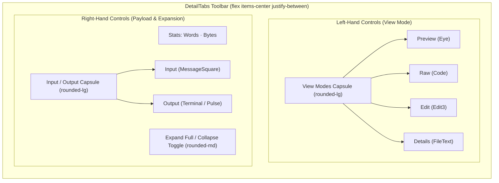
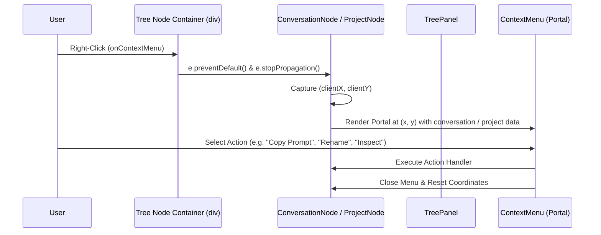
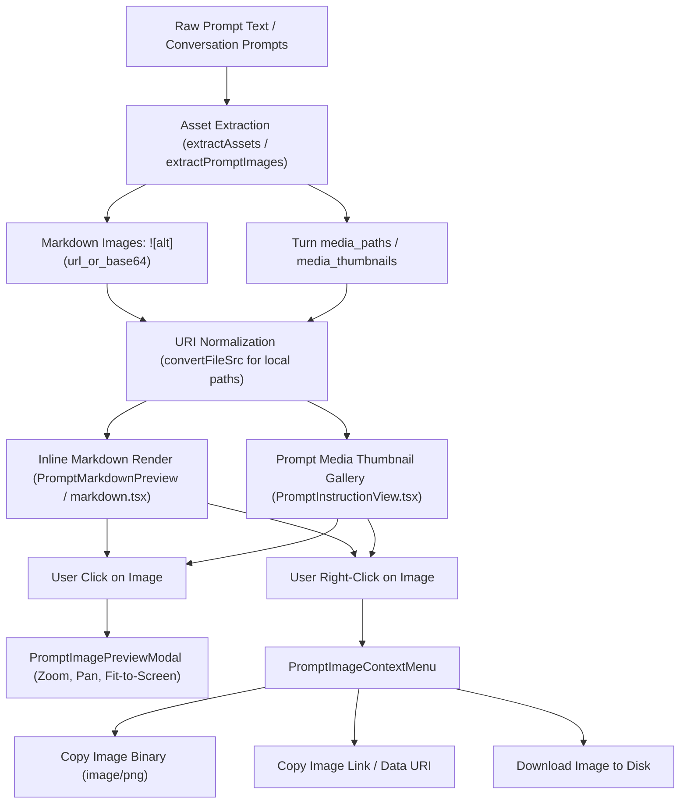
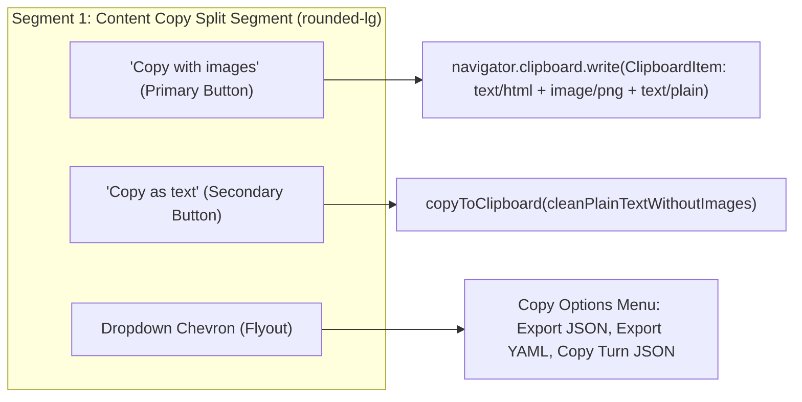
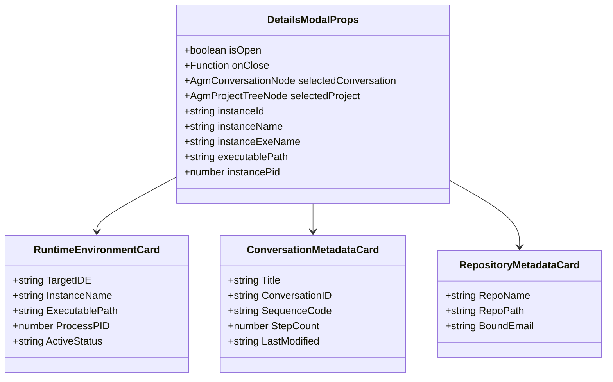
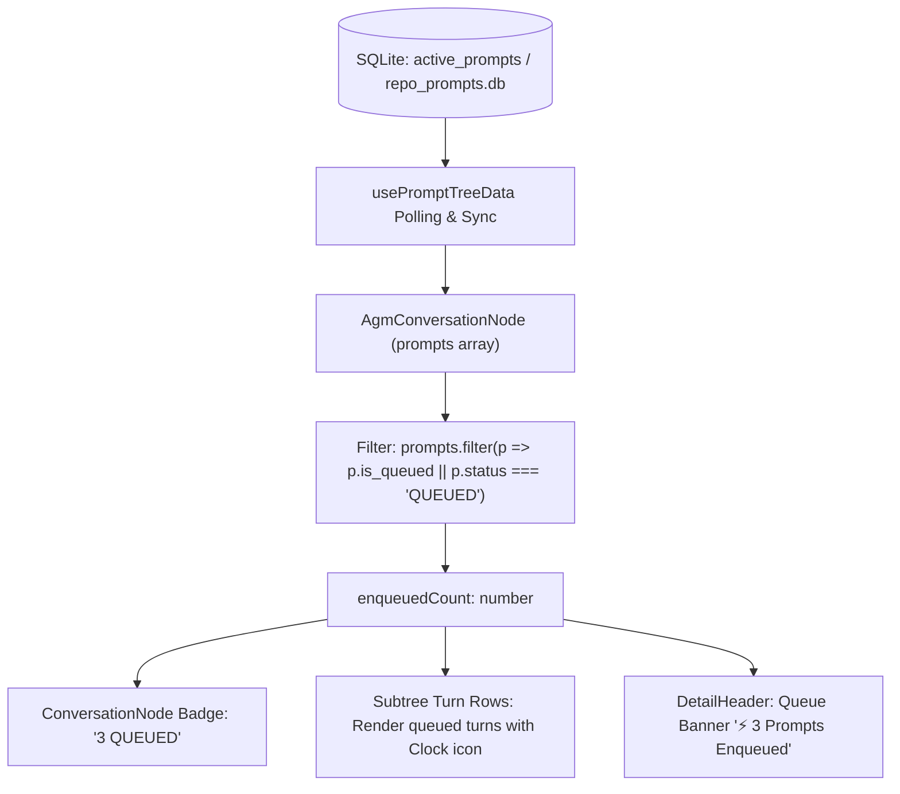
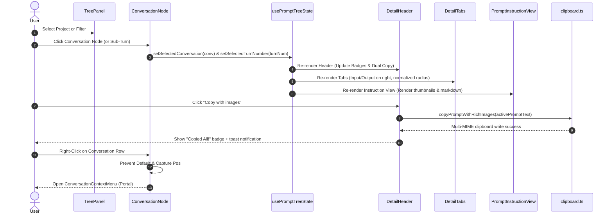

# Architecture Specification: UI and Functionality Enhancement Instructions

- **Specification Slug**: `ui-and-functionality-enhancement-instructions`
- **Document Path**: `02-spec/21-app/ui-and-functionality-enhancement-instructions/01-architecture-spec.md`
- **Master Plan**: `.ai-memory/plans/ui-and-functionality-enhancement-instructions.md`
- **Target Subtask Plan**: `.ai-memory/plans/subtasks/ui-and-functionality-enhancement-instructions/01-ui-layout-and-buttons.md`
- **Target Release Version**: `v4.227.0` (Minor Bump)
- **Author**: Spec Author 01 (Task Planning & Specification)
- **Status**: MANDATED & APPROVED FOR IMPLEMENTATION

---

## 1. Executive Summary & Design Principles

This specification defines the architectural overhaul, component hierarchy, DOM reorganization, visual styling, and event propagation systems for eight critical user interface and functionality enhancements within Antigravity Manager's `PromptTreeView` subsystem:

1. **DetailTabs Right-Hand Re-anchoring**: Relocating the `[Input]` and `[Output]` tab capsule to the right-hand side directly beside the `[Expand Full]` toggle, consolidating stats, tabs, and expansion into a unified right-aligned toolbar segment while leaving view modes on the left.
2. **Button Border-Radius Normalization**: Replacing excessive, bubble-like `rounded-full` styling across buttons, capsules, and tags in all prompt tree components with disciplined, modern `rounded-md` (6px) and `rounded-lg` (8px) tokens.
3. **Comprehensive Tree Node Right-Click Context Menu**: Fixing tree-wide context menu dead zones by capturing `onContextMenu` across the entire node row container in `TreePanel.tsx`, `ProjectNode.tsx`, and `ConversationNode.tsx`, preventing browser default context popups and displaying contextual actions for projects, conversations, and sub-turns.
4. **Rich Image Rendering, Thumbnail Gallery & Contextual Copying**: Enhancing `PromptInstructionView.tsx` and `markdown.tsx` with inline image rendering, attached media thumbnail strips, click-to-open lightbox previews via `PromptImagePreviewModal.tsx`, and right-click image operations via `PromptImageContextMenu.tsx`.
5. **Dual Copy Mode Buttons**: Replacing the ambiguous copy menu with dual, explicit primary choices in `DetailHeader.tsx`: "Copy with images" (rich HTML + binary PNG clipboard write) and "Copy without images (as text)" (sanitized plain text/markdown write).
6. **Restoration of Runtime Details Modal**: Restoring the Details action trigger and enriching `DetailsModal.tsx` to surface critical runtime telemetry: Target IDE, Instance Name, Executable Path, and Process PID.
7. **Enqueued Prompts Counter & Subtree Visibility**: Exposing background FIFO queue volume directly in `ConversationNode.tsx` (badge counter) and `DetailHeader.tsx` (queue status banner), displaying queued turns in the prompt tree with active queue indicators.
8. **Visual Differentiation for Conversation Sessions vs Individual Prompt Turns**: Introducing clear semantic styling, badge distinctions, and header breadcrumbs to eliminate user confusion when toggling between an entire conversation session and an isolated prompt turn.

### Core Architectural Invariants Enforced
- **Contiguous Segmented Capsules**: Controls grouped together must share a single backdrop wrapper, fine divider borders, and consistent corner radii (`rounded-lg` wrapper with `first:rounded-l-lg last:rounded-r-lg` segments) rather than floating, disconnected buttons.
- **Strict Relative Pathing**: All documentation, codebase references, and attachment paths must use repository-relative paths. No absolute paths (`C:\...`, `D:\...`) or `file:///` URIs may appear in specifications or persistent artifacts.
- **No Silent Errors**: Every fallible operation (clipboard writing, IPC invocations, image conversions, context menu positioning) must report warnings through `useErrorStore.getState().trackWarning()` or user-facing errors via `captureException()`.
- **4-Tier Prompt Origin Hierarchy**: Prompt origin classifications (`USER_PROMPT`, `SUBAGENT_INSTRUCTION`, `SYSTEM_MESSAGE`, `TOOL_OUTPUT`) must be visually maintained across all node headers and badges.

---

## 2. DetailTabs Layout Architecture (`DetailTabs.tsx`)

### 2.1 Problem Diagnosis
In the existing layout of `src/components/instances/PromptTreeView/DetailTabs.tsx`, the tab controls for switching between `Input` (prompt instruction) and `Output` (execution results / terminal output) are grouped on the left-hand side alongside the view mode switch (`Preview`, `Raw`, `Edit`, `Details`). This produces:
1. Visual overcrowding on the left edge, causing toolbar wrapping on narrower screens.
2. Disconnection from the content length statistics and expansion controls (`[Expand Full]`) located far on the right.
3. Lack of functional grouping: view modes alter *how* content is rendered, whereas `Input`/`Output` alters *which payload* is being viewed.

### 2.2 Re-architected DOM Hierarchy



### 2.3 Structural & Styling Specifications
- **Left Group**: Contains only the View Mode segmented capsule:
  - Wrapper: `inline-flex items-center rounded-lg bg-slate-100/90 dark:bg-[#120a1f]/90 backdrop-blur-md border border-slate-200/80 dark:border-purple-500/30 p-0.5 divide-x divide-slate-200/70 dark:divide-purple-500/20 shadow-2xs shrink-0`.
  - Buttons (`Preview`, `Raw`, `Edit`, `Details`): Use `p-1.5 transition-all text-xs font-semibold cursor-pointer`. The first button has `rounded-l-md`, intermediate buttons have `rounded-none`, and the last button has `rounded-r-md`.
- **Right Group**: Floated to the right with `flex items-center gap-2 ml-auto shrink-0`:
  - **Stats Display**: Monospace word count and formatted byte size (`text-xs font-semibold text-slate-500 dark:text-slate-400 font-mono`).
  - **Input / Output Capsule**:
    - Wrapper: `inline-flex items-center rounded-lg bg-slate-100/90 dark:bg-[#120a1f]/90 backdrop-blur-md border border-slate-200/80 dark:border-purple-500/30 p-0.5 divide-x divide-slate-200/70 dark:divide-purple-500/20 shadow-2xs shrink-0`.
    - `Input` Button: `flex items-center gap-1.5 px-3 py-1 rounded-l-md text-[11px] font-semibold`. Active state: `bg-blue-600 text-white shadow-2xs`.
    - `Output` Button: `flex items-center gap-1.5 px-3 py-1 rounded-r-md text-[11px] font-semibold`. Active state: `bg-blue-600 text-white shadow-2xs`. Includes running pulse indicator if `selectedConversation?.is_running` is active.
  - **Expand Full Button**: Positioned directly beside the Input/Output capsule:
    - Container styling: `flex items-center gap-1 px-2.5 py-1 rounded-md text-[10px] font-semibold bg-cyan-500/10 text-cyan-700 dark:text-cyan-300 border border-cyan-500/20 hover:bg-cyan-500/20 transition-all cursor-pointer`.

---

## 3. Button Border-Radius Normalization

### 3.1 Motivation & Design Audit
The existing UI uses excessive `rounded-full` classes across all buttons, dropdown capsules, and action chips. This creates an uncoordinated, overly rounded "bubble" aesthetic that conflicts with desktop software guidelines and clutters complex data grids.

### 3.2 Standardization Matrix

| Component Area | Current Token | Normalized Token | Design Rationale |
| :--- | :--- | :--- | :--- |
| Action Capsules (DetailHeader) | `rounded-full` | `rounded-lg` (8px) | Structured, modern segmented toolbar appearance. |
| Split Button Halves (Left/Right) | `rounded-l-full` / `rounded-r-full` | `rounded-l-md` / `rounded-r-md` (6px) | Clean interior corner alignment within `rounded-lg` shell. |
| View Mode Buttons (DetailTabs) | `rounded-l-full` / `rounded-r-full` | `rounded-l-md` / `rounded-r-md` (6px) | Cohesive geometric rhythm matching IDE tabs. |
| Expand / Collapse Button | `rounded-full` | `rounded-md` (6px) | Replaces circle-pill with clean rectangular tag. |
| Conversation Status Badges | `rounded-full` | `rounded-md` (6px) | Aligns with sequence badge geometry (`rounded-[4px]`). |
| Tree Filter Chips (TreePanel) | `rounded-full` | `rounded-md` (6px) | Standardizes list view filters. |
| Image Context Menu & Lightbox Buttons | `rounded-full` | `rounded-md` (6px) | Professional desktop floating control aesthetic. |

### 3.3 Target File Scope
- `src/components/instances/PromptTreeView/DetailTabs.tsx`
- `src/components/instances/PromptTreeView/DetailHeader.tsx`
- `src/components/instances/PromptTreeView/TreePanel.tsx`
- `src/components/instances/PromptTreeView/ProjectNode.tsx`
- `src/components/instances/PromptTreeView/ConversationNode.tsx`
- `src/components/instances/PromptTreeView/PromptInstructionView.tsx`
- `src/components/instances/PromptTreeView/PromptMarkdownPreview.tsx`

---

## 4. Tree Node Right-Click Context Menu Hierarchy

### 4.1 Problem Diagnosis
Currently, right-clicking on tree nodes produces inconsistent or non-functional behavior:
1. In `ConversationNode.tsx`, `onContextMenu` was bound exclusively to an inner `<span>` rendering the title string. Right-clicking the outer node row, icon, sequence badge, or whitespace triggered no action or opened the browser's default inspection menu.
2. In `ProjectNode.tsx`, right-click events were not properly propagated or handled when projects were rendered inside scoped single-project mode.
3. In `TreePanel.tsx`, context menu dismissal states were uncoordinated, and child nodes lacked clear handlers for triggering conversation-level and project-level commands.

### 4.2 Event Propagation Architecture



### 4.3 Container-Level Right-Click Invariant
- **Whole-Row Hit Target**: The top-level `div` for every project row, conversation row, and prompt turn row must attach `onContextMenu={(e) => { e.preventDefault(); e.stopPropagation(); setContextMenuPos({ x: e.clientX, y: e.clientY }); }}`.
- **Sub-Turn Distinction**:
  - Right-clicking a **Project Node** opens `ProjectContextMenu` (Refresh, Pin, Archive, Export Project JSON/YAML, Copy Repo Path).
  - Right-clicking a **Conversation Node** opens `ConversationContextMenu` (Rename, Inspect Full Transcript, Resend Prompts, Enqueue Prompts, Rerun Nudges, Copy Prompt Text, Export JSON/YAML/SQLite).
  - Right-clicking an individual **Turn Node** opens `ConversationContextMenu` with targeted prompt text and turn-specific execution context.
- **Viewport Boundary Clamping**: Coordinates must be constrained within `[8, window.innerWidth - 280]` and `[8, window.innerHeight - 450]` to prevent menus from rendering off-screen.

---

## 5. Rich Image Rendering, Thumbnail Previewing & Contextual Copying

### 5.1 Architecture & Pipeline



### 5.2 Implementation Specifications
1. **URI Normalization & Local File Compatibility**:
   - Remote URLs (`https://...`, `http://...`) and Data URIs (`data:image/...`) render natively.
   - Local filesystem paths (`./.antigravity/attachments/...`, `attachments/...`) must be converted using `@tauri-apps/api/core` `convertFileSrc()` when running within Tauri to bypass WebView2 security restrictions.
2. **Thumbnail Gallery Strip in `PromptInstructionView.tsx`**:
   - When a conversation or turn has associated images (extracted from markdown or `media_paths`), render a compact thumbnail gallery above or below the prompt instruction text.
   - Thumbnails: `w-14 h-14 object-cover rounded-md border border-slate-200 dark:border-purple-500/30 hover:border-purple-400 transition-transform hover:scale-105 cursor-pointer shadow-2xs`.
3. **Interactive Lightbox Integration**:
   - Clicking any thumbnail or inline markdown image opens `PromptImagePreviewModal.tsx`.
   - Supports keyboard closing (`Escape`), image dimensions display, and download triggers.
4. **Context Menu (`PromptImageContextMenu.tsx`)**:
   - Right-clicking any rendered image displays the custom dark-glass menu at mouse coordinates.
   - Action 1: "Copy Image" - Calls `writeNativeImageToClipboard()` from `src/components/instances/PromptTreeView/clipboard.ts` using `ClipboardItem` with `image/png`.
   - Action 2: "Copy Image Link" - Copies the normalized source path or data URI to clipboard.
   - Action 3: "Save Image As" - Prompts save dialog to write the binary image to user disk.

---

## 6. Dual Copy Pipeline in `DetailHeader.tsx`

### 6.1 Problem & Motivation
The previous copy action toolbar used an overloaded split button that caused confusion: users could not easily tell whether clicking "Copy All" would copy rich images or plain text, leading to failed pastes into terminals or non-rich-text editors.

### 6.2 Dual Action Design



### 6.3 Technical Contract
1. **Copy with Images (`onCopyWithImages` / `handleCopyAllWithRichImages`)**:
   - Synthesizes a multi-MIME payload containing:
     - `text/html`: Full rendered HTML with inline styling, formatted code blocks, and embedded base64/linked images.
     - `image/png`: True binary blob of the primary attached image.
     - `text/plain`: Full markdown text fallback.
   - Visual Label: `Copy with images` with `ImageIcon` and `Check` flash on success.
2. **Copy without Images (`onCopyCleanText`)**:
   - Invokes `stripImagesFromPrompt(activePromptText)` to eliminate `` markup, leaving pure markdown and code blocks.
   - Visual Label: `Copy as text` with `FileText` icon.
3. **Styling**: Mounted inside the primary action capsule using `rounded-l-md` and `rounded-none` segments with clear tooltips and hotkey indicators.

---

## 7. Details Modal Restoration & Runtime Environment Telemetry

### 7.1 Problem Diagnosis
The Details button was previously stripped from `DetailHeader.tsx` and buried inside an icon-only button in `DetailTabs.tsx`. Furthermore, `DetailsModal.tsx` failed to display critical runtime environment data needed to diagnose prompt dispatch targets:
- Which target IDE is running the instance (Antigravity, Cursor, VS Code, Windsurf).
- The friendly instance display name.
- The absolute executable path on disk.
- The actual running OS process PID.

### 7.2 Enriched Details Modal Architecture



### 7.3 Data Fields Added to `DetailsModal.tsx`
1. **Target IDE**: Derived from `instanceExeName` or `selectedProject.instance_exe_name` (e.g. `Antigravity`, `Cursor`, `VS Code`, `Windsurf`). Displayed with an IDE branding icon.
2. **Instance Name**: Friendly instance label (e.g. `Work Profile 01`, `Benchmark Sandboxed`).
3. **Executable Path**: Full binary path on disk (e.g. `Programs/Antigravity/Antigravity.exe`), with a 1-click "Copy Path" button.
4. **Process PID**: Operating system process identifier with a live status badge (`PID: 28412 · Active`).

---

## 8. Enqueued Prompts Counter & FIFO Queue Visibility

### 8.1 Data Model & Synchronization
Antigravity Manager processes queued prompts via a strict FIFO background dispatcher (`ORDER BY created_at ASC, id ASC`). When multiple prompts are dispatched to a busy conversation, they transition to `is_queued: true`.



### 8.2 UI Representation
1. **In `ConversationNode.tsx`**:
   - If `enqueuedCount > 0`, render an amber status badge beside the conversation title:
     ```tsx
     <span className="flex items-center gap-1 px-1.5 py-0.5 rounded-md text-[9px] font-bold font-mono bg-amber-500/15 text-amber-700 dark:text-amber-300 border border-amber-500/30 shadow-2xs">
         <Clock className="w-2.5 h-2.5 text-amber-500" />
         <span>{enqueuedCount} QUEUED</span>
     </span>
     ```
   - In the expanded sub-turns list, queued turns are displayed with an amber tag `T{turn_number} · QUEUED`, clearly signaling their pending FIFO state.
2. **In `DetailHeader.tsx`**:
   - Render a contextual queue notification strip when viewing a conversation with enqueued tasks:
     ```tsx
     {enqueuedCount > 0 && (
         <div className="flex items-center gap-2 px-2.5 py-1 rounded-md bg-amber-500/10 border border-amber-500/30 text-amber-800 dark:text-amber-200 text-xs font-medium">
             <Clock className="w-3.5 h-3.5 text-amber-500 shrink-0" />
             <span>{enqueuedCount} prompt(s) enqueued in FIFO queue for this conversation.</span>
         </div>
     )}
     ```

---

## 9. Visual Differentiation: Conversation Session vs Single Prompt Turn

### 9.1 Problem Diagnosis
Currently, clicking on a parent conversation node versus clicking on a child prompt turn (`Turn 1`, `Turn 2`) renders nearly identical detail panes. Users cannot easily discern whether they are inspecting the conversation as an entire multi-turn thread or viewing an isolated turn payload.

### 9.2 Semantic Differentiation Matrix

| Aspect | Conversation Session Selected | Single Prompt Turn Selected |
| :--- | :--- | :--- |
| **Selection Scope** | `selectedTurnNumber === null` | `selectedTurnNumber !== null` (e.g. `3`) |
| **Tree Node Highlighting** | Entire conversation card highlighted with solid blue border and background (`bg-blue-100/70 dark:bg-blue-950/60`). | Conversation card retains subtle parent outline; specific child turn row receives vivid left border and accent background (`border-l-2 border-sky-500 bg-sky-500/15`). |
| **Header Badge** | `[Session C001 · N Turns]` in cyan/blue. | `[Turn T3 of N · C001]` in purple/emerald. |
| **Header Title** | Full conversation title (e.g. `Fix database migrations`). | Turn breadcrumb (e.g. `↳ Turn 3: "Update schema definitions"`). |
| **Detail Breadcrumb** | `All {N} turns in session · Last modified {time}`. | `Single turn inspection · Turn {turn_number} of {total_turns}` with `< Prev Turn` / `Next Turn >` navigation. |
| **Action Toolbar Context** | "Send Next Turn" / "Enqueue Turn" / "Rerun Session". | "Resend This Turn" / "Copy Turn Markdown" / "Inspect Turn JSON". |

### 9.3 State Flow in `usePromptTreeState.ts`
- Introduce explicit `selectedTurnNumber: number | null` in `PromptTreeState`.
- When clicking the parent conversation node: `setSelectedTurnNumber(null)`.
- When clicking a turn item: `setSelectedTurnNumber(turn.turn_number)`.
- Pass `selectedTurnNumber` to `DetailHeader.tsx`, `DetailTabs.tsx`, and `PromptInstructionView.tsx` to dynamically switch titles, badges, and contextual breadcrumbs.

---

## 10. Data Flow & Event Architecture



---

## 11. Error Handling & House Rule Compliance

1. **No Silent Errors Rule**:
   - All asynchronous handlers for clipboard interactions (`copyToClipboard`, `writeNativeImageToClipboard`, `copyPromptWithRichImages`) must route failures to `useErrorStore.getState().trackWarning()` or `captureException()`.
   - All Tauri IPC invocations (`rename_conversation`, `resend_prompt`, `enqueue_prompt`) must handle errors with explicit rollback and user-facing notifications.
2. **Safe Image Loading Guard**:
   - Every `` tag rendered within markdown or thumbnail strips must have an `onError` fallback that gracefully hides the broken element or replaces it with a clean placeholder icon, preventing layout collapse.
3. **Regex Catastrophic Backtracking Prevention**:
   - Token parsing regexes in `markdown.tsx` and `PromptMarkdownPreview.tsx` must maintain strict character exclusion boundaries (`[^\s)]+`, `[^`]+`) and enforce the `MAX_INLINE_BLOCK_BYTES` guard (50 KB).

---

## 12. Verification & Acceptance Criteria Matrix

| Feature | Acceptance Criteria | Verification Method |
| :--- | :--- | :--- |
| **DetailTabs Right Re-anchoring** | `[Input]` and `[Output]` tabs sit on the right-hand side directly beside `[Expand Full]`. View modes remain on left. | Visual inspection in UI, responsiveness test across 1024px to 1920px. |
| **Button Rounding Normalization** | All prompt tree buttons and capsules use `rounded-md` or `rounded-lg`. Zero `rounded-full` buttons remain in PromptTreeView. | Code search for `rounded-full` in `src/components/instances/PromptTreeView/`. |
| **Tree Node Right-Click** | Right-clicking anywhere on a project, conversation, or turn row opens the respective context menu. Native browser menu blocked. | Right-click verification on row icons, text, and empty padding. |
| **Image Rendering & Preview** | Embedded images render inline and in thumbnail strips. Clicking opens lightbox modal; right-clicking opens image copy menu. | Test prompt containing markdown image and base64 attachment. |
| **Dual Copy Buttons** | "Copy with images" writes rich HTML + binary image. "Copy without images" writes sanitized plain text. | Clipboard inspection in Word/Notepad after copy actions. |
| **Details Modal Telemetry** | Details dialog shows Target IDE, Instance Name, Executable Path, and Process PID with copy buttons. | Open Details modal for running instance; confirm all 4 fields populate. |
| **Enqueued Prompts Counter** | Conversation node displays enqueued count badge. DetailHeader displays enqueued notification banner. | Enqueue 2 prompts into active thread; observe count in tree and header. |
| **Session vs Turn Differentiation** | Selecting session shows `[Session C001]`; selecting turn shows `[Turn T{N}]` with distinct accents and breadcrumbs. | Alternately click conversation row and turn rows; verify visual change. |

---

*Specification authored in strict adherence to Antigravity Manager UI/UX and architectural guidelines. Approved for immediate subtask decomposition and execution.*
