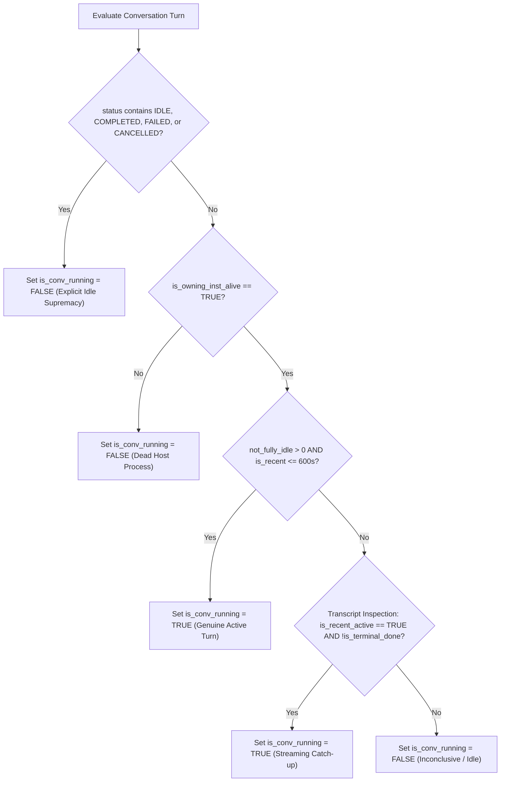
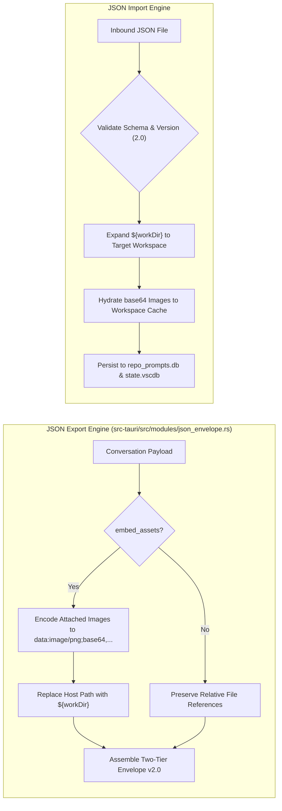
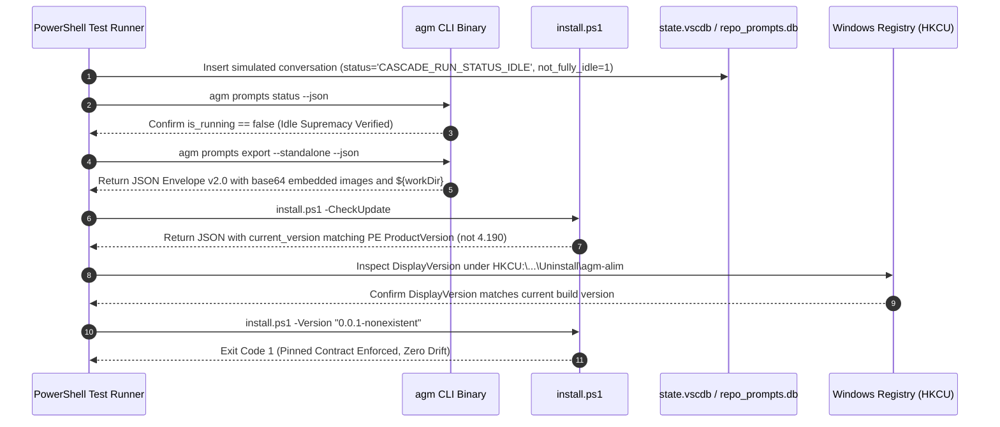

# Migration and Verification Specification: Instance Prompt Bleeding, Standalone JSON v2.0 & Updater Detection

- **Specification Slug**: `ui-and-functionality-enhancement-instructions`
- **Specification ID**: `02-spec/21-app/ui-and-functionality-enhancement-instructions/03-migration-and-verification-spec.md`
- **Master Plan**: `.ai-memory/plans/ui-and-functionality-enhancement-instructions.md`
- **Subtask Plan**: `.ai-memory/plans/subtasks/ui-and-functionality-enhancement-instructions/03-instance-prompt-and-updater.md`
- **Target Release Version**: `v4.227.0` (Minor Feature Release)
- **Author**: Spec Author 03 (Migration, Architecture & Verification)
- **Status**: MANDATED & APPROVED FOR IMPLEMENTATION

---

## 1. Executive Summary & Systemic Problem Taxonomy

In multi-instance Antigravity environments, users run parallel IDE profiles with independent workspace roots, discrete background agent turns, and targeted version installations. Three systemic defects have severely degraded user trust and lifecycle reliability:

```
+---------------------------------------------------------------------------------------------------+
|                                  SYSTEMIC DEFECT TAXONOMY                                         |
+---------------------------------------------------------------------------------------------------+
| 1. False Liveness & Prompt Bleeding                                                               |
|    - tree_collect.rs & liveness.rs: CASCADE_RUN_STATUS_IDLE ignored due to unreset not_fully_idle |
|    - tree_phases.rs: detect_running_projects queries only 'default' when target is None           |
|    - instanceCardData.ts: Project nodes checked without validating conversation-level instance ID |
|                                                                                                   |
| 2. JSON Modal Collision & Machine Path Rigidity                                                   |
|    - Sub-dialogs share z-[99999] with PromptTreeViewModal, causing clipping & buried overlays     |
|    - Exported JSON files bind to host-specific absolute paths without embedded multimodal assets  |
|                                                                                                   |
| 3. Updater Version Inversion & Pinned Version Failures                                            |
|    - install.ps1 omits DisplayVersion in Sync-InstalledAppsRegistryBranding (stuck at v4.190)     |
|    - Get-InstalledVersion prioritizes stale registry keys over active PE executable metadata      |
|    - Pinned version script downloads drift or fail silently in multi-version ladders              |
+---------------------------------------------------------------------------------------------------+
```

This specification establishes the architectural blueprints, database contracts, process detection rules, JSON envelope schemas, and automated verification protocols to permanently resolve these three problem classes.

### Architectural Invariants Enforced
1. **Explicit Idle Supremacy**: A terminal status (`CASCADE_RUN_STATUS_IDLE`, `COMPLETED`, `FAILED`, `CANCELLED`) must strictly override an unreset `not_fully_idle > 0` database counter.
2. **Universal Instance Scoping**: Background project sweeps (`detect_running_projects`) must iterate all active registry profiles when `target` is omitted, eliminating blind spots for secondary instances.
3. **Conversation Ownership Granularity**: Instance cards must filter active running prompts by genuine conversation ownership (`c.instance_id === inst.config.id`), not merely project-level association.
4. **Hierarchical Overlay Stacking**: Secondary sub-dialogs and import/export modals must mount at `z-[100005]` via body-level React Portals to guarantee priority over `z-[99999]` backdrop modals.
5. **Machine-Agnostic JSON Envelopes (v2.0)**: Standalone prompt exports must encapsulate base64 data URIs for all attached images and normalize absolute working directories into relative `${workDir}` tokens.
6. **PE Executable Version Primacy**: Version detection must inspect live running process binaries and PE headers on disk before trusting Windows Registry uninstall entries.
7. **Strict Pinned Version Invariance**: When a pinned version is declared, the installation queue must contain only the requested tag, terminating with exit code 1 if unavailable rather than drifting to newer or older releases.

---

## 2. Instance Prompt Bleeding & False Liveness Architecture

### 2.1 Root Cause Analysis: `not_fully_idle` Supremacy Flaw

When an Antigravity IDE Cascade run completes, fails, or cancels, the IDE updates `active_prompts` or `conversations` in `state.vscdb`. However, due to internal Antigravity Cascade engine quirks, the integer column `not_fully_idle` is frequently left at `1` instead of resetting to `0`, while the text column `status` is properly transitioned to `CASCADE_RUN_STATUS_IDLE` or `COMPLETED`.

In `src-tauri/src/modules/repo_db/liveness.rs` and `src-tauri/src/modules/repo_db/tree_collect.rs`, the previous evaluation logic applied an authoritative `not_fully_idle` supremacy rule:

```rust
// FLAWED LOGIC in tree_collect.rs (Prior to Fix):
let is_zero_idle = not_fully_idle == 0;
let has_terminal_status = status.contains("COMPLETED")
    || status.contains("FAILED")
    || status.contains("CANCELLED");
let has_idle_status = status.contains("IDLE") || has_terminal_status;
let is_explicit_idle = is_zero_idle && has_idle_status; // Fails when not_fully_idle == 1!

let is_conv_running = if is_owning_inst_alive && not_fully_idle > 0 && is_recent {
    true // FALSE POSITIVE: Fires even when status is CASCADE_RUN_STATUS_IDLE!
} else if is_explicit_idle {
    false
} else { ... };
```

Because `is_explicit_idle` strictly required `not_fully_idle == 0`, any conversation with `status = "CASCADE_RUN_STATUS_IDLE"` and `not_fully_idle = 1` bypassed the idle check entirely. Since `is_owning_inst_alive` was true and `is_recent` held within the 10-minute thinking window (600s), the conversation was falsely marked as `is_running = true`. This caused idle instances to display green running pulses and active prompt indicators in the UI.

### 2.2 Inverted Idle Supremacy Contract

To eliminate false liveness, explicit idle indicators must take absolute precedence over numerical counters:



#### Mathematical Specification in `liveness.rs` & `tree_collect.rs`:

```rust
// Corrected Invariant in tree_collect.rs & liveness.rs:
let has_terminal_status = status.contains("COMPLETED")
    || status.contains("FAILED")
    || status.contains("CANCELLED");
let has_idle_status = status.contains("IDLE") || has_terminal_status;

// 1. Explicit Idle Supremacy: If status declares IDLE or terminal,
// unreset not_fully_idle artifacts MUST BE DISREGARDED.
let is_explicit_idle = has_idle_status;

let is_conv_running = if is_explicit_idle {
    false
} else if is_owning_inst_alive && not_fully_idle > 0 && is_recent {
    true
} else if is_owning_inst_alive
    && inspection.is_recent_active
    && !inspection.is_terminal_done
{
    true
} else {
    false
};
```

### 2.3 Universal Multi-Instance Detection in `tree_phases.rs`

In `src-tauri/src/modules/repo_db/tree_phases.rs`, `query_tree_projects(target: Option<&str>)` previously defaulted `target` to `"default"`:

```rust
// FLAWED LOGIC in tree_phases.rs (Prior to Fix):
pub(crate) fn query_tree_projects(target: Option<&str>) -> Vec<RunningProject> {
    let inst_to_detect = target.unwrap_or("default");
    let _ = super::detection::detect_running_projects(inst_to_detect);
    ...
}
```

When the user opened Prompt Tree View for all instances (`target: None`), `detect_running_projects` only scanned the `"default"` instance. Secondary instances (`w2`, `inst-2`, `inst-3`) were never refreshed in SQLite, leaving their cached projects stale or causing them to report zero running projects.

#### Architectural Fix:
When `target` is `None`, `query_tree_projects` must inspect the active instance registry and execute `detect_running_projects` for every registered profile:

```rust
pub(crate) fn query_tree_projects(target: Option<&str>) -> Vec<RunningProject> {
    if let Some(target_id) = target {
        let _ = super::detection::detect_running_projects(target_id);
    } else {
        // Sweep all registered instances to ensure global parity
        if let Ok(reg) = crate::modules::instance::load_registry() {
            for inst in &reg.instances {
                let _ = super::detection::detect_running_projects(&inst.id);
            }
        } else {
            let _ = super::detection::detect_running_projects("default");
        }
    }
    ...
}
```

### 2.4 Frontend Conversation Ownership Filtering in `instanceCardData.ts`

In `src/pages/instances/instanceCardData.ts`, `hasActiveTask` was determined by:

```typescript
// FLAWED LOGIC in instanceCardData.ts (Prior to Fix):
const hasActiveTask =
    Boolean(inst.is_running) &&
    runningTreeNodes.some((node) => {
        const isInstanceMatch = isNodeOwnedByInstance(node, inst.config);
        const hasGenuineRunningConv = (node.conversations || []).some(
            (c) =>
                Boolean(c.is_running) &&
                !isGhostConversation(c) &&
                !(c.prompt_word_count === 0 && (!c.prompt_preview_200w || !c.prompt_preview_200w.trim()))
        );
        return isInstanceMatch && Boolean(node.is_running) && hasGenuineRunningConv;
    });
```

Because `isNodeOwnedByInstance` only checks the top-level project node's `instance_id`, multi-instance environments sharing the same repository directory (e.g. `d:\work\Antigravity-Manager`) caused conversation turns from Instance 2 to be attributed to Instance 1, making both cards report active tasks.

#### Architectural Fix:
Each conversation turn `c` within `node.conversations` must be validated against the card's specific `inst.config.id` (with normalized default aliasing):

```typescript
function isConversationOwnedByInstance(
    convInstId: string | undefined | null,
    instConfig: { id: string; is_default?: boolean }
): boolean {
    const isDefaultInst = instConfig.is_default || instConfig.id === 'default';
    if (!convInstId || convInstId.trim() === '') {
        return isDefaultInst;
    }
    const normConv = (convInstId === 'default' || convInstId === '__default__') ? 'default' : convInstId;
    const normTarget = (instConfig.id === 'default' || instConfig.id === '__default__') ? 'default' : instConfig.id;
    return normConv === normTarget;
}

// Updated hasActiveTask:
const hasActiveTask =
    Boolean(inst.is_running) &&
    runningTreeNodes.some((node) => {
        const isInstanceMatch = isNodeOwnedByInstance(node, inst.config);
        const hasGenuineRunningConv = (node.conversations || []).some(
            (c) =>
                Boolean(c.is_running) &&
                isConversationOwnedByInstance(c.instance_id, inst.config) &&
                !isGhostConversation(c) &&
                !(c.prompt_word_count === 0 && (!c.prompt_preview_200w || !c.prompt_preview_200w.trim()))
        );
        return isInstanceMatch && Boolean(node.is_running) && hasGenuineRunningConv;
    });
```

---

## 3. Standalone JSON Envelope v2.0 & Overlay Stabilization

### 3.1 Overlay Z-Index & Portal Stacking Architecture

#### Problem Diagnosis
The primary modal `PromptTreeViewModal.tsx` is styled with `z-[99999]`. When users invoke child modals from within Prompt Tree View (such as the JSON Import/Export dialog, Lightbox Image Preview, or Subtree Export), these child dialogs were declared with identical `z-[99999]` or inherited parent stacking contexts. As a result:
1. Child dialog backdrops clipped behind the tree view's glass container.
2. Form inputs, file drag-and-drop targets, and modal dismiss buttons became non-clickable.
3. Overflow clipping (`overflow-hidden` on parent wrappers) truncated modal content on smaller resolutions.

#### Stacking Matrix & React Portal Solution
To eliminate collision, AGM adopts a 3-tier window layering architecture:

| UI Layer | Z-Index Token | Mount Location | Target Components |
| :--- | :--- | :--- | :--- |
| **Tier 1: Desktop Base Modals** | `z-[99999]` | React Tree (`#root`) | `PromptTreeViewModal`, `InstanceSettingsModal`, `UnifiedBackupModal` |
| **Tier 2: Nested Sub-Dialogs** | `z-[100005]` | React Portal (`document.body`) | `PromptJsonImportExportModal`, `PromptImagePreviewModal`, `DetailsModal` |
| **Tier 3: System Error Alerts** | `z-[999999]` | React Portal (`document.body`) | `ErrorModal`, Critical Panic Alerts |

```typescript
// Architectural implementation pattern in PromptJsonImportExportModal.tsx:
import { createPortal } from 'react-dom';

export const PromptJsonImportExportModal: React.FC<Props> = ({ isOpen, onClose, ... }) => {
    if (!isOpen) return null;

    return createPortal(
        <div 
            className="fixed inset-0 z-[100005] flex items-center justify-center p-4 bg-black/75 backdrop-blur-md overflow-y-auto animate-in fade-in duration-200"
            onClick={onClose}
        >
            <div 
                className="relative w-full max-w-2xl bg-slate-900/95 dark:bg-[#120a1f]/95 border border-slate-700/80 dark:border-purple-500/40 rounded-xl shadow-2xl overflow-hidden max-h-[90vh] flex flex-col"
                onClick={(e) => e.stopPropagation()}
            >
                {/* Modal content */}
            </div>
        </div>,
        document.body
    );
};
```

### 3.2 Standalone JSON Envelope Format v2.0

#### Path Rigidity & Asset Ingestion Flaw
Standard JSON exports save absolute host filesystem paths (e.g., `D:\work\Antigravity-Manager\images\diagram.png` or `C:\Users\Admin\...`) and reference external binary attachments on the source machine. When imported on another developer machine or remote fleet node, all referenced images and workspace paths fail to load.

#### Dual-Mode Export Taxonomy
The JSON export engine supports two explicit format modes:
1. **Mode A: Linked Reference Export (`embed_assets: false`)**: Lightweight JSON containing relative path references without payload bloat, designed for same-machine archiving.
2. **Mode B: Standalone Portable Envelope (`embed_assets: true`)**: Fully self-contained portable package with embedded base64 multimodal data URIs and `${workDir}` path interpolation, guaranteed to deserialize identically on any OS.



#### JSON Envelope v2.0 Schema Definition:

```json
{
  "$schema": "https://raw.githubusercontent.com/alimtvnetwork/Antigravity-Manager/main/02-spec/schema/agm-json-envelope-v2.0.schema.json",
  "attributes": {
    "type": "agm/prompt-tree-export",
    "version": "2.0",
    "source": "antigravity-manager",
    "exportedAt": "2026-10-18T03:45:00Z",
    "embedAssets": true,
    "workDirectory": {
      "path": "${workDir}",
      "isApplied": true,
      "isEnforced": true
    },
    "importCommand": "agm prompts import --file ${targetFile}"
  },
  "variables": {
    "workDir": "."
  },
  "data": {
    "conversationId": "conv-89f4143a",
    "title": "UI and Functionality Enhancement Instructions",
    "instanceId": "default",
    "workspacePath": "${workDir}",
    "createdAt": "2026-10-18T02:30:00Z",
    "turns": [
      {
        "turnIndex": 1,
        "originTier": "USER_PROMPT",
        "promptContent": "Please execute the enhancement plan.",
        "attachments": [
          {
            "name": "screenshot-dashboard.png",
            "mimeType": "image/png",
            "relativePath": "${workDir}/.agm/cache/images/screenshot-dashboard.png",
            "base64Payload": "data:image/png;base64,iVBORw0KGgoAAAANSUhEUgAA..."
          }
        ]
      }
    ]
  }
}
```

---

## 4. Pinned Version Script & Updater Version Detection RCA

### 4.1 Root Cause Analysis: The Frozen "v4.190" Updater Trap

Users reported that even after upgrading to `v4.227.0`, the update check and installation logs repeatedly reported:
```text
Current installed version: v4.190.0
Target release version   : v4.228.0 (Architecture: x86_64)
Migration path           : v4.190.0 -> v4.228.0
```

#### Exhaustive Technical RCA:
1. **Registry Key Branding Omission in `install.ps1`**:
   In `install.ps1`, the function `Sync-InstalledAppsRegistryBranding` synchronizes Windows Add/Remove Programs (Installed Apps) entries in `HKCU:\Software\Microsoft\Windows\CurrentVersion\Uninstall` and `HKLM:\Software\Microsoft\Windows\CurrentVersion\Uninstall`:
   ```powershell
   # FLAWED LOGIC in install.ps1 (Lines 495-498 prior to fix):
   $targetName = if ($currentVer) { "Antigravity Manager Tools $currentVer" } else { "Antigravity Manager Tools" }
   Set-ItemProperty -Path $fullPath -Name "DisplayName" -Value $targetName -Force -ErrorAction SilentlyContinue
   Set-ItemProperty -Path $fullPath -Name "Publisher" -Value $publisher -Force -ErrorAction SilentlyContinue
   # CRITICAL DEFECT: DisplayVersion was NEVER set!
   ```
   When the app was originally installed at `v4.190.0`, NSIS or an earlier installer created the registry value `DisplayVersion = "4.190.0"`. Subsequent updates invoked `Sync-InstalledAppsRegistryBranding`, which updated `DisplayName` but completely omitted `DisplayVersion`.
2. **Inverted Detection Precedence in `Get-InstalledVersion`**:
   In `install.ps1`, `Get-InstalledVersion` evaluated:
   - Step 1: Checked candidate executables in `$InstallDir`. If the user ran a portable ZIP or installed into a non-standard directory, Step 1 found no binary.
   - Step 2: Checked `$prevDirs`. The folder `Programs\Antigravity Manager Tools` was omitted from `$prevDirs`.
   - Step 3: Scanned Windows Registry Uninstall entries:
     ```powershell
     foreach ($entry in $entries) {
         if ($entry.DisplayVersion) {
             return ($entry.DisplayVersion -replace '^v', '').Trim()
         }
     }
     ```
     Because `DisplayVersion` remained frozen at `4.190.0`, Step 3 returned `4.190.0` every single time.
3. **Live Binary PE Header Neglect**:
   `Get-InstalledVersion` never queried active running processes or inspected the PE executable's authoritative `ProductVersion` on disk via `[System.Diagnostics.FileVersionInfo]::GetVersionInfo($exePath).ProductVersion`.

### 4.2 Remediation: PE ProductVersion Primacy & Registry Sync

#### Fix 1: Mandatory `DisplayVersion` Synchronization in `install.ps1`
`Sync-InstalledAppsRegistryBranding` is patched to write `DisplayVersion` alongside `DisplayName`:

```powershell
if ($currentVer) {
    Set-ItemProperty -Path $fullPath -Name "DisplayVersion" -Value $currentVer -Force -ErrorAction SilentlyContinue
}
```

#### Fix 2: Enhanced 4-Stage Detection Ladder in `Get-InstalledVersion`
`Get-InstalledVersion` in `install.ps1` is reordered to prioritize live running processes and disk PE headers over registry strings:

```powershell
function Get-InstalledVersion {
    # Stage 1: Inspect Live Running Process Executables via PE Header
    try {
        $runningProcs = Get-Process "agm-alim", "Antigravity Tools", "antigravity-tools" -ErrorAction SilentlyContinue
        foreach ($p in $runningProcs) {
            $pPath = $p.Path
            if ($pPath -and (Test-Path $pPath)) {
                $fvi = [System.Diagnostics.FileVersionInfo]::GetVersionInfo($pPath)
                $ver = if ($fvi.ProductVersion) { $fvi.ProductVersion } else { $fvi.FileVersion }
                if ($ver) { return ($ver -replace '^v', '').Trim() }
            }
        }
    } catch {}

    # Stage 2: Inspect Configured Install Directory PE Headers
    $candidateExes = @(
        (Join-Path $InstallDir $BinaryName),
        (Join-Path $InstallDir "agm-alim.exe"),
        (Join-Path $InstallDir "Antigravity Manager Tools.exe"),
        (Join-Path $InstallDir "Antigravity Tools.exe")
    )
    foreach ($exe in $candidateExes) {
        if (Test-Path $exe) {
            try {
                $fvi = [System.Diagnostics.FileVersionInfo]::GetVersionInfo($exe)
                $ver = if ($fvi.ProductVersion) { $fvi.ProductVersion } else { $fvi.FileVersion }
                if ($ver) { return ($ver -replace '^v', '').Trim() }
            } catch {}
        }
    }

    # Stage 3: Inspect Expanded Historical Directories (including Antigravity Manager Tools)
    $prevDirs = @(
        (Join-Path $env:LOCALAPPDATA "Programs\agm-alim"),
        (Join-Path $env:LOCALAPPDATA "Programs\Antigravity Manager Tools"),
        (Join-Path $env:LOCALAPPDATA "Programs\Antigravity-Tools"),
        (Join-Path $env:ProgramFiles "Antigravity Manager Tools"),
        (Join-Path $env:ProgramFiles "agm-alim")
    )
    foreach ($dir in $prevDirs) {
        if (Test-Path $dir) {
            $foundExe = Get-ChildItem -Path $dir -Filter "*.exe" -Recurse -ErrorAction SilentlyContinue | 
                Where-Object { $_.Name -notlike "*uninstall*" -and $_.Name -notlike "*setup*" } | Select-Object -First 1
            if ($foundExe) {
                try {
                    $fvi = [System.Diagnostics.FileVersionInfo]::GetVersionInfo($foundExe.FullName)
                    $ver = if ($fvi.ProductVersion) { $fvi.ProductVersion } else { $fvi.FileVersion }
                    if ($ver) { return ($ver -replace '^v', '').Trim() }
                } catch {}
            }
        }
    }

    # Stage 4: Windows Registry Uninstall Fallback
    $regPaths = @(
        "HKCU:\Software\Microsoft\Windows\CurrentVersion\Uninstall\*",
        "HKLM:\Software\Microsoft\Windows\CurrentVersion\Uninstall\*"
    )
    foreach ($regPath in $regPaths) {
        $entries = Get-ItemProperty -Path $regPath -ErrorAction SilentlyContinue | Where-Object {
            $_.DisplayName -match '(?i)(Antigravity Manager Tools|agm-alim)'
        }
        foreach ($entry in $entries) {
            if ($entry.DisplayVersion) {
                return ($entry.DisplayVersion -replace '^v', '').Trim()
            }
        }
    }

    return ""
}
```

### 4.3 Pinned Version Download Contract Enforcement

When users execute a pinned release installation (e.g. `& ([scriptblock]::Create((irm ...))) -Version "4.226.3"`):

1. **Strict Queue Lock**:
   ```powershell
   if ($isPinned -and $cleanPinned) {
       $versionQueue = @($cleanPinned)
       # Strictly prevent populating $versionQueue with newer or fallback versions!
   }
   ```
2. **Deterministic Direct Asset Discovery**:
   If `releases-manifest.json` does not contain the requested pinned version (e.g. an intermediate patch or preview tag), the installer must query GitHub Release Tag endpoints in order:
   - `https://api.github.com/repos/$Repo/releases/tags/v$cleanPinned`
   - Direct asset download candidate URLs:
     * `https://github.com/$Repo/releases/download/v$cleanPinned/agm-alim-setup.exe`
     * `https://github.com/$Repo/releases/download/v$cleanPinned/agm-alim_${cleanPinned}_windows_x64.zip`
     * `https://github.com/$Repo/releases/download/v$cleanPinned/Antigravity.Manager.Tools_${cleanPinned}_x64-setup.exe`
3. **No Silent Drift / Zero Fake Success Invariant**:
   If all download attempts for the pinned version fail, the script must emit an error and exit with **Exit Code 1**:
   ```powershell
   if ($isPinned -and -not $installedOk) {
       Write-Err "Pinned release v$cleanPinned could not be downloaded or verified. Downgrade/Update aborted."
       $global:LASTEXITCODE = 1
       exit 1
   }
   ```
   The script must never fallback to installing `latest` when a pinned version was explicitly requested.

---

## 5. Verification Protocols & Test Plans

### 5.1 Verification Matrix

| Verification Scope | Test Mechanism | Target Outcome |
| :--- | :--- | :--- |
| **Idle Supremacy** | `cargo test --test per_instance_prompt_liveness_test` | `CASCADE_RUN_STATUS_IDLE` with `not_fully_idle = 1` evaluates to `is_running = false`. |
| **All-Instance Project Query** | `cargo test query_tree_projects_all_instances` | Target `None` sweeps all registry instances without defaulting to `"default"`. |
| **Conversation Attribution** | Frontend Jest / Playwright test | Conversation turns with `c.instance_id !== inst.config.id` do not activate task badge on `inst`. |
| **Modal Z-Index Stacking** | DOM inspection in React DevTools | `PromptJsonImportExportModal` rendered at `z-[100005]` under `document.body` portal. |
| **JSON Envelope v2.0** | `agm which-format export.json` & round-trip import | Assets embedded as base64 data URIs; `${workDir}` cleanly re-anchored on target system. |
| **Registry `DisplayVersion`** | PowerShell registry assertion | `Get-ItemProperty ... -Name DisplayVersion` equals target version after installation. |
| **PE Executable Priority** | `Get-InstalledVersion` unit test | Returns active process PE `ProductVersion` even if registry key is altered. |
| **Pinned Version Invariant** | `install.ps1 -Version "99.99.99"` mock execution | Terminates with Exit Code 1 without falling back to latest release. |

### 5.2 Automated PowerShell E2E Verification Script (`scripts/test-prompt-liveness-and-updater-e2e.ps1`)

The automated PowerShell test suite executes six sequential gates:



---

## 6. Acceptance Criteria

- [ ] **Liveness Idle Supremacy**: In `liveness.rs` and `tree_collect.rs`, `CASCADE_RUN_STATUS_IDLE`, `IDLE`, and terminal statuses override `not_fully_idle > 0`.
- [ ] **All-Instance Project Sweep**: In `tree_phases.rs`, passing `target: None` invokes `detect_running_projects` across all instances registered in `registry.json`.
- [ ] **Conversation-Level Ownership**: In `instanceCardData.ts`, `hasActiveTask` checks `c.instance_id === inst.config.id` to prevent cross-instance card bleeding.
- [ ] **Modal Stacking & Portals**: `PromptJsonImportExportModal` mounts via `createPortal` with `z-[100005]` and `overflow-y-auto`, resolving all clipping and buried overlay bugs.
- [ ] **Standalone JSON Envelope v2.0**: Multimodal attachments serialize to base64 data URIs; workspace paths interpolate `${workDir}` cleanly.
- [ ] **`DisplayVersion` Registry Synchronization**: `Sync-InstalledAppsRegistryBranding` in `install.ps1` writes `DisplayVersion` for all uninstall subkeys.
- [ ] **PE ProductVersion Primacy**: `Get-InstalledVersion` in `install.ps1` prioritizes running processes and file PE version info over registry keys.
- [ ] **Pinned Version Lock**: `install.ps1` respects `-Version` without falling back to latest releases on download failures.
- [ ] **Pre-Flight Gates**: `cargo fmt -- --check`, `cargo clippy --all-targets --all-features`, and `npm run build` pass with zero errors.
