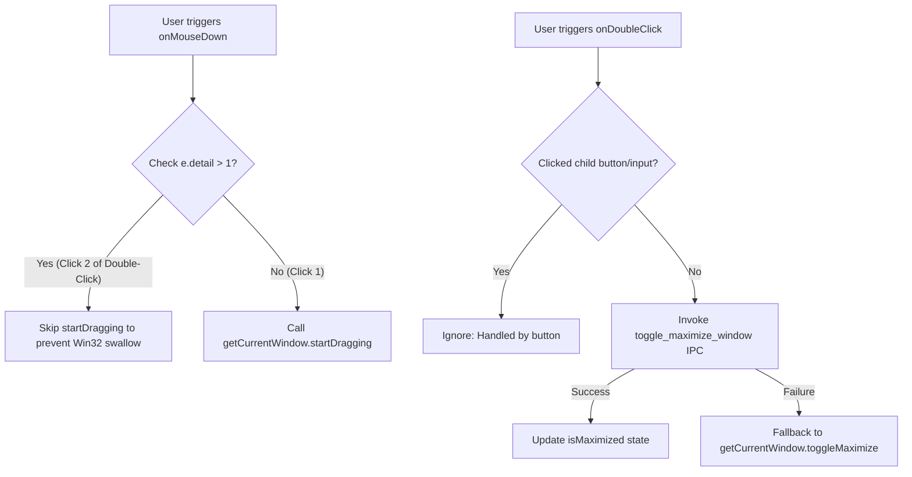
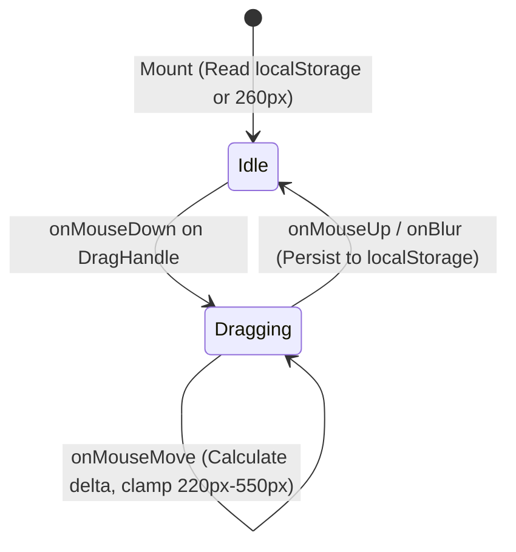

# Architecture and UI Specification: UI and Functionality Enhancements

- **Specification Slug**: `ui-and-functionality-enhancements`
- **Document Path**: `02-spec/21-app/ui-and-functionality-enhancements/01-architecture-and-ui-spec.md`
- **Master Plan**: `.ai-memory/plans/ui-and-functionality-enhancements.md`
- **Benchmark Branch**: `backup/ui-and-functionality-enhancements-benchmark`
- **Target Release Version**: `v4.207.0` (Minor Bump)
- **Author**: Worker 01 (Wave 2: UI Architecture & Spec Authoring)
- **Status**: MANDATED & APPROVED FOR IMPLEMENTATION

---

## 1. Executive Summary & Design Invariants

This specification defines the architectural design, DOM hierarchies, component states, and styling specifications for five critical user interface enhancements across Antigravity Manager:

1. **Window TitleBar & Navbar Double-Click Maximize Resolution**: Eliminates Win32 native window dragging modal loop swallow by intercepting `onMouseDown` when click count indicates an ongoing double click (`e.detail > 1`), and routing `onDoubleClick` directly to the `toggle_maximize_window` Tauri IPC command with fallback to `getCurrentWindow().toggleMaximize()`.
2. **RecordingIndicator Compact Dark-Glass Status Capsule**: Compresses the disconnected audit indicator and log trigger into a single contiguous 28px (`h-7`) dark-glass segmented pill capsule, standardizing typography to `text-[10px]` and eliminating redundant horizontal bulk.
3. **QuotaProgressBar Width Reduction, Glow Softening, and Milestone Alignment**: Reduces horizontal footprint by 10% (`min-w-[140px]` $\to$ `min-w-[126px]`, table cells `min-w-[220px]/[210px]` $\to$ `min-w-[195px]/[185px]`), converts harsh high-contrast neon drop-shadows into subtle ambient emerald glows, and replaces uneven 5-checkpoint layouts (`[20, 40, 60, 80, 90]`) with 4 equal-distance checkpoints at `[20, 40, 60, 80]` styled in unified emerald color.
4. **AccountTable Resizable Email Column with Dynamic Persistence**: Introduces an interactive column drag-resize handle on the Email `<th>` element bounded between `[220px, 550px]`, dynamic drag state with visual feedback, real-time column width updates across all rows, and persistent storage in `localStorage` (`agm_account_table_email_width`).
5. **PromptTreeView Toolbar Compaction & New Conversation Flow**: Unifies disconnected floating action capsules into a single contiguous segmented dark-glass group, integrates `Send` and `Enqueue` into a primary split dropdown button with full dispatch options, and introduces a streamlined "New Conversation" creation flow with an interactive custom title input.

### House Design Invariants Enforced
- **Contiguous Segmented Capsules**: All adjacent toolbar controls and status badges MUST use contiguous segmented pill capsules (`rounded-full`, shared border, subtle divider lines, dark-glass styling) rather than loose, disjointed circular buttons.
- **Transparent Inline Form Styling**: Any inline `<select>` or `<input>` controls mounted within segmented capsules MUST use transparent borderless styling (`bg-transparent border-0 focus:ring-0 focus:outline-none`) to eliminate nested white pill-in-pill visual defects.
- **No Silent Errors**: All fallible asynchronous operations (Tauri invokes, clipboard interactions, localStorage parsing) must route errors through `useErrorStore.getState().captureError()` or `trackWarning()`.

---

## 2. Window TitleBar & Navbar Double-Click Maximize Architecture

### 2.1 Problem Diagnosis & Root Cause
In Tauri applications on Windows (Win32), invoking `getCurrentWindow().startDragging()` inside `onMouseDown` causes the OS to enter a native modal dragging loop (`WM_NCLBUTTONDOWN` / `HTCAPTION`). When a user double-clicks:
1. The first mouse-down event fires with `e.detail === 1`.
2. `startDragging()` is called immediately.
3. The Win32 OS dragging message loop takes exclusive mouse capture.
4. The second mouse-down and mouse-up events are swallowed by the Win32 window manager and never dispatched into WebKit / WebView2 DOM.
5. Consequently, `onDoubleClick` fails to fire or fires erratically only when mouse motion is completely absent, making window maximize toggle feel broken.

### 2.2 Architectural Solution



### 2.3 DOM Structure & Event Handlers

#### In `src/components/layout/TitleBar.tsx`:
```tsx
const handleMouseDown = (e: React.MouseEvent<HTMLElement>) => {
    // Prevent dragging when clicking interactive controls
    if ((e.target as HTMLElement).closest('button, input, select, a, .no-drag')) return;
    // CRITICAL: Prevent startDragging on multi-clicks to allow onDoubleClick to reach WebView2
    if (e.detail > 1) return;
    try {
        getCurrentWindow().startDragging();
    } catch (err) {
        useErrorStore.getState().trackWarning(err, {
            source: 'TitleBar.handleMouseDown',
            triggerAction: 'startDragging',
        });
    }
};

const handleDoubleClick = async (e: React.MouseEvent<HTMLElement>) => {
    if ((e.target as HTMLElement).closest('button, input, select, a, .no-drag')) return;
    await handleToggleMaximize();
};
```

#### In `src/components/navbar/Navbar.tsx`:
```tsx
const handleMouseDown = (e: React.MouseEvent<HTMLElement>) => {
    if (!isTauri()) return;
    const target = e.target as HTMLElement;
    if (target.closest('.no-drag, button, a, input, select, textarea')) return;
    // CRITICAL: Skip dragging if multi-click is detected to guarantee double-click delivery
    if (e.detail > 1) return;
    try {
        getCurrentWindow().startDragging();
    } catch (err) {
        useErrorStore.getState().trackWarning(err, {
            source: 'Navbar.handleMouseDown',
            triggerAction: 'startDragging',
        });
    }
};

const handleDoubleClick = async (e: React.MouseEvent<HTMLElement>) => {
    if (!isTauri()) return;
    const target = e.target as HTMLElement;
    if (target.closest('.no-drag, button, a, input, select, textarea')) return;
    try {
        await invoke('toggle_maximize_window');
    } catch {
        try {
            await getCurrentWindow().toggleMaximize();
        } catch (err) {
            useErrorStore.getState().captureError(err, {
                source: 'Navbar.handleDoubleClick',
                triggerAction: 'toggle_maximize_window',
            });
        }
    }
};
```

---

## 3. RecordingIndicator Status Pill Compaction Architecture

### 3.1 Visual Specification & Requirements
The recording indicator in `src/components/audit/RecordingIndicator.tsx` currently consumes excessive vertical and horizontal padding (`py-1`, text size 11px, unconstrained height).

The new compact status pill:
- **Height**: Fixed 28px (`h-7`).
- **Styling**: Dark-glass segmented capsule (`rounded-full bg-slate-800/80 dark:bg-slate-900/90 backdrop-blur-md border border-slate-700/60 divide-x divide-slate-700/60 shadow-xs`).
- **Typography**: Compact monospace font (`text-[10px] font-mono font-medium`).
- **Left Segment**: Recording status toggle button (`px-2 h-full flex items-center gap-1.5 hover:bg-slate-700/50 rounded-l-full transition-colors cursor-pointer`).
  - When IDLE: Neutral slate dot (`w-1.5 h-1.5 rounded-full bg-slate-500`) with text `IDLE`.
  - When RECORDING: Pulsing crimson dot (`w-1.5 h-1.5 rounded-full bg-red-500 animate-pulse shadow-[0_0_6px_rgba(239,68,68,0.7)]`) with text `REC MM:SS`.
- **Right Segment**: Audit log drawer toggle button (`px-2 h-full flex items-center gap-1 hover:bg-slate-700/50 rounded-r-full transition-colors cursor-pointer`).
  - Icon: `ScrollText` (`w-3 h-3 text-slate-400`).
  - Label: `Log`.

### 3.2 DOM Structure & Implementation Details
```tsx
<div
    className="inline-flex items-center h-7 rounded-full border border-slate-700/60 bg-slate-800/80 dark:bg-slate-900/90 backdrop-blur-md divide-x divide-slate-700/60 shadow-xs text-[10px] font-mono select-none"
    role="group"
    aria-label={t('audit.indicator_label', 'Audit recording controls')}
>
    <button
        type="button"
        onClick={() => void toggleRecording()}
        title={isRecording ? t('audit.stop_recording', 'Stop audit recording') : t('audit.start_recording', 'Start audit recording')}
        className="px-2.5 h-full flex items-center gap-1.5 text-slate-300 hover:text-white hover:bg-slate-700/50 rounded-l-full transition-colors cursor-pointer"
    >
        <span
            className={cn(
                "w-1.5 h-1.5 rounded-full shrink-0 transition-all",
                isRecording
                    ? "bg-red-500 animate-pulse shadow-[0_0_6px_rgba(239,68,68,0.7)]"
                    : "bg-slate-500"
            )}
        />
        <span className={isRecording ? "text-red-300 font-semibold" : "text-slate-400"}>
            {isRecording ? `REC ${elapsed}` : 'IDLE'}
        </span>
    </button>
    <button
        type="button"
        onClick={() => setPanelOpen(true)}
        title={t('audit.open_panel', 'Open audit log')}
        className="px-2 h-full flex items-center gap-1 text-slate-300 hover:text-white hover:bg-slate-700/50 rounded-r-full transition-colors cursor-pointer"
    >
        <ScrollText className="w-3 h-3 text-slate-400" />
        <span>{t('audit.log', 'Log')}</span>
    </button>
</div>
```

---

## 4. QuotaProgressBar Glow, Width & Checkpoint Overhaul

### 4.1 Checkpoint Restructuring: 4 Equal-Distance Milestones
- **Current State**: 5 uneven checkpoints `[20, 40, 60, 80, 90]` with jarring multi-colored stops (red at 20%, orange at 40%, yellow at 60%, green at 80%/90%).
- **New State**: 4 equal-distance checkpoints at `[20, 40, 60, 80]` representing uniform 20% steps across the progress lifecycle.
- **Color Unification**: All filled milestone nodes use unified emerald styling:
  - Fill Background: `#10b981` (emerald-500) or CSS variable `var(--ui-success)`.
  - Icon stroke: Clean white with crisp sub-pixel render.
  - Unfilled Background: `bg-slate-300/50 dark:bg-white/10 border-transparent`.

### 4.2 Glow Softening
- **Current Harsh Glow**:
  - `hover:drop-shadow-[0_0_8px_rgba(26,241,141,0.5)]`
  - `shadow-[0_0_12px_rgba(26,241,141,0.6)]`
  - `group-hover:shadow-[0_0_12px_rgba(26,241,141,0.85)]`
- **Softened Glow Specification**:
  - Container hover drop-shadow: `hover:drop-shadow-[0_0_5px_rgba(16,185,129,0.25)]`
  - Progress glow track: `shadow-[0_0_6px_rgba(16,185,129,0.25)]`
  - Node hover shadow: `group-hover:shadow-[0_0_6px_rgba(16,185,129,0.4)]`

### 4.3 10% Horizontal Footprint Compaction
- **Track Minimum Width**:
  - Previous: `min-w-[140px]`
  - Reduced by 10%: `min-w-[126px]`
- **AccountTable Column Headers (`AccountTable.tsx`)**:
  - 4H Quota Header: `min-w-[220px]` $\to$ `min-w-[195px]`
  - Weekly Quota Header: `min-w-[220px]` $\to$ `min-w-[195px]`
- **AccountTable Row Content Cells (`AccountRowContent.tsx`)**:
  - 4H Quota `<td>`: `min-w-[210px]` $\to$ `min-w-[185px]`
  - Weekly Quota `<td>`: `min-w-[210px]` $\to$ `min-w-[185px]`

### 4.4 Node Rendering Code Specification
```tsx
const DEFAULT_CHECKPOINTS = [20, 40, 60, 80];
const UNIFIED_EMERALD_COLOR = '#10b981';

{showCheckpoints && sortedCheckpoints.map((cp, idx) => {
    const isFilled = clamped >= cp;
    return (
        <div
            key={cp}
            id={`agm-progress-node-${idx + 1}`}
            className={cn(
                "agm-progress-node absolute top-1/2 -translate-y-1/2 -translate-x-1/2 rounded-full flex items-center justify-center transition-all duration-300 z-10 pointer-events-none border-[1.5px]",
                compact ? "w-3.5 h-3.5" : "w-4.5 h-4.5",
                isFilled
                    ? "border-transparent bg-emerald-500 shadow-[0_1px_4px_rgba(0,0,0,0.3)] group-hover:shadow-[0_0_6px_rgba(16,185,129,0.4)]"
                    : "bg-slate-300/50 dark:bg-white/10 border-transparent shadow-[inset_0_1px_2px_rgba(0,0,0,0.2)]"
            )}
            style={{
                left: `${cp}%`,
                ...(isFilled ? { backgroundColor: UNIFIED_EMERALD_COLOR } : {}),
            }}
            title={`Milestone ${cp}%`}
        >
            <svg
                className={cn(
                    "pointer-events-none transition-colors duration-200",
                    compact ? "w-2 h-2" : "w-2.5 h-2.5",
                    isFilled ? "text-white drop-shadow-[0_1px_1px_rgba(0,0,0,0.4)]" : "text-slate-400 dark:text-white/35"
                )}
                viewBox="0 0 16 16"
                fill="none"
                stroke="currentColor"
                strokeWidth="2.6"
                strokeLinecap="round"
                strokeLinejoin="round"
            >
                <path d="M4 6.5L8 10.5L12 6.5" />
            </svg>
        </div>
    );
})}
```

---

## 5. AccountTable Resizable Email Column Architecture

### 5.1 Requirements & Interaction Model
1. **Dynamic Width State**: Default to `260px`, bounded between `MIN_EMAIL_COL_WIDTH = 220` and `MAX_EMAIL_COL_WIDTH = 550`.
2. **Persistent Storage**: Save to `localStorage` key `'agm_account_table_email_width'`. Load on component mount with boundary validation.
3. **Interactive Drag Handle**: Mounted on the right border of the Email `<th>` element:
   - Handle width: `w-2` (`8px`), centered on the right border with absolute positioning.
   - Hover cue: subtle blue accent highlight (`hover:bg-blue-500/40`).
   - Active drag cue: solid blue vertical line (`bg-blue-600 dark:bg-cyan-400`).
   - Cursor: `cursor-col-resize`.
   - Prevent text selection: set `user-select: none` during active resizing.
4. **Row Alignment**: Apply `width: ${emailWidth}px` directly to `<th>` and all `<td>` elements rendering the email column.

### 5.2 Resizing State Machine



### 5.3 Implementation Hook & Handler Design

```tsx
const STORAGE_KEY = 'agm_account_table_email_width';
const MIN_WIDTH = 220;
const MAX_WIDTH = 550;
const DEFAULT_WIDTH = 260;

// State initialization
const [emailColWidth, setEmailColWidth] = useState<number>(() => {
    try {
        const saved = localStorage.getItem(STORAGE_KEY);
        if (saved) {
            const parsed = parseInt(saved, 10);
            if (Number.isFinite(parsed)) {
                return Math.min(MAX_WIDTH, Math.max(MIN_WIDTH, parsed));
            }
        }
    } catch {
        // Fallback for SSR / restricted storage environments
    }
    return DEFAULT_WIDTH;
});

const [isResizing, setIsResizing] = useState(false);

const handleMouseDownResize = useCallback((e: React.MouseEvent) => {
    e.preventDefault();
    e.stopPropagation();
    setIsResizing(true);

    const startX = e.clientX;
    const startWidth = emailColWidth;

    const handleMouseMove = (moveEvent: MouseEvent) => {
        const deltaX = moveEvent.clientX - startX;
        const newWidth = Math.min(MAX_WIDTH, Math.max(MIN_WIDTH, startWidth + deltaX));
        setEmailColWidth(newWidth);
    };

    const handleMouseUp = (upEvent: MouseEvent) => {
        setIsResizing(false);
        window.removeEventListener('mousemove', handleMouseMove);
        window.removeEventListener('mouseup', handleMouseUp);
        const finalDelta = upEvent.clientX - startX;
        const finalWidth = Math.min(MAX_WIDTH, Math.max(MIN_WIDTH, startWidth + finalDelta));
        try {
            localStorage.setItem(STORAGE_KEY, String(finalWidth));
        } catch (err) {
            useErrorStore.getState().trackWarning(err, {
                source: 'AccountTable.resizeEmailColumn',
                triggerAction: 'localStorage.setItem',
            });
        }
    };

    window.addEventListener('mousemove', handleMouseMove);
    window.addEventListener('mouseup', handleMouseUp);
}, [emailColWidth]);
```

### 5.4 Header & Cell DOM Template
```tsx
{/* Email Column Header with Drag Handle */}
<th
    className="px-2 py-0.5 text-left rtl:text-right text-xs font-medium text-gray-500 dark:text-gray-400 uppercase tracking-wider whitespace-nowrap relative select-none"
    style={{ width: `${emailColWidth}px`, minWidth: `${emailColWidth}px`, maxWidth: `${emailColWidth}px` }}
>
    <span>{t('accounts.table.email')}</span>
    
    {/* Resizing Drag Handle */}
    <div
        onMouseDown={handleMouseDownResize}
        className={cn(
            "absolute right-0 top-0 bottom-0 w-2 cursor-col-resize flex items-center justify-center transition-colors group z-20",
            isResizing ? "bg-blue-500/30" : "hover:bg-blue-500/20"
        )}
        title="Drag to resize Email column (220px - 550px)"
    >
        <div className={cn(
            "w-0.5 h-4 rounded-full transition-colors",
            isResizing ? "bg-blue-600 dark:bg-cyan-400 h-full" : "bg-slate-300 dark:bg-slate-700 group-hover:bg-blue-500"
        )} />
    </div>
</th>
```

---

## 6. PromptTreeView Toolbar Compaction & New Conversation Flow

### 6.1 Unified Toolbar Capsule Design
In `src/components/instances/PromptTreeView/DetailHeader.tsx`, the toolbar currently renders three separate disconnected floating capsules:
- Capsule 1: `[ Copy All | v ]`
- Capsule 2: `[ Send N | v ]`
- Capsule 3: `[ Enqueue | v ]`

These three capsules must be merged into a single contiguous segmented dark-glass capsule following the house standard:
```tsx
<div className="inline-flex items-center rounded-full bg-slate-100/90 dark:bg-[#120a1f]/90 backdrop-blur-md border border-slate-200/80 dark:border-purple-500/30 p-0.5 divide-x divide-slate-200/70 dark:divide-purple-500/20 shadow-2xs shrink-0">
    {/* Segment 1: Copy All Split Button */}
    {/* Segment 2: Unified Send / Enqueue Split Button */}
    {/* Segment 3: New Conversation Trigger Button */}
</div>
```

### 6.2 Unified Send / Enqueue Primary Split Button
Instead of two competing send actions, present a single primary action button with a unified dispatch dropdown:
- **Left Primary Segment**:
  - Dispatches immediate execution to the IDE via `onResend()`.
  - Icon: `RotateCw` (with spin animation during `isResending`).
  - Label: `Send`.
  - Hotkey Badge: `<kbd>N</kbd>`.
- **Right Split Chevron**:
  - Toggles the unified dispatch options flyout.
  - Options include:
    1. **Send Now**: Immediate injection into running instance IDE.
    2. **Enqueue to Queue**: Background FIFO queue insertion without stealing IDE window focus.
    3. **Conversation Destination Mode**: Dropdown toggle between `Current Conv` and `New Conv`.
    4. **New Conversation Title Input**: Dynamic inline input field visible when `New Conv` is selected.
    5. **Confirmation Suffix Selector**: Inline transparent select (`None`, `Done?`, `Released?`, etc.).
    6. **Focus IDE Window**: External link action to bring IDE to front.

### 6.3 New Conversation Creation Flow
When the user selects `New Conv` (or clicks the dedicated New Conversation trigger):
1. **Interactive Title Input**: A text input field (`newConversationTitle`) appears directly in the popover or toolbar header:
   ```tsx
   {conversationTargetMode === 'new' && (
       <div className="px-2.5 py-1.5 space-y-1 bg-slate-50 dark:bg-[#1a1228] rounded-lg border border-slate-200/60 dark:border-purple-500/20">
           <label className="text-[10px] font-medium text-slate-500 dark:text-slate-400 block">
               New Conversation Title:
           </label>
           <input
               type="text"
               value={newConversationTitle}
               onChange={(e) => setNewConversationTitle(e.target.value)}
               placeholder="Enter conversation title (optional)..."
               className="w-full px-2 py-1 text-xs rounded bg-white dark:bg-[#090611] border border-slate-300 dark:border-slate-700 text-slate-900 dark:text-slate-100 focus:outline-none focus:ring-1 focus:ring-blue-500"
               maxLength={60}
           />
       </div>
   )}
   ```
2. **Dispatch Execution**:
   - In `usePromptTreePromptActions.ts`, when `conversationTargetMode === 'new'`:
     - If `newConversationTitle` is non-empty, format or tag the prompt or seed `.antigravity_resume_task.json` with the title.
     - Pass `targetConvId = undefined` to `sendPromptNow()` or `enqueuePrompt()`, triggering the creation of a brand new conversation in Antigravity IDE.
     - Display feedback: `"Created and dispatched to new conversation: '<title>'!"`.

---

## 7. Target Files & Code Change Locations

| Target File | Component / Area | Primary Modifications |
|:---|:---|:---|
| `src/components/layout/TitleBar.tsx` | Window TitleBar | Add `e.detail > 1` guard to `onMouseDown`, route `onDoubleClick` to `toggle_maximize_window` IPC. |
| `src/components/navbar/Navbar.tsx` | Window Navbar | Add `e.detail > 1` guard to `handleMouseDown`, route `handleDoubleClick` to `toggle_maximize_window` IPC. |
| `src/components/audit/RecordingIndicator.tsx` | Audit Status Pill | Lock height to `h-7` (28px), apply dark-glass segmented capsule styling, reduce padding to `px-2`. |
| `src/components/accounts/QuotaProgressBar.tsx` | Quota Progress Bar | Shrink track to `min-w-[126px]`, soften neon shadows to 6px ambient glows, set default checkpoints to `[20, 40, 60, 80]` with unified emerald color. |
| `src/components/accounts/AccountTable.tsx` | Account Table Header | Add resizable Email column handle, bounds `[220px, 550px]`, localStorage persistence, shrink quota headers to `min-w-[195px]`. |
| `src/components/accounts/AccountTable/AccountRowContent.tsx` | Account Table Rows | Bind email `<td>` width to dynamic state, shrink quota cells to `min-w-[185px]`. |
| `src/components/instances/PromptTreeView/DetailHeader.tsx` | Prompt Tree Toolbar | Merge 3 floating capsules into 1 contiguous segmented pill, unify Send/Enqueue split button, add New Conversation title input. |
| `src/components/instances/PromptTreeView/usePromptTreeState.ts` | Prompt Tree State | Add `newConversationTitle`, `setNewConversationTitle` state variables. |
| `src/components/instances/PromptTreeView/usePromptTreePromptActions.ts` | Prompt Actions | Support `newConversationTitle` during prompt dispatch and enqueue. |

---

## 8. Verification & Regression Testing Matrix

| Test ID | Area / Feature | Action / Verification | Expected Outcome |
|:---|:---|:---|:---|
| **TEST-UI-01** | TitleBar Maximize | Rapid double-click on titlebar background area. | Window toggles smoothly between normal and maximized without getting stuck in drag state. |
| **TEST-UI-02** | Navbar Maximize | Rapid double-click on empty navbar region. | Window toggles maximize state without triggering single-click drags. |
| **TEST-UI-03** | Status Pill Compaction | Inspect navbar audit status pill. | Height strictly equals 28px (`h-7`), segmented dark-glass border, clean font sizing. |
| **TEST-UI-04** | Quota Bar Glow | Hover over quota progress bar in dark and light modes. | Neon glare is eliminated; smooth, soft emerald ambient glow renders cleanly. |
| **TEST-UI-05** | Quota Bar Checkpoints | Observe milestone nodes on quota progress bar. | Exactly 4 nodes at 20%, 40%, 60%, 80%, all filled nodes are unified emerald green. |
| **TEST-UI-06** | Email Column Resizing | Drag the right edge of Email column header to left and right. | Column expands/shrinks smoothly between 220px and 550px; updates rows in sync. |
| **TEST-UI-07** | Column Width Persistence | Refresh browser or restart AGM desktop app after resizing Email column. | Persisted width from `localStorage` is restored automatically. |
| **TEST-UI-08** | Prompt Tree Toolbar | Open Prompt Tree View modal on any project. | Actions are consolidated into a single contiguous segmented dark-glass capsule. |
| **TEST-UI-09** | Send / Enqueue Dropdown | Click Chevron on unified Send button. | Dropdown opens with Send Now, Enqueue, Destination mode, Suffix, and Focus IDE. |
| **TEST-UI-10** | New Conversation Flow | Switch destination to "New Conv", enter title "Test Feature", click Send. | Dispatches prompt to a new conversation with custom title feedback. |
