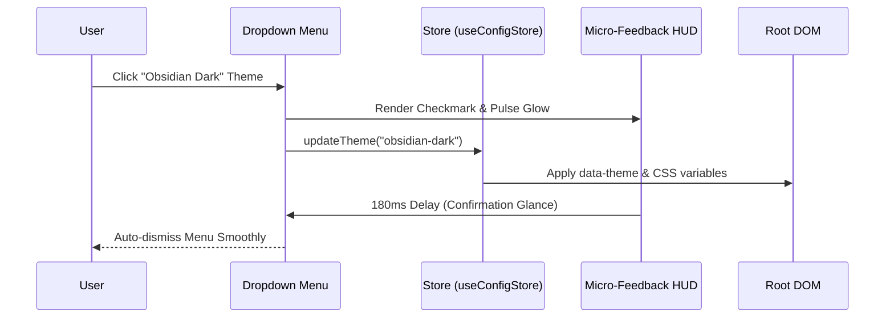

# Architecture Specification: UI & UX Enhancements for Antigravity-Manager

**Document ID:** `02-spec/21-app/ui-and-ux-enhancements-for-antigravity-manager/01-architecture-spec.md`  
**Parent Task:** `ui-and-ux-enhancements-for-antigravity-manager`  
**Version:** 1.0.0  
**Updated:** 2026-10-15  
**Status:** APPROVED ARCHITECTURE SPECIFICATION  
**Target Release:** v4.200.0  
**Subtask Plan:** [.ai-memory/plans/subtasks/ui-and-ux-enhancements-for-antigravity-manager/01-ui-components-and-builder.md](../../../.ai-memory/plans/subtasks/ui-and-ux-enhancements-for-antigravity-manager/01-ui-components-and-builder.md)  
**Related Specs:**
- Progress Bar Specification: [03-progress-bar-spec.md](03-progress-bar-spec.md)

---

## 1. Executive Summary & Problem Classification

Antigravity-Manager provides a unified multi-instance management console and multi-protocol reverse proxy gateway. As the user interface expanded to encompass multi-instance process orchestration, cluster leases, real-time prompt telemetry, and fine-grained quota tracking, several visual, structural, and ergonomic defects have accumulated:

1. **TitleBar Close Button Edge Cut-Off:**
   - In windowed desktop mode on Windows 10/11 and Linux environments, the window caption controls (`TitleBar.tsx`) are positioned flush against the right boundary (`mr-0`, `w-11 h-8`).
   - Desktop Window Manager (DWM) anti-aliasing, rounded window corner clipping, and custom display scaling cause the rightmost close button (`#titlebar-btn-close`) to be truncated or clipped by 2–4 pixels, degrading visual polish and hit-testing ergonomics.

2. **Navbar Clutter & NavSettings Trigger Bloat:**
   - The top navigation bar (`Navbar.tsx` and `NavSettings.tsx`) contains redundant text strings ("Preferences", language labels, and theme descriptions) directly on the primary toolbar trigger buttons.
   - This label bloat consumes excessive horizontal width, forcing premature wrapping, crowding the instance selector, or causing layout instability on screens below 1280px width.

3. **Silent Dropdown Selection & Lack of State Update Feedback:**
   - When users switch color themes, update active languages, or modify execution destination modes via dropdown menus, there is no instant tactile confirmation or reactive visual feedback.
   - Users cannot discern whether a theme change or language preference was successfully persisted to configuration storage or if an internal error was encountered.

4. **Sticky Header Overlapping Modal Dialogs (Z-Index Hierarchy Failure):**
   - The main application navbar (`Navbar.tsx`) is rendered with `position: sticky; top: 0; zIndex: 100; isolation: 'isolate'`.
   - Modals and drawers embedded across various views without root DOM portaling become trapped inside ancestor stacking contexts.
   - Consequently, when modals are opened, the sticky navbar header remains visible and clickable **on top of** the modal overlay backdrop, obscuring modal header actions and violating fundamental windowing isolation.

5. **Lack of Browser-Based UI Prototyping & Inspection Tooling:**
   - Tuning progress bar milestones, node protrusion geometry, segmented pill capsules, and modal stacking currently requires compiling the full Tauri Rust backend and launching the desktop binary.
   - A standalone, zero-dependency browser-based UI builder tool is required to test, inspect, and benchmark components in pure HTML/CSS/JS with zero compilation overhead.

This architecture specification defines the comprehensive layout, token system, stacking hierarchy, and prototyping toolchain to eliminate these defects across all target operating systems.

---

## 2. Unified Design Tokens & Glassmorphism System

The design system enforces strict dark-glass tokens, rounded segmented capsules, and high-contrast typography across both light and dark operational modes.

### 2.1 Color Tokens & Surface Variables

All surfaces leverage CSS custom properties declared in `src/styles/ui-tokens.css`:

```css
:root {
  /* Surface Tokens */
  --ui-bg-glass: rgba(245, 250, 249, 0.85);
  --ui-border-glass: rgba(229, 231, 235, 0.60);
  --ui-surface-capsule: rgba(243, 244, 246, 0.95);
  --ui-divider-capsule: rgba(229, 231, 235, 0.60);
  
  /* Text & Contrast Tokens */
  --ui-text-primary: #1f2937;
  --ui-text-secondary: #4b5563;
  --ui-text-muted: #9ca3af;
  
  /* Progress Scale Tokens */
  --ui-quota-stop-100: #1af18d; /* Vibrant Terminal Green */
  --ui-quota-stop-80:  #10b981; /* Emerald */
  --ui-quota-stop-60:  #eab308; /* Warm Amber Yellow */
  --ui-quota-stop-40:  #f97316; /* Warning Orange */
  --ui-quota-stop-20:  #ef4444; /* Bright Red */
  --ui-quota-stop-0:   #7f1d1d; /* Deep Crimson */
}

.dark {
  /* Surface Tokens - Dark Glass */
  --ui-bg-glass: rgba(9, 6, 17, 0.85);
  --ui-border-glass: #40285e;
  --ui-surface-capsule: rgba(23, 16, 37, 0.90);
  --ui-divider-capsule: rgba(51, 65, 85, 0.60);
  
  /* Text & Contrast Tokens */
  --ui-text-primary: #f8fafc;
  --ui-text-secondary: #cbd5e1;
  --ui-text-muted: #64748b;
}
```

### 2.2 Segmented Pill Capsule Invariant (`AGENTS.md`)

All adjacent toolbar actions, settings triggers, and desktop window controls **MUST** be wrapped into contiguous segmented pill capsules rather than disjointed individual circular buttons:
- **Container Styling:** `rounded-full border border-gray-200/60 dark:border-[#40285e] bg-gray-100 dark:bg-[#171025]/90 p-0.5 shadow-xs flex items-center`.
- **Internal Dividers:** Contiguous buttons share internal subtle dividers (`divide-x divide-gray-200/50 dark:divide-slate-700/60` or explicit `border-r border-gray-200/50 dark:border-slate-700/60`).
- **Terminal Radii:** Leftmost button uses `rounded-l-full`, rightmost button uses `rounded-r-full`, and intermediate buttons remain square/unrounded.
- **Transparent Select Invariant:** Any `<select>` dropdown rendered inside a segmented capsule MUST use `bg-transparent border-0 focus:ring-0 focus:outline-none text-inherit` to completely eliminate nested white pill-in-pill visual defects.

---

## 3. TitleBar & Window Control Architecture

The custom desktop titlebar (`src/components/layout/TitleBar.tsx`) provides window dragging, title branding, and platform-specific window caption controls.

### 3.1 Resolving the Close Button Cut-Off Defect

```
[Defective Layout - Flush Edge]
+-----------------------------------------------------------------------------+
| Agm Tool By Alim  v4.195.0              [ - ] [ [] ] [ X ]| <- Edge Clipping
+-----------------------------------------------------------------------------+

[Corrected Layout - Segmented Capsule with Safe-Area Inset]
+-----------------------------------------------------------------------------+
| Agm Tool By Alim  v4.195.0         +-------------------------+              |
|                                    |  [ - ] | [ [] ] | [ X ] |  8px inset   |
|                                    +-------------------------+   (pr-2.5)   |
+-----------------------------------------------------------------------------+
```

#### Root Cause Analysis:
1. `TitleBar.tsx` rendered caption controls with zero right padding (`mr-0`, `pr-0`), positioning the close button's right edge flush with the WebView viewport boundary.
2. In Windows 11 DWM (Desktop Window Manager), hardware-accelerated windows feature rounded outer corners (`DWMWA_WINDOW_CORNER_PREFERENCE`). Elements rendered at `right: 0` are physically clipped by the operating system's window radius.
3. On high-DPI displays (125%, 150%, 175%), fractional pixel rounding truncates the outer 1.5px border of the close button.

#### Structural Solution:
1. **Safe-Area Inset:** Apply an explicit safe-area right inset of 10px (`pr-2.5 sm:pr-3`) on the right control cluster container in `TitleBar.tsx`.
2. **Segmented Capsule Wrapping:** Replace the bare button strip with a unified, dark-glass segmented pill capsule:
   ```tsx
   <div className="flex items-center rounded-full bg-gray-100/90 dark:bg-[#171025]/90 border border-gray-200/60 dark:border-[#40285e] p-0.5 divide-x divide-gray-200/50 dark:divide-slate-700/60 shadow-xs mr-2">
       {/* Minimize */}
       <button id="titlebar-btn-minimize" className="w-8 h-6 rounded-l-full ...">...</button>
       {/* Maximize / Restore */}
       <button id="titlebar-btn-maximize" className="w-8 h-6 ...">...</button>
       {/* Close */}
       <button id="titlebar-btn-close" className="w-8 h-6 rounded-r-full hover:bg-[#E81123] hover:text-white ...">...</button>
   </div>
   ```
3. **Platform-Specific Parity:**
   - **macOS:** Standard traffic lights (`Close`, `Minimize`, `Maximize`) remain left-aligned with `pl-3 gap-2`, preserving native macOS HIG ergonomics.
   - **Windows / Linux:** Right-aligned segmented pill capsule with clear insets, preventing any clipping or cut-off under all scaling factors.

---

## 4. Navbar Segmented Capsule Hierarchy

The main application navigation header (`src/components/navbar/Navbar.tsx`) is structured into four clearly decoupled, non-overlapping segmented zones:

```
+--------------------------------------------------------------------------------------------------------------------+
| ZONE 1: BRANDING        | ZONE 2: NAVIGATION MENU      | ZONE 3: INSTANCES         | ZONE 4: UTILITIES & SETTINGS  |
| [ Logo ] [ Bug ] [ Err ]| [ Accounts | Proxy | Audit ] | [ Local IDE | FF | Sync ] | [ Recycle | Palette | EN v ]  |
+--------------------------------------------------------------------------------------------------------------------+
```

### 4.1 Zone 1: Branding & Global Diagnostics Pill
- Contains `NavLogo`, the debug console trigger (`Bug` icon with active amber glow), and the error queue badge (`ErrorQueueBadge`).
- Wrapped in an integrated pill container with subtle dividers.

### 4.2 Zone 2: Navigation Menu Capsule (`NavMenu.tsx`)
- Houses high-priority navigation links (`/accounts`, `/instances`, `/api-proxy`, `/audit`, `/settings`).
- Styled as a centered, floating dark-glass segmented capsule with smooth active-route pill sliding indicators.

### 4.3 Zone 3: Instance & Workspace Leases Capsule (`InstanceSelector.tsx`)
- Houses the active instance dropdown, fast-forward shortcut trigger, and instance lease status.

### 4.4 Zone 4: Utilities & System Settings Capsule (`NavSettings.tsx`)
- Combines system maintenance, theme styling, and internationalization into a unified 3-slot segmented capsule.

---

## 5. NavSettings Icon-Only Compacting & Triangle Trigger Architecture

To eliminate visual clutter and reclaim over 120 pixels of horizontal navigation space, `NavSettings.tsx` is completely refactored from text-heavy buttons into an **icon-only segmented pill capsule**.

```
+----------------------------------------------------------+
|            NAVSETTINGS 3-SLOT SEGMENTED CAPSULE          |
| +------------------------------------------------------+ |
| |  [ RotateCcw ]  |  [ Palette (Swatch) ]  |  [ EN ▼ ] | |
| +------------------------------------------------------+ |
|         |                     |                 |        |
|         v                     v                 v        |
|    Quick Clean           Theme Catalogue   Language Menu |
|       Modal                 Dropdown          Dropdown   |
+----------------------------------------------------------+
```

### 5.1 Slot 1: Antigravity Quick Clean (Recycle Icon)
- **Visual Presentation:** Single icon button with `RotateCcw` (14px). Left-rounded (`rounded-l-full`).
- **Interaction:** Single-click opens the `AgyCleanModal` for cleaning developer caches, temp files, and process locks.
- **Tooltip:** `title={t('nav.quick_clean', 'Antigravity Cache & Retention Clean')}`.

### 5.2 Slot 2: Theme Catalogue Switcher (Swatch Dot + Palette Icon)
- **Visual Presentation:** Dual-indicator presentation:
  1. A 10px circular color swatch previewing the active theme's primary gradient:
     `background: linear-gradient(135deg, ${currentPalette.bg} 50%, ${currentPalette.primary} 50%)`.
  2. The `Palette` icon (14px) with subtle accent coloring.
- **Interaction:** Opens the expanded 2-column theme catalogue popover (`THEME_PALETTES`).
- **Elimination:** Removes bulky theme text labels from the top-level navbar trigger.

### 5.3 Slot 3: Language Selector with Micro-Triangle Trigger
- **Visual Presentation:** Right-rounded (`rounded-r-full`). Displays the 2-letter uppercase language code (`EN`, `ZH`, `JA`, `ES`, `DE`, `RU`, `AR`) followed by an elegant **micro-triangle caret**:
  ```tsx
  <span className="text-[11px] font-mono font-bold uppercase tracking-wider text-gray-700 dark:text-gray-300">
      {currentLangItem.short}
  </span>
  <svg 
      className={`w-2 h-2 text-gray-400 group-hover:text-gray-200 transition-transform duration-150 ${isPrefsOpen ? 'rotate-180' : ''}`} 
      viewBox="0 0 8 6" 
      fill="currentColor"
  >
      <path d="M0 1.5L4 5.5L8 1.5H0Z" />
  </svg>
  ```
- **Rationale for Triangle Caret:** The micro-triangle caret (`▼` / SVG path `M0 1.5L4 5.5L8 1.5H0Z`) provides a crisp, compact, and unmistakable dropdown indicator that consumes 50% less width than standard 16px chevrons.

---

## 6. Dropdown Update Feedback & Reactive State Engine

A major UX deficiency in previous builds was the lack of visual feedback when changing settings inside dropdown menus. When an option was selected, the dropdown abruptly closed with zero indication of success.

### 6.1 Interactive Feedback Pipeline

When an option is selected from the Theme Catalogue or Language menu:



1. **Immediate In-Item Visual Confirmation:**
   - The clicked item instantly renders an illuminated `Check` icon (`w-3.5 h-3.5 text-emerald-500 animate-in zoom-in-75 duration-100`).
   - The item's background transitions to an active accent highlight (`bg-emerald-500/15 border-emerald-500/30`).
2. **Glance Delay before Dismissal:**
   - A brief 180ms glance delay is enforced before closing the popover, allowing the human eye to perceive the selection confirmation.
3. **Reactive Global Synchronization:**
   - The theme or language update immediately synchronizes across all open windows, updating document classes (`light` vs `dark`) and `document.documentElement.dir` (`ltr` vs `rtl`).
4. **Error Interception:**
   - In accordance with the project's **No Silent Errors** rule, any persistence failure during `saveConfig` routes immediately into `useErrorStore.getState().captureError` and opens the diagnostic error modal.

---

## 7. Modal Z-Index Priority Hierarchy & Stacking Context Resolution

### 7.1 Problem Analysis: Why Modals Were Overlapped by Sticky Headers

In earlier versions, opening certain modals (such as `DroidSyncModal`, `HermesSyncModal`, `InstanceSettingsModal`, or audit details) resulted in a critical visual defect: **the top navbar header remained rendered directly on top of the modal backdrop and modal dialog**.

#### Architectural Root Cause:
1. **Local Stacking Context Trapping:**
   - The sticky navbar in `Navbar.tsx` declared:
     `style={{ position: 'sticky', top: 0, zIndex: 100, isolation: 'isolate' }}`.
   - Child page components (rendered inside `<main>` via React Router `<Outlet />`) rendered modal components directly in their local JSX trees without portaling to `document.body`.
   - CSS properties on `<main>` (e.g. `overflow-hidden`, `transform`, or `filter`) created independent stacking contexts.
   - In CSS stacking rules, an element with `z-index: 9999` trapped inside a parent container with stacking context cannot render above a sibling element (`Navbar`) with `z-index: 100` that sits in the root stacking context!
2. **Inconsistent Arbitrary Z-Indices:**
   - Modals throughout the codebase used arbitrary z-index values (`z-[300]`, `z-[9999]`, `z-[99999]`, `z-[999999]`), leading to layering collisions between modals, dropdowns, and sticky table headers.

### 7.2 The Mandatory Universal Z-Index Ladder

All z-index values across the application are standardized into an unambiguous 8-tier hierarchy:

| Tier | Token Name | Tailwind Class | Numeric Z-Index | Permitted Elements & Components |
| :---: | :--- | :--- | :--- | :--- |
| **0** | Base Canvas | `z-0` | `0` | Default page body, content cards, scrollable viewports |
| **1** | Local Overlays | `z-10` | `10` | Milestone nodes, badge overlaps, avatar clusters |
| **2** | Sticky Table Headers | `z-20` | `20` | Table `<thead>` sticky scrolling within sub-views |
| **3** | Sticky Main Navbar | `z-sticky` / `z-[100]` | `100` | Application top navigation bar (`Navbar.tsx`) |
| **4** | In-Page Dropdown Menus | `z-dropdown` / `z-[500]` | `500` | Flyout menus, select popovers, toolbar actions |
| **5** | Fixed HUDs & Toasts | `z-toast` / `z-[1000]` | `1,000` | Toast notifications (`ToastContainer`), debug HUDs |
| **6** | Side Panels & Drawers | `z-drawer` / `z-[5000]` | `5,000` | `ErrorHistoryDrawer`, slide-out side drawers |
| **7** | **Standard Modal Dialogs** | **`z-modal` / `z-[10000]`** | **`10,000`** | **All standard dialogs (`ModalDialog`, `SettingsModals`, `DetailsModal`)** |
| **8** | **High-Priority System Modals** | **`z-sys-modal` / `z-[50000]`**| **`50,000`** | **`AgyCleanModal`, `UnifiedBackupModal`, `SyncModals`** |
| **9** | **Fatal Error Overlay** | **`z-critical` / `z-[99999]`**| **`99,999`** | **Global unhandled crash modal (`ErrorModal`)** |
| **10**| Desktop Window Drag | `z-drag` / `z-[100000]` | `100,000` | Tauri OS drag regions (`data-tauri-drag-region`) |

### 7.3 Mandatory Stacking Invariants:
1. **Universal React Portal Invariant:**
   - **EVERY modal component, drawer, and full-screen overlay MUST be mounted into `document.body` via `createPortal(modalElement, document.body)`.**
   - Direct inline rendering of modal dialogs inside page or table JSX hierarchies is strictly forbidden.
2. **Backdrop Event Isolation:**
   - The modal backdrop (`fixed inset-0 bg-black/60 backdrop-blur-sm`) sits at `z-[10000]` (or `z-[50000]`), completely covering the entire viewport, including the sticky navbar.
   - The backdrop must set `pointer-events-auto` and intercept all clicks (`onClick={(e) => e.stopPropagation()}`), preventing any accidental click-through to the navbar beneath it.
3. **Elimination of Navbar `isolation: 'isolate'`:**
   - Remove `isolation: 'isolate'` from `Navbar.tsx` to prevent accidental stacking context isolation issues with child popovers.

---

## 8. Browser-Based UI Builder Tool Architecture

To facilitate rapid iteration, isolated component benchmarking, and autonomous AI verification without compiling the native Rust Tauri backend, a standalone browser-based tool is architected at:

`tools/ui-builder/index.html`

### 8.1 Tool Architecture & Zero-Dependency Design

```
+--------------------------------------------------------------------------------------------------------------------+
|                                    ANTIGRAVITY-MANAGER UI PROTOTYPING BUILDER                                      |
+--------------------------------------------------------------------------------------------------------------------+
| LEFT: CONFIGURATION & CONTROLS                    | RIGHT: LIVE INTERACTIVE PREVIEW & INSPECTION                   |
|                                                   |                                                                |
| 1. Progress Bar Controls:                         | +------------------------------------------------------------+ |
|    - Fill Percentage Slider [ 78% ]               | | LIVE PROGRESS BAR (10px Track, 20px Nodes, Checkmarks)     | |
|    - Milestone Node Checkpoints: 5 Internal       | | [=====(v)======(v)======(v)======(v)======( )----]  78%    | |
|    - Table Row Hover Simulation: [ON / OFF]       | +------------------------------------------------------------+ |
|                                                   |                                                                |
| 2. Segmented Capsule Controls:                    | +------------------------------------------------------------+ |
|    - NavSettings Layout Mode: [Icon-Only]         | | LIVE NAVBAR & SEGMENTED CAPSULES                           | |
|    - Caret Type: [Micro-Triangle ▼]               | | [ Recycle ] | [ Swatch + Palette ] | [ EN ▼ ]              | |
|                                                   | +------------------------------------------------------------+ |
| 3. Modal Stacking & Z-Index Simulator:            |                                                                |
|    - Sticky Navbar: z-index 100                   | +------------------------------------------------------------+ |
|    - Open Test Modal: z-index 10,000              | | LIVE MODAL STACKING SIMULATION (Zero Header Overlap)      | |
|    - Verify Header Overlap Elimination            | | [ Modal Dialog sits 100% ABOVE Sticky Header ]             | |
|                                                   | +------------------------------------------------------------+ |
| 4. Code Snippet Export:                           |                                                                |
|    - [ Copy Standalone HTML/CSS ]                 |                                                                |
+--------------------------------------------------------------------------------------------------------------------+
```

### 8.2 Architectural Modules of the UI Builder:
1. **Standalone Execution:** Pure modern HTML5, CSS3, and ES6 JavaScript. Runs directly in any web browser (local browser file protocol or local static server) with zero build steps (`no npm run build` required).
2. **Live Progress Bar Benchmark:**
   - Allows interactive scrubbing of quota percentage (0% to 100%).
   - Renders the exact 10px track height (`h-2.5`) with 20px protruding nodes (`w-5 h-5`).
   - Toggles checkmarks (`v`) dynamically as the fill surpasses each milestone node.
   - Tests table row hover glow (`filter: drop-shadow`, `box-shadow`) under 80% default vs 100% hover brightness.
3. **Segmented Capsule & Transparent Dropdown Workbench:**
   - Tests TitleBar safe-area insets (`pr-2.5`) to verify zero close-button cut-off.
   - Tests the 3-slot NavSettings capsule (Recycle, Swatch+Palette, Language with micro-triangle).
   - Validates that `<select>` elements render completely borderless and transparent without nested white rectangular artifacts.
4. **Stacking Context & Z-Index Collision Tester:**
   - Simulates a sticky header (`position: sticky; z-index: 100`) with a scrollable page container.
   - Spawns modal dialogs at `z-index: 10000`, testing and verifying that the modal backdrop and dialog sit strictly above the header with zero bleed-through or click-through.
5. **One-Click Code Generator:**
   - Generates production-ready, clean HTML/CSS snippets for copy-pasting directly into React components.

---

## 9. Architectural Invariants & Verification Checklist

Every change executed under this specification must strictly comply with the following invariants:

- [ ] **Invariant 1 (No Close Cut-Off):** TitleBar window controls on Windows/Linux must have at least 8px right safe-area inset (`pr-2.5` / `pr-3`), ensuring the close button is never clipped by DWM rounded corners.
- [ ] **Invariant 2 (Segmented Capsule Parity):** All adjacent controls in TitleBar and Navbar must be wrapped into contiguous segmented pill capsules (`rounded-full`, shared border, subtle dividers, dark-glass background).
- [ ] **Invariant 3 (NavSettings Icon-Only):** NavSettings primary toolbar trigger must be strictly icon-only with a micro-triangle caret for language, eliminating top-level text bloat.
- [ ] **Invariant 4 (Modal Portaling & Zero Header Overlap):** All modals must use `createPortal(..., document.body)` with `z-index >= 10,000`, guaranteeing that modals always sit above the sticky navbar (`z-100`).
- [ ] **Invariant 5 (Progress Bar Geometry):** Track height must be exactly 10px (`h-2.5`), milestone nodes must be 20px in diameter with checkmark glyphs, strictly zero nodes at 0% and 100% ends, and 5 internal splits.
- [ ] **Invariant 6 (Relative Paths Only):** All documentation and specifications must use strictly relative Git paths (`02-spec/...`, `.ai-memory/...`, `src/...`) with zero absolute filesystem paths.
- [ ] **Invariant 7 (No Silent Errors):** All asynchronous config persistence and window invoke operations must route failures to `useErrorStore.getState().captureError` or `trackWarning`.
