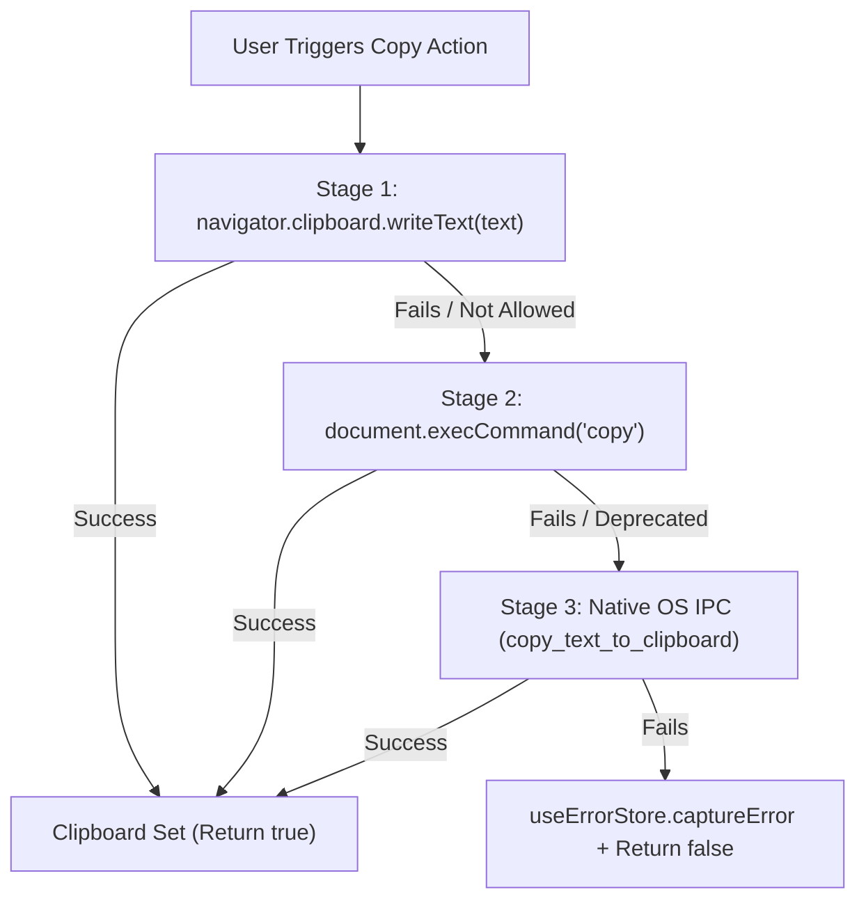

# 02-component-spec: Component-Level UI and UX Enhancements

- **Spec ID:** `02-spec/21-app/ui-and-ux-enhancements-for-antigravity-manager/02-component-spec.md`
- **Application:** Antigravity-Manager (`agm`, React Frontend, Tauri Desktop App)
- **Status:** `APPROVED`
- **Lead Architect:** Spec 02 Component Specialist
- **Parent Task:** `ui-and-ux-enhancements-for-antigravity-manager`

---

## 1. Executive Summary & Component Scope

This specification defines the component-level implementation standards for user interface refinement, caption boundary integrity, visual continuity, and modal layering across Antigravity-Manager:

1. **Window Caption & Cut-off Boundary Protection (`src/components/layout/TitleBar.tsx` and `src/components/navbar/NavSettings.tsx`):**
   - Eliminate subpixel clipping, button stroke truncation, and icon bounding-box overflow on custom window caption controls.
   - Standardize boundary padding, `overflow-visible` styling, and normalized SVG vector dimensions (`w-3.5 h-3.5` with `16x16` viewbox) to maintain razor-sharp rendering on High-DPI displays.
2. **Navigation Menu Modernization & Visual Continuity (`src/components/navbar/NavMenu.tsx`):**
   - Transition the direct `Settings` action from a mixed text+icon button to an icon-only button accompanied by an accessible high-contrast dark-glass tooltip, matching `Accounts` and `Instances`.
   - Replace the detached circular hamburger dropdown button with a seamlessly integrated trailing segment featuring a crisp chevron down indicator.
   - Guarantee continuous segmented pill geometry (`rounded-full`, shared dark-glass background, subtle vertical dividers) across all navigation states.
   - Implement proactive, non-silent feedback for update checks (immediate "Checking for updates..." feedback toast transitioning to "No updates available (latest version installed)").
3. **Modal Stacking & Collision Hardening (`src/components/instances/PromptTreeView/PromptTreeViewModal.tsx` & `src/components/common/ModalDialog.tsx`):**
   - Elevate modal z-index hierarchy to `z-[99999]` and overlay drag handles to `z-[100000]`, preventing modal headers from slipping beneath the persistent top navbar or desktop caption regions.
   - Adjust modal viewport margins and header anchoring so modal control capsules never collide with titlebar drag zones.
4. **Standalone Prompt Copy Feature Verification (`src/components/instances/PromptTreeView/ConversationNode.tsx`, `DetailHeader.tsx`, `clipboard.ts`):**
   - Provide direct single-click prompt clipboard copying from tree nodes and detail headers without requiring dropdown expansion.
   - Guarantee rich dual-MIME (`text/html` and `text/plain`) formatting and seamless fallbacks across browser and native OS clipboard backends.

---

## 2. Window Caption Controls & Boundary Padding Specification

### 2.1 The Caption Clipping Defect
On custom borderless Tauri windows (`decorations: false`), window caption controls (Minimize, Maximize/Restore, Close) are rendered via HTML/SVG elements. Two defects currently degrade visual quality:
1. **Bounding Box Truncation:** Button containers configured with tight sizing (`w-7 h-7` or `p-0.5`) inside containers with implicit clipping truncate outer SVG paths (specifically the diagonal strokes of the close "✕" icon and restore double rectangles).
2. **Subpixel Border Overlap:** Dividing lines (`divide-x`) within segmented capsules encroach upon adjacent button click targets, resulting in asymmetric button hover outlines.

### 2.2 Component Standards: `src/components/layout/TitleBar.tsx`

```
┌────────────────────────────────────────────────────────────────────────────────────────┐
│ [A] Agm Tool By Alim  v4.204.0       (Draggable Region)         [  −  ] [  □  ] [  ✕  ] │
└────────────────────────────────────────────────────────────────────────────────────────┘
                                                                    44px    44px    44px
                                                                 (w-11)  (w-11)  (w-11)
```

- **Container Invariants:**
  - Root `<header>` maintains `h-8 select-none relative z-50 shrink-0`.
  - Action container on the right must enforce `flex items-center h-full overflow-visible`.
- **Button Sizing & Target Bounds:**
  - Minimize (`#titlebar-btn-minimize`): `w-11 h-8 flex items-center justify-center` with text color `text-gray-600 dark:text-gray-400 hover:bg-gray-200/80 dark:hover:bg-white/10`.
  - Maximize/Restore (`#titlebar-btn-maximize`): `w-11 h-8 flex items-center justify-center` with matching hover state.
  - Close (`#titlebar-btn-close`): `w-11 h-8 flex items-center justify-center hover:bg-[#E81123] hover:text-white dark:hover:bg-[#E81123] dark:hover:text-white active:bg-[#C40E1E]`.
- **SVG Vector Normalization:**
  - Close icon SVG:
    ```tsx
    <svg 
      className="w-3.5 h-3.5 pointer-events-none overflow-visible" 
      viewBox="0 0 16 16" 
      fill="none" 
      stroke="currentColor" 
      strokeWidth="1.5" 
      strokeLinecap="round"
      strokeLinejoin="round"
    >
      <path d="M3.5 3.5l9 9M12.5 3.5l-9 9" />
    </svg>
    ```
  - `overflow-visible` on the `<svg>` ensures that diagonal stroke endpoints (`strokeLinecap="round"`) are never clipped by the SVG bounding box.
  - Path coordinates are inset by 0.5px (`3.5` to `12.5`) rather than `3` to `13` to prevent border clipping at non-integer device pixel ratios.

### 2.3 Component Standards: `src/components/navbar/NavSettings.tsx`

When rendered inside the unified header bar in `src/components/navbar/NavSettings.tsx`, window controls are contained within a segmented pill capsule:

```tsx
{/* Window controls (Minimize, Maximize/Restore, Close) - Tauri only */}
{isTauri() && (
    <div className="flex items-center rounded-full bg-gray-100 dark:bg-[#171025]/90 border border-gray-200/60 dark:border-[#40285e] p-0.5 divide-x divide-gray-200/50 dark:divide-slate-700/60 shadow-xs z-50 shrink-0 overflow-visible">
        <button
            type="button"
            id="btn-window-minimize"
            name="window-minimize"
            data-xpath="//*[@id='btn-window-minimize']"
            onClick={handleMinimize}
            className="w-7 h-7 rounded-l-full hover:bg-gray-200 dark:hover:bg-[#40285e] flex items-center justify-center transition-all duration-150 ease-out cursor-pointer overflow-visible"
            title={t('common.minimize', 'Minimize')}
            aria-label="Minimize"
        >
            <Minus className="w-3.5 h-3.5 text-gray-700 dark:text-gray-300 pointer-events-none" />
        </button>

        <button
            type="button"
            id="btn-window-maximize"
            name="window-maximize"
            data-xpath="//*[@id='btn-window-maximize']"
            onClick={handleToggleMaximize}
            className="w-7 h-7 hover:bg-gray-200 dark:hover:bg-[#40285e] flex items-center justify-center transition-all duration-150 ease-out cursor-pointer overflow-visible"
            title={isMaximized ? t('common.restore', 'Restore') : t('common.maximize', 'Maximize')}
            aria-label={isMaximized ? "Restore" : "Maximize"}
        >
            {isMaximized ? (
                <svg className="w-3.5 h-3.5 text-gray-700 dark:text-gray-300 pointer-events-none overflow-visible" viewBox="0 0 16 16" fill="none" stroke="currentColor" strokeWidth="1.5">
                    <rect x="4.5" y="1.5" width="9.5" height="9.5" rx="1" />
                    <path d="M1.5 5.5v8.5h8.5" />
                </svg>
            ) : (
                <svg className="w-3.5 h-3.5 text-gray-700 dark:text-gray-300 pointer-events-none overflow-visible" viewBox="0 0 16 16" fill="none" stroke="currentColor" strokeWidth="1.5">
                    <rect x="2.5" y="2.5" width="11" height="11" rx="1.5" />
                </svg>
            )}
        </button>

        <button
            type="button"
            id="btn-window-close"
            name="window-close"
            data-xpath="//*[@id='btn-window-close']"
            onClick={handleClose}
            className="w-7 h-7 rounded-r-full hover:bg-red-500 hover:text-white dark:hover:bg-red-500 dark:hover:text-white flex items-center justify-center transition-all duration-150 ease-out cursor-pointer group overflow-visible"
            title={t('common.close', 'Close')}
            aria-label="Close"
        >
            <X className="w-3.5 h-3.5 text-gray-700 dark:text-gray-300 group-hover:text-white transition-colors duration-150 pointer-events-none" />
        </button>
    </div>
)}
```

- **Key Geometry Requirements:**
  - `overflow-visible` applied to both the segmented capsule wrapper and individual buttons.
  - Uniform `w-7 h-7` dimensions for all three buttons ensures symmetric circular end-caps (`rounded-l-full` and `rounded-r-full`).
  - Stroke width maintained at standard `1.5` for balanced visual weight with Lucide icons.

---

## 3. Navigation Menu Modernization (`src/components/navbar/NavMenu.tsx`)

### 3.1 Settings Button: Icon-Only Conversion with Tooltip
In `src/components/navbar/NavMenu.tsx`, the `Settings` button previously rendered text and an icon (`<Settings /> <span>Settings</span>`), creating an asymmetric pill layout alongside the icon-only `Accounts` and `Instances` buttons.

#### Specification:
1. **Icon-Only Structure:** Strip the text label `<span>` from direct render.
2. **Accessible Tooltip Capsule:** Render a positioned hover tooltip with dark-glass styling (`bg-slate-900/95 dark:bg-slate-950/95 backdrop-blur-md text-white text-[10px] rounded-md shadow-lg border border-slate-700/60`).
3. **Segmented Rounding (`segRounding`):**
   - The direct action array comprises `[accountsItem, instancesItem, settingsItem]`.
   - If `settingsItem` is the last direct item and no trailing menu exists, it takes `rounded-r-full`.
   - When the trailing chevron trigger is mounted, `settingsItem` takes `rounded-none` (middle segment).

```tsx
{/* Settings direct button (Icon-only with tooltip) */}
{settingsItem && (
    <div className="relative group">
        <Link
            to="/settings"
            draggable="false"
            className={cn(
                "flex items-center justify-center px-2.5 py-1 text-xs font-semibold transition-all duration-150 cursor-pointer select-none",
                segRounding(settingsItem),
                isSettingsActive
                    ? "bg-blue-600 text-white shadow-xs"
                    : "text-gray-700 dark:text-gray-300 hover:bg-gray-200 dark:hover:bg-[#40285e]"
            )}
            aria-label={settingsItem.label}
            title={settingsItem.label}
        >
            <Settings className={cn("w-3.5 h-3.5 shrink-0", isSettingsActive ? "text-white" : "text-indigo-600 dark:text-indigo-400")} />
        </Link>
        <div className="absolute top-full left-1/2 -translate-x-1/2 mt-1.5 px-2 py-0.5 bg-slate-900/95 dark:bg-slate-950/95 backdrop-blur-md text-white text-[10px] font-medium rounded-md shadow-lg border border-slate-700/60 pointer-events-none opacity-0 group-hover:opacity-100 transition-opacity duration-150 z-[9999] whitespace-nowrap">
            {settingsItem.label}
        </div>
    </div>
)}
```

### 3.2 Trailing Dropdown Trigger: Crisp Chevron Indicator
Previously, the "More Views" trigger was rendered as a standalone circular button (`w-7 h-7 rounded-full ml-0.5`) with a hamburger `Menu` icon, breaking capsule continuity.

#### Specification:
1. **Seamless Capsule Integration:** Eliminate `ml-0.5` and standalone circular geometry. Mount the trigger directly inside the segmented capsule with `rounded-r-full` and border divider.
2. **Crisp Triangle Chevron Indicator:** Replace `Menu` with `ChevronDown` (`w-3 h-3 text-gray-500 dark:text-gray-400`).
3. **Interactive State:** When dropdown is open, chevron rotates 180° (`rotate-180`).
4. **Active Route Feedback:** If the active route is an item inside the dropdown, the trigger segment highlights in subtle blue tint (`bg-blue-600/10 dark:bg-blue-500/20 text-blue-600 dark:text-blue-400`).

```tsx
{/* 4. Integrated Chevron Dropdown Segment for remaining views */}
<div className="relative" ref={menuRef}>
    <button
        type="button"
        onClick={() => {
            const next = !isMenuOpen;
            setIsMenuOpen(next);
            if (next) {
                window.dispatchEvent(new CustomEvent('agm:dropdown-open', { detail: { source: 'nav-menu' } }));
            }
        }}
        className={cn(
            "flex items-center justify-center px-2 py-1 text-xs transition-all duration-150 cursor-pointer rounded-r-full select-none",
            isDropdownRouteActive || isMenuOpen
                ? "bg-blue-600 text-white shadow-xs"
                : "text-gray-700 dark:text-gray-300 hover:bg-gray-200 dark:hover:bg-[#40285e]"
        )}
        title={activeDropdownItem ? `${activeDropdownItem.label} (More)` : t('common.more_views', 'More Views')}
        aria-label="More Navigation"
        aria-expanded={isMenuOpen}
    >
        <ChevronDown className={cn("w-3.5 h-3.5 shrink-0 transition-transform duration-200", isMenuOpen && "rotate-180")} />
    </button>
```

### 3.3 Proactive Update Feedback (No Silent Errors)
Users clicking "Check for Updates" inside the dropdown previously observed a silent pause until network requests finished, or complete silence if the system was already up to date.

#### Specification:
1. **Immediate Initial Toast:** Dispatch an instant informative toast (`showToast(t('nav.checking_for_updates', 'Checking for updates...'), 'info')`).
2. **Proactive Outcome Notification:**
   - When an update exists: The update notification modal opens automatically via `useUpdateStore`.
   - When on the latest version: Display `showToast(t('nav.update_up_to_date', 'No updates available (latest version installed)'), 'success')`.
   - When checking fails: Log warning to `useErrorStore` and display `showToast(t('nav.update_check_failed', 'Could not check for updates. Please verify your connection.'), 'error')`.

```typescript
const handleCheckUpdates = async () => {
    setIsMenuOpen(false);
    showToast(t('nav.checking_updates', 'Checking for updates...'), 'info');
    try {
        const info = await checkForUpdates(true);
        if (info?.has_update) {
            // UpdateNotification card appears automatically via the store
            return;
        }
        if (info) {
            showToast(t('nav.update_up_to_date', 'No updates available (latest version installed)'), 'success');
        } else {
            showToast(t('nav.update_check_failed', 'Could not check for updates'), 'error');
        }
    } catch (err) {
        useErrorStore.getState().trackWarning(err, {
            source: 'NavMenu.handleCheckUpdates',
            triggerAction: 'checkForUpdates',
        });
        showToast(t('nav.update_check_failed', 'Could not check for updates'), 'error');
    }
};
```

---

## 4. Modal Stacking & Z-Index Elevation Specification

### 4.1 Z-Index Hierarchy Invariant
To prevent complex modals (`PromptTreeViewModal`, `ModalDialog`, `InspectorModal`, `DetailsModal`) from slipping beneath sticky navigation elements or desktop titlebar drag zones, all application layers must conform to the following explicit z-index scale:

| Layer Level | Tailwind Class | Numeric Z-Index | Component Description |
|---|---|---|---|
| **L1: Base Content** | `z-0` | 0 | Page content, scrollable tables, cards |
| **L2: Sticky Nav** | `z-40` | 40 | Top navbar bar (`NavSettings`, `NavMenu`) |
| **L3: Desktop TitleBar**| `z-50` | 50 | Custom window header & drag handle |
| **L4: Popovers/Menus** | `z-[9999]` | 9999 | Dropdown flyouts, tooltip popovers |
| **L5: Application Modals**| `z-[99999]` | 99999 | `PromptTreeViewModal`, `ModalDialog`, audit modal |
| **L6: Modal Drag Region**| `z-[100000]`| 100000 | Modal-specific window dragging overlay |

### 4.2 Layout Stacking & Viewport Geometry (`PromptTreeViewModal.tsx`)

In `src/components/instances/PromptTreeView/PromptTreeViewModal.tsx`:
1. **Backdrop Elevation:** Change wrapper container from `z-[300]` to `z-[99999]`:
   ```tsx
   <div
       className={`fixed inset-0 z-[99999] flex items-center justify-center bg-black/60 backdrop-blur-xs animate-in fade-in duration-200 ${isFullscreen ? "p-0" : "p-4 sm:p-6"}`}
   >
   ```
2. **Collision-Proof Vertical Clearance:**
   - In windowed mode (`!isFullscreen`), modal height is constrained to `h-[88vh] max-h-[calc(100vh-4rem)]` with `rounded-2xl`.
   - In fullscreen mode, modal fills `h-full w-full rounded-none`.
3. **Portal Mounting:**
   - Ensure the modal is rendered strictly via `createPortal(modalContent, document.body)`.

### 4.3 Modal Header Preservation (`ModalHeader.tsx`)
1. Modal header retains `sticky top-0 z-30 flex items-center justify-between border-b border-slate-200/80 dark:border-[#40285e] px-4 py-2.5 bg-slate-50/95 dark:bg-[#090611]/95 backdrop-blur-md shrink-0`.
2. Segmented action capsules on the right remain interactive and immune to event absorption by root Tauri drag regions.

---

## 5. Standalone Prompt Copy Feature & Clipboard Verification

### 5.1 Standalone Tree-Node Copy Interaction (`ConversationNode.tsx`)
In `src/components/instances/PromptTreeView/ConversationNode.tsx`, users can copy the conversation prompt directly without first opening the detail pane or inspector modal:

1. **Hover Action Button:** Render a compact `Copy` button (`w-5 h-5 rounded hover:bg-slate-200 dark:hover:bg-[#40285e] p-0.5 opacity-0 group-hover:opacity-100 transition-opacity`) on the right side of the node.
2. **Click Propagation Isolation:** The copy button click event must invoke `e.stopPropagation()` to prevent unwanted selection or navigation changes.
3. **Transient Confirmation:** State toggle provides immediate visual feedback (`Check` icon in emerald for 2 seconds) and triggers `copyToClipboard(conv.prompt_preview_200w)`.

### 5.2 Detail Header Copy Capsules (`DetailHeader.tsx`)
In `src/components/instances/PromptTreeView/DetailHeader.tsx`:
1. **Direct Copy Button (Left Capsule Action):**
   - Single-click executes clean text copy:
     ```tsx
     const cleanText = stripImagesFromPrompt(activePromptText);
     copyToClipboard(cleanText);
     ```
   - Renders `Copied Clean Text!` with `Check` icon for 2000ms.
2. **Flyout Dropdown Actions:**
   - `Copy with Images`: Injects rich HTML with embedded base64/remote image markup via `copyPromptWithRichImages`.
   - `Save Images to Disk`: Saves referenced prompt images to local storage.
   - `Export as Markdown`: Saves `.md` file via Tauri save dialog.
   - `Export as JSON`: Saves structured payload `.json`.

### 5.3 Tri-Stage Fallback Clipboard Engine (`src/utils/clipboard.ts`)
The copy pipeline guarantees zero clipboard failures across desktop Tauri, browser webview, and headless environments:



1. **Stage 1 (Async Clipboard API):** Preferred modern path. If browser window focus is lost, logs warning without crashing.
2. **Stage 2 (DOM ExecCommand):** Classical off-screen `<textarea>` selection fallback.
3. **Stage 3 (Native OS Helper):** Desktop Tauri IPC command `copy_text_to_clipboard`, dispatching to Windows `clip.exe`, macOS `pbcopy`, or Linux `wl-copy`/`xclip`.

---

## 6. Verification & Test Matrix

| Test ID | Area | Action / Verification | Expected Outcome |
|---|---|---|---|
| `TC-CMP-01` | Window Caption | Hover and click Close button in `TitleBar.tsx` and `NavSettings.tsx` | No SVG stroke clipping; cross ends terminate cleanly with rounded caps |
| `TC-CMP-02` | NavMenu Settings | Inspect `NavMenu.tsx` direct buttons | Settings is rendered as icon-only; hover displays dark-glass tooltip; continuous pill geometry |
| `TC-CMP-03` | NavMenu Chevron | Toggle trailing dropdown in `NavMenu.tsx` | Chevron indicator rotates 180°; seamless capsule integration; no disjointed circle artifact |
| `TC-CMP-04` | Update Feedback | Click "Check for Updates" with and without active internet | Proactive toast displays immediately; final status toast displayed; no silent failure |
| `TC-CMP-05` | Modal Z-Index | Open `PromptTreeViewModal` while navigating views | Modal overlays navbar and titlebar at `z-[99999]`; modal header fully visible and interactive |
| `TC-CMP-06` | Standalone Copy | Click copy button on conversation node in tree | Prompt text copied to clipboard immediately; green checkmark appears for 2s |
| `TC-CMP-07` | Rich Image Copy | Click "Copy with Images" in DetailHeader | Clipboard receives dual MIME `text/html` and `text/plain` payloads |
