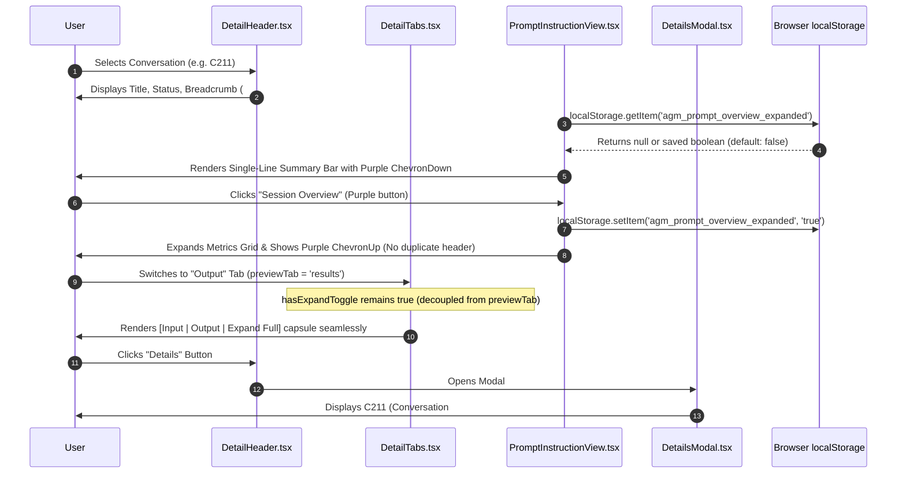

# Specification: Prompt Tree UI/UX Redesign, Collapsible Session Overview & Output Tab Fix

**Slug:** `ui-ux-redesign-and-bug-fix-instructions`  
**Document ID:** `02-spec/21-app/ui-ux-redesign-and-bug-fix-instructions/01-ui-ux-and-overview-spec.md`  
**Target Release:** v4.163.0  
**Status:** APPROVED SPECIFICATION  
**Lead Author:** Antigravity UI & UX Architecture Specialist  
**Subsystem:** Prompt Tree View (`src/components/instances/PromptTreeView/`)  

---

## 1. Executive Summary & Defect Remediation Scope

The Prompt Tree View (`src/components/instances/PromptTreeView/PromptTreeViewModal.tsx`) serves as the core orchestration and inspection dashboard for multi-instance prompt tracking, session analysis, and prompt re-injection in Antigravity-Manager.

Recent ergonomics analysis and user feedback identified four critical UI/UX and functional defects that hinder usability, waste vertical viewport space, and degrade tab navigation:

1. **Monolithic Vertical Space Waste in Session Overview Card:**
   In `src/components/instances/PromptTreeView/PromptInstructionView.tsx`, when no individual turn is selected (`selectedTurnNumber === null`), the full "Conversation Session Summary Dashboard" renders as an expanded card occupying up to 40% of the visible vertical height. Users intending to view or edit the prompt instruction text must repeatedly scroll past metrics they have already reviewed.
2. **Duplicate Header & Redundant Metadata:**
   The top of the overview card (lines 234–247 of `PromptInstructionView.tsx`) duplicates the conversation sequence badge (`CONV` / `C211`), session title, and conversation ID (`ID: ...`), despite this exact identity trio already being rendered immediately above in `src/components/instances/PromptTreeView/DetailHeader.tsx`.
3. **Semantic Ambiguity of `C211` / `C231` and Interaction `turns`:**
   Users encountering sequence codes like `C211` or `C231` and the count of `turns` lacked in-context explanations of what these values represent. This metadata was improperly placed in the primary prompt reading canvas instead of being organized within the dedicated metadata inspector (`src/components/instances/PromptTreeView/DetailsModal.tsx`).
4. **Disappearing Expand Full / Fold Toggle on Output Tab:**
   In `src/components/instances/PromptTreeView/DetailTabs.tsx`, the variable `hasExpandToggle` was hardcoded to require `previewTab === 'instruction'`. When users switch to the `Output` tab (`previewTab === 'results'`), the Expand Full / Fold toggle completely disappears from the segmented capsule, preventing users from toggling full text or collapsing long output logs.

This specification outlines the technical contracts, component architectures, UI design tokens, state persistence mechanisms, and quality gates required to resolve these issues.

---

## 2. Defect Remediation Matrix

| Defect ID | Target File | Root Cause | Target Architectural Solution |
|---|---|---|---|
| **D1** | `src/components/instances/PromptTreeView/PromptInstructionView.tsx` | Overview card is unconditionally expanded, consuming excessive vertical viewport. | Convert to a **collapsible card**, default collapsed (`isExpanded = false`), persisted in `localStorage` under key `agm_prompt_overview_expanded`. |
| **D2** | `src/components/instances/PromptTreeView/PromptInstructionView.tsx` | Overview card repeats title, sequence badge, and conversation ID already present in `DetailHeader.tsx`. | **Eliminate duplicate header** (lines 234–247). Replace with a compact single-line summary bar when collapsed, and a streamlined header when expanded. |
| **D3** | `src/components/instances/PromptTreeView/DetailsModal.tsx` | Sequence codes (`C211`, `C231`) and `turns` concepts lack formal labels and explanations. | Move sequence code breakdown (`C211` &rarr; `Conversation #211`) and `turns` definition (`User prompt instructions and assistant execution cycles`) cleanly into `DetailsModal.tsx` with dedicated descriptive badges. |
| **D4** | `src/components/instances/PromptTreeView/DetailTabs.tsx` | `hasExpandToggle` is conditionally gated by `previewTab === 'instruction'`. | **Decouple `hasExpandToggle` from `previewTab`**, preserving the Expand Full / Fold button across both `Input` and `Output` tabs with proper capsule border-radius styling. |

---

## 3. Detailed Architectural Specifications

### 3.1 Collapsible Session Overview Card (`PromptInstructionView.tsx`)

#### 3.1.1 State Persistence & Initialization Contract
The expand/collapse state must persist across application restarts and conversation switching using the browser's `localStorage` engine.

- **Storage Key:** `agm_prompt_overview_expanded`
- **Default Value:** `false` (Default Collapsed to prioritize prompt reading and editing vertical space).
- **State Initialization:**
  ```typescript
  const [isOverviewExpanded, setIsOverviewExpanded] = useState<boolean>(() => {
      try {
          const saved = localStorage.getItem('agm_prompt_overview_expanded');
          return saved !== null ? JSON.parse(saved) === true : false;
      } catch {
          return false;
      }
  });
  ```
- **State Mutation & Error Guard:**
  In accordance with `AGENTS.md` house rules, any failure in `localStorage.setItem` (e.g. quota exceeded, restricted environment) must NOT be swallowed silently; it must be recorded through `useErrorStore.getState().trackWarning`.
  ```typescript
  const handleToggleOverview = () => {
      setIsOverviewExpanded((prev) => {
          const next = !prev;
          try {
              localStorage.setItem('agm_prompt_overview_expanded', JSON.stringify(next));
          } catch (err: unknown) {
              useErrorStore.getState().trackWarning(err, {
                  source: 'PromptInstructionView.toggleOverview',
                  triggerAction: 'save_overview_state',
              });
          }
          return next;
      });
  };
  ```

#### 3.1.2 Compact Single-Line Collapsed Summary Bar
When `isOverviewExpanded === false`, the entire card collapses into a single-line summary bar of fixed height (~36px / `h-9`):

- **Container Styling:**
  `flex items-center justify-between px-3 py-1.5 rounded-xl border border-slate-200/80 dark:border-[#40285e]/80 bg-gradient-to-r from-slate-50 via-white to-purple-50/20 dark:from-[#171025] dark:via-[#120a1f] dark:to-[#1a0e2e] shadow-xs text-xs font-poppins`
- **Left Summary Badges:**
  - **Status Pill:** Compact status badge (Running pulse or Queued clock or Idle badge).
  - **Turn Metric Badge:** `span` displaying `{totalTurns} {totalTurns === 1 ? 'turn' : 'turns'}` in bold monospace.
  - **Time & Duration Badge:** Monospace text showing `{durationDisplay} ({timestampRange})` (hidden on extra small viewports `hidden sm:inline-block`).
  - **Pending FIFO Queue Indicator:** If `enqueuedTurns.length > 0`, an amber pill badge indicating `{enqueuedTurns.length} pending`.
- **Right Expander Action:**
  - Low-profile subtle purple button with `ChevronDown` icon.
  - Text: `Session Overview`.
  - Icon: `<ChevronDown className="w-3.5 h-3.5 text-purple-500 shrink-0" />`.
  - Styling tokens: `flex items-center gap-1.5 px-2.5 py-1 text-[11px] font-semibold rounded-lg text-purple-700 dark:text-purple-300 bg-purple-500/10 hover:bg-purple-500/20 dark:bg-purple-950/40 dark:hover:bg-purple-900/50 border border-purple-500/20 dark:border-purple-800/40 transition-all duration-150 cursor-pointer`.

#### 3.1.3 Elimination of Duplicate Header in Expanded State
In lines 234–247 of `PromptInstructionView.tsx`, the inner header repeated:
```tsx
{/* DELETED: Redundant Header repeating DetailHeader */}
<div className="flex items-center justify-between pb-2 border-b border-slate-200/60 dark:border-[#2b1b42]">
    <span className="text-[10px] font-mono px-1.5 py-0.5 rounded-md ...">
        {selectedConversation.seq_code || 'CONV'}
    </span>
    <h3>{selectedConversation.title}</h3>
    <p>ID: {selectedConversation.conversation_id}</p>
    ...
```
**Remediation:**
When expanded (`isOverviewExpanded === true`), the top bar of the card is streamlined:
- Left: An elegant title with Terminal/BarChart icon: `Session Overview & Metrics`.
- Right: A subtle purple collapse button with `ChevronUp` icon (`Collapse Overview`) allowing the user to fold it back down.
- Body: The 4-column Metrics Grid (`Total Turns`, `Session Status`, `Time Range`, `Duration`) and the Enqueued Prompts FIFO list (if pending turns exist) are rendered cleanly without duplicating the conversation ID or title.

---

### 3.2 Semantic Explanation of `C211` / `C231` and `turns` in `DetailsModal.tsx`

`DetailsModal.tsx` is the canonical inspector for project, environment, and conversation metadata.

#### 3.2.1 Semantic Breakdown
1. **Sequence Code (`C211` / `C231`):**
   - **Meaning:** Represents the sequential conversation code assigned to the conversation session within the project workspace storage. `C211` translates directly to **Conversation #211**.
   - **Label in DetailsModal:** `Sequence Code / Conversation Index`
   - **Visual Presentation:** A purple badge `C211 (Conversation #211)` accompanied by an explanatory subtext: `Sequential conversation index within project workspace storage`.
2. **Interaction Turns (`turns`):**
   - **Meaning:** Represents the number of discrete user-assistant dialog cycles (turns) recorded within the session. Each turn comprises a user instruction step and its corresponding AI responses, tool executions, and artifacts.
   - **Label in DetailsModal:** `Interaction Turns`
   - **Visual Presentation:** A badge/metric `N Turns (Prompt-Response Cycles)` accompanied by an explanatory subtext: `User request instructions and assistant execution cycles in this session`.

#### 3.2.2 Integration in `DetailsModal.tsx`
Within the `Conversation Info` card of `DetailsModal.tsx`, insert a 2-column grid row directly beneath the Conversation ID and above the Status / Step Count row:

```tsx
<div className="grid grid-cols-2 gap-2 pt-2 border-t border-slate-200/50 dark:border-[#40285e]/50">
    <div>
        <span className="text-slate-500 dark:text-slate-400 block text-[10px] uppercase font-mono">
            Sequence Code
        </span>
        <div className="flex items-center gap-1.5 mt-0.5">
            <span className="font-mono text-[11px] font-bold px-1.5 py-0.5 rounded-md bg-purple-100 dark:bg-purple-950/60 text-purple-700 dark:text-purple-300 border border-purple-200 dark:border-purple-800/40">
                {selectedConversation?.seq_code || 'CONV'}
                {convNumDisplay ? ` (Conv #${convNumDisplay})` : ''}
            </span>
        </div>
        <span className="text-[9.5px] text-slate-400 dark:text-slate-500 block mt-0.5">
            Sequential conversation index in workspace
        </span>
    </div>
    <div>
        <span className="text-slate-500 dark:text-slate-400 block text-[10px] uppercase font-mono">
            Interaction Turns
        </span>
        <div className="flex items-center gap-1.5 mt-0.5">
            <span className="font-mono text-[11px] font-bold text-slate-800 dark:text-slate-200">
                {turnCount} {turnCount === 1 ? 'Turn' : 'Turns'}
            </span>
        </div>
        <span className="text-[9.5px] text-slate-400 dark:text-slate-500 block mt-0.5">
            User prompts &amp; AI response cycles
        </span>
    </div>
</div>
```

---

### 3.3 Decoupling `hasExpandToggle` in `DetailTabs.tsx`

#### 3.3.1 Root Cause of Defect
In `src/components/instances/PromptTreeView/DetailTabs.tsx` lines 38–43:
```typescript
// DEFECTIVE IMPLEMENTATION:
const hasExpandToggle = previewTab === 'instruction' && Boolean(
    isTruncated ||
    activePromptText.trim().endsWith('...') ||
    activePromptText.trim().endsWith('…') ||
    showAllWords
);
```
When `previewTab === 'results'`, the expression `previewTab === 'instruction'` evaluates to `false`. Consequently, `hasExpandToggle` is forced to `false`.

#### 3.3.2 Decoupled Implementation Contract
Remove `previewTab === 'instruction'` from the condition. `hasExpandToggle` must depend solely on whether the text has truncation or is in an expanded state:
```typescript
// CORRECT IMPLEMENTATION:
const hasExpandToggle = Boolean(
    isTruncated ||
    activePromptText.trim().endsWith('...') ||
    activePromptText.trim().endsWith('…') ||
    showAllWords
);
```

#### 3.3.3 Button Capsule Layout & Border Radius Matrix
The segmented capsule on the right side of `DetailTabs.tsx` mounts:
`[ Input ] [ Output ] [ Expand Full / Collapse ]`

The styling ensures seamless dark-glass segmented aesthetics:
- `Input` button: always `rounded-l-md` (if first item in group).
- `Output` button:
  - If `hasExpandToggle === true`: `rounded-none`.
  - If `hasExpandToggle === false`: `rounded-r-md`.
- `Expand Full / Collapse` button (rendered when `hasExpandToggle === true`):
  - Always `rounded-r-md`.
  - State active styling: `bg-cyan-500/20 text-cyan-700 dark:text-cyan-300` when `showAllWords === true`.

---

## 4. Component Interaction Flow & Lifecycle Diagram



---

## 5. Technical Invariants & House Rules Alignment

1. **`AGENTS.md` Minimalist & Contextual UI:**
   - Controls must reuse existing dark-glass segmented pill capsule conventions.
   - Buttons must use subtle dividers, `rounded-full` or `rounded-md` capsules, and avoid loose disjointed circular buttons.
2. **`AGENTS.md` Error Visibility (House Rule 2026-10-10):**
   - No silent errors or empty `catch {}` blocks around `localStorage` operations.
   - In `PromptInstructionView.tsx`, any storage failure must route to `useErrorStore.getState().trackWarning`.
3. **Responsive Parity:**
   - Collapsed summary bar must gracefully truncate long timestamp ranges on small screens using `hidden sm:inline-block`.
4. **Zero Layout Shift:**
   - Smooth transition between collapsed and expanded overview card without causing horizontal overflow or jumping in the markdown preview pane.

---

## 6. Verification & Quality Gates

| Verification Gate | Validation Procedure | Acceptance Criteria |
|---|---|---|
| **Gate 1: Default Collapsed State** | Launch Prompt Tree View on a freshly loaded conversation session. | Session overview card is collapsed by default into a slim single-line bar (~36px high). |
| **Gate 2: State Persistence** | Click the purple expander to expand overview. Close and reopen the Prompt Tree View modal. | Card remains expanded on reload. After toggling to collapsed and reopening, card remains collapsed. |
| **Gate 3: Header Deduplication** | Expand the overview card. Inspect the top of the card and compare with `DetailHeader.tsx`. | No duplicate title, sequence badge, or `ID: ...` is rendered inside the overview card. |
| **Gate 4: Metadata Clarity in Modal** | Click the "Details" button in `DetailHeader` or `DetailTabs`. | `DetailsModal` clearly labels `C211 (Conversation #211)` as sequential conversation index, and `N Turns` as user prompts & AI cycles. |
| **Gate 5: Output Tab Expand Toggle** | In `DetailTabs`, click the `Output` button. | The `Expand Full / Collapse` toggle remains visible and styled cleanly as the rightmost segment of the capsule. |
