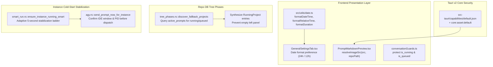

# Specification 02: Date Formatting, Prompt Tree Visibility & Closed IDE Stabilization Ladder

> **Specification ID:** `02-date-ide-send-spec`  
> **Parent Slug:** `ui-ux-redesign-and-bug-fix-instructions`  
> **Target Subsystem:** Frontend UI/UX, Timestamp Utilities, Prompt Tree View, Tauri Capabilities, Instance Smart Runner & Dispatcher  
> **Status:** `[APPROVED]`  
> **Author:** `@aukgit`  
> **Affected Files:**
> - `src/utils/date.ts`
> - `src/types/config.ts`
> - `src/components/settings/GeneralSettingsTab.tsx`
> - `src/pages/Settings/tabs/GeneralTab.tsx`
> - `src-tauri/capabilities/default.json`
> - `src/components/instances/PromptTreeView/clipboard.ts`
> - `src/components/instances/PromptTreeView/PromptMarkdownPreview.tsx`
> - `src/components/instances/PromptTreeView/conversationGuards.ts`
> - `src-tauri/src/modules/repo_db/tree_phases.rs`
> - `src-tauri/src/modules/instance/smart_run.rs`
> - `src-tauri/src/modules/repo_db/agy.rs`

---

## 1. Problem Statement & Root Cause Analysis

### 1.1 Timestamp Formatting, Durations & Relative Time Ambiguity
- **Inconsistent Formatting:** Timestamps across instances, prompt tree nodes, and detail panels are rendered using divergent formats (e.g., `DD-MMM-YY - hh:mm A`, raw ISO strings, or localized strings with arbitrary seconds).
- **Timezone Inconsistencies:** Some views inadvertently display UTC strings directly to users instead of converting to the user's local Windows timezone.
- **Duration Clutter:** Session and prompt execution durations frequently render seconds even when durations span hours or minutes (e.g., `18h 27m 14s` or `12m 45s`), adding unnecessary visual noise.
- **Missing Relative Time:** When absolute timestamps are displayed, users lack quick mental context regarding recency (e.g., "ran 5 minutes ago", "ran 1 day ago").

### 1.2 Prompt Tree Image Rendering Failure & Blank Tree with Active Prompts
- **Tauri v2 Asset Protocol Restriction:** In Tauri v2, local image rendering via `convertFileSrc` relies on the custom `asset:` protocol. `src-tauri/capabilities/default.json` is missing `"core:asset:default"`. Without this capability permission, the WebView security policy intercepts and blocks all asset protocol requests, resulting in broken image icons.
- **Relative Path Unresolved in Markdown:** `PromptMarkdownPreview.tsx` rendered markdown image nodes `` with the raw `src` string without piping through `resolveImageSrc()` or resolving relative repository paths (`./artifacts/image.png`) against the project's `repo_path`.
- **Empty Left Panel on Active/Queued Prompts:** `tree_phases.rs::discover_fallback_projects` scans `conversation_summaries.db` when `workspaceStorage` is unavailable, but fails to check `active_prompts` in `repo_prompts.db`. When an instance is executing or queuing prompts before conversation summaries are written by the IDE, `discover_fallback_projects` yields zero projects, rendering an empty left sidebar.
- **Queued Prompts Marked Stale:** `conversationGuards.ts::isStaleOrEmptyConversation` exempts `is_running`, but ignores `is_queued`. Consequently, newly queued prompts are incorrectly classified as stale/empty conversations and collapsed or filtered out.

### 1.3 Closed IDE Send Loss: Missing Process Stabilization Ladder
- **Premature Prompt Dispatch:** When sending a prompt to a closed Antigravity IDE, `ensure_instance_running_smart` launches the executable but sleeps for only 800ms before returning.
- **Electron Cold-Start Latency:** Electron-based IDEs require between 3 to 5 seconds to initialize Node.js runtimes, spawn the main window, open DevTools WebSocket ports, and bind IPC listeners.
- **Prompt Loss:** Calling `agy` or Chrome DevTools Protocol (CDP) dispatch within 800ms causes dispatch failures or drops because the IDE input controls and sockets are not yet receptive.

---

## 2. Architecture & Data Contracts



---

## 3. Detailed Technical Requirements

### 3.1 Centralized Date Formatting & Duration Rules (`src/utils/date.ts`)

#### 3.1.1 Time Format Standard
- **Default Format:** `DD-MMM-YYYY HH:mm` in 24-hour clock (e.g., `18-Oct-2026 21:40`).
- **Configurable Mode:** Support user preference stored in `AppConfig.date_format_mode`:
  - `'24h'` (Default): `18-Oct-2026 21:40`
  - `'12h'`: `18-Oct-2026 09:40 PM`
  - `'iso'`: `2026-10-18T21:40:00`
- **Timezone Invariant:** All displays must use the local system/Windows timezone. Storage across databases and API requests remains strictly ISO 8601 UTC0 (`YYYY-MM-DDTHH:mm:ss.sssZ` or Unix epoch seconds).

#### 3.1.2 Relative Recency Delta (`formatRelativeTime`)
Provide a standard helper returning polite relative time:
- `< 45 seconds`: `ran just now` (or `just now`)
- `< 90 seconds`: `ran 1 minute ago`
- `< 45 minutes`: `ran ${m} minutes ago`
- `< 90 minutes`: `ran 1 hour ago`
- `< 24 hours`: `ran ${h} hours ago`
- `< 48 hours`: `ran 1 day ago`
- `< 30 days`: `ran ${d} days ago`
- `>= 30 days`: `ran ${months} months ago`
The prefix `ran ` should be customizable via parameter `formatRelativeTime(value, { prefixRan: boolean })`.

#### 3.1.3 Duration Second Suppression (`formatDuration`)
- Rule: Seconds are suppressed whenever the duration contains minutes or hours.
- Formatting Logic:
  - `secs < 60`: `${secs}s` (e.g., `45s`, `0s`)
  - `60 <= secs < 3600`: `${mins}m` (e.g., `27m`, omit seconds)
  - `secs >= 3600`: `${hrs}h ${mins}m` (e.g., `18h 27m`, omit seconds)
- When `mins === 0` and `hrs > 0`: `${hrs}h` (e.g., `2h`).

### 3.2 General Settings Configuration (`src/components/settings/GeneralSettingsTab.tsx`)

- Add `date_format_mode` to `AppConfig` in `src/types/config.ts`:
  ```typescript
  export type DateFormatMode = '24h' | '12h' | 'iso';
  
  export interface AppConfig {
      // ... existing fields
      date_format_mode?: DateFormatMode;
  }
  ```
- In `GeneralSettingsTab.tsx` (and `src/pages/Settings/tabs/GeneralTab.tsx`):
  - Render a dedicated setting section: **Timestamp & Date Format**.
  - Dropdown options:
    - `24-Hour Clock (e.g. 18-Oct-2026 21:40)` [Default]
    - `12-Hour Clock (e.g. 18-Oct-2026 09:40 PM)`
    - `ISO 8601 UTC (e.g. 2026-10-18 21:40:00)`
  - Provide a live preview capsule displaying the current time formatted with the selected option.
  - Automatically persist changes to `gui_config.json` via `saveConfig`.

### 3.3 Prompt Tree Image Rendering & Tauri Capability

#### 3.3.1 Tauri Asset Capability (`src-tauri/capabilities/default.json`)
Add `"core:asset:default"` to the permissions array:
```json
{
  "$schema": "../gen/schemas/desktop-schema.json",
  "identifier": "default",
  "description": "Default capability for Antigravity-Manager main window",
  "windows": ["main", "*"],
  "permissions": [
    "core:default",
    "core:asset:default",
    "core:window:default",
    ...
  ]
}
```

#### 3.3.2 Relative Path Resolution in Image Utilities (`src/components/instances/PromptTreeView/clipboard.ts`)
Update `resolveImageSrc`:
```typescript
export function resolveImageSrc(src: string, repoPath?: string): string {
    if (!src || !src.trim()) return '';
    const trimmed = src.trim();

    if (trimmed.startsWith('data:') || trimmed.startsWith('http://') || trimmed.startsWith('https://') || trimmed.startsWith('blob:')) {
        return trimmed;
    }

    let cleanPath = trimmed;
    if (cleanPath.startsWith('file:///')) {
        cleanPath = cleanPath.slice(7);
        if (/^\/[a-zA-Z]:[\\/]/.test(cleanPath)) {
            cleanPath = cleanPath.slice(1);
        }
    } else if (cleanPath.startsWith('file://')) {
        cleanPath = cleanPath.slice(7);
    }

    try {
        cleanPath = decodeURIComponent(cleanPath);
    } catch {
        // Keep raw cleanPath
    }

    // If cleanPath is relative and repoPath is provided, resolve against repoPath
    const isAbsolute = /^[a-zA-Z]:[\\/]/.test(cleanPath) || cleanPath.startsWith('/') || cleanPath.startsWith('\\\\');
    if (!isAbsolute && repoPath && repoPath.trim().length > 0) {
        const sep = repoPath.includes('/') ? '/' : '\\';
        const normRepo = repoPath.replace(/[/\\]+$/, '');
        const normChild = cleanPath.replace(/^[./\\]+/, '');
        cleanPath = `${normRepo}${sep}${normChild}`;
    }

    try {
        if (typeof window !== 'undefined' && (window as unknown as { __TAURI_INTERNALS__?: { convertFileSrc?: unknown } }).__TAURI_INTERNALS__?.convertFileSrc) {
            return convertFileSrc(cleanPath);
        }
    } catch {
        // Fallback to cleanPath
    }

    return cleanPath;
}
```

#### 3.3.3 Markdown Preview Integration (`src/components/instances/PromptTreeView/PromptMarkdownPreview.tsx`)
- Extend `PromptMarkdownPreviewProps` to accept `repoPath?: string`.
- When rendering `imgSrc !== undefined`, wrap `imgSrc` with `resolveImageSrc(imgSrc, repoPath)`:
  ```tsx
  const resolvedSrc = useMemo(() => resolveImageSrc(imgSrc, repoPath), [imgSrc, repoPath]);
  ```
- Ensure image error handler does not hide images prematurely; provide interactive fallback if an asset fails to load.

#### 3.3.4 Stale Conversation Guard Protection (`src/components/instances/PromptTreeView/conversationGuards.ts`)
Update `isStaleOrEmptyConversation`:
```typescript
export function isStaleOrEmptyConversation(conv: AgmConversationNode): boolean {
    if (isGhostConversation(conv)) {
        return true;
    }
    const isEmptyPrompt =
        conv.prompt_word_count === 0 ||
        !conv.prompt_preview_200w ||
        conv.prompt_preview_200w.trim().length === 0;

    // Running OR queued conversations must NEVER be treated as stale or empty
    if (Boolean(conv.is_running) || Boolean(conv.is_queued)) {
        return false;
    }

    if (isEmptyPrompt) {
        return true;
    }

    const title = (conv.title || '').trim().toLowerCase();
    const isUntitled =
        !title ||
        title === 'untitled' ||
        title.startsWith('untitled') ||
        title === 'new conversation' ||
        title.startsWith('new conversation') ||
        title === 'conversation' ||
        title.startsWith('conversation-') ||
        title.startsWith('chat-') ||
        title === 'chat' ||
        title === (conv.short_id || '').toLowerCase();
    return isUntitled;
}
```

#### 3.3.5 Active Prompts Project Synthesis (`src-tauri/src/modules/repo_db/tree_phases.rs`)
In `discover_fallback_projects`:
- Query `active_prompts` table in `repo_prompts.db` for prompts with `status IN ('running', 'in_flight', 'dispatched', 'queued')`.
- For each active prompt:
  - Check if `(prompt.instance_id, normalize_path_for_compare(&prompt.repo_path))` is already present in `seen_fb`.
  - If missing, synthesize a `RunningProject`:
    ```rust
    let repo_name = Path::new(&prompt.repo_path)
        .file_name()
        .map(|n| n.to_string_lossy().to_string())
        .unwrap_or_else(|| "project".to_string());
    let project_key = format!("{}__{}", repo_name.to_lowercase(), prompt.instance_id);
    projects.push(RunningProject {
        id: project_key,
        instance_id: prompt.instance_id.clone(),
        repo_name,
        repo_path: prompt.repo_path.clone(),
        workspace_storage_path: None,
        is_running: prompt.status == "running" || prompt.status == "in_flight",
        last_detected_at: prompt.updated_at,
    });
    ```
- This prevents the prompt tree left panel from rendering empty when prompts are in-flight or queued for workspaces not yet registered in `conversation_summaries.db`.

---

## 4. Closed IDE Send Delivery Ladder Specification

### 4.1 Cold-Start Detection & Adaptive 5-Second Ladder (`src-tauri/src/modules/instance/smart_run.rs`)

When `ensure_instance_running_smart` determines that an instance is offline (`!is_running`):
1. **Initiate Cold Launch:** Call `launch_instance_with_workspaces` or `launch_instance`.
2. **Execute Adaptive Stabilization Ladder (up to 5,000ms):**
   - Step 1: Initial spawn pause (1,000ms).
   - Step 2: Adaptive loop: 8 iterations of 500ms (total remaining budget 4,000ms).
   - In each iteration:
     - Invalidate and refresh process cache.
     - Call `is_instance_process_running_smart(&canonical_id)`.
     - If running: verify primary PID has valid OS process handles and window handles (on Windows via Win32 `EnumWindows` or PID validation).
     - Check whether DevTools / CDP port is bound or responsive (if configured).
     - Once stabilized, break early and record total stabilization elapsed time.
3. **Cold-Start Liveness Logging:**
   ```
   [ColdStartLadder] Instance '{}' cold-started and stabilized in {}ms (PID: {:?})
   ```
4. **Signature Enhancement:** Return a tuple or struct indicating cold-start occurrence:
   ```rust
   pub struct EnsureRunningResult {
       pub is_running: bool,
       pub pid: Option<u32>,
       pub was_cold_started: bool,
       pub stabilization_ms: u64,
   }
   ```

### 4.2 Dispatch Synchronization in `src-tauri/src/modules/repo_db/agy.rs`

In `send_prompt_now_for_instance`:
1. When calling `ensure_instance_running_smart`:
   - Inspect `was_cold_started`.
   - If `was_cold_started` is true:
     - Enforce a 1,500ms UI settlement buffer to allow the IDE's internal extensions, chat panel, and IPC bridge to become responsive.
     - Verify target window focus using `focus_running_instance`.
2. Proceed with `.antigravity_resume_task.json` snapshot write.
3. Attempt `spawn_or_replace_prompt_via_agy`:
   - If `agy` CLI dispatch fails, fall back to CDP dispatch with a retry loop (3 attempts with 500ms backoff) before returning error.
   - This prevents lost prompts when the IDE is launched on-demand from the send button.

---

## 5. Architectural Invariants & House Rules Compliance

1. **No Silent Errors:**
   - All SQLite queries and filesystem accesses must propagate errors via `AppError` or use `crate::error::record_ignored` accompanied by explicit `// Justification:` comments.
   - Frontend operations must use `useErrorStore.getState().trackWarning` or `captureError`.
2. **Strict UTC0 Storage Invariant:**
   - Dates in database columns (`created_at`, `updated_at`, `last_detected_at`) must remain integer Unix epoch seconds or ISO 8601 UTC0 strings.
   - Format conversion occurs exclusively in the presentation layer (`src/utils/date.ts`).
3. **FIFO Queue Ordering:**
   - Any query fetching active or queued prompts must preserve `ORDER BY created_at ASC, id ASC`.
4. **Cross-Platform Compatibility:**
   - Path resolution logic in `resolveImageSrc` must support both Windows backslashes (`C:\path\to\file.png`) and POSIX forward slashes (`/path/to/file.png`).

---

## 6. Verification & Test Plan

| Test ID | Area | Scenario | Expected Outcome |
|---|---|---|---|
| `TEST-01` | Date Utility | Call `formatDateTime` with epoch `1792338000` | Renders `18-Oct-2026 21:40` in local 24-hour time |
| `TEST-02` | Date Utility | Call `formatDuration(1105)` (18m 25s) | Returns `18m` (seconds suppressed) |
| `TEST-03` | Date Utility | Call `formatDuration(66420)` (18h 27m) | Returns `18h 27m` (seconds suppressed) |
| `TEST-04` | Date Utility | Call `formatRelativeTime(Date.now() - 300000)` | Returns `ran 5 minutes ago` |
| `TEST-05` | Settings | Toggle `date_format_mode` in settings UI | Preview updates instantly; persists across reloads |
| `TEST-06` | Capabilities | Build with `core:asset:default` | Local `asset://` image requests load without 403 Forbidden |
| `TEST-07` | Markdown Preview | Markdown with `./screenshots/err.png` and `repoPath` | Resolves to Tauri asset URL and renders image |
| `TEST-08` | Guards | Queued prompt passed to `isStaleOrEmptyConversation` | Returns `false` (prompt remains visible in tree) |
| `TEST-09` | Tree Phases | Fallback discovery with prompt in `active_prompts` | Synthesizes project node; left sidebar is not empty |
| `TEST-10` | Cold Start | Send prompt when target instance is closed | IDE launches; 5s ladder stabilizes; prompt dispatched successfully |
