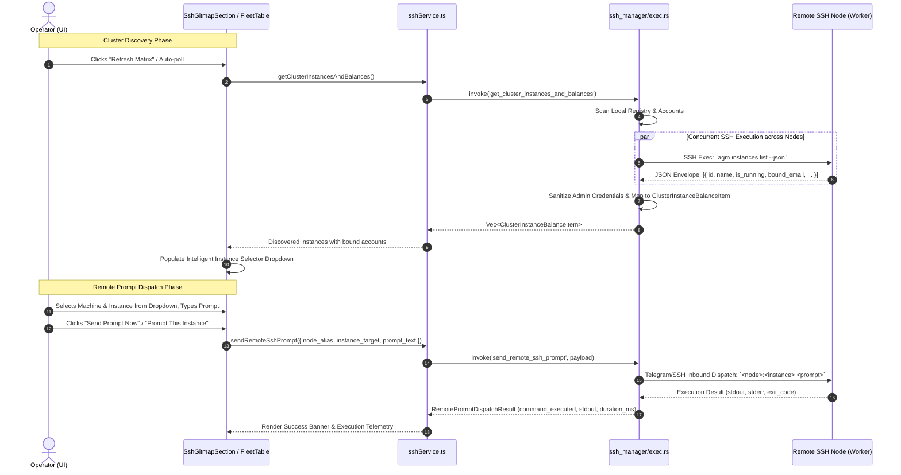

# Specification: SSH Instance & Google Account Discovery and Remote Prompt Dispatch

## 1. Executive Summary & Problem Classification

### 1.1 Context & User Motivation
In distributed development and multi-machine environments running Antigravity-Manager (AGM), operators manage fleets consisting of local workstations and remote worker nodes connected via SSH or GitMap mesh networks. Each machine can run multiple concurrent IDE profiles/instances (e.g., `default`, `c1`, `c2`), each bound to a specific Google account for AI quota utilization and prompt orchestration.

Previously, the cluster telemetry interface suffered from two major architectural and UX shortcomings:
1. **IP-Centric Clutter over Account Visibility**: Both the fleet machines view (`FleetMachinesTable.tsx`) and the SSH management tab (`SshGitmapSection.tsx`) assigned disproportionate screen space and prominent table columns to raw network IP addresses. Operators need to know **which Google account is operating on which instance, on which machine**. The IP address is secondary operational metadata that should be demoted to an on-demand tooltip or popover.
2. **Superficial Cluster Balance Telemetry & Dummy Instance Fallbacks**: The backend discovery function (`get_cluster_instances_and_balances` in `src-tauri/src/modules/ssh_manager/exec.rs`) performed a superficial TCP port 22 handshake on remote nodes. It never inspected the remote instance registry or running processes, returning dummy placeholder records (`instance_id: "default"`, empty `bound_email`).
3. **Remote Prompt Dispatch Interface Mismatch**: The prompt dispatch payload in `src-tauri/src/modules/ssh_manager/types.rs` lacked field serialization aliases (`instance_target`), and returned an incomplete response envelope missing telemetry fields (`stdout`, `stderr`, `duration_ms`, `command_executed`). In the frontend, users were forced to type raw instance names into a freeform text input rather than choosing from discovered active instances.

### 1.2 Target Deliverables
- **Account & Instance Prominence**: Elevate connected Google account email, instance profile name, and machine alias to primary visual columns; demote IP address into an interactive hover popover/tooltip with 1-click copy.
- **Deep Remote Node Discovery**: Upgrade `get_cluster_instances_and_balances` to query remote nodes via SSH (`agm instances list --json`) concurrently, deserializing active instances and their bound accounts.
- **Protocol & Field Parity**: Align `RemotePromptDispatchPayload` and `RemotePromptDispatchResult` between Rust and TypeScript.
- **Intelligent Instance Dropdown & 1-Click Dispatch**: Replace raw text input with a contextual dropdown showing `<instance_name> — <bound_email>` and enable 1-click "Prompt This Instance" locking from the matrix.

---

## 2. Architecture & Discovery Workflow

### 2.1 Multi-Node Discovery & Prompt Dispatch Sequence
The following sequence diagram details the end-to-end data flow for discovering active instances across remote SSH nodes and dispatching remote prompts.



---

## 3. Data Contracts & Serialization Parity

### 3.1 Backend Rust Structs (`src-tauri/src/modules/ssh_manager/types.rs`)

#### 3.1.1 Payload Alignment
```rust
/// Payload for sending a prompt to a local or remote SSH machine/instance
#[derive(Debug, Clone, Serialize, Deserialize)]
pub struct RemotePromptDispatchPayload {
    pub node_alias: String,
    #[serde(alias = "instance_target", alias = "instance_id")]
    pub instance_name: String,
    pub prompt_text: String,
    #[serde(default)]
    pub conversation_id: Option<String>,
}
```

#### 3.1.2 Return Envelope Alignment
```rust
/// Result of dispatching a prompt to a local or remote SSH machine/instance
#[derive(Debug, Clone, Serialize, Deserialize)]
pub struct RemotePromptDispatchResult {
    pub success: bool,
    pub node_alias: String,
    #[serde(alias = "instance_target")]
    pub instance_name: String,
    #[serde(default)]
    pub dispatch_route: String,
    #[serde(default)]
    pub message: String,
    #[serde(default)]
    pub command_executed: String,
    #[serde(default)]
    pub stdout: String,
    #[serde(default)]
    pub stderr: String,
    #[serde(default)]
    pub duration_ms: u128,
}
```

#### 3.1.3 Cluster Instance Balance Record
```rust
/// Multi-machine instance & bound account balance record
#[derive(Debug, Clone, Serialize, Deserialize)]
pub struct ClusterInstanceBalanceItem {
    pub machine_alias: String,
    pub machine_ip: String,
    #[serde(default, alias = "ip_address")]
    pub ip_address: Option<String>,
    #[serde(default, skip_serializing_if = "Option::is_none")]
    pub error_message: Option<String>,
    #[serde(default, skip_serializing_if = "Option::is_none")]
    pub latency_ms: Option<u64>,
    pub is_local: bool,
    pub instance_id: String,
    pub instance_name: String,
    pub running: bool,
    pub bound_email: String,
    pub tier: String,
    pub quota_4h_pct: f64,
    pub quota_weekly_pct: f64,
    pub active_model: String,
    pub status_label: String,
}
```

### 3.2 Frontend TypeScript Interfaces (`src/services/sshService.ts`)

```typescript
export interface ClusterInstanceBalanceItem {
    machine_alias: string;
    ip_address: string;
    machine_ip?: string;
    is_local: boolean;
    online: boolean;
    instance_id: string;
    instance_name: string;
    running: boolean;
    pid: number | null;
    bound_email: string | null;
    tier: string | null;
    quota_4h_pct: number | null;
    quota_weekly_pct: number | null;
    last_updated?: string;
    error?: string | null;
    error_message?: string | null;
    latency_ms?: number | null;
    status_label?: string;
}

export interface RemotePromptDispatchPayload {
    node_alias: string;
    instance_target: string;
    prompt_text: string;
    conversation_id?: string | null;
}

export interface RemotePromptDispatchResult {
    node_alias: string;
    instance_target: string;
    success: boolean;
    command_executed: string;
    stdout: string;
    stderr: string;
    duration_ms: number;
    message?: string;
    dispatch_route?: string;
}
```

---

## 4. Backend Implementation Specification (`src-tauri/src/modules/ssh_manager/exec.rs`)

### 4.1 Deep Remote Node Discovery via `agm instances list --json`
In `get_cluster_instances_and_balances()`:
1. **Local Inventory Collection**:
   - Query local registry (`instance::load_registry()`) and account list (`account::list_accounts()`).
   - Emit items for all local instances with true PID running state and bound account quota.
2. **Concurrent Remote SSH Inspection**:
   - Load configured SSH nodes (`load_ssh_connections()`).
   - Filter out local machine.
   - For each configured remote node, execute concurrently using `std::thread::scope`:
     1. Measure latency and verify TCP liveness on port 22 (timeout: 1500ms).
     2. If reachable, execute remote CLI command:
        `agm instances list --json`
        using `exec_ssh_command` or `exec_via_gitmap_ssh`.
     3. Parse the JSON standard envelope (`CliEnvelope`). Extract the `data` array containing remote instances.
     4. For each instance object in `data`:
        - Extract `id`, `name`, `is_running`, `bound_email`, `status`.
        - Sanitize `bound_email` to eliminate administrative tokens (`administrator`, `root`, `${adminUser}`, `${linuxUser}`). If no account is bound, assign `"(unbound)"`.
        - Push a `ClusterInstanceBalanceItem` representing the discovered instance.
     5. If `agm instances list --json` returns non-zero, parse failure, or times out:
        - Fallback gracefully: emit a single node summary item with `status_label: "reachable"` and an informational notice, ensuring the UI still indicates node reachability without crashing.

### 4.2 Telemetry Enrichment in `send_remote_ssh_prompt`
In `send_remote_ssh_prompt()`:
1. Start an execution timer using `Instant::now()`.
2. Construct the normalized dispatch string:
   - For local: `format!("{} {}", inst_name, text)` or with conversation ID.
   - For remote: `format!("{}:{} {}", node_alias, inst_name, text)`.
3. Dispatch via `execute_prompt_injection(&cmd_str)`.
4. Capture return output and calculate `duration_ms = start.elapsed().as_millis()`.
5. Populate all envelope fields:
   - `command_executed`: Normalized CLI / delegation command string.
   - `stdout`: Cleaned response text without Telegram HTML tags.
   - `stderr`: Error indicator description if failed, empty string on success.
   - `duration_ms`: Real execution latency.

---

## 5. UI/UX Specification

### 5.1 Demoting IP Address & Elevating Account Identity
In accordance with user requirements, the primary identity of a node is its **Machine Alias**, **Connected Google Account(s)**, and **Instance Name(s)**.

#### 5.1.1 `FleetMachinesTable.tsx` & `FleetMachineRow.tsx`
- **Table Columns Reorganization**:
  1. **Machine & Status** (Min-width: 180px): Node alias, Online pulse indicator, Mesh badge, OS badge, and an inline subtle IP hover popover/tooltip badge.
  2. **Connected Google Account(s)** (Min-width: 220px): Elevated to primary position. Displays bound account email addresses with masking toggle (`Eye` / `EyeOff`), high-contrast styling.
  3. **Running Instance(s)** (Min-width: 200px): Profile capsules with pulsing status dots (`is_running`), instance names, and bound email pills.
  4. **Running Prompts** (Min-width: 120px): Active prompt count with pulsing `Zap` badge.
  5. **Last Seen** (Min-width: 110px): Relative duration (`ran 5 minutes ago`).
- **Demoted IP Address Component**:
  - Render IP address inside an interactive compact pill (`font-mono text-[11px] text-slate-400 bg-slate-800/40 px-1.5 py-0.5 rounded border border-slate-700/50`).
  - On hover, display a tooltip with the full host address, port, and connection type.
  - Clicking the copy icon triggers 1-click clipboard copy with green `Check` feedback.

#### 5.1.2 `SshGitmapSection.tsx` Matrix Table
- Reorganize the **Multi-Machine Instance & Account Credit Matrix**:
  1. **Machine & Node**: Machine alias, online indicator, demoted IP pill with copy button.
  2. **Instance & Status**: Instance name, running badge (`running` / `idle`).
  3. **Connected Google Account**: High-contrast email display with mask toggle.
  4. **Subscription Tier**: PRO / ULTRA / FREE badge.
  5. **4h Rolling Quota**: Percentage bar & label.
  6. **Weekly Quota**: Percentage bar & label.
  7. **Action**: Segmented 1-click "Prompt This Instance" button.

### 5.2 Intelligent Instance Dropdown & 1-Click Prompt Dispatching

#### 5.2.1 Intelligent Instance `<select>` Dropdown
In the **Remote Machine & Instance Prompt Dispatcher Bar** (`SshGitmapSection.tsx`):
- Replace the raw `<input type="text" value={targetInstance} />` with an intelligent dynamic `<select>` dropdown.
- Dropdown options are dynamically computed from `clusterBalances` based on the currently selected `targetMachine`:
  ```tsx
  const availableInstances = clusterBalances.filter(
      (item) => item.machine_alias.toLowerCase() === targetMachine.toLowerCase()
  );
  ```
- Each option renders:
  `${item.instance_name} — ${item.bound_email || 'unbound'} (${item.running ? 'Running' : 'Idle'})`
- If no instances have been discovered yet for that machine, fallback to a default option: `default — (Primary Instance)`.
- **UI Guard & House Rule Compliance**:
  The `<select>` dropdown mounted inside the segmented capsule MUST use transparent borderless styling:
  `className="text-xs font-mono text-gray-900 dark:text-slate-100 bg-transparent border-0 focus:ring-0 focus:outline-none pr-2 cursor-pointer"`
  This strictly eliminates nested white pill-in-pill visual defects.

#### 5.2.2 1-Click "Prompt This Instance" Dispatching
- In the Multi-Machine Matrix table, clicking "Prompt This Instance":
  1. Automatically updates `targetMachine` to `item.machine_alias`.
  2. Automatically updates `targetInstance` to `item.instance_name || item.instance_id`.
  3. If `promptText` is already filled, immediately dispatches the prompt over SSH.
  4. If `promptText` is empty, displays a toast:
     `Target locked to ${item.machine_alias}:${item.instance_name} (${item.bound_email}) — enter prompt below to send`
     and scrolls the prompt input field into view with autofocus.

---

## 6. Security, Credential Redaction & Error Visibility

### 6.1 Administrative Credential Scrubbing
To prevent metadata leaks in team screen-sharing and recordings:
- `isAdminIdentifier` & `sanitizeAdminText` are strictly enforced across all instance labels, emails, and execution targets:
  - Strings matching `Administrator`, `root`, `${adminUser}`, `${linuxUser}` are stripped.
  - Remote SSH execution results scrub username credentials from return logs.

### 6.2 No Silent Errors Invariant
- Backend Rust errors in `get_cluster_instances_and_balances` and `send_remote_ssh_prompt` route through `AppError` and `tracing::warn!`.
- Frontend errors in `sshService.ts` and `SshGitmapSection.tsx` route through `useErrorStore.getState().trackWarning(...)` or `captureError(...)`. No empty `catch {}` blocks are permitted.

---

## 7. Verification & Acceptance Checklist

| Requirement | Verification Criterion | Status |
| :--- | :--- | :--- |
| **IP Demotion** | IP address in `FleetMachinesTable.tsx` and `SshGitmapSection.tsx` is demoted to a compact pill/tooltip with 1-click copy. | Pending |
| **Account Prominence** | Connected Google account email is elevated to primary table column before instances/quotas. | Pending |
| **SSH Discovery** | `get_cluster_instances_and_balances` queries remote nodes with `agm instances list --json` and discovers real instances. | Pending |
| **Payload Parity** | `RemotePromptDispatchPayload` supports `instance_target` alias; `RemotePromptDispatchResult` provides `stdout`, `stderr`, `duration_ms`. | Pending |
| **Dropdown Selector** | Instance input in `SshGitmapSection.tsx` is replaced with an intelligent `<select>` showing `<instance_name> — <bound_email>`. | Pending |
| **1-Click Dispatch** | Clicking "Prompt This Instance" locks the target machine & instance and focuses the prompt input. | Pending |
| **Credential Scrubbing** | Zero occurrences of `Administrator` or `root` in instance names or bound emails. | Pending |
| **Pre-flight Checks** | `cargo clippy --all-targets --all-features` and `npm run build` pass with zero warnings/errors. | Pending |
