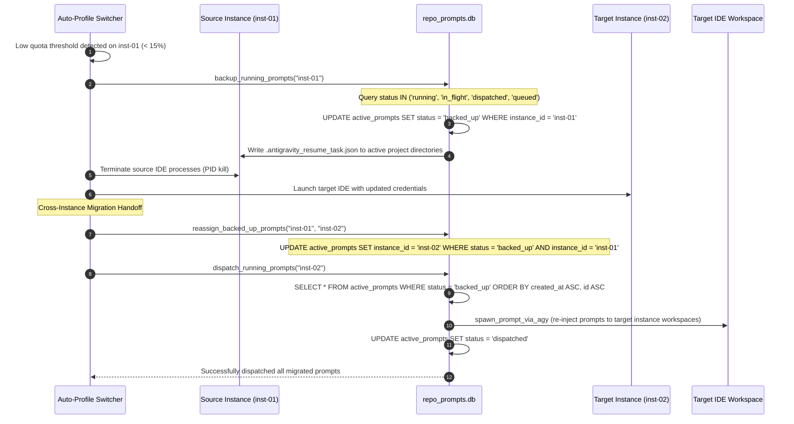

# Architecture Specification: Update CLI Self-Delegation & Prompt Pipeline Fixes

> **/goal** Eliminate Windows executable file-lock collisions during `agm update` through universal self-delegation, repair process taxonomy blindspots, reconnect prompt pipeline dispatch and queuing, and resolve cross-instance prompt backup and restoration during auto-profile switching.
> **/learn** Apply strict out-of-process console delegation, comprehensive process enumeration, positive boolean invariants, and FIFO queue semantics across all AGM runtime targets.

**Module:** `update-cli-command-and-pipeline-fixes`  
**Version:** `1.0.0`  
**Status:** `Active`  
**Author:** `@aukgit`  
**AI Confidence:** `Production-Ready`  
**Ambiguity:** `None`  

---

## 1. Executive Summary

This specification establishes the architectural design, failure decoding, and target data flows for two mission-critical subsystems within Antigravity-Manager:
1. **The AGM Updater Subsystem (`agm update`)**: Preventing in-place file-lock deadlocks on Windows by enforcing universal out-of-process self-delegation to `%TEMP%\agm-updater\agm-update-cli-<pid>.exe`, comprehensive process lifecycle termination (`antigravity-manager.exe`, `agm.exe`, `agm-alim.exe`, `antigravity-tools.exe`), and installer script candidate synchronization (`install.ps1`).
2. **The Prompt Pipeline & Queue Engine (QE)**: Reconnecting disconnected CLI dispatch routes (`agm prompt send`, `agm prompt queue`), eliminating hardcoded dummy paths (`scratch/test-repo`) and detached session identifiers (`session_id: NULL`), preventing silent queue prompt loss during execution bridge failures, expanding backup coverage to non-running active prompts, and enabling cross-instance prompt workload migration during profile switches.

---

## 2. Architectural Root Cause Analysis (RCA)

### 2.1 Root Cause 1: Windows File-Lock Collision during In-Process `agm update`
- **Vulnerability Location**: `src-tauri/src/bin/agm/update_cmds.rs` (lines 380–416) & `src-tauri/src/modules/delegate_updater/run.rs` (lines 37–82).
- **Failure Mechanism**:
  When a user or automation agent invokes `agm update`, `cmd_update` queries `is_ui_process_running_excluding(std::process::id())`. If the GUI desktop process is not running, `cmd_update` branches directly into in-process execution via `antigravity_tools_lib::modules::delegate_updater::run_cli_update(&cli_update_args)`.
  On Windows, `run_cli_update` invokes `powershell.exe -Command & .\install.ps1 -Update -Force -NoLaunch ...`. The PowerShell installer downloads the release asset and launches NSIS or unpacks binaries over the active installation directory (typically `%LOCALAPPDATA%\Programs\agm-alim\` or `%LOCALAPPDATA%\agm-cli\`).
  Because the calling process (`agm.exe`) is actively executing in-process code, Windows NT kernel holds an exclusive memory-mapped file lock (`ERROR_ACCESS_DENIED`, Win32 error 5 / error 32) on `agm.exe`. The installer fails to overwrite `agm.exe`, crashing or generating a corrupted partial install.
- **Root Cause**:
  `cmd_update` improperly conditioned delegation on whether the *GUI* was running (`if ui_running`), failing to recognize that the *CLI caller binary itself* (`agm.exe`) resides in the installation path and locks its own binary on disk.
- **Architectural Remedy**:
  Universal Self-Delegation: On Windows, any execution of `agm update` that is not already executing from `%TEMP%\agm-updater\` MUST immediately copy the running binary to `%TEMP%\agm-updater\agm-update-cli-<pid>.exe`, spawn the delegated copy with Win32 `CREATE_NEW_CONSOLE | CREATE_NEW_PROCESS_GROUP` passing `--wait-pid <caller_pid>`, and terminate the caller immediately (`std::process::exit(0)`). The temp child process waits for caller PID termination, ensuring all file locks on the installation directory are released before executing the installer.

### 2.2 Root Cause 2: Process Taxonomy Blindspots in Updater and Installer
- **Vulnerability Location**:
  - `src-tauri/src/modules/delegate_updater/process.rs` (lines 55–80, 100–133)
  - `install.ps1` (lines 275–281, 1577–1585)
- **Failure Mechanism**:
  - In `process.rs`, process enumeration is restricted to:
    ```rust
    let process_names = ["agm-alim.exe", "antigravity-tools.exe"];
    ```
    The main desktop executable `antigravity-manager.exe` and the terminal CLI `agm.exe` are completely absent from this array. Consequently, `is_ui_process_running_excluding` returns `false` even when `antigravity-manager.exe` or `agm.exe` is actively open. Furthermore, `kill_other_ui_processes` issues `taskkill.exe` solely for `agm-alim.exe` and `antigravity-tools.exe`.
  - In `install.ps1`, `$processNames` (lines 275–281) checks only:
    ```powershell
    $processNames = @("agm-alim", "antigravity-tools", "Anti-Gravity Tools", "Anti-Gravity Tools by Alim", "AGM by Alim")
    ```
    Missing: `"antigravity-manager"` and `"agm"`.
    In `$lockCandidates` (lines 1577–1583), only `$BinaryName`, `"agm-alim.exe"`, `"AGM by Alim.exe"`, `"Anti-Gravity Tools by Alim.exe"`, and `"antigravity-tools.exe"` are renamed to `.old`.
    Missing: `antigravity-manager.exe` and `agm.exe`.
- **Root Cause**:
  Legacy naming assumption retained from initial prototypes. As the project evolved to brand executables as `antigravity-manager.exe` and `agm.exe`, process supervisory lists and installer file-lock rename ladders were never synchronized with the current binary taxonomy.
- **Architectural Remedy**:
  Standardize the unified process taxonomy across both Rust backend and PowerShell installer:
  - `antigravity-manager.exe` / `antigravity-manager`
  - `agm.exe` / `agm`
  - `agm-alim.exe` / `agm-alim`
  - `antigravity-tools.exe` / `antigravity-tools`

### 2.3 Root Cause 3: Prompt Pipeline Disconnection & Queue Scheduler Dropping
- **Vulnerability Location**:
  - `src-tauri/src/bin/agm/prompt_cmds.rs` (lines 99–215, 281–370)
  - `src-tauri/src/modules/repo_db/queue.rs` (lines 190–208)
- **Failure Mechanism**:
  - `cmd_prompts_send`:
    1. Line 109 defaults `repo_path` to `"scratch/test-repo"` if `--repo` is omitted, rather than resolving the caller's active working directory (`env::current_dir()`).
    2. Line 164 generates an arbitrary detached UUID: `session_id: Some(format!("conv-{}", uuid::Uuid::new_v4()))`.
    3. Line 175 writes `.antigravity_resume_task.json` and inserts into `active_prompts`, but NEVER calls `repo_db::spawn_prompt_via_agy(&active_prompt)` or triggers any dispatch bridge. The prompt enters `in_flight` status in SQLite and remains unexecuted.
  - `cmd_prompts_queue`:
    1. Line 327 executes `INSERT INTO active_prompts ... VALUES (..., NULL, 'queued', ...)`, forcing `session_id` to `NULL`.
    2. Defaults `repo_path` to `"scratch/test-repo"` instead of the current project directory.
  - `queue.rs` (`check_and_dispatch_enqueued_prompts`):
    Lines 191–201 attempt `let sent = spawn_prompt_via_agy(&prompt);`, but immediately thereafter unconditionally updates the prompt state:
    `UPDATE active_prompts SET status = 'dispatched'`.
    If `spawn_prompt_via_agy` fails (`sent == false`) due to process spawn errors or missing tools, the prompt is still stamped as `dispatched`. Because the scheduler only queries `status IN ('backed_up', 'queued', 'pending')`, the failed prompt is permanently lost and never retried.
- **Root Cause**:
  Architectural disconnect between standalone CLI commands and the central prompt runtime engine (`repo_db`), combined with state-machine progression without verification of execution bridge success.
- **Architectural Remedy**:
  1. In `cmd_prompts_send`: Resolve current repository directory via `env::current_dir()`, derive workspace slug via `derive_current_repo_slug()`, resolve active conversation session via sequence target resolution, write resume task document, and trigger `spawn_prompt_via_agy`.
  2. In `cmd_prompts_queue`: Preserve the active conversation identifier or derive from project workspace rather than inserting `NULL`.
  3. In `check_and_dispatch_enqueued_prompts`: Check `is_dispatch_successful`. Only transition to `'dispatched'` if spawn succeeds or a valid conversation resume task is verified on disk. If spawn fails, retain `'queued'` status with backoff timestamp.

### 2.4 Root Cause 4: Switch Backup/Restore Scope Mismatch & Missing Status Transitions
- **Vulnerability Location**:
  - `src-tauri/src/modules/repo_db/backup.rs` (lines 64–83)
  - `src-tauri/src/modules/repo_db/dispatch.rs` (lines 59–92)
- **Failure Mechanism**:
  - In `backup_running_prompts`:
    The SQL transition query explicitly targets only `WHERE status = 'running'`.
    Prompts that were recently queued (`status = 'queued'`), in transit (`status = 'in_flight'`), or dispatched (`status = 'dispatched'`) but whose work is actively underway in IDE transcripts are ignored and never transitioned to `'backed_up'`.
  - In `dispatch_running_prompts`:
    The dispatcher filters candidate backed-up prompts against `target_inst`:
    ```rust
    let is_match = if is_default_target {
        prompt_inst == "default" || prompt_inst == "__default__" || prompt_inst.is_empty()
    } else {
        prompt_inst == target_inst
    };
    ```
    When the auto-switcher switches an active workload from source instance `inst-alpha` to target instance `inst-beta`, the prompts backed up from `inst-alpha` retain `instance_id = "inst-alpha"`.
    When `inst-beta` initializes and calls `dispatch_running_prompts("inst-beta")`, `is_match` is evaluated as `false` (`"inst-alpha" != "inst-beta"`).
    Every prompt is marked `PROMPT_DISPATCH_REJECTED` and discarded.
- **Root Cause**:
  Overly restrictive status filter during backup (`WHERE status = 'running'`) and rigid instance-identity filtering during dispatch that fails to account for cross-instance workload migration during account switching.
- **Architectural Remedy**:
  1. In `backup_running_prompts`: Expand transition query to `WHERE status IN ('running', 'in_flight', 'dispatched', 'queued')`.
  2. In `dispatch_running_prompts`: Introduce cross-instance migration support during auto-switch handoffs, re-binding backed up prompts from the source instance to the newly active target instance before dispatch, and strictly enforcing FIFO ordering (`ORDER BY created_at ASC, id ASC`).

---

## 3. Target Architecture & Data Flows

### 3.1 Data Flow 1: Windows Universal Self-Delegation Update Flow

```mermaid
sequenceDiagram
    autonumber
    actor User as Terminal / Automation
    participant CLI as agm.exe (Caller PID: 1042)
    participant Temp as %TEMP%\agm-updater\agm-update-cli-1042.exe
    participant PS as powershell.exe (install.ps1)
    participant App as Installation Directory (%LOCALAPPDATA%\Programs\agm-alim)

    User->>CLI: agm update [--force]
    CLI->>CLI: Check current executable location
    Note over CLI: Running from InstallDir (not in %TEMP%\agm-updater)
    CLI->>Temp: prepare_isolated_update_cli(1042)
    Note over Temp: Copy self to %TEMP%\agm-updater\agm-update-cli-1042.exe
    CLI->>Temp: spawn_delegated_update_cli(wait_pid: 1042, flags: CREATE_NEW_CONSOLE)
    CLI->>User: "[OK] Delegated to temp copy (PID 2084). Exiting caller..."
    CLI->>CLI: std::process::exit(0)
    Note over CLI: Caller process terminates; file locks released!

    Temp->>Temp: Stage 1: Poll is_pid_alive(1042) until terminated
    Temp->>Temp: kill_other_ui_processes (antigravity-manager, agm, agm-alim)
    Temp->>PS: Stage 2: Execute install.ps1 -Update -Force -NoLaunch
    PS->>PS: Close-ToolProcesses (all taxonomy binaries)
    PS->>PS: Rename lock candidates to .old (antigravity-manager.exe, agm.exe)
    PS->>App: Extract / Install updated binaries into InstallDir
    PS-->>Temp: Installer complete (exit code: 0)
    Temp->>App: Stage 3: open_ui (relaunch updated antigravity-manager.exe)
    Temp->>User: "[SUCCESS] Update Complete - Relaunched Antigravity-Manager."
```

### 3.2 Data Flow 2: Dispatched & Queued Prompt Execution Flow with Failure Recovery

```mermaid
sequenceDiagram
    autonumber
    actor User as Developer / CLI
    participant PromptCmd as agm prompt send / queue
    participant RepoDB as repo_prompts.db (active_prompts)
    participant FS as Workspace (.antigravity_resume_task.json)
    participant Bridge as agy execution bridge
    participant Sched as Queue Scheduler (10-min loop)

    User->>PromptCmd: agm prompt send "Implement feature X"
    PromptCmd->>PromptCmd: Resolve current working dir & derive repo slug
    PromptCmd->>PromptCmd: Resolve active conversation session
    PromptCmd->>RepoDB: INSERT active_prompts (status: 'in_flight', session_id, repo_path)
    PromptCmd->>FS: Write .antigravity_resume_task.json
    PromptCmd->>Bridge: spawn_prompt_via_agy(&prompt)
    alt Execution Bridge Succeeds
        Bridge-->>PromptCmd: Process spawned successfully (is_success: true)
        PromptCmd->>RepoDB: UPDATE active_prompts SET status = 'running'
    else Execution Bridge Fails / Offline
        Bridge-->>PromptCmd: Spawn failed (is_success: false)
        PromptCmd->>RepoDB: UPDATE active_prompts SET status = 'queued'
        Note over RepoDB: Prompt preserved in queue; never dropped!
    end

    Note over Sched: Periodic 10-Minute Bookkeeping Cycle
    Sched->>RepoDB: Query idle projects with status IN ('backed_up', 'queued', 'pending')
    Sched->>Sched: Verify project liveness (is_idle: true)
    Sched->>Bridge: spawn_prompt_via_agy(&queued_prompt)
    alt Sched Dispatch Succeeds
        Bridge-->>Sched: Success (is_success: true)
        Sched->>RepoDB: UPDATE active_prompts SET status = 'dispatched'
        Sched->>RepoDB: Record AuditAction::SchedulePrompt
    else Sched Dispatch Fails
        Bridge-->>Sched: Failure (is_success: false)
        Sched->>RepoDB: Retain status = 'queued' & increment retry backoff
        Note over Sched: Logged as retry candidate for next cycle
    end
```

### 3.3 Data Flow 3: Cross-Instance Auto-Switch Workload Migration & Prompt Restore Flow



---

## 4. Invariant & Boundary Matrix

| Invariant ID | Subsystem | Invariant Rule | Violation Impact | Enforcement Mechanism |
|---|---|---|---|---|
| `INV-UPD-01` | Updater | Universal Windows CLI delegation when running from install directory | OS Error 32 / `ERROR_ACCESS_DENIED` binary overwrite failure | Check path; delegate to `%TEMP%\agm-updater\` with immediate `exit(0)` |
| `INV-UPD-02` | Updater | Comprehensive process taxonomy coverage (`antigravity-manager`, `agm`, `agm-alim`, `antigravity-tools`) | Dangling processes hold file locks on DLLs and main executables | Exact process array in `process.rs` and `install.ps1` |
| `INV-UPD-03` | Updater | Unattended delegation with `--yes` and explicit parameters | Interactive prompt blocks headless execution | Hardcode `--force --no-launch` in Stage 2 runner |
| `INV-PMP-01` | Prompt Engine | Grounded repository path resolution | Prompts land in dummy `scratch/test-repo` | Fallback ladder: CLI arg -> `env::current_dir()` |
| `INV-PMP-02` | Prompt Engine | Positive boolean conventions only | Inconsistent polarity and lint errors | Fields: `is_running`, `has_conversation`, `is_success`, `is_idle` |
| `INV-PMP-03` | Prompt Engine | Zero prompt loss on dispatch failure | Unrecoverable prompt drop into `dispatched` | Guard state transition on `is_dispatch_success` |
| `INV-PMP-04` | Prompt Engine | Cross-instance workload re-assignment on switch | Prompts rejected by target instance filter | Handoff query re-binds source `instance_id` to target before dispatch |
| `INV-PMP-05` | Prompt Engine | Strict FIFO execution ordering | LIFO dispatch executes prompts out of sequence | SQL clause: `ORDER BY created_at ASC, id ASC` |

---

## 5. Implementation Details & File Modification Inventory

### 5.1 Subsystem 1: Updater File Modifications

1. `src-tauri/src/bin/agm/update_cmds.rs`:
   - Replace the `if ui_running` conditional delegation branch with universal self-delegation.
   - Detect if the current binary is executing from an install location (or not inside `%TEMP%\agm-updater\`). If true, call `prepare_isolated_update_cli(caller_pid)` and `spawn_delegated_update_cli`, then immediately exit with code 0.
2. `src-tauri/src/modules/delegate_updater/process.rs`:
   - Expand `process_names` to include `"antigravity-manager.exe"` and `"agm.exe"`.
   - Update `kill_other_ui_processes` to issue `taskkill.exe` for `"antigravity-manager.exe"` and `"agm.exe"`.
   - Update non-Windows `pgrep` and `pkill` to include `"antigravity-manager"` and `"agm"`.
3. `install.ps1`:
   - Add `"antigravity-manager"` and `"agm"` to `$processNames` in `Close-ToolProcesses`.
   - Add `antigravity-manager.exe` and `agm.exe` to `$lockCandidates` for `.old` renaming prior to NSIS execution.

### 5.2 Subsystem 2: Prompt Pipeline & Queue File Modifications

1. `src-tauri/src/bin/agm/prompt_cmds.rs`:
   - In `cmd_prompts_send`: Replace `"scratch/test-repo"` fallback with current working directory resolution. Replace random UUID `session_id` with workspace conversation resolution. Call `repo_db::spawn_prompt_via_agy(&active_prompt)`.
   - In `cmd_prompts_queue`: Remove hardcoded `NULL` for `session_id`. Bind active conversation ID or repo slug.
2. `src-tauri/src/modules/repo_db/queue.rs`:
   - In `check_and_dispatch_enqueued_prompts`: Guard status transition. Update status to `'dispatched'` only if `sent` is true or valid file write with same conversation succeeded. If failed, retain `'queued'` status.
3. `src-tauri/src/modules/repo_db/backup.rs`:
   - Expand backup transition query to `WHERE status IN ('running', 'in_flight', 'dispatched', 'queued')`.
4. `src-tauri/src/modules/repo_db/dispatch.rs`:
   - Add helper `reassign_backed_up_prompts_to_instance(source_instance, target_instance)`.
   - Ensure `dispatch_running_prompts` enforces `ORDER BY created_at ASC, id ASC`.

---

## 6. Verification & Quality Gates

1. **Pre-flight Quality Gates**:
   - `cd src-tauri && cargo fmt -- --check`
   - `cd src-tauri && cargo clippy --all-targets --all-features`
   - `npm run build`
2. **Functional Validation Scenarios**:
   - **Update Self-Delegation**: Invoke `agm update --force` while `antigravity-manager.exe` and `agm.exe` are running. Confirm caller exits within 200ms, temp updater spawns in separate console, replaces binaries cleanly without error 32, and relaunches `antigravity-manager.exe`.
   - **Prompt Send & Queue**: Run `agm prompt send "Test prompt"`. Confirm prompt is inserted with caller's current repo path, valid session ID, and dispatched via `spawn_prompt_via_agy`.
   - **Queue Failure Resilience**: Run `agm queue-scheduler --once` with offline bridge. Confirm enqueued prompts remain in `'queued'` state and are not dropped.
   - **Switch Migration**: Back up prompts on `default` instance and switch to secondary instance. Verify prompts are migrated and dispatched to the secondary instance without being rejected.
