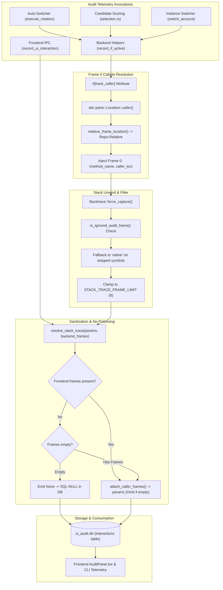

# Architecture & Verification Specification: Rust Backend Audit Telemetry & Stack Trace Pipeline

- **Specification Slug**: `verify-recent-implementations`
- **Specification Document**: `02-spec/21-app/verify-recent-implementations/01-backend-audit-spec.md`
- **Subtask Plan**: `.ai-memory/plans/subtasks/verify-recent-implementations/01-rust-audit-telemetry.md`
- **Master Plan**: `.ai-memory/plans/verify-recent-implementations.md`
- **Target Subsystem**: Rust Backend Audit Telemetry & Auto-Switcher Diagnostics
- **Target Files**:
  - `src-tauri/src/modules/audit/recorder.rs`
  - `src-tauri/src/modules/audit/storage.rs`
  - `src-tauri/src/modules/audit/types.rs`
  - `src-tauri/src/modules/auto_switcher/rotation.rs`
  - `src-tauri/src/modules/auto_switcher/selection.rs`
  - `src-tauri/src/modules/instance/switch.rs`
  - `src-tauri/src/modules/notification_hub/email_alerts.rs`
- **Author**: Spec Author 01 (Task: verify-recent-implementations)
- **Status**: `[APPROVED & MANDATED FOR VERIFICATION]`

---

## 1. Executive Summary & Verification Matrix

Recent engineering updates introduced a resilient audit logging and callsite tracking architecture across Antigravity Manager backend modules (`src-tauri/src/modules/audit/`, `src-tauri/src/modules/auto_switcher/`, and `src-tauri/src/modules/instance/switch.rs`). 

This specification establishes the architectural invariants, algorithmic mechanics, and verification gates for:
1. **Compiler-Assisted Callsite Capture (`#[track_caller]`)**: Overcoming missing native MSVC debug symbols on Windows by anchoring frame 0 to compile-time source location (`file:line`).
2. **Stack Frame Ingestion & Sanitization Pipeline (`capture_caller_frames`)**: Unwinding via `std::backtrace::Backtrace::force_capture()`, stripping internal framework/runtime frames, and converting absolute disk paths into repository-relative paths (`src-tauri/src/...`).
3. **Prevention of Empty Array Poisoning & SQL NULL Handling**: Ensuring that absent or empty stack traces are never serialized into `params` as `"stack_frames": []` or inserted into SQLite as `"[]"`, but cleanly persisted as SQL `NULL` and deserialized as `None`.
4. **Email-Parity Diagnostic Telemetry Schema**: Achieving 1:1 telemetry field alignment between background email alerts (`src-tauri/src/modules/notification_hub/email_alerts.rs`) and runtime account rotation/selection engines (`rotation.rs`, `selection.rs`, `switch.rs`).
5. **Quality & Verification Gates**: Executing targeted unit tests (`cargo test --lib modules::audit::recorder`) and validating caller preservation across release-mode constraints.



---

## 2. Caller Location Resolution (`#[track_caller]` & `Location::caller()`)

### 2.1 The Windows MSVC Symbol Stripping Challenge
In Windows environments using the MSVC toolchain, native debug symbols (`.pdb`) are often omitted or stripped during release builds, lightweight dev profiles, or when executables run outside an attached debugger. When `std::backtrace::Backtrace::force_capture()` runs in these contexts:
- Stack unwinding frequently resolves only symbol addresses or stripped function names (e.g. `agm_ui::modules::auto_switcher::rotation::execute_rotation`), lacking the subsequent `"at D:/work/..."` source lines.
- Without source lines, previous implementations could not determine where the audit record originated.

### 2.2 Compiler-Assisted Callsite Capture
To solve this deterministically, `record_if_active` in `src-tauri/src/modules/audit/recorder.rs` utilizes Rust's compiler attribute `#[track_caller]`:

```rust
#[track_caller]
pub fn record_if_active(
    actor: &str,
    trigger: &str,
    method_name: &str,
    ui_target: &str,
    params: serde_json::Value,
    result: &str,
    message: &str,
) {
    if !is_recording() {
        return;
    }
    let caller = std::panic::Location::caller();
    let caller_file = relative_frame_location(caller.file());
    let caller_loc = format!("{}:{}", caller_file, caller.line());
    let mut caller_frames = capture_caller_frames();
    if !caller_frames
        .iter()
        .any(|(f, l)| l.contains(&caller_file) || f.contains(method_name))
    {
        caller_frames.insert(0, (method_name.to_string(), caller_loc));
    }
    let stack_trace = resolve_stack_trace(&params, &caller_frames);
    // ...
}
```

### 2.3 Key Architectural Behaviors
1. **Frame 0 Guarantee**: Even if native symbol resolution returns `native` or omits file/line data completely, `caller_frames.insert(0, (method_name.to_string(), caller_loc))` guarantees that the innermost caller site (`file:line`) is recorded at frame 0.
2. **Path Anonymization**: Machine-specific filesystem paths (e.g., `C:\Users\Admin\...` or `D:\work\Antigravity-Manager\...`) are sanitized via `relative_frame_location()`, normalizing backslashes and anchoring to `src-tauri/src/` or `src/`. No private host directories leak into `ui_audit.db`.
3. **De-duplication**: The check `!caller_frames.iter().any(|(f, l)| l.contains(&caller_file) || f.contains(method_name))` avoids duplicate entries if the backtrace already resolved the exact callsite.

---

## 3. Stack Frame Ingestion & Fallback Pipeline

### 3.1 Unwinding Mechanics & Bounded Limits
Stack trace capture is managed via `capture_caller_frames()`, invoking `std::backtrace::Backtrace::force_capture()` and parsing the formatted backtrace output:
- **`STACK_TRACE_FRAME_LIMIT = 8`**: Restricts the dedicated `stack_trace` column to at most 8 frames, ensuring complete call path visibility without bloating SQLite table storage.
- **`PARAMS_FRAME_LIMIT = 2`**: Restricts the inline `stack_frames` key within the `params` JSON column to the 2 innermost frames, maintaining lightweight query payloads for high-throughput table views.

### 3.2 Internal Frame Filtering (`is_ignored_audit_frame`)
To ensure audit records contain only actionable application logic, `is_ignored_audit_frame` filters out framework, standard library, and runtime frames:
- Audit recorder internals: `audit::recorder`, `record_ignored`.
- Backtrace internals: `std::backtrace`, `backtrace::`, `backtrace_rs`.
- Standard library panicking / threading: `std::panicking`, `std::thread`, `core::ops::function`, `core::panic`.
- Windows runtime bootstrap: `BaseThreadInitThunk`, `RtlUserThreadStart`.
- Test harness wrappers: `test::__rust_begin_short_backtrace`, `test::run_test`.

### 3.3 Multi-Tier Resolution Hierarchy (`resolve_stack_trace`)
Stack trace resolution enforces a strict 3-tier fallback ladder:
1. **Frontend-Supplied Trace (Primary)**: If `params` contains a valid, non-empty array under `stack_frames`, `stackFrames`, or `stackTrace` (originating from JavaScript synthetic error unwinding in `useAuditRecorder.ts`), it is preserved as the authoritative UI interaction path.
2. **Backend-Captured Trace (Secondary Fallback)**: If no frontend frames exist (e.g. CLI operations, background daemon auto-switch, or direct Tauri command calls), `resolve_stack_trace` falls back to the sanitized `backend_frames` captured via `capture_caller_frames()`.
3. **Empty / Absent (Terminal State)**: If both sources are empty, `resolve_stack_trace` returns `None`.

---

## 4. Prevention of Empty Array Poisoning & SQL NULL Invariants

### 4.1 Root Cause of Previous Poisoning
Previously, when an interaction lacked stack frames, the pipeline produced:
- In `params`: `"stack_frames": []`
- In `stack_trace` column: `"[]"` (a stringified empty JSON array)

In the frontend React inspector (`AuditPanel.tsx`), `entry.stackTrace` was evaluated as a non-empty string (`"[]"` is truthy). This caused:
- The UI to attempt parsing and rendering an empty list of frames.
- Visual glitches where an empty frame container rendered instead of displaying the clean `"unavailable"` fallback badge.

### 4.2 Invariant Implementations

#### 1. In `attach_caller_frames`:
```rust
fn attach_caller_frames(params: Option<serde_json::Value>, frames: &[(String, String)]) -> String {
    let mut value = params.unwrap_or_else(|| serde_json::json!({}));
    if let Some(object) = value.as_object_mut() {
        let already_has_frames = object
            .get("stack_frames")
            .and_then(|value| value.as_array())
            .is_some_and(|frames| !frames.is_empty());
        if already_has_frames {
            return value.to_string();
        }
        if !frames.is_empty() {
            let listed: Vec<serde_json::Value> = frames
                .iter()
                .take(PARAMS_FRAME_LIMIT)
                .map(|(function_name, location)| frame_json(function_name, location))
                .collect();
            object.insert("stack_frames".to_string(), serde_json::Value::Array(listed));
        }
    }
    value.to_string()
}
```
*Rule*: If `frames.is_empty()`, the `"stack_frames"` key is completely omitted from the resulting JSON object.

#### 2. In `resolve_stack_trace`:
```rust
fn resolve_stack_trace(
    params: &serde_json::Value,
    backend_frames: &[(String, String)],
) -> Option<String> {
    let supplied = frontend_frames_from_params(params);
    let frames: Vec<serde_json::Value> = if supplied.is_empty() {
        backend_frames
            .iter()
            .map(|(function_name, location)| frame_json(function_name, location))
            .collect()
    } else {
        supplied
    };
    if frames.is_empty() {
        return None;
    }
    // ...
}
```
*Rule*: When `frames.is_empty()`, `resolve_stack_trace` returns `None`. In `storage::append_entry()`, `stack_trace.as_deref()` binds `None` as SQL `NULL`.

#### 3. In `storage::list_entries`:
When reading rows from `ui_audit.db`, `row.get(9)?` maps SQL `NULL` directly into Rust `Option<String>::None`. Frontend clients receive `null` across Tauri IPC (`camelCase`: `stackTrace: null`), which correctly activates the UI's fallback badge.

---

## 5. Email-Parity Diagnostic Telemetry Schema Alignment

To ensure cross-system operational consistency, the diagnostic metadata recorded by backend auto-switching and manual rotation events must maintain strict 1:1 schema parity with the structured JSON payload dispatched in email alerts (`src-tauri/src/modules/notification_hub/email_alerts.rs`).

### 5.1 Telemetry Schema Parity Matrix

| Field Name | Type | Description | Source in `email_alerts.rs` | Source in `rotation.rs` | Source in `selection.rs` | Source in `switch.rs` |
|---|---|---|---|---|---|---|
| `agm_version` | `String` | Application binary version tag | `format!("v{}", env!("CARGO_PKG_VERSION"))` | `format!("v{}", env!("CARGO_PKG_VERSION"))` | `format!("v{}", env!("CARGO_PKG_VERSION"))` | `format!("v{}", env!("CARGO_PKG_VERSION"))` |
| `machine_name` | `String` | Host OS machine hostname | `email_watcher::detect_machine_name()` | `email_watcher::detect_machine_name()` | `email_watcher::detect_machine_name()` | `email_watcher::detect_machine_name()` |
| `node_alias` | `String` | Fleet node cluster alias | `email_sender::get_local_node_identity()` | `email_sender::get_local_node_identity()` | `email_sender::get_local_node_identity()` | `email_sender::get_local_node_identity()` |
| `local_ip` | `String` | Active network interface IP | `email_watcher::detect_local_ip()` | `email_watcher::detect_local_ip()` | `email_watcher::detect_local_ip()` | `email_watcher::detect_local_ip()` |
| `instance_id` | `String` | Target workspace instance ID | `details.instance_id` | `inst_id` | `current_instance_id` | `followup_instance_id` |
| `switch_mode` | `String` | Execution mode (`auto` / `manual`) | `"auto"` / `"manual"` | `"auto"` | N/A (scoring phase) | `"manual"` |
| `condition` | `String` | Trigger classification | `condition` | `condition` | N/A | `"manual_switch"` |
| `from_account` / `previous_email` | `Option<String>` | Prior account email (masked) | `from_display` | `prev_email` (masked) | N/A | `followup_prev` (masked) |
| `to_account` / `selected_email` | `String` | Target account email (masked) | `selected_display` | `target.email` (masked) | `candidate.account_id` | `followup_email` (masked) |
| `target_quota_4h` | `Option<f64>` | Fresh 4h window quota percentage | `details.target_quota_4h` | `target_q_4h` | `fresh_4h_quota` | `target_4h` |
| `target_quota_weekly` | `Option<f64>` | Fresh weekly quota percentage | `details.target_quota_weekly` | `target_q_weekly` | N/A | `target_weekly` |
| `credit_before_switch` | `Option<f64>` | Remaining quota on previous account | `details.credit_before_switch` | `credit_before` | N/A | `prev_4h` |
| `reason` | `String` | Contextual trigger reason | `details.reason` | `reason` | Selection rationale | User / rotator reason |
| `timestamp` | `i64` | UTC timestamp in milliseconds | `chrono::Utc::now().timestamp()` | `chrono::Utc::now().timestamp_millis()` | `chrono::Utc::now().timestamp_millis()` | `chrono::Utc::now().timestamp_millis()` |

### 5.2 Condition Taxonomy
The `condition` string represents a standard classification across all notification channels and audit logs:
- `"critical_quota"`: Account quota dropped below the emergency threshold (< 5% or 0%).
- `"depleted_before_finish"`: Quota depleted before completing a long-running prompt session.
- `"forced_rotation"`: Operator or CLI triggered a forced instance rotation.
- `"low_quota_threshold"`: Standard auto-switch boundary reached (< configured threshold, e.g. 15%).
- `"manual_switch"`: Direct user-initiated switch via GUI dialog or CLI command.

---

## 6. Verification Gates & Execution Criteria

Worker 01 must verify the entire backend implementation against the following automated tests and code checks:

### 6.1 Unit Test Gate
Targeted unit tests in `src-tauri/src/modules/audit/recorder.rs` validate all callsite and frame resolution invariants:

```bash
cargo test --lib modules::audit::recorder
```

The test suite contains 5 mandatory unit tests:
1. **`caller_frames_keep_two_locations_and_skip_the_recorder`**: Validates that backtraces skip recorder internal functions, accurately parse function names and locations, normalize Windows backslashes into forward slashes, and preserve repo-relative paths (`src-tauri/src/...`).
2. **`resolve_stack_trace_prefers_frontend_frames`**: Confirms that when a frontend payload supplies `stack_frames`, those frames take absolute precedence over backend-captured frames.
3. **`resolve_stack_trace_falls_back_to_backend_frames`**: Verifies that when frontend frames are empty or invalid, the backend captured trace is utilized; when both are empty, returns `None`.
4. **`attach_caller_frames_keeps_frontend_frames_and_limits_injected`**: Validates that injected backend frames are clamped to `PARAMS_FRAME_LIMIT` (2), pre-existing frontend frames are left untouched, and an empty frame list never injects an empty `"stack_frames": []` array.
5. **`caller_frames_retains_native_symbols_when_at_line_absent`**: Verifies that backtraces lacking `"at "` line numbers (e.g. stripped MSVC symbols) retain native symbol names with `"native"` location rather than dropping the caller frame.

### 6.2 Code Quality & Static Analysis Gates
- **Formatting**: `cargo fmt -- --check`
- **Linting**: `cargo clippy --lib --all-features` (Must produce 0 errors or warnings in the audit and auto-switcher modules).
- **No Machine Path Invariant**: Audit records must never contain absolute paths (e.g. `C:\`, `D:\`, `/home/`).
- **No Bare Error Invariant**: Every fallible database or JSON operation must route errors into `AppError` or use `crate::error::record_ignored` with an explicit justification comment.

---

## 7. Conclusion

By integrating compile-time caller location (`#[track_caller]`), multi-tier frame unwinding with native symbol fallback, and strict SQL NULL / non-empty array semantics, Antigravity Manager guarantees reliable caller diagnostics across all platforms. The 1:1 parity with email telemetry ensures unified system observability from background daemons to the user audit panel.
