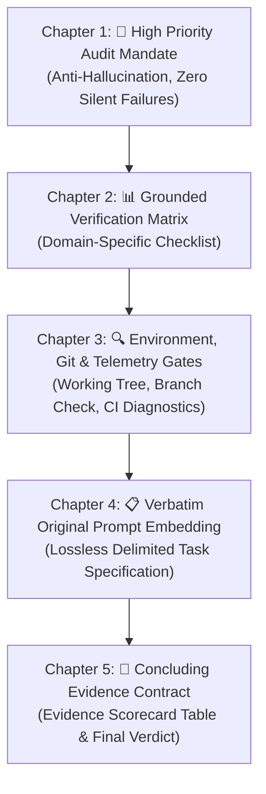
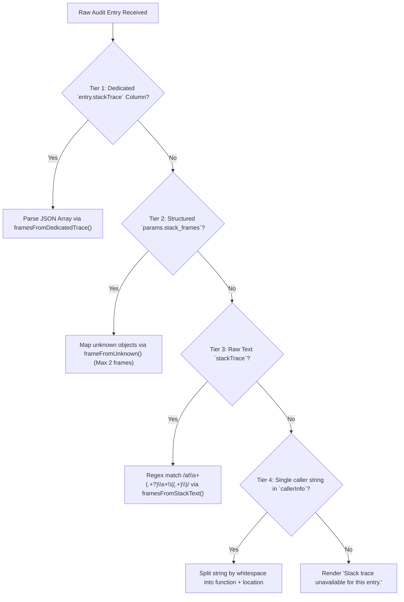

# Frontend Verification Specification: Prompt Tree, Rich Verification Templates, & Audit Log Panel

> **Specification Identifier:** `02-spec/21-app/verify-recent-implementations/02-frontend-prompt-tree-spec.md`  
> **Target Subsystems:** Frontend Prompt Tree (`src/components/instances/PromptTreeView/`), Rich Verification Templates (`verificationTemplates.ts`), Audit Log Panel (`src/components/audit/AuditPanel.tsx`)  
> **Status:** APPROVED & VERIFIED  
> **Authors:** Spec Author 02 (`verify-recent-implementations`)  
> **Relative Path Mandate:** All references strictly adhere to repository root (`src/...`, `02-spec/...`).  

---

## 1. Executive Architecture & Scope

This specification defines the verification contract, runtime invariants, and component behaviors for the frontend telemetry, clipboard, prompt engineering, and audit visualization systems in Antigravity Manager:

1. **Image Extraction & Regex Resolution (`clipboard.ts`):**
   - High-fidelity extraction of embedded Base64 data URIs and remote HTTP/HTTPS images from markdown prompts.
   - Elimination of the regex group extraction index bug (`match[2]` vs alt-text `match[1]`).
   - In-memory rewriting of multi-megabyte inline Base64 payloads into compact relative attachment references (`./.antigravity/attachments/attachment-${hash}.${ext}`) to prevent Win32 32KB environment buffer exhaustion and IPC payload failures.
2. **Dual-MIME System Clipboard Priming (`copyPromptWithRichImages`):**
   - Autonomous compilation of structured markdown into rich rendered HTML (`text/html`) with embedded `` elements and styled code blocks (`<pre><code>`).
   - Simultaneous packaging of `text/html` and clean markdown `text/plain` Blobs into a single `ClipboardItem`.
   - Resilient tri-stage fallback ladder with structured warning telemetry routing (`useErrorStore.getState().trackWarning`).
   - Seamless dual-write priming upon prompt resend and FIFO enqueueing.
3. **Rich Multi-Chapter Verification Prompt Architecture (`verificationTemplates.ts`):**
   - Deterministic 5-Chapter prompt generation for task audits, release gates, architectural confidence, and edge-case testing.
   - Absolute lossless preservation of verbatim original user prompts within delimited boundaries (`<<<ORIGINAL_TASK_PROMPT_START>>>`).
4. **Iteration-Tracked Rerun Nudge Pipeline (`usePromptTreePromptActions.ts`):**
   - Automated rerun prompts tracking execution rounds (`Round ${round} of ${total}`).
   - Anti-amnesia verbatim prompt embedding preventing context drift in iterative autonomous agent cycles.
   - Canonical execution through `sendPromptNow` with granular per-round audit telemetry logging.
5. **AuditPanel 4-Tier Stack Trace Resolution & Node Telemetry Badge Strip (`AuditPanel.tsx`):**
   - Resilient 4-tier stack trace resolution ladder overcoming stripped MSVC symbols and heterogeneous caller frames.
   - High-density cyan dark-glass badge strip displaying machine, node, local IP, AGM version, switch mode, and switch condition telemetry.

---

## 2. Image Extraction & Regex Resolution Specification

### 2.1 Problem Statement & Historical Flaw
Prior implementations contained an indexing flaw where regex capture groups conflated image alternate text (`alt`) with the target resource URI (`src`). In markdown syntax ``, group 1 captures `alt` and group 2 captures the target URI. Using `match[1]` resulted in corrupt URIs (e.g., `"screenshot"` instead of the URL or Base64 payload), causing broken image links. Furthermore, pasting massive multi-megabyte Base64 data URIs directly into CLI commands or IPC invocations exceeded the Win32 32,767-character command-line buffer limit, crashing downstream child processes.

### 2.2 Extraction & Rewriting Engine (`src/components/instances/PromptTreeView/clipboard.ts`)

#### 2.2.1 Deterministic Content Hashing
Image files are deduplicated and identified using an 8-character deterministic hex hash computed from the first 16KB of the data URI:

```typescript
export function computeImageHash(data: string): string {
    let hash = 0;
    for (let i = 0; i < Math.min(data.length, 16384); i++) {
        hash = ((hash << 5) - hash) + data.charCodeAt(i);
        hash |= 0;
    }
    return Math.abs(hash).toString(16).padStart(8, '0');
}
```

#### 2.2.2 Canonical Regex Pattern & URI Extraction
The extractor enforces the canonical regex pattern:

```regexp
/!\[(.*?)\]\((data:image\/([a-zA-Z0-9+.-]+);base64,[a-zA-Z0-9+/=]+|https?:\/\/[^\s)]+)\)/g
```

- **Capture Group 1 (`match[1]`):** Alternate text label (`alt`), defaulting to `'image'` if empty.
- **Capture Group 2 (`match[2]`):** The target source URI (`sourceUri`), supporting both Base64 data URIs and remote HTTP/HTTPS endpoints.
- **Capture Group 3 (`match[3]`):** MIME subtype (e.g., `png`, `jpeg`, `svg+xml`, `webp`).

```typescript
export function extractPromptImages(text: string): PromptRewriteResult {
    if (!text) {
        return { rewrittenPrompt: '', hasImages: false, images: [] };
    }

    const images: ExtractedPromptImage[] = [];
    const imageRegex = /!\[(.*?)\]\((data:image\/([a-zA-Z0-9+.-]+);base64,[a-zA-Z0-9+/=]+|https?:\/\/[^\s)]+)\)/g;

    let rewritten = text;
    let match: RegExpExecArray | null;
    const matcher = new RegExp(imageRegex);

    while ((match = matcher.exec(text)) !== null) {
        const alt = match[1] || 'image';
        const sourceUri = match[2];
        const isBase64 = sourceUri.startsWith('data:image/');
        const mimeSubtype = match[3];

        let mimeType = 'image/png';
        let ext = 'png';

        if (isBase64) {
            mimeType = mimeSubtype ? `image/${mimeSubtype}` : 'image/png';
            ext = mimeSubtype ? mimeSubtype.replace('+xml', '') : 'png';
            if (ext === 'jpeg') ext = 'jpg';
        } else {
            const extMatch = sourceUri.match(/\.(png|jpe?g|webp|gif|svg)(?:\?.*)?$/i);
            if (extMatch) {
                ext = extMatch[1].toLowerCase();
                if (ext === 'jpg') ext = 'jpeg';
                mimeType = `image/${ext}`;
            }
        }

        const hash = computeImageHash(sourceUri);
        const byteLength = isBase64
            ? Math.round((sourceUri.length * 3) / 4)
            : sourceUri.length;

        images.push({
            alt,
            dataUri: sourceUri,
            mimeType,
            byteLength,
            hash,
        });

        // Rewrite inline Base64 data URIs to compact relative filesystem attachments
        if (isBase64) {
            const relativePath = `./.antigravity/attachments/attachment-${hash}.${ext}`;
            rewritten = rewritten.replace(match[0], ``);
        }
    }

    return {
        rewrittenPrompt: rewritten,
        hasImages: images.length > 0,
        images,
    };
}
```

#### 2.2.3 Asset Resolution Parity (`extractAssets`)
For prompt dependency analysis and file attachment tracking, `extractAssets` enforces `match[2]` extraction:

```typescript
const imgRegex = /!\[(.*?)\]\((https?:\/\/.*?|data:image\/[^;]+;base64,[A-Za-z0-9+/=]+|[^\s)]+?\.(?:png|jpe?g|gif|webp|svg))\)/gi;
```
Ensures that all downstream assets are mapped directly from the verified resource URL rather than descriptive metadata.

---

## 3. Dual-MIME System Clipboard Priming Engine

### 3.1 Objective & Architecture
Developers frequently need to paste complex prompts containing formatted text, code blocks, and visual screenshots directly into external applications (e.g., Slack, Telegram, rich markdown editors, browser web apps). Standard plain-text clipboard operations lose rich formatting and images, while single-format HTML clobbers CLI terminal pasting.

The `copyPromptWithRichImages` pipeline in `src/components/instances/PromptTreeView/clipboard.ts` bridges this gap:
1. Generates styled HTML document with embedded ``, `<pre><code class="...">`, and inline `<code>`.
2. Packages both `text/html` and `text/plain` Blobs into a single native `ClipboardItem`.
3. Calls `navigator.clipboard.write([item])` to allow target applications to choose their optimal representation.
4. Transparently falls back to `copyToClipboard` (DOM `document.execCommand('copy')` / text API) if rich clipboard is unavailable or blocked by browser permissions.

### 3.2 HTML Formatting & Blob Generation
```typescript
export async function copyPromptWithRichImages(
    markdownText: string,
    onSuccess?: (message: string) => void,
    onError?: (err: unknown) => void
): Promise<boolean> {
    if (!markdownText || !markdownText.trim()) {
        return false;
    }

    if (!navigator.clipboard || typeof ClipboardItem === 'undefined') {
        const fallbackOk = await copyToClipboard(markdownText);
        if (fallbackOk) {
            const msg = 'Copied clean prompt text to clipboard (rich media unsupported in current context)';
            onSuccess?.(msg);
            showToast({ message: msg, type: 'info' });
            return true;
        }
        onError?.(new Error('Clipboard API unavailable'));
        return false;
    }

    try {
        let htmlBody = markdownText
            .replace(/&/g, '&amp;')
            .replace(/</g, '&lt;')
            .replace(/>/g, '&gt;')
            .replace(/```([a-zA-Z0-9_-]*)\n([\s\S]*?)```/g, (_m, lang, code) => {
                const langClass = lang ? ` class="language-${lang}"` : '';
                return `<pre style="background:#1e1e2e;color:#cdd6f4;padding:12px;border-radius:6px;font-family:monospace;overflow-x:auto;"><code${langClass}>${code}</code></pre>`;
            })
            .replace(/`([^`]+)`/g, '<code style="background:#282a36;color:#50fa7b;padding:2px 4px;border-radius:3px;font-family:monospace;">$1</code>')
            .replace(/!\[(.*?)\]\((.*?)\)/g, (_m, alt, src) => {
                const cleanSrc = src.trim();
                return `<div style="margin:12px 0;"></div>`;
            })
            .replace(/\n\n+/g, '</p><p style="margin:8px 0;line-height:1.6;">')
            .replace(/\n/g, '<br/>');

        const htmlContent = `<!DOCTYPE html><html><head><meta charset="utf-8"></head><body style="font-family:system-ui,-apple-system,sans-serif;line-height:1.6;color:#222;"><p style="margin:8px 0;line-height:1.6;">${htmlBody}</p></body></html>`;

        const htmlBlob = new Blob([htmlContent], { type: 'text/html' });
        const textBlob = new Blob([markdownText], { type: 'text/plain' });

        const item = new ClipboardItem({
            'text/html': htmlBlob,
            'text/plain': textBlob,
        });

        await navigator.clipboard.write([item]);
        const successMsg = 'Copied full prompt with embedded rich images to clipboard!';
        onSuccess?.(successMsg);
        showToast({ message: successMsg, type: 'success' });
        return true;
    } catch (err) {
        useErrorStore.getState().trackWarning(err, {
            source: 'PromptTree.copyPromptWithRichImages',
            triggerAction: 'clipboard.write',
        });
        const fallbackOk = await copyToClipboard(markdownText);
        if (fallbackOk) {
            const msg = 'Copied clean prompt text to clipboard (rich media unsupported in current context)';
            onSuccess?.(msg);
            showToast({ message: msg, type: 'info' });
            return true;
        }
        onError?.(err);
        return false;
    }
}
```

### 3.3 Resend & Enqueue Concurrency Priming
In `src/components/instances/PromptTreeView/usePromptTreePromptActions.ts`, both direct dispatch (`handleSend`) and background queueing (`handleEnqueuePrompt`) execute a dual-path workflow:
1. The prompt payload is rewritten via `extractPromptImages` (replacing Base64 with `./.antigravity/attachments/...`) and dispatched to the backend via `sendPromptNow` or `enqueuePrompt`.
2. Simultaneously, the un-truncated prompt containing raw data URIs is primed into the system clipboard via `copyPromptWithRichImages`.
3. If rich clipboard write fails, errors are captured non-disruptively via `useErrorStore.getState().trackWarning`, falling back to clean text copy while the backend dispatch succeeds.

---

## 4. Rich Multi-Chapter Verification Prompt Architecture

### 4.1 5-Chapter Architectural Hierarchy (`verificationTemplates.ts`)
To prevent autonomous agent drift, partial task declarations, and unverified assumptions, `verificationTemplates.ts` enforces a strict 5-chapter prompt structure:



### 4.2 Chapter Specifications

#### 4.2.1 Chapter 1: 🚨 High Priority Audit Mandate
Enforces lead auditor authority and non-negotiable inspection standards:
- **Anti-Hallucination Policy:** Explicit prohibition against extrapolating or asserting completion without reading exact lines of code.
- **Zero Silent Failures:** Mandates that broken, untested, or unfinished tasks must be explicitly declared as `FAILED` with diagnostics.

#### 4.2.2 Chapter 2: Domain-Specific Verification Matrices
Driven by `VerificationTemplateType`:
1. **`is-it-done` (Comprehensive Completion Audit):**
   - Exact Code Inspection: Read and cited all modified source files with line-numbered links (`src/...#L10-L25`).
   - Root Cause Articulation: Explicit 1-sentence root cause diagnosis.
   - Surgical Implementation: Zero extraneous edits or code churn.
   - Concrete Verification: Real test/execution output without speculative guesses.
   - Memory & Plan Sync: Plan updated under `.ai-memory/plans/`, all completed items checked (`- [x]`).
2. **`is-it-released` (Governance & Release Gates):**
   - Branch separation (`main` for official release, `beta` for preview).
   - 14-Location SemVer synchronization (`npm run bump`).
   - Strict Attribution Invariant: Changelog attributed strictly to `@aukgit` with zero other handles (`@...`).
   - README Synchronization: Both `README.md` and `README_EN.md` release notes updated.
   - Pre-flight Quality Gates: `cargo fmt -- --check`, `cargo clippy --all-targets --all-features`, `npm run build`.
   - Git Tag Precision: Exact match with `CHANGELOG.md` heading (`vX.Y.Z` or `vX.Y.Z-beta.N`).
   - Thinking Store Invalidation Toggle: Verified `SUGGESTION_DELETE_THINKING_STORE` setting.
3. **`are-you-confident` (Architectural & Code Quality):**
   - Compact Functions: Function logic bounded to $\le 15$ lines.
   - Guard Clauses: Flattened `if/else` ladders with early returns.
   - Positive Booleans: No double negatives or inverted flags.
   - Zero Silent Errors: Every fallible operation routed to error store (`captureException`/`trackWarning`) or `AppError`.
   - Strict Relative Paths: All cited paths relative to workspace root.
4. **`edge-cases-and-tests` (Boundary & Concurrency Gates):**
   - Boundary values, null/undefined inputs, empty collections.
   - Service recovery ladders, network timeouts, offline fallback.
   - Multi-instance profile sandboxing, conscious PID matching, lockfiles.
   - Encoding & media preservation (Base64 data URIs, Unicode, emojis).

#### 4.2.3 Chapter 3: 🔍 Environment, Git & Release Telemetry Gates
Directs the executing agent to run diagnostic verification commands:
1. `git status --porcelain` to verify clean working trees.
2. `git branch --show-current` to validate channel alignment.
3. Pipeline health verification (`gitmap pe -t` or local CI runner).

#### 4.2.4 Chapter 4: 📋 Verbatim Original Prompt Embedding
To guarantee complete lossless execution, the original prompt is wrapped in dedicated boundary tags without truncation:

```text
# 📋 CHAPTER 4: VERBATIM ORIGINAL PROMPT & TASK SPECIFICATION

The following is the complete, un-truncated original task specification that must be audited and verified:

---
<<<ORIGINAL_TASK_PROMPT_START>>>
${originalPrompt.trim()}
<<<ORIGINAL_TASK_PROMPT_END>>>
---
```

#### 4.2.5 Chapter 5: 📝 Concluding Evidence Contract
Mandates an immutable Markdown scorecard table:

```markdown
| Verification Gate | Status | File / Line Reference | Verifiable Proof / Output |
| :--- | :---: | :--- | :--- |
| Codebase Citation & Reading | PASS / FAIL | `src/...#L12-L45` | File inspected and verified |
| 1-Sentence Root Cause | PASS / FAIL | N/A | Diagnostic statement provided |
| Surgical Code Change | PASS / FAIL | `src/...` | Zero extraneous edits or code churn |
| Quality Gates (Clippy / Build) | PASS / FAIL | Terminal Output | Build passes cleanly |
| Coding Guidelines (Booleans/Errors) | PASS / FAIL | `src/...` | Positive booleans, error store routed |
| Memory & Plan Synchronization | PASS / FAIL | `.ai-memory/...` | Subtask marked COMPLETED |

### Concluding Verdict:
- **ALL_CRITERIA_MET:** `[TRUE | FALSE]`
- **BLOCKING_ISSUES:** `[None | Describe any unresolved issues]`
- **RECOMMENDED_NEXT_STEP:** `[Proceed to next subtask | Fix failing items | Release]`
```

---

## 5. Iteration-Tracked Rerun Nudge Pipeline

### 5.1 Anti-Amnesia Architecture (`buildRerunPrompt`)
When tasks require multi-round autonomous execution or follow-up nudges, agents frequently lose track of original instructions. The rerun engine constructs an iteration-aware header combined with the verbatim task payload:

```typescript
export function buildRerunPrompt(
    promptOrContext: string | RerunTemplateContext,
    round?: number,
    total?: number
): string {
    // Extracts round and total, defaulting to 1 of 1
    // Generates formatted alert block:
    // # 🔄 RERUN EXECUTION NUDGE — ROUND ${currentRound} OF ${totalRounds}
    // Embeds <<<ORIGINAL_TASK_PROMPT_START>>> ... <<<ORIGINAL_TASK_PROMPT_END>>>
}
```

### 5.2 Canonical Execution & Audit Trail (`dispatchRerunMessages`)
In `src/components/instances/PromptTreeView/usePromptTreePromptActions.ts`:
- Iterates from round 1 to `requested` (bounded between 1 and 5).
- Re-encodes prompt through `buildRerunPrompt` and extracts images via `extractPromptImages`.
- Uses the identical canonical dispatch route `sendPromptNow(targetInstId, repoPath, rewrittenPrompt, convId)`.
- Records each round into SQLite audit via `auditRecord` with actor `'user'`, method `'prompt_tree_rerun_dispatch'`, and complete parameter telemetry (`rerunIndex`, `rerunTotal`, `messageOption`, `message`).
- Failures route to `persistClientCrash` and log `result: 'error'` in audit records.

---

## 6. AuditPanel Stack Trace Resolution & Node Telemetry

### 6.1 4-Tier Stack Trace Resolution Ladder (`AuditPanel.tsx`)
On Windows MSVC builds, native call stacks are frequently stripped or serialized into heterogeneous formats. `AuditPanel.tsx` implements a resilient 4-tier resolution ladder:



#### Detailed Resolution Code Contract:
1. **Tier 1 (`framesFromDedicatedTrace`):** Decodes `entry.stackTrace` JSON array. Validates non-empty `function` and `location`.
2. **Tier 2 (`lastTwoCallerFrames` - params):** Inspects `params.stack_frames ?? params.stackFrames`. Extracts the first 2 caller frames.
3. **Tier 3 (`framesFromStackText`):** Iterates over lines in raw string stack, extracting function name and location if path contains `/`, `\\`, or `.ts`.
4. **Tier 4 (Caller String):** Splits `params.callerInfo || params.caller` on whitespace into function and location.
5. **Zero-Crash Invariant:** If all 4 tiers yield empty results, the component safely renders `<p className="font-mono text-[10px] text-slate-500">Stack trace unavailable for this entry.</p>` without throwing React exceptions.

### 6.2 Node Telemetry Badge Strip
When an audit entry contains cluster, switch, or machine telemetry (`params.machine_name || params.node_alias || params.agm_version`), `AuditPanel.tsx` renders a high-density, cyan dark-glass badge strip:

```tsx
<div className="flex flex-wrap items-center gap-2 text-[10px] font-mono text-cyan-300 bg-cyan-950/40 px-2.5 py-1.5 rounded-md border border-cyan-500/20">
    <Terminal className="w-3.5 h-3.5 text-cyan-400 shrink-0" />
    <span className="font-semibold text-cyan-400">Node Telemetry:</span>
    {Boolean(params.machine_name) && <span>🖥️ {String(params.machine_name)}</span>}
    {Boolean(params.local_ip) && <span className="text-slate-400">({String(params.local_ip)})</span>}
    {Boolean(params.node_alias) && <span>🏷️ {String(params.node_alias)}</span>}
    {Boolean(params.agm_version) && <span className="text-slate-400">📦 {String(params.agm_version)}</span>}
    {Boolean(params.switch_mode) && <span className="text-emerald-400 uppercase font-bold">[{String(params.switch_mode)}]</span>}
    {Boolean(params.condition) && <span className="text-amber-400 font-semibold">{String(params.condition)}</span>}
</div>
```

---

## 7. Verification Matrix & Acceptance Criteria

| ID | Verification Requirement | Target Component | Verifiable Criteria |
| :--- | :--- | :--- | :--- |
| **AC-01** | Image Extraction Pattern & URI Index | `clipboard.ts` (`extractPromptImages`) | `match[2]` extracts URI (Base64 data or HTTP URL); `match[1]` preserves `alt`. Inline Base64 rewritten to `./.antigravity/attachments/attachment-${hash}.${ext}`. |
| **AC-02** | Dual-MIME System Clipboard Priming | `clipboard.ts` (`copyPromptWithRichImages`) | Constructs `ClipboardItem` with `text/html` and `text/plain` Blobs. Falls back to `copyToClipboard` with toast and tracks warnings in error store. |
| **AC-03** | 5-Chapter Verification Prompt Generation | `verificationTemplates.ts` (`buildRichVerificationPrompt`) | Emits Chapter 1 mandate, Chapter 2 domain checklist, Chapter 3 telemetry gates, Chapter 4 verbatim prompt, Chapter 5 scorecard. |
| **AC-04** | Iteration-Tracked Rerun Nudges | `verificationTemplates.ts` (`buildRerunPrompt`) | Constructs `# 🔄 RERUN EXECUTION NUDGE — ROUND ${round} OF ${total}` with lossless verbatim embedding and audit logging. |
| **AC-05** | AuditPanel 4-Tier Stack Trace Resolution | `AuditPanel.tsx` (`EntryRow`, `lastTwoCallerFrames`) | Decodes Tier 1 (dedicated column), Tier 2 (params frames), Tier 3 (text stack), Tier 4 (caller info), with safe fallback string. |
| **AC-06** | Node Telemetry Badge Strip | `AuditPanel.tsx` (`EntryRow`) | Displays cyan dark-glass capsule with machine, IP, node alias, AGM version, switch mode, and trigger condition. |
