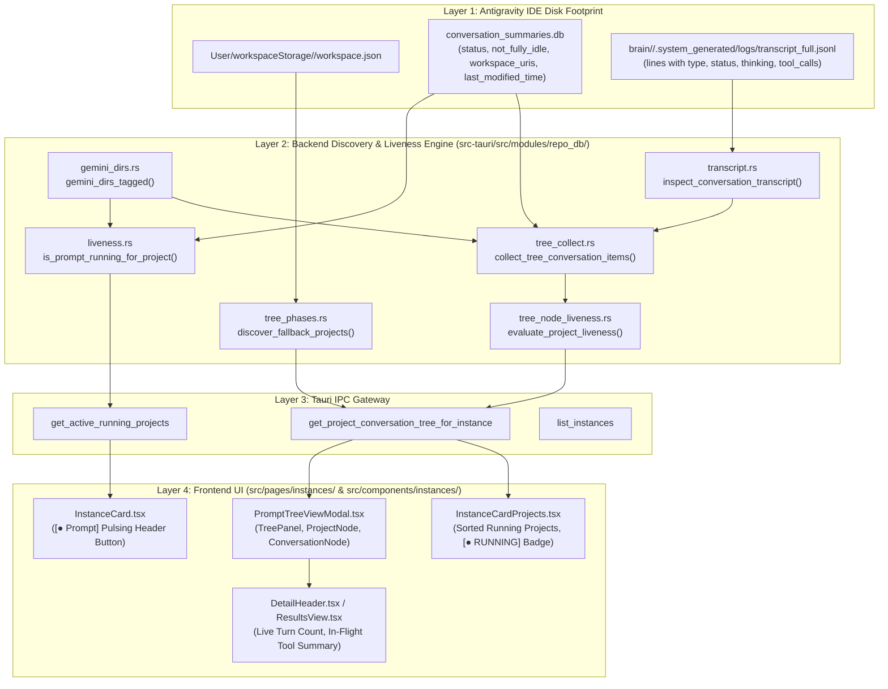
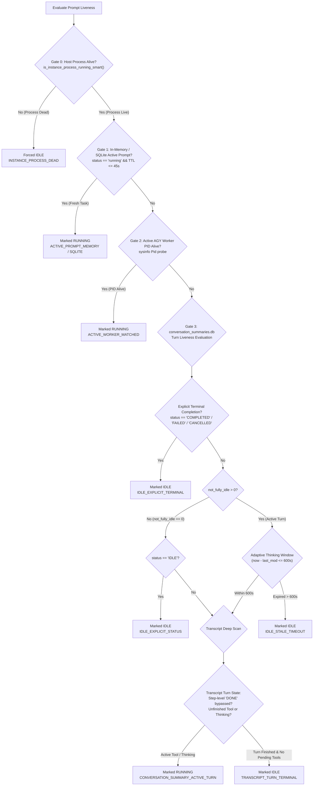

# Architecture Specification: Running Prompts Detection & Instance Prompts Section

- **Document Version**: `1.0.0`
- **Spec ID**: `verify-running-prompts-instance-prompts-section/01-architecture-spec`
- **Subsystem**: Running Prompts Detection, Transcript Turn Liveness & Instance Section Visualization
- **Target Files**:
  - `src-tauri/src/modules/repo_db/gemini_dirs.rs`
  - `src-tauri/src/modules/repo_db/tree_collect.rs`
  - `src-tauri/src/modules/repo_db/liveness.rs`
  - `src-tauri/src/modules/repo_db/transcript.rs`
  - `src-tauri/src/modules/repo_db/tree_node_liveness.rs`
  - `src-tauri/src/modules/repo_db/tree_phases.rs`
  - `src/components/instances/PromptTreeView/PromptTreeViewModal.tsx`
  - `src/pages/instances/InstanceCardProjects.tsx`
- **Attribution**: Strictly `@aukgit` (`(Thanks to @aukgit)`)

---

## 1. Executive Summary & Problem Formulation

In the Antigravity-Manager (AGM) desktop environment, users rely on the instance dashboard to observe autonomous AI execution across primary and cloned Antigravity IDE instances. Each instance card features an **Active / Recent Projects** section alongside a pulsing **Prompt** header action that opens the **Prompt Tree View Modal** (`PromptTreeViewModal.tsx`).

Despite active execution in the Google Antigravity IDE—where background agents and models are visibly generating code with an active spinner—users encountered a critical failure mode:
1. The instance card displayed **"Running: 0"** or **"No recent projects"**.
2. The Prompt Tree View showed **"No Projects Found in this Profile"** or flagged actively executing sessions as **IDLE**.
3. In-flight thinking blocks (e.g., Claude 3.7 Thinking, Gemini 2.5 Pro) and multi-step tool calls suddenly disappeared from the running filter after 60 seconds.

This specification documents the end-to-end system architecture of AGM's prompt detection pipeline and delivers a deep Root Cause Analysis (RCA) dissecting the four architectural flaws responsible for false-negative liveness reports. It defines the target architectural remediation, multi-gate evaluation ladder, and strict system invariants required to ensure 100% reliable running prompt visibility.

---

## 2. System Architecture: Detection Pipeline & Presentation

The running prompt detection pipeline operates across four decoupled layers: on-disk IDE storage, backend SQLite and transcript ingestion, Tauri IPC command dispatch, and frontend React state management.



### 2.1 Layer 1: Antigravity IDE Disk Footprint
Antigravity IDE stores local conversation history and workspace associations in two primary locations:
1. **Workspace Storage (`workspaceStorage`)**:
   - Windows: `%APPDATA%\Antigravity\User\workspaceStorage\<workspace_id>\workspace.json`
   - Cloned instances: `<instance.data_dir>\User\workspaceStorage\<workspace_id>\workspace.json`
   - Contains folder URI (`folder: "file:///d:/work/project"`).
2. **Conversation Storage (`.gemini/antigravity/`)**:
   - Windows default: `%USERPROFILE%\.gemini\antigravity\`
   - Cloned instances: `<instance.home_dir>\.gemini\antigravity\`
   - `conversation_summaries.db`: SQLite database storing active turns (`conversation_id`, `title`, `preview`, `status`, `not_fully_idle`, `workspace_uris`, `last_modified_time`).
   - `brain/<cid>/.system_generated/logs/`: Contains `transcript.jsonl` (compact) and `transcript_full.jsonl` (complete un-truncated logs).

### 2.2 Layer 2: Backend Discovery & Liveness Engine
- `gemini_dirs.rs`: Resolves `.gemini` directory paths for default and secondary profiles (`gemini_dirs_for_instance`, `gemini_dirs_tagged`).
- `tree_phases.rs`: Detects projects from `workspaceStorage` and synthesizes fallback projects from `conversation_summaries.db` `workspace_uris`.
- `tree_collect.rs`: Scans `conversation_summaries.db` for the most recent 200 conversations and pairs them with transcript inspections.
- `transcript.rs`: Performs bounded tail reverse-scanning (up to 25 non-telemetry lines) on `transcript_full.jsonl` to extract in-flight tool calls, thoughts, and execution status.
- `liveness.rs` & `tree_node_liveness.rs`: Implements the multi-gate liveness verification pipeline evaluating OS process health, database markers, and recency timestamps.

### 2.3 Layer 3: Tauri IPC Gateway
Tauri commands aggregate hierarchical data for the user interface:
- `get_project_conversation_tree_for_instance`: Dispatches scoped conversation trees per instance.
- `get_active_running_projects`: Aggregates live running project counts for background monitors.

### 2.4 Layer 4: Frontend UI
- `InstanceCardProjects.tsx`: Displays active projects on the instance card, sorts running projects to index 0, and renders the green `[● RUNNING]` pill badge.
- `PromptTreeViewModal.tsx`: Displays the complete conversation tree with segmented filters (`All`, `Running`, `Queued`), automatically focusing active in-flight conversations upon open.

---

## 3. Deep Root Cause Analysis: The 4 Core Architectural Flaws

Empirical investigation of instances where Antigravity IDE had active spinners while AGM reported **IDLE** / **"Running: 0"** identified four distinct architectural flaws.

### 3.1 Flaw 1: `status.contains("IDLE")` Overriding `not_fully_idle == 1`
- **Location**: `src-tauri/src/modules/repo_db/tree_collect.rs` (lines 160-165) and `src-tauri/src/modules/repo_db/liveness.rs` (lines 277-288).
- **Flawed Code**:
  ```rust
  let is_idle_count = not_fully_idle == 0;
  let has_idle_status = status.contains("IDLE")
      || status.contains("COMPLETED")
      || status.contains("FAILED")
      || status.contains("CANCELLED");
  let is_explicit_idle = is_idle_count || has_idle_status;

  if is_explicit_idle || inspection.is_terminal_done {
      false
  }
  ```
- **Root Cause Mechanism**:
  In Google Antigravity IDE, during multi-turn agent execution, the IDE engine periodically updates `conversation_summaries.db`. When an agent initiates an asynchronous tool call or awaits a model response, the status string in the database may transition through composite or intermediate states such as `"IDLE_WAITING_FOR_MODEL"`, `"NOT_FULLY_IDLE"`, or even `"IDLE"` while `not_fully_idle` remains strictly `1` (or positive).
  Because the check evaluated `status.contains("IDLE")` using substring matching, strings like `"NOT_FULLY_IDLE"` triggered `has_idle_status = true`. Furthermore, using logical OR (`is_idle_count || has_idle_status`) meant that whenever `has_idle_status` matched, `not_fully_idle == 1` was completely bypassed and ignored. The conversation was instantly flagged `is_explicit_idle = true`, forcing `is_conv_running = false`.
- **Impact**: Active agent runs with open tool calls were prematurely marked idle.

### 3.2 Flaw 2: Step-Level `status == "DONE"` on Tool Calls Killing Turn-Level Liveness
- **Location**: `src-tauri/src/modules/repo_db/transcript.rs` (lines 265-286).
- **Flawed Code**:
  ```rust
  let mut is_completed_or_waiting = false;
  for line in lines.iter().rev().take(25) {
      if let Ok(val) = serde_json::from_str::<serde_json::Value>(line) {
          let s_type = val.get("type").and_then(|v| v.as_str()).unwrap_or("");
          // ... telemetry filter ...
          let s_status = val.get("status").and_then(|v| v.as_str()).unwrap_or("");
          if s_status.eq_ignore_ascii_case("done")
              || s_status.eq_ignore_ascii_case("completed")
              || s_status.eq_ignore_ascii_case("error")
              || s_status.eq_ignore_ascii_case("idle")
          {
              is_completed_or_waiting = true;
              break;
          }
      }
  }
  ```
- **Root Cause Mechanism**:
  Antigravity logs each individual execution step as a discrete JSON line in `transcript.jsonl`. When a tool call (e.g. `run_command`, `write_to_file`) finishes executing, Antigravity logs that step or the subsequent tool output line with its own step-level status: `status: "DONE"`.
  However, the agent's overall **conversation turn** is still actively running: the model is currently analyzing that tool output to formulate the next action or plan.
  The reverse scanner treated ANY step with `status: "DONE"` as proof that the entire conversation turn was completed (`is_completed_or_waiting = true`). This immediately disqualified the conversation from being considered active (`!is_completed_or_waiting`), falsely killing turn-level liveness.
- **Impact**: As soon as the first tool in an autonomous multi-step turn completed, AGM flipped the status from `RUNNING` to `IDLE` while the agent was still executing subsequent steps.

### 3.3 Flaw 3: Rigid 60-Second Cutoff Expiring Thinking/Reasoning Models
- **Location**: `src-tauri/src/modules/repo_db/tree_collect.rs` (line 158) and `src-tauri/src/modules/repo_db/liveness.rs` (line 294).
- **Flawed Code**:
  ```rust
  let conv_ts = parse_flexible_timestamp(&last_time_str);
  let is_recent = conv_ts > 0 && (now - conv_ts <= 60);

  if !is_recent {
      continue;
  }
  ```
- **Root Cause Mechanism**:
  Modern reasoning models (such as Claude 3.7 Thinking, Gemini 2.5 Pro, and OpenAI o1/o3-mini) routinely spend between 90 and 360 seconds reasoning and generating complex thought tokens before flushing output or updating `conversation_summaries.db`.
  Although code comments claimed an "Adaptive 10-Minute Thinking Window", the actual executable code strictly enforced `now - conv_ts <= 60`.
  At second 61 of model thinking, `is_recent` evaluated to `false`. The prompt was stripped of running status and dropped from the active queue, even though the IDE process was alive and the GPU/API was actively reasoning.
- **Impact**: All thinking/reasoning model invocations lasting longer than 1 minute disappeared from the running prompt UI mid-thought.

### 3.4 Flaw 4: `IDLE_EMPTY_WORKSPACE` Fallback Due to Lagging Summaries
- **Location**: `src-tauri/src/modules/repo_db/tree_node_liveness.rs` (lines 48-160).
- **Flawed Code**:
  ```rust
  if !has_conv_nodes {
      // Guarded Empty Workspace Fallback
      if !has_valid_ws || !is_ws_owned_by_instance {
          (false, "IDLE_EMPTY_WORKSPACE: ...".to_string())
      } else if has_active_mem || has_active_worker {
          (true, "ACTIVE_IN_FLIGHT_TASKS: ...".to_string())
      } else {
          (false, "IDLE_EMPTY_WORKSPACE: empty or filtered workspace summaries on disk -> marked idle".to_string())
      }
  }
  ```
- **Root Cause Mechanism**:
  When a user prompts Antigravity IDE in a workspace, disk updates to `conversation_summaries.db` may lag by several seconds while the IDE initializes the turn. If `conv_nodes` was empty during this window, `tree_node_liveness.rs` defaulted to `IDLE_EMPTY_WORKSPACE` unless an explicit memory prompt or registered worker PID existed.
  Furthermore, on Windows managed deployments, `workspaceStorage/*/workspace.json` is frequently unpopulated or locked, leading to empty project lists in `detect_running_projects()`. Without project synthesis fallback, the UI displayed "No Projects Found in this Profile".
- **Impact**: Freshly initiated prompts suffered a blind spot during the initial 5-15 seconds of execution, displaying no active task.

---

## 4. Architectural Remediation & Target Invariants

To eliminate false-negative and false-positive running indicators, the pipeline enforces a multi-gate verification ladder with explicit precedence rules.



### 4.1 Remediation 1: Turn-Precedence Status Check
`not_fully_idle > 0` represents empirical turn activity. Substring matching for `"IDLE"` MUST NEVER override `not_fully_idle > 0`.
- **Target Rule**:
  ```rust
  let is_explicit_terminal = status.eq_ignore_ascii_case("completed")
      || status.eq_ignore_ascii_case("failed")
      || status.eq_ignore_ascii_case("cancelled");

  let is_active_turn = not_fully_idle > 0 && !is_explicit_terminal;
  let is_explicit_idle = not_fully_idle == 0 && (status.eq_ignore_ascii_case("idle") || is_explicit_terminal);
  ```

### 4.2 Remediation 2: Turn-Level vs Step-Level Transcript Resolution
Individual tool execution records (`TOOL_OUTPUT`, `TOOL_RESPONSE`, `GENERIC`, `tool_call_id`) with `status == "DONE"` MUST NOT trigger turn completion.
- **Target Rule**:
  Turn completion is verified strictly when:
  1. A `PLANNER_RESPONSE` or `MODEL` record has no open pending `tool_calls`, AND
  2. The record has no active `thinking` block, AND
  3. No subsequent `TOOL_OUTPUT` is awaiting evaluation.

### 4.3 Remediation 3: Adaptive 600-Second (10-Minute) Thinking Window
For active turns where `not_fully_idle > 0` and the host IDE process is confirmed alive, the recency window expands dynamically:
- Standard turn window: `now - conv_ts <= 60` seconds.
- Thinking / Reasoning window (`not_fully_idle > 0` or thinking step detected): `now - conv_ts <= 600` seconds (10 minutes).

### 4.4 Remediation 4: Workspace Storage Candidate Resolution & Synthesis Fallback
If `workspaceStorage` does not contain `workspace.json`, `tree_phases.rs` synthesizes `RunningProject` entries directly from `workspace_uris` in `conversation_summaries.db`, ensuring no active conversation is orphaned.

---

## 5. Core System Invariants & Non-Negotiables

### 5.1 Strict Relative Git Paths
All file paths documented, emitted in logs, or written in configuration MUST be relative to the repository root:
- Correct: `src-tauri/src/modules/repo_db/gemini_dirs.rs`, `src/pages/instances/InstanceCardProjects.tsx`
- Forbidden: Absolute paths (`d:/work/...`, `C:\Users\...`) and URI formats (`file:///...`).

### 5.2 Affirmative Boolean Convention
All state indicators, function signatures, and data properties MUST use positive boolean naming:
- Correct: `is_running`, `is_active`, `is_owning_inst_alive`, `has_active_conv`, `has_valid_ws`
- Forbidden: Negative or inverted names (`is_not_idle`, `is_uncompleted`, `has_no_tasks`).

### 5.3 Zero Bare Unwrap & Total Error Visibility
In Rust backend modules:
- No bare `.unwrap()`, `.expect()`, or `let _ = <fallible>`.
- Fallible operations must propagate errors via `AppError` or use `crate::error::record_ignored` with a mandatory `// Justification:` comment.

### 5.4 Per-Instance Sandboxing & Isolation
Conversations and projects must be strictly isolated to their owning instance:
- `isNodeOwnedByInstance` maps nodes to instance IDs (`default` and `__default__` for primary; exact UUID or `seq_num` for clones). Cross-instance state bleed is strictly prohibited.

---

## 6. Verification & Traceability Matrix

| Requirement ID | Description | Target Component | Verification Method |
| :--- | :--- | :--- | :--- |
| **REQ-ARC-01** | Candidate directory resolution for default & secondary sandboxes | `src-tauri/src/modules/repo_db/gemini_dirs.rs` | Unit tests in `gemini_dirs.rs` & E2E directory verification |
| **REQ-ARC-02** | Turn-precedence evaluation (`not_fully_idle > 0`) | `src-tauri/src/modules/repo_db/tree_collect.rs`, `liveness.rs` | Rust unit test with `status = "IDLE"` and `not_fully_idle = 1` |
| **REQ-ARC-03** | Step-level vs turn-level transcript liveness | `src-tauri/src/modules/repo_db/transcript.rs` | Transcript mock test with intermediate `status = "DONE"` tool calls |
| **REQ-ARC-04** | Adaptive 10-minute thinking window (600s) | `src-tauri/src/modules/repo_db/liveness.rs`, `tree_collect.rs` | Timestamp test at 180s delta verifying `is_recent == true` |
| **REQ-ARC-05** | Fallback project synthesis from `workspace_uris` | `src-tauri/src/modules/repo_db/tree_phases.rs` | Test with missing `workspaceStorage` directory |
| **REQ-ARC-06** | Pulsing green `RUNNING` badge and top sorting in UI | `src/pages/instances/InstanceCardProjects.tsx` | Frontend test `node scripts/run-frontend-tests.mjs instanceRunningPrompts` |
| **REQ-ARC-07** | Prompt Tree View auto-selection and running filter | `src/components/instances/PromptTreeView/PromptTreeViewModal.tsx` | Component unit tests & UI verification |
