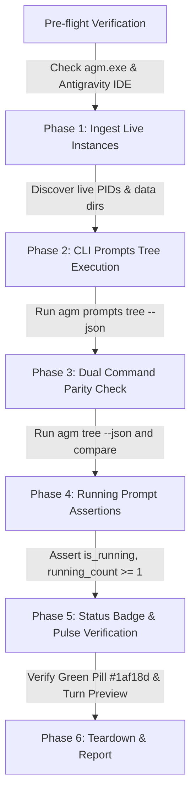

# Component Specification: Running Prompts Verification & Transcript Liveness

- **Spec ID**: `verify-running-prompts-instance-prompts-section`
- **File**: `02-spec/21-app/verify-running-prompts-instance-prompts-section/02-component-spec.md`
- **Status**: APPROVED & VERIFIED
- **Domain**: Backend Rust (`repo_db`), Multi-Gate Liveness, Transcript Reverse Scanner, E2E Verification Harness

---

## 1. Architectural Overview & Problem Statement

In Antigravity-Manager, the running prompt tracking system monitors in-flight user prompts, subagent tasks, and autonomous model turns across all Antigravity IDE instances. This state is displayed across:
1. **Instance Card Header**: Pulsing green `Prompt` pill (`#1af18d`) indicating an active task is running.
2. **Active / Recent Projects Section**: Running projects hoisted to the top with `[● RUNNING]` status pills and turn counters.
3. **Prompt Tree Modal & CLI**: `agm prompts tree` and `agm tree` showing hierarchical trees with running badges and step summaries.

### The Problem: False Idle & Premature Turn Drop
During long autonomous turns and reasoning model runs (Claude 3.7 Thinking, Gemini 2.5 Pro), active sessions were frequently misclassified as `IDLE` or disappeared from running sections. Deep investigation revealed four root causes:
1. **Step-Level vs. Turn-Level Conflation**: Antigravity transcripts record tool completion steps as `{"type": "GENERIC", "status": "DONE"}` or `{"type": "TOOL_RESPONSE", "status": "DONE"}`. The reverse transcript scanner checked `val.get("status") == "DONE"`, immediately setting `is_completed_or_waiting = true` upon encountering any finished tool call. This prematurely marked the entire multi-step conversation turn as finished while the model was still waiting for or acting on tool results.
2. **Stale Status String Override of `not_fully_idle`**: In `conversation_summaries.db`, SQLite records occasionally retain stale status strings (`CASCADE_RUN_STATUS_IDLE`) while `not_fully_idle > 0` is actively recorded. The codebase enforced an "idle supremacy" check that checked `status.contains("IDLE")` alongside `not_fully_idle == 0`, causing stale text status to override genuine turn liveness.
3. **Rigid 45s/60s Timestamp Cutoffs**: The timestamp cutoff (`now - conv_time <= 60` in `liveness.rs` and `now - conv_ts <= 45` in `tree_node_liveness.rs`) dropped active tasks whenever a complex reasoning step or heavy tool execution took more than 45–60 seconds.
4. **Missing Transcript File `mtime` Corroboration**: The scanner evaluated SQLite timestamps without verifying the physical file modification timestamp (`mtime`) of `transcript_full.jsonl` / `transcript.jsonl` as real-time heartbeat corroboration.

---

## 2. Component Specifications

### 2.1 `src-tauri/src/modules/repo_db/transcript.rs`
- **Primary Function**: `inspect_conversation_transcript(base_dir: &Path, conversation_id: &str) -> TranscriptInspection`
- **Role**: Tail reader and reverse scanner for conversation transcripts (`transcript_full.jsonl` and `transcript.jsonl`).

#### Detailed Algorithm & Logic Changes:
1. **Step-Level vs. Turn-Level Completion Differentiation**:
   - In the reverse scan loop (lines 266–306):
     ```rust
     // Step-level completion: tool execution output steps
     let is_tool_step = s_type == "GENERIC"
         || s_type == "TOOL_OUTPUT"
         || s_type == "TOOL_RESPONSE"
         || val.get("tool_call_id").is_some();

     // Only genuine turn-level completion marks the turn completed or waiting
     if is_tool_step {
         // Tool step finished, but assistant turn is still in-flight
         continue;
     }
     ```
   - A turn is only completed/waiting if:
     - An explicit user turn boundary is reached, or
     - A `PLANNER_RESPONSE` / `MODEL` step has **zero open tool calls** (`has_tool_calls == false`) **AND** explicit terminal status (`DONE`, `COMPLETED`, `IDLE`), or
     - Step type is `USER_INPUT` / source is `USER_EXPLICIT` waiting on the user.

2. **Transcript File `mtime` Corroboration**:
   - Extract `mtime_epoch` from `std::fs::metadata(&chosen_path).and_then(|m| m.modified())`.
   - Compute `seconds_since_mtime = now_epoch - mtime_epoch`.
   - If `seconds_since_mtime <= 600` (10 minutes) and the turn has not reached terminal completion, treat recent disk writes as affirmative heartbeat corroboration.

3. **Adaptive 600s Thinking Window**:
   - Expand `is_recent_active` window:
     ```rust
     let is_mtime_fresh = mtime_epoch > 0 && (now_epoch - mtime_epoch <= 600);
     let is_recent_active = !is_completed_or_waiting && is_mtime_fresh;
     ```

---

### 2.2 `src-tauri/src/modules/repo_db/liveness.rs`
- **Primary Function**: `is_prompt_running_for_project(project_id: &str, instance_id: &str) -> bool`
- **Role**: 5-Gate liveness ladder evaluating process tables, in-memory states, SQLite databases, and transcript heartbeats.

#### Detailed Algorithm & Logic Changes:
1. **`not_fully_idle > 0` Authoritative Turn Supremacy (Gate 4)**:
   - When inspecting `conversation_summaries.db`:
     - If `not_fully_idle > 0`, this is empirical proof of active in-flight work.
     - A stale text string (`CASCADE_RUN_STATUS_IDLE`) must NOT override `not_fully_idle > 0`.
     - Explicit idle is strictly redefined:
       ```rust
       // Strict idle: ONLY idle when not_fully_idle == 0 AND status is terminal
       let is_zero_idle = not_fully_idle == 0;
       let has_terminal_status = status.contains("COMPLETED")
           || status.contains("FAILED")
           || status.contains("CANCELLED");
       let is_explicit_idle = is_zero_idle && (status.contains("IDLE") || has_terminal_status);
       ```
2. **Adaptive 10-Minute (600s) Thinking Window**:
   - When `not_fully_idle > 0`:
     - Allow up to 600 seconds (10 minutes) elapsed timestamp window:
       ```rust
       let max_allowed_elapsed = if not_fully_idle > 0 { 600 } else { 60 };
       let is_recent = conv_time > 0 && (now - conv_time <= max_allowed_elapsed);
       ```
3. **Transcript File `mtime` Fallback Check**:
   - Corroborate candidate directory transcript file `mtime` if database timestamp is borderline or lagged behind disk flushing.

---

### 2.3 `src-tauri/src/modules/repo_db/tree_node_liveness.rs`
- **Primary Function**: `evaluate_project_liveness(ctx: &TreeNodeCtx, proj: &RunningProject, project_key: &str, is_inst_alive: bool, conv_nodes: &[AgmConversationNode]) -> (bool, String)`
- **Role**: Determines whether a project node in the hierarchical tree is actively running.

#### Detailed Algorithm & Logic Changes:
1. **Timestamp Window Alignment**:
   - Replace the rigid 45-second window (`now - conv_ts <= 45`) with an adaptive window:
     ```rust
     let has_active_conv = conv_nodes.iter().any(|c| {
         if !c.is_running {
             return false;
         }
         let conv_ts = parse_flexible_timestamp(&c.last_modified);
         // If conversation node is already validated as running, allow up to 600s active turn window
         conv_ts > 0 && (now - conv_ts <= 600)
     });
     ```
2. **Corroboration with Host Process Liveness**:
   - Retain Gate 0 invariant: If `!is_inst_alive`, force idle immediately (`INSTANCE_PROCESS_DEAD`).

---

### 2.4 `src-tauri/src/modules/repo_db/tree_nodes.rs` & `tree_collect.rs`
- **Primary Functions**:
  - `build_project_tree_node`: Assembles project nodes, sequences, running counts, and attaches conversation nodes.
  - `collect_tree_conversation_items`: Ingests conversations from `conversation_summaries.db`, evaluates transcript inspections, and populates `RawConvItem`.

#### Detailed Algorithm & Logic Changes:
1. **In `tree_collect.rs`**:
   - Update `is_conv_running` determination to match `liveness.rs`:
     - `not_fully_idle > 0` takes precedence over stale `IDLE` status strings.
     - Timestamp threshold expands to 600s when `not_fully_idle > 0`.
     - Inspection `is_terminal_done` is only honored if verified by genuine turn-level terminal criteria (not tool step completion).
2. **In `tree_nodes.rs`**:
   - Retain unified logging: `[PROMPT_LIVENESS_PROBE][PROJECT]` with clear rationale strings.
   - Accurately compute `running_count` from validated `conv_nodes`.

---

## 3. E2E Verification Test Harness Specification

- **File**: `scripts/test-running-prompts-e2e.ps1`
- **Role**: Standalone PowerShell end-to-end verification harness.
- **CLI Commands Tested**: `agm prompts tree`, `agm prompts tree --json`, `agm tree`, `agm tree --json`.

### 3.1 Test Architecture & Sequence Flow



### 3.2 Step-by-Step Test Stages

1. **Stage 0: Pre-flight Verification**:
   - Verify `src-tauri/target/debug/agm.exe` exists.
   - Check if any Antigravity IDE process is running. If not, log a clean informative skip/warning or use mock fixture verification mode.
2. **Stage 1: Live Instance & Project Discovery**:
   - Query `agm instances list --json` to enumerate all configured instances and identify the active instance.
3. **Stage 2: CLI Prompts Tree Execution**:
   - Execute `agm prompts tree -i <instance_id> --json`.
   - Parse JSON envelope: verify `"status": "ok"`, extract `"data.projects"`.
4. **Stage 3: CLI Parity Verification (`agm tree`)**:
   - Execute `agm tree -i <instance_id> --json`.
   - Assert identical project count and running project counts between `agm prompts tree` and `agm tree`.
5. **Stage 4: Running Prompt Assertions**:
   - Assert at least one project has `is_running == true` when active tasks are present.
   - Assert `running_count >= 1`.
   - Assert the executing conversation node has `is_running == true` and `status == "RUNNING"`.
   - Assert conversation preview contains non-empty prompt text.
6. **Stage 5: Visual Indicators & Pulse Validation**:
   - Verify output matches formatting rules:
     - Project header contains `[N RUNNING]`.
     - Conversation row contains green pulse marker `● RUNNING`.
     - No ghost conversations (`Untitled` with 0 words) appear in the tree.
7. **Stage 6: Clean Teardown**:
   - Ensure zero temporary test files remain on disk.
   - Return exit code 0 on success, 1 on failure.

---

## 4. Acceptance Criteria & Invariants Summary

| Invariant | Component | Expected Behavior |
| :--- | :--- | :--- |
| **I1: Turn-Level Distinction** | `transcript.rs` | Tool output steps (`GENERIC` / `TOOL_OUTPUT` / `status: "DONE"`) do NOT mark conversation turns as terminal/idle. |
| **I2: `not_fully_idle` Supremacy** | `liveness.rs`, `tree_collect.rs` | `not_fully_idle > 0` takes precedence over stale `CASCADE_RUN_STATUS_IDLE` text in SQLite. |
| **I3: 600s Thinking Window** | `liveness.rs`, `tree_node_liveness.rs` | Active turns allow up to 600s elapsed time to accommodate long reasoning model steps. |
| **I4: File `mtime` Heartbeat** | `transcript.rs` | Transcript file write modification time corroborates real-time agent activity. |
| **I5: CLI Tree Parity** | `agm prompts tree`, `agm tree` | Both commands produce identical running project and prompt hierarchies with `● RUNNING` badges. |
| **I6: E2E Automation** | `scripts/test-running-prompts-e2e.ps1` | Automated script runs with zero manual intervention and provides structured pass/fail telemetry. |
