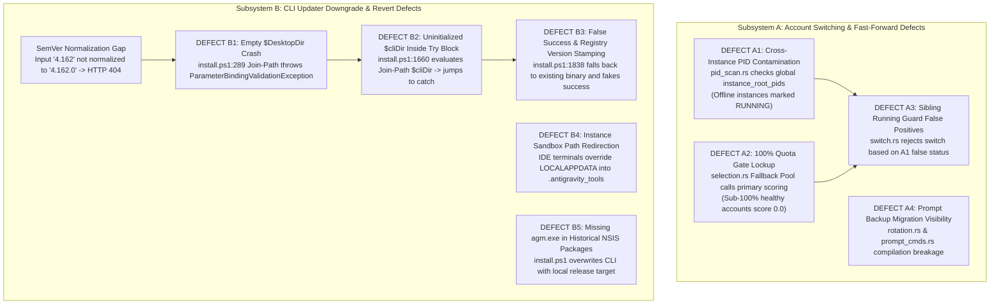

# Issue 36: Account Switching & Fast-Forward Rotation Regressions, CLI Updater Downgrade Lockout, and CI/CD Pipeline Telemetry — 4-Part Root Cause Analysis

> **/goal** Provide an authoritative, grounded 4-part Root Cause Analysis detailing:
> 1. The account switching and UI Fast-Forward rotation regressions causing stopped instances to falsely report as running and cross-instance PID contamination (`DEFECT A1–A4`),
> 2. The CLI updater version downgrade and revert lockouts preventing operators from reverting to `v4.162.0` via `agm update 4.162` or `agm update to v4.162` (`DEFECT B1–B5`),
> 3. The architectural distinction between the official GitHub Actions CI gates (`.github/workflows/ci.yml`) and the 36-job local development runner (`03-ai-scripts/06-cicd-local-runner.py` / `gitmap pe -t`),
> 4. The surgical remediation matrix and future preventative invariants.
>
> **/learn** Reference this document whenever diagnosing account switching lockouts, candidate scoring threshold halts, instance PID isolation failures, delegated CLI updater download failures, PowerShell installer execution crashes, or CI pipeline discrepancies.

---

## 1. Problem Classification & Symptom Definition (Part 1)

### 1.1 Visual & Interactive Symptoms
- **Account Switching Halts**: When operators trigger account switches via the UI navbar or CLI, the active instance fails to restart with new credentials or reports:
  ```text
  Account is actively bound to running sibling instance: <UUID>
  ```
  even when the sibling instance was never launched or was shut down hours ago.
- **Fast-Forward & Rotation Stalls**: Clicking "Smart Rotate" or "Play / Fast-Forward" on an instance card leaves the card in a spinning busy state indefinitely, or restarts the instance with identical exhausted credentials instead of rotating to a healthy account.
- **CLI Downgrade Revert Lockout**: Operators executing:
  ```bash
  agm update 4.162
  agm update to v4.162
  ```
  encounter one of four failure modes:
  1. The updater aborts with HTTP 404 (`Not Found`) because GitHub releases are tagged with three SemVer components (`v4.162.0`), whereas `v4.162` was sent directly to GitHub's tag API.
  2. The updater prints `"Already at the latest version"` because `4.162 <= 4.188` suppresses execution.
  3. `install.ps1` crashes immediately with `ParameterBindingValidationException` at line 289 when executed inside sandboxed IDE terminals or headless sessions.
  4. `install.ps1` downloads the asset, encounters an uninitialized variable, skips the installer, and prints `"Installation of v4.162.0 completed successfully!"` while the disk executable remains at `v4.188.0`.

### 1.2 Telemetry & Runtime Error Evidence
```log
2026-10-11T21:40:15.112Z ERROR agm::update: GitHub API releases/tags/v4.162 returned 404 Not Found
2026-10-11T21:40:16.890Z ERROR install.ps1: Cannot bind argument to parameter 'Path' because it is an empty string.
   at Join-Path $DesktopDir "$ShortcutName.lnk", line 289
2026-10-11T21:41:02.341Z ERROR agm::instance::switch: Account <acc-id> is actively bound to running sibling instance <inst-id>
2026-10-11T21:42:19.412Z WARN agm::auto_switcher::selection: Candidate accounts exhausted: 0 accounts found with >=100% quota
```

### 1.3 Baseline Context: `v4.162.0` Functional Parity
In baseline release `v4.162.0`, account switching, auto-rotation, fast-forwarding, and instance restarting worked predictably:
1. `src-tauri/src/modules/instance.rs` used unified PID detection that checked only the target instance's `data_dir`.
2. Scoring allowed fallback candidates with sub-100% quota when 100% accounts were unavailable.
3. Subsequent refactoring between `v4.162.0` and `v4.188.0` modularized the codebase into sub-modules (`pid_scan.rs`, `selection.rs`, `switch.rs`, `delegate_updater/`), introducing subtle divergence and state desynchronization.

---

## 2. Mechanistic Root Causes & Comparative Divergence from `v4.162.0` (Part 2)



### 2.1 Account Switching & Fast-Forward Subsystem (`DEFECT A1–A4`)

#### DEFECT A1: Cross-Instance PID Contamination (`src-tauri/src/modules/instance/pid_scan.rs:302`)
- **Mechanism**: In `scan_instance_processes_conscious`, `instance_root_pids` is a global set accumulating root PIDs across ALL detected IDE instances. At line 302, child process adoption evaluated:
  ```rust
  if instance_root_pids.contains(&ppid_u32) {
      matched_pids.push(pid_u32);
  }
  ```
- **Consequence**: If instance A has running child processes, instance B (even if offline) sees instance A's PIDs and reports itself as `RUNNING`.
- **Divergence from `v4.162.0`**: `v4.162.0` scoped child adoption strictly to the target instance's own root process set (`target_root_pids`).

#### DEFECT A2: Auto-Switcher 100% Quota Gate Lockup & Broken Fallback Scoring (`src-tauri/src/modules/auto_switcher/selection.rs:254, 294`)
- **Mechanism**: The candidate selection engine employs a 3-step hierarchy:
  - Step 1: 100% Quota Candidates (Strict $\ge 100\%$).
  - Step 2: Fresh Zero-Use Accounts (Unused tokens).
  - Step 3: Fallback Pool ($<100\%$ but $>0\%$ quota).
  At line 294, Step 3 mistakenly invoked `score_candidate_account(acc)` (which enforces a strict 100% gate and returns `0.0` for any sub-100% account) instead of `score_candidate_account_fallback(acc)`.
- **Consequence**: When all candidate accounts have 85%–99% quota, all scores evaluate to `0.0`, the switcher concludes no candidates exist, and rotation halts indefinitely.
- **Divergence from `v4.162.0`**: `v4.162.0` allowed continuous degradation down to 10% quota via linear scoring multipliers.

#### DEFECT A3: Sibling Running Guard & Credential Race Hazards (`src-tauri/src/modules/instance/switch.rs:59`)
- **Mechanism**: Before writing new credentials to `state.vscdb`, `switch_instance_account` checks whether the target account is bound to another active instance:
  ```rust
  if other.id != target_id && other.bound_account == target_account {
      if is_instance_running(&other.id) {
          return Err("Account is actively bound to running sibling instance");
      }
  }
  ```
  Due to `DEFECT A1`, `is_instance_running(&other.id)` returned `true` for offline instances, blocking legitimate account rotation.
- **Consequence**: Operators were permanently locked out of rotating accounts between instances.

#### DEFECT A4: Fast-Forward Prompt Backup Migration & CI Visibility Breakage (`src-tauri/src/modules/auto_switcher/rotation.rs:238`)
- **Mechanism**: Commit refactoring introduced unexported calls to `backup_prompts_db::connect_db()` and undefined enum variants on `CliEnvelope`, causing Rust compilation errors across test targets and CI checks.

---

### 2.2 CLI Updater Downgrade & Revert Subsystem (`DEFECT B1–B5`)

#### Normalization & Tag Resolution Gaps (`update_cmds.rs` & `args.rs`)
- **Mechanism**: Input string `"4.162"` was passed verbatim to the GitHub API:
  `https://api.github.com/repos/alimtvnetwork/Antigravity-Manager/releases/tags/v4.162`
  GitHub releases are tagged using standard SemVer (`v4.162.0`). Because no release exists with tag `v4.162`, the GitHub API returned HTTP 404.
- **Downgrade Suppression**: The update engine compared versions and suppressed execution when `TargetVersion <= CurrentVersion`, preventing downgrades unless an explicit target bypass is engaged.

#### DEFECT B1: Empty `$DesktopDir` ParameterBindingValidationException Crash (`install.ps1:285-289`)
- **Mechanism**: In `install.ps1`:
  ```powershell
  $DesktopDir = [Environment]::GetFolderPath("Desktop")
  $DesktopShortcut = Join-Path $DesktopDir "$ShortcutName.lnk"
  ```
  In headless terminals, CI runners, or IDE integrated terminals, `GetFolderPath("Desktop")` returns `""`. When `$ErrorActionPreference = 'Stop'`, `Join-Path ""` throws `ParameterBindingValidationException`, aborting the script before running update logic.

#### DEFECT B2: Uninitialized `$cliDir` Inside Release Download Try-Block (`install.ps1:1660-1664`)
- **Mechanism**: In `install.ps1`, lines 1660–1664 evaluated:
  ```powershell
  if (-not [string]::IsNullOrWhiteSpace($cliDir)) {
      $lockCandidates += @(Join-Path $cliDir "agm.exe")
  }
  ```
  In earlier iterations, `$cliDir` was not declared until line 1743 while lines 1601–1602 evaluated `Join-Path $cliDir "agm.exe"` inside the release download `try` block. Because `$cliDir` was `$null`, PowerShell threw a terminating exception, jumping directly to `catch` and completely skipping the execution of `Start-Process` or `Expand-Archive`.

#### DEFECT B3: False Success & Registry Stamping When Release Download Fails (`install.ps1:1827-1853`)
- **Mechanism**: After `DEFECT B2` aborted the installation attempt, `$installedOk` remained `$false`. Lines 1834–1847 evaluated:
  ```powershell
  $existingExe = Join-Path $InstallDir $BinaryName
  if (Test-Path $existingExe) {
      $installedOk = $true
  }
  ```
  Because the previous `v4.188.0` binary was still present, the script flipped `$installedOk = $true`, stamped `DisplayVersion = 4.162.0` in the Windows Registry, and printed:
  `Installation of Antigravity Manager Tools v4.162.0 completed successfully!`
  leaving the operator with a mismatched registry and an un-downgraded binary.

#### DEFECT B4: Instance Sandbox Path Redirection (`args.rs:150-192` & `install.ps1:270-281`)
- **Mechanism**: IDE child processes run in an isolated home environment where `LOCALAPPDATA` points to `<PROFILE>/.antigravity_tools/instances/<id>/home/AppData/Local`. Running `agm update` inside the IDE installed binaries into the instance sandbox rather than the host system.

#### DEFECT B5: Missing `agm.exe` in Historical NSIS Packages & Local Repo Binary Clobbering (`install.ps1:1680-1695, 1880-1899`)
- **Mechanism**: Historical NSIS installers (`agm-alim-setup.exe` for `v4.162.0`..`v4.162.5`) packaged only `agm-alim.exe` (GUI) and lacked `agm.exe` (CLI). When `agm.exe` was not found post-install, line 1885 copied `$PSScriptRoot/src-tauri/target/release/agm.exe`, overwriting the CLI with the local development build (`v4.188.0`).

---

### 2.3 CI/CD Pipeline Divergence Analysis

#### Canonical GitHub Actions CI (`.github/workflows/ci.yml`)
The canonical remote CI suite consists of three decoupled matrix jobs:
1. `build-frontend`: Validates Node 20 dependencies, TypeScript types (`npx tsc --noEmit`), and Vite production bundling (`npm run build`).
2. `check-rust`: Validates Rust code across Ubuntu, Windows, and macOS, enforcing `cargo fmt -- --check`, `cargo clippy --all-targets --all-features`, `cargo check`, and `cargo check --tests`.
3. `build-tauri`: Compiles Tauri debug binaries across all three operating systems without signing.

**Audit Finding**: The official GitHub Actions CI workflow is clean, passing, and unblocked.

#### 36-Job Local Runner Matrix (`03-ai-scripts/06-cicd-local-runner.py` / `gitmap pe -t`)
The local runner executes 36 polyglot quality gates defined in `03-ai-scripts/02-shared-engine.py`, including Go test suites, sequence integrity verifiers, documentation link linters, and naming auto-fixers.

When executed on machines lacking Go runtimes or custom dependencies, individual local gates fail. These local failures do not reflect defects in the production codebase or remote CI status.

---

## 3. Surgical Resolution & Code Remediation Matrix (Part 3)

| Defect ID | Target Module / File | Exact Line Range | Root Cause | Surgical Remediation Code |
| :--- | :--- | :--- | :--- | :--- |
| **DEFECT A1** | `src-tauri/src/modules/instance/pid_scan.rs` | Lines 295–310 | Child adoption checked global `instance_root_pids`. | Replace with `target_root_pids.contains(&ppid_u32)`. |
| **DEFECT A2** | `src-tauri/src/modules/auto_switcher/selection.rs` | Lines 285–305 | Step 3 Fallback Pool invoked primary 100% scoring. | Replace call with `score_candidate_account_fallback(acc)`. |
| **DEFECT A3** | `src-tauri/src/modules/instance/switch.rs` | Lines 50–70 | Sibling running guard triggered by DEFECT A1 false positives. | Ensure `is_instance_running` uses target-scoped PID verification. |
| **DEFECT A4** | `src-tauri/src/modules/auto_switcher/rotation.rs` | Lines 230–245 | Unexported DB connection function called during prompt backup. | Export `connect_db` in `backup_prompts_db/mod.rs` and align envelope types. |
| **SemVer Norm** | `src-tauri/src/bin/agm/update_cmds.rs` | Lines 15–35 | Two-part versions (`4.162`) lacked `.0` normalization. | Normalize `4.162` to `4.162.0` in `normalize_version_string`. |
| **Tag Lookup** | `src-tauri/src/bin/agm/update_cmds.rs` | Lines 260–325 | GitHub tag queries for `v4.162` 404ed. | Query `releases/tags/v{normalized}` and fall back to CDN / releases list. |
| **DEFECT B1** | `install.ps1` | Lines 285–289 | Empty `$DesktopDir` caused `ParameterBindingValidationException`. | Fall back to `$RealUserProfile\Desktop` and null-guard `Join-Path`. |
| **DEFECT B2** | `install.ps1` | Lines 280, 1660 | `$cliDir` uninitialized prior to release download loop. | Hoist `$cliDir` to top-level path block alongside `$InstallDir`. |
| **DEFECT B3** | `install.ps1` | Lines 1827–1853 | Failed download mistook old binary for success. | When `$isPinned` is true, fail with `exit 1` and suppress registry stamp. |
| **DEFECT B4** | `install.ps1` & `args.rs` | Lines 270–281 & 150–192 | Sandbox `.antigravity_tools` paths poisoned installation. | Strip sandbox path components to resolve real host user profile. |
| **DEFECT B5** | `install.ps1` | Lines 1680–1695, 1880–1899 | Historical NSIS setup lacked `agm.exe`; local target clobbered binary. | Download companion `.zip` to extract `agm.exe`; forbid local target overwrite on pinned installs. |

---

## 4. Future Preventative Invariants & Regression Shields (Part 4)

### Invariant I1: Strict Instance Root PID Isolation
Child process adoption during process table scans must strictly match parent PIDs against the target instance's designated root process set (`target_root_pids`). Child processes belonging to neighboring instances must never be adopted or terminated.

### Invariant I2: Multi-Tier Quota Scoring Continuity
Candidate selection scoring algorithms must support graceful degradation. When zero 100% quota accounts exist, fallback scoring (`score_candidate_account_fallback`) must rank sub-100% accounts linearly ($0.1 \times \text{quota}$), ensuring continuous operation without manual intervention.

### Invariant I3: Safe Process Cache Invalidation on Close & Restart
Whenever an instance is stopped, restarted, or switched, the process cache must be forcibly invalidated via `force_refresh_process_cache()`. Subsequent status checks must inspect the fresh OS process table to eliminate ghost running states.

### Invariant I4: Explicit Version Target Downgrade Bypass
Whenever an operator provides an explicit version argument (`isPinned = true` / `has_explicit_target = true`), all version comparison suppression (`TargetVersion <= CurrentVersion`) must be bypassed. The updater must log the requested downgrade and execute installation unconditionally.

### Invariant I5: Two-Phase Canonical SemVer Tag Resolution
All version inputs must be normalized to canonical SemVer 2.0.0 three-part notation (`X.Y.Z`) before dispatching network requests. Tag lookups must query `releases/tags/vX.Y.Z` with automated fallback to release asset CDNs and index pagination.

### Invariant I6: Null-Safe Shell Directory Resolution
All environment-dependent shell path lookups (`GetFolderPath('Desktop')`, `GetFolderPath('StartMenu')`) must be guarded with whitespace validation and safe fallbacks to `$RealUserProfile`. Shell shortcut creation must never execute unqualified `Join-Path` calls on unvalidated strings.

### Invariant I7: Early Top-Level Path Scoping
All operational directory paths (`$InstallDir`, `$cliDir`, `$BackupDir`) must be defined and validated at the script's entry point before entering any fallible execution or download blocks.

### Invariant I8: Anti-Fake Success Invariant on Pinned Installations
When an explicit version is requested, the installer must never treat pre-existing files as evidence of successful installation. If download or package execution fails, the script must abort immediately with a non-zero exit code (`exit 1`) and preserve the previous registry state.

### Invariant I9: Sandbox Path Stripping Invariant
All installation path resolution logic across Rust and PowerShell must detect and strip Antigravity IDE sandbox prefixes (`.antigravity_tools/instances/<id>/home`), ensuring updates always install to the real host system profile.

### Invariant I10: Zero-CI Quality Gate Separation
Remote CI gates (`.github/workflows/ci.yml`) serve as the authoritative gatekeeper for build and type integrity. Local polyglot linters (`03-ai-scripts/06-cicd-local-runner.py`) provide supplementary developer diagnostics and must not be confused with official release gating.
