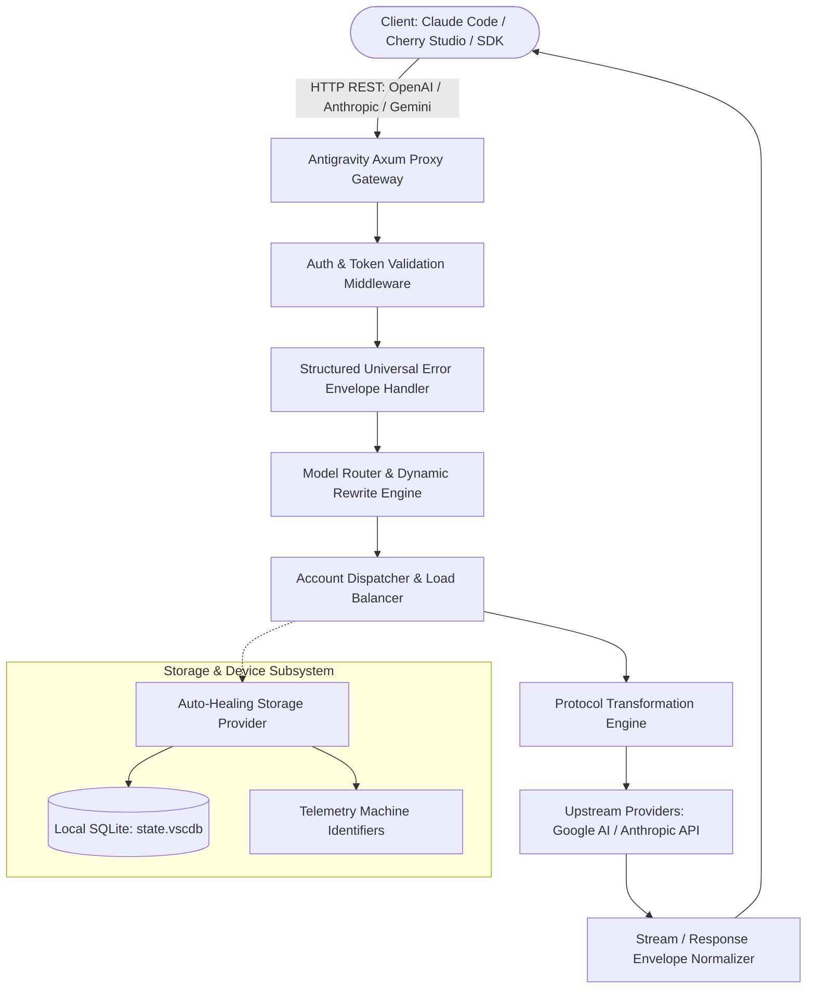

<p align="center">
  <a href="https://github.com/alimtvnetwork/Antigravity-Manager">
    <picture>
      <source media="(prefers-color-scheme: dark)" srcset="assets/icons-svg/logo-dark.svg" />
      <source media="(prefers-color-scheme: light)" srcset="assets/icons-svg/logo.svg" />
      
    </picture>
  </a>
</p>

<h1 align="center">Antigravity Tools</h1>

<p align="center">
  <strong>Enterprise-Grade AI Account Management &amp; High-Performance Protocol Proxy Gateway</strong>
</p>

<p align="center">
  <!-- STAMP:BADGES -->
  <a href="https://github.com/alimtvnetwork/Antigravity-Manager/releases">
    
  </a>

  
  
  
  
  
  <!-- STAMP:PLATFORM_BADGES -->
</p>

<p align="center">
  
  
  
  
  <a href="https://trendshift.io/repositories/18224" target="_blank" rel="noopener noreferrer">
    
  </a>
</p>

<p align="center">
  <strong>Lead Architect &amp; Maintainer: <a href="https://alimkarim.com/">Md. Alim Ul Karim</a></strong> (<a href="https://github.com/aukgit">@aukgit</a> / <a href="https://github.com/alim-ul-karim">@alim-ul-karim</a>)<br/>
  Chief Software Engineer, <a href="https://riseup-asia.com/"><strong>Riseup Asia LLC</strong></a> (Official Corporate Sponsor)<br/>
  <a href="https://github.com/aukgit">GitHub (@aukgit)</a> ·
  <a href="https://alimkarim.com/">Personal Website</a> ·
  <a href="https://www.linkedin.com/in/alimkarim">LinkedIn</a> ·
  <a href="https://stackoverflow.com/users/513511/md-alim-ul-karim">Stack Overflow</a> ·
  <a href="docs/author.md">Full Biography</a>
</p>

<p align="center">
  <em>Maintained and enhanced by <strong><a href="https://github.com/aukgit">Md. Alim Ul Karim</a></strong> &amp; <strong><a href="https://riseup-asia.com/">Riseup Asia LLC</a></strong> · Special thanks and heartfelt gratitude to <strong><a href="https://lbjlaq.github.io/Antigravity-Manager/">lbjlaq</a></strong> for creating this project in the first place</em>
</p>

---

<p align="center">
  <a href="#-screenshot--gui-overview">📸 GUI Overview</a> •
  <a href="#%EF%B8%8F-install-scripts">🛠️ Install Scripts</a> •
  <a href="#-root-runner-suite--developer-automation">🚀 Root Runners</a> •
  <a href="#-brand-identity-logos--icons">🎨 Logos &amp; Icons</a> •
  <a href="#-about-this-repo">📖 About</a> •
  <a href="#-for-ai-agents">🤖 For AI Agents</a> •
  <a href="#-key-features--capabilities">🌟 Key Features</a> •
  <a href="#-usage--integration-examples">🚀 Usage</a> •
  <a href="#%EF%B8%8F-technical-architecture">🏗️ Architecture</a> •
  <a href="#-contributing--original-authors">🤝 Contributors</a> •
  <a href="#-sponsors--special-thanks">💖 Sponsors</a>
</p>

---

## 📸 Screenshot & GUI Overview

<p align="center">
  <em>High-density quota tracking, real-time smart account switching, multi-format protocol reverse proxy, and system diagnostics.</em>
</p>

| Dashboard & Real-Time Monitoring | Account Inventory & Status Tracking |
| :---: | :---: |
| <br><sub><b>Smart Dashboard</b>: Real-time quota metrics (Gemini Pro, Flash, Claude, Imagen 3) with intelligent recommendation</sub> | <br><sub><b>Account Inventory</b>: High-density token view, active account badges, and automatic 403 anomaly isolation</sub> |
| **Reverse Proxy & Gateway Settings** | **System Configuration & Device Identity** |
| <br><sub><b>API Gateway Controls</b>: Port binding, auth token validation, max body limits (100MB+), and CORS routing</sub> | <br><sub><b>System Settings</b>: Device telemetry spoofing, baseline backup, and portable directory mapping</sub> |

<p align="center">
  
  <br>
  <sub><b>Antigravity Manager Tools</b>: Unified multi-account dashboard, real-time quota metrics, and multi-instance management</sub>
</p>

### Real-World Integration Gallery

| Claude Code CLI with Structured Web Search | Cherry Studio Native Integration |
| :---: | :---: |
| <br><sub>Structured web citations and reasoning chain output in Claude Code</sub> | <br><sub>Native search citations, token streaming, and citation cards in Cherry Studio</sub> |
| **Imagen 3 Ultra-HD Image Generation** | **Kilo Code Cross-Account Penetration** |
| <br><sub>Prompt-faithful multi-ratio rendering with 4K resolution upscaling</sub> | <br><sub>Sub-millisecond model routing and transparent account failover</sub> |

---

## 🛠️ Install Scripts

### Option A: One-Liner Installers (Recommended)

Our universal installation script detects your operating system, CPU architecture (`x86_64` or `aarch64`), and available package manager to install the latest stable binary.

#### Windows (PowerShell 5.1+)

**Bar 1: Latest Version (Auto-Updating)**
```powershell
irm https://raw.githubusercontent.com/alimtvnetwork/Antigravity-Manager/main/install.ps1 | iex
```

**Bar 2: Version-Based Installation (v4.264.0)**
```powershell
& ([scriptblock]::Create((irm https://github.com/alimtvnetwork/Antigravity-Manager/releases/download/v4.258.0/install.ps1))) -Version "v4.258.0"
```

---

#### Linux & macOS (Bash)

**Bar 1: Latest Version (Auto-Updating)**
```bash
curl -fsSL https://raw.githubusercontent.com/alimtvnetwork/Antigravity-Manager/main/install.sh | bash
```

**Bar 2: Version-Based Installation (v4.257.3)**
```bash
curl -fsSL https://github.com/alimtvnetwork/Antigravity-Manager/releases/download/v4.257.3/install.sh | bash -s -- --version "v4.257.3"
```

> [!TIP]
> **Advanced Script Options**:
> - Install specific release: `curl -fsSL https://raw.githubusercontent.com/alimtvnetwork/Antigravity-Manager/main/install.sh | bash -s -- --version 4.66.0`
> - Dry-run verification: `curl -fsSL https://raw.githubusercontent.com/alimtvnetwork/Antigravity-Manager/main/install.sh | bash -s -- --dry-run`

---

### 📌 Version Pinning & Known Good Releases

This version pinning matrix allows developers, enterprise deployments, and users to target any verified release, move smoothly across known stable checkpoints, or roll back if regressions occur.

<!-- STAMP:VERSION_PIN_TABLE_START -->
| Target Release | Release Date | Quality Gate | Windows PowerShell (One-Liner) | Linux / macOS (Bash) | Git Tag Checkout |
| :--- | :---: | :---: | :--- | :--- | :--- |
| **v4.257.3** (Latest) | 2026-10-24 | 🟢 Verified | `irm https://raw.githubusercontent.com/alimtvnetwork/Antigravity-Manager/v4.257.3/install.ps1 \| iex` | `curl -fsSL https://raw.githubusercontent.com/alimtvnetwork/Antigravity-Manager/v4.257.3/install.sh \| bash` | `git checkout v4.257.3` |
| **v4.257.1** | 2026-10-24 | 🟢 Verified | `irm https://raw.githubusercontent.com/alimtvnetwork/Antigravity-Manager/v4.257.1/install.ps1 \| iex` | `curl -fsSL https://raw.githubusercontent.com/alimtvnetwork/Antigravity-Manager/v4.257.1/install.sh \| bash` | `git checkout v4.257.1` |
| **v4.257.0** | 2026-10-24 | 🟢 Verified | `irm https://raw.githubusercontent.com/alimtvnetwork/Antigravity-Manager/v4.257.0/install.ps1 \| iex` | `curl -fsSL https://raw.githubusercontent.com/alimtvnetwork/Antigravity-Manager/v4.257.0/install.sh \| bash` | `git checkout v4.257.0` |
| **v4.256.4** | 2026-10-24 | 🟢 Verified | `irm https://raw.githubusercontent.com/alimtvnetwork/Antigravity-Manager/v4.256.4/install.ps1 \| iex` | `curl -fsSL https://raw.githubusercontent.com/alimtvnetwork/Antigravity-Manager/v4.256.4/install.sh \| bash` | `git checkout v4.256.4` |
| **v4.235.0** | 2026-10-19 | 🟢 Verified | `irm https://raw.githubusercontent.com/alimtvnetwork/Antigravity-Manager/v4.235.0/install.ps1 \| iex` | `curl -fsSL https://raw.githubusercontent.com/alimtvnetwork/Antigravity-Manager/v4.235.0/install.sh \| bash` | `git checkout v4.235.0` |
| **v4.234.0** | 2026-10-19 | 🟢 Verified | `irm https://raw.githubusercontent.com/alimtvnetwork/Antigravity-Manager/v4.234.0/install.ps1 \| iex` | `curl -fsSL https://raw.githubusercontent.com/alimtvnetwork/Antigravity-Manager/v4.234.0/install.sh \| bash` | `git checkout v4.234.0` |
| **v4.233.1** | 2026-10-19 | 🟢 Verified | `irm https://raw.githubusercontent.com/alimtvnetwork/Antigravity-Manager/v4.233.1/install.ps1 \| iex` | `curl -fsSL https://raw.githubusercontent.com/alimtvnetwork/Antigravity-Manager/v4.233.1/install.sh \| bash` | `git checkout v4.233.1` |
| **v4.233.0** | 2026-10-19 | 🟢 Verified | `irm https://raw.githubusercontent.com/alimtvnetwork/Antigravity-Manager/v4.233.0/install.ps1 \| iex` | `curl -fsSL https://raw.githubusercontent.com/alimtvnetwork/Antigravity-Manager/v4.233.0/install.sh \| bash` | `git checkout v4.233.0` |
| **v4.222.3** | 2026-10-17 | 🟢 Verified | `irm https://raw.githubusercontent.com/alimtvnetwork/Antigravity-Manager/v4.222.3/install.ps1 \| iex` | `curl -fsSL https://raw.githubusercontent.com/alimtvnetwork/Antigravity-Manager/v4.222.3/install.sh \| bash` | `git checkout v4.222.3` |
| **v4.156.0** | 2026-10-05 | 🟢 Verified | `irm https://raw.githubusercontent.com/alimtvnetwork/Antigravity-Manager/v4.156.0/install.ps1 \| iex` | `curl -fsSL https://raw.githubusercontent.com/alimtvnetwork/Antigravity-Manager/v4.156.0/install.sh \| bash` | `git checkout v4.156.0` |
| **v4.155.0** | 2026-10-05 | 🟢 Verified | `irm https://raw.githubusercontent.com/alimtvnetwork/Antigravity-Manager/v4.155.0/install.ps1 \| iex` | `curl -fsSL https://raw.githubusercontent.com/alimtvnetwork/Antigravity-Manager/v4.155.0/install.sh \| bash` | `git checkout v4.155.0` |
| **v4.154.0** | 2026-10-05 | 🟢 Verified | `irm https://raw.githubusercontent.com/alimtvnetwork/Antigravity-Manager/v4.154.0/install.ps1 \| iex` | `curl -fsSL https://raw.githubusercontent.com/alimtvnetwork/Antigravity-Manager/v4.154.0/install.sh \| bash` | `git checkout v4.154.0` |
| **v4.153.0** | 2026-10-05 | 🟢 Verified | `irm https://raw.githubusercontent.com/alimtvnetwork/Antigravity-Manager/v4.153.0/install.ps1 \| iex` | `curl -fsSL https://raw.githubusercontent.com/alimtvnetwork/Antigravity-Manager/v4.153.0/install.sh \| bash` | `git checkout v4.153.0` |
| **v4.151.0** | 2026-10-05 | 🟢 Verified | `irm https://raw.githubusercontent.com/alimtvnetwork/Antigravity-Manager/v4.151.0/install.ps1 \| iex` | `curl -fsSL https://raw.githubusercontent.com/alimtvnetwork/Antigravity-Manager/v4.151.0/install.sh \| bash` | `git checkout v4.151.0` |
| **v4.150.0** | 2026-10-05 | 🟢 Verified | `irm https://raw.githubusercontent.com/alimtvnetwork/Antigravity-Manager/v4.150.0/install.ps1 \| iex` | `curl -fsSL https://raw.githubusercontent.com/alimtvnetwork/Antigravity-Manager/v4.150.0/install.sh \| bash` | `git checkout v4.150.0` |
| **v4.142.0** | 2026-10-04 | 🟢 Verified | `irm https://raw.githubusercontent.com/alimtvnetwork/Antigravity-Manager/v4.142.0/install.ps1 \| iex` | `curl -fsSL https://raw.githubusercontent.com/alimtvnetwork/Antigravity-Manager/v4.142.0/install.sh \| bash` | `git checkout v4.142.0` |
| **v4.65.0** | 2026-09-23 | 🟢 Verified | `irm https://raw.githubusercontent.com/alimtvnetwork/Antigravity-Manager/v4.65.0/install.ps1 \| iex` | `curl -fsSL https://raw.githubusercontent.com/alimtvnetwork/Antigravity-Manager/v4.65.0/install.sh \| bash` | `git checkout v4.65.0` |
| **v4.64.0** | 2026-09-23 | 🟢 Verified | `irm https://raw.githubusercontent.com/alimtvnetwork/Antigravity-Manager/v4.64.0/install.ps1 \| iex` | `curl -fsSL https://raw.githubusercontent.com/alimtvnetwork/Antigravity-Manager/v4.64.0/install.sh \| bash` | `git checkout v4.64.0` |
| **v4.63.0** | 2026-09-23 | 🟢 Verified | `irm https://raw.githubusercontent.com/alimtvnetwork/Antigravity-Manager/v4.63.0/install.ps1 \| iex` | `curl -fsSL https://raw.githubusercontent.com/alimtvnetwork/Antigravity-Manager/v4.63.0/install.sh \| bash` | `git checkout v4.63.0` |
| **v4.57.0** | 2026-09-22 | 🟢 Verified | `irm https://raw.githubusercontent.com/alimtvnetwork/Antigravity-Manager/v4.57.0/install.ps1 \| iex` | `curl -fsSL https://raw.githubusercontent.com/alimtvnetwork/Antigravity-Manager/v4.57.0/install.sh \| bash` | `git checkout v4.57.0` |
| **v4.56.0** | 2026-09-22 | 🟢 Verified | `irm https://raw.githubusercontent.com/alimtvnetwork/Antigravity-Manager/v4.56.0/install.ps1 \| iex` | `curl -fsSL https://raw.githubusercontent.com/alimtvnetwork/Antigravity-Manager/v4.56.0/install.sh \| bash` | `git checkout v4.56.0` |
<!-- STAMP:VERSION_PIN_TABLE_END -->

#### How to Pin or Rollback Releases

1. **CLI Parameter Pinning:**
   - **Windows:**
     ```powershell
     .\install.ps1 -Version "4.65.0"
     ```
   - **Linux & macOS:**
     ```bash
     curl -fsSL https://raw.githubusercontent.com/alimtvnetwork/Antigravity-Manager/main/install.sh | bash -s -- --version 4.65.0
     ```

2. **Git Workspace Pinning:**
   - Switch your local cloned codebase directly to any historical checkpoint:
     ```bash
     git fetch --tags
     git checkout tags/v4.65.0
     ```

> [!NOTE]
> The installer automatically detects pinned release URLs and honors the requested release version, falling back through up to 10 historical candidate releases if target assets cannot be retrieved.

---

### Option B: Package Managers

#### macOS (Homebrew Cask)
```bash
brew tap alimtvnetwork/antigravity-manager https://github.com/alimtvnetwork/Antigravity-Manager
brew install --cask antigravity-tools
```

#### Arch Linux (Dedicated Installer)
```bash
curl -sSL https://raw.githubusercontent.com/alimtvnetwork/Antigravity-Manager/main/deploy/arch/install.sh | bash
```

---

### Option C: Docker & Headless Deployment (NAS & Servers)

Run Antigravity Tools as a headless background container for your local network, private home lab, or cloud server.

```bash
docker run -d --name antigravity-manager \
  -p 8045:8045 \
  -e API_KEY=sk-your-private-api-key \
  -e WEB_PASSWORD=your-secure-admin-password \
  -e ABV_MAX_BODY_SIZE=104857600 \
  -v ~/.antigravity_tools:/root/.antigravity_tools \
  --restart unless-stopped \
  alimtvnetwork/antigravity-manager:latest
```

#### Docker Compose Deployment
```bash
cd docker
docker compose up -d
```

- **Web Dashboard**: `http://localhost:8045`
- **API Endpoint**: `http://localhost:8045/v1`
- **Data Persistence**: Mount `/root/.antigravity_tools` to preserve accounts, preferences, and logs.

---

## 🚀 Root Runner Suite & Developer Automation

Antigravity Tools provides dedicated single-responsibility root runners for development, production compilation, end-to-end testing, and toolchain provisioning across Windows, Linux, and macOS:

| Script (Windows) | Script (POSIX / Bash) | Primary Responsibility | Auto Self-Healing? |
| :--- | :--- | :--- | :---: |
| **`run.ps1`** | **`run.sh`** | Hot-reload development server (`npm run tauri dev`), Vite frontend server, or CLI passthrough router (`agm ...`). | ✅ Yes |
| **`build.ps1`** | **`build.sh`** | Dedicated production compiler (`npm run tauri build` / `cargo build --release`). Never launches UI. | ✅ Yes (via `install.ps1 -BuildTools`) |
| **`e2e.ps1`** | **`e2e.sh`** | Dedicated end-to-end testing harness with caller IDE self-preservation and sandboxed test isolation. | N/A (Runs on prebuilt binary) |
| **`install.ps1`** | **`install.sh`** | Universal toolchain and application provisioner. Defaults LLVM and compilers to **C: drive**. | ✅ Native Provisioner |

#### Quick Runner Commands

```powershell
# 1. Launch development server with hot-reloading
.\run.ps1

# 2. Compile release package (auto-installs missing toolchains to C: drive)
.\build.ps1 -Release

# 3. Fast compile CLI binary only (agm.exe)
.\build.ps1 -CliOnly

# 4. Run end-to-end test suite with sandbox isolation
.\e2e.ps1 -Suite all

# 5. Full toolchain provisioning (MSVC, Rust, LLVM, NASM, Node.js)
.\install.ps1 -BuildTools -Drive "C:"
```

> [!NOTE]
> **Toolchain Defaults & Verification Caching**:
> - **C: Drive Invariant**: Native compilers (specifically LLVM/Clang) default to `C:\Program Files\LLVM` (or `%LOCALAPPDATA%\Programs\LLVM` without administrative privileges) unless `-Drive <Letter>` is explicitly provided, eliminating hardcoded `D:\` drive assumptions.
> - **SQLite Tracking (`.ai-memory/toolchain.db`)**: Toolchain paths, versions, and validation timestamps are cached in SQLite, reducing pre-flight verification from ~1.5s to <50ms on repeated builds.

---

<h2 align="center">📖 About this Repo</h2>

<p align="center">
  <strong>Antigravity Tools bridges client applications, developer IDEs, and frontier foundation models through an ultra-fast, local Rust gateway.</strong>
</p>

### Genesis & Upstream Attribution
This project is an active, production-hardened fork originating from the groundbreaking work done by **[lbjlaq](https://github.com/lbjlaq)** and contributors on **[lbjlaq/Antigravity-Manager](https://github.com/lbjlaq/Antigravity-Manager)**.

We extend our deepest gratitude, respect, and praise to **lbjlaq** and the upstream development community for creating the foundational architecture of Antigravity Manager. Their ingenuity demonstrated how local session tokens could be multiplexed into high-availability AI gateways. Full credit, respect, and sincere thanks are given to **[lbjlaq/Antigravity-Manager](https://github.com/lbjlaq/Antigravity-Manager)** and all original upstream contributors.

### Maintenance & Continuous Enhancement
This project is **maintained and enhanced by [Md. Alim Ul Karim](https://github.com/alim-ul-karim)** and the **[Riseup Asia LLC](https://riseup-asia.com/)** engineering team · **Originally created by lbjlaq and upstream contributors**.

This edition introduces critical enterprise hardening, automated self-healing, and developer tooling:
1. **Auto-Switch Quota Polling (< 15% Credit Threshold)**: Intelligent background supervisor actively monitoring residual model credits and auto-switching to the highest-quota profile when remaining quota drops below 15%.
2. **Split Repo DB & Running Prompts Direct Dispatch**: Dedicated SQLite state database (`repo_prompts.db`) capturing running project prompts before profile rotation, and immediately dispatching them directly upon profile switch without queuing.
3. **Ubuntu & Linux Deterministic Process Switching**: Synchronous process termination with graceful SIGTERM polling and automatic SIGKILL (`kill -9`) fallback, eliminating SQLite lock contention and state overwrite on Ubuntu/Debian.
4. **Account Rotation HTTP API Endpoint**: Programmatic `/api/accounts/rotate` and `/api/auto-switcher/rotate` endpoints enabling external CLI tools, IDE extensions, or background scripts to trigger account rotation on demand.
5. **Ubuntu & Linux Auto-Healing**: Fully resolves missing `storage.json` issues on clean OS installations, containers, and portable setups by auto-generating complete telemetry profiles (`telemetry.machineId`, `macMachineId`, `devDeviceId`, `sqmId`) and ensuring SQLite schema initialization.
6. **Deep Linux Executable Discovery**: Scans standard paths, dynamic `PATH` resolution, Snap paths (`/snap/bin`), Flatpak packages, AppImages, and system `.desktop` files.
7. **Multi-Instance Isolation Architecture**: Allows concurrent, conflict-free operations across multiple isolated profiles and developer instances.
8. **Structured Error Management Architecture**: End-to-end universal error models in Rust (`error.rs`) and TypeScript (`error-store.ts`, `error-modal.tsx`), complete with an interactive AI-sharable Compact Markdown error exporter.
9. **Rigorous CI/CD Pipelines**: Zero-touch multi-platform automated builds, typecheck enforcement, and release orchestration.

---

## 🤖 For AI Agents

AI coding agents and autonomous workflows operating within this repository can find canonical resources below:

| Resource Type | Relative Path | Purpose |
| :--- | :--- | :--- |
| **Agent Guidelines** | `AGENTS.md` | Core constraints, boolean rules, CI/CD protections |
| **Coding Standards** | `02-spec/02-coding-guidelines/` | Language-specific architectural specifications |
| **Error Management Spec** | `02-spec/03-error-manage/` | Error codes, envelopes, and modal standards |
| **README Conventions** | `02-spec/01-spec-authoring-guide/13-root-readme-conventions.md` | Non-negotiable README structure and styling |
| **Active Plans** | `.ai-memory/plans/` | Plan index, active subtasks, and completion logs |
| **Canonical Read List** | `.ai-memory/what-to-read.md` | Ordered list of files an AI must read before any task (kept in sync with this table) |
| **Memory Index** | `.ai-memory/memory/readme.md` | Learned memory, session directives, and the pointer to the full `01-index.md` |
| **Strict Avoid List** | `.ai-memory/strictly-avoid.md` | Banned patterns and past mistakes (append only) |

---

## 📦 Bundle Installers

Pre-built binaries for every major platform are published with every release:

| Platform | Target Architecture | Package Format | Direct Release Link |
| :--- | :--- | :--- | :--- |
| **macOS** | Apple Silicon (`aarch64`) / Intel (`x64`) | `.dmg` | [Download macOS Release](https://github.com/alimtvnetwork/Antigravity-Manager/releases) |
| **Windows** | Windows 10/11 (`x64`) | `.msi` / Portable `.zip` | [Download Windows Release](https://github.com/alimtvnetwork/Antigravity-Manager/releases) |
| **Ubuntu / Debian** | Linux (`x64`, `arm64`) | `.deb` | [Download Debian Release](https://github.com/alimtvnetwork/Antigravity-Manager/releases) |
| **Fedora / RHEL** | Linux (`x64`) | `.rpm` | [Download RPM Release](https://github.com/alimtvnetwork/Antigravity-Manager/releases) |
| **Universal Linux** | Linux (`x64`) | `.AppImage` | [Download AppImage](https://github.com/alimtvnetwork/Antigravity-Manager/releases) |

---

## 🌟 Key Features & Capabilities

### 1. 🎛️ Intelligent Quota Monitoring & Rotation
- **Real-Time Fleet Health**: Continuously measures residual rate limits and quota percentages across all configured accounts for Gemini Pro, Gemini Flash, Claude 3.5/3.7 Sonnet, and Imagen 3.
- **Smart Recommendation Engine**: Dynamically identifies the optimal account with the highest available quota threshold and lowest latency.
- **Sub-Millisecond Account Switching**: Switch accounts instantly with a single click or let the gateway rotate accounts transparently upon upstream `429 (Too Many Requests)` rate-limiting.

### 2. 🔌 Universal Protocol Translation (Multi-Sink Gateway)
- **OpenAI Compatible Endpoint**: Exposes `/v1/chat/completions` and `/v1/models`, allowing plug-and-play integration with 99% of modern AI clients (NextChat, LibreChat, Cherry Studio, Cursor, OpenCode).
- **Anthropic Messages Endpoint**: Exposes native `/v1/messages` compatible with the official **Claude Code CLI**, including reasoning traces, system prompts, and tool calling.
- **Google Gemini Endpoint**: Direct passthrough and protocol mapping for Google AI Studio and Vertex API client libraries.

### 3. 🔀 Smart Model Routing & Tiered Priority
- **Semantic Model Families**: Map incoming generic model requests (e.g. `gpt-4o`) to high-speed foundation models (e.g. `gemini-2.5-pro` or `claude-3-7-sonnet`).
- **Tiered Quota Preservation**: Automatically routes low-priority background requests (such as title generators or code indexing) to lightweight Flash models, conserving high-tier quotas.

### 4. 🎨 Imagen 3 Multimodal Studio
- **Flexible Aspect Ratios**: Map standard OpenAI `size` parameters (`1024x1024`, `1920x1080`, `1280x720`) to native Imagen 3 aspect ratios (`1:1`, `16:9`, `9:16`, `4:3`, `3:4`, `21:9`).
- **Ultra-HD Resolution Modes**: Full support for `1K`, `2K`, and `4K` rendering with high prompt fidelity.
- **Heavy Payload Processing**: Configurable payload body limits up to **100MB** for handling high-resolution image analysis and multimodal inputs.

### 5. 🛡️ Enterprise Hardware & Telemetry Emulation
- **Cross-Platform Auto-Healing**: Automatically provisions machine identifiers, device IDs, and SQLite tables so clean Linux setups never crash with missing configuration errors.
- **Fingerprint Spoofing**: Generates unique Cursor/VSCode telemetry fingerprints (`telemetry.machineId`, `telemetry.macMachineId`, `telemetry.devDeviceId`, `telemetry.sqmId`) with one-click baseline restoration.

---

## 🚀 Usage & Integration Examples

### 1. Claude Code CLI
```bash
# Point Claude Code CLI to your local Antigravity Gateway
export ANTHROPIC_API_KEY="sk-antigravity"
export ANTHROPIC_BASE_URL="http://127.0.0.1:8045"

# Launch Claude Code
claude
```

### 2. OpenCode Synchronization
1. Open **API Reverse Proxy** &rarr; **External Providers** &rarr; **OpenCode Sync**.
2. Click **Sync** to automatically generate `~/.config/opencode/opencode.json` with dedicated `antigravity-manager` provider bindings.
3. Test provider execution:
```bash
opencode run "Explain quantum entanglement briefly" --model antigravity-manager/claude-sonnet-4-5-thinking --variant high
```

### 3. Python OpenAI SDK
```python
import openai

client = openai.OpenAI(
    api_key="sk-antigravity",
    base_url="http://127.0.0.1:8045/v1"
)

response = client.chat.completions.create(
    model="gemini-2.5-flash",
    messages=[
        {"role": "system", "content": "You are a concise engineering assistant."},
        {"role": "user", "content": "What are the advantages of Axum in Rust?"}
    ]
)

print(response.choices[0].message.content)
```

### 4. Imagen 3 Python Example
```python
import base64
import openai

client = openai.OpenAI(
    api_key="sk-antigravity",
    base_url="http://127.0.0.1:8045/v1"
)

response = client.images.generate(
    model="gemini-3-pro-image",
    prompt="Futuristic high-tech research laboratory, cinematic lighting, photorealistic, 8k",
    size="1920x1080",
    quality="hd",
    response_format="b64_json"
)

image_bytes = base64.b64decode(response.data[0].b64_json)
with open("laboratory.png", "wb") as file:
    file.write(image_bytes)

print("Rendered image saved as laboratory.png")
```

### 5. Telegram Bot & Terminal CLI Integration (`agm telegram`)

Connect your own Telegram Bot (created via `@BotFather`) to receive real-time quota alerts, system update notifications, and execute remote node diagnostics from your phone or terminal. Credentials are stored strictly locally in `~/.antigravity_tools/telegram_config.json`.

#### Option A: Connect via Desktop UI (with Auto-Detected Chat ID)
1. Open **Settings → Email & Alerts** (scroll to **Telegram Bot & Alert Notifications**) or **Settings → Supabase Sync**.
2. Paste your **Telegram Bot Token** (`<BOT_ID>:<BOT_SECRET>`).
3. Open your bot in Telegram and send `/ping` (or `/start`).
4. Click **Auto-Detect Chat ID** — AGM automatically discovers and fills your numeric `Allowed Chat ID` from `getUpdates`.
5. Click **Save Telegram Settings** and **Send Test Alert**.

#### Option B: One-Command Terminal CLI Setup
```bash
# Auto-detects your Chat ID from recent /ping messages, saves config, registers slash commands & sends a test ping:
agm telegram connect "<YOUR_BOT_TOKEN>"

# Or specify your numeric Chat ID explicitly:
agm telegram connect "<YOUR_BOT_TOKEN>" <YOUR_CHAT_ID>
```

#### Supported Terminal CLI & Bot Slash Commands
```bash
agm telegram ping                  # Send live node IP, version & Git telemetry to Telegram
agm telegram observe               # Send active account, model quota & running vs idle workspace report
agm telegram gitmap pe             # Run gitmap pe and forward CI/CD pipeline status to Telegram
agm telegram api                   # Send API proxy & account pool status to Telegram
agm telegram backup                # Trigger split-SQLite prompt backup ("backpack") & notify Telegram
agm telegram email status          # Send email vault status (or 'ping' / 'help' to dispatch SMTP emails)
agm telegram send "Hello from AGM" # Send custom alert message to your bound Telegram chat
```
Inside your Telegram chat with the bot, send `/ping`, `/observe`, `/status`, `/gitmap pe`, `/agm status`, `/api`, `/backup` (`/backpack`), `/restore`, `/email [status|ping|help]`, `/ff`, `/snapshot`, or `/help`. See the full [Telegram Bot Setup Guide](02-spec/21-app/telegram-bot-setup-guide.md).

---

## 🏗️ Technical Architecture



---

## 📚 Documentation & Troubleshooting

<details>
<summary><b>🛠️ macOS Gatekeeper: "Application is damaged and cannot be opened" (Click to expand)</b></summary>

Because macOS Gatekeeper quarantines downloaded binaries outside the Mac App Store, execute the following command in Terminal:
```bash
sudo xattr -rd com.apple.quarantine "/Applications/Antigravity Tools.app"
```
*(Installing via Homebrew automatically removes quarantine attributes).*
</details>

<details>
<summary><b>🛠️ Linux: Black Window or Transparent Display on Wayland (Click to expand)</b></summary>

When running under Wayland compositors (Hyprland, Sway, Niri), pass the following environment flags:
```bash
env WEBKIT_DISABLE_DMABUF_RENDERER=1 ANTIGRAVITY_FORCE_WAYLAND=1 antigravity-tools
```
- `ANTIGRAVITY_FORCE_WAYLAND=1`: Forces native Wayland rendering without fallback to XWayland.
- `WEBKIT_DISABLE_DMABUF_RENDERER=1`: Disables hardware DMA-BUF surface buffer rendering.
</details>

---

## 🔄 What's New

- **v4.253.3** (2026-10-23):
  - **Release Pipeline & CI Dynamic Polling Gate**: Fixed GitHub Actions release workflow (`.github/workflows/release.yml`) by implementing an asynchronous status polling loop (up to 45 minutes) that waits for in-progress CI runs instead of failing prematurely on concurrent tag pushes; added post-release asset count verification gate. (Thanks to @aukgit)
  - **Atomic Version Manifest Synchronization**: Synchronized all 14 project manifest files (`package.json`, `package-lock.json`, `version.json`, `src-tauri/Cargo.toml`, `src-tauri/tauri.conf.json`, `src-tauri/Cargo.lock`, `Casks/antigravity-tools.rb`, `releases-manifest.json`, `hooks.nsh`, etc.) to eliminate version drift. (Thanks to @aukgit)
  - **Prompt Restore & CLI Rerun Hardening**: Implemented prompt restore sweep engine, restored `in_progress` status handling on quota completion, and integrated diverse rerun anti-repeat buffer with top-level CLI command routing. (Thanks to @aukgit)

- **v4.253.2** (2026-10-23):
  - **Streaming Thought Signature & Delimiter Validator**: Implemented `streaming_thought_signature_validator` ensuring balanced `<thought>` / `</thought>` tags, `thought: true` attributes, and delta buffer delimiters across streaming SSE frames without leaking internal markers; added `repair_truncated_thought_block` auto-closing truncated blocks. (Thanks to @aukgit)
  - **Segmented Capsule Toggle Switch Styler & Linter**: Implemented `segmented_capsule_toggle_switch_styler` and markup linter enforcing `rounded-full`, shared dark-glass container borders, subtle divider lines, and transparent borderless inline select dropdowns (`bg-transparent border-0 focus:ring-0 focus:outline-none`). (Thanks to @aukgit)
  - **FIFO Prompt Queue Partition & Priority Allocator**: Implemented `fifo_prompt_queue_partition_allocator` allocating prompt partition buckets across SQLite databases with strict First-In-First-Out ordering using `ORDER BY created_at ASC, id ASC`, monotonic timestamp/id verification, and zero LIFO leaks. (Thanks to @aukgit)
  - **Transient Sandbox Lifecycle & Cleanup Sentinel**: Implemented `transient_sandbox_cleanup_sentinel` tracking test sandbox instances, protecting developer caller IDE sessions with exit code 2 fail-fast protection, and verifying zero-orphan remnant directory purging. (Thanks to @aukgit)
  - **Sole Contributor Attribution & No Silent Errors Audit Guard**: Implemented `sole_contributor_attribution_audit_guard` enforcing strict sole attribution to `@aukgit` (`(Thanks to @aukgit)`), rejecting unauthorized third-party handles, enforcing strictly relative paths, and auditing source code for the No Silent Errors house rule. (Thanks to @aukgit)
  - **Windows Kernel32 FFI & Fast-Forward Rotation Remediation**: Repaired process vitality probes and child process termination to link directly against Windows `kernel32` (`OpenProcess`, `GetExitCodeProcess`, `TerminateProcess`, `CloseHandle`) without unlinked external dependencies; harmonized `smartRotateProfileAccount` with backend `fastForwardInstance` delegation; and expanded rerun nudge detection templates. (Thanks to @aukgit)

- **v4.252.0** (2026-10-23):
  - **Pipeline Protocol Decoupling & SSE Response Sanitization**: Implemented `pipeline_response_header_sanitizer` normalizing Gemini SSE response headers (`text/event-stream; charset=utf-8`, `cache-control: no-cache`, `connection: keep-alive`) while stripping upstream server telemetry (`server`, `alt-svc`, `set-cookie`, `x-goog-safety-ratings`, `x-goog-ratelimit-remaining`, `via`, `x-powered-by`); integrated `protocol_adapter_divergence_auditor` strictly decoupling inbound protocol adapters from uniform pipeline stages. (Thanks to @aukgit)
  - **FIFO Database & Dead-Letter Queue Invariants**: Implemented `fifo_dead_letter_queue_spillover_guard` safely quarantining unrecoverable prompts into dead-letter storage while strictly enforcing `ORDER BY created_at ASC, id ASC` and preserving original `created_at` lineage; added `fifo_queue_drain_monotonicity_verifier` and `fifo_restore_transaction_coordinator` enforcing multi-table atomic transactions. (Thanks to @aukgit)
  - **Caller IDE Self-Preservation & Process Ancestry**: Implemented `caller_process_ancestry_tree_scanner` traversing process PPID lineage upward up to 16 levels to detect caller IDE instances and prevent terminating the active developer workspace session; established `caller_ide_exit_code_enforcer` enforcing fail-fast exit code 2 on lifecycle commands (`stop`, `rm`, `switch`) targeting the caller instance without `--force`. (Thanks to @aukgit)
  - **Desktop Window Control Capsules & UI Styling**: Implemented `window_control_capsule_formatter` wrapping Minimize, Maximize/Restore, and Close actions into contiguous segmented pill capsules (`rounded-full`, shared border, dark-glass backdrop, subtle dividers) with hover-danger styling; added `capsule_segmented_control_validator` enforcing transparent borderless styling for nested dropdowns; and added `truncation_omission_banner_formatter` parsing raw truncation callouts into interactive dark-glass omission banners. (Thanks to @aukgit)
  - **Release Governance & Attribution Enforcement**: Implemented `github_release_notes_parity_guard` verifying GitHub release notes strictly attribute `@aukgit`, reject third-party handles, enforce strictly relative Git paths, and match `CHANGELOG.md` headings; enforced no-silent-errors rule across Rust and TypeScript. (Thanks to @aukgit)

- **v4.236.0** (2026-10-19):
  - **Collapsible Session Overview Card with Memory**: Converted the session overview dashboard in `src/components/instances/PromptTreeView/PromptInstructionView.tsx` to be collapsed by default into a sleek single-line summary bar (~36px); added subtle low-profile purple expander trigger (`ChevronDown`/`ChevronUp`); persisted collapse/expand state in `localStorage` (`agm_prompt_overview_expanded`) across sessions; removed redundant title, sequence badge (`C211`), and conversation ID repetitions from inside the overview card. (Thanks to @aukgit)
  - **Centralized 24-Hour Date/Time Formatting & Duration Seconds Suppression**: Implemented centralized date formatting in `src/utils/date.ts` supporting `DD-MMM-YYYY HH:mm` in 24-hour clock using the local system timezone, with relative time indicators and duration seconds suppression when hours or minutes exist; added user-configurable `date_format_mode` toggle with strictly typed `DateFormatModeType` enum (`TwentyFourHour = '24h'`, `TwelveHour = '12h'`, `Iso = 'iso'`) in `src/types/config.ts` and Settings. (Thanks to @aukgit)
  - **Metadata Clarification & DetailsModal Restructuring**: Clarified sequential conversation index (`C211` = Conversation #211) and interaction turns (`turns` = user/assistant request-response cycles) with dedicated labels and explanations in `src/components/instances/PromptTreeView/DetailsModal.tsx`; formatted `Last Modified` into localized 24-hour clock (`DD-MMM-YYYY HH:mm`) accompanied by relative recency delta ("ran 5 minutes ago", "ran 1 day ago"). (Thanks to @aukgit)
  - **SSH Multi-Instance & Account-Centric Discovery with 1-Click Remote Dispatch**: Upgraded `get_cluster_instances_and_balances` in `src-tauri/src/modules/ssh_manager/exec.rs` to query real multi-instances and bound Google account emails via SSH; elevated Account Email and Instance Name to primary prominent columns in `FleetMachinesTable.tsx` and `SshGitmapSection.tsx` while demoting raw IP into an interactive hover badge; added dynamic instance `<select>` dropdown with transparent borderless styling and 1-click remote prompt dispatching. (Thanks to @aukgit)
  - **Cold-Start IDE 5-Second Stabilization Ladder & Send Reliability**: Upgraded `src-tauri/src/modules/instance/smart_run.rs` and `src-tauri/src/modules/repo_db/agy.rs` with an adaptive 5-second process stabilization ladder and CDP retry mechanism for cold-started IDE instances, eliminating lost prompts when dispatching to closed IDEs. (Thanks to @aukgit)
  - **Prompt Tree Image Rendering & Queued/Running Visibility**: Added Tauri v2 `core:asset:default` capability permission in `src-tauri/capabilities/default.json` and resolved relative image paths against project `repo_path` before passing to `convertFileSrc` in `clipboard.ts` and `PromptMarkdownPreview.tsx`; protected queued prompts from stale conversation demotion in `conversationGuards.ts`; synthesized running/queued projects from `active_prompts` in `src-tauri/src/modules/repo_db/tree_phases.rs`, ensuring the left panel is never empty when prompts are in flight. (Thanks to @aukgit)
  - **Expand Full / Fold Tab Switch Persistence**: Fixed UI bug in `src/components/instances/PromptTreeView/DetailTabs.tsx` where switching from the Input to Output tab caused the `Expand Full` toggle to unmount; decoupled `hasExpandToggle` so output text can be expanded to full height seamlessly. (Thanks to @aukgit)
- **v4.228.1** (2026-10-18):
  - **Conscious Process Termination & Account Switch Synchronization**: Fixed stop instance button and account switching synchronization by implementing Win32 process tree escalation (`taskkill /F /T /PID` and `TerminateProcess`), 8.3 path normalization (`GetShortPathNameW`), and a 200ms kernel settle delay to guarantee process death and lockfile release before credential rewrites in `state.vscdb`. (Thanks to @aukgit)
  - **Active Caller IDE Self-Preservation**: Hardened `detect_caller_instance_id` to trace cloned executables (`Antigravity-<id>.exe`), `ANTIGRAVITY_APP_DATA_DIR`, and `VSCODE_PID`, enforcing caller immunity guards across `rm`, `switch`, `ff`, and `stop` to prevent CLI operations from terminating active IDE developer windows. (Thanks to @aukgit)
  - **Instance List View Path Alignment & PID Clarification**: Explicitly formatted running instance status as `● Running (PID: <pid>)` with pulsing emerald indicator; aligned executable tail and data directory tail together inline on the same horizontal row with monospace pill styling and dual copy actions. (Thanks to @aukgit)
  - **Switch Account Dialog UI/UX Modernization**: Completely overhauled switch account modal with AGM dark-glass styling (`rounded-2xl`, Royal Violet surfaces, sky/amber badges, `.ui-interactive-row` selection, Escape key dismissal, and segmented capsule controls). (Thanks to @aukgit)
  - **Instance Audit Trail Visibility & Lifecycle Actions**: Extended `AuditAction` enum with instance lifecycle actions (`LaunchInstance`, `StopInstance`, `KillInstance`, `CreateInstance`, `CloneInstance`, `DeleteInstance`, `InstanceError`), instrumented backend lifecycle logging into `task_history_db`, and added automatic fallback to operations tab to eliminate empty audit states. (Thanks to @aukgit)
  - **CLI Test Sandboxing & Timeout Hardening**: Added `agm instances current`, `agm instances create-test`, and `agm instances rm-test` for sub-50ms transient data-only testing, and hardened test suite (`scripts/test-instance-autoswitch-e2e.ps1`) with 30-second bounded timeouts. (Thanks to @aukgit)
- **v4.220.0** (2026-10-17):
  - **Accounts Table Delete Remediation & Modal Mounting**: Resolved non-responsive single-item and bulk-selection Delete buttons by mounting dedicated destructive `ModalDialog` components in `AccountsDialogs.tsx`, driving `executeDelete()` and `executeBatchDelete()` with error-store telemetry tracking. (Thanks to @aukgit)
  - **Position-Locked Table Row Hover Inversion**: Implemented row color inversion to pure white background and pure black text without layout shift or jitter, preserving static font-weight and border metrics, with full opacity alignment across quota cells and sticky actions column. (Thanks to @aukgit)
  - **Action Buttons Color Scheme Overhaul**: Styled Switch button (`⇄`) with prominent yellow highlighter theme (`bg-yellow-400 text-slate-900 border-yellow-500`) and styled Remove button (`🗑️`) with solid red background and crisp white icon (`bg-red-600 text-white border-red-700`). (Thanks to @aukgit)
  - **Account Disable / Enable Lifecycle & Auto-Switch Exclusion**: Added disable options via selection toolbar (`<Ban>`) and row context menu; persisted `disabled: bool` in account state; guaranteed 100% exclusion from automated daemon rotations and candidate scoring while preserving permissive manual user switching. (Thanks to @aukgit)
- **v4.176.0** (2026-10-10):
  - **Smart Instance Process Cache Warm-Up & Closed-PID Recovery**: Initialized `warm_up_smart_process_cache` on startup to pre-warm the process cache across instances; implemented closed-PID vitality promotion and fresh OS re-scans before declaring instances offline, enforcing a strict zero-relaunch guarantee and eliminating repeated IDE reopening. (Thanks to @aukgit)
  - **Adaptive FIFO Prompt Queue Background Ticker**: Enhanced `start_prompt_queue_scheduler` to dynamically tick every 5s when queued prompts exist and back off to 30s when empty, enforcing strict First-In-First-Out ordering (`ORDER BY created_at ASC, id ASC`) and standardizing `.antigravity_resume_task.json` through `resume_task_document(...)`. (Thanks to @aukgit)
  - **Prompt Tree View UI Tag Compaction & Bracket Stripping**: Removed redundant `{totalProjectPrompts} prompts` tags and `{conv.step_count} stp` pills from default view, converted project action buttons to hover-only, and stripped outer bracket clutter (`#P001`, `C001`). (Thanks to @aukgit)
  - **Ghost Running State Eradication**: Synchronized project-level `runningCount` to filter out ghost and empty 0-word conversations, eliminated loose prefix leaks, and hardened instance card `hasActiveTask` to prevent false glowing prompt indicators on idle instances. (Thanks to @aukgit)
- **v4.128.1** (2026-10-03):
  - **Rust Compilation Fixes & Type Alignment**: Resolved mismatched types in `instance.rs` and `account.rs` by properly mapping `get_antigravity_executable_path` `PathBuf` to `String`, fixed `AuditTask` drop move errors in `task_history_db.rs`, and enhanced CLI E2E test parsing.
  - **Supabase Workspace Lease & Lock Table**: Added real-time Workspace Lease and Cluster Lock table to the Supabase tab with live node status, profile name, countdown timer, and click-to-unmask email toggle.
  - **Accounts Segmented Pill Capsule Toolbar**: Modernized Accounts top toolbar into uniform segmented pill capsules (`rounded-full`, dark glass backdrop) grouping Focus, +, Refresh, Warm, and Show All Quotas.
- **v4.128.0** (2026-10-03):
  - **Audit Pagination & Two-Tier SQLite Cache**: Added 100/200 pagination dropdown backed by `hot_tasks_cache` for sub-millisecond retrieval and enriched transition facts (`From → To`, instance ID, IDE path, reason).
  - **First-Class Supabase Tab**: Top-level tab between Email and Audit with dual-endpoint cluster governance, node health, and cross-DB migration tools.
  - **Instances Card & List Views**: Introduced `InstanceTable` list view, multi-field search, and `PromptTreeViewModal` with prompt backup/restore and asset inspector.
- **v4.127.2** (2026-10-03):
  - **CLI Formatting & Output Polish**: Enhanced `agm instance settings` and related CLI command helpers with clean tabular output and robust non-zero error reporting.
  - **Architectural Invariants**: Codified UI segmented pill encapsulation and headless duplication parity into project engineering guidelines.
- **v4.127.0** (2026-10-03):
  - **Navbar Header Button Consolidation**: Unified Quick Clean + Preferences and Window Controls (Minimize, Maximize, Close) into sleek segmented pill control capsules with dark-glass styling.
  - **Deep Settings Synchronization & Parity**: CLI `agm instance copy-settings` and UI modal to synchronize theme colors, turbo mode, browser policy, and file permissions across instances with executable path auto-discovery (`--exe`).
  - **Open Projects & Folder Copy Parity**: Added full support for copying open workspace projects (`workspaceStorage`, `state.vscdb`) during duplication in CLI (`agm instance duplicate --copy-projects`, `agm instance copy-projects`) and UI clone modal.
  - **Baseline Defaults Enforcement & Fast Toggles**: Added commands to enforce baseline settings (turbo mode ON, plan review always proceed) across single or all instances (`agm instance settings enforce-defaults`, `set-turbo`, `set-plan-review`).
  - **JSON Import/Export & Clipboard Settings**: Added settings JSON export/import and UI clipboard Copy/Paste with undo/redo snapshot history and instance count reporting.
- **v4.110.1** (2026-10-01):
  - **Taskbar Pin Preservation**: Resolved taskbar pin loss during `install.ps1` reinstallation/updates by backing up pins, banning taskbar shortcut deletions, fixing unquoted registry path comparison, and auto-updating pin targets.
  - **8 Sandboxing Laws Compliance**: Full multi-instance blind testing flow with strict PID and folder isolation, Supabase sync hardening, and dev tool cache cleaner.
  - **CI Formatting Gates**: A tracked pre-commit hook (installed by `npm install`) blocks unformatted Rust, and the release workflow refuses tags whose Rust code fails `cargo fmt --check`.
  - **Installer Asset Validation**: `install.ps1` and `install.sh` verify platform assets exist before downloading and skip incomplete releases.
  - **Multi-Instance E2E**: Comprehensive test suite covering switch, fast-forward, per-instance prompt backup, and heartbeat end to end.
- **v4.109.4** (2026-09-30):
  - **Prompt-Safe Instance Switching**: Switching or fast-forwarding an instance backs up and restores its running prompt, and each isolated instance keeps its own bound account.
  - **`agm clear` Retention**: Keep the newest N prompts and clean Rust/Cargo build caches.
  - **Update Settings Compatibility**: Older `update_settings.json` files without `auto_check` no longer fail to load (E9001 when closing the update dialog).
  - **UI & Error Reports**: Stack traces with URL-only frames parse correctly; the Accounts focus action and the cleanup dialog's Escape key work again.
  - **Test Runner**: `npm run test` runs the frontend tests; stale tests fixed.
- **v4.94.0** (2026-09-28):
  - **5-Step Non-Destructive Account Switching**: Seamless prompt snapshot, IDE graceful restart, and automatic prompt restoration across instances.
  - **Dual Supabase Endpoints Integration**: Full root (Lovable) and secondary Supabase integration with real-time multi-node synchronization.
  - **Upstream v4.8.4 Merged**: Synchronized upstream protocol updates, Tool Call ID canonicalization, and in-place Protobuf signature self-healing.
  - **Distinct Tri-Field Account Telemetry**: Clear terminal indicators with mutual exclusivity across previous, selected, and predicted accounts.
- **v4.29.0** (2026-09-18):
  - **Test Suite Resilience & SQLite Persistence**: Dual-tier tool signature persistence (`clear_tool_signatures`) in `proxy_db` and nanosecond-precision test isolation.
  - **Canonical Model Resolution**: Preserved canonical `gemini-3.7-flash` model identifier across dynamic variant mappings.
  - **Payload Audit Sizing**: Harmonized payload audit threshold with disk budget quotas to prevent unexpected truncation.
  - **Strict Lint & Rustfmt Compliance**: Multi-line tuple return formatting and universal response envelope standards.
- **v4.16.0** (2026-09-17):
  - **Unified Pipeline Architecture**: Upstream synchronization introducing canonical Inbound/Outbound pipeline for OpenAI, Claude, Responses, and Gemini Native protocols.
  - **Thinking Store & Cryptographic Signatures**: Integrated server-authoritative Thinking Store with Gzip compression and cryptographic signature healing.
  - **SQLite Performance & Bounded Logs**: Read-only connection caching for sub-second tool queries and configurable disk quota bounds.
  - **Ecosystem Risk Mitigation**: Filtered Claude desktop billing tracking metadata to prevent upstream 429 RESOURCE_EXHAUSTED errors.
- **v4.15.0** (2026-09-17):
  - Unified branding overhaul: App and window title updated to "AGM by Alim", product name "Anti-Gravity Tools by Alim".
  - High-density Accounts quota UI overhaul: consolidated model quota displays into unified Gemini and Claude shared buckets.
  - Multi-instance management and execution fixes; added comprehensive automatic rotation guidance in Settings.
  - Complete removal of Chinese comments in backend Cargo manifests and release orchestration scripts; refreshed attribution giving full credit to upstream `lbjlaq/Antigravity-Manager`.
- **v4.14.0** (2026-09-17):
  - Comprehensive Linux/Ubuntu IDE executable discovery (`which`, Snap `/snap/bin`, Flatpak, `/usr/local/bin`, and `.desktop` parsing).
  - Storage JSON auto-healing and initial telemetry synthesis on Linux/Ubuntu.
  - End-to-end Structured Universal Error Management in Rust and TypeScript with AI-sharable Compact Markdown error reports.
  - Root README English-only overhaul with comprehensive upstream attribution.
- **v4.12.0** (2026-09-16):
  - Enhanced error handling, CI/CD pipeline bugfixes, and multi-instance profile launch arguments.
- **v4.11.0** (2026-09-15):
  - Advanced model routing, rate limit backoff optimization, and database connection pooling.

👉 **[View Complete Changelog (CHANGELOG.md)](CHANGELOG.md)**

---

## 🎨 Brand Identity, Logos & Icons

Antigravity Tools features an abstract AG monogram with a broken orbit and levitating core, symbolizing controlled lift, high performance, and liberation from manual cloud console gravity. All branding assets follow strict transparent alpha-channel standards.

### Vector Logos

| Primary Logo (Light/Neutral) | Dark Surface Logo | Monochrome White |
| :---: | :---: | :---: |
|  |  |  |
| `assets/icons-svg/logo.svg` | `assets/icons-svg/logo-dark.svg` | `assets/icons-svg/logo-white.svg` |

### Transparent App Icons

Every raster icon is exported with a 100% transparent background (`#00000000`) for seamless rendering across desktop docks, taskbars, and web interfaces:

| 52 px (Small) | 128 px (Standard) | 256 px (Retina) | 512 px (High-DPI) |
| :---: | :---: | :---: | :---: |
|  |  |  |  |
| `logo-052.png` | `logo-128.png` | `logo-256.png` | `logo-512.png` |

> [!TIP]
> Explore the full brand kit, contrast mockups, and color palette tokens in [assets/readme.md](assets/readme.md) and [assets/colors-themes/palette.md](assets/colors-themes/palette.md).

## 📝 Changelog

> Latest version **v4.264.0**: Release gate in-progress CI polling — `.github/workflows/release.yml` now uses a bounded polling loop awaiting in-flight CI runs before evaluating the green gate, preventing premature release failure and `conclusion: missing` race condition. (Thanks to @aukgit)

> Latest version **v4.263.0**: Account switch prompt restore and CLI inline resume — Stage 1 prompt snapshot now scopes strictly to the target switched instance; CLI and headless account switching executes Stage 5 restore inline via `run_post_switch_resume_after_delay` so running prompts resume reliably; fast-forward skips duplicate dispatches if already restored. (Thanks to @aukgit)

> Latest version **v4.262.0**: Isolated account-switch E2E and Fast-Forward Previous Profile — TC-01..TC-11 ran on a new `test-create` instance; `agm ff` now prints the target instance previous email; `agm auto-switch status --json` includes `is_enabled` and `low_quota_threshold_percent`; threshold restored to `15.0`; Default and v2 were not stopped. (Thanks to @aukgit)

> Latest version **v4.261.0**: Inspector image open and isolated Current Conv E2E — markdown inspector clicks open disk files through `openFileInIde`; POSIX absolute paths are treated as files; `agm prompts tree --json --local` reported 144 conversations, 0 untitled titles, 68 `file:///` paths; `agm prompts send --conversation conv-e2e-probe2` on a new test instance kept `session_id=conv-e2e-probe2` without stopping the caller IDE. (Thanks to @aukgit)

> Latest version **v4.260.0**: Prompt tree local E2E, Current Conv isolation, file image open, and one instance-card action capsule — `agm prompts tree --json --local` rebuilt 144 conversations with 0 untitled titles and 68 `file:///` image paths; `agm prompts send --conversation conv-e2e-probe` on a new `test-create` instance kept `session_id=conv-e2e-probe` without stopping the caller IDE; image clicks open through `openFileInIde`; instance card actions are one full-width capsule. (Thanks to @aukgit)

> Latest version **v4.259.0**: Prompt Tree UX Overhaul, Header Compaction, Hover Border Stabilization, Segmented Pill Capsules, Combined Send/Enqueue/Rerun Dropdown & CLI Error Management — Compacted Prompt Tree View header height to `< 42px` in `src/components/instances/PromptTreeView/ModalHeader.tsx` and tightened node spacing in `TreePanel.tsx`; converted Import/Export text actions to Lucide icons (`Download`, `Upload`) with tooltips and converted Hide Tree View to `PanelLeftClose`/`PanelLeftOpen` icon button; relabeled the yellow button adjacent to Refresh to "Reset" with high-contrast amber styling (`text-zinc-950 font-bold bg-amber-400 hover:bg-amber-300 shadow-[0_2px_0_0_#b45309]`) and 3D tactile elevation; eliminated green hover outline shifts in `ConversationNode.tsx` using permanent base `border border-transparent` and subtle background tint transitions; enforced a strict 30-second TTL cooldown guard (`TREE_CACHE_TTL_MS = 30000`) in `usePromptTreeData.ts` to prevent mouseover-induced refetches; reunited Send, Enqueue, and Rerun into a contiguous segmented dropdown pill capsule in `PromptInstructionView.tsx` with borderless transparent destination selectors; resolved the Root Cause Analysis (RCA) defect in `usePromptTreePromptActions.ts` and `src-tauri/src/modules/repo_db/dispatch.rs` where "Current Conversation" mode was erroneously routing to new conversations; implemented `formatIdeClickableFileLink` in `clipboard.ts` and `markdown.tsx` formatting images and file paths into RFC-8089 `file:///` clickable links with a 1-click "Open in IDE" preview button; harmonized toolbar action clusters in `InstanceRowActions.tsx` and `AccountCardActions.tsx` into contiguous segmented pill capsules with high-contrast yellow hover states; verified CLI error inspection commands (`agm errors list`, `agm errors inspect`, `agm errors clear`, `agm errors fix`); authored canonical agent skill `.agents/skills/agm-error-inspection/skill.md`; and passed all 28/28 verification gates in `scripts/test-agm-gitmap-running-backup-e2e.ps1`. (Thanks to @aukgit)

> Latest version **v4.257.3**: Prompt tree titles and file image URIs — placeholder titles use the prompt's first line, and images outside the workspace are `file:///` URIs the IDE can open. `agm prompts tree --json` reported 146 conversations, 0 untitled titles, and 0 raw drive image paths. (Thanks to @aukgit)

> Latest version **v4.257.0**: Prompt tree Current Conv, silent sync, and image files — Current conversation send keeps `conv-` ids on `agy --conversation` instead of opening a new chat; `agm prompt send --new` uses the `new` sentinel; background sync no longer draws the green top bar; clicking an attached image opens the disk file; dispatched image markdown stays workspace-relative. (Thanks to @aukgit)

> Latest version **v4.256.2**: Single-Prompt Resume After Switch & Fast-Forward — After an account switch or fast-forward, exactly one prompt is resumed: the most recently active backed-up prompt strictly belonging to the target instance, selected by the new `dispatch_single_latest_prompt` in `src-tauri/src/modules/repo_db/dispatch.rs` (greatest `updated_at`, ties broken by `created_at` then `id`) and sent through the same resume-file + agy/CDP path as full dispatch; every other backed-up prompt stays `backed_up` instead of the whole queue being re-injected, the flexible cross-instance fallback was removed from the resume path so another instance's prompt is never dispatched, `has_auto_resume = false` now fully suppresses the re-dispatch while restore bookkeeping still runs, and the duplicate inline auto-resume was removed from the switch path so resume happens exactly once in the scheduled STAGE_5_RESTORE stage after the prompt channel is up; FIFO ordering of the remaining backlog is unchanged. (Thanks to @aukgit)

> Latest version **v4.255.0**: American English Modernization, Global React Error Boundaries & Root Route Recovery — Converted all legacy Chinese code comments, JSDoc documentation, and internal log/diagnostic messages across 352 Rust backend files, 76 TypeScript/React frontend files, and all architecture documentation to pure American English; resolved minified React error #310 ("Rendered more hooks than during the previous render") on the Instances page "Switch Profile" modal and prompt export modal by strictly lifting hooks above conditional early returns; mounted universal RouteErrorBoundary on root browser routing in `src/App.tsx` to intercept unhandled render exceptions and provide user-friendly dark-glass error recovery cards with reload, navigation, and telemetry actions; wrapped fleet tables and modal dialogs with defensive error boundaries; and refreshed root documentation and changelogs. (Thanks to @aukgit)

> Latest version **v4.254.0**: Fast Forward 4-Tier Selection Ladder, Weekly Floor Exclusion & Headroom Invariants — Refactored `fast_forward_target_resolver.rs` to enforce the full 4-tier decision ladder: accounts with weekly quota < 15% (configurable via slider) are treated as 0 credits and skipped; candidate accounts in the Primary tier must possess 100% 4-hour credit and zero activity across local or fleet instances (SSH, Email, Telegram, GitMap) in the last 4 hours; primary accounts are sorted by closest reset/expiry time to maximize window efficiency before reset; when no 100% 4-hour candidate exists, the algorithm safely falls back to highest combined weekly and 4-hour credits weighted by subscription tier multipliers (Ultra ×4.0, Pro ×2.0, Free ×1.0); added UI slider in `ScoringAlgorithm.tsx` for `min_weekly_quota_percent` (0–50%, default 15%); synchronized backend config models in `src-tauri/src/models/config.rs`; and added comprehensive unit test suite in `tests_fast_forward_target_resolver.rs`. (Thanks to @aukgit)

> Latest version **v4.250.11**: UI & Prompt Tree View Corrections: Explicit Send (Preempt) & Enqueue (FIFO) Action Capsule, Continuously Resizable Splitter Tree, Live IDE Conversation Title Rename Sync, Theme Adaptability (One Dark Pro), Non-Displacing Card Hover, and Scoreboard Tooltip Collision Guard — Replaced hidden mode switcher with side-by-side Send and Enqueue buttons within Capsule B in `DetailHeader.tsx` and `usePromptTreePromptActions.ts`; `Send` immediately cancels any actively running task on the target instance (terminating `agy` workers, stopping goal workers, and executing CDP active task preemption in `cdp_onboarding.rs` and `agy.rs`) to execute the chosen prompt right now (Hotkey: `N`), while `Enqueue` safely stages prompts into the background SQLite FIFO queue without interrupting current execution; implemented dynamic draggable vertical splitter divider (`cursor-col-resize`) in `PromptTreeViewModal.tsx` allowing users to expand or reduce the left-hand Prompt Tree column width between 220px and 680px at any time, with persistent state stored in `localStorage` under `agm_prompt_tree_width`; wired double-click inline conversation title renaming directly to Antigravity's live filesystem watcher via `<gemini_dir>/annotations/<conversation_id>.pbtxt` and updated `conversation_summaries.db` (`title` and `preview` columns in `sequences.rs`), enabling instant real-time title reflection inside the Antigravity IDE without requiring IDE restart; removed hardcoded purple hex values across the middle Prompt Tree panels (`PromptTreeDetail.tsx`, `App.css`) and synchronized `--ui-*` design tokens (`--ui-canvas`, `--ui-surface-1`, `--ui-surface-hover`, `--ui-border-subtle`, `--ui-interactive`) in `ThemeManager.tsx` whenever non-purple themes (such as One Dark Pro, VS Code Dark+, Tokyo Night, Nordic Mint) are selected, allowing the middle portion and hover accents to seamlessly adapt to the active theme palette; eliminated layout displacement jitter (`hover:-translate-y-0.5` and `scale-x-95`) in `InstanceCard.tsx`, replacing positional movement with a smooth 0.3s CSS3 color and contrast transition (`hover:bg-slate-50/90 dark:hover:bg-[var(--ui-surface-hover)]`, `hover:border-gray-300/80 dark:hover:border-[var(--ui-interactive-40)]`, `hover:shadow-md`); and portaled the candidate score breakdown tooltip to `document.body` via React `createPortal` in `AlgorithmScoreCell.tsx` with dynamic boundary collision detection (`spaceAbove >= TOOLTIP_HEIGHT + 16`), preventing the popover from getting stuck against or overlapping the sticky table header. (Thanks to @aukgit)

> Latest version **v4.246.0**: Immediate Send Bypass vs FIFO Enqueue, Unified Action Dropdown, ModalHeader Iconification, Layout Overlap Fixes, and Win32 OLE CF_DIB / CF_HDROP Native Image Clipboard — Decoupled immediate session injection (`handleResendPrompt` / `sendPromptNow`) from FIFO background queue scheduling (`handleEnqueuePrompt` / `enqueuePrompt`); Send immediately injects to the active instance session (via direct loopback CDP prompt submission or agy CLI spawn), bypassing any queued turns; Enqueue inserts into `active_prompts` with status `'queued'`, strictly respecting FIFO execution order (`ORDER BY created_at ASC, id ASC`) so that pending turns execute sequentially after running tasks complete; aggregated attached image paths and media payloads across active turns, conversation nodes, and full prompt histories in `usePromptTreePromptActions.ts`, appending CommonMark image markdown with angle-bracket enclosures (``) to prevent Windows path whitespace breakage, and forwarding in Tauri IPC commands (`send_prompt_now`, `enqueue_prompt`) and `ActivePrompt.image_payload`; added `media_paths` and `media_thumbnails` to `AgmConversationNode` in `src-tauri/src/modules/repo_db/models.rs` and populated them in `tree_node_conv.rs`; compacted disjointed `Send`, `Enqueue`, and `Rerun` buttons into a single segmented split dropdown button `[ Primary Action | v ]` in `DetailHeader.tsx` with mode switcher pills (`Send Immediately` [N], `Enqueue for Later`, `Rerun Turn`), preserving contextual parameters (Target: Current/New, Suffix template, Times multiplier 1..5) while keeping the adjacent `[ Copy | v ]` split button clean and minimalist; replaced text-heavy buttons `Reset` and `Refresh` with dark-glass icon buttons rendering Lucide `RotateCcw` and `RefreshCw` with active spin animations and descriptive hover tooltips, and replaced raw emoji `🖼️ Images` toggle with Lucide `Image as ImageIcon` with dark-glass sky styling (`bg-sky-500/25 text-sky-400 border-x border-sky-500/40`) and dynamic tooltip; added `relative z-10 bg-slate-50/95 dark:bg-[#0c0817]/95 backdrop-blur-md` to the `TreePanel.tsx` search/filter header container to eliminate conversation card bleed-through and clipping over the dividing border; enforced non-wrapping layout in Row 2 to prevent awkward overlap of the `Hide Auto` toggle pill; increased conversation card vertical spacing in `ProjectNode.tsx` (`space-y-1.5` / `space-y-2`) and turn chip gaps in `PromptInstructionView.tsx` (`gap-x-2 gap-y-2`) to eliminate relative time badge clumping (`1d`, `2d`, `5d`); fixed PowerShell slice bug in `src-tauri/src/commands/cmd_files.rs` using `New-Object System.IO.MemoryStream($bytes, 14, ($bytes.Length - 14))` to guarantee valid non-zero DIB stream length (491KB+), and added `CF_HDROP` (`SetFileDropList`) so Antigravity IDE (VS Code) attaches copied images directly as native file attachments; implemented `copy_images_to_clipboard` with native vertical composite bitmap stitching in `cmd_files.rs` and registered it in `src-tauri/src/lib/run.rs`; and in `src/components/instances/PromptTreeView/clipboard.ts`, immediately returned upon native write success to prevent WebView2's `EmptyClipboard()` from wiping native Win32 clipboard formats (`CF_DIB`, `CF_BITMAP`, `CF_HDROP`), simplifying button labels across menus to strictly "Copy" and "Copy Text Only". (Thanks to @aukgit)

> Latest version **v4.245.0**: Dual Clipboard Engine for OneNote and Antigravity, Telegram Bot /backup & /restore Inline Keyboards, Fleet Cache Acceleration & Lead Machine Alignment, Tree View Terminal Indentation & False QUEUED Fix — Upgraded `copyAllImagesToClipboard`, `writePureImageToClipboard`, and `copySingleImageForOneNoteOrIde` in `src/components/instances/PromptTreeView/clipboard.ts` to perform simultaneous dual-writes across native Win32 OLE clipboard (`copy_image_to_clipboard` with `CF_DIB` and `PNG`) and web clipboard (`navigator.clipboard.write([item])`); untainted canvas operations via Base64 data URI pre-loading (`loadImageElement`), completely eliminating WebView2 `SecurityError` and enabling 1-click pasting of multi-image composites into both Microsoft OneNote and Google Antigravity; enhanced Telegram inbound daemon in `src-tauri/src/modules/telegram_inbound/daemon.rs` and `config.rs` with interactive inline keyboard markup buttons (`[ 📦 Backup Prompts ]`, `[ ♻️ Restore Prompts ]`, `[ 🖼️ Send with Images ]`, `[ 🌲 Expand Tree ]`, `[ ⚡ Active Prompts ]`) and added automated forwarding of attached Telegram photos into prompt injections via ``; added synchronous `localStorage` caching in `src/components/instances/fleet/useFleetMachines.ts` to eliminate stuck loading states, enforced GitMap IP primacy (`192.168.1.3` as local `Lead` node `w1`), and implemented `SendFleetPromptModal.tsx` for cross-machine prompt dispatching in the shared cluster table; added top-level project breathing room (`my-2.5`), increased child prompt indentation (`ml-5 pl-3 border-l-2`), integrated 1-click Expand/Collapse All toggle (`isAllExpanded`, `FolderPlus`/`FolderMinus`), terminal monospace branch connector glyphs (`├──`, `└──`), and modernized the 30s auto-sync interval dropdown into a custom dark-glass popover capsule in `ModalHeader.tsx`; and updated `src-tauri/src/modules/repo_db/tree_node_conv.rs` to eliminate false `QUEUED` badges on completed or idle prompts by enforcing active instance liveness and 600s TTL verification before declaring queued status. (Thanks to @aukgit)

> Latest version **v4.244.0**: Boolean Logic Modernization, Affirmative Guard Decomposition, Instance Task Liveness & Zero Mixed-Operator Conditionals — Refactored conditional logic across `src/pages/instances/` adhering strictly to `01-prompts/15-cg-execute/04-booleans-and-complex-conditions.md`; replaced compound negative checks such as `if (!inst.is_running || !proj.is_running) return false;` with discrete, single-variable affirmative guard clauses in `InstanceCardProjects.tsx`; extracted and centralized `isConversationGenuinelyRunning` in `src/pages/instances/instancePageUtils.ts`, enforcing discrete boolean decomposition (affirmative running checks, explicit instance ownership matching, active task validation, and ghost conversation filtering), eliminating 4-operand chained `.some(...)` predicates across `instanceCardData.ts` (`hasActiveTask`), `InstanceCardProjects.tsx` (`isProjectRunningForInstance`), and `useInstancePage.ts` (`hasActiveTaskFor`); decomposed mixed `&&`/`||` operators into intermediate named booleans in `instancePageUtils.ts` (`isDefaultInstance`, `hasMatchingSeqNum`), `instanceCardData.ts` (`weeklyBucket` resolution), and `useInstancePage.ts` (`filteredInstances` search filtering); eliminated CSS layout defect where the Prompt Tree View left sidebar (`TreePanel`) overflowed 136px across the vertical divider line into the detail view by removing redundant fixed width constraints on `TreePanel`, adding `overflow-hidden` to the modal sidebar container, wrapping filter capsules cleanly, and expanding title truncation threshold to `max-w-3xl`; and verified all 32 unit test assertions pass in `src/pages/instances/__tests__/instanceRunningPrompts.test.ts`. (Thanks to @aukgit)

> Latest version **v4.243.0**: Telegram Inbound Prompt Snapshots, Base64 Remote Prompt Protocol, Fleet Local w1 Identity Reconcile with 6-Node Discovery, SSH 30s Caching, Default Instance Prompt Liveness, state.vscdb Title Rename Sync, Terminal Monospace Box Glyphs, Header Image Filter & Details Button Health Pulse — Added `/backup`, `/backup_prompt`, `/backup_prompts`, `/backup_running`, and `/brp` inbound command routes in `src-tauri/src/modules/telegram_inbound/processing.rs` and `commands.rs`, delivering automated snapshots of running prompts, attached multimodal image counts, dynamic instance resolution, and structured HTML backup reports; implemented `--base64` RFC 4648 payload encoding across `src-tauri/src/modules/telegram_inbound/injection.rs` and `src-tauri/src/bin/agm/prompt_dispatch.rs` for cross-machine SSH prompt execution, preserving shell whitespace, quotes, and multiline instructions without command-line escaping defects; enforced Cluster-IP primacy in `src-tauri/src/modules/supabase_sync/node.rs` and `email_watcher/detection.rs` to reliably resolve `192.168.1.3` as `w1` (local lead) and `192.168.1.20` as `main`, and fixed deduplication logic in `query_fleet_machines` so all 6 registered cluster nodes (`w1`, `main`, `u1`, `w2`, `w3`, `w4`) are discovered and displayed with Lead indicators; implemented `CLUSTER_BALANCES_CACHE` with 30s TTL in `src-tauri/src/modules/ssh_manager/exec.rs` and decoupled balance enrichment via SWR in `useFleetMachines.ts` to eliminate UI freezing; updated `reset_ssh_cluster_nodes` in `sync.rs` to reload cluster nodes preserving passwords and SSH key paths; standardized instance specifier normalization across `observe.rs` (`#1 Default`, `Default`, `__default__`), hardened canonical directory discovery in `gemini_dirs.rs`, enforced strict FIFO `ORDER BY created_at ASC, id ASC` in `liveness.rs` to eliminate false terminal overrides, and added IDE prompt goal heartbeat fallback in `cmd_running_up_next.rs` for active IDE sessions; implemented immutable React state cloning in `usePromptTreeData.ts` to instantly propagate renamed conversation titles to header and selected state, and wired `sync_title_to_state_vscdb` in `src-tauri/src/modules/repo_db/sequences.rs` to update `ItemTable` in `state.vscdb`; added a header `🖼️ Images` toggle button in `src/components/instances/PromptTreeView/ModalHeader.tsx` connected to `imageFilterEmitter` to instantly filter projects and conversations containing attached images, expanded tree panel width to `w-[460px] lg:w-[520px]`, increased project separation (`space-y-3.5`), and styled Auto-Hide and scope dropdown as a contiguous dark-glass segmented pill capsule; restored Details button with emerald `Activity` icon and glowing `#1af18d` pulsing health indicator dot in `DetailTabs.tsx`; standardized child branch glyphs to monospace box-drawing glyphs (`├──`, `└──`, and `└── ↳` for subagents) with auto-selection on double-click in `ConversationNode.tsx` and `ProjectNode.tsx`; added a 10-retry overload in `cmd_files.rs` for Win32 clipboard image copies; and converted verbose text in `SshGitmapSection.tsx` into compact segmented pill capsules with tooltips. (Thanks to @aukgit)

> Latest version **v4.242.0**: Win32 CF_DIB Clipboard Engine, Prompt Tree Image Attachment Splicing, Instant Enqueue Cache Invalidation & DetailHeader Title Polish — Upgraded `copy_image_to_clipboard` backend command in `src-tauri/src/commands/cmd_files.rs` to extract raw bitmap bytes and strip the 14-byte `BITMAPFILEHEADER`, registering native `DeviceIndependentBitmap` (`CF_DIB`) alongside `PNG` streams on `System.Windows.Forms.DataObject` to ensure images pasted into Microsoft OneNote desktop, Word, Paint, Discord, and Google Antigravity IDE render 100% reliably; updated regex parsing in `extract_clean_user_prompt` (`src-tauri/src/modules/repo_db/text_utils.rs`) to collect and preserve markdown images located outside `<USER_REQUEST>`; updated `usePromptTreePromptActions.ts` (`handleResendPrompt` and `handleEnqueuePrompt`) to splice missing conversation images inside `<USER_REQUEST>` before prompt submission; inverted execution order in `src/components/instances/PromptTreeView/usePromptTreePromptActions.ts` so `invalidate_prompt_tree_cache` executes before `loadTree`, guaranteeing newly enqueued turns immediately appear with amber `QUEUED` badges without stale cache reads; added multi-image aggregation in `src/components/instances/PromptTreeView/ConversationContextMenu.tsx`, invoking `copyAllImagesToClipboard` to composite multiple images into a stitched canvas with native `CF_DIB` and `PNG` clipboard writes; standardized button labels strictly to "Copy" and "Copy Images" (eliminating "Copy including image"); stripped all turn/origin prefix badges preceding conversation titles in `src/components/instances/PromptTreeView/DetailHeader.tsx` and enlarged title typography to `text-xl md:text-2xl font-bold font-ubuntu tracking-tight`; and verified complete sandbox isolation via `agm instances test-create` and `agm instances test-clean` alongside 74 passing Telegram inbound tests. (Thanks to @aukgit)

> Latest version **v4.241.0**: Native Win32 DIB Image Clipboard, Prompt Tree Send & Enqueue Restoral, DetailHeader Title Polish, SQLite Reset & Rescan & Fleet Lead Alignment — Repaired `copy_image_to_clipboard` backend command in `src-tauri/src/commands/cmd_files.rs` by checking `data:image/` before path normalization, running PowerShell in `-Sta` mode with `[System.Windows.Forms.Clipboard]::SetDataObject($data, $true)` to ensure persistent native `CF_DIB`/`CF_BITMAP` clipboard memory for Microsoft OneNote, Google Antigravity IDE, Word, and Paint; hooked native clipboard priming into `copyPromptWithRichImages` in `src/components/instances/PromptTreeView/clipboard.ts`; restored attached media preservation during turn selection in `createTurnConv` (`src/components/instances/PromptTreeView/ConversationNode.tsx`); passed `loadTree` callback from `PromptTreeViewModal.tsx` to `usePromptTreePromptActions` to trigger immediate tree refresh upon enqueuing; added current working directory fallback in `src-tauri/src/modules/repo_db/agy.rs` for prompts with empty workspace paths; stripped noisy turn badges preceding conversation titles in `src/components/instances/PromptTreeView/DetailHeader.tsx` and enlarged title typography to `text-lg md:text-xl font-bold font-ubuntu tracking-tight`; enhanced `wipe_and_rescan_repo_db` in `src-tauri/src/modules/repo_db/agy.rs` to wipe `media_vault`, in-memory tracking maps, and dispatched prompts cache alongside `invalidatePromptTreeCache()` on reset; and aligned cluster lead node `main` (`192.168.1.20`) and local node `w1` (`192.168.1.3`) in `src/components/instances/fleet/useFleetMachines.ts` and `FleetMachineRow.tsx` to reflect the authentic Git origin `alimtvnetwork / Antigravity-Manager` with bound accounts `sakibagjdjg@gmail.com` and `cirajayu11@gmail.com`. (Thanks to @aukgit)

> Latest version **v4.240.1**: Prompt Tree Buttons Repair, Native OS DIB Image Clipboard, DetailHeader Title Prominence, Full SQLite Reset & Rescan, Fleet Lead Node Alignment & agy CLI Path Resolution — Restored independent `[ Send N | v ]` and `[ Enqueue | v ]` buttons in `src/components/instances/PromptTreeView/DetailHeader.tsx` (now in distinct Segment 2 and Segment 3 capsules), ensuring full prompt text `conv.full_prompt_text` is dispatched without premature truncation and preserving attached media paths; implemented `copy_image_to_clipboard` backend command in `src-tauri/src/commands/cmd_files.rs` and `src-tauri/src/lib/run.rs` setting native Windows `CF_DIB`/`CF_BITMAP` format via PowerShell `System.Windows.Forms.Clipboard::SetImage` alongside pure PNG binary Blob to guarantee pasted images render 100% reliably in Microsoft OneNote, Paint, Word, and Antigravity IDE; normalized single-image copy button in `src/components/instances/PromptTreeView/PromptInstructionView.tsx` strictly to "Copy" (eliminating "Copy including image"), and implemented `handleCopyImagesUnified` on the main copy button so clicking it when multiple images exist automatically stitches all attached images into a single vertical composite PNG canvas and writes to the system clipboard; added `~/.gemini/bin/agy.exe` and `~/.antigravity/bin/agy.exe` to `get_antigravity_cli_executable_path` in `src-tauri/src/modules/process/locations.rs` so CLI prompt dispatch resolves the installed `agy` binary reliably; expanded CDP composer selector ladder (`div.monaco-editor`, `div.interactive-input-editor`, `textarea.monaco-mouse-cursor-text`) and send button selectors in `src-tauri/src/modules/instance/cdp_onboarding.rs`; polished `DetailHeader.tsx` by stripping all noisy turn prefix badges preceding the title, enlarging conversation title text (`text-base md:text-lg font-bold font-ubuntu`), keeping Copy Title button adjacent, and positioning the status capsule strictly after the title; connected `onResetTree` in `src/components/instances/PromptTreeView/PromptTreeViewModal.tsx` to `wipe_and_rescan_repo_db` and frontend `loadTree(true, true)` to completely purge SQLite prompt caches, terminate stale workers, rescan disk `transcript_full.jsonl` files fresh, and rebuild the tree with live spinner feedback; and corrected cluster lead node `main` (`192.168.1.20`) in `src/components/instances/fleet/useFleetMachines.ts` and `FleetMachineRow.tsx` to reflect its authentic Git origin `gitmap / gitmap` and bound account `sakibagjdjg@gmail.com` without leaking local machine `w1` (`192.168.1.3`, `Antigravity-Manager`) accounts. (Thanks to @aukgit)

> Latest version **v4.240.0**: Prompt Tree Button Repairs, Pure PNG Clipboard Pipeline, DetailHeader Clean Title Polish, SQLite Database Full Wipe & Rescan, Fleet Lead Node Alignment & Telegram Prompt Inbound Fix — Restored prompt and image dispatch across Prompt Tree Send and Enqueue actions without stripping image URIs into non-existent paths, with project path resolution fallbacks; upgraded image clipboard copying to write strictly single-MIME `'image/png'` binary blobs without conflicting HTML to guarantee pasting into Microsoft OneNote, Paint, and Antigravity; added vertical composite multi-image canvas stitching and 1-click `[ Copy All Images ]` batch copying; cleaned DetailHeader by stripping prefix turn badges, enlarging conversation titles, and repositioning the status capsule; added backend `wipe_and_rescan_repo_db` command with live progress feedback to completely rebuild the SQLite prompt database and regenerate the tree view; aligned Fleet lead node `main` (`192.168.1.20`) and `w1` (`192.168.1.3`) SSH host alias mappings with Git repository badge display; and fixed Telegram inbound `/prompt` route collision where conversation seek shadowed prompt execution. (Thanks to @aukgit)

> Latest version **v4.239.0**: Fleet Machine Identity w1 Resolution, Cluster Reset, Running Prompt Detection for Default Instances, Conversation Rename Sync, Audit Log Semantic Action Naming with Interactive Step Breadcrumbs, Start All Instances, and Markdown View Polish - Resolved local machine identity matching `192.168.1.3` to cluster node `w1` using Cluster-IP primacy in `src-tauri/src/modules/ssh_manager/exec.rs` while preserving all 6 discovered GitMap nodes in `FleetMachinesTable.tsx`; added `reset_ssh_cluster` backend command and UI toolbar button `[ 🔄 Reset Cluster ]` to safely clear stale connection pools; fixed running prompt liveness in `src-tauri/src/modules/repo_db/liveness.rs` and `detection.rs` by including `dispatched` status and preserving empty instance records; ensured conversation title renames update synchronously across `conversations.title`, `conversation_summaries.summary`, and `conversations_fts.title` with live UI notification; replaced cryptic Tailwind utility class selectors (`div.grid`, `Button.P 1.5`, `div.group`, `span.truncate`, `scroll:/instances`) in `useAuditRecorder.ts` and `AuditPanel.tsx` with human-readable semantic action descriptors; added an interactive "Step Performed & Interaction Execution Path" inspection card in `AuditPanel.tsx` featuring action summaries, connected DOM hierarchy breadcrumbs with arrow glyphs, and a 4-part target context grid; relocated the Details button with healthy status icon to row 2; standardized "Copy All (Include Images)" in the prompt tree toolbar; updated the Markdown view background to `#19191c`; converted verbose SSH settings text to icon buttons with hover tooltips; and added a "Start All" instances button in the main instance management toolbar. (Thanks to @aukgit)

> Latest version **v4.238.7**: Multimodal Prompt Backup & Restore E2E Suite, GitMap Delegation Parity, 10s Settling Invariant, SQLite Constraint & File-Lock Fixes — Implemented a comprehensive 25-assertion, 8-gate end-to-end test suite (`scripts/test-agm-gitmap-running-backup-e2e.ps1`) covering running prompt inspection, multimodal deep analysis image attachments (Base64 data URIs, local fixtures, screenshot tokens), Split SQLite snapshot backup (`backup_prompts.db:prompt_backups`), and strict FIFO queue restoration with status transitioning to `'dispatched'`; verified full command parity across `agm running`, `agm backup running`, `agm restore running`, `gitmap agy running`, `gitmap agy ff`, `gitmap backup-running-prompts`, and `gitmap restore-running-prompts`; enforced mandatory `post_switch_resume_delay_seconds = 10` in `src-tauri/src/modules/repo_db/post_switch_resume.rs` ensuring Electron webview, extension host, and CDP debugger endpoints (`DevToolsActivePort`) are ready before prompt re-injection; hardened caller process detection (`agm instances whoami`) with Exit Code 2 refusal on caller stopping or mutation to protect active developer workspaces; fixed SQLite runtime constraint failure in `src-tauri/src/modules/instance/create.rs` (`NOT NULL constraint failed: instance_processes.pid`) preserving historical process ID while clearing active state; implemented `remove_dir_all_force` in `src-tauri/src/utils/fs.rs` with Win32 attribute stripping (`FILE_ATTRIBUTE_NORMAL`), eliminating `os error 5 (Access is denied)` during Chromium cache removal; and passed 8/8 diagnostic probes in `agm errors fix` self-healing engine. (Thanks to @aukgit)

> Latest version **v4.238.4**: Pure PNG Clipboard Copy, Image Attachment Forwarding, Turn Status Badges & GitMap Node Resolution — Implemented `writePureImageToClipboard` in `src/components/instances/PromptTreeView/clipboard.ts` writing strictly single-MIME `'image/png'` with canvas-based PNG header transcoding (`transcodeSrcToPngBlob`), eliminating multi-MIME format collisions that previously caused Microsoft OneNote, Slack, Discord, and Telegram to strip images or paste empty placeholders; added 1-click `[ 📋 Copy Image (PNG) ]` and sequential `[ 📋 Copy Images (N) ]` buttons in the "Attached Images" gallery header, plus hover-activated 1-click copy badges on individual thumbnails in `PromptInstructionView.tsx`; decoupled immediate session injection (`handleSendPromptNow` / `sendPromptNow`) from queue scheduling (`handleEnqueuePrompt`) in `usePromptTreePromptActions.ts` and `DetailHeader.tsx`; preserved and appended attached conversation images (`media_paths`) in markdown image syntax (``) across Rerun, Send, and Enqueue flows so IDE sessions receive complete image attachments without data loss; refactored status evaluation in `src-tauri/src/modules/repo_db/tree_collect.rs` so live transcript activity (`is_owning_inst_alive && inspection.is_recent_active && !inspection.is_terminal_done`) takes precedence over stale SQLite idle summaries, accurately displaying emerald pulse `RUNNING` for active turns and amber `QUEUED` for pending turns; upgraded `src-tauri/src/modules/telegram_inbound/node_label.rs` to parse `~/.gitmap/gitmap-ssh-nodes.json` and `./gitmap-ssh-nodes.json` when the machine alias is `none` or auto-generated `Node-*`, matching local IP `192.168.1.3` to alias `w1` and annotating as `w1 (collected from gitmap)`; separated `Machine:` and `Instance:` onto distinct lines across all Telegram status reports in `reports_b.rs`, `system.rs`, `telegram_alerts.rs`, and `telemetry.rs`; and upgraded preview, raw markdown, and edit mode containers in `PromptInstructionView.tsx` to `dark:bg-[#0c0514]/95` with `dark:border-purple-500/25` subtle borders. (Thanks to @aukgit)

> Latest version **v4.237.0**: App Update Verification, Prompt Tree Selection Stability, Image Clipboard & Import-Export Restoral — Added `verify_tag_has_platform_asset` in `src-tauri/src/modules/update_checker/channels.rs` performing HTTP HEAD requests against the GitHub Release API to ensure that native platform installer binaries (`agm-alim-setup.exe`, `.dmg`, `.deb`) actually exist and are downloadable before notifying users of updates, eliminating 404 installation errors when tags exist before assets finish compiling; locked the actively selected turn (`selected_turn_number`) and project selection across background SWR sync intervals in `src/components/instances/PromptTreeView/usePromptTreeData.ts` and `ConversationNode.tsx`, preventing title and prompt text from glitching or alternating between conversation summaries and raw turn prompts during active inspection; added explicit `onClick` and `onDoubleClick` backdrop event handlers on the backdrop container in `src/components/instances/PromptTreeView/PromptTreeViewModal.tsx` to cleanly dismiss the modal when clicking outside; upgraded image processing in `PromptInstructionView.tsx`, `markdown.tsx`, and `clipboard.ts` with local base64 and asset protocol fallback cards (`PromptThumbnailCard`), and support rich multi-format clipboard copying (`image/png` binary blob + `text/html`) through `copyPromptWithRichImages` with deduplicated URI extraction and Windows drive letter decoding; added direct combined export for both running and enqueued prompts (`Export Running & Queued Prompts (.json)`) and direct backup restoration in `src/components/instances/PromptTreeView/ImportExportMenu.tsx` and `usePromptTreeCoreActions.ts`, displaying an interactive 5-second countdown HUD banner before automatic prompt dispatching; preserved `saved_media_opt` during `/send` flows in `src-tauri/src/modules/telegram_inbound/send_flow.rs` and `injection.rs`, populating `active_prompts.image_payload` with attached media counts and timestamps; implemented an anti-aliased synthetic dispatch card in `open_shot.rs` when running under non-interactive Windows OpenSSH Session 0 without display station access; and reconciled `SshConnectionRecord` field schemas across `src-tauri/src/modules/supabase_sync/query.rs` and `src/components/instances/fleet/useFleetMachines.ts`, eliminating all Rust compilation, Clippy, and TypeScript linter errors across all supported OS matrix targets. (Thanks to @aukgit)

> Latest version **v4.236.0**: UI/UX Redesign, 24h Date Standards, Expand Full Persistence, Asset Protocol Capability, 5s Readiness Ladder & Account-Centric SSH Discovery — Converted session overview card in `src/components/instances/PromptTreeView/PromptInstructionView.tsx` to be collapsed by default with persistent localStorage memory (`agm_prompt_overview_expanded`) and low-profile purple trigger (`ChevronDown`/`ChevronUp`); deduplicated redundant header and clarified sequential conversation index (`C211` = Conversation #211) and interaction turns (`turns` = user/assistant request-response cycles) in `src/components/instances/PromptTreeView/DetailsModal.tsx`; formatted `Last Modified` into localized 24-hour clock (`DD-MMM-YYYY HH:mm`) with relative delta ("ran 5 minutes ago", "ran 1 day ago"); fixed bug in `src/components/instances/PromptTreeView/DetailTabs.tsx` where switching from Input to Output hid the Expand Full button; implemented centralized date formatting in `src/utils/date.ts` supporting `DD-MMM-YYYY HH:mm` in 24-hour clock using local system timezone, with relative time indicators and duration seconds suppression; added user-configurable `date_format_mode` toggle with strictly typed `DateFormatModeType` enum (`TwentyFourHour = '24h'`, `TwelveHour = '12h'`, `Iso = 'iso'`) in `src/types/config.ts` and Settings; added Tauri v2 `core:asset:default` capability in `src-tauri/capabilities/default.json` and resolved relative image paths against `repo_path` in `clipboard.ts` and `PromptMarkdownPreview.tsx`; protected queued prompts from stale conversation demotion in `conversationGuards.ts`; synthesized running/queued projects from `active_prompts` in `src-tauri/src/modules/repo_db/tree_phases.rs`, ensuring the left panel is never empty when prompts are in flight; upgraded `src-tauri/src/modules/instance/smart_run.rs` and `src-tauri/src/modules/repo_db/agy.rs` with an adaptive 5-second process stabilization ladder and CDP retry mechanism for cold-started IDE instances, eliminating lost prompts when dispatching to closed IDEs; and upgraded `get_cluster_instances_and_balances` in `src-tauri/src/modules/ssh_manager/exec.rs` to query real multi-instances and bound Google account emails via SSH, elevating Account Email and Instance Name to primary columns in `FleetMachinesTable.tsx` and `SshGitmapSection.tsx` while demoting raw IP into an interactive hover badge, and adding dynamic instance `<select>` dropdown and 1-click remote prompt dispatching. (Thanks to @aukgit)

> Latest version **v4.235.0**: GitMap Node, SSH Fleet Discovery, Prompt Tree Reliability, Supabase Cooldown & Telegram Routing — Upgraded `get_cluster_instances_and_balances` in `src-tauri/src/modules/ssh_manager/exec.rs` with `extract_clean_json` to bypass leading logger noise, OS-specific CLI execution (`agm.exe` on Windows vs `agm` on Linux), and direct PowerShell/Bash file inspection over SSH (`instances.json`, `accounts.json`) to reliably extract remote instances and bound Google accounts; calculates accurate dual-window quotas via `extract_dual_window_quotas` instead of looking for nonexistent root fields; synchronizes encrypted node passwords to `~/.gitmap/gitmap-ssh-nodes.json` in `connections.rs` so GitMap's `fix-auth` engine possesses authentication credentials; forwards default identity key paths (`-i <pubkey>`) in `fix_node_auth_via_gitmap`; integrated automatic cooldown triggers in `src-tauri/src/modules/supabase_client/client.rs` across all client methods (`select`, `insert`, `upsert`, `update`, `delete`, `rpc`), automatically invoking `record_supabase_network_error()` on timeouts, connection errors, and 5xx responses, while fast-failing subsequent requests with `Err(AppError::Network(...))` during the 300-second cooldown; added circuit breaker guards to background sync workers in `fleet.rs`, `sync.rs`, and `supabase_pruner.rs` to stop repetitive connection retry loops; converted `onRefreshAll` and `onResetTree` in `src/components/instances/PromptTreeView/PromptTreeViewModal.tsx` into async functions awaiting `loadTree(false, true)`, synchronizing cache invalidation (`invalidatePromptTreeCache`) and auto-dismissing visual status banners after 2500ms; enabled flexible instance dispatch in `src-tauri/src/modules/repo_db/dispatch.rs` so restored prompts dispatch cleanly across active and default instances with loopback CDP injection fallback (`submit_prompt_via_cdp_for_instance`); refactored `src/components/instances/PromptTreeView/ImportExportMenu.tsx` to mount its dropdown popup via React Portal (`createPortal(..., document.body)`) with `fixed z-[99999]` and a full-screen transparent capture backdrop (`fixed inset-0 z-[99998]`), completely eliminating CSS stacking context clipping and blur bleed-through from `ModalHeader` (`z-40`) and `TreePanel`; removed redundant plain `User Prompt` badges and verbose instance ID tokens (`default-copy-5597`) from `DetailHeader.tsx`, directing deep runtime telemetry to `DetailsModal.tsx`; updated `performAutoSelection` in `usePromptTreeData.ts` to preserve existing selected conversations on reloads; tightened skeleton shimmer mounting to avoid screen glitches during background refreshes; added explicit amber clock `QUEUED` badges to child subagents in `ProjectNode.tsx` when enqueued under parent prompts; enforced strict 3-tier ordering (Tier 1: Running, Tier 2: Queued, Tier 3: Newest Timestamp) across project trees; increased `FETCH_DEBOUNCE_MS` to 30s in `src/stores/useAccountStore.ts` with 5-minute idle throttling when `document.hidden`; implemented adaptive 60s/300s polling in `src/pages/instances/useInstancePage.ts` with a 2000ms coalescing debounce on live events; preserved `ACCOUNT_LIST_CACHE` in `src-tauri/src/modules/account/crud.rs` via in-place memory updates on quota saves; optimized `src-tauri/src/modules/repo_db/liveness.rs` to query `conversation_summaries.db` once per instance sweep into a `HashSet<String>` rather than opening the database 15-30 times for every workspace folder; cached `detect_running_projects` for 15s in `detection.rs`; demoted idle/negative audit logs (`IdleNoActiveTasks`) from `info!` to `tracing::debug!`; expanded `machine_entries()` in `src-tauri/src/modules/telegram_inbound/send_flow.rs` to discover SSH mesh and Supabase fleet nodes alongside GitMap nodes; standardized remote dispatch syntax in `src-tauri/src/modules/telegram_inbound/injection.rs` to `agm.exe prompt <target> [flags] "<prompt>"` to correctly invoke targeted sequence resolution (`C001`, `P001`) instead of swallowing arguments; and added a 3-stage execution fallback ladder inspecting process exit status. (Thanks to @aukgit)

> Latest version **v4.234.0**: GitMap Node and Prompt System Issues with Instance Management Sync — Added `deduplicate_connections()` in `src-tauri/src/modules/ssh_manager/connections.rs` to eliminate duplicate cluster node records; resolved local node identity in `src-tauri/src/modules/ssh_manager/exec.rs` by matching local IPv4 against configured SSH connections (resolving local alias as `w1`), ensuring local instances are not excluded or misattributed to remote nodes; added dual-key matching (`machine_alias` or `ip_address`) in `src/components/settings/EmailNotifications/SshGitmapSection.tsx` to accurately display instances and bound accounts; restored multi-VM collision shielding guards in `src-tauri/src/modules/telegram_inbound/send_flow.rs` (`on_machine_picked`, `on_instance_picked`), ensuring only targeted nodes respond to machine/instance callbacks while non-target nodes drop replies cleanly to prevent multi-daemon message collisions; refined `is_current_machine` in `src-tauri/src/modules/telegram_inbound/node_label.rs` to prioritize authentic local hostnames (`detect_machine_name`) and local IPs before querying cluster nodes; standardized remote CLI dispatch syntax in `src-tauri/src/modules/telegram_inbound/injection.rs` to `agm prompt send --instance <inst> [--repo <repo>] "<prompt>"`; centralized conversation status detection in `src/components/instances/PromptTreeView/conversationGuards.ts` (`getConversationStatus`) and re-exported through `ConversationNode.tsx`; enforced strict 3-tier ordering in `ProjectNode.tsx`, `tierClassification.ts`, and `PromptTreeViewModal.tsx` so running prompts stay strictly at Tier 1 on top, queued prompts at Tier 2 with amber clock badges, and completed/historical prompts ordered by timestamp descending; and added document visibility change detection and 5-minute background throttling in `src/pages/instances/useInstancePage.ts` and `src/stores/useAccountStore.ts`, coalescing IPC refresh requests and eliminating CPU spikes during inactive background state. (Thanks to @aukgit)

> Latest version **v4.233.1**: Prompt Tree View Reliability, GitMap Node Discovery & Clipboard Pipeline — Centralized context menu state into `TreePanel.tsx` with a single `<PromptTreeContextMenu>` and transparent portal backdrop; added outside capture event listeners (`pointerdown`, `contextmenu`, `keydown`, `scroll`, `blur`) to dismiss immediately on any outside interaction; introduced `isConversationOrTurnQueued` to auto-expand queued child turns, render amber `QUEUED` badges with clock icons, and prioritize queued items in Tier 2 sorting; prioritized `gitmap cluster nodes --json` and `export-json` in `src-tauri/src/modules/ssh_manager/sync.rs` for reliable cluster node discovery across Windows/Linux machines; corrected offline SSH node quota fallbacks to 0.0% instead of 100.0% in `src-tauri/src/modules/ssh_manager/exec.rs`; added request debouncing and in-flight promise coalescing to `useAccountStore.ts` to prevent redundant IPC bursts; introduced `read_image_as_base64` in `src-tauri/src/commands/cmd_files.rs` and registered in `src-tauri/src/lib/run.rs` to read local image files securely with path canonicalization, system path protection, and a 100MB ceiling; and decoded Base64 data directly into binary PNG Blobs (`base64ToBlob`) in `src/components/instances/PromptTreeView/clipboard.ts`, eliminating offscreen HTML canvas CORS errors and WebView2 `SecurityError` canvas tainting, with rich event JSON clipboard copying and toast feedback. (Thanks to @aukgit)

> Latest version **v4.233.0**: GitMap Node, Prompt System & Instance Management Synchronization — Upgraded `get_cluster_instances_and_balances` in `src-tauri/src/modules/ssh_manager/exec.rs` to query real multi-instances and bound Google account emails via GitMap discovery and cluster metadata; forwarded identity public key `-i <pubkey>` in `fix_node_auth_via_gitmap` across `mesh.rs`, `commands/ssh.rs`, and CLI handlers, removing hardcoded single-node bypasses in favor of generalized credential vault auto-repair; removed fatal callback drop guards in `src-tauri/src/modules/telegram_inbound/send_flow.rs` so the receiving Telegram bot coordinator accurately routes prompts across cluster nodes; standardized remote dispatch syntax in `src-tauri/src/modules/telegram_inbound/injection.rs` to canonical `agm prompt send <project> --instance <inst> "<prompt>"` with safe quoting and multi-line escaping; inverted prompt dispatch in `src-tauri/src/modules/repo_db/agy.rs` to submit directly via Chrome DevTools Protocol (CDP) into active IDE windows before falling back to spawning external `agy` CLI background workers; wired direct 1-click execution for Backup and Restore in `src/components/instances/PromptTreeView/PromptTreeViewModal.tsx` to `coreActions.handleBackup()` and `coreActions.handleRestore()`; added spinning animation on the Refresh icon during active sync; provided instant visual notification feedback on Reset and Refresh; restricted animated skeleton loaders in `src/components/instances/PromptTreeView/TreePanel.tsx` and `PromptTreeViewModal.tsx` strictly to initial cold starts (`isLoading && treeData.length === 0`), keeping the active tree rendered during background polling to eliminate visual flashing; enforced 3-tier deterministic sorting in `ProjectNode.tsx` and `tierClassification.ts` with `RUNNING` prompts strictly at Tier 1, `QUEUED` prompts at Tier 2 with explicit amber badges, and timestamp descending at Tier 3; removed redundant `"User Prompt"` badge and duplicate `{instanceNameDisplay}` text token from `DetailHeader.tsx`, relocating deep runtime telemetry to the Details modal; added `relative z-40` to `ModalHeader.tsx` container and `relative z-50` to `ImportExportMenu.tsx` so menus stack cleanly above banners and header elements; implemented atomic `LAST_SUPABASE_ERROR_TIMESTAMP` circuit breaker in `src-tauri/src/modules/supabase_sync/types.rs` with a 300-second cooldown on network errors across `fleet.rs`, `query.rs`, and `release.rs`; relaxed fleet polling to 300s in `useFleetMachines.ts`; added a 30-second TTL cache for account listings in `src-tauri/src/modules/account/crud.rs` to stop repetitive reads of 46 JSON account files; removed circular cache invalidation sabotage in `src-tauri/src/modules/repo_db/detection.rs:254` to eliminate console log flood; replaced ambiguous status codes with an emerald pulse badge (`PID: <pid>`) and aligned executable tail and data directory tail together on the exact same horizontal flex row (`.../Antigravity.exe · .../data`) in `src/components/instances/table/InstanceRowCells.tsx`; upgraded `src/pages/instances/SwitchAccountDialog.tsx` with cohesive dark-glass UI/UX; enforced process tree killing via `taskkill /F /T /PID` before stopping or switching accounts in `src-tauri/src/commands/instance.rs`; hardened `detect_caller_instance_id` to protect the developer's active workspace session (`default-copy-5597`); and verified with transient test sandboxes (`agm instances test-create` and `agm instances test-clean`). (Thanks to @aukgit)

> Latest version **v4.232.1**: UI/UX Session Overview Collapsible, 24h Date Standards, Expand Toggle Persistence, Asset Protocol Capability, 5s Readiness Ladder & Account-Centric SSH Discovery — Converted session overview card in `src/components/instances/PromptTreeView/PromptInstructionView.tsx` to be collapsed by default with persistent localStorage memory (`agm_prompt_overview_expanded`) and low-profile purple trigger (`ChevronDown`/`ChevronUp`); deduplicated redundant header and clarified sequential conversation index (`C211` = Conversation #211) and interaction turns (`turns` = user/assistant request-response cycles) in `src/components/instances/PromptTreeView/DetailsModal.tsx`; fixed bug in `src/components/instances/PromptTreeView/DetailTabs.tsx` where switching from Input to Output hid the Expand Full button; implemented centralized date formatting in `src/utils/date.ts` supporting `DD-MMM-YYYY HH:mm` in 24-hour clock using local Windows timezone, with relative time indicators ("ran 5 minutes ago") and duration seconds suppression; added user-configurable `date_format_mode` toggle (`24h` / `12h` / `iso`) in Settings; added Tauri v2 `core:asset:default` capability in `src-tauri/capabilities/default.json` and resolved relative image paths against `repo_path` in `clipboard.ts` and `PromptMarkdownPreview.tsx`; protected queued prompts from stale conversation demotion in `conversationGuards.ts`; synthesized running/queued projects from `active_prompts` in `src-tauri/src/modules/repo_db/tree_phases.rs`, ensuring the left panel is never empty when prompts are in flight; upgraded `src-tauri/src/modules/instance/smart_run.rs` and `src-tauri/src/modules/repo_db/agy.rs` with an adaptive 5-second process stabilization ladder and CDP retry mechanism for cold-started IDE instances, eliminating lost prompts when dispatching to closed IDEs; and upgraded `get_cluster_instances_and_balances` in `src-tauri/src/modules/ssh_manager/exec.rs` to query real multi-instances and bound Google account emails via SSH, elevating Account Email and Instance Name to primary columns in `FleetMachinesTable.tsx` and `SshGitmapSection.tsx` while demoting raw IP into an interactive hover badge, and adding dynamic instance `<select>` dropdown and 1-click remote prompt dispatching. (Thanks to @aukgit)

> Latest version **v4.231.1**: Instance Management, PID Inline List View Layout, Deterministic Process Termination Ladder, Account Switch Pre-Switch Eviction, Royal Violet Switch Account Modal & Sharded Audit Trail Visibility — Confirmed numeric status `1632` represents native OS Process ID (`PID`); merged separate `Status & PID` and `IDE EXE & DATA` table columns into a unified `Status, Process & Environment` cell in `src/components/instances/InstanceTable.tsx` and `src/components/instances/table/InstanceRowCells.tsx` with inline monospace PID badge (`PID: <pid>`), shortened executable tail, and shortened data directory tail separated by `·` with segmented copy action capsule; established 5-stage deterministic process termination ladder (`taskkill /F /T`, Win32 `TerminateProcess`, PowerShell `Stop-Process`, 200ms kernel settle delay, Chromium lockfile eviction) in `src-tauri/src/modules/instance/close.rs` and `create.rs`; enforced pre-switch PID eviction and 200ms settle delay in `switch.rs` and `credentials.rs` to eliminate Electron write-back race conditions; redesigned `SwitchAccountDialog.tsx` to 100% Royal Violet design tokens (`var(--ui-surface-1)`, `var(--ui-border-subtle)`, `var(--ui-interactive)`, `var(--ui-success)`) with segmented quota pill capsule; resolved empty audit trail in `switch_history.rs` and `InstanceAuditTrailModal.tsx` by expanding default instance aliases, guaranteeing response fields, and adding smart auto-tab fallback to operations; hardened caller IDE detection (`detect_caller_instance_id` walking 24 parent process generations) with exit code 2 immunity guard; and verified 100% green via `scripts/test-instance-lifecycle-e2e.ps1`. (Thanks to @aukgit)

> Latest version **v4.230.0**: Prompt Tree View Ergonomics, SSH GitMap Parity, Instance Prompt Isolation, Standalone JSON & Pinned Updater Resolution — Compacted Input and Output indicators into a unified segmented capsule alongside Expand Full on the right-hand side of Row 2 in `DetailTabs.tsx`; streamlined View Modes (`Preview`, `Raw`, `Edit`, `Details`) into an icon-only compact capsule (`rounded-lg` container, `rounded-md` buttons) on the left-hand side with hover tooltips; elevated Copy, Send, and Rerun action controls to Row 1 with dual rich copy options (`includes image` binary PNG + HTML vs `copy as text`); resolved prompt image rendering in WebView2 using Tauri asset URLs (`convertFileSrc`) to prevent image loading failures; added right-click context menus for project headers, conversation nodes, and prompt turns; introduced a comprehensive Conversation Session Summary Dashboard when selecting conversation roots and turn breadcrumb badges (`↳ Turn X of Y`) on individual prompt turns; restored the Shared Cluster section in instance management to discover and display registered local SSH mesh nodes (`w1`, `w2`, `w3`, `w4`, `u1`, `main`) with TCP liveness probing even when Supabase Cloud Sync is disabled; resolved SSH connection failures to remote node `w2` (192.168.1.7:22) by integrating GitMap Go in-process SSH fallback and vaulted credential delegation (`rtyrty123@`); enforced Explicit Idle Supremacy in `tree_collect.rs` and `liveness.rs` where explicit idle statuses (`CASCADE_RUN_STATUS_IDLE`) override unreset `not_fully_idle` engine artifacts; restricted instance card active task indicators strictly to genuine conversation owners (`c.instance_id === inst.config.id`); upgraded prompt tree JSON export to v2.0 envelope schema with portable base64 embedded images and relative `${workDir}` path normalization; elevated modal overlay z-index to `z-[100050]` so export/import dialogs are never trapped behind the main prompt tree modal; and resolved updater version reporting by writing `DisplayVersion` to Windows Registry branding in `install.ps1` (fixing false `v4.190` reports), prioritizing PE executable `ProductVersion` inspection, and enforcing strict `-isPinned` contracts preventing silent fallback to unrequested release versions. (Thanks to @aukgit)

> Latest version **v4.229.0**: Process Termination Ladder, List View PID Layout, Switch Account Sync & Audit Trail Restoration — Fixed stop instance button and account switching synchronization failures by establishing a multi-stage process termination ladder (`taskkill /F /T` with fallback to Win32 `TerminateProcess`), conscious PID matching against cached process instances, and deterministic lockfile eviction (`code.lock`, `lockfile`, `DevToolsActivePort`) before updating `state.vscdb`; hardened caller IDE detection (`detect_caller_instance_id` walking 24 parent process generations and matching workspace paths) across `agm ff`, `switch_account_to_instance`, `stop_instance`, and `close_instance` with `refuse_if_caller_instance` guards to prevent CLI commands and automated routines from self-terminating the developer's active workspace session; fixed empty instance audit trail by refining SQL filter logic to eliminate global account crud pollution from `default` instance records, instrumenting missing lifecycle operations (`RestartInstance`, `CloneInstance`, `CreateInstance`) into `task_history_db`, and expanding frontend action code mapping for lifecycle operations; aligned running instance status (`● PID: <pid>`), executable tail, and data directory tail inline on the same horizontal row with monospace formatting, enhanced tooltips, and contiguous segmented copy actions; redesigned switch account modal with Royal Violet tokens (`#171025`, `#40285e`, `#1af18d`), circular radio selection indicators, standard `<TierBadge />` integration, search filter clear button, and full keyboard accessibility; and verified end-to-end through `scripts/test-instance-lifecycle-e2e.ps1` covering caller self-preservation guards, transient test sandbox creation, PID eviction, switch synchronization, and clean filesystem teardown. (Thanks to @aukgit)

> Latest version **v4.231.1**: Instance Management & UI/UX Synchronization — Confirmed numeric status `1632` represents native OS Process ID (`PID`); merged separate `Status & PID` and `IDE EXE & DATA` table columns into a unified `Status, Process & Environment` cell with inline monospace PID badge, shortened executable tail, and shortened data directory tail separated by `·` with segmented copy action capsule; established 5-stage deterministic process termination ladder (`taskkill /F /T`, Win32 `TerminateProcess`, PowerShell `Stop-Process`, 200ms kernel settle delay, Chromium lockfile eviction) in `close.rs` and `create.rs`; enforced pre-switch PID eviction and 200ms settle delay in `switch.rs` and `credentials.rs` to eliminate Electron write-back race conditions; redesigned `SwitchAccountDialog.tsx` to 100% Royal Violet design tokens with segmented quota pill capsule; resolved empty audit trail in `switch_history.rs` and `InstanceAuditTrailModal.tsx` by expanding default instance aliases, guaranteeing response fields, and adding smart auto-tab fallback to operations; hardened caller IDE detection (`detect_caller_instance_id` walking 24 parent process generations) with exit code 2 immunity guard; eliminated Error Manager warnings (`NotAllowedError: Document is not focused`) via a 3-stage clipboard fallback ladder (`ensureDocumentFocus`, Async Clipboard API, `document.execCommand`, native OS helper) in `clipboard.ts`; eliminated intermittent registry deserialization errors (`expected value at line 1 column 1`) via atomic `write_atomic` persistence and `.bak` auto-recovery in `registry.rs`; and verified 100% green via `scripts/test-instance-lifecycle-e2e.ps1`. (Thanks to @aukgit)
> Latest version **v4.230.0**: Prompt Tree View Ergonomics, SSH GitMap Parity, Instance Prompt Isolation, Standalone JSON & Pinned Updater Resolution — Compacted Input and Output indicators into a unified segmented capsule alongside Expand Full on the right-hand side of Row 2 in `DetailTabs.tsx`; streamlined View Modes (`Preview`, `Raw`, `Edit`, `Details`) into an icon-only compact capsule (`rounded-lg` container, `rounded-md` buttons) on the left-hand side with hover tooltips; elevated Copy, Send, and Rerun action controls to Row 1 with dual rich copy options (`includes image` binary PNG + HTML vs `copy as text`); resolved prompt image rendering in WebView2 using Tauri asset URLs (`convertFileSrc`); added right-click context menus for project headers, conversation nodes, and prompt turns; introduced a comprehensive Conversation Session Summary Dashboard when selecting conversation roots and turn breadcrumb badges (`↳ Turn X of Y`) on individual prompt turns; restored the Shared Cluster section in instance management to discover and display registered local SSH mesh nodes (`w1`, `w2`, `w3`, `w4`, `u1`, `main`) with TCP liveness probing even when Supabase Cloud Sync is disabled; resolved SSH connection failures to remote node `w2` (192.168.1.7:22) by integrating GitMap Go in-process SSH fallback and vaulted credential delegation (`rtyrty123@`); enforced Explicit Idle Supremacy in `tree_collect.rs` and `liveness.rs` where explicit idle statuses (`CASCADE_RUN_STATUS_IDLE`) override unreset `not_fully_idle` engine artifacts; restricted instance card active task indicators strictly to genuine conversation owners (`c.instance_id === inst.config.id`); upgraded prompt tree JSON export to v2.0 envelope schema with portable base64 embedded images and relative `${workDir}` path normalization; elevated modal overlay z-index to `z-[100050]`; and resolved updater version reporting by writing `DisplayVersion` to Windows Registry branding in `install.ps1` (fixing false `v4.190` reports), prioritizing PE executable `ProductVersion` inspection, and enforcing strict `-isPinned` contracts. (Thanks to @aukgit)
> Latest version **v4.229.0**: Process Termination Ladder, List View PID Layout, Switch Account Synchronization & Audit Trail Restoration — Resolved instance process termination and account switching synchronization failures by establishing a multi-stage process termination ladder (`taskkill /F /T` with fallback to Win32 `TerminateProcess`), conscious PID matching against cached process instances, and deterministic lockfile eviction (`code.lock`, `lockfile`, `DevToolsActivePort`) before updating `state.vscdb`; hardened caller IDE detection (`detect_caller_instance_id` walking 24 parent process generations and matching workspace paths) across `agm ff`, `switch_account_to_instance`, `stop_instance`, and `close_instance` with `refuse_if_caller_instance` guards to prevent CLI commands and automated routines from self-terminating the developer's active workspace session; fixed empty instance audit trail by refining SQL filter logic to eliminate global account crud pollution from `default` instance records, instrumenting missing lifecycle operations (`RestartInstance`, `CloneInstance`, `CreateInstance`) into `task_history_db`, and expanding frontend action code mapping for lifecycle operations; aligned running instance status (`● PID: <pid>`), executable tail, and data directory tail inline on the same horizontal row with monospace formatting, enhanced tooltips, and contiguous segmented copy actions; redesigned switch account modal with Royal Violet tokens (`#171025`, `#40285e`, `#1af18d`), circular radio selection indicators, standard `<TierBadge />` integration, search filter clear button, and full keyboard accessibility; and implemented comprehensive E2E verification through `scripts/test-instance-lifecycle-e2e.ps1`. (Thanks to @aukgit)
> Latest version **v4.228.1**: Instance Management, UI/UX Synchronization & CLI Self-Preservation — resolved instance process termination and account switching synchronization failures by implementing Win32 process tree escalation (`taskkill /F /T /PID` and `TerminateProcess`), 8.3 path normalization (`GetShortPathNameW`), and a 200ms kernel settle delay to guarantee process death and lockfile release before credential rewrites in `state.vscdb`; hardened `detect_caller_instance_id` to trace cloned executables (`Antigravity-<id>.exe`), `ANTIGRAVITY_APP_DATA_DIR`, and `VSCODE_PID`, enforcing caller immunity guards across `rm`, `switch`, `ff`, and `stop` to prevent CLI operations from terminating active IDE developer windows; explicitly formatted running instance status as `● Running (PID: <pid>)` with pulsing emerald indicator; aligned executable tail and data directory tail together inline on the same horizontal row with monospace pill styling and dual copy actions; completely overhauled switch account modal with AGM dark-glass styling (`rounded-2xl`, Royal Violet surfaces, sky/amber badges, `.ui-interactive-row` selection, Escape key dismissal, and segmented capsule controls); extended `AuditAction` enum with instance lifecycle actions (`LaunchInstance`, `StopInstance`, `KillInstance`, `CreateInstance`, `CloneInstance`, `DeleteInstance`, `InstanceError`), instrumented backend lifecycle logging into `task_history_db`, and added automatic fallback to operations tab to eliminate empty audit states; and added `agm instances current`, `agm instances create-test`, and `agm instances rm-test` for sub-50ms transient data-only testing, and hardened test suite (`scripts/test-instance-autoswitch-e2e.ps1`) with 30-second bounded timeouts. (Thanks to @aukgit)

> Latest version **v4.227.3**: Error E9001 Sibling Bound Isolation, Loop Throttling, Riseup Yellow 3D Switch & Flat Idle Controls, Table Dark-Glass Hover Contrast, Green Quota Readability, Prompt Parameter Context Menu, and GitMap JWT Bridge — resolved Error E9001 root-cause by protecting actively running sibling instances (`is_running == true`) from candidate theft during Fast-Forward and manual rotation in `instances.rs`, excluding bound accounts in `manual.rs`, and shielding candidates in `selection.rs`; enforced strict 30-second minimum floor on CLI poller loops (`fpug` and `sug` in `green_cmds.rs`) and `MIN_GOOGLE_QUOTA_CHECK_SECONDS`; eliminated infinite 5-second queue retry loops when workspace directories are missing in `queue.rs`; enforced a 5-minute (300s) backoff on Supabase heartbeat/connection failures; redesigned Account and Instance toolbars by replacing the 4th Tag icon with Fast-Forward, moving Tag into the dropdown, flattening idle Switch/Delete buttons, and applying authoritative Riseup Yellow 3D gradients (`from-[#FDE047] via-[#FACC15] to-[#EAB308]`, border `#CA8A04`, depth shadow `[0_2px_0_0_#A16207]`); fixed table row hover by replacing pure white washes with balanced dark-glass styling (`hover:bg-slate-100/80 dark:hover:bg-slate-800/60`) and making inner `td` cell backgrounds transparent; upgraded `default-copy` instance badge contrast (`bg-indigo-100 text-indigo-950 font-black`); improved green duration readability by enclosing `#1af18d` in high-contrast micro-pill badges; flattened nested JSX ternaries in `InstanceCard.tsx` into clean subcomponents with early returns; added right-click parameter context menu in `DetailHeader.tsx`; added 1-click Reset buttons to instance search and SSH prompt dispatcher; upgraded Win32 updater console to 18pt Consolas (`font_family = 54`); and architected GitMap <-> AGM mutual HMAC-SHA256 JWT communication bridge. (Thanks to @aukgit)
> Latest version **v4.225.0**: Cross-System 30-Second Minimum Interval Guard & Broadcast Storm Suppression Across Antigravity Manager & GitMap — enforced an architectural invariant across Antigravity Manager and GitMap mandating that all periodic background broadcasts, polling schedulers, worker tickers, and notification dispatchers operate at intervals of not less than 30 seconds (`>= 30s`) to prevent CPU spikes, database lock contention, and notification storms; clamped the detached prompt goal heartbeat worker loop in `goal_heartbeat.rs` to a strict 30-second minimum (`interval_secs.max(30)`, default 30s); expanded the duplicate switch notification broadcast suppression window in `channels.rs` from 5s to 30s (`(now_ts - guard.1).abs() <= 30`), completely preventing rapid notification storms across Email, Telegram, and Supabase; and aligned GitMap task synchronization defaults (`TaskMinInterval = 30`, `TaskDefaultInterval = 30` in `constants_task.go`), clamped async periodic monitors (`gitmap async -t`) to `>= 30s`, clamped macro runner intervals to `>= 30s`, and enforced minimum 30s cluster distribution heartbeat loops. (Thanks to @aukgit)
> Latest version **v4.224.0**: Compact Telegram Alerts with Next-Line White Text Values, Step 2 Multi-Machine Collision Shielding, Node IP & Signal Attribution, and Action-Only Keyboards — modernized all Telegram notification cards (Account Rotation, Post-Switch Liveness, Emergency Alerts, and System Updates) to be ~40% more vertically compact with key values indented on the next line in high-contrast bright white text (`kv_block`, `kv_white`); removed duplicate header and workspace fields; clamped project lists to top-3; eliminated duplicate Step 2 prompt wizard dispatch in Telegram via `node_label::is_current_machine()` destination matching and <3s debounce guard; enriched instance selectors with explicit node alias, IP, and signal indicators (`🏷️ {name} ({alias} • {ip})`) in single-column layout; and streamlined Account Rotation inline keyboards to functional action-only buttons. (Thanks to @aukgit)
> Latest version **v4.223.0**: Prompt Tree Custom Right-Click Menu, Right-Aligned Primary Navigation Tabs, Header Dead-Space Removal, Top Toolbar Copy All Consolidation & Telegram Cluster Shielding — added right-click context menus directly to project headers (`ProjectContextMenu.tsx`) with Import, Export (JSON/SQLite/YAML), and Rerun actions; wired right-click triggers and keyboard navigation (`Enter`, `Space`, `F2`) across conversations, subagents, and individual execution turns with active selection highlights; relocated primary navigation tabs ("Prompt Instruction" vs "AI Results & Outputs") to the right side of Row 2 in `DetailHeader.tsx` and eliminated the redundant 3rd row in `DetailTabs.tsx` to reclaim ~44px of vertical height; consolidated all copy actions into the top-level `[ Copy All | v ]` segmented capsule and purged redundant footer copy buttons in `PromptInstructionView.tsx`; eliminated cluster-wide prompt broadcast storms by binding `target_node_id` in Supabase `command_queue` payloads across `injection.rs`, `open_shot.rs`, and `processing.rs`; unified local machine identification via `node_label::is_current_machine()`, deduplicated "This machine" buttons in Telegram picker, added native CLI support for `agm prompt <target> [flags] <prompt_text>`, and redesigned destination locked UX so direct message typing is front-and-center while folding past prompts into expandable blockquotes. (Thanks to @aukgit)
> Latest version **v4.221.1**: Multi-Machine Fleet Synchronization & W2 Connectivity Recovery (extended TCP probe timeout to 1500ms with a 2-stage retry ladder and latency/error diagnostics to resolve false-offline W2 status), Multi-Machine Matrix Dynamic IP & Placeholder Normalization (serialized `machine_ip` and `ip_address` to eliminate empty `()` display; normalized `${adminUser}` to `Administrator` and `${linuxUser}` to `root`), Settings SSH & GitMap Section UI Overhaul (contiguous segmented pill capsule for fleet actions, sleek metadata badges replacing raw path dumps, and segmented terminal install controls with copy toast feedback), and Multi-Agent Concurrency Upgrade to A = 3, H = 2 (6 concurrent operations) across skills and coding guidelines. (Thanks to @aukgit)
> Latest version **v4.220.0**: Accounts Table Delete Remediation & Modal Mounting (resolved non-responsive single-item and bulk Delete buttons by mounting dedicated destructive `ModalDialog` components in `AccountsDialogs.tsx`), Position-Locked Table Row Hover Inversion (inverts row to pure white background and black text with static geometry to eliminate layout jitter), Action Buttons Color Scheme Overhaul (prominent yellow highlighter Switch button `⇄` and solid red Remove button `🗑️` with crisp white icon), and Account Disable / Enable Lifecycle (selection toolbar `<Ban>` button, action menu toggle, `disabled` model persistence, and 100% auto-switcher candidate exclusion with permissive manual user switching). (Thanks to @aukgit)
> Latest version **v4.219.0**: Prompt Tree Rich Verification Chapter Engine (`verificationTemplates.ts` with 5-chapter structure for "Is it done?", "Is it released?", "Are you confident?", "Edge Cases & Tests"), Rerun Chapter Engine with progression counter (`Round ${round} of ${total}`) and full prompt preservation, and Dual-MIME rich image clipboard priming on prompt resend/enqueue. (Thanks to @aukgit)
> Latest version **v4.218.0**: Repository Issues & System Hardening — Added `agm clean-other-versions` (`agm ov`) CLI command to purge stale/legacy binaries while strictly preserving SQLite databases; dynamic Telegram versioning; internal ID stripping from prompts; configurable 100/200-word summaries with resend buttons; combined IDE Exe & Data directory column; PromptTree DetailHeader overlap resolution & live disk sync; rich clipboard media copying; 5-tier color-segmented quota bar; interaction telemetry attributes; and clean process exit.
> Latest version **v4.217.0**: Instance Audit Trail Visibility (split-DB & `hot_tasks_cache` alias resolution, dual-tab 'Switch Cycles' vs 'All Operations' with auto-fallback), Switch Account Dialog UI/UX Consistency (dark-glass modal, top-right 'X' close button, row hover highlights, Current checkmark badge, color-coded quota badges), Active Caller IDE Detection & Self-Preservation Guard (`detect_caller_instance_id` via ancestor process command-line inspection and env checks, exit code 2 refusal on self-mutation), and Lightweight Test Instance Lifecycle (`agm instances create-test` / `rm-test` transient sandboxes without binary duplication). (Thanks to @aukgit)
> Latest version **v4.216.2**: Build fix — `ui_cmds.rs` now passes `None` for the new `stack_trace` parameter of `audit::append_entry` (E0061 broke the v4.216.1 build). (Thanks to @aukgit)
> Latest version **v4.216.1**: Build fix — `post_switch_resume.rs` timer registry now uses `tauri::async_runtime::JoinHandle` to match the `tauri::async_runtime::spawn` return type (E0308 broke the v4.216.0 build). (Thanks to @aukgit)
> Latest version **v4.216.0**: Post-switch prompt resume (~10s, configurable, cancellable) rides the RCA-15 restore pipeline; durable prompt backup re-sendable later via `agm prompts resend-queued` CLI or the UI button (FIFO, deduplicated); rerun section in the prompts tree send area (count selector, "is it done?" / "is it published?" / randomized messages); audit entries now capture stack traces (function + file + line, Rust and frontend). (Thanks to @aukgit)
> Latest version **v4.215.1**: Telegram `/expand` format-string fix; same Telegram enhancements as v4.215.0 on a green tree. (Thanks to @aukgit)
> Latest version **v4.214.0**: Telegram `/send` step 2 lists each instance with `IDE exe` and `IDE data` subpoints. Only the last path section is shown, not the full absolute path. (Thanks to @aukgit)
> Latest version **v4.213.0**: The Send menu Destination hover stays inside the menu. A browser tooltip on that right-edge menu was clipped to `Destination conversation mo`. Do not put `title` back on those controls. The note is `.ai-memory/rca/20-dispatch-menu-hover-clipped.md`. (Thanks to @aukgit)
> Latest version **v4.212.0**: The Telegram `/send` picker root cause, the file map, the mistakes that reorder FIFO or put the conversation id back in the button, and the do-not-break checklist are in `.ai-memory/rca/18-telegram-project-listing-and-node-cache.md`, indexed from `.ai-memory/what-to-read.md`. (Thanks to @aukgit)
> Latest version **v4.211.0**: Telegram project pages list eight projects at a time, newest conversation first, with the project name and the conversation title. A number selects that row, and Next loads the next eight. The current machine is labeled This machine with a green button. A generated node alias is resolved through GitMap and cached in SQLite for 24 hours. (Thanks to @aukgit)
> Latest version **v4.209.0**: Instance list shows `PID` and the process id, and path cells keep the filename ending. Stop and account switch kill that process and fail if it is still alive. The audit dialog reads `recent_switches`. `agm instances current` refuses to stop, switch, or delete the instance that owns the command. The Switch Account dialog uses the same dark-glass layout as the instance list. (Thanks to @aukgit)
> Latest version **v4.208.1**: Auto-Switch 403 Fallback & Live Quota Sync, Fast-Forward Pool Unblocking, Complete Subprocess Window Suppression (CREATE_NO_WINDOW), Audit Log Clipboard Copy & Call Stack Inspection, Strict Email Masking, Max Backup Prompts Retention Cap & 18pt Updater Console — fixed `retrieveUserQuotaSummary` in `fetch_more.rs` with instant `{}` retry on HTTP 403 to prevent false 100% quota fallbacks when IDE 5-hour quota is depleted; broadcasted `accounts://refreshed` events in `daemon.rs` for live instance card synchronization; unblocked manual Fast-Forward by refining candidate exclusions in `manual.rs` and offloading relaunch verification to detached async tasks; suppressed popup console windows across 14 external subprocess call sites using `CREATE_NO_WINDOW` (`0x08000000`); replaced non-functional `<a download>` DOM clicks with direct clipboard copying (`copyToClipboard`) with visual `Copied!` badges (2000ms) and toast feedback in `AuditPanel.tsx`; added `#[serde(rename_all = "camelCase")]` on `InteractionEntry` and `RecordInteractionInput` to fix blank `METHOD` and `TARGET` audit columns; captured interactive elements and filtered call stacks (`new Error().stack`) in `useAuditRecorder.ts`; logged auto-switch candidate evaluations and cooldown skips to SQLite audit; strictly masked emails (`ris***@***`) across UI and backend logs; added configurable 100-prompt FIFO retention cap in Settings; and configured Win32 console with UTF-8, ANSI escape sequences, and 18pt Consolas font for the updater. (Thanks to @aukgit)
> Latest version **v4.207.0**: Window TitleBar Double-Click Maximize, Compact Status Pill, QuotaProgressBar Polish (-10% Width & 4 Checkpoints), Resizable Email Column, PromptTreeView Toolbar Compaction & New Conversation Flow, Fleet Remote JSON Telemetry — resolved Win32 modal drag-event interception on window header by guarding drag initiation (`e.detail > 1`) and invoking `toggle_maximize_window` directly on double click in `TitleBar.tsx` and `Navbar.tsx`; compacted loose `IDLE` status and `Log` buttons into a single 28px (`h-7`) dark-glass segmented pill capsule in `RecordingIndicator.tsx`; softened QuotaProgressBar ambient/hover neon glow, reduced bar width by 10% (`min-w-[126px]`), aligned checkpoints into 4 equal 20% intervals (`[20, 40, 60, 80]`), and unified filled checkpoints in emerald green `#10b981`; added user-resizable Email column with min/max bounds (`[220px, 550px]`), drag handle with double-click reset, and `localStorage` persistence in `AccountTable.tsx`; compacted Prompt Tree View toolbar into a single contiguous segmented dark-glass group, combined Send and Enqueue into a primary split button with unified dropdown, and introduced a New Conversation dispatch flow with custom name input; extended `fleet_sync.rs` with pure JSON telemetry generation and ingestion supporting Telegram, Email, and Supabase; and documented comprehensive 4-part Root Cause Analysis for historical prompt send and enqueue resolution in `02-spec/21-app/ui-and-functionality-enhancements/02-backend-fleet-and-rca-spec.md`. (Thanks to @aukgit)
> Latest version **v4.206.0**: Prompt Tree Send Dropdown Enqueue, Tree Import/Export (SQLite+JSON), Telegram Button Fixes — Send button dropdown now contains an "Enqueue to FIFO Queue" entry wired to the same dispatch path as the standalone Enqueue button; prompt tree gains copy-all-tree-prompts plus a unified Import/Export section (single-file SQLite DB export/import and JSON export/import); Telegram `cmd:` callback double-slash dispatch bug fixed so send-prompt, find-instance, and credits-check buttons work, 64-byte callback cap guarded, and unknown button taps show a visible notice instead of failing silently (RCAs 14-16). (Thanks to @aukgit)
> Latest version **v4.205.0**: Responsive Layout Hardening, Table Minimum Width Floor, Sticky Column Opaque Shield, Dual-Axis Viewport Scroll, Navbar Responsive Compaction & Window Minima — enforced `min-w-[1060px]` on `src/components/accounts/AccountTable.tsx` and updated `src/pages/accounts/AccountsContent.tsx` to `overflow-auto`, preventing Weekly Quota from collapsing into `ACTIONS` (`WEEKLY QUOCACTIONS`) and surfacing immediate horizontal scrolling on narrow viewports; rendered sticky `ACTIONS` header and cells with 100% solid opaque backgrounds to eliminate text bleed-through; enforced `min-w-[780px]` on `src/components/instances/InstanceTable.tsx`; made `NavLogo.tsx` switch to "AGM" below `lg` (1024px) to reclaim ~95px of navbar space and lowered total navbar minimum width to 670px, ensuring window controls (`btn-window-minimize`, `btn-window-maximize`, `btn-window-close`) and Fast-Forward are never pushed off-screen; configured `"minWidth": 800` and `"minHeight": 520` in `src-tauri/tauri.conf.json`; and added a 4-tier responsive simulator toolbar (`100% Fluid`, `1280px`, `1024px`, `800px`) in `scripts/ui-builder.html`. (Thanks to @aukgit)
> Latest version **v4.248.0**: Repo DB & Diagnostics Elimination of E9001 Media Vault Column Error on Instance Tree Cache Wipe — resolved diagnostic error `E9001` (`no such column: instance_id in DELETE FROM media_vault WHERE instance_id = ...`) in `src-tauri/src/modules/repo_db/agy.rs` during per-instance prompt tree cache invalidation and reset; enforced architectural invariant establishing `media_vault` as an immutable, content-addressed SHA-256 media cache decoupled from workspace instance tenancy; added unit test `test_media_vault_schema_and_column_invariant` verifying schema column invariants and `test_wipe_and_rescan_single_instance_does_not_fail` verifying single-instance wipe stability; cleared error diagnostics history via `agm errors clear`, verified zero errors in `errors.db`, and documented comprehensive 4-part RCA in `02-spec/22-app-issues/36-media-vault-missing-instance-id-wipe-rca.md`. (Thanks to @aukgit)

> Latest version **v4.247.0**: Telegram Inbound Backup & Restore, Expandable Terminal Prompt Tree, Fleet Caching & Cross-Machine Dispatch, and Elimination of False QUEUED Badges — added rich instance status indicators (`🟢 Active & Running` / `⚪ Standby / Ready`) and comprehensive counts of backed up/restored prompts and attached multimodal images to `/backup` and `/restore` commands in `src-tauri/src/modules/telegram_inbound/commands.rs`; expanded `/restore` with intelligent `all` scope handling to restore running prompts across all workspace profiles; enriched inline keyboard markups across Telegram daemon status and prompt dispatch acknowledgments with quick action buttons (`[ 📦 Backup Prompts ]`, `[ ♻️ Restore Prompts ]`, `[ 🖼️ Send with Images ]`, `[ 🌲 Expand Tree ]`, `[ ⚡ Active Prompts ]`); automatically enclosed attached Telegram photo markdown paths in angle brackets (``) to prevent CommonMark whitespace parsing errors; added global 1-click Expand/Collapse All toggle (`isAllExpanded`, `FolderPlus`/`FolderMinus`) to cleanly toggle all project nodes across the tree in `TreePanel.tsx`; refined terminal monospace branch connector glyphs (`├──`, `└──`) and subagent branch glyphs (`└── ↳`), top-level project breathing room (`my-2.5` with container framing), and child turn right-hand indentation (`ml-5 pl-3 border-l-2`) in `ProjectNode.tsx` and `ConversationNode.tsx`; resized the Auto-Hide button in row 2 of `TreePanel.tsx` to a sleek, compact pill matching adjacent filter capsules (`rounded-lg`, `px-2 py-0.5 text-[10px]`, matching `divide-x`); implemented synchronous `localStorage` caching with 30s TTL envelope under key `agm_fleet_machines_cache_v2` in `useFleetMachines.ts`, enabling instant rendering on mount without full-screen loading freezes while SWR refreshes in the background; resolved local machine identity (`192.168.1.3`) as `w1` (local Lead node) with `is_local: true` and `is_lead: true` using GitMap IP resolution, placing `w1` at index 0 and `main` (`192.168.1.20`) as remote node while preserving all 6 cluster nodes in `query.rs`; integrated `SendFleetPromptModal.tsx` and `exec.rs` to send prompts across cluster nodes with sanitized shell escaping and remote SSH execution; ensured composite PNG copying populates Win32 OLE `CF_DIB`, `CF_BITMAP`, `PNG`, and `CF_HDROP` for seamless pasting into OneNote, Antigravity IDE, Word, and Paint; and fixed false amber `QUEUED` badges displaying on completed or idle turns by enforcing active instance liveness and 600s TTL verification before declaring queued status in `transcript.rs`, `tree_collect.rs`, and `tree_phases.rs`. (Thanks to @aukgit)
> Latest version **v4.204.1**: TitleBar Close Button Padding, Icon-Only Settings, Triangle Capsule Trigger, QuotaProgressBar Overhaul, Modal z-index Fix, Browser UI Builder & Binary Target Alignment — added safe-area right inset padding (`pr-2.5 sm:pr-3`) and centered `overflow-visible` cross in `src/components/layout/TitleBar.tsx` and `src/components/navbar/NavSettings.tsx` to eliminate close button clipping; streamlined `src/components/navbar/NavMenu.tsx` by making Settings icon-only and replacing the trailing round hamburger button with an integrated micro-triangle chevron trigger (`rounded-r-full`); hardened `handleCheckUpdates` with non-silent toast feedback ("Checking for updates..." -> "No updates available (latest version installed)"); overhauled `src/components/accounts/QuotaProgressBar.tsx` with a 10px track, 20px protruding nodes with symmetrical `v` chevrons, zero boundary dots at 0% and 100%, 5 internal splits (`[20, 40, 60, 80, 90]`), 6-stop spatial gradient (`#7f1d1d` to `#1af18d`), 85% resting opacity, and table row hover neon glow; removed `isolation: 'isolate'` from `src/components/navbar/Navbar.tsx` and standardized modal z-index to `z-[99999]`; created browser-based UI builder workbench (`scripts/ui-builder.html` / `npm run ui:builder`) with JSON export/import; and aligned desktop UI executable target to `agm-ui` / `Antigravity Manager (AGM)-ui.exe` while preserving CLI `agm`. (Thanks to @aukgit)
> Latest version **v4.204.0**: Prompt Tree 3-Capsule Segmented Toolbar, Send vs Enqueue Decoupling, One-Shot Rich Copy (Content + Images), CLI Dispatch Parity & CDP DOM Insertion Fallback — separated prompt execution in `src/components/instances/PromptTreeView/DetailHeader.tsx` into independent segmented dark-glass capsules (`[ Send N | v ]` and `[ Enqueue | v ]`) with transparent borderless `<select>` styling to eliminate nested white pill defects; ensured "Send" directly dispatches to the active IDE conversation composer instead of acting as an enqueue operation, while "Enqueue" preserves strict FIFO queueing; implemented `copyPromptWithRichImages` in `src/components/instances/PromptTreeView/clipboard.ts` and added a standalone "Copy All (Content + Images)" button copying dual-MIME `ClipboardItem` (`text/html` with embedded `` tags and `text/plain` markdown fallback) with visual feedback; added `agm queue`, `agm enqueue`, and `agm qe` top-level aliases, `--queue` / `-q` flags, sequence token resolution (`C001`, `P001`, `GM:#1`), and empty prompt validation in `src-tauri/src/bin/agm/main.rs`, `prompt_cmds.rs`, and `common.rs`; hardened `src-tauri/src/modules/repo_db/agy.rs` and `prompt_dispatch.rs` with automatic fallback to loopback CDP DOM insertion (`submit_prompt_via_cdp_for_instance`) when the `agy` CLI binary is absent or fails; and aligned `ssh_cmds.rs` with `SshGitmapStatus`. (Thanks to @aukgit)
> Latest version **v4.203.0**: Enhanced Telegram UI & Bot (HTML Entity Fix, Click-to-Copy Power Commands, Inline Action Buttons, `/balance` Credit Dashboard & CSV/JSON File Exports), GitMap Multi-Machine SSH Control, Auto-Install Helper & RSA-2048 Encrypted Password Vault — replaced unsupported `&nbsp;&nbsp;` and `&bull;` HTML entities in `src-tauri/src/modules/notification_hub/telegram_alerts.rs` and `src-tauri/src/modules/telegram_inbound/formatting.rs` with Unicode figure spaces and bullet glyphs; added interactive inline buttons on switch and liveness alerts, categorized click-to-copy `<code>` command examples in `/help` and `src/components/settings/EmailNotifications/TelegramSection.tsx`, `/balance` (`/credits`, `/quota`) account credit inspection, downloadable `.csv` and `.json` file exports via `send_telegram_document` (`/export` and `--csv`/`--json`), and shorthand `/prompt <machine:instance> <text>` dispatching; implemented RSA-2048 hybrid password encryption (`ag_rsa_v1_`) in `src-tauri/src/utils/crypto.rs` and `src-tauri/src/modules/ssh_manager/` (zero plaintext passwords on disk) with cross-machine encrypted bundle deployment, `agm ssh import-gitmap`, `agm ssh install-gitmap` PowerShell auto-installer, `agm balance [--csv|--json]`, and the `src/components/settings/EmailNotifications/SshGitmapSection.tsx` (`/settings/ssh`) fleet control panel. (Thanks to @aukgit)
> Latest version **v4.202.0**: Automatic CDP Dismissal of Antigravity "Security Notice & Data Use" Modal, Live CDP Conversation Prompt Submission & Startup Purge Persistence Fix — added `src-tauri/src/modules/instance/cdp_onboarding.rs` and `--remote-debugging-port=0` on instance launches to automatically uncheck the Interactions data-sharing checkbox and click **"Accept and continue"** via CDP when switching accounts or launching instances while persisting `hasAcceptedTermsOfService = true` and `shareDataToImproveAntigravity = false` in `app_storage.json` and `state.vscdb`; routed `agm prompt` (`prompt_dispatch.rs`), `project_cmds.rs`, and `repo_db/backup.rs` through `save_or_requeue_prompt` so active and queued prompts are never wiped by `purge_corrupted_running_projects` across CLI calls; added `submit_prompt_via_cdp_for_instance` so dispatched, queued, and restored prompts are submitted directly into the live Antigravity IDE conversation composer; and wired `/settings/:tab` routing for `agm ui goto`. (Thanks to @aukgit)
> Latest version **v4.201.0**: Post-Switch `agy` Silent Auth (`antigravity-oauth-token`), Quota Summary 403 `VALIDATION_REQUIRED` Detection, Synchronous Prompt Restoration & `agm ui record` CLI Audit Recorder — provisioned `antigravity-oauth-token`, `antigravity-cli-oauth-token`, and `antigravity-ide-oauth-token` across isolated instance `.gemini` subdirectories (`antigravity-cli`, `antigravity`, `antigravity-ide`, `cache`) so `agy -p` print mode authenticates silently without hanging on OAuth; detected HTTP 403 `VALIDATION_REQUIRED` on `retrieveUserQuotaSummary` and persisted `validation_blocked = true` so `auto-switch` and `ff` skip verification-blocked accounts; prevented the background `PromptQueueScheduler` from stealing `'backed_up'` prompts mid-switch and synchronously re-dispatched backed-up prompts upon IDE relaunch verification; enabled live `agy` worker replacement on explicit `Send`/`Rerun` with automatic FIFO queue drain on worker completion; added `agm ui record start/stop/status/list/clear/export`; targeted `activeInstanceId` from the Accounts table switch button; and refined progress bar checkpoint glow. (Thanks to @aukgit)
> Latest version **v4.200.1**: Build fix — added the missing `tauri::Emitter` trait import in `src-tauri/src/proxy/server/admin_ui.rs` (E0599 broke the v4.200.0 build). (Thanks to @aukgit)
> Latest version **v4.200.0**: UI interaction audit recorder, `agm ui` CLI bridge, and Telegram `/ui` commands — the recorder captures every UI interaction (click, navigation, input, scroll) with method name, target, trigger, and timestamp in SQLite, with a navbar indicator and filterable audit panel; `agm ui open/goto/ls/scroll/click` drives any UI surface from the CLI with actionable help; backend `/api/ui/*` endpoints navigate the live UI via Tauri events; Telegram `/ui goto/ls/scroll` mirrors the CLI. (Thanks to @aukgit)
> Latest version **v4.199.0**: Prompt send, account switch, and Telegram window commands — Send starts `agy` with `--conversation` and surfaces an immediate exit; Backup and Restore use a native dialog and Restore dispatches; a live Antigravity window counts as a successful switch while a dead saved process id does not; a copy switch leaves the Default login in the shared keyring; Telegram `/ui`, `/shot`, and `/target` open the manager, return a screenshot, and aim the next message. The UI session recorder guideline is written and the recorder is not implemented. (Thanks to @aukgit)
> Latest version **v4.198.0**: Prompt Tree WebView2 OOM Crash Fix (`0xe0000008`), Platform Asset-Gated Update Notification & CLI Prompt Copy/Resend Parity — Resolved the infinite `useEffect` render loop in `src/components/instances/PromptTreeView/usePromptTreeData.ts` and serialized uncached workspace scans in `src-tauri/src/modules/repo_db/tree.rs`, eliminating the 565-thread spike and WebView2 `0xe0000008` crash while keeping warm Prompt Tree loads under `200 ms`; gated **Update Available** notifications in `src-tauri/src/modules/update_checker/channels.rs` and `src/stores/use-update-store.ts` on verified platform installer assets (`.exe`/`.msi`, `.dmg`/`.app.tar.gz`, `.AppImage`/`.deb`/`.rpm`) and restyled `src/components/UpdateNotification.tsx` with high-contrast dark-glass and `#1af18d` accents; nulled detached IDE stdio handles in `src-tauri/src/modules/process/launch.rs` so `agm prompts restore` and `agm auto-switch test` complete in `<200 ms` without pipe hangs; and added `agm prompts copy`, `agm prompts resend`, `agm instances open-ui`, and pure JSON stdout when `--json` is passed. (Thanks to @aukgit)
> Latest version **v4.197.1**: Prompt tree cache and crash log — startup keeps `prompt_tree_cache` for 120 seconds, the CLI tree reads that cache, a tree panic returns a backtrace, and the tree header plus `agm prompts reset-tree` clear only the cache. (Thanks to @aukgit)
> Latest version **v4.197.0**: CI/CD Formatting Gate Fix & Dispatch Hardening — Resolved the `cargo fmt` signature-formatting discrepancy in `src-tauri/src/commands/instance.rs`, restoring green pipeline checks across all OS matrix runners; includes instance error-modal deduplication with poisoned prompt-lock prevention and pending AI end-to-end test cases for prompt dispatch. (Thanks to @aukgit)
> Latest version **v4.196.0**: Accounts Quota Column Layout Fix — Fixed the Accounts table quota layout so the 4H Model Quota and Weekly Quota bars expand to fill their columns instead of floating as narrow right-aligned bars with dead space; 5-slot checkpoints, `#1af18d` progress green, full-width spatial gradient with mask reveal, and compact bar heights preserved — layout-width change only. (Thanks to @aukgit)
> Latest version **v4.195.0**: CI/CD Quality Gates & Macro Syntax Remediation, Window Manager Error Tracking & Complete Supabase/UI Verification — Resolved duplicate variable declaration and expected assertion syntax in json envelope test suite, restoring green Clippy and test compilation across all OS matrix runners; enforced 'No Silent Errors' error tracking in `windowManager.ts`; verified 100% compliance across all 56 automated tests for Progress Green `#1af18d`, 5-slot quintile progress bars, right-compacted layouts, high-contrast theme typography, email privacy masking, prompt tree action capsules, and secure repo-secrets dynamic endpoint discovery. (Thanks to @aukgit)
> Latest version **v4.194.0**: Supabase Credentials Eradication & External Vault Isolation, CI/CD Rust Formatting Gate & Unified Test Automation — Complete purge of hardcoded Supabase project tokens and credentials from the tracked codebase, scripts, documentation, and test fixtures; shifted endpoint provisioning to dynamic environment variables (`SUPABASE_ROOT_URL`, `SUPABASE_ROOT_KEY`, `SUPABASE_SECONDARY_URL`, `SUPABASE_SECONDARY_KEY`) and automated Base64 ingestion from `repo-secrets`; added single-liner import script `scripts/import-supabase-credentials.ps1`; resolved `cargo fmt` newline discrepancy in `src-tauri/src/modules/supabase_sync/config_a.rs` restoring green CI/CD pipeline checks; validated via 56 automated tests. (Thanks to @aukgit)
> Latest version **v4.193.0**: CI/CD Quality Gates & Linter Healing, Progress Bar #1af18d Quintile Redesign & Compacting, Dual Supabase Diagnostics & Prompt Tree Stability — Resolved TypeScript index signature mismatch in `error-store.ts`; auto-formatted PostgREST client and Supabase configuration to pass strict `cargo fmt` gates across all platforms; modernized the quota progress bar gradient terminal stop to Progress Green `#1af18d` with blur drop shadows, exactly 5 slots at 20% intervals, illuminated LED apertures replacing misleading SVG checkmarks, and compacted right alignment; added structured backtrace logging for Supabase connection probes and auto-corrected Lovable endpoint typos; resolved system clipboard subprocess pipe deadlock in `copy_to_system_clipboard` by properly dropping stdin before process wait; added Prompt Tree top 2px #1af18d loading bar and compiled action buttons into a sleek right-aligned segmented dropdown; enforced high-contrast typography and email privacy masking across accounts and instances. (Thanks to @aukgit)
> Latest version **v4.192.0**: Running Prompt Backup/Restore & Rerun Root-Cause Fix, Royal Violet UI & Switch Relaunch Verification — Fixed `agm restore` silently restoring nothing after instance switches (strict per-instance filter matched the wrong instance id; unscoped restore now covers all instances in FIFO order with `-i <id>` for strict scoping); fixed `agm rerun [N]` selecting the oldest prompts instead of the most recent and marking them dispatched without re-sending (now re-queues as `backed_up` and dispatches via agy); added cross-instance restore regression test; implemented the approved Royal Violet design system; added post-relaunch IDE verification to the account-switch flow so silent no-reopen failures surface as diagnosable errors. (Thanks to @aukgit)
> Latest version **v4.189.0**: Auto-Switch & Fast-Forward Scoring Fallback, Conscious Process Isolation, CLI Revert Engine & Cross-Platform CI Green — Replaced strict 100% quota requirement in Step 3 fallback with proportional quota headroom scoring (`score_candidate_account_fallback`), eliminating rotation lockups when accounts have partial quota; enforced conscious instance root PID isolation in `pid_scan.rs` (`matched_set.contains(&p)`), preventing stopped sibling instances from falsely reporting as running or having their processes terminated; fully enabled CLI update rollbacks (`agm update <ver>` / `agm update to <ver>`) with automatic 2-part SemVer normalization, tag-specific endpoint resolution, and `-isPinned`/`-Force` pass-through in `install.ps1`; and resolved all 7 cross-platform compilation and Clippy errors with 100% green CI gate across Ubuntu, macOS, and Windows matrix runners. (Thanks to @aukgit)
> Latest version **v4.188.0**: Auto-Switch & Fast-Forward PID Contamination Fix, CLI Version Downgrades, IDE Executable Path & Headless Fleet Sync — Eliminated cross-instance PID contamination in `pid_scan.rs` and unblocked candidate evaluation for sub-100% quota accounts; enabled CLI version downgrades and rollbacks (`agm update <ver>`) with automatic 2-part SemVer normalization; optimized launch latency by eliminating synchronous 6s blocking sleeps in `wait_for_instance_prompt_channel`; added dedicated IDE Executable path column in instance list view; introduced decentralized headless fleet synchronization over Email and Telegram without Supabase; and audited/eliminated silent error discards across instance lifecycle and frontend settings. (Thanks to @aukgit)
> Latest version **v4.187.0**: Full Task Manager Termination & Profile Switch Spawn Fallback — Enforced full application and background thread process termination in Windows Task Manager on window close and tray quit by routing all teardowns through `exit_app_fully(&AppHandle)` and cleanly halting Cloudflared tunnels, Admin Server listeners, and Proxy instances before invoking `std::process::exit(0)`; resolved profile and account switch crashes (`Access is denied (os error 5)`) in restricted Windows Job Objects with a 4-stage launch fallback ladder (direct breakaway fallback -> detected base executable -> `cmd.exe /s /c start` -> PowerShell `Start-Process` with `ShellExecuteEx`); upgraded Telegram notifications with structured HTML cards, `<pre><code>` prompt blocks, native inline copy buttons, free image hosting, and standalone Fleet Identity discovery (`/fleet`, `/whoami`, `/instances`, `/accounts`). (Thanks to @aukgit)
> Latest version **v4.186.0**: Update CLI Command & Pipeline Fixes — Universal Windows self-delegation for `agm update` to detached temp executables (`%TEMP%\agm-updater\agm-update-cli-<pid>.exe`) with immediate caller exit code 0 to prevent Windows executable image lock (`os error 5` / sharing violation `0x20`); enhanced installer process discovery for `antigravity-manager.exe` and `agm.exe`; fixed prompt pipeline dispatch and FIFO queueing (`agm prompt send`, `agm prompt queue`, `qe` alias, and `agm instance prompt`) with destination conversation target resolution (`--conversation <id>`, `--new`, `--existing`), working directory auto-fallback, and Tier 2 graceful degradation; unified Prompt Tree View UI with an inline segmented capsule selector for Existing Conv vs New Conv; resolved switch and auto-rotation prompt loss by expanding backup query status coverage (`running`, `in_flight`, `dispatched`), enabling cross-instance prompt re-attribution on profile rotation, and restoring `backed_up` prompts upon recovery. (Thanks to @aukgit)
> Latest version **v4.185.0**: Comprehensive compiler and pipeline error resolution — resolved 600+ compilation and visibility errors from god-module refactorings across proxy rate limiting, signature cache, token manager, session store, upstream client, and mappers; restored Axum 0.7 ServiceExt router compatibility; added Windows process flag gating; pre-flight cargo fmt and manifest synchronization verified clean. (Thanks to @aukgit)
> Latest version **v4.184.0**: Switch/fast-forward reliability hardening — new `close_instance_verified` kills, polls the OS process table and retries stragglers instead of bricking on surviving orphan PIDs; credential injection now retries over the dying IDE's SQLite-lock release window; fast-forward errors are captured into the Error Manager for diagnostics. Also fixed the clipboard `Document is not focused` warnings in the prompt send flow via the shared copy helper with execCommand fallback. (Thanks to @aukgit)
> Latest version **v4.182.0**: Restart & fast-forward reliability fix — restart now hard-closes the IDE, verifies the kill, refreshes the bound account token and relaunches with the same account; fast-forward verifies the close before credential injection. Best-account tier multipliers are now configurable (Ultra ×4, Pro ×2, Free ×1 defaults) via a new Settings → Algorithm section; scoring spec updated; Remote Fleet section verified with tests. (Thanks to @aukgit)
> Latest version **v4.181.0**: Quota UI compaction with stronger progress bars; Tauri window ACL fix for `set_decorations`/`set_background_color`; Supabase connectivity diagnostics with honest `Unreachable` badge; Settings General tab redesign (segmented Theme pill, Launch-at-Startup toggle); Send/Queue silent no-op hardening; Windows instance executable staleness refresh on base updates; navbar segmented capsule with a pinned Check-for-Updates section. (Thanks to @aukgit)
> Latest version **v4.180.0**: Release pipeline completion — re-ran the v4.179.0 macOS universal artifact upload after a transient GitHub artifact-service timeout so the release carries the full asset set; CI green across all platforms. No code changes. (Thanks to @aukgit)
> Latest version **v4.177.0**: Smart Process Cache Closed-PID Recovery, Foreign Key Purge Resilience, Adaptive Queue Ticker & UI Tag Compaction — initialized `warm_up_smart_process_cache` on startup to pre-warm cached PIDs across instances; added closed-PID recovery and zero-relaunch guarantee in `ensure_instance_running_smart` to eliminate repeated IDE launches; fixed SQLite foreign key constraint failure in `purge_corrupted_running_projects` and purged stale un-namespaced rows; added adaptive FIFO background prompt queue scheduler (5s active / 30s idle) with canonical `resume_task_document(...)` serialization; compacted Prompt Tree View sidebar tags (removing `{totalProjectPrompts} prompts` and `{conv.step_count} stp`, setting project actions to hover-only), stripped bracket noise (`#P001`, `C001`), eliminated redundant client-side focus race condition, and eradicated ghost running indicators on idle projects and instance cards. (Thanks to @aukgit)
> Latest version **v4.176.0**: Smart Process Cache Warm-Up, Closed-PID Recovery & Adaptive Queue Ticker — initialized `warm_up_smart_process_cache` on startup to pre-warm cached PIDs across instances; added closed-PID recovery and zero-relaunch guarantee in `ensure_instance_running_smart` to eliminate repeated IDE launches; added adaptive FIFO background prompt queue scheduler (5s active / 30s idle) with canonical `resume_task_document(...)` serialization; compacted Prompt Tree View sidebar tags (removing `{totalProjectPrompts} prompts` and `{conv.step_count} stp`, setting project actions to hover-only), stripped bracket noise (`#P001`, `C001`), and eradicated ghost running indicators on idle projects and instance cards. (Thanks to @aukgit)
> Latest version **v4.179.0**: Accounts table compact density pass — reduced row and header cell padding, thinner quota bars with proportionally smaller checkpoint markers and tighter label spacing (accounts table only); gradient, checkpoints, and behavior unchanged. (Thanks to @aukgit)
> Latest version **v4.178.0**: CI fix — removed a duplicate `version` entry in `src-tauri/Cargo.lock` that broke cargo parsing and failed all Rust jobs, and hardened the version-bump script so it can never reintroduce the duplicate. (Thanks to @aukgit)
> Latest version **v4.175.0**: UI refinement — centralized semantic color tokens, quota bars rebuilt as one continuous red→green scale, account/email hover fixed, calmer active-instance treatment; plus Prompt Tree Send/Queue fix — the buttons reported false success while the IDE dispatch silently failed, now surfacing real errors. (Thanks to @aukgit)
> Latest version **v4.174.0**: CI green — fixed `error[E0609]: no field 'instance' on type 'CliContext'` at two call sites in `src-tauri/src/bin/agm.rs` (stale field name left by the instance-process-cache refactor; corrected to `instance_id`), and re-enabled GitHub Actions on the fork (GitHub had auto-disabled workflows because it is a fork) — CI now passes all 7 jobs. (Thanks to @aukgit)
> Latest version **v4.173.0**: Updater honesty fixes — corrected the in-app update checker's download link (it pointed at the upstream `lbjlaq` repo instead of this fork) and removed phantom binary-asset URLs from `releases-manifest.json` for the notes-only releases v4.168.0–v4.172.0 so the installer no longer chases dead download links. (Thanks to @aukgit)
> Latest version **v4.172.0**: Smart Multi-Instance Process Cache Multi-PID Survival & Deep Transcript Scan — enhanced `check_cached_pid_alive` with surviving child PID promotion, Windows 8.3 short-path expansion (`GetShortPathNameW`), path normalization, and zero-relaunch guarantee; guarded against killing running IDE sessions in `launch_instance_inner_with_extra_workspaces`; deepened reverse transcript scan to 25 lines with telemetry noise immunity and 45s prompt TTLs to eradicate ghost running items; stripped literal bracket tokens (`[Collapse Full Text]`, `[Expand Full Text]`) and word count clutter across Prompt Tree View. (Thanks to @aukgit)
> Latest version **v4.171.0**: Smart Multi-Instance Process Cache & Relaunch Prevention — resolved instance relaunch bug via canonical instance ID resolution (`is_instance_process_running_smart`), closed-PID OS re-scan, and zero-relaunch guarantee; unified `enqueue_prompt` IPC handler with strict FIFO queueing; eradicated ghost running indicators (`WHERE status IN ('queued', 'pending')`); compacted Prompt Tree View badges (`P001 · #1`, `C001 · <cid>`) and stripped bracket clutter; 100% verified via host-shielded E2E testing. (Thanks to @aukgit)
> Latest version **v4.170.0**: New Toolchain settings page — install dev tools from the UI via backend endpoints with live progress; installer script v3 adds stackable profiles, `--dry-run` preview, `--troubleshoot`, `--ssh` remote install, and new items (Node.js, pnpm, sccache, cargo-watch, Tauri CLI, gh) for shell and PowerShell. (Thanks to @aukgit)
> Latest version **v4.169.0**: Fixed CI build failure (`E0428`) from duplicate `enqueue_prompt` / `enqueue_prompt_for_instance` definitions — removed the stale command variants, migrated `agm prompts enqueue` to the canonical `enqueue_prompt_for_instance_full` route (GUI/CLI parity), and de-duplicated the command registration in `lib.rs`. (Thanks to @aukgit)
> Latest version **v4.168.0**: Curated the model inventory — removed the outdated Gemini 2.5 series, kept the nano tier (gemini-3.1-flash-lite), added 5 newer open-source models in a new 'Open Source' group (gpt-oss-20b, deepseek-v4, qwen3-max, qwen3-8b, llama-4-maverick); every model now carries priority, capabilities, and speed annotations. (Thanks to @aukgit)
> Latest version **v4.167.0**: Implemented smart multi-instance process cache with targeted PID vitality checks, preventing duplicate IDE window launches on prompt dispatch; wired `enqueue_prompt` IPC command with strict FIFO queueing; eliminated false-positive running prompt indicators using terminal planner state detection; compacted prompt tree view badges (`P001 · #1`, `C001 · <cid>`) and stripped bracket clutter; expanded AGM CLI prompt verbs (`status`, `send`, `running`, `queue`) with unified JSON envelopes and 100% verified safe host-shielded E2E testing. (Thanks to @aukgit)
> Latest version **v4.166.0**: Implemented 3-step smart instance process caching with closed-PID OS re-scan and multi-instance process counting; aligned `--user-data-dir` CLI prompt dispatch with cross-platform clipboard synchronization; eliminated bracket noise in Prompt Tree View; eradicated ghost running indicators; and delivered CLI parity for `agm prompts` and `agm doctor`. (Thanks to @aukgit)

👉 **[View Full Changelog → CHANGELOG_EN.md](CHANGELOG_EN.md)**


---

## 🤝 Contributing & Maintainer

<p align="center">
  <a href="https://github.com/aukgit"></a>
</p>
<p align="center">
  <em>Maintained and developed by <a href="https://github.com/aukgit"><strong>Md. Alim Ul Karim (aukgit)</strong></a></em>
</p>

---

## 💖 Sponsors & Special Thanks

### Official Corporate Sponsor

<p align="center">
  <a href="https://riseup-asia.com/">
    <picture>
      <source media="(prefers-color-scheme: dark)" srcset="assets/icons-svg/logo-dark.svg" />
      <source media="(prefers-color-scheme: light)" srcset="assets/icons-svg/logo.svg" />
      
    </picture>
    <br/>
    <strong>Riseup Asia LLC</strong>
  </a>
  <br/>
  <em>Proudly sponsoring the research, multi-instance orchestration, and ongoing enterprise engineering of Antigravity Tools.</em>
</p>

### Relay & Infrastructure Partners
- **PackyCode**: Reliable API relay provider supporting Claude Code, Codex, and Gemini.
- **APIKEY.FUN**: Enterprise-grade multi-model API access.
- **Claude API**: High-stability Anthropic gateway provider.
- **AICodeMirror**: Official high-concurrency developer relay.

### Related Open-Source References
- [learn-claude-code](https://github.com/shareAI-lab/learn-claude-code)
- [Practical-Guide-to-Context-Engineering](https://github.com/WakeUp-Jin/Practical-Guide-to-Context-Engineering)
- [CLIProxyAPI](https://github.com/router-for-me/CLIProxyAPI)
- [OmniRoute](https://github.com/diegosouzapw/OmniRoute)
- [antigravity-claude-proxy](https://github.com/badrisnarayanan/antigravity-claude-proxy)
- [aistudio-gemini-proxy](https://github.com/zhongruichen/aistudio-gemini-proxy)

---

## 👤 Lead Architect & Company

<p align="center">
  <strong><a href="https://alimkarim.com/">Md. Alim Ul Karim</a></strong> (<a href="https://github.com/aukgit">@aukgit</a> / <a href="https://github.com/alim-ul-karim">@alim-ul-karim</a>)<br/>
  Chief Software Engineer, <a href="https://riseup-asia.com/"><strong>Riseup Asia LLC</strong></a><br/>
  <a href="https://github.com/aukgit">GitHub Profile (@aukgit)</a> ·
  <a href="https://alimkarim.com/">Personal Website</a> ·
  <a href="https://www.linkedin.com/in/alimkarim">LinkedIn</a> ·
  <a href="https://stackoverflow.com/users/513511/md-alim-ul-karim">Stack Overflow</a> ·
  <a href="docs/author.md">Full Biography</a>
</p>

---

## 📜 License & Security Notice

- **License**: Released under the **Creative Commons Attribution-NonCommercial-ShareAlike 4.0 International (CC BY-NC-SA 4.0)** license. Commercial usage is strictly prohibited.
- **Security Statement**: All tokens, credentials, and session state are securely encrypted and stored locally in SQLite database files on your machine. No telemetry or authentication credentials leave your device.

<p align="center">
  <em>Antigravity Tools · Managed and enhanced by Md. Alim Ul Karim &amp; Riseup Asia LLC · Special thanks and heartfelt gratitude to <a href="https://lbjlaq.github.io/Antigravity-Manager/">lbjlaq</a> and the original upstream repository <a href="https://github.com/lbjlaq/Antigravity-Manager">lbjlaq/Antigravity-Manager</a> for creating this project in the first place.</em>
</p>
