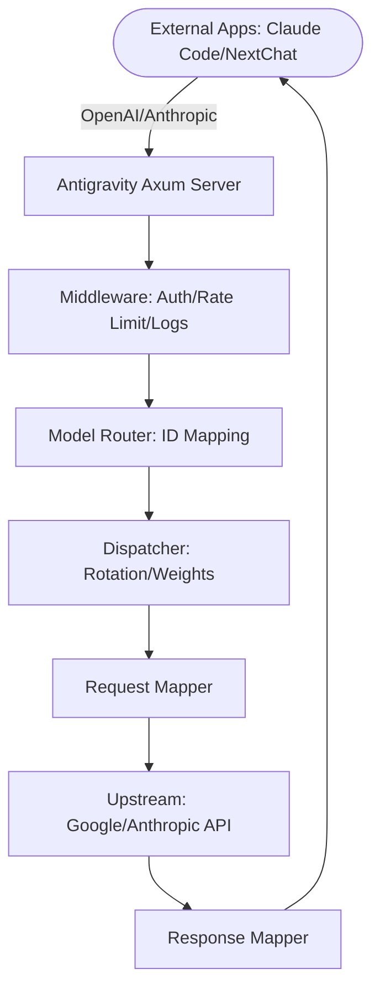

# Antigravity Tools 🚀
> Professional AI Account Management & Protocol Proxy System (v4.228.0)

<div align="center">
  

  <h3>Your Personal High-Performance AI Gateway</h3>
  <p>Not just account management, but the ultimate solution to break API barriers.</p>
  <p><em>Managed and enhanced by <strong>Md. Alim Ul Karim</strong> · Originally created by <strong>lbjlaq</strong> and upstream contributors</em></p>

  <p>
    <a href="https://github.com/alimtvnetwork/Antigravity-Manager/releases">
      
    </a>
    
    
    
    
  </p>

  <p>
    <a href="#-features">Features</a> •
    <a href="#-gui-overview">GUI Overview</a> •
    <a href="#-architecture">Architecture</a> •
    <a href="#-installation">Installation</a> •
    <a href="#-quick-integration">Integration</a>
  </p>

  <p>
    <strong>English</strong>
  </p>
</div>

---

**Antigravity Tools** is an all-in-one desktop application designed for developers and AI enthusiasts. It perfectly combines multi-account management, protocol conversion, and smart request scheduling to provide you with a stable, high-speed, and low-cost **Local AI Relay Station**.

By leveraging this app, you can transform common Web Sessions (Google/Anthropic) into standardized API interfaces, completely eliminating the protocol gap between different providers.

## 💖 Sponsors

| Sponsor | Description |
| :---: | :--- |
|  | Thanks to **PackyCode** for sponsoring this project! PackyCode is a reliable and efficient API relay service provider, offering relays for various services such as Claude Code, Codex, and Gemini. PackyCode provides a special offer for users of this project: Register using [this link](https://www.packyapi.com/register?aff=Ctrler) and enter the **"Ctrler"** coupon code when topping up to enjoy a **10% discount**. |
|  | Thanks to **APIKEY.FUN** for sponsoring this project! APIKEY.FUN is a professional enterprise-grade AI relay station, dedicated to providing stable, efficient, and low-cost AI model API access services for enterprise and individual developers. The platform supports mainstream popular models such as Claude, OpenAI, and Gemini, with prices as low as 7% of the official original price. Register through [this exclusive link](https://apikey.fan/register?aff=Ctrler) for this project to enjoy an exclusive offer of up to **permanent 5% off on top-ups**. |
|  | Thanks to **Claude API** for supporting this project! claudeapi.com is a **Claude API** relay station built on **official and AWS channels**, focused exclusively on Claude, delivering high stability and low latency with full support for Claude Code. Exclusive offer: register via this [exclusive link](https://console.claudeapi.com/register?source=antigravity) to get **free trial credits — zero setup, get started instantly**; enjoy an extra **5% off** when you top up (Contact Support). |
|  | Thanks to **AICodeMirror** for sponsoring this project! AICodeMirror provides official high-stability relay services for Claude Code / Codex / Gemini CLI, supporting enterprise-grade concurrency, fast invoicing, and 24/7 dedicated technical support. Claude Code / Codex / Gemini official channels at 38% / 2% / 9% of original price, with extra discounts on top-ups! AICodeMirror offers special benefits for Antigravity-Manager users: register via [this link](https://aicodemirror.ai/register?invitecode=MV5XUM) to enjoy 20% off your first top-up, and enterprise customers can get up to 25% off! |

### ☕ Support

If you find this project helpful, feel free to buy me a coffee!

<a href="https://www.buymeacoffee.com/Ctrler" target="_blank"></a>

| Alipay | WeChat Pay | Buy Me a Coffee |
| :---: | :---: | :---: |
|  |  |  |

## 🚀 Recommended Projects

If you like this project, you might also be interested in:

*   **[Antigravity-Tools-LS](https://github.com/lbjlaq/Antigravity-Tools-LS)**: A Language Server Protocol (LSP) designed for AI protocols, providing you with smarter code completion, diagnostics, and protocol debugging experiences.

## 🌟 Detailed Feature Matrix

### 1. 🎛️ Smart Account Dashboard
*   **Global Real-time Monitoring**: Instant insight into the health of all accounts, including average remaining quotas for Gemini Pro, Gemini Flash, Claude, and Gemini Image generation.
*   **Smart Recommendation**: The system uses a real-time algorithm to filter and recommend the "Best Account" based on quota redundancy, supporting **one-click switching**.
*   **Active Account Snapshot**: Visually displays the specific quota percentage and the last synchronization time of the currently active account.

### 2. 🔐 Professional AI Account Management & Proxy System
*   **OAuth 2.0 Authorization (Auto/Manual)**: Pre-generates a copyable authorization URL so you can finish auth in any browser; after the callback, the app auto-completes and saves the account (use “I already authorized, continue” if needed).
*   **Multi-dimensional Import**: Supports single token entry, JSON batch import, and automatic hot migration from V1 legacy databases.
*   **Gateway-level Views**: Supports switching between "List" and "Grid" views. Provides 403 Forbidden detection, automatically marking and skipping accounts with permission anomalies.

### 3.  Protocol Conversion & Relay (API Proxy)
*   **Multi-Protocol Adaptation (Multi-Sink)**:
    *   **OpenAI Format**: Provides `/v1/chat/completions` endpoint, compatible with 99% of existing AI apps.
    *   **Anthropic Format**: Provides native `/v1/messages` interface, supporting all features of **Claude Code CLI** (e.g., chain-of-thought, system prompts).
    *   **Gemini Format**: Supports direct calls from official Google AI SDKs.
*   **Smart Self-healing**: When a request encounters `429 (Too Many Requests)` or `401 (Expired)`, the backend triggers **millisecond-level automatic retry and silent rotation**, ensuring business continuity.

### 4. 🔀 Model Router Center
*   **Series-based Mapping**: Classify complex original model IDs into "Series Groups" (e.g., routing all GPT-4 requests uniformly to `gemini-3-pro-high`).
*   **Expert Redirection**: Supports custom regex-level model mapping for precise control over every request's landing model.
*   **Tiered Routing [New]**: Automatically prioritizes models based on account tiers (Ultra/Pro/Free) and reset frequencies to ensure stability for high-volume users.
*   **Silent Background Downgrading [New]**: Intelligently identifies background tasks (e.g., Claude CLI title generation) and reroutes them to Flash models to preserve premium quota.

### 5. 🎨 Multimodal & Imagen 3 Support
*   **Advanced Image Control**: Supports precise control over image generation tasks via OpenAI `size` (e.g., `1024x1024`, `16:9`) parameters or model name suffixes.
*   **Enhanced Payload Support**: The backend supports payloads up to **100MB** (configurable), more than enough for 4K HD image recognition and processing.

##  GUI Overview

| | |
| :---: | :---: |
|  <br> Dashboard |  <br> Account List |
|  <br> Modern Dashboard |  <br> API Proxy |
|  <br> Settings | |

### 💡 Usage Examples

| | |
| :---: | :---: |
|  <br> Claude Code Web Search |  <br> Cherry Studio Integration |
|  <br> Imagen 3 Advanced Drawing |  <br> Kilo Code Integration |

## 🏗️ Architecture



## 📥 Installation

### Option A: Terminal Installation (Recommended)

#### Cross-Platform One-Line Install Scripts

Automatically detects your OS, architecture, and package manager — one command to download and install.

#### Windows (PowerShell 5.1+)

**Bar 1: Latest Version (Auto-Updating)**
```powershell
irm https://raw.githubusercontent.com/alimtvnetwork/Antigravity-Manager/main/install.ps1 | iex
```

**Bar 2: Version-Based Installation (v4.72.0)**
```powershell
& ([scriptblock]::Create((irm https://github.com/alimtvnetwork/Antigravity-Manager/releases/download/v4.72.0/install.ps1))) -Version "4.72.0"
```

---

#### Linux & macOS (Bash)

**Bar 1: Latest Version (Auto-Updating)**
```bash
curl -fsSL https://raw.githubusercontent.com/alimtvnetwork/Antigravity-Manager/main/install.sh | bash
```

**Bar 2: Version-Based Installation (v4.72.0)**
```bash
curl -fsSL https://github.com/alimtvnetwork/Antigravity-Manager/releases/download/v4.72.0/install.sh | bash -s -- --version "4.72.0"
```

> **Supported formats**: Linux (`.deb` / `.rpm` / `.AppImage`) | macOS (`.dmg`) | Windows (NSIS `.exe`)
>
> **Advanced usage**: Install a specific version `curl -fsSL https://raw.githubusercontent.com/alimtvnetwork/Antigravity-Manager/main/install.sh | bash -s -- --version 4.66.0`, dry-run mode `curl -fsSL https://raw.githubusercontent.com/alimtvnetwork/Antigravity-Manager/main/install.sh | bash -s -- --dry-run`

#### macOS - Homebrew
If you have [Homebrew](https://brew.sh/) installed, you can also install via:

```bash
# 1. Tap the repository
brew tap alimtvnetwork/antigravity-manager https://github.com/alimtvnetwork/Antigravity-Manager

# 2. Install the app
brew install --cask antigravity-tools
```

#### Arch Linux
You can choose to install via the one-click script or Homebrew:

**Option 1: One-click script (Recommended)**
```bash
curl -sSL https://raw.githubusercontent.com/alimtvnetwork/Antigravity-Manager/main/deploy/arch/install.sh | bash
```

**Option 2: via Homebrew** (If you have [Linuxbrew](https://sh.brew.sh/) installed)
```bash
brew tap alimtvnetwork/antigravity-manager https://github.com/alimtvnetwork/Antigravity-Manager
brew install --cask antigravity-tools
```

#### Other Linux Distributions
The AppImage will be automatically symlinked to your binary path with executable permissions.

### Option B: Manual Download
Download from [GitHub Releases](https://github.com/alimtvnetwork/Antigravity-Manager/releases):
*   **macOS**: `.dmg` (Universal, Apple Silicon & Intel)
*   **Windows**: `.msi` or portable `.zip`
*   **Linux**: `.deb` or `AppImage`

### Option C: Docker Deployment (Recommended for NAS/Servers)
If you prefer running in a containerized environment, we provide a native Docker image. This image supports the v4.0.3 Native Headless architecture, automatically hosts frontend static resources, and allows for direct browser-based management.

#### Option 1: Direct Run (Recommended)
- **API_KEY**: Required. Used for AI request authentication.
- **WEB_PASSWORD**: Optional. Used for Web UI login. Defaults to API_KEY if NOT set.

```bash
docker run -d --name antigravity-manager \
  -p 8045:8045 \
  -e API_KEY=sk-your-api-key \
  -e WEB_PASSWORD=your-login-password \
  -e ABV_MAX_BODY_SIZE=104857600 \
  -v ~/.antigravity_tools:/root/.antigravity_tools \
  alimtvnetwork/antigravity-manager:latest

# Forgot keys? Run `docker logs antigravity-manager` or `grep -E '"api_key"|"admin_password"' ~/.antigravity_tools/gui_config.json`
```

> [!TIP]
> **🧪 Pulling Beta / Preview Images**:
> To test the latest Beta pre-release features, specify the corresponding Beta version tag (pre-releases are published independently and will never overwrite the `latest` stable tag):
> ```bash
> # Pull a specific Beta pre-release version (check Docker Hub for all tags)
> docker pull lbjlaq/antigravity-manager:v4.8.2-beta.0
> 
> # Run Beta container
> docker run -d --name antigravity-manager-beta \
>   -p 8045:8045 \
>   -e API_KEY=sk-your-api-key \
>   -e WEB_PASSWORD=your-login-password \
>   -e ABV_MAX_BODY_SIZE=104857600 \
>   -v ~/.antigravity_tools:/root/.antigravity_tools \
>   lbjlaq/antigravity-manager:v4.8.2-beta.0
> ```
> View all published Beta tags on [Docker Hub Tags](https://hub.docker.com/r/lbjlaq/antigravity-manager/tags). If you wish to run the unreleased bleeding-edge `beta` branch directly, build locally: `docker build -t lbjlaq/antigravity-manager:beta -f docker/Dockerfile .`.

#### 🔐 Authentication Scenarios
*   **Scenario A: Only `API_KEY` is set**
    - **Web Login**: Use `API_KEY` to access the dashboard.
    - **API Calls**: Use `API_KEY` for AI request authentication.
*   **Scenario B: Both `API_KEY` and `WEB_PASSWORD` are set (Recommended)**
    - **Web Login**: **Must** use `WEB_PASSWORD`. Using API Key will be rejected (more secure).
    - **API Calls**: Continue to use `API_KEY`. This allows you to share the API Key with team members while keeping the password for administrative access only.

#### 🆙 Upgrade Guide for Older Versions
If you are upgrading from v4.0.1 or earlier, your installation won't have a `WEB_PASSWORD` set by default. You can add one using any of these methods:
1.  **Web UI (Recommended)**: Log in using your existing `API_KEY`, go to the **API Proxy Settings** page, find the **Web UI Management Password** section below the API Key, set your new password, and save.
2.  **Environment Variable (Docker)**: Stop the old container and start the new one with the added parameter `-e WEB_PASSWORD=your_new_password`. **Note: Environment variables have the highest priority and will override any changes in the UI.**
3.  **Config File (Persistent)**: Directly edit `~/.antigravity_tools/gui_config.json` and add/modify `"admin_password": "your_new_password"` inside the `proxy` object.
    - *Note: `WEB_PASSWORD` is the environment variable name, while `admin_password` is the JSON key in the config file.*

> [!TIP]
> **Priority Logic**:
> - **Environment Variable** (`WEB_PASSWORD`) has the highest priority. If set, the application will always use it and ignore values in the configuration file.
> - **Configuration File** (`gui_config.json`) is used for persistent storage. When you change the password via Web UI and save, it is written here.
> - **Fallback**: If neither is set, it falls back to `API_KEY`; if even `API_KEY` is missing, a random one is generated.

#### Option 2: Use Docker Compose
1. Enter the `docker` directory and start the service:
```bash
cd docker
docker compose up -d
```
> **Log rotation**: Compose limits JSON logs to `100m` per file and keeps `3` files by default to prevent unbounded growth.
> **Access URL**: `http://localhost:8045` (Admin Console) | `http://localhost:8045/v1` (API Base)
> **System Requirements**:
> - **RAM**: **1GB** recommended (minimum 256MB).
> - **Persistence**: Mount `/root/.antigravity_tools` to persist your data.
> - **Architecture**: Supports x86_64 and ARM64.
> **See**: [Docker Deployment Guide (docker)](./docker/README.md)

<details>
<summary><b>🛠️ Troubleshooting - Click to expand</b></summary>

#### macOS says "App is damaged"?
Due to macOS security gatekeeper, non-App Store apps might show this. Run this in Terminal to fix:
```bash
sudo xattr -rd com.apple.quarantine "/Applications/Antigravity Tools.app"
```

#### Linux window is black or empty?
On niri, Hyprland, Sway, and similar compositors, older builds forced `GDK_BACKEND=x11` whenever `DISPLAY` was set, and WebKit then drew a black window. Update to a build that includes this fix, or launch once with:

```bash
env WEBKIT_DISABLE_DMABUF_RENDERER=1 ANTIGRAVITY_FORCE_WAYLAND=1 antigravity-tools
```

- `ANTIGRAVITY_FORCE_WAYLAND=1`: keep native Wayland (do not force X11)
- `ANTIGRAVITY_FORCE_X11=1`: force X11 if you still need it
- `WEBKIT_DISABLE_DMABUF_RENDERER=1`: disable the WebKit DMA-BUF renderer

</details>

## 🔌 Quick Integration Examples

### 🔐 OAuth Authorization Flow (Add Account)
1. Go to `Accounts` → `Add Account` → `OAuth`.
2. The dialog pre-generates an authorization URL before you click any button. Click the URL to copy it to the system clipboard, then open it in the browser you prefer and complete authorization.
3. After consent, the browser opens a local callback page and shows “✅ Authorized successfully!”.
4. The app automatically continues the flow and saves the account; if it doesn’t, click “I already authorized, continue” to finish manually.

> Note: the auth URL contains a one-time local callback port. Always use the latest URL shown in the dialog. If the app isn’t running or the dialog is closed during auth, the browser may show `localhost refused connection`.

### How to use with JeikCode? (Recommended)
[JeikCode](https://github.com/jeikl/JeikCode) is a modern terminal AI Coding Agent crafted by the core maintainer of this project, featuring native deep integration with Antigravity-Manager, delivering **95%+ KV-Cache hit rate** and seamless reasoning level control.
1. **One-Click Sync via GUI (Recommended)**:
   - Launch Antigravity-Manager and ensure the **API Proxy** service is running.
   - Switch to the **`>_ Agent Tools One-Click Configuration`** tab.
   - Locate the **JeikCode** card, choose your desired default model (e.g. `gemini-3.8-flash-high`), and click **`🔄 Sync Now`**.
   - Simply run `jeikcode` in your terminal for the TUI, **and type `/webui` to instantly launch the modern WebUI in your browser for a richer visual coding experience out of the box!**
2. **Temporary Environment Variables**:
```bash
export ANTHROPIC_BASE_URL="http://127.0.0.1:8045"
export ANTHROPIC_API_KEY="sk-antigravity"
jeikcode --model claude-sonnet-4-6-thinking
```
> For complete manual configuration and tuning, see the [JeikCode Integration Guide](./docs/jeikcode_integration.md).

### How to use with Claude Code CLI?
1. Start Antigravity service in the "API Proxy" tab.
2. In your terminal:
```bash
export ANTHROPIC_API_KEY="sk-antigravity"
export ANTHROPIC_BASE_URL="http://127.0.0.1:8045"
claude
```

### How to use with OpenCode?
1. Go to **API Proxy** → **External Providers** → click the **OpenCode Sync** card.
2. Click **Sync** to generate `~/.config/opencode/opencode.json`:
    - Creates a dedicated provider `antigravity-manager` (does not overwrite google/anthropic providers)
    - Optional: Check **Sync accounts** to export `antigravity-accounts.json` (plugin-compatible v3 format) for the OpenCode plugin
3. Click **Clear Config** to remove Manager configuration and clean up legacy entries; click **Restore** to revert from backup.
4. On Windows, the path is `C:\Users\<User>\.config\opencode\` (same `~/.config/opencode` rule).

**Quick verification commands:**
```bash
# Test antigravity-manager provider (supports --variant)
opencode run "test" --model antigravity-manager/claude-sonnet-4-5-thinking --variant high

# If opencode-antigravity-auth is installed, verify google provider still works independently
opencode run "test" --model google/antigravity-claude-sonnet-4-5-thinking --variant max
```

### How to use in Python?
```python
import openai

client = openai.OpenAI(
    api_key="sk-antigravity",
    base_url="http://127.0.0.1:8045/v1"
)

response = client.chat.completions.create(
    model="gemini-3-flash",
    messages=[{"role": "user", "content": "Hello, please introduce yourself"}]
)
print(response.choices[0].message.content)
```

### How to use with Kilo Code?
1.  **Protocol Selection**: We recommend using the **Gemini protocol**.
2.  **Base URL**: Set it to `http://127.0.0.1:8045`.
3.  **Note**:
    - **OpenAI Protocol Limitation**: When using OpenAI mode, Kilo Code's request path will append `/v1/chat/completions/responses`, a non-standard path that will return 404 from Antigravity. Make sure to enter the Base URL and select Gemini mode.
    - **Model Mapping**: Model names in Kilo Code may differ from Antigravity's defaults. If you encounter connection issues, set up custom mappings on the "Model Mapping" page and check the **log files** for debugging.

### How to connect a Telegram Bot & CLI (`agm telegram`)?
1. **Create a Bot**: Message `@BotFather` on Telegram with `/newbot` to obtain an HTTP API token (`<BOT_ID>:<BOT_SECRET>`), then open your new bot in Telegram and send `/ping`.
2. **Connect via UI (Auto-Detect Chat ID)**:
   - Navigate to **Settings → Email & Alerts** (or **Settings → Supabase Sync**).
   - Paste your **Telegram Bot Token**, click **Auto-Detect Chat ID** to automatically populate your numeric `Allowed Chat ID`, and click **Save Telegram Settings**.
3. **Connect via Terminal CLI (One Command)**:
   ```bash
   agm telegram connect "<YOUR_BOT_TOKEN>"
   ```
4. **Remote Commands (Chat & Terminal)**:
   - **In Telegram Chat**: `/ping`, `/observe`, `/status`, `/gitmap pe`, `/agm status`, `/api`, `/backup` (`/backpack`), `/restore`, `/email [status|ping|help]`, `/ff`, `/snapshot`, `/help`.
   - **In Terminal**: `agm telegram [ping|observe|gitmap|api|backup|restore|email|send|poll|ls]`.

### How to use Image Generation (Imagen 3)?

#### Method 1: OpenAI Images API (Recommended)
```python
import openai

client = openai.OpenAI(
    api_key="***",
    base_url="http://127.0.0.1:8045/v1"
)

# Generate image
response = client.images.generate(
    model="gemini-3-pro-image",
    prompt="A futuristic cyberpunk city with neon lights",
    size="1920x1080",      # Supports any WIDTHxHEIGHT format, auto-calculates aspect ratio
    quality="hd",          # "standard" | "hd" | "medium"
    n=1,
    response_format="b64_json"
)

# Save image
import base64
image_data = base64.b64decode(response.data[0].b64_json)
with open("output.png", "wb") as f:
    f.write(image_data)
```

**Supported parameters**:
- **`size`**: Any `WIDTHxHEIGHT` format (e.g. `1280x720`, `1024x1024`, `1920x1080`), auto-calculates and maps to standard aspect ratios (21:9, 16:9, 9:16, 4:3, 3:4, 1:1)
- **`quality`**:
  - `"hd"` → 4K resolution (high quality)
  - `"medium"` → 2K resolution (medium quality)
  - `"standard"` → Default resolution (standard quality)
- **`n`**: Number of images to generate (1-10)
- **`response_format`**: `"b64_json"` or `"url"` (Data URI)

<details>
<summary><b>🎨 Expand to view more image generation methods & parameter mapping rules (Chat API / Model Suffix / Cherry Studio)</b></summary>

#### Method 2: Chat API + Parameters (✨ New)

**All protocols** (OpenAI, Claude) Chat APIs now support direct `size` and `quality` parameters:

```python
# OpenAI Chat API
response = client.chat.completions.create(
    model="gemini-3-pro-image",
    size="1920x1080",      # ✅ Supports any WIDTHxHEIGHT format
    quality="hd",          # ✅ "standard" | "hd" | "medium"
    messages=[{"role": "user", "content": "A futuristic city"}]
)
```

```bash
# Claude Messages API
curl -X POST http://127.0.0.1:8045/v1/messages \
  -H "Content-Type: application/json" \
  -H "x-api-key: ***" \
  -d '{
    "model": "gemini-3-pro-image",
    "size": "1280x720",
    "quality": "hd",
    "messages": [{"role": "user", "content": "A cute cat"}]
  }'
```

**Parameter priority**: `imageSize` parameter > `quality` parameter > model suffix

**✨ New `imageSize` parameter support**:

In addition to the `quality` parameter, you can now also use Gemini's native `imageSize` parameter:

```python
# Using imageSize parameter (highest priority)
response = client.chat.completions.create(
    model="gemini-3-pro-image",
    size="16:9",           # Aspect ratio
    imageSize="4K",        # ✨ Direct resolution: "1K" | "2K" | "4K"
    messages=[{"role": "user", "content": "A futuristic city"}]
)
```

```bash
# Claude Messages API also supports imageSize
curl -X POST http://127.0.0.1:8045/v1/messages \
  -H "Content-Type: application/json" \
  -H "x-api-key: ***" \
  -d '{
    "model": "gemini-3-pro-image",
    "size": "1280x720",
    "imageSize": "4K",
    "messages": [{"role": "user", "content": "A cute cat"}]
  }'
```

**Parameter descriptions**:
- **`imageSize`**: Direct resolution specification (`"1K"` / `"2K"` / `"4K"`)
- **`quality`**: Infers resolution from quality level (`"standard"` → 1K, `"medium"` → 2K, `"hd"` → 4K)
- **Priority**: If both `imageSize` and `quality` are specified, the system prioritizes `imageSize`

#### Method 3: Chat API + Model Suffix
```python
response = client.chat.completions.create(
    model="gemini-3-pro-image-16-9-4k",  # Format: gemini-3-pro-image-[ratio]-[quality]
    messages=[{"role": "user", "content": "A futuristic city"}]
)
```

**Model suffix explanation**:
- **Aspect ratio**: `-16-9`, `-9-16`, `-4-3`, `-3-4`, `-21-9`, `-1-1`
- **Quality**: `-4k` (4K), `-2k` (2K), no suffix (standard)
- **Example**: `gemini-3-pro-image-16-9-4k` → 16:9 ratio + 4K resolution

#### Method 4: Cherry Studio & Other Client Settings
In clients that support OpenAI protocol (e.g., Cherry Studio), you can configure image generation parameters via the **Model Settings** page:

1. **Enter Model Settings**: Select the `gemini-3-pro-image` model
2. **Configure Parameters**:
   - **Size**: Enter any `WIDTHxHEIGHT` format (e.g. `1920x1080`, `1024x1024`)
   - **Quality**: Choose `standard` / `hd` / `medium`
   - **Number**: Set the number of images (1-10)
3. **Send Request**: Simply type your image description in the chat dialog

**Parameter mapping rules**:
- `size: "1920x1080"` → Auto-calculated as `16:9` aspect ratio
- `quality: "hd"` → Mapped to `4K` resolution
- `quality: "medium"` → Mapped to `2K` resolution

</details>

## 📝 Changelog

> Latest version **v4.228.0**: Instance Management, UI/UX Synchronization & CLI Self-Preservation — resolved instance process termination and account switching synchronization failures by implementing Win32 process tree escalation (`taskkill /F /T /PID` and `TerminateProcess`), 8.3 path normalization (`GetShortPathNameW`), and a 200ms kernel settle delay to guarantee process death and lockfile release before credential rewrites in `state.vscdb`; hardened `detect_caller_instance_id` to trace cloned executables (`Antigravity-<id>.exe`), `ANTIGRAVITY_APP_DATA_DIR`, and `VSCODE_PID`, enforcing caller immunity guards across `rm`, `switch`, `ff`, and `stop` to prevent CLI operations from terminating active IDE developer windows; explicitly formatted running instance status as `● Running (PID: <pid>)` with pulsing emerald indicator; aligned executable tail and data directory tail together inline on the same horizontal row with monospace pill styling and dual copy actions; completely overhauled switch account modal with AGM dark-glass styling (`rounded-2xl`, Royal Violet surfaces, sky/amber badges, `.ui-interactive-row` selection, Escape key dismissal, and segmented capsule controls); extended `AuditAction` enum with instance lifecycle actions (`LaunchInstance`, `StopInstance`, `KillInstance`, `CreateInstance`, `CloneInstance`, `DeleteInstance`, `InstanceError`), instrumented backend lifecycle logging into `task_history_db`, and added automatic fallback to operations tab to eliminate empty audit states; and added `agm instances current`, `agm instances create-test`, and `agm instances rm-test` for sub-50ms transient data-only testing, and hardened test suite (`scripts/test-instance-autoswitch-e2e.ps1`) with 30-second bounded timeouts. (Thanks to @aukgit)

> Latest version **v4.227.0**: Error E9001 Sibling Bound Isolation, Loop Throttling, Riseup Yellow 3D Switch & Flat Idle Controls, Table Dark-Glass Hover Contrast, Green Quota Readability, Prompt Parameter Context Menu, and GitMap JWT Bridge — resolved Error E9001 root-cause by protecting actively running sibling instances (`is_running == true`) from candidate theft during Fast-Forward and manual rotation in `instances.rs`, excluding bound accounts in `manual.rs`, and shielding candidates in `selection.rs`; enforced strict 30-second minimum floor on CLI poller loops (`fpug` and `sug` in `green_cmds.rs`) and `MIN_GOOGLE_QUOTA_CHECK_SECONDS`; eliminated infinite 5-second queue retry loops when workspace directories are missing in `queue.rs`; enforced a 5-minute (300s) backoff on Supabase heartbeat/connection failures; redesigned Account and Instance toolbars by replacing the 4th Tag icon with Fast-Forward, moving Tag into the dropdown, flattening idle Switch/Delete buttons, and applying authoritative Riseup Yellow 3D gradients (`from-[#FDE047] via-[#FACC15] to-[#EAB308]`, border `#CA8A04`, depth shadow `[0_2px_0_0_#A16207]`); fixed table row hover by replacing pure white washes with balanced dark-glass styling (`hover:bg-slate-100/80 dark:hover:bg-slate-800/60`) and making inner `td` cell backgrounds transparent; upgraded `default-copy` instance badge contrast (`bg-indigo-100 text-indigo-950 font-black`); improved green duration readability by enclosing `#1af18d` in high-contrast micro-pill badges; flattened nested JSX ternaries in `InstanceCard.tsx` into clean subcomponents with early returns; added right-click parameter context menu in `DetailHeader.tsx`; added 1-click Reset buttons to instance search and SSH prompt dispatcher; upgraded Win32 updater console to 18pt Consolas (`font_family = 54`); and architected GitMap <-> AGM mutual HMAC-SHA256 JWT communication bridge. (Thanks to @aukgit)
> Latest version **v4.225.0**: Cross-System 30-Second Minimum Interval Guard & Broadcast Storm Suppression Across Antigravity Manager & GitMap — enforced an architectural invariant across Antigravity Manager and GitMap mandating that all periodic background broadcasts, polling schedulers, worker tickers, and notification dispatchers operate at intervals of not less than 30 seconds (`>= 30s`) to prevent CPU spikes, database lock contention, and notification storms; clamped the detached prompt goal heartbeat worker loop in `goal_heartbeat.rs` to a strict 30-second minimum (`interval_secs.max(30)`, default 30s); expanded the duplicate switch notification broadcast suppression window in `channels.rs` from 5s to 30s (`(now_ts - guard.1).abs() <= 30`), completely preventing rapid notification storms across Email, Telegram, and Supabase; and aligned GitMap task synchronization defaults (`TaskMinInterval = 30`, `TaskDefaultInterval = 30` in `constants_task.go`), clamped async periodic monitors (`gitmap async -t`) to `>= 30s`, clamped macro runner intervals to `>= 30s`, and enforced minimum 30s cluster distribution heartbeat loops. (Thanks to @aukgit)
> Latest version **v4.224.0**: Compact Telegram Alerts with Next-Line White Text Values, Step 2 Multi-Machine Collision Shielding, Node IP & Signal Attribution, and Action-Only Keyboards — modernized all Telegram notification cards (Account Rotation, Post-Switch Liveness, Emergency Alerts, and System Updates) to be ~40% more vertically compact with key values indented on the next line in high-contrast bright white text (`kv_block`, `kv_white`); removed duplicate header and workspace fields; clamped project lists to top-3; eliminated duplicate Step 2 prompt wizard dispatch in Telegram via `node_label::is_current_machine()` destination matching and <3s debounce guard; enriched instance selectors with explicit node alias, IP, and signal indicators (`🏷️ {name} ({alias} • {ip})`) in single-column layout; and streamlined Account Rotation inline keyboards to functional action-only buttons. (Thanks to @aukgit)
> Latest version **v4.223.0**: Prompt Tree Custom Right-Click Menu, Right-Aligned Primary Navigation Tabs, Header Dead-Space Removal, Top Toolbar Copy All Consolidation & Telegram Cluster Shielding — added right-click context menus directly to project headers (`ProjectContextMenu.tsx`) with Import, Export (JSON/SQLite/YAML), and Rerun actions; wired right-click triggers and keyboard navigation (`Enter`, `Space`, `F2`) across conversations, subagents, and individual execution turns with active selection highlights; relocated primary navigation tabs ("Prompt Instruction" vs "AI Results & Outputs") to the right side of Row 2 in `DetailHeader.tsx` and eliminated the redundant 3rd row in `DetailTabs.tsx` to reclaim ~44px of vertical height; consolidated all copy actions into the top-level `[ Copy All | v ]` segmented capsule and purged redundant footer copy buttons in `PromptInstructionView.tsx`; eliminated cluster-wide prompt broadcast storms by binding `target_node_id` in Supabase `command_queue` payloads across `injection.rs`, `open_shot.rs`, and `processing.rs`; unified local machine identification via `node_label::is_current_machine()`, deduplicated "This machine" buttons in Telegram picker, added native CLI support for `agm prompt <target> [flags] <prompt_text>`, and redesigned destination locked UX so direct message typing is front-and-center while folding past prompts into expandable blockquotes. (Thanks to @aukgit)
> Latest version **v4.221.0**: Multi-Machine Fleet Synchronization & W2 Connectivity Recovery (extended TCP probe timeout to 1500ms with a 2-stage retry ladder and latency/error diagnostics to resolve false-offline W2 status), Multi-Machine Matrix Dynamic IP & Placeholder Normalization (serialized `machine_ip` and `ip_address` to eliminate empty `()` display; normalized `${adminUser}` to `Administrator` and `${linuxUser}` to `root`), Settings SSH & GitMap Section UI Overhaul (contiguous segmented pill capsule for fleet actions, sleek metadata badges replacing raw path dumps, and segmented terminal install controls with copy toast feedback), and Multi-Agent Concurrency Upgrade to A = 3, H = 2 (6 concurrent operations) across skills and coding guidelines. (Thanks to @aukgit)
> Latest version **v4.220.0**: Accounts Table Delete Remediation & Modal Mounting (resolved non-responsive single-item and bulk Delete buttons by mounting dedicated destructive `ModalDialog` components in `AccountsDialogs.tsx`), Position-Locked Table Row Hover Inversion (inverts row to pure white background and black text with static geometry to eliminate layout jitter), Action Buttons Color Scheme Overhaul (prominent yellow highlighter Switch button `⇄` and solid red Remove button `🗑️` with crisp white icon), and Account Disable / Enable Lifecycle (selection toolbar `<Ban>` button, action menu toggle, `disabled` model persistence, and 100% auto-switcher candidate exclusion with permissive manual user switching). (Thanks to @aukgit)
> Latest version **v4.219.0**: Prompt Tree Rich Verification Chapter Engine (`verificationTemplates.ts` with 5-chapter structure for "Is it done?", "Is it released?", "Are you confident?", "Edge Cases & Tests"), Rerun Chapter Engine with progression counter (`Round ${round} of ${total}`) and full prompt preservation, and Dual-MIME rich image clipboard priming on prompt resend/enqueue. (Thanks to @aukgit)
> Latest version **v4.218.0**: Repository Issues & System Hardening — Added `agm clean-other-versions` (`agm ov`) CLI command to purge stale/legacy binaries while strictly preserving SQLite databases; dynamic Telegram versioning; internal ID stripping from prompts; configurable 100/200-word summaries with resend buttons; combined IDE Exe & Data directory column; PromptTree DetailHeader overlap resolution & live disk sync; rich clipboard media copying; 5-tier color-segmented quota bar; interaction telemetry attributes; and clean process exit. (Thanks to @aukgit)
> Latest version **v4.217.0**: Instance Audit Trail Visibility (split-DB & `hot_tasks_cache` alias resolution, dual-tab 'Switch Cycles' vs 'All Operations' with auto-fallback), Switch Account Dialog UI/UX Consistency (dark-glass modal, top-right 'X' close button, row hover highlights, Current checkmark badge, color-coded quota badges), Active Caller IDE Detection & Self-Preservation Guard (`detect_caller_instance_id` via ancestor process command-line inspection and env checks, exit code 2 refusal on self-mutation), and Lightweight Test Instance Lifecycle (`agm instances create-test` / `rm-test` transient sandboxes without binary duplication). (Thanks to @aukgit)
> Latest version **v4.216.2**: Build fix — `ui_cmds.rs` now passes `None` for the new `stack_trace` parameter of `audit::append_entry` (E0061 broke the v4.216.1 build). (Thanks to @aukgit)
> Latest version **v4.216.1**: Build fix — `post_switch_resume.rs` timer registry now uses `tauri::async_runtime::JoinHandle` to match the `tauri::async_runtime::spawn` return type (E0308 broke the v4.216.0 build). (Thanks to @aukgit)
> Latest version **v4.216.0**: Post-switch prompt resume (~10s, configurable, cancellable) rides the RCA-15 restore pipeline; durable prompt backup re-sendable later via `agm prompts resend-queued` CLI or the UI button (FIFO, deduplicated); rerun section in the prompts tree send area (count selector, "is it done?" / "is it published?" / randomized messages); audit entries now capture stack traces (function + file + line, Rust and frontend). (Thanks to @aukgit)
> Latest version **v4.215.1**: Telegram `/expand` format-string fix; same Telegram enhancements as v4.215.0 on a green tree. (Thanks to @aukgit)
> Latest version **v4.214.0**: Telegram `/send` step 2 lists each instance with `IDE exe` and `IDE data` subpoints. Only the last path section is shown, not the full absolute path. (Thanks to @aukgit)
> Latest version **v4.213.0**: The Send menu Destination hover stays inside the menu. A browser tooltip on that right-edge menu was clipped to `Destination conversation mo`. Do not put `title` back on those controls. The note is `.ai-memory/rca/20-dispatch-menu-hover-clipped.md`. (Thanks to @aukgit)
> Latest version **v4.212.0**: The Telegram `/send` picker root cause, the file map, the mistakes that reorder FIFO or put the conversation id back in the button, and the do-not-break checklist are in `.ai-memory/rca/18-telegram-project-listing-and-node-cache.md`, indexed from `.ai-memory/what-to-read.md`. (Thanks to @aukgit)
> Latest version **v4.211.0**: Telegram project pages list eight projects at a time, newest conversation first, with the project name and the conversation title. A number selects that row, and Next loads the next eight. The current machine is labeled This machine with a green button. A generated node alias is resolved through GitMap and cached in SQLite for 24 hours. (Thanks to @aukgit)
> Latest version **v4.209.0**: Instance list shows `PID` and the process id, and path cells keep the filename ending. Stop and account switch kill that process and fail if it is still alive. The audit dialog reads `recent_switches`. `agm instances current` refuses to stop, switch, or delete the instance that owns the command. The Switch Account dialog uses the same dark-glass layout as the instance list. (Thanks to @aukgit)

> Latest version **v4.208.0**: Auto-Switch 403 Fallback & Live Quota Sync, Fast-Forward Pool Unblocking, Complete Subprocess Window Suppression (CREATE_NO_WINDOW), Audit Log Clipboard Copy & Call Stack Inspection, Strict Email Masking, Max Backup Prompts Retention Cap & 18pt Updater Console — fixed `retrieveUserQuotaSummary` in `fetch_more.rs` with instant `{}` retry on HTTP 403 to prevent false 100% quota fallbacks when IDE 5-hour quota is depleted; broadcasted `accounts://refreshed` events in `daemon.rs` for live instance card synchronization; unblocked manual Fast-Forward by refining candidate exclusions in `manual.rs` and offloading relaunch verification to detached async tasks; suppressed popup console windows across 14 external subprocess call sites using `CREATE_NO_WINDOW` (`0x08000000`); replaced non-functional `<a download>` DOM clicks with direct clipboard copying (`copyToClipboard`) with visual `Copied!` badges (2000ms) and toast feedback in `AuditPanel.tsx`; added `#[serde(rename_all = "camelCase")]` on `InteractionEntry` and `RecordInteractionInput` to fix blank `METHOD` and `TARGET` audit columns; captured interactive elements and filtered call stacks (`new Error().stack`) in `useAuditRecorder.ts`; logged auto-switch candidate evaluations and cooldown skips to SQLite audit; strictly masked emails (`ris***@***`) across UI and backend logs; added configurable 100-prompt FIFO retention cap in Settings; and configured Win32 console with UTF-8, ANSI escape sequences, and 18pt Consolas font for the updater. (Thanks to @aukgit)
> Latest version **v4.207.0**: Window TitleBar Double-Click Maximize, Compact Status Pill, QuotaProgressBar Polish (-10% Width & 4 Checkpoints), Resizable Email Column, PromptTreeView Toolbar Compaction & New Conversation Flow, Fleet Remote JSON Telemetry — resolved Win32 modal drag-event interception on window header by guarding drag initiation (`e.detail > 1`) and invoking `toggle_maximize_window` directly on double click in `TitleBar.tsx` and `Navbar.tsx`; compacted loose `IDLE` status and `Log` buttons into a single 28px (`h-7`) dark-glass segmented pill capsule in `RecordingIndicator.tsx`; softened QuotaProgressBar ambient/hover neon glow, reduced bar width by 10% (`min-w-[126px]`), aligned checkpoints into 4 equal 20% intervals (`[20, 40, 60, 80]`), and unified filled checkpoints in emerald green `#10b981`; added user-resizable Email column with min/max bounds (`[220px, 550px]`), drag handle with double-click reset, and `localStorage` persistence in `AccountTable.tsx`; compacted Prompt Tree View toolbar into a single contiguous segmented dark-glass group, combined Send and Enqueue into a primary split button with unified dropdown, and introduced a New Conversation dispatch flow with custom name input; extended `fleet_sync.rs` with pure JSON telemetry generation and ingestion supporting Telegram, Email, and Supabase; and documented comprehensive 4-part Root Cause Analysis for historical prompt send and enqueue resolution in `02-spec/21-app/ui-and-functionality-enhancements/02-backend-fleet-and-rca-spec.md`. (Thanks to @aukgit)
> Latest version **v4.206.0**: Prompt Tree Send Dropdown Enqueue, Tree Import/Export (SQLite+JSON), Telegram Button Fixes — Send button dropdown now contains an "Enqueue to FIFO Queue" entry wired to the same dispatch path as the standalone Enqueue button; prompt tree gains copy-all-tree-prompts plus a unified Import/Export section (single-file SQLite DB export/import and JSON export/import); Telegram `cmd:` callback double-slash dispatch bug fixed so send-prompt, find-instance, and credits-check buttons work, 64-byte callback cap guarded, and unknown button taps show a visible notice instead of failing silently (RCAs 14-16). (Thanks to @aukgit)
> Latest version **v4.205.0**: Responsive Layout Hardening, Table Minimum Width Floor, Sticky Column Opaque Shield, Dual-Axis Viewport Scroll, Navbar Responsive Compaction & Window Minima — enforced `min-w-[1060px]` on `src/components/accounts/AccountTable.tsx` and updated `src/pages/accounts/AccountsContent.tsx` to `overflow-auto`, preventing Weekly Quota from collapsing into `ACTIONS` (`WEEKLY QUOCACTIONS`) and surfacing immediate horizontal scrolling on narrow viewports; rendered sticky `ACTIONS` header and cells with 100% solid opaque backgrounds to eliminate text bleed-through; enforced `min-w-[780px]` on `src/components/instances/InstanceTable.tsx`; made `NavLogo.tsx` switch to "AGM" below `lg` (1024px) to reclaim ~95px of navbar space and lowered total navbar minimum width to 670px, ensuring window controls (`btn-window-minimize`, `btn-window-maximize`, `btn-window-close`) and Fast-Forward are never pushed off-screen; configured `"minWidth": 800` and `"minHeight": 520` in `src-tauri/tauri.conf.json`; and added a 4-tier responsive simulator toolbar (`100% Fluid`, `1280px`, `1024px`, `800px`) in `scripts/ui-builder.html`. (Thanks to @aukgit)
> Latest version **v4.204.1**: TitleBar Close Button Padding, Icon-Only Settings, Triangle Capsule Trigger, QuotaProgressBar Overhaul, Modal z-index Fix, Browser UI Builder & Binary Target Alignment — added safe-area right inset padding (`pr-2.5 sm:pr-3`) and centered `overflow-visible` cross in `src/components/layout/TitleBar.tsx` and `src/components/navbar/NavSettings.tsx` to eliminate close button clipping; streamlined `src/components/navbar/NavMenu.tsx` by making Settings icon-only and replacing the trailing round hamburger button with an integrated micro-triangle chevron trigger (`rounded-r-full`); hardened `handleCheckUpdates` with non-silent toast feedback ("Checking for updates..." -> "No updates available (latest version installed)"); overhauled `src/components/accounts/QuotaProgressBar.tsx` with a 10px track, 20px protruding nodes with symmetrical `v` chevrons, zero boundary dots at 0% and 100%, 5 internal splits (`[20, 40, 60, 80, 90]`), 6-stop spatial gradient (`#7f1d1d` to `#1af18d`), 85% resting opacity, and table row hover neon glow; removed `isolation: 'isolate'` from `src/components/navbar/Navbar.tsx` and standardized modal z-index to `z-[99999]`; created browser-based UI builder workbench (`scripts/ui-builder.html` / `npm run ui:builder`) with JSON export/import; and aligned desktop UI executable target to `agm-ui` / `Antigravity Manager (AGM)-ui.exe` while preserving CLI `agm`. (Thanks to @aukgit)
> Latest version **v4.204.0**: Prompt Tree 3-Capsule Segmented Toolbar, Send vs Enqueue Decoupling, One-Shot Rich Copy (Content + Images), CLI Dispatch Parity & CDP DOM Insertion Fallback — separated prompt execution in `src/components/instances/PromptTreeView/DetailHeader.tsx` into independent segmented dark-glass capsules (`[ Send N | v ]` and `[ Enqueue | v ]`) with transparent borderless `<select>` styling to eliminate nested white pill defects; ensured "Send" directly dispatches to the active IDE conversation composer instead of acting as an enqueue operation, while "Enqueue" preserves strict FIFO queueing; implemented `copyPromptWithRichImages` in `src/components/instances/PromptTreeView/clipboard.ts` and added a standalone "Copy All (Content + Images)" button copying dual-MIME `ClipboardItem` (`text/html` with embedded `` tags and `text/plain` markdown fallback) with visual feedback; added `agm queue`, `agm enqueue`, and `agm qe` top-level aliases, `--queue` / `-q` flags, sequence token resolution (`C001`, `P001`, `GM:#1`), and empty prompt validation in `src-tauri/src/bin/agm/main.rs`, `prompt_cmds.rs`, and `common.rs`; hardened `src-tauri/src/modules/repo_db/agy.rs` and `prompt_dispatch.rs` with automatic fallback to loopback CDP DOM insertion (`submit_prompt_via_cdp_for_instance`) when the `agy` CLI binary is absent or fails; and aligned `ssh_cmds.rs` with `SshGitmapStatus`. (Thanks to @aukgit)
> Latest version **v4.203.0**: Enhanced Telegram UI & Bot (HTML Entity Fix, Click-to-Copy Power Commands, Inline Action Buttons, `/balance` Credit Dashboard & CSV/JSON File Exports), GitMap Multi-Machine SSH Control, Auto-Install Helper & RSA-2048 Encrypted Password Vault — replaced unsupported `&nbsp;&nbsp;` and `&bull;` HTML entities in `src-tauri/src/modules/notification_hub/telegram_alerts.rs` and `src-tauri/src/modules/telegram_inbound/formatting.rs` with Unicode figure spaces and bullet glyphs; added interactive inline buttons on switch and liveness alerts, categorized click-to-copy `<code>` command examples in `/help` and `src/components/settings/EmailNotifications/TelegramSection.tsx`, `/balance` (`/credits`, `/quota`) account credit inspection, downloadable `.csv` and `.json` file exports via `send_telegram_document` (`/export` and `--csv`/`--json`), and shorthand `/prompt <machine:instance> <text>` dispatching; implemented RSA-2048 hybrid password encryption (`ag_rsa_v1_`) in `src-tauri/src/utils/crypto.rs` and `src-tauri/src/modules/ssh_manager/` (zero plaintext passwords on disk) with cross-machine encrypted bundle deployment, `agm ssh import-gitmap`, `agm ssh install-gitmap` PowerShell auto-installer, `agm balance [--csv|--json]`, and the `src/components/settings/EmailNotifications/SshGitmapSection.tsx` (`/settings/ssh`) fleet control panel. (Thanks to @aukgit)
> Latest version **v4.202.0**: Automatic CDP Dismissal of Antigravity "Security Notice & Data Use" Modal, Live CDP Conversation Prompt Submission & Startup Purge Persistence Fix — added `src-tauri/src/modules/instance/cdp_onboarding.rs` and `--remote-debugging-port=0` on instance launches to automatically uncheck the Interactions data-sharing checkbox and click **"Accept and continue"** via CDP when switching accounts or launching instances while persisting `hasAcceptedTermsOfService = true` and `shareDataToImproveAntigravity = false` in `app_storage.json` and `state.vscdb`; routed `agm prompt` (`prompt_dispatch.rs`), `project_cmds.rs`, and `repo_db/backup.rs` through `save_or_requeue_prompt` so active and queued prompts are never wiped by `purge_corrupted_running_projects` across CLI calls; added `submit_prompt_via_cdp_for_instance` so dispatched, queued, and restored prompts are submitted directly into the live Antigravity IDE conversation composer; and wired `/settings/:tab` routing for `agm ui goto`. (Thanks to @aukgit)
> Latest version **v4.201.0**: Post-Switch `agy` Silent Auth (`antigravity-oauth-token`), Quota Summary 403 `VALIDATION_REQUIRED` Detection, Synchronous Prompt Restoration & `agm ui record` CLI Audit Recorder — provisioned `antigravity-oauth-token`, `antigravity-cli-oauth-token`, and `antigravity-ide-oauth-token` across isolated instance `.gemini` subdirectories (`antigravity-cli`, `antigravity`, `antigravity-ide`, `cache`) so `agy -p` print mode authenticates silently without hanging on OAuth; detected HTTP 403 `VALIDATION_REQUIRED` on `retrieveUserQuotaSummary` and persisted `validation_blocked = true` so `auto-switch` and `ff` skip verification-blocked accounts; prevented the background `PromptQueueScheduler` from stealing `'backed_up'` prompts mid-switch and synchronously re-dispatched backed-up prompts upon IDE relaunch verification; enabled live `agy` worker replacement on explicit `Send`/`Rerun` with automatic FIFO queue drain on worker completion; added `agm ui record start/stop/status/list/clear/export`; targeted `activeInstanceId` from the Accounts table switch button; and refined progress bar checkpoint glow. (Thanks to @aukgit)
> Latest version **v4.200.1**: Build fix — added the missing `tauri::Emitter` trait import in `src-tauri/src/proxy/server/admin_ui.rs` (E0599 broke the v4.200.0 build). (Thanks to @aukgit)
> Latest version **v4.200.0**: UI interaction audit recorder, `agm ui` CLI bridge, and Telegram `/ui` commands — the recorder captures every UI interaction (click, navigation, input, scroll) with method name, target, trigger, and timestamp in SQLite, with a navbar indicator and filterable audit panel; `agm ui open/goto/ls/scroll/click` drives any UI surface from the CLI with actionable help; backend `/api/ui/*` endpoints navigate the live UI via Tauri events; Telegram `/ui goto/ls/scroll` mirrors the CLI. (Thanks to @aukgit)
> Latest version **v4.199.0**: Prompt send, account switch, and Telegram window commands — Send starts `agy` with `--conversation` and surfaces an immediate exit; Backup and Restore use a native dialog and Restore dispatches; a live Antigravity window counts as a successful switch while a dead saved process id does not; a copy switch leaves the Default login in the shared keyring; Telegram `/ui`, `/shot`, and `/target` open the manager, return a screenshot, and aim the next message. The UI session recorder guideline is written and the recorder is not implemented. (Thanks to @aukgit)
> Latest version **v4.198.0**: Prompt Tree WebView2 OOM Crash Fix (`0xe0000008`), Platform Asset-Gated Update Notification & CLI Prompt Copy/Resend Parity — Resolved the infinite `useEffect` render loop in `src/components/instances/PromptTreeView/usePromptTreeData.ts` and serialized uncached workspace scans in `src-tauri/src/modules/repo_db/tree.rs`, eliminating the 565-thread spike and WebView2 `0xe0000008` crash while keeping warm Prompt Tree loads under `200 ms`; gated **Update Available** notifications in `src-tauri/src/modules/update_checker/channels.rs` and `src/stores/use-update-store.ts` on verified platform installer assets (`.exe`/`.msi`, `.dmg`/`.app.tar.gz`, `.AppImage`/`.deb`/`.rpm`) and restyled `src/components/UpdateNotification.tsx` with high-contrast dark-glass and `#1af18d` accents; nulled detached IDE stdio handles in `src-tauri/src/modules/process/launch.rs` so `agm prompts restore` and `agm auto-switch test` complete in `<200 ms` without pipe hangs; and added `agm prompts copy`, `agm prompts resend`, `agm instances open-ui`, and pure JSON stdout when `--json` is passed. (Thanks to @aukgit)
> Latest version **v4.197.1**: Prompt tree cache and crash log — startup keeps `prompt_tree_cache` for 120 seconds, the CLI tree reads that cache, a tree panic returns a backtrace, and the tree header plus `agm prompts reset-tree` clear only the cache. (Thanks to @aukgit)
> Latest version **v4.197.0**: CI/CD Formatting Gate Fix & Dispatch Hardening — Resolved the `cargo fmt` signature-formatting discrepancy in `src-tauri/src/commands/instance.rs`, restoring green pipeline checks across all OS matrix runners; includes instance error-modal deduplication with poisoned prompt-lock prevention and pending AI end-to-end test cases for prompt dispatch. (Thanks to @aukgit)
> Latest version **v4.196.0**: Accounts Quota Column Layout Fix — Fixed the Accounts table quota layout so the 4H Model Quota and Weekly Quota bars expand to fill their columns instead of floating as narrow right-aligned bars with dead space; 5-slot checkpoints, `#1af18d` progress green, full-width spatial gradient with mask reveal, and compact bar heights preserved — layout-width change only. (Thanks to @aukgit)
> Latest version **v4.195.0**: CI/CD Quality Gates & Macro Syntax Remediation, Window Manager Error Tracking & Complete Supabase/UI Verification — Resolved duplicate variable declaration and expected assertion syntax in json envelope test suite, restoring green Clippy and test compilation across all OS matrix runners; enforced 'No Silent Errors' error tracking in `windowManager.ts`; verified 100% compliance across all 56 automated tests for Progress Green `#1af18d`, 5-slot quintile progress bars, right-compacted layouts, high-contrast theme typography, email privacy masking, prompt tree action capsules, and secure repo-secrets dynamic endpoint discovery. (Thanks to @aukgit)
> Latest version **v4.194.0**: Supabase Credentials Eradication & External Vault Isolation, CI/CD Rust Formatting Gate & Unified Test Automation — Complete purge of hardcoded Supabase project tokens and credentials from the tracked codebase, scripts, documentation, and test fixtures; shifted endpoint provisioning to dynamic environment variables (`SUPABASE_ROOT_URL`, `SUPABASE_ROOT_KEY`, `SUPABASE_SECONDARY_URL`, `SUPABASE_SECONDARY_KEY`) and automated Base64 ingestion from `repo-secrets`; added single-liner import script `scripts/import-supabase-credentials.ps1`; resolved `cargo fmt` newline discrepancy in `src-tauri/src/modules/supabase_sync/config_a.rs` restoring green CI/CD pipeline checks; validated via 56 automated tests. (Thanks to @aukgit)
> Latest version **v4.193.0**: CI/CD Quality Gates & Linter Healing, Progress Bar #1af18d Quintile Redesign & Compacting, Dual Supabase Diagnostics & Prompt Tree Stability — Resolved TypeScript index signature mismatch in `error-store.ts`; auto-formatted PostgREST client and Supabase configuration to pass strict `cargo fmt` gates across all platforms; modernized the quota progress bar gradient terminal stop to Progress Green `#1af18d` with blur drop shadows, exactly 5 slots at 20% intervals, illuminated LED apertures replacing misleading SVG checkmarks, and compacted right alignment; added structured backtrace logging for Supabase connection probes and auto-corrected Lovable endpoint typos; resolved system clipboard subprocess pipe deadlock in `copy_to_system_clipboard` by properly dropping stdin before process wait; added Prompt Tree top 2px #1af18d loading bar and compiled action buttons into a sleek right-aligned segmented dropdown; enforced high-contrast typography and email privacy masking across accounts and instances. (Thanks to @aukgit)
> Latest version **v4.227.5**: Running Prompt Backup/Restore & Rerun Root-Cause Fix, Royal Violet UI & Switch Relaunch Verification — Fixed `agm restore` silently restoring nothing after instance switches (strict per-instance filter matched the wrong instance id; unscoped restore now covers all instances in FIFO order with `-i <id>` for strict scoping); fixed `agm rerun [N]` selecting the oldest prompts instead of the most recent and marking them dispatched without re-sending (now re-queues as `backed_up` and dispatches via agy); added cross-instance restore regression test; implemented the approved Royal Violet design system; added post-relaunch IDE verification to the account-switch flow so silent no-reopen failures surface as diagnosable errors. (Thanks to @aukgit)
> Latest version **v4.228.0**: Conscious Process Termination, Inline List View Path Alignment, Switch Dialog Dark-Glass Modernization, Audit Trail Visibility & CLI Test Lifecycle — Resolved instance process termination and account switching synchronization failures by implementing Win32 process tree escalation (`taskkill /F /T /PID` and `TerminateProcess`), 8.3 path normalization (`GetShortPathNameW`), and a 200ms kernel settle delay to guarantee process death and lockfile release before credential rewrites in `state.vscdb`; hardened `detect_caller_instance_id` to trace cloned executables (`Antigravity-<id>.exe`), `ANTIGRAVITY_APP_DATA_DIR`, and `VSCODE_PID`, enforcing caller immunity guards across `rm`, `switch`, `ff`, and `stop` to prevent CLI operations from terminating active IDE developer windows; explicitly formatted running instance status as `● Running (PID: <pid>)` with pulsing emerald indicator; aligned executable tail and data directory tail together inline on the same horizontal row with monospace pill styling and dual copy actions; completely overhauled switch account modal with AGM dark-glass styling (`rounded-2xl`, Royal Violet surfaces, sky/amber badges, `.ui-interactive-row` selection, Escape key dismissal, and segmented capsule controls); extended `AuditAction` enum with instance lifecycle actions (`LaunchInstance`, `StopInstance`, `KillInstance`, `CreateInstance`, `CloneInstance`, `DeleteInstance`, `InstanceError`), instrumented backend lifecycle logging into `task_history_db`, and added automatic fallback to operations tab to eliminate empty audit states; and added `agm instances current`, `agm instances create-test`, and `agm instances rm-test` for sub-50ms transient data-only testing, and hardened test suite (`scripts/test-instance-autoswitch-e2e.ps1`) with 30-second bounded timeouts. (Thanks to @aukgit)
> Latest version **v4.189.0**: Auto-Switch & Fast-Forward Scoring Fallback, Conscious Process Isolation, CLI Revert Engine & Cross-Platform CI Green — Replaced strict 100% quota requirement in Step 3 fallback with proportional quota headroom scoring (`score_candidate_account_fallback`), eliminating rotation lockups when accounts have partial quota; enforced conscious instance root PID isolation in `pid_scan.rs` (`matched_set.contains(&p)`), preventing stopped sibling instances from falsely reporting as running or having their processes terminated; fully enabled CLI update rollbacks (`agm update <ver>` / `agm update to <ver>`) with automatic 2-part SemVer normalization, tag-specific endpoint resolution, and `-isPinned`/`-Force` pass-through in `install.ps1`; and resolved all 7 cross-platform compilation and Clippy errors with 100% green CI gate across Ubuntu, macOS, and Windows matrix runners. (Thanks to @aukgit)
> Latest version **v4.188.0**: Auto-Switch & Fast-Forward PID Contamination Fix, CLI Version Downgrades, IDE Executable Path & Headless Fleet Sync — Eliminated cross-instance PID contamination in `pid_scan.rs` and unblocked candidate evaluation for sub-100% quota accounts; enabled CLI version downgrades and rollbacks (`agm update <ver>`) with automatic 2-part SemVer normalization; optimized launch latency by eliminating synchronous 6s blocking sleeps in `wait_for_instance_prompt_channel`; added dedicated IDE Executable path column in instance list view; introduced decentralized headless fleet synchronization over Email and Telegram without Supabase; and audited/eliminated silent error discards across instance lifecycle and frontend settings. (Thanks to @aukgit)
> Latest version **v4.187.0**: Full Task Manager Termination & Profile Switch Spawn Fallback — Enforced full application and background thread process termination in Windows Task Manager on window close and tray quit by routing all teardowns through `exit_app_fully(&AppHandle)` and cleanly halting Cloudflared tunnels, Admin Server listeners, and Proxy instances before invoking `std::process::exit(0)`; resolved profile and account switch crashes (`Access is denied (os error 5)`) in restricted Windows Job Objects with a 4-stage launch fallback ladder (direct breakaway fallback -> detected base executable -> `cmd.exe /s /c start` -> PowerShell `Start-Process` with `ShellExecuteEx`); upgraded Telegram notifications with structured HTML cards, `<pre><code>` prompt blocks, native inline copy buttons, free image hosting, and standalone Fleet Identity discovery (`/fleet`, `/whoami`, `/instances`, `/accounts`). (Thanks to @aukgit)
> Latest version **v4.186.0**: Update CLI Command & Pipeline Fixes — Universal Windows self-delegation for `agm update` to detached temp executables (`%TEMP%\agm-updater\agm-update-cli-<pid>.exe`) with immediate caller exit code 0 to prevent Windows executable image lock (`os error 5` / sharing violation `0x20`); enhanced installer process discovery for `antigravity-manager.exe` and `agm.exe`; fixed prompt pipeline dispatch and FIFO queueing (`agm prompt send`, `agm prompt queue`, `qe` alias, and `agm instance prompt`) with destination conversation target resolution (`--conversation <id>`, `--new`, `--existing`), working directory auto-fallback, and Tier 2 graceful degradation; unified Prompt Tree View UI with an inline segmented capsule selector for Existing Conv vs New Conv; resolved switch and auto-rotation prompt loss by expanding backup query status coverage (`running`, `in_flight`, `dispatched`), enabling cross-instance prompt re-attribution on profile rotation, and restoring `backed_up` prompts upon recovery. (Thanks to @aukgit)
> Latest version **v4.185.0**: Comprehensive compiler and pipeline error resolution — resolved 600+ compilation and visibility errors from god-module refactorings across proxy rate limiting, signature cache, token manager, session store, upstream client, and mappers; restored Axum 0.7 ServiceExt router compatibility; added Windows process flag gating; pre-flight cargo fmt and manifest synchronization verified clean. (Thanks to @aukgit)
> Latest version **v4.183.0**: Switch/fast-forward reliability hardening — new `close_instance_verified` kills, polls the OS process table and retries stragglers instead of bricking on surviving orphan PIDs; credential injection now retries over the dying IDE's SQLite-lock release window; fast-forward errors are captured into the Error Manager for diagnostics. Also fixed the clipboard `Document is not focused` warnings in the prompt send flow via the shared copy helper with execCommand fallback. (Thanks to @aukgit)
> Latest version **v4.182.0**: Restart & fast-forward reliability fix — restart now hard-closes the IDE, verifies the kill, refreshes the bound account token and relaunches with the same account; fast-forward verifies the close before credential injection. Best-account tier multipliers are now configurable (Ultra ×4, Pro ×2, Free ×1 defaults) via a new Settings → Algorithm section; scoring spec updated; Remote Fleet section verified with tests. (Thanks to @aukgit)
> Latest version **v4.181.0**: Quota UI compaction with stronger progress bars; Tauri window ACL fix for `set_decorations`/`set_background_color`; Supabase connectivity diagnostics with honest `Unreachable` badge; Settings General tab redesign (segmented Theme pill, Launch-at-Startup toggle); Send/Queue silent no-op hardening; Windows instance executable staleness refresh on base updates; navbar segmented capsule with a pinned Check-for-Updates section. (Thanks to @aukgit)
> Latest version **v4.180.0**: Release pipeline completion — re-ran the v4.179.0 macOS universal artifact upload after a transient GitHub artifact-service timeout so the release carries the full asset set; CI green across all platforms. No code changes. (Thanks to @aukgit)
> Latest version **v4.177.0**: Smart Process Cache Closed-PID Recovery, Foreign Key Purge Resilience, Adaptive Queue Ticker & UI Tag Compaction — initialized `warm_up_smart_process_cache` on startup to pre-warm cached PIDs across instances; added closed-PID recovery and zero-relaunch guarantee in `ensure_instance_running_smart` to eliminate repeated IDE launches; fixed SQLite foreign key constraint failure in `purge_corrupted_running_projects` and purged stale un-namespaced rows; added adaptive FIFO background prompt queue scheduler (5s active / 30s idle) with canonical `resume_task_document(...)` serialization; compacted Prompt Tree View sidebar tags (removing `{totalProjectPrompts} prompts` and `{conv.step_count} stp`, setting project actions to hover-only), stripped bracket noise (`#P001`, `C001`), eliminated redundant client-side focus race condition, and eradicated ghost running indicators on idle projects and instance cards. (Thanks to @aukgit)
> Latest version **v4.176.0**: Smart Process Cache Warm-Up, Closed-PID Recovery & Adaptive Queue Ticker — initialized `warm_up_smart_process_cache` on startup to pre-warm cached PIDs across instances; added closed-PID recovery and zero-relaunch guarantee in `ensure_instance_running_smart` to eliminate repeated IDE launches; added adaptive FIFO background prompt queue scheduler (5s active / 30s idle) with canonical `resume_task_document(...)` serialization; compacted Prompt Tree View sidebar tags (removing `{totalProjectPrompts} prompts` and `{conv.step_count} stp`, setting project actions to hover-only), stripped bracket noise (`#P001`, `C001`), and eradicated ghost running indicators on idle projects and instance cards. (Thanks to @aukgit)
> Latest version **v4.179.0**: Accounts table compact density pass — reduced row and header cell padding, thinner quota bars with proportionally smaller checkpoint markers and tighter label spacing (accounts table only); gradient, checkpoints, and behavior unchanged. (Thanks to @aukgit)
> Latest version **v4.178.0**: CI fix — removed a duplicate `version` entry in `src-tauri/Cargo.lock` that broke cargo parsing and failed all Rust jobs, and hardened the version-bump script so it can never reintroduce the duplicate. (Thanks to @aukgit)
> Latest version **v4.175.0**: UI refinement — centralized semantic color tokens, quota bars rebuilt as one continuous red→green scale, account/email hover fixed, calmer active-instance treatment; plus Prompt Tree Send/Queue fix — the buttons reported false success while the IDE dispatch silently failed, now surfacing real errors. (Thanks to @aukgit)
> Latest version **v4.174.0**: CI green — fixed `error[E0609]: no field 'instance' on type 'CliContext'` at two call sites in `src-tauri/src/bin/agm.rs` (stale field name left by the instance-process-cache refactor; corrected to `instance_id`), and re-enabled GitHub Actions on the fork (GitHub had auto-disabled workflows because it is a fork) — CI now passes all 7 jobs. (Thanks to @aukgit)
> Latest version **v4.173.0**: Updater honesty fixes — corrected the in-app update checker's download link (it pointed at the upstream `lbjlaq` repo instead of this fork) and removed phantom binary-asset URLs from `releases-manifest.json` for the notes-only releases v4.168.0–v4.172.0 so the installer no longer chases dead download links. (Thanks to @aukgit)
> Latest version **v4.172.0**: Smart Multi-Instance Process Cache Multi-PID Survival & Deep Transcript Scan — enhanced `check_cached_pid_alive` with surviving child PID promotion, Windows 8.3 short-path expansion (`GetShortPathNameW`), path normalization, and zero-relaunch guarantee; guarded against killing running IDE sessions in `launch_instance_inner_with_extra_workspaces`; deepened reverse transcript scan to 25 lines with telemetry noise immunity and 45s prompt TTLs to eradicate ghost running items; stripped literal bracket tokens (`[Collapse Full Text]`, `[Expand Full Text]`) and word count clutter across Prompt Tree View. (Thanks to @aukgit)
> Latest version **v4.171.0**: Smart Multi-Instance Process Cache & Relaunch Prevention — resolved instance relaunch bug via canonical instance ID resolution (`is_instance_process_running_smart`), closed-PID OS re-scan, and zero-relaunch guarantee; unified `enqueue_prompt` IPC handler with strict FIFO queueing; eradicated ghost running indicators (`WHERE status IN ('queued', 'pending')`); compacted Prompt Tree View badges (`P001 · #1`, `C001 · <cid>`) and stripped bracket clutter; 100% verified via host-shielded E2E testing. (Thanks to @aukgit)
> Latest version **v4.170.0**: New Toolchain settings page — install dev tools from the UI via backend endpoints with live progress; installer script v3 adds stackable profiles, `--dry-run` preview, `--troubleshoot`, `--ssh` remote install, and new items (Node.js, pnpm, sccache, cargo-watch, Tauri CLI, gh) for shell and PowerShell. (Thanks to @aukgit)
> Latest version **v4.169.0**: Fixed CI build failure (`E0428`) from duplicate `enqueue_prompt` / `enqueue_prompt_for_instance` definitions — removed the stale command variants, migrated `agm prompts enqueue` to the canonical `enqueue_prompt_for_instance_full` route (GUI/CLI parity), and de-duplicated the command registration in `lib.rs`. (Thanks to @aukgit)
> Latest version **v4.168.0**: Curated the model inventory — removed the outdated Gemini 2.5 series, kept the nano tier (gemini-3.1-flash-lite), added 5 newer open-source models in a new 'Open Source' group (gpt-oss-20b, deepseek-v4, qwen3-max, qwen3-8b, llama-4-maverick); every model now carries priority, capabilities, and speed annotations. (Thanks to @aukgit)
> Latest version **v4.167.0**: Implemented smart multi-instance process cache with targeted PID vitality checks, preventing duplicate IDE window launches on prompt dispatch; wired `enqueue_prompt` IPC command with strict FIFO queueing; eliminated false-positive running prompt indicators using terminal planner state detection; compacted prompt tree view badges (`P001 · #1`, `C001 · <cid>`) and stripped bracket clutter; expanded AGM CLI prompt verbs (`status`, `send`, `running`, `queue`) with unified JSON envelopes and 100% verified safe host-shielded E2E testing. (Thanks to @aukgit)
> Latest version **v4.166.0**: Implemented 3-step smart instance process caching with closed-PID OS re-scan and multi-instance process counting; aligned `--user-data-dir` CLI prompt dispatch with cross-platform clipboard synchronization; eliminated bracket noise in Prompt Tree View; eradicated ghost running indicators; and delivered CLI parity for `agm prompts` and `agm doctor`. (Thanks to @aukgit)

👉 **[View Full Changelog → CHANGELOG_EN.md](CHANGELOG_EN.md)**


<details open>
<summary><b>👥 Contributors & Maintainer</b></summary>

<a href="https://github.com/aukgit"></a>

<p><em>Maintained and developed by <a href="https://github.com/aukgit"><strong>Md. Alim Ul Karim (aukgit)</strong></a></em></p>

</details>

<details>
<summary><b>🤝 Special Thanks - Click to expand</b></summary>

This project has referenced or learned from the ideas or code of the following excellent open-source projects during its development (in no particular order):

*   [learn-claude-code](https://github.com/shareAI-lab/learn-claude-code)
*   [Practical-Guide-to-Context-Engineering](https://github.com/WakeUp-Jin/Practical-Guide-to-Context-Engineering)
*   [CLIProxyAPI](https://github.com/router-for-me/CLIProxyAPI)
*   [OmniRoute](https://github.com/diegosouzapw/OmniRoute)
*   [antigravity-claude-proxy](https://github.com/badrisnarayanan/antigravity-claude-proxy)
*   [aistudio-gemini-proxy](https://github.com/zhongruichen/aistudio-gemini-proxy)
*   [gcli2api](https://github.com/su-kaka/gcli2api)
*   [agent-vibes](https://github.com/funny-vibes/agent-vibes)

</details>

*   **License**: **CC BY-NC-SA 4.0**. Strictly for non-commercial use.
*   **Security**: All account data is encrypted and stored locally in a SQLite database. Data never leaves your device unless sync is enabled.

---

<div align="center">
  <p>If you find this tool helpful, please give it a ⭐️ on GitHub!</p>
  <p>Managed and enhanced by Md. Alim Ul Karim &amp; Riseup Asia LLC · Special thanks and full credit to the original upstream project <a href="https://github.com/lbjlaq/Antigravity-Manager">lbjlaq/Antigravity-Manager</a> and original contributors.</p>
  <p>Copyright © 2024-2026 Antigravity Team.</p>
</div>
